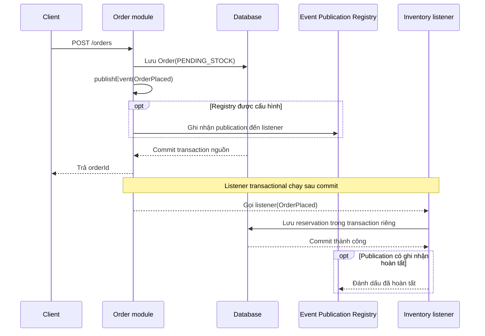
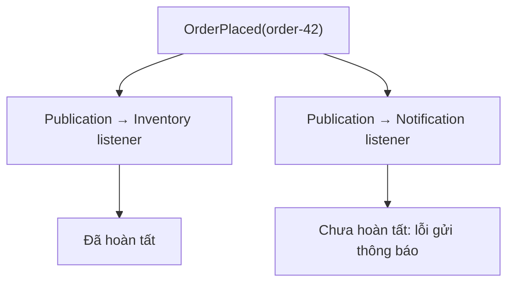
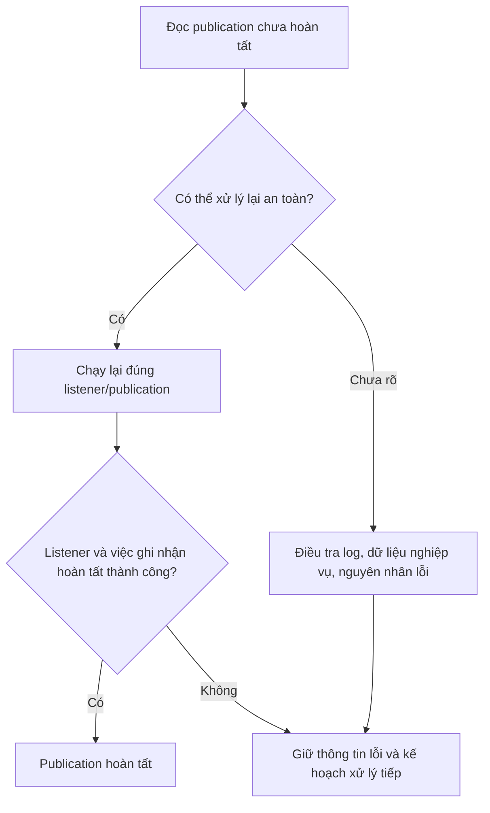

# Hoàn tất xử lý application event trong Spring Modulith

## 1. “Hoàn tất xử lý” nghĩa là gì?

Trong một ứng dụng Spring Boot tổ chức theo module, `order` có thể phát `OrderPlaced` để `inventory` giữ hàng và `notification` gửi xác nhận. Một lời gọi `ApplicationEventPublisher.publishEvent(...)` cho biết **publisher đã công bố event vào cơ chế application events của Spring**, không có nghĩa mọi listener đã chạy xong. Nếu listener chạy sau commit và bất đồng bộ, nó có thể bắt đầu sau khi HTTP request đặt hàng đã trả về.

Trong chương **Chu kỳ phát hành** của **SPRING_MODULITH_APPLICATION_EVENTS**, “hoàn tất xử lý” là giai đoạn module tiêu thụ đã thực hiện xong công việc mà một publication giao cho nó; khi có **Event Publication Registry**, hệ thống còn cần **ghi nhận publication tương ứng đã hoàn tất**. Đây là nền tảng để xác định publication nào chưa xử lý xong, publication nào cần phục hồi, tránh gọi lại vô hạn hoặc bỏ sót việc phải làm.

Mục tiêu của toàn module học là giao tiếp giữa các Spring Modulith application module bằng application events, giảm phụ thuộc và giữ ranh giới nghiệp vụ; đồng thời thực hành publisher, listener sau commit, publication registry, retry, kiểm thử và quan sát luồng sự kiện đáng tin cậy. Vì vậy bài này tập trung vào **ý nghĩa của thành công và thất bại**, thay vì chỉ viết annotation rồi coi event đã xong.

Sau bài học, bạn có thể:

1. Phân biệt hoàn tất transaction nguồn, hoàn tất listener, hoàn tất publication và hoàn tất quy trình nghiệp vụ.
2. Mô tả cách registry theo dõi publication đến từng listener và ghi nhận kết quả.
3. Thiết kế listener để thất bại thực sự được nhận diện, còn xử lý lại không gây tác dụng phụ trùng.
4. Đánh giá các trường hợp lỗi giữa commit, thực thi listener và ghi nhận hoàn tất.
5. Xây dựng kiểm thử và chỉ số vận hành để chứng minh các publication có thể được phục hồi.

## 2. Các mốc “xong” không đồng nghĩa với nhau

Giả sử khách đặt hàng và ứng dụng cần giữ hàng sau khi đơn được ghi nhận. Ta có những mốc:

| Mốc | Điều đã biết | Điều **chưa** được bảo đảm |
| --- | --- | --- |
| Publisher gọi `publishEvent` | Mã nghiệp vụ đã phát tín hiệu cho cơ chế Spring event | Transaction nguồn đã commit, listener đã thành công |
| Transaction `order` commit | Thay đổi đơn hàng đã commit | `inventory` đã giữ hàng, `notification` đã gửi xong |
| Listener được gọi | Consumer đã bắt đầu nhận thông báo | Logic listener kết thúc hoặc side effect bền vững |
| Method listener kết thúc bình thường | Đường thực thi listener trở về mà không báo lỗi | Mọi tác động ngoài transaction đã chắc chắn thực hiện đúng một lần |
| Publication được registry ghi nhận hoàn tất | Hệ thống theo dõi publication đã ghi nhận thành công theo cơ chế cấu hình | Toàn bộ quy trình nhiều module đã đạt trạng thái kinh doanh cuối cùng |
| Quy trình kinh doanh kết thúc | Các trạng thái cần thiết như `CONFIRMED`/`REJECTED` đã được đạt đến | Không có nhu cầu lưu log hoặc theo dõi kết quả về sau |

Một event có thể có nhiều listener. Ví dụ, `inventory` thành công trong khi `notification` thất bại. **Việc hoàn tất của một listener không được diễn giải thành hoàn tất mọi listener.** Khi registry theo dõi publication cho từng listener đủ điều kiện, mỗi publication tương ứng có kết quả độc lập.

Điều này còn cho thấy hai khái niệm cần đặt đúng tên:

- **Business completion:** Module đã đạt kết quả nghiệp vụ mà nó có trách nhiệm bảo đảm, chẳng hạn reservation được lưu hợp lệ.
- **Publication completion:** Hạ tầng theo dõi đã ghi nhận sự kiện gửi cho listener cụ thể được xử lý thành công.

Publication hoàn tất không phải bằng chứng độc lập rằng toàn bộ quy trình liên module hay mọi hệ thống bên ngoài đã đạt trạng thái mong muốn. Điều được đánh dấu “xong” phụ thuộc vào **nội dung thực sự nằm trong phạm vi callback listener**.

## 3. Chu kỳ điển hình của một publication sau commit



Sơ đồ là **mô hình logic**: cách registry lưu các publication, xác định thời điểm ghi nhận và cơ chế thực thi phụ thuộc phiên bản Spring Modulith, các starter lưu trữ và cấu hình cụ thể. Không coi nó là cam kết thứ tự SQL chính xác hay một protocol giữa các máy độc lập. Các application module trong ví dụ vẫn có thể chạy chung một tiến trình.

**Điểm quyết định:** Listener chạy sau commit của `order` nên có thể thất bại khi đơn hàng vẫn tồn tại. Vì thế trạng thái `PENDING_STOCK` là chính xác hơn việc trả về ngay “đã giữ hàng”. Nếu giữ hàng thất bại vì hết tồn, cần kết quả nghiệp vụ như `REJECTED` hoặc bước xử lý tiếp theo do module sở hữu quy định.

## 4. Event Publication Registry theo dõi điều gì?

Spring Modulith cung cấp **Event Publication Registry** để theo dõi việc phát event cho các transactional event listeners phù hợp, khi ứng dụng cấu hình một triển khai lưu trữ tương ứng. Ý tưởng là có thể biết **publication nào còn chưa được ghi nhận hoàn tất**, đặc biệt sau khi listener gặp lỗi hoặc ứng dụng khởi động lại.

Về mặt khái niệm, một publication có các thông tin sau (đây là **mô hình giải thích**, không phải schema database cố định của Spring Modulith):

```text
Publication
  ├─ publicationId           (định danh bản ghi theo dõi)
  ├─ event                   (payload hoặc dữ liệu có thể khôi phục)
  ├─ targetListener          (listener được nhắm tới)
  ├─ publicationDate         (thời điểm ghi nhận publication)
  ├─ completionDate?         (thời điểm ghi nhận hoàn tất, nếu có)
  └─ trạng thái suy ra từ thông tin lưu trữ/cấu hình
```

Không nên hardcode tên cột hoặc coi tất cả triển khai registry lưu cùng một schema. Triển khai lưu trữ, phiên bản thư viện và cấu hình có thể có cách ghi nhận/giữ/xóa publication đã hoàn tất khác nhau.

### 4.1. Một event, nhiều kết quả của listener



Ở ví dụ, registry có thể theo dõi hai publication đến hai listener riêng biệt. Không thể nói `OrderPlaced` đã “hoàn tất toàn bộ” chỉ vì việc giữ hàng thành công. Với consumer A đã hoàn tất nhưng B còn lỗi, **phục hồi phải tập trung vào B**, không tự ý thực hiện lại tác vụ của A theo cách làm trùng side effect.

### 4.2. Registry khác gì nghiệp vụ?

Registry chủ yếu giúp xác nhận trạng thái **phát và xử lý event**. Nó không biết các quy tắc “đã giữ đủ hàng”, “khách đã nhận email” hay “đã hoàn tiền” nếu ứng dụng không diễn đạt và kiểm chứng các kết quả ấy. Một listener có thể trả về bình thường dù chỉ ghi log; khi đó “publication hoàn tất” không chứng minh nghiệp vụ đã được thực hiện.

Do vậy phải thiết kế ranh giới rõ:

- Module `order` sở hữu việc ghi đơn và phát sự thật `OrderPlaced`.
- Module `inventory` sở hữu kiểm tra tồn, giao dịch reservation và cách xử lý trùng.
- Module `notification` sở hữu quyết định kênh gửi và trách nhiệm gửi thông báo.
- Registry hỗ trợ nhận biết và phục hồi **publication đến listener**, không thay thế các trạng thái nghiệp vụ.

## 5. Publisher tạo event có thể được xử lý lại

Một hợp đồng tốt cho event có định danh bền vững và payload snapshot:

```java
// com/example/shop/order/OrderPlaced.java
package com.example.shop.order;

import java.time.Instant;
import java.util.Objects;
import java.util.UUID;

public record OrderPlaced(
        UUID eventId,
        UUID orderId,
        Instant occurredAt
) {
    public OrderPlaced {
        Objects.requireNonNull(eventId, "eventId");
        Objects.requireNonNull(orderId, "orderId");
        Objects.requireNonNull(occurredAt, "occurredAt");
    }
}
```

Sự kiện này được đặt tại API công khai của `order`, nên module nhận có thể import nó mà không phải tham chiếu `order.internal`. Trường `eventId` dành cho nhận diện một lần công bố sự thật, `orderId` chỉ aggregate và `occurredAt` ghi thời điểm nghiệp vụ. **Cùng một publication được xử lý lại phải dùng lại payload sự kiện gốc**, không tạo `eventId` và `occurredAt` mới khi retry.

Publisher có thể viết:

```java
// Đoạn minh họa bên trong com.example.shop.order.internal.OrderService
@Transactional
public UUID place(PlaceOrderCommand command) {
    Order order = Order.place(command);
    orders.save(order);

    OrderPlaced event = new OrderPlaced(
            UUID.randomUUID(),
            order.id(),
            clock.instant()
    );
    events.publishEvent(event);
    return order.id();
}
```

`Order`, `PlaceOrderCommand`, `orders`, `clock` và `events` trong đoạn trích là các thành phần do ứng dụng ví dụ định nghĩa hoặc inject. `events` là `ApplicationEventPublisher` của Spring, `clock` nên là `java.time.Clock` được inject để kiểm thử xác định. **Việc gọi `publishEvent` chưa phải là chứng nhận commit của transaction đặt hàng.**

Nếu transaction sau đó rollback, listener sau commit không được coi như có nghiệp vụ đặt hàng đã hoàn tất. Với một registry được cấu hình phù hợp, việc ghi nhận publication cũng phải được đánh giá theo transaction và cơ chế lưu trữ thực tế; không nên giả định mọi cấu hình tự động bền vững chỉ vì có event publisher.

## 6. Listener thế nào mới được coi là đã xử lý thành công?

Một listener thông thường nên **hoàn tất tác vụ mà nó chịu trách nhiệm trong ranh giới giao dịch phù hợp**, rồi trả về bình thường. Nếu tác vụ chưa thành công, lỗi không được âm thầm biến thành “thành công”.

```java
// com/example/shop/inventory/internal/OrderPlacedListener.java
package com.example.shop.inventory.internal;

import com.example.shop.order.OrderPlaced;
import org.springframework.modulith.events.ApplicationModuleListener;
import org.springframework.stereotype.Component;

@Component
class OrderPlacedListener {

    private final StockReservationService reservations;

    OrderPlacedListener(StockReservationService reservations) {
        this.reservations = reservations;
    }

    @ApplicationModuleListener
    void on(OrderPlaced event) {
        reservations.reserveOnce(event.orderId());
    }
}
```

`StockReservationService` là service nội bộ của `inventory`; `reserveOnce` là nghiệp vụ do ứng dụng ví dụ tự định nghĩa, phải bảo vệ idempotency trong repository/transaction. Listener import **event công khai** của `order` nhưng không gọi vào `order.internal`.

Trong cách dùng phổ biến của Spring Modulith, `@ApplicationModuleListener` kết hợp cơ chế **transactional listener sau commit, thực thi bất đồng bộ và transaction mới cho phần xử lý**. Điều này giúp phân tách transaction nguồn với nghiệp vụ nhận. Các chi tiết về môi trường executor, transaction manager và event publication infrastructure cần kiểm chứng trên cấu hình ứng dụng thực tế.

### 6.1. Khi callback kết thúc bình thường

Với listener được registry theo dõi đúng cách, hạ tầng có thể ghi nhận publication đã hoàn tất sau khi invocation được coi là thành công. Nhưng đoạn code:

```java
@ApplicationModuleListener
void on(OrderPlaced event) {
    try {
        reservations.reserveOnce(event.orderId());
    } catch (Exception error) {
        log.error("Không giữ được hàng", error);
        // Nuốt exception rồi trả về bình thường.
    }
}
```

là lỗi thiết kế nghiêm trọng nếu thất bại cần được retry: callback có thể bị coi là thành công và publication được đánh dấu hoàn tất, trong khi reservation chưa xong. **Log lỗi không thay thế tín hiệu lỗi.** Phải quyết định rõ nghiệp vụ nào là thành công, nghiệp vụ nào là từ chối hợp lệ, lỗi nào cần được ghi nhận để xử lý lại.

### 6.2. Khi callback ném exception

Nếu `reserveOnce` ném lỗi kỹ thuật (ví dụ mất kết nối database) và lỗi được truyền ra ngoài, listener chưa thực hiện thành công. Với registry được bật và theo dõi listener, publication tương ứng thường còn ở trạng thái **chưa hoàn tất**, phục vụ kiểm tra/phục hồi theo cơ chế cấu hình. `order` có thể đã commit từ trước; thất bại listener không đảo ngược transaction của publisher.

Không đồng nhất exception và mọi kết quả nghiệp vụ không mong muốn. **Hết hàng** có thể là một kết quả hợp lệ, cần một trạng thái `OUT_OF_STOCK` hoặc sự kiện kết quả do quy trình nghiệp vụ định nghĩa. Một lỗi nghiệp vụ cố định không nên bị retry vô hạn như lỗi kết nối.

### 6.3. Không “hoàn tất sớm” khi công việc còn chạy bên ngoài

Nếu callback chỉ khởi chạy `CompletableFuture`, gọi REST không đợi kết quả, hoặc ghi một tác vụ vào queue tự chế rồi trả về, phương thức có thể kết thúc trước khi tác vụ thật hoàn thành. Khi đó registry chỉ quan sát thành công của **callback**, không tự biết tác vụ phía sau đã xong hay chưa.

Muốn theo dõi đáng tin cậy, cần xác định đơn vị công việc nào chính là kết quả hoàn tất: hoặc listener thực hiện một thao tác có commit chắc chắn, hoặc nó ghi một **lệnh/outbox bền vững** và giao trách nhiệm phần sau cho cơ chế khác có theo dõi riêng. Không nên đánh dấu publication hoàn tất chỉ dựa vào side effect đang còn trong bộ nhớ.

## 7. Những thời điểm lỗi và trạng thái cần kỳ vọng

Để kiểm thử việc **hoàn tất xử lý**, hãy đặt lỗi vào đúng mốc của transaction hoặc listener. Chỉ nói “event lỗi” không đủ để tìm nguyên nhân hay quyết định cách phục hồi.

| Thời điểm lỗi | Transaction của `order` | Công việc của `inventory` | Publication khi có registry phù hợp | Hành động cần cân nhắc |
| --- | --- | --- | --- | --- |
| Validation trước khi tạo event thất bại | Không commit đơn mới | Không cần chạy | Không có publication hợp lệ cần phục hồi | Trả lỗi nghiệp vụ cho caller |
| Transaction nguồn rollback sau `publishEvent` | Rollback | Listener sau commit không được thực hiện như giao dịch đã thành công | Không nên coi đây là một publication thành công sau commit | Kiểm tra lý do rollback |
| Transaction nguồn commit, listener chưa bắt đầu | Commit | Chưa thực hiện | Có thể đang chưa hoàn tất | Quan sát độ trễ; không tự coi listener đã xong |
| Listener ném lỗi kỹ thuật trước khi ghi reservation | Commit | Chưa hoàn tất | Publication còn chưa được ghi nhận hoàn tất | Phục hồi/retry phù hợp |
| Listener ghi reservation rồi transaction của nó rollback | Commit | Không có reservation commit từ lần thử đó | Không được coi là nghiệp vụ hoàn tất | Xử lý lỗi và cho phép retry |
| Reservation commit nhưng đánh dấu completion thất bại | Commit | Có thể đã giữ hàng | Registry có thể vẫn thấy chưa hoàn tất | **Retry phải idempotent** |
| Listener B thất bại sau khi listener A thành công | Commit | Kết quả từng listener khác nhau | A và B cần được đánh giá độc lập | Chỉ phục hồi việc chưa hoàn tất theo cơ chế |
| Listener bắt lỗi rồi trả về bình thường | Commit | Có thể chưa làm xong | Có nguy cơ bị đánh dấu đã hoàn tất | Sửa cách báo lỗi; kiểm thử lại |
| Lỗi cố định do thiếu hàng | Commit | Có kết quả từ chối nghiệp vụ | Tùy cách quy trình xử lý kết quả | Chuyển trạng thái hoặc phát kết quả; tránh retry vô hạn |

Bảng này mô tả **trạng thái và kỳ vọng cần xác minh**, không áp đặt một cấu trúc bảng SQL hoặc cơ chế recovery tự động cho mọi phiên bản Spring Modulith. Ví dụ phần registry chỉ có ý nghĩa nếu hạ tầng theo dõi và lưu publication thực sự đã được cấu hình.

### 7.1. Khoảng lỗi khó nhất: “đã làm xong nhưng chưa ghi nhận xong”

Đây là tình huống không nên bỏ qua:

```text
1. Listener nhận OrderPlaced(eventId=E1, orderId=O42).
2. Inventory commit Reservation(orderId=O42).
3. Ứng dụng/crash/kết nối DB lỗi trước khi registry đánh dấu completed.
4. Publication E1 vẫn có thể được xem là chưa hoàn tất.
5. Khi chạy lại, listener nhận lại E1.
```

Nếu `inventory` trừ số lượng tồn kho một lần nữa, nghiệp vụ đã bị sai dù cơ chế phục hồi đang làm đúng mục tiêu **thử xử lý lại publication chưa hoàn tất**. Thiết kế đáng tin cậy cần coi việc gọi lại là một khả năng bình thường, và xử lý trùng ở module sở hữu nghiệp vụ.

## 8. Thiết kế idempotency cho listener có thể chạy lại

**Idempotency** có nghĩa một yêu cầu được xử lý lại với cùng định danh nghiệp vụ không làm thay đổi kết quả thêm một lần ngoài chủ đích. Với ví dụ giữ hàng, bất biến quan trọng là **mỗi đơn chỉ có một reservation hợp lệ cho cùng mục đích giữ hàng**.

Một hướng thiết kế là lưu reservation với khóa nghiệp vụ duy nhất như `(orderId, purpose)`; module `inventory` có thể dùng `eventId` để theo dõi từng sự kiện, nhưng không nên đồng nhất `eventId` và `orderId`. Một đơn hàng có thể phát nhiều loại sự kiện; cũng có thể có yêu cầu giữ hàng mới hợp lệ theo quy trình riêng.

```text
OrderPlaced(E1, O42)
   → reserveOnce(O42) → INSERT reservation (O42, INITIAL_HOLD) → OK

OrderPlaced(E1, O42) được xử lý lại
   → reserveOnce(O42) → đã có reservation tương ứng → trả kết quả cũ

Không có thao tác trừ stock lần hai.
```

### 8.1. Ví dụ service và ràng buộc dữ liệu

```java
// Mã minh họa thuộc inventory.internal
@Service
class StockReservationService {

    private final ReservationRepository reservations;
    private final StockAllocator allocator;

    StockReservationService(
            ReservationRepository reservations,
            StockAllocator allocator
    ) {
        this.reservations = reservations;
        this.allocator = allocator;
    }

    @Transactional
    public void reserveOnce(UUID orderId) {
        if (reservations.existsByOrderIdAndPurpose(
                orderId, ReservationPurpose.INITIAL_HOLD)) {
            return;
        }

        // Kiểm tra tồn và tạo reservation trong cùng transaction.
        StockReservation reservation = allocator.reserve(orderId);
        reservations.save(reservation);
    }
}
```

Đoạn code là **phác thảo nghiệp vụ**; `ReservationRepository`, `StockAllocator`, `StockReservation` và `ReservationPurpose` là các kiểu do ứng dụng tự xây dựng. Chỉ kiểm tra `existsBy...()` rồi `save()` **chưa đủ an toàn** dưới concurrent delivery, vì hai transaction có thể cùng nhìn thấy chưa có reservation. Cần ràng buộc unique trên khóa nghiệp vụ, locking/optimistic concurrency phù hợp và giao dịch bảo vệ thao tác cập nhật tồn kho.

Nếu xảy ra xung đột unique do một transaction khác đã hoàn tất, hãy đọc lại dữ liệu và xác minh reservation hiện có có đúng mục đích, payload và trạng thái mong muốn hay không. Không nuốt mọi `DataIntegrityViolationException` rồi coi là thành công: xung đột có thể bắt nguồn từ lỗi dữ liệu khác.

### 8.2. Không nuốt lỗi bằng cách “đánh dấu đã xử lý”

Lỗi kỹ thuật như database timeout thường cần để hạ tầng nhận biết và quyết định thử lại. Nhưng **không đủ hàng** có thể được module `inventory` ghi thành một **kết quả nghiệp vụ bền vững** (`REJECTED_OUT_OF_STOCK`) rồi cho listener kết thúc bình thường. Khi đó publication đã hoàn tất vì module thực thi đã xử lý yêu cầu tới một trạng thái hợp lệ, dù đơn hàng không được xác nhận.

Điểm khác biệt nằm ở **hợp đồng**: thành công của callback nghĩa là “đã xử lý yêu cầu theo quy tắc và ghi nhận kết quả”, không nhất thiết nghĩa là “luôn giữ hàng thành công”. Nếu quy trình cần thông báo kết quả về `order`, hãy thiết kế event kết quả hoặc module điều phối sao cho không tạo vòng phụ thuộc tĩnh giữa các module.

## 9. Phục hồi publication chưa hoàn tất

Một tác vụ vận hành thường gặp là tìm các publication đã ghi nhận nhưng chưa được đánh dấu hoàn tất, rồi quyết định có nên thử lại hay cần điều tra. Event Publication Registry cung cấp nền tảng để biết tình trạng này; **cách gọi API quản lý publication chưa hoàn tất và cơ chế chạy lại thay đổi theo phiên bản Spring Modulith và cấu hình ứng dụng**.

Quy trình khái niệm:



Để chạy phục hồi an toàn, cần kiểm tra:

1. **Publication có thực sự chưa hoàn tất?** Đối chiếu registry, thời gian, listener đích và transaction nguồn. Đừng suy ra từ một log cũ.
2. **Tác vụ đã có side effect chưa?** Gửi email, gọi API thanh toán hay giữ hàng có thể đã thành công trước khi lỗi ghi nhận hoàn tất.
3. **Listener có idempotent không?** Nếu chưa, phải bổ sung khóa nghiệp vụ, đối chiếu dữ liệu hoặc phương án bù trước khi replay hàng loạt.
4. **Lỗi có tính tạm thời hay cố định?** Mất kết nối DB có thể retry; payload sai schema hoặc dữ liệu vi phạm quy tắc có thể cần sửa nguyên nhân.
5. **Có nhiều tiến trình cùng phục hồi không?** Cần cơ chế phối hợp, tránh hai worker đồng thời replay và làm side effect trùng.
6. **Có quy định giới hạn thử và cảnh báo không?** Một publication mắc kẹt lâu nên được quan sát và can thiệp; không để vòng retry vô hạn che giấu lỗi.

**Không mặc định** registry tự động chạy lại mọi publication chưa hoàn tất theo một lịch cố định. Tùy phiên bản, dependency và cách cấu hình, ứng dụng có thể cần bật cơ chế phục hồi hoặc tổ chức tác vụ gọi API thích hợp. Việc truy vấn, resubmit, dọn dữ liệu hoàn tất phải theo đúng API và semantics của phiên bản đã chọn.

### 9.1. Dọn dữ liệu đã hoàn tất

Publication hoàn tất có thể được giữ lại để quan sát/audit hoặc được dọn theo chế độ lưu trữ được cấu hình. Tài liệu vận hành phải xác định chính sách retention phù hợp, yêu cầu pháp lý và giới hạn dung lượng. **Không xóa bừa publication chưa hoàn tất** chỉ vì bản ghi đã cũ: nó có thể đại diện cho công việc nghiệp vụ còn dang dở.

## 10. Hoàn tất listener và side effect bên ngoài

Với thao tác thuần database nội bộ, một transaction riêng giúp bảo vệ kết quả nghiệp vụ của listener. Tuy nhiên, những hệ thống bên ngoài như email, HTTP API hay payment gateway có cách xác nhận hoàn tất khác:

```text
Listener:
  1. Gửi email qua provider (provider chấp nhận).
  2. Ứng dụng mất kết nối trước khi lưu trạng thái đã gửi.
  3. Publication chưa được đánh dấu hoàn tất.
  4. Replay → có nguy cơ gửi email hai lần.
```

Cần chọn chiến lược dựa trên hiệu ứng nghiệp vụ:

| Loại tác vụ | Rủi ro khi xử lý lại | Biện pháp thường dùng |
| --- | --- | --- |
| Ghi reservation nội bộ | Trừ tồn hai lần | Unique business key, locking và transaction |
| Gửi email | Gửi thông báo lặp | Khóa thông báo, trạng thái đã gửi, API deduplication nếu provider hỗ trợ |
| Gọi cổng thanh toán | Thu tiền hai lần | Idempotency key được cổng hỗ trợ, đối chiếu transaction trước replay |
| Ghi job để xử lý tiếp | Job mất khi ứng dụng lỗi | Persist job/outbox trong transaction, tiến trình gửi có theo dõi riêng |
| Gọi REST API không có idempotency | Không biết lần trước có thành công không | Truy vấn trạng thái hoặc quy trình đối soát/bù trước khi thử lại |

Một cách thực hiện đáng tin cậy là để listener **ghi yêu cầu side effect vào outbox trong transaction** của nó; sau khi commit, một worker khác xử lý outbox và tự quản lý retry/idempotency. Khi đó “listener hoàn tất” chỉ có nghĩa **đã lưu yêu cầu giao đi an toàn**, còn việc email thật sự đến nơi thuộc vòng đời khác. Điều này phải được phản ánh minh bạch trong tài liệu contract và chỉ số vận hành.

Nếu dùng event externalization của Spring Modulith hoặc broker riêng, cần xem hợp đồng giao nhận và acknowledgement của tầng tích hợp ấy; không đồng nhất việc ghi nhận publication nội bộ với acknowledgement của broker hoặc kết quả của consumer bên ngoài.

## 11. Kiểm thử tính hoàn tất và khả năng phục hồi

Kiểm thử chỉ gọi trực tiếp `listener.on(event)` có thể giúp xác minh logic nghiệp vụ, nhưng **không đủ** để chứng minh after-commit, registry và ghi nhận completion hoạt động đúng. Cần tối thiểu một vòng kiểm thử tích hợp chạy qua Spring context và transaction thực.

### 11.1. Kiểm thử đơn vị idempotency

Một kịch bản có thể đưa vào unit hoặc repository integration test:

```java
// Pseudocode/JUnit minh họa: tên service và repository do ứng dụng định nghĩa.
@Test
void duplicateDeliveryDoesNotCreateSecondReservation() {
    UUID orderId = UUID.randomUUID();

    reservationService.reserveOnce(orderId);
    reservationService.reserveOnce(orderId);

    assertThat(reservationRepository.countByOrderId(orderId)).isEqualTo(1);
}
```

Kiểm thử này chỉ có ý nghĩa khi repository dùng thật hoặc fake kiểm chứng đúng bất biến. Nếu implementation phụ thuộc unique constraint/locking ở database, hãy dùng **integration test với cơ sở dữ liệu thực tế tương thích**; fake trong bộ nhớ không chứng minh an toàn đồng thời.

### 11.2. Ma trận kiểm thử integration

| Kịch bản | Bằng chứng kỳ vọng |
| --- | --- |
| Transaction nguồn commit, listener thành công | Reservation tồn tại; publication đến listener được ghi nhận hoàn tất theo cấu hình |
| Transaction nguồn rollback | Không có nghiệp vụ nguồn commit; after-commit listener không gây tác vụ hoàn tất |
| Listener ném lỗi kỹ thuật | Nghiệp vụ listener chưa được coi là xong; có thông tin publication chưa hoàn tất nếu registry bật |
| Lỗi tạm thời được khắc phục rồi replay | Listener hoàn tất; không thêm reservation thừa |
| Listener tạo side effect nhưng completion chưa ghi nhận | Replay vẫn không nhân đôi kết quả nghiệp vụ |
| Hai listener trên cùng event, một thành công một lỗi | Kiểm tra trạng thái publication độc lập cho từng listener |
| Hai lần replay đồng thời | Unique constraint/idempotency vẫn bảo vệ reservation |
| Listener nuốt exception | Test bắt được nguy cơ callback báo thành công sai; sửa để lỗi được phản ánh đúng |

Với listener bất đồng bộ, hãy **đợi điều kiện nghiệp vụ có giới hạn thời gian** hoặc dùng công cụ test event chuyên dụng; một `Thread.sleep(...)` cố định không chứng minh listener đã chạy và dễ gây test lúc PASS lúc FAIL. Kiểm thử transaction nên có ranh giới commit rõ ràng: nếu phương thức test tự bao trong transaction chưa commit, listener `AFTER_COMMIT` có thể chưa được kích hoạt.

### 11.3. Kiểm tra ranh giới kiến trúc

```java
import org.junit.jupiter.api.Test;
import org.springframework.modulith.core.ApplicationModules;

class ArchitectureTests {

    @Test
    void modulesRespectBoundaries() {
        ApplicationModules.of(ShopApplication.class).verify();
    }
}
```

`ShopApplication` là lớp `@SpringBootApplication` của ứng dụng minh họa. Kiểm tra này giúp phát hiện module import vào phần nội bộ module khác hoặc tạo chu trình dependency không hợp lệ; **nó không tự kiểm chứng** publication completion hay retry. Cần kết hợp kiểm tra kiến trúc và kiểm thử tích hợp luồng sự kiện.

## 12. Quan sát và vận hành trạng thái hoàn tất

Việc gọi listener thành công chỉ có giá trị vận hành khi nhóm phát triển có thể trả lời: **publication nào chưa hoàn tất, vì sao, đã tồn tại bao lâu, ai chịu trách nhiệm và liệu có thể xử lý lại an toàn?**

### 12.1. Dữ liệu theo dõi nên có

| Thông tin | Nguồn | Mục đích |
| --- | --- | --- |
| `eventId` | Hợp đồng event | Đối chiếu các lần xử lý của cùng sự kiện |
| `orderId` hoặc aggregate ID | Module sở hữu nghiệp vụ | Tìm trạng thái nghiệp vụ hiện tại |
| `eventType` | Loại event | Phân loại lỗi và chính sách xử lý |
| `targetListener` | Publication/registry | Biết đúng consumer còn chưa hoàn tất |
| `occurredAt` | Event do publisher tạo | Biết thời điểm nghiệp vụ xảy ra |
| `publishedAt`/`publicationDate` nếu có | Theo dõi publication | Đánh giá publication bị tồn đọng |
| `attemptStartedAt`, `attemptFinishedAt` | Telemetry listener | Tách riêng thời gian từng lần thử |
| `completionDate` nếu có | Registry | Đánh giá độ trễ đến khi hoàn tất theo định nghĩa hệ thống |
| `failureCategory` | Listener hoặc hạ tầng | Phân biệt lỗi retry được và từ chối nghiệp vụ |

Những tên trường trên là **gợi ý mô hình quan sát**, không phải tên trường bắt buộc của Spring Modulith hoặc schema của mọi registry. Trong code thực tế nên dùng log có cấu trúc, tracing và metric phù hợp, tránh ghi payload nhạy cảm hoặc ghi lại exception quá nhiều lần trong vòng retry.

### 12.2. Chỉ số cần theo dõi

- **Số publication chưa hoàn tất**, phân theo loại event, module và listener đích.
- **Tuổi của publication chưa hoàn tất lâu nhất**; một publication kẹt lâu thường quan trọng hơn số lỗi thoáng qua.
- **Thời gian từ lúc publication đến lúc hoàn tất**, dùng timestamp đúng ngữ nghĩa và hiểu hạn chế khi đồng hồ lệch.
- **Số lần xử lý lỗi và xử lý lại** theo consumer, loại lỗi và thời gian.
- **Số lần idempotency chặn trùng**, để nhận diện retry thường xuyên hoặc nguồn phát trùng.
- **Trạng thái quy trình nghiệp vụ**: đơn ở `PENDING_STOCK` bao lâu, reservation thành công hay từ chối, chứ không chỉ đếm publication đã completed.

Thời lượng của một lần thực thi method có thể đo bằng công cụ đo elapsed time/monotonic clock; hiệu hai timestamp của hai tiến trình hoặc hai máy khác nhau có thể chịu ảnh hưởng clock skew.

### 12.3. Ví dụ tình huống vận hành

```text
eventId=E42
eventType=OrderPlaced
aggregateId=O42
targetListener=inventory.OrderPlacedListener
publicationStatus=INCOMPLETE   # Giá trị minh họa của dashboard
failureCategory=TRANSIENT_DATABASE_ERROR
businessReservation=NOT_FOUND
action=RETRY_AFTER_DATABASE_RECOVERS
```

Nếu dashboard cho thấy `businessReservation=EXISTS` nhưng `publicationStatus=INCOMPLETE`, cần kiểm tra **khả năng đã commit side effect rồi lỗi ở bước completion**. Khi ấy replay phải đi qua logic idempotency. Một người vận hành không nên xóa publication thủ công để “làm sạch chỉ số” khi chưa biết kết quả nghiệp vụ.

## 13. Bài tập: Hoàn tất một publication có lỗi ở listener

**Bối cảnh:** `order` lưu đơn ở `PENDING_STOCK` rồi phát `OrderPlaced`. `inventory` nhận event bằng `@ApplicationModuleListener` và giữ hàng. `notification` cũng lắng nghe để gửi thông báo đã tiếp nhận. Ứng dụng sử dụng một triển khai Event Publication Registry phù hợp với cấu hình dự án.

**Nhiệm vụ:**

1. Tạo contract `OrderPlaced(eventId, orderId, occurredAt)` ở API công khai của `order` và publisher dùng `ApplicationEventPublisher`.
2. Định nghĩa `StockReservationService.reserveOnce(orderId)` trong `inventory`, bảo vệ business key bằng ràng buộc dữ liệu, không cập nhật trực tiếp repository của `order`.
3. Cho listener `inventory` cố ý ném lỗi tạm thời ở lần chạy đầu. Quan sát publication của listener này **chưa được ghi nhận hoàn tất** theo registry đang cấu hình.
4. Kiểm tra listener `notification` có thể hoàn tất độc lập và không bị coi là lỗi chỉ vì `inventory` thất bại.
5. Khắc phục lỗi, dùng cơ chế phục hồi phù hợp của phiên bản Spring Modulith đang triển khai, xác nhận publication `inventory` được đánh dấu hoàn tất.
6. Tạo kịch bản reservation đã commit nhưng lần ghi nhận hoàn tất bị gián đoạn; xử lý lại cùng event và xác minh chỉ có **một reservation**.
7. Thử một listener `catch (Exception)` rồi chỉ ghi log. Giải thích vì sao hành vi “nuốt exception” có thể làm publication bị coi là hoàn tất sai.
8. Mô tả kết quả khi transaction `order` rollback và khi listener từ chối giữ hàng vì không đủ tồn.
9. Bổ sung kiểm thử kiến trúc bằng `ApplicationModules.of(ShopApplication.class).verify()`, và xác minh import `order.internal.OrderRepository` từ `inventory` bị coi là vi phạm.
10. Tạo bảng theo dõi số publication incomplete, tuổi publication, số lần retry và kết quả business reservation.

### Tự kiểm tra kết quả

| Tình huống thử | Kết quả đúng |
| --- | --- |
| Đơn được commit, giữ hàng thành công | Reservation commit; publication tương ứng hoàn tất |
| Đơn bị rollback | Không có tác vụ after-commit xử lý như đơn đã thành công |
| Listener inventory lỗi kỹ thuật | Publication inventory còn có thể nhận diện để khôi phục |
| Notification thành công khi inventory lỗi | Kết quả publication của hai listener độc lập |
| Replay event sau khi reservation đã ghi | Không trừ tồn hai lần |
| Hết hàng là kết quả nghiệp vụ hợp lệ | Có trạng thái/kết quả từ chối; không retry vô hạn |
| Listener chỉ phát một tác vụ bất đồng bộ rồi trả về | Không được mô tả là đã hoàn tất side effect bên ngoài |

**Câu hỏi suy luận:** “Nếu registry báo publication đã hoàn tất, hệ thống có bảo đảm email chắc chắn đến hộp thư khách không?” — **Không.** Điều đó chỉ phản ánh trạng thái xử lý theo phạm vi mà registry và listener quan sát được. Việc email được provider chấp nhận, phát tới địa chỉ và thật sự được đọc thuộc các trạng thái khác nhau; cần thiết kế tracking/outbox và cam kết riêng.

## 14. Những nguyên tắc cần nhớ

1. **Hoàn tất transaction nguồn, listener, publication và toàn bộ nghiệp vụ là bốn khái niệm riêng.** Không suy luận cái sau từ cái trước khi chưa có bằng chứng.
2. **Registry theo dõi publication đến listener đủ điều kiện** theo cơ chế lưu trữ/cấu hình; một listener hoàn tất không có nghĩa các listener khác đã hoàn tất.
3. **Listener phải báo lỗi đúng cách.** Nuốt exception hoặc trả về trước khi công việc thật sự được bảo đảm có thể tạo hoàn tất giả.
4. **Retry không tương đương exactly-once.** Lỗi giữa side effect và completion có thể khiến cùng event được xử lý lại; mỗi module phải bảo vệ idempotency và transaction nghiệp vụ.
5. **Phân loại lỗi kỹ thuật và kết quả nghiệp vụ.** Lỗi tạm thời cần phục hồi, còn từ chối nghiệp vụ cần trạng thái rõ ràng và không retry vô hạn.
6. **Kiểm thử từ transaction đến registry.** Unit test listener giúp kiểm tra logic, nhưng chỉ integration test cấu hình đúng mới chứng minh after-commit, completion và recovery.
7. **Quan sát cả publication và trạng thái nghiệp vụ.** Một hệ thống có bảng publication “sạch” vẫn có thể sai nếu listener báo thành công sớm hoặc làm side effect không có kiểm soát.

Hoàn tất xử lý là điểm cuối của một lần thực hiện **có trách nhiệm và có thể kiểm chứng**. Khi ranh giới module được bảo vệ, các sự kiện được theo dõi và listener xử lý lại an toàn, Spring Modulith cho phép tổ chức giao tiếp bất đồng bộ sau commit mà vẫn kiểm soát được thất bại, phục hồi và trạng thái kinh doanh.
