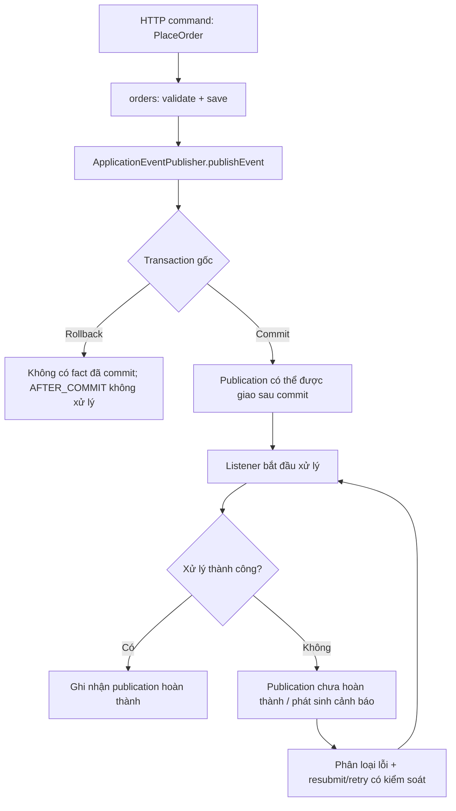
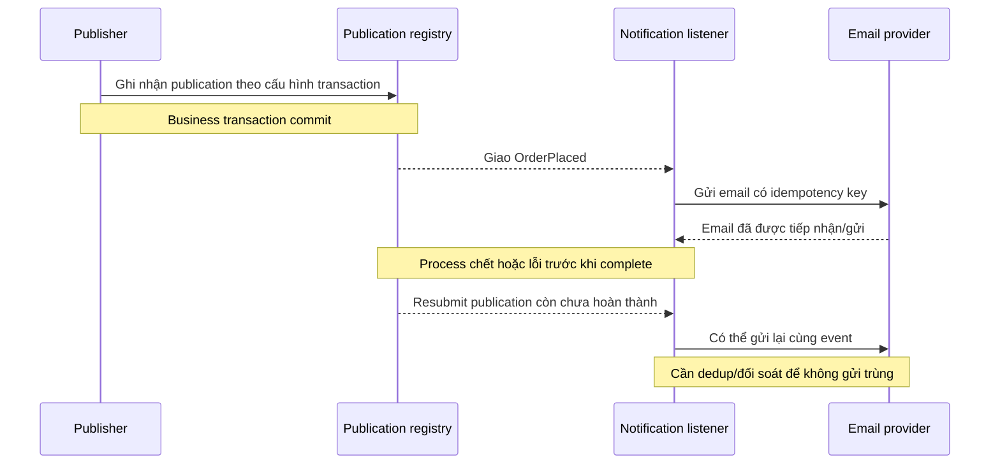

# Thất bại khi xử lý application event trong chu kỳ phát hành Spring Modulith

## 1. Bài toán: event đã được phát nhưng listener xử lý thất bại

Trong ứng dụng Spring Boot tổ chức theo **Spring Modulith**, module `orders` có thể phát `OrderPlaced` sau khi ghi nhận đơn hàng. Module `inventory` lắng nghe để giữ hàng, còn `notifications` gửi email. Giao tiếp bằng application events giúp module phát không cần gọi trực tiếp service nội bộ của các module nhận. Tuy nhiên, sau khi đơn hàng được commit, listener có thể gặp lỗi mạng, database timeout, tiến trình dừng đột ngột hoặc dữ liệu event không còn tương thích.

Tình huống cần giải quyết:

1. `OrderService` lưu đơn hàng và phát `OrderPlaced`.
2. Transaction đơn hàng **commit thành công**.
3. `NotificationListener` bắt đầu gửi email.
4. Dịch vụ email không phản hồi hoặc trả lỗi; listener không hoàn thành.
5. Đơn hàng đã tồn tại nhưng email chưa được gửi. Làm sao **nhận biết, thử lại và tránh gửi trùng**?

Đây là trọng tâm của bài **“Thất bại khi xử lý”** trong chương **“Chu kỳ phát hành”** của module **SPRING_MODULITH_APPLICATION_EVENTS**. Mục tiêu là tổ chức giao tiếp giữa các module bằng application events, bảo vệ ranh giới nghiệp vụ, xử lý sau commit, lưu vết event publication, retry, kiểm thử và quan sát để giao sự kiện đáng tin cậy hơn.

Kết thúc bài, bạn có thể:

- Phân biệt lỗi của **publisher**, **transaction**, **listener** và **hạ tầng giao sự kiện**.
- Hiểu điều gì xảy ra với transaction đơn hàng khi listener sau commit thất bại.
- Thiết kế listener báo lỗi đúng cách để event publication registry có thể ghi nhận publication chưa hoàn thành.
- Xác định khi nào retry, khi nào dừng và chuyển lỗi sang xử lý có kiểm soát.
- Thiết kế idempotency cho cả thao tác database và dịch vụ ngoài.
- Xây dựng test tình huống commit/rollback, listener lỗi, restart/replay và xử lý trùng.
- Theo dõi publication tồn đọng, thời gian xử lý và khả năng phục hồi trong vận hành.

> **Phạm vi:** Spring Modulith hỗ trợ hạ tầng theo dõi publication giữa các module. Khả năng lưu trữ bền vững, cách khôi phục và chính sách thử lại phụ thuộc phiên bản, starter và cấu hình ứng dụng; không thể mặc định rằng chỉ gọi `publishEvent(...)` sẽ có delivery exactly-once hoặc retry tự động vô hạn.

## 2. Xác định đúng vị trí lỗi trong vòng đời event

Một lỗi xuất hiện ở những mốc khác nhau sẽ có hậu quả khác nhau. Cần tách việc **tạo event**, **commit nghiệp vụ**, **giao event** và **hoàn thành xử lý**.



Sơ đồ mô tả **trạng thái logic**. Cách lưu publication, trạng thái nội bộ và thời điểm cập nhật phụ thuộc cấu hình Spring Modulith; đây không phải mô tả schema database hay tên enum chính thức.

| Mốc | Sự kiện kỹ thuật | Nếu thất bại | Hậu quả cần quan sát |
|---|---|---|---|
| Trước `publishEvent` | Kiểm tra quy tắc, lưu entity | Command bị từ chối hoặc transaction rollback | Không nên có event khẳng định fact đã hoàn tất |
| Khi `publishEvent` | Spring thông báo event cho listener | Listener đồng bộ có thể ném exception | Exception có thể lan về publisher và làm rollback transaction |
| Khi commit | Database chốt thay đổi nghiệp vụ | Transaction không commit | Listener `AFTER_COMMIT` không chạy đối với transaction bị rollback |
| Sau commit, trước khi listener bắt đầu | Xếp lịch/thực thi hậu xử lý | Executor bị từ chối, process dừng | Publication có thể còn cần được xử lý khi dùng cơ chế lưu bền vững phù hợp |
| Listener đang chạy | Gọi database, email, API ngoài | Timeout, exception, dữ liệu sai | Event chưa được xử lý thành công dù business transaction gốc đã commit |
| Sau side effect, trước khi đánh dấu hoàn thành | Ghi nhận kết quả xử lý | Process dừng hoặc lỗi ghi nhận | Có thể replay và **lặp side effect** nếu consumer không idempotent |
| Khi replay | Đọc event và chạy listener lại | Không deserialize được, lỗi vẫn tồn tại | Publication tồn đọng; cần migration hoặc xử lý thủ công có kiểm soát |

**Điểm mấu chốt:** “`publishEvent` đã trả về”, “database đã commit” và “listener đã xử lý thành công” là **ba điều kiện khác nhau**. Phải kiểm tra cả ba trước khi kết luận sự kiện đã được giao và xử lý đúng.

## 3. Phân biệt các loại listener khi xảy ra lỗi

Spring Framework cung cấp `@EventListener` và `@TransactionalEventListener`. Spring Modulith có `@ApplicationModuleListener` để thuận tiện cho xử lý event liên module. Chúng có ngữ nghĩa lỗi khác nhau.

| Listener | Thời điểm thực thi điển hình | Ảnh hưởng của exception |
|---|---|---|
| `@EventListener` đồng bộ | Gọi trực tiếp trong quá trình `publishEvent` | Exception thường lan vào luồng publisher và có thể khiến transaction đang mở rollback |
| `@TransactionalEventListener` với phase `AFTER_COMMIT` | Chạy khi transaction đã commit | Không tự đảo ngược được transaction nghiệp vụ đã commit; cần xác định cách báo và ghi nhận lỗi |
| `@ApplicationModuleListener` | Kết hợp listener sau commit, xử lý async và transaction riêng theo phiên bản hỗ trợ | Lỗi của listener được xử lý ngoài transaction gốc; publication cần được ghi nhận/chờ phục hồi nếu có registry phù hợp |

### 3.1. Lỗi đồng bộ có thể làm thay đổi kết quả publisher

Ví dụ một `@EventListener` đồng bộ gọi dịch vụ email ngay khi nhận `OrderPlaced`, trong khi `placeOrder()` vẫn đang mở transaction. Nếu email ném exception, transaction đơn hàng có thể rollback. Nếu email **đã gửi** rồi nhưng đoạn mã sau đó làm rollback, khách sẽ nhận thông báo cho đơn không tồn tại bền vững.

Điều này không phải lúc nào cũng sai về kỹ thuật: có những nghiệp vụ cần lời gọi đồng bộ, nhưng một side effect ngoài database thường không thể tham gia giao dịch nguyên tử của database. Cần thiết kế ranh giới xử lý theo đúng yêu cầu nghiệp vụ.

### 3.2. Lỗi sau commit không làm rollback đơn đã lưu

Với listener giao dịch mặc định `AFTER_COMMIT`, transaction gốc đã hoàn tất trước khi side effect được thực hiện. Nếu listener gửi email thất bại, **đơn hàng vẫn tồn tại**. Việc phục hồi phải dựa vào một phương án riêng: quản lý publication, retry, cảnh báo hoặc xử lý nghiệp vụ bù trừ.

Đừng viết mã giả định rằng ném exception từ listener sau commit sẽ tự động khiến toàn bộ đơn hàng rollback. Một listener `@ApplicationModuleListener` thường xử lý trong transaction khác, nên transaction gốc không còn ở đó để rollback.

### 3.3. Event được phát ngoài transaction

`@TransactionalEventListener` mặc định không xử lý một event khi không có transaction phù hợp đang hoạt động, trừ khi cấu hình `fallbackExecution` cho phép. Vì vậy, nếu refactor vô tình làm mất transaction ở publisher, listener có thể không chạy mà không có exception như mong đợi ở luồng HTTP.

Trong các ứng dụng dùng proxy của Spring, cũng cần nhớ việc gọi method `@Transactional` qua `this.someMethod()` trong cùng object có thể không đi qua proxy giao dịch. Kiểm thử phải xác minh transaction **đang hoạt động thật**, không chỉ nhìn annotation trong mã nguồn.

## 4. Ví dụ publisher và listener có khả năng thất bại

Giả sử ứng dụng gồm module `orders` và `notifications`. Định nghĩa event công khai trong package `orders` để module nhận có thể phụ thuộc vào hợp đồng mà không đọc repository nội bộ.

### 4.1. Event mô tả fact đã xảy ra

```java
// src/main/java/com/example/shop/orders/OrderPlaced.java
package com.example.shop.orders;

import java.time.Instant;
import java.util.UUID;

public record OrderPlaced(
        UUID eventId,
        UUID orderId,
        Instant occurredAt
) {
    public OrderPlaced {
        if (eventId == null || orderId == null || occurredAt == null) {
            throw new IllegalArgumentException("Event fields must be present");
        }
    }
}
```

`eventId` nhận diện một **sự kiện nghiệp vụ**; `orderId` nhận diện đơn hàng. Với retry cùng một publication, cần giữ ổn định event ID, không sinh một event ID mới mỗi lần xử lý lại.

### 4.2. Publisher xác lập fact trong transaction

```java
// src/main/java/com/example/shop/orders/internal/OrderService.java
package com.example.shop.orders.internal;

import com.example.shop.orders.OrderPlaced;
import java.time.Clock;
import java.util.UUID;
import org.springframework.context.ApplicationEventPublisher;
import org.springframework.stereotype.Service;
import org.springframework.transaction.annotation.Transactional;

@Service
public class OrderService {

    private final OrderRepository orders;
    private final ApplicationEventPublisher events;
    private final Clock clock;

    public OrderService(
            OrderRepository orders,
            ApplicationEventPublisher events,
            Clock clock
    ) {
        this.orders = orders;
        this.events = events;
        this.clock = clock;
    }

    @Transactional
    public UUID placeOrder(PlaceOrderCommand command) {
        Order order = orders.save(Order.create(command));

        events.publishEvent(new OrderPlaced(
                UUID.randomUUID(),
                order.id(),
                clock.instant()
        ));
        return order.id();
    }
}
```

`Order`, `OrderRepository` và `PlaceOrderCommand` là các kiểu domain minh họa chưa được khai báo đầy đủ trong bài. Ứng dụng cần thêm cấu hình `Clock`, datasource và transaction manager thích hợp.

Thứ tự có ý nghĩa: module `orders` xác lập đơn hợp lệ rồi tạo event. Bản thân lệnh `publishEvent` vẫn diễn ra **bên trong transaction**; chỉ consumer sau commit mới xử lý sự kiện như dữ liệu đã được ghi nhận bền vững.

### 4.3. Listener không được che giấu thất bại

```java
// src/main/java/com/example/shop/notifications/internal/NotificationListener.java
package com.example.shop.notifications.internal;

import com.example.shop.orders.OrderPlaced;
import org.springframework.modulith.events.ApplicationModuleListener;
import org.springframework.stereotype.Component;

@Component
class NotificationListener {

    private final NotificationSender sender;

    NotificationListener(NotificationSender sender) {
        this.sender = sender;
    }

    @ApplicationModuleListener
    void on(OrderPlaced event) {
        // Contract giả định: an toàn khi nhận lại cùng event.
        sender.sendOrderReceivedOnce(event.orderId(), event.eventId());
    }
}
```

`NotificationSender` là abstraction nghiệp vụ tự triển khai. Ví dụ giả định phương thức `sendOrderReceivedOnce` sẽ ném một exception khi xử lý không thành công và có cơ chế idempotency phù hợp. Điều này cho phép hạ tầng ghi nhận listener **không hoàn thành** khi thực sự lỗi.

Cần bật và cấu hình hạ tầng bất đồng bộ/transaction phù hợp với phiên bản Spring Modulith đang dùng (chẳng hạn `@EnableAsync`, transaction manager và executor được cấu hình). Không dựa vào mặc định của một release khác để kết luận công việc được lên lịch, lưu publication hay replay ra sao.

## 5. Sai lầm nguy hiểm: nuốt exception rồi trả về thành công

Xét listener này:

```java
// Ví dụ KHÔNG NÊN làm nếu lỗi cần được retry.
@ApplicationModuleListener
void on(OrderPlaced event) {
    try {
        notificationSender.send(event.orderId());
    } catch (RuntimeException ex) {
        log.warn("Email failed: {}", ex.getMessage());
        // Phương thức kết thúc bình thường dù side effect không thành công.
    }
}
```

Khi listener hoàn tất mà không ném lỗi, cơ chế quản lý publication có thể xem listener đã xử lý thành công và đánh dấu publication hoàn thành. Thao tác gửi email **thực chất thất bại**, nhưng không còn được nhận diện là tác vụ cần phục hồi.

Cách xử lý phù hợp hơn khi lỗi còn có thể thử lại:

```java
@ApplicationModuleListener
void on(OrderPlaced event) {
    try {
        notificationSender.sendOrderReceivedOnce(
                event.orderId(), event.eventId()
        );
    } catch (TransientNotificationException ex) {
        log.warn(
                "Order confirmation failed eventId={} cause=TRANSIENT",
                event.eventId()
        );
        throw ex; // Giữ tín hiệu chưa hoàn thành cho hạ tầng xử lý.
    }
}
```

Hai đoạn này là ví dụ độc lập trong một lớp đã có dependency và logger; `TransientNotificationException` là kiểu exception minh họa của ứng dụng. Tùy chính sách, lỗi vĩnh viễn cũng có thể cần báo thất bại để operator xử lý, hoặc chuyển sang một trạng thái nghiệp vụ **đã được ghi nhận có kiểm soát**. Điều quan trọng là **không tự biến thất bại thành thành công**.

Cũng cần tránh catch mọi `Exception` rồi đổi tất cả thành một ngoại lệ không phân loại: vận hành sẽ không biết lỗi nào tạm thời, lỗi nào cần sửa dữ liệu và lỗi nào liên quan đến contract.

## 6. Nhóm lỗi và chiến lược xử lý phù hợp

Không phải lỗi nào cũng nên thử lại theo cùng một lịch.

| Nhóm lỗi | Ví dụ | Retry có thể hữu ích? | Cách xử lý |
|---|---|---|---|
| **Tạm thời (transient)** | Timeout, kết nối DB bị ngắt, dịch vụ ngoài trả 503 | Có, sau khi xác nhận thao tác idempotent | Backoff, giới hạn lần thử, ghi metric |
| **Quá tải/giới hạn (throttling)** | HTTP 429, executor queue đầy | Có, sau thời gian giảm tải | Tôn trọng retry-after nếu có; giảm concurrency |
| **Dữ liệu/nghiệp vụ vĩnh viễn** | Địa chỉ email không hợp lệ, thiếu dữ liệu bắt buộc, trạng thái không cho xử lý | Thường không hiệu quả nếu dữ liệu không đổi | Ghi nhận kết quả nghiệp vụ rõ ràng hoặc chuyển hàng lỗi để xử lý |
| **Contract/serialization** | Không deserialize được event cũ, class bị đổi package | Không khi chưa sửa compatibility | Khắc phục code/schema, migration/upcaster, replay có kiểm soát |
| **Phân quyền/cấu hình** | Credential sai, API bị chặn, migration DB thiếu | Chỉ sau khi sửa nguyên nhân | Cảnh báo và khôi phục cấu hình trước khi replay |
| **Không rõ đã thành công chưa** | Timeout sau khi provider có thể đã nhận yêu cầu | Có điều kiện | Đối soát trạng thái remote hoặc dùng idempotency key |
| **Bug logic** | `NullPointerException` do đường đi chưa xét | Retry không giải quyết nguyên nhân | Sửa mã, thêm test hồi quy, xử lý publication tồn đọng sau deploy |

Một lỗi 429 thường cần chờ; một lỗi 400 do payload sai thường không. Nhưng không nên phân loại chỉ từ HTTP status code: API bên ngoài có thể dùng mã khác nhau. Hãy định nghĩa chính sách dựa trên **contract thực tế của dịch vụ nhận**.

### 6.1. Lỗi chưa rõ kết quả là trường hợp đặc biệt

Ví dụ listener gọi API thanh toán: request được gửi đi, kết nối timeout trước khi response về. Có hai khả năng:

- API chưa xử lý giao dịch.
- API **đã xử lý thành công**, chỉ response bị mất.

Thử lại một request không idempotent có thể tạo thanh toán thứ hai. Khi có rủi ro này, nên dùng idempotency key được nhà cung cấp hỗ trợ hoặc truy vấn trạng thái giao dịch qua API đối soát trước khi thực hiện lại. **At-least-once delivery không tương đương at-least-once side effect mong muốn.**

## 7. Event publication registry ghi nhận thất bại ra sao?

Spring Modulith có **event publication registry**, hỗ trợ theo dõi publication đến các transactional listener. Khi cấu hình cơ chế lưu trữ bền vững phù hợp (ví dụ JDBC hoặc JPA theo release), mỗi publication cần xử lý có thể được lưu và được đánh dấu hoàn tất khi listener thành công.

Nên hiểu ở mức **publication đến từng listener**, thay vì một cờ chung duy nhất cho event:

| Fact | Listener | Kết quả hiện tại | Hành động cần thiết |
|---|---|---|---|
| `OrderPlaced(event-17)` | `notifications` | Chưa hoàn thành do timeout | Phân loại nguyên nhân, resubmit khi phù hợp |
| `OrderPlaced(event-17)` | `inventory` | Đã hoàn thành | Không chạy lại phần đã thành công chỉ vì email lỗi |
| `OrderPlaced(event-17)` | `analytics` | Đã hoàn thành | Giữ nguyên kết quả phân tích |
 
Những trạng thái trong bảng là **cách diễn giải logic**, không mặc định tên bảng/cột chính thức của Spring Modulith.

### 7.1. Điều kiện để theo dõi publication bền vững

Một số bước cần xác minh khi cấu hình:

1. Chọn starter persistence registry phù hợp với release và cơ sở dữ liệu, ví dụ tích hợp JDBC/JPA.
2. Có datasource, transaction manager, schema/migration và serializer event hoạt động đúng.
3. Publication được ghi vào kho bền vững với ranh giới transaction thích hợp để tránh publication không khớp với business commit.
4. Listener thuộc loại được hạ tầng registry hỗ trợ theo dõi; không mặc định mọi `@EventListener` đồng bộ đều có semantics như transactional listener.
5. Có chiến lược kiểm tra publication chưa hoàn thành, retry/resubmission và cleanup/retention.
6. Test restart/crash và khả năng đọc event đã được ghi với phiên bản code trước.

Ví dụ khai báo Maven **chỉ để minh họa loại dependency** khi ứng dụng chọn JDBC:

```xml
<!-- Phiên bản cụ thể được quản lý bởi Spring Modulith BOM tương thích Boot. -->
<dependency>
    <groupId>org.springframework.modulith</groupId>
    <artifactId>spring-modulith-starter-jdbc</artifactId>
</dependency>
```

Không tự suy ra rằng thêm dependency là đủ để vận hành đầy đủ. Cần xem tài liệu đúng phiên bản để cấu hình schema, transaction, serializer, cách resubmission và các lựa chọn dọn publication.

### 7.2. Registry không đồng nghĩa tự động retry

Registry giúp **biết còn gì chưa hoàn thành** và cung cấp nền tảng phục hồi. Việc tự động thử lại lúc khởi động, theo lịch, theo yêu cầu quản trị hay bằng cơ chế tương ứng phải được cấu hình theo phiên bản/dịch vụ thực tế.

Hãy phân biệt:

- **Record publication:** ghi nhận việc cần giao một event cho một listener.
- **Mark completed:** ghi nhận listener đã hoàn thành theo hạ tầng.
- **Retry/resubmission:** cố gọi lại listener cho publication chưa hoàn thành.
- **Cleanup/retention:** quyết định giữ bản ghi đã hoàn tất và chưa hoàn tất trong bao lâu.

Không có cơ chế retry rõ ràng, một publication vẫn có thể tồn đọng mãi dù được ghi bền vững. Ngược lại, retry không kiểm soát có thể tạo bão yêu cầu tới dịch vụ đang lỗi.

### 7.3. Tính nhất quán khi publisher rollback

Lý tưởng với một hệ thống dùng cùng database và transaction thích hợp, **thay đổi nghiệp vụ và publication cần phục hồi** được gắn với cùng ranh giới commit. Nếu business transaction rollback, không nên tồn tại một publication mang nghĩa “đơn đã đặt thành công” được phép thực thi như fact hợp lệ.

Điều này phải được xác minh bằng **integration test trên cấu hình persistence thật**, không chỉ đọc annotation. Nếu dùng broker ngoài hoặc nhiều cơ sở dữ liệu, cần thiết kế outbox/transaction boundary tương ứng; Spring application events trong cùng tiến trình không tự tạo atomic transaction xuyên hệ thống.

## 8. Khoảng lỗi “đã làm xong nhưng chưa đánh dấu hoàn thành”

Đây là lý do quan trọng nhất khiến listener phải idempotent.



Hãy xét ba kịch bản:

| Thời điểm lỗi | Dữ liệu business | Side effect bên ngoài | Nguy cơ |
|---|---|---|---|
| Trước khi listener gọi hệ thống ngoài | Đã commit | Chưa xảy ra | Retry thường an toàn nếu consumer không tác động phần khác |
| Sau khi hệ thống ngoài **đã thực hiện** nhưng trước khi ghi completion | Đã commit | Đã xảy ra | Retry có thể thực hiện lặp |
| Sau khi publication được ghi hoàn thành | Đã commit | Đã thành công | Không nên replay publication đã hoàn thành trừ mục đích có kiểm soát |

Vì không thể bọc email provider và registry database trong một transaction ACID thông thường, **không nên tuyên bố exactly-once** cho toàn bộ side effect. Một thiết kế thực dụng thường chấp nhận khả năng giao lại rồi dùng **idempotency và đối soát** để có kết quả nghiệp vụ đúng.

## 9. Thiết kế consumer idempotent

**Idempotency** nghĩa là chạy lại cùng một yêu cầu theo hợp đồng đã định nghĩa không tạo tác động nghiệp vụ không mong muốn. Cần phân biệt “một lần cho mỗi event” và “một lần cho mỗi nghiệp vụ”.

### 9.1. Chọn khóa khử trùng đúng ngữ nghĩa

| Nghiệp vụ | Khóa tham khảo | Vì sao |
|---|---|---|
| Ghi nhận một lần xử lý fact | `(consumerName, eventId)` | Cùng event giao lại không làm lặp công việc của cùng consumer |
| Mỗi đơn một email “đã tiếp nhận” | `(orderId, notificationType)` | Có thể có event lặp hoặc event khác cùng yêu cầu gửi một loại email |
| Mỗi yêu cầu giữ hàng độc lập | `reservationRequestId` | Không nhầm nhiều reservation hợp lệ của một đơn thành duplicate |
| Mỗi yêu cầu thanh toán | Idempotency key được công nhận bởi provider | Đối soát theo hợp đồng hệ thống thanh toán |

Đừng dùng `orderId` để dedup mọi event nếu một đơn có nhiều fact hợp lệ như `OrderPlaced`, `OrderConfirmed` và `OrderCancelled`. Cũng đừng mặc định một event ID mới có nghĩa được phép thực hiện lại side effect mà nghiệp vụ chỉ muốn một lần.

### 9.2. Ràng buộc nguyên tử tại persistence

Ví dụ bảng lưu trạng thái giữ hàng:

```sql
CREATE TABLE stock_reservations (
    reservation_id UUID PRIMARY KEY,
    order_id UUID NOT NULL,
    item_id UUID NOT NULL,
    quantity INTEGER NOT NULL,
    CONSTRAINT uq_reservation_order_item UNIQUE (order_id, item_id)
);
```

Schema này **chỉ phù hợp** nếu domain xác nhận một đơn có tối đa một reservation cho mỗi mặt hàng. Với nhiều đợt giữ hàng hợp lệ cùng một `orderId`/`itemId`, cần một khóa riêng cho mỗi reservation request và quy tắc unique khác.

Một transaction xử lý event có thể sử dụng thao tác ghi có ràng buộc unique/UPSERT thích hợp cho database. Đừng triển khai một cách ngây thơ:

```java
// Không an toàn nếu có hai consumer chạy đồng thời mà không có ràng buộc DB.
if (!repository.existsByOrderId(orderId)) {
    repository.save(new Reservation(orderId));
}
```

Hai thread có thể cùng quan sát “chưa tồn tại”, rồi cùng insert. Ràng buộc unique ở database hoặc thao tác nguyên tử tương đương mới bảo vệ được trường hợp cạnh tranh.

### 9.3. Idempotency với hệ thống ngoài

Với email, API thanh toán hoặc broker:

- Ưu tiên **idempotency key** ở hệ thống nhận nếu được hỗ trợ và hiểu rõ thời gian hiệu lực của khóa.
- Lưu trạng thái nghiệp vụ và key đã dùng, đủ để đối soát khi xảy ra timeout.
- Tránh đánh dấu “đã gửi” trước khi thực sự có kết quả được định nghĩa trong hợp đồng.
- Tránh gửi lại tự động khi kết quả lần trước không rõ mà chưa có cách kiểm tra.
- Khi không có hỗ trợ dedup ở bên nhận, phải xác định giới hạn bảo đảm và quy trình xử lý trường hợp gửi lặp.

Một bảng `processed_events` giúp chống lặp trong database của consumer, nhưng tự nó **không biến giao dịch với email provider thành nguyên tử**. Cần xem xét điểm lỗi trước/sau khi thực hiện side effect ngoài.

## 10. Thiết kế retry và backoff có kiểm soát

Retry phù hợp cho lỗi tạm thời và khi thao tác có idempotency. Một chính sách tốt cần xác định **điều kiện**, **giới hạn**, **độ trễ** và **đường xử lý khi hết khả năng phục hồi tự động**.

Ví dụ quy tắc do ứng dụng lựa chọn:

| Lần thử sau thất bại | Thời gian chờ tham khảo | Điều kiện |
|---|---|---|
| 1 | 5 giây | Timeout/503, còn trong giới hạn |
| 2 | 30 giây | Lỗi vẫn tạm thời |
| 3 | 2 phút | Chưa vượt số lần và hạn xử lý |
| 4 | 10 phút | Chỉ thử lại nếu vẫn có lợi ích nghiệp vụ |
| Sau giới hạn | Chuyển xử lý có kiểm soát | Ghi rõ lỗi, alert, xét đối soát/khôi phục thủ công |

Đây là **chính sách ví dụ**, không phải lịch retry mặc định của Spring Modulith. Trong sản xuất có thể dùng exponential backoff kèm jitter để tránh hàng loạt listener đồng loạt thử lại. Lưu `attempt count`, lỗi gần nhất và thời điểm thử tiếp nếu cần khả năng điều phối và audit; cách lưu các trường đó phụ thuộc giải pháp retry thực tế.

### 10.1. Không nhầm retry tức thời với replay bền vững

Có hai phạm vi thường gặp:

- **Retry trong cùng lần thực thi**: vài lần gọi nhanh trước khi listener kết thúc, phù hợp lỗi rất ngắn; vẫn không giải quyết process crash nếu không có persistence.
- **Resubmission của publication chưa hoàn thành**: thử lại sau khi listener đã thất bại hoặc tiến trình khởi động lại; cần registry/outbox bền vững và cơ chế lập lịch/điều phối tương ứng.

Nếu bọc retry trong listener và cuối cùng ném exception, registry vẫn có cơ hội nhận diện xử lý không hoàn thành. Nếu code nuốt exception khi hết retry, hạ tầng có thể đánh dấu publication thành công sai.

### 10.2. Giới hạn concurrency, circuit breaker và backpressure

Nếu hệ thống email đang sập, gửi 10.000 publication chưa hoàn thành cùng lúc sẽ làm tình trạng nặng hơn. Hãy cân nhắc:

- Giới hạn số listener chạy đồng thời và dung lượng queue.
- Dừng/thưa retry khi bên nhận đang lỗi hàng loạt.
- Đặt timeout rõ cho HTTP/database call và kiểm soát tài nguyên thread.
- Xử lý queue rejection và alert; không để công việc thất bại chỉ vì executor đầy mà không có đường khôi phục.
- Phân biệt độ ưu tiên các sự kiện nếu có SLA khác nhau.

Việc tích hợp Spring Retry hoặc Resilience4j là lựa chọn bổ sung tùy kiến trúc; không mặc định rằng chúng đã được kích hoạt bởi annotation của Spring Modulith.

## 11. Xử lý publication không thể phục hồi tự động

Có những “poison events” gây lỗi lặp lại dù dịch vụ đã ổn định, ví dụ payload cũ không còn deserialize được, thiếu dữ liệu bắt buộc, hoặc trạng thái nghiệp vụ hiện tại không cho phép thực hiện side effect.

Với các publication này:

1. **Cách ly trường hợp lỗi:** ghi nhận loại event, listener, định danh và nguyên nhân; hạn chế việc thử lại dồn dập.
2. **Kiểm tra an toàn dữ liệu:** không dump payload nhạy cảm ra log hoặc gửi cho người không có quyền.
3. **Đánh giá khả năng sửa:** migration serializer, sửa dữ liệu theo quy trình hoặc điều chỉnh consumer.
4. **Xác định quyết định nghiệp vụ:** thử lại, bỏ qua có kiểm soát, tạo tác vụ bù trừ hoặc yêu cầu operator.
5. **Ghi nhận lý do hoàn tất/hủy** theo contract vận hành và khả năng API của release.
6. **Theo dõi tác động:** có đơn hàng/tác vụ nào bị treo ở trạng thái chờ không?

Không tùy tiện đánh dấu “đã hoàn thành” chỉ để làm bảng publication sạch hơn. Một sự kiện giữ hàng thất bại có thể cần trạng thái đơn `WAITING_FOR_STOCK` hoặc `CANCELLED`, thay vì xóa dấu vết và khiến UI hiển thị thành công sai.

### 11.1. Retry không được hồi sinh dữ liệu đã hết hiệu lực

Nếu listener xử lý lại sau nhiều ngày, địa chỉ email có thể đã thay đổi, quyền sử dụng dữ liệu có thể bị thu hồi hoặc đơn hàng đã hủy. Contract phải xác định dùng **snapshot tại thời điểm fact** hay **trạng thái hiện tại**, và áp dụng chính sách dữ liệu tương ứng.

Ví dụ, `OrderPlaced` không có nghĩa phải gửi email bằng mọi giá sau khi tài khoản đã bị xóa và tác vụ thông báo không còn hợp lệ. Consumer cần phương án kết thúc có kiểm soát, không xem mọi publication cũ là mệnh lệnh bất biến.

## 12. Theo dõi thất bại và backlog trong production

Một ứng dụng có registry nhưng không theo dõi publication tồn đọng vẫn có thể mất chức năng nghiệp vụ một thời gian dài. Các tín hiệu quan sát nên phân biệt rõ **phát event**, **ghi publication**, **bắt đầu listener**, **xử lý thành công** và **xử lý thất bại**.

| Tín hiệu | Ý nghĩa | Hành động khi bất thường |
|---|---|---|
| Số publication chưa hoàn thành | Công việc đang chờ hoặc đã lỗi | So sánh với baseline, tìm consumer gây backlog |
| Tuổi publication lâu nhất | Có tác vụ bị kẹt quá lâu không? | Ưu tiên sự kiện quá hạn, kiểm tra SLA |
| Tỷ lệ lỗi theo listener | Module nào không xử lý được? | Xác định nguyên nhân và lỗi tập trung |
| Độ trễ từ commit đến hoàn thành | Hệ thống có đáp ứng nhu cầu gần thời gian thực? | Kiểm tra executor, DB, dịch vụ ngoài |
| Số lần retry/resubmit | Có vòng lặp vô ích hoặc cơ chế replay bị tắc? | Điều chỉnh retry/backoff và phân loại lỗi |
| Executor queue/rejected tasks | Có nghẽn tài nguyên async? | Giảm concurrency hoặc tăng năng lực có kiểm soát |
| Số tác vụ quá hạn nghiệp vụ | Lỗi kỹ thuật có ảnh hưởng người dùng? | Escalate tới owner nghiệp vụ, xử lý bù |

Tùy phiên bản và cấu hình, một số metric có thể đã được instrumentation cung cấp, một số khác phải tự tạo. Không giả định Spring Boot Actuator tự hiển thị đầy đủ trạng thái từng publication mà chưa kiểm tra cơ chế quan sát thật.

### 12.1. Log có cấu trúc và correlation ID

Ví dụ tại listener:

```java
@ApplicationModuleListener
void on(OrderPlaced event) {
    log.info(
            "event-consume-start type={} eventId={} listener={}",
            "OrderPlaced", event.eventId(), "NotificationListener"
    );

    try {
        sender.sendOrderReceivedOnce(event.orderId(), event.eventId());
        log.info("event-consume-success eventId={}", event.eventId());
    } catch (RuntimeException ex) {
        log.error(
                "event-consume-failure eventId={} listener={}",
                event.eventId(), "NotificationListener", ex
        );
        throw ex;
    }
}
```

Đoạn mã giả định các dependency/logger đã được khai báo. Nếu exception chứa response hoặc dữ liệu nhạy cảm, cần áp dụng chính sách redact cho log, hoặc chỉ ghi mã lỗi an toàn. `eventId`/`orderId` cũng có thể là định danh liên kết cá nhân và cần kiểm soát quyền truy cập theo chính sách.

Khi xử lý bất đồng bộ, trace context/MDC không tự nhiên giữ nguyên trên mọi thread. Hãy cấu hình propagation thích hợp nếu ứng dụng muốn nối trace HTTP → publisher → listener, và đừng đưa token, địa chỉ hoặc payload nhạy cảm vào trace baggage.

### 12.2. Ngưỡng cảnh báo nên bám nhu cầu nghiệp vụ

Tùy hệ thống, email thông báo có thể chậm vài phút nhưng giữ hàng cho đơn sắp hết hạn cần phản hồi sớm. Đặt alert theo **tuổi backlog và tác động nghiệp vụ**, không chỉ nhìn tổng số publication.

Ví dụ: “Có publication giữ hàng chưa hoàn thành quá 2 phút trong giờ hoạt động” có ý nghĩa hơn “có 100 event chưa hoàn thành” nếu lưu lượng thay đổi theo mùa. Các số là ví dụ, cần đo và thống nhất theo SLA thực tế.

## 13. Kiểm thử lỗi trong chu kỳ phát hành

Một bài test chỉ assert `publishEvent(...)` được gọi chưa chứng minh khả năng phục hồi. Cần có test ở từng ranh giới, chọn mức test phù hợp.

### 13.1. Test publisher phát fact đúng

Spring Modulith cung cấp `@ApplicationModuleTest` và `PublishedEvents` để kiểm thử module và quan sát event được phát:

```java
package com.example.shop.orders.internal;

import static org.assertj.core.api.Assertions.assertThat;

import com.example.shop.orders.OrderPlaced;
import org.junit.jupiter.api.Test;
import org.springframework.beans.factory.annotation.Autowired;
import org.springframework.modulith.test.ApplicationModuleTest;
import org.springframework.modulith.test.PublishedEvents;

@ApplicationModuleTest
class OrderPublicationTests {

    @Autowired OrderService service;
    @Autowired PublishedEvents publishedEvents;

    @Test
    void publishesOrderPlaced() {
        // Fixture minh họa, dự án thật cần tự triển khai.
        PlaceOrderCommand command = OrderFixtures.validCommand();

        var id = service.placeOrder(command);

        assertThat(publishedEvents.ofType(OrderPlaced.class))
                .anySatisfy(event ->
                        assertThat(event.orderId()).isEqualTo(id));
    }
}
```

Test này kiểm tra **publisher đã phát sự kiện đúng loại**, chưa kiểm tra after-commit, persistence, retry hoặc notification được gửi. `OrderFixtures` và domain model là mã giả định cần triển khai trong dự án thực tế.

### 13.2. Test có transaction thật và rollback

Hai trường hợp quan trọng:

- **Commit:** sau khi giao dịch tạo đơn commit, listener `AFTER_COMMIT` được phép thực hiện side effect.
- **Rollback:** event đã được publish trong mã nhưng giao dịch thất bại; listener sau commit **không** thực hiện side effect.

Một test method có `@Transactional` trong Spring Test thường được rollback sau khi test kết thúc. Do đó, nếu muốn quan sát listener after-commit, cần **chủ động commit một transaction thật** bằng công cụ test thích hợp hoặc `TransactionTemplate`, rồi chờ điều kiện xử lý async có timeout.

Ví dụ kiểm tra thời điểm bằng listener kiểm thử `@TransactionalEventListener` **đồng bộ**:

```java
// Đoạn minh họa nằm trong @SpringBootTest đã inject:
// TransactionTemplate transactions;
// ApplicationEventPublisher publisher;
// AfterCommitProbe probe; // Listener đồng bộ trong test context

@Test
void afterCommitListenerDoesNotObserveRollback() {
    var event = new OrderPlaced(
            UUID.randomUUID(), UUID.randomUUID(), Instant.now()
    );

    transactions.executeWithoutResult(status -> {
        publisher.publishEvent(event);
        status.setRollbackOnly();
    });

    assertThat(probe.events()).isEmpty();
}
```

`AfterCommitProbe` và các import/bean là helper do test tự tạo. Đây là cách minh họa ranh giới transaction, **không phải test registry hoặc test hoàn tất listener async**.

### 13.3. Test listener gặp lỗi và publication còn chưa hoàn thành

Khi ứng dụng có registry persistence được cấu hình đúng, integration test nên:

1. Khởi tạo DB/transaction/registry tương đương production.
2. Đưa `NotificationSender` vào chế độ ném một exception **có kiểm soát**.
3. Tạo đơn và commit transaction publisher thật.
4. Chờ listener đã cố xử lý và thất bại (có timeout).
5. Kiểm tra **publication chưa hoàn thành** bằng API/query phù hợp với phiên bản được dùng.
6. Khôi phục sender, kích hoạt cơ chế resubmission đã cấu hình.
7. Xác nhận xử lý thành công, publication được ghi nhận hoàn tất và side effect chỉ có kết quả nghiệp vụ hợp lệ.

Không hardcode một API registry giả định vào code test; tên method và cách biểu diễn publication có thể khác giữa các phiên bản. Test phải dùng **đúng API/behavior đang được ứng dụng tích hợp**.

### 13.4. Test idempotency và khoảng lỗi sau side effect

Dựng hai tình huống độc lập:

| Tình huống test | Kỳ vọng |
|---|---|
| Cùng event được xử lý hai lần | Không tạo hai reservation/notification job khi contract quy định một lần |
| Side effect ngoài đã thành công, completion record thất bại | Replay không tạo tác động không mong muốn; có cách đối soát kết quả |

Ví dụ test cơ chế lưu tác vụ:

```java
@Test
void processingSameEventTwiceCreatesSingleJob() {
    var event = new OrderPlaced(
            UUID.randomUUID(), UUID.randomUUID(), Instant.now()
    );

    listener.on(event);
    listener.on(event); // Mô phỏng delivery lặp.

    assertThat(notificationJobs.countByOrderId(event.orderId()))
            .isEqualTo(1);
}
```

Đây là **khung test minh họa** cần bổ sung listener, repository test và định nghĩa `enqueueOnce` có unique constraint. Đừng dùng test này để tuyên bố email provider bên ngoài cũng gửi đúng một lần. Để chứng minh khía cạnh đó, cần idempotency key, fake provider hoặc integration contract phù hợp.

### 13.5. Test publication cũ sau khi deploy phiên bản mới

Registry lưu publication để phục hồi có thể gặp sự kiện từ phiên bản cũ. Hãy test deserialize payload cũ với serializer/version hiện tại. Nếu đổi tên class, package, cấu trúc record hoặc format timestamp, cần có migration/upcaster tương ứng.

Các trường hợp cần xem xét:

- Event cũ thiếu field mới.
- Event cũ chứa enum value đã bị đổi/loại bỏ.
- Listener mới không còn hiểu nghĩa nghiệp vụ event cũ.
- Replay sau khi dữ liệu tham chiếu đã bị xóa hoặc đổi quyền.
- Event cũ đến sau event mới, ảnh hưởng thứ tự xử lý cùng aggregate.

## 14. Lỗi cần phân biệt với thiếu độ tin cậy ở kiến trúc module

Không phải mọi vấn đề “listener không chạy” đều do runtime. Một số lỗi thuộc thiết kế:

| Vấn đề | Dấu hiệu | Hướng kiểm tra |
|---|---|---|
| Sai ranh giới module | Consumer import repository nội bộ publisher | Dùng `ApplicationModules.verify()` và sửa public event/API |
| Sai ý nghĩa event | `OrderPlaced` nhưng thật ra chỉ có request đang chờ | Xác định lại fact và trạng thái nghiệp vụ |
| Listener không được quét bean | Không có log bắt đầu listener | Kiểm tra component scan và package |
| Thiếu transaction publisher | Transactional listener không được kích hoạt như mong đợi | Kiểm tra proxy `@Transactional` và `fallbackExecution` |
| Cấu hình async/executor chưa đúng | Task không được chạy hoặc queue bị từ chối | Kiểm tra `@EnableAsync`, executor và error handler |
| Registry chưa bền vững | Sau restart không còn publication để xử lý | Kiểm tra starter, schema, datasource và serializer |
| Retry vô điều kiện | Một poison event gây vòng lặp lỗi | Phân loại lỗi, giới hạn thử lại và tạo cảnh báo |
| Thiếu idempotency | Side effect trùng sau resubmit | Dùng unique key và đối soát hệ thống ngoài |

Để kiểm tra dependency architecture của Modulith:

```java
package com.example.shop;

import org.junit.jupiter.api.Test;
import org.springframework.modulith.core.ApplicationModules;

class ArchitectureTests {

    @Test
    void modulesRespectBoundaries() {
        ApplicationModules.of(ShopApplication.class).verify();
    }
}
```

Test kiến trúc giúp bảo vệ ranh giới module, nhưng không đo **tỷ lệ delivery thành công**. Kết quả `verify()` PASS và độ tin cậy runtime là hai phương diện cần kiểm chứng riêng.

## 15. Quy trình xử lý sự cố publication thất bại

Khi cảnh báo “`OrderPlaced` chưa hoàn thành trong `notifications`” xuất hiện, nên điều tra theo thứ tự nhằm tránh replay thiếu kiểm soát:

1. **Định danh publication:** Xác định loại event, event ID, listener và thời gian tạo; hạn chế xem payload nhạy cảm.
2. **Xác định transaction gốc:** Đơn hàng đã commit thật và còn trạng thái hợp lệ để xử lý không?
3. **Tra trạng thái consumer:** Đã có notification job, email receipt hoặc tác động phụ nào được ghi nhận chưa?
4. **Phân loại nguyên nhân:** Timeout tạm thời, rate limit, contract/schema, thiếu quyền, bug hay dữ liệu không còn hợp lệ?
5. **Kiểm tra idempotency:** Nếu resubmit, khóa nào ngăn side effect trùng? Có thể đối soát với provider không?
6. **Khắc phục nguyên nhân:** Sửa config/bug/data, giảm tải hoặc chờ dịch vụ hồi phục.
7. **Resubmit có giới hạn:** Dùng cơ chế phục hồi chính thức cho phiên bản registry đang chạy; tránh chạy đồng thời nhiều replay không điều phối.
8. **Đọc lại kết quả:** Publication đã hoàn tất? Kết quả nghiệp vụ có đúng? Có publication khác bị ảnh hưởng?
9. **Ghi bài học vận hành:** Bổ sung test, cảnh báo, runbook và giới hạn retry.

**Không xóa bản ghi chưa hoàn thành chỉ để loại bỏ cảnh báo.** Xóa không có đối soát có thể khiến một đơn bị bỏ qua bước nghiệp vụ quan trọng, đồng thời mất chứng cứ về nguyên nhân.

## 16. Các câu hỏi tự kiểm tra

1. Nếu listener `@ApplicationModuleListener` ném exception sau khi đơn hàng đã commit, transaction của `orders` có tự rollback không? Vì sao?
2. Vì sao catch exception rồi chỉ log có thể khiến registry ghi nhận publication hoàn thành sai?
3. Tại sao có registry bền vững vẫn chưa thể khẳng định email gửi chính xác một lần?
4. Phân biệt retry trong cùng lần chạy với resubmit publication sau restart. Cơ chế nào giúp phục hồi khi process chết?
5. Trong trường hợp HTTP timeout sau request thanh toán, vì sao retry ngay có thể nguy hiểm?
6. Khóa `eventId` và `(orderId, notificationType)` khác nhau ở điểm nào khi chống gửi trùng?
7. Tại sao test dùng `@Transactional` ở method kiểm thử có thể không kích hoạt listener after-commit?
8. Khi thay đổi schema `OrderPlaced`, publication cũ chưa xử lý cần được kiểm tra ra sao?

### Bài tập 1 — Khôi phục email bị lỗi

Một đơn hàng đã commit; `NotificationListener` gặp HTTP 503. Hãy đề xuất chính sách retry/backoff, giới hạn thử lại, metric cảnh báo và cách xác nhận hoàn tất sau recovery. Chỉ ra rõ ranh giới nào không thể rollback được.

### Bài tập 2 — Trùng reservation sau crash

`StockReservationListener` đã ghi reservation thành công nhưng service chết trước khi đánh dấu publication hoàn thành. Sau restart, cùng `OrderPlaced(eventId=A, orderId=O)` được xử lý lại. Hãy thiết kế bảng/ràng buộc unique và test chứng minh không giữ hàng hai lần. Giải thích khi nào unique theo `orderId` là quá chặt.

### Bài tập 3 — Poison event sau nâng cấp

Một publication cũ lưu `OrderPlaced` với field `orderId` kiểu chuỗi, trong khi release mới yêu cầu kiểu khác. Listener lặp lại lỗi deserialization và backlog tăng. Hãy đề xuất bước xác minh, migration/upcaster, cách tạm dừng retry và quy trình xử lý publication cũ sau khi sửa.

## 17. Checklist thiết kế xử lý thất bại

- [ ] Publisher chỉ phát event mô tả fact hợp lệ trong transaction phù hợp.
- [ ] Listener cần xử lý sau commit dùng cơ chế listener giao dịch phù hợp.
- [ ] Các exception quan trọng không bị nuốt khiến completion bị ghi nhận sai.
- [ ] Có registry bền vững khi yêu cầu nghiệp vụ không chấp nhận mất publication sau crash.
- [ ] Schema/serializer của publication được kiểm tra, kể cả dữ liệu event cũ.
- [ ] Có cơ chế retry/resubmission được cấu hình và kiểm tra thực tế.
- [ ] Retry có giới hạn, backoff và phân loại lỗi transient/permanent.
- [ ] Mỗi consumer có chiến lược idempotency theo side effect nghiệp vụ.
- [ ] Có cơ chế đối soát khi hệ thống ngoài có thể đã xử lý trước timeout.
- [ ] Có chỉ số backlog, tuổi publication, tỷ lệ lỗi và cảnh báo phù hợp.
- [ ] Test commit, rollback, listener throw, replay và duplicate đều có kỳ vọng rõ.
- [ ] Publication không phục hồi được có đường xử lý thủ công/bù trừ được kiểm soát.
- [ ] Log và dữ liệu registry được bảo vệ, không lộ payload nhạy cảm.

## 18. Tổng kết

**Thất bại khi xử lý application event** không đồng nghĩa thao tác nghiệp vụ của publisher thất bại. Với listener sau commit, đơn hàng có thể đã được lưu thành công trong khi email, giữ hàng hoặc một bước hậu xử lý vẫn chưa hoàn tất. Vì vậy, ứng dụng phải nhận diện được **publication nào, listener nào và nguyên nhân gì** còn cần xử lý.

Spring Modulith cung cấp nền tảng quản lý event publication, nhưng độ tin cậy đầu cuối cần có **persistence phù hợp, cơ chế recovery được cấu hình, retry có kiểm soát, idempotency, đối soát và observability**. Kết hợp các yếu tố đó với kiểm thử rollback, crash/replay và contract giúp các module giảm phụ thuộc mà vẫn giữ đúng ranh giới nghiệp vụ và trạng thái xử lý sau commit.

