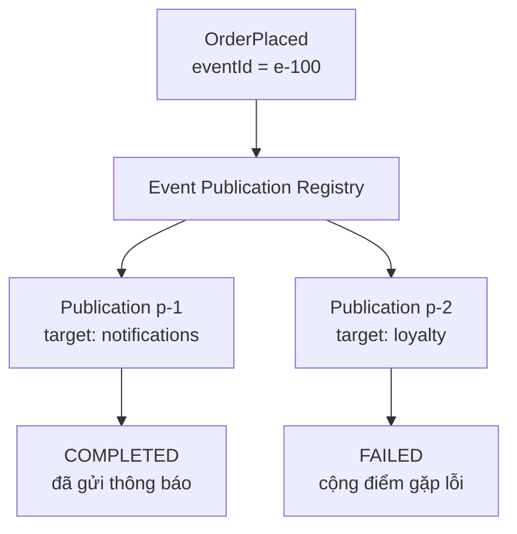
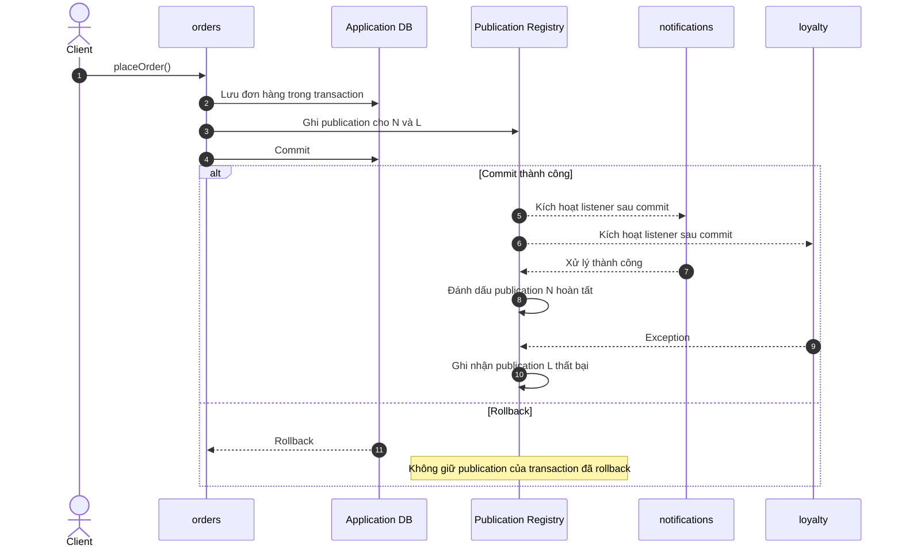
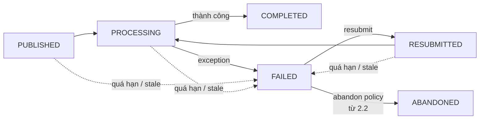

# Theo dõi trạng thái trong chu kỳ phát hành sự kiện Spring Modulith

## 1. Vì sao phải theo dõi trạng thái publication?

Trong Spring Modulith, một module có thể công bố sự kiện bằng `ApplicationEventPublisher` và để module khác phản ứng qua `@ApplicationModuleListener`. Cách này giảm phụ thuộc giữa các module, nhưng làm phát sinh câu hỏi vận hành quan trọng: **sự kiện đã được module nhận xử lý thành công hay chưa?**

Ví dụ, sau khi đơn hàng được xác nhận, module `orders` phát `OrderPlaced`. Hai module quan tâm:

- `notifications` gửi thông báo xác nhận.
- `loyalty` cộng điểm thưởng.

Đơn hàng có thể đã commit thành công trong khi gửi email bị lỗi mạng. Nếu chỉ kiểm tra giá trị trả về của `publishEvent(...)`, ta không biết các tác vụ sau commit đã hoàn tất hay chưa. Cần một nơi theo dõi **từng lần phân phối sự kiện đến từng listener**.

Spring Modulith cung cấp **Event Publication Registry** để lưu thông tin publication cho các transactional listener đủ điều kiện, theo dõi việc xử lý và hỗ trợ khôi phục những publication chưa hoàn tất. Bài học này tập trung vào cách hiểu, đọc và vận hành trạng thái của các publication: từ lúc ghi nhận, bắt đầu xử lý, hoàn tất, thất bại cho tới phát lại.

Sau bài học, bạn có thể phân biệt `event` với `publication`; giải thích vòng đời publication ở Spring Modulith 2.x; xây dựng một màn hình quan sát cơ bản, cảnh báo backlog; và lựa chọn cách resubmit an toàn mà không làm lặp hiệu ứng nghiệp vụ.

## 2. Event và publication không phải cùng một đối tượng

**Business event** là sự thật nghiệp vụ đã xảy ra, chẳng hạn một `OrderPlaced` với `eventId` và `orderId`. **Event publication** là bản ghi thể hiện việc giao event đó tới **một listener đích**.

Vì một event có thể được nhiều listener tiêu thụ, một lần gọi `publishEvent(...)` có thể tạo **nhiều publication**, mỗi publication có trạng thái hoàn thành riêng.



`e-100`, `p-1` và `p-2` chỉ là định danh minh họa. Trong ứng dụng thực tế:

- `eventId` thuộc **payload nghiệp vụ** và có thể dùng để chống xử lý trùng tại consumer.
- `publicationId` thuộc **bản ghi publication** do registry tạo, phân biệt đường phân phối tới từng listener.
- `targetIdentifier` cho biết listener đích mà publication gắn với. Không nên dùng thứ tự listener trong code làm định danh.
- **Một listener thành công không chứng minh các listener còn lại đã thành công.**

Chính sự phân biệt này cho phép tái thực thi riêng listener thất bại thay vì phát lại toàn bộ luồng nghiệp vụ tạo đơn.

## 3. Registry ghi gì và ghi khi nào?

Khi ứng dụng đã cấu hình persistence cho Event Publication Registry, Spring Modulith chặn luồng phát sự kiện và xác định các **transactional event listener** đủ điều kiện. Mặc định, những listener được đánh dấu trực tiếp hoặc gián tiếp bằng `@TransactionalEventListener` được xem xét; `@ApplicationModuleListener` là một shortcut thuộc nhóm này.

Registry lưu các publication tương ứng **trong transaction nghiệp vụ gốc**. Khi transaction rollback, dữ liệu nghiệp vụ và publication được ghi cùng transaction cũng rollback. Khi commit thành công, các listener ở pha sau commit có thể được thực thi và trạng thái publication được cập nhật.



Sơ đồ mô tả **quan hệ logic**. Trong thực tế, các listener chạy bất đồng bộ không có thứ tự hoàn tất cố định. Ở Spring Modulith 2.x, việc cập nhật trạng thái do interceptor và cơ chế registry quản lý; ở bản 1.x, mô hình hiển thị thường dựa trên publication chưa hoàn thành và completion date.

**Điều kiện cần:** phải có backend lưu publication (JDBC, JPA, MongoDB, Neo4j hoặc loại phù hợp phiên bản) và cấu hình transaction/persistence đúng. Chỉ dùng `ApplicationEventPublisher` mà chưa cấu hình registry bền vững thì không có cơ sở để kỳ vọng dữ liệu publication còn tồn tại sau khi ứng dụng dừng.

## 4. Chu kỳ trạng thái trong Spring Modulith 2.x

Kể từ **Spring Modulith 2.0**, `EventPublication.Status` biểu diễn trạng thái tường minh. Trong **2.2**, trạng thái `ABANDONED` được bổ sung. Dự án sử dụng bản 1.x cần đọc phần tương thích ở mục 13 vì không có cùng enum trạng thái.

| Trạng thái | Ý nghĩa | Hướng theo dõi |
|---|---|---|
| `PUBLISHED` | Publication đã được lưu, đang chờ hoặc sắp được listener nhận | Xem thời gian chờ; nếu quá lâu, kiểm tra dispatcher và staleness |
| `PROCESSING` | Listener đã nhận publication và đang xử lý | Xem thời gian chạy, tác vụ treo và lượng xử lý đồng thời |
| `COMPLETED` | Listener đã xử lý thành công | Theo dõi throughput/độ trễ và chính sách lưu trữ |
| `FAILED` | Listener ném exception hoặc publication bị đánh dấu thất bại khi quá hạn | Phân loại lỗi, xử lý retry có kiểm soát |
| `RESUBMITTED` | Publication thất bại được gửi lại, chờ một lượt xử lý mới | Theo dõi thời gian chờ và số lần thử |
| `ABANDONED` *(từ 2.2)* | Publication được chính sách từ bỏ sau thất bại; không tiếp tục resubmit theo cơ chế thông thường | Cần quy trình vận hành/đối soát riêng; không coi là thành công |

Sơ đồ chuyển trạng thái khái quát:



Các mũi tên nét đứt chỉ hoạt động khi **Staleness Monitor** được bật và cấu hình ngưỡng phù hợp. Trạng thái `ABANDONED` chỉ có từ phiên bản hỗ trợ và khi chính sách quyết định từ bỏ; không phải mọi lỗi đều tự động biến thành `ABANDONED`.

Một publication đã `COMPLETED` chứng minh **listener cụ thể đã trả về thành công** theo cơ chế theo dõi, chưa chắc chứng minh side effect ngoài transaction (như email qua dịch vụ khác) chắc chắn đã xảy ra đúng một lần.

## 5. Ví dụ thực tế: hai listener, hai kết quả

Payload nghiệp vụ của module `orders`:

```java
package com.example.shop.orders;

import java.time.Instant;
import java.util.UUID;

public record OrderPlaced(
        UUID eventId,
        UUID orderId,
        Instant occurredAt
) {}
```

Hai module đăng ký listener:

```java
// Minh họa: mỗi lớp đặt tại package của module tương ứng.
@Component
class NotificationListener {

    private final NotificationService notifications;

    NotificationListener(NotificationService notifications) {
        this.notifications = notifications;
    }

    @ApplicationModuleListener
    void on(OrderPlaced event) {
        notifications.sendOrderConfirmation(
                event.eventId(), event.orderId());
    }
}

@Component
class LoyaltyListener {

    private final LoyaltyService loyalty;

    LoyaltyListener(LoyaltyService loyalty) {
        this.loyalty = loyalty;
    }

    @ApplicationModuleListener
    void on(OrderPlaced event) {
        loyalty.creditOnce(event.eventId(), event.orderId());
    }
}
```

Hai listener dùng `org.springframework.modulith.events.ApplicationModuleListener`; `NotificationService` và `LoyaltyService` là các dịch vụ nghiệp vụ giả định của module tiếp nhận. `@ApplicationModuleListener` kết hợp xử lý **sau commit**, **bất đồng bộ** và **transaction mới** cho listener.

Giả sử email gửi thành công nhưng kho điểm thưởng tạm thời không kết nối được:

| Publication | Lần xử lý 1 | Sau khôi phục |
|---|---|---|
| `OrderPlaced → notifications` | `COMPLETED` | Giữ nguyên hoàn tất |
| `OrderPlaced → loyalty` | `FAILED` | `RESUBMITTED → PROCESSING → COMPLETED` nếu thử lại thành công |

Bản ghi publication của `notifications` không cần bị gọi lại chỉ vì listener `loyalty` thất bại. Khi resubmit publication của `loyalty`, consumer phải bảo đảm `creditOnce(...)` không cộng điểm lặp nếu side effect đã xảy ra trước khi trạng thái registry được đánh dấu hoàn tất.

## 6. Metadata nên quan sát cho từng publication

Spring Modulith cung cấp interface `EventPublication` chứa những dữ liệu theo dõi, trong đó các getter trạng thái và đếm lượt thử được giới thiệu từ 2.0.

| Dữ liệu | API tiêu biểu | Cách sử dụng |
|---|---|---|
| Publication ID | `getIdentifier()` | Tra cứu một bản ghi, đối chiếu log vận hành |
| Event gốc | `getEvent()` | Xác định loại event, business ID nếu được phép đọc |
| Listener đích | `TargetEventPublication.getTargetIdentifier()` | Khoanh vùng module/listener lỗi |
| Thời điểm publication | `getPublicationDate()` | Tính tuổi publication |
| Thời điểm hoàn thành | `getCompletionDate()` | Phân tích thời gian từ phát đến hoàn tất |
| Đã hoàn tất | `isCompleted()` | Kiểm tra nhanh ở các API hỗ trợ |
| Trạng thái 2.x | `getStatus()` | Phân loại backlog theo state |
| Thời điểm phát lại gần nhất 2.x | `getLastResubmissionDate()` | Quan sát retry gần đây |
| Số lượt thực thi 2.x | `getCompletionAttempts()` | Phân loại lỗi lặp, giới hạn retry |

**Thời gian publication không phải thời gian bắt đầu xử lý.** Tương tự, số lần thực thi không phải số lần business event được phát: một publication bị resubmit nhiều lần nhưng vẫn ứng với cùng event gốc và listener đích.

Nên đặt `eventId` ổn định trong payload để nối dữ liệu registry với log ứng dụng. `publicationId` giúp xác định **một lần giao event tới một listener**, còn `eventId` giúp chống thực thi lại **tác động nghiệp vụ** khi listener được gọi nhiều lần.

## 7. Đọc publication đang chờ bằng Java

Với Spring Modulith **2.0+**, có thể dùng `EventPublicationRegistry` để lấy các publication chưa hoàn tất. Ví dụ dưới đây đặt trong **module vận hành nội bộ**, không trong module `orders` để tránh kéo trách nhiệm quan sát vào nghiệp vụ tạo đơn.

```java
package com.example.shop.monitoring;

import java.time.Instant;
import java.util.List;
import java.util.UUID;
import org.springframework.modulith.events.EventPublication;
import org.springframework.modulith.events.core.EventPublicationRegistry;
import org.springframework.stereotype.Service;

@Service
public class PublicationStatusService {

    private final EventPublicationRegistry registry;

    public PublicationStatusService(EventPublicationRegistry registry) {
        this.registry = registry;
    }

    public List<PendingPublication> snapshot() {
        return registry.findIncompletePublications().stream()
                .map(publication -> new PendingPublication(
                        publication.getIdentifier(),
                        publication.getTargetIdentifier().toString(),
                        publication.getEvent().getClass().getSimpleName(),
                        publication.getStatus(),
                        publication.getPublicationDate(),
                        publication.getCompletionAttempts()
                ))
                .toList();
    }

    public record PendingPublication(
            UUID publicationId,
            String target,
            String eventType,
            EventPublication.Status status,
            Instant publishedAt,
            int attempts
    ) {}
}
```

Mục đích: đọc danh sách publication chưa hoàn tất và tạo một bản tóm tắt **không chứa toàn bộ payload**. Code sử dụng API thuộc `spring-modulith-events-core` và các kiểu mới của 2.x; dependency thực tế phụ thuộc starter của dự án. `findIncompletePublications()` có thể **tải toàn bộ backlog**: cách này phù hợp demo/diagnostics quy mô nhỏ, không nên chạy liên tục trên bảng có hàng triệu publication.

Ở production, ưu tiên phép đếm/truy vấn được tối ưu trong kho dữ liệu theo schema đang dùng; API `EventPublicationRepository.countByStatus(...)` có từ 2.0 nhưng là tầng repository SPI. Nếu xây endpoint giám sát, hãy giới hạn quyền truy cập, ẩn event payload và áp dụng pagination/lọc tuổi bản ghi.

Đừng coi `snapshot()` là một dashboard thời gian thực: trạng thái có thể thay đổi ngay khi truy vấn chạy. Kết quả là **ảnh chụp tại thời điểm đọc**, không phải một transaction snapshot của toàn hệ thống phân tán.

## 8. Quan sát các publication hoàn tất

Publication `COMPLETED` có ý nghĩa khác với publication chưa hoàn tất: nó phản ánh listener đã chạy xong theo bộ theo dõi. Nếu muốn báo cáo throughput hoặc kiểm toán sau commit, cần biết hệ thống đang dùng **completion mode** nào.

Spring Modulith hỗ trợ cấu hình:

```properties
spring.modulith.events.completion-mode=update
```

| Chế độ | Dữ liệu sau khi thành công | Ý nghĩa cho giám sát |
|---|---|---|
| `UPDATE` (mặc định) | Giữ publication và cập nhật completion date | Có thể truy vấn publication hoàn tất; cần dọn bản ghi cũ |
| `DELETE` | Xóa publication khi hoàn tất | Giảm lưu trữ; không thể lấy history đã xóa từ `CompletedEventPublications` |
| `ARCHIVE` | Chuyển publication vào vùng lưu trữ archive | Có thể giữ lịch sử trong archive, phụ thuộc backend/phiên bản |

Trong chế độ `UPDATE` hoặc `ARCHIVE` có hỗ trợ, API `CompletedEventPublications.findAll()` trả về các publication đã hoàn tất đang được lưu. API `deletePublicationsOlderThan(Duration)` hỗ trợ dọn bản ghi hoàn tất cũ theo retention policy.

Ví dụ dọn bản ghi hoàn tất **cũ hơn 30 ngày**, chỉ thực hiện khi chính sách lưu giữ cho phép:

```java
package com.example.shop.monitoring;

import java.time.Duration;
import org.springframework.modulith.events.CompletedEventPublications;
import org.springframework.stereotype.Service;

@Service
public class PublicationRetentionService {

    private final CompletedEventPublications completed;

    public PublicationRetentionService(
            CompletedEventPublications completed) {
        this.completed = completed;
    }

    public void purgeCompletedOlderThan30Days() {
        completed.deletePublicationsOlderThan(Duration.ofDays(30));
    }
}
```

Ví dụ trên **chỉ định nghĩa method**; lịch chạy, phân quyền và chính sách retention là việc của ứng dụng. Không gọi dọn dữ liệu thiếu điều kiện hoặc áp dụng cùng một chính sách cho publication `FAILED`: publication chưa hoàn tất cần được xử lý/đối soát trước.

Nếu chọn `DELETE`, số lượng `COMPLETED` trong registry có thể bằng 0 sau khi xử lý, nhưng đó **không có nghĩa** chưa có listener nào thành công. Metrics hoàn tất nên được ghi nhận ở thời điểm chạy thay vì chỉ dựa vào số bản ghi còn lại.

## 9. Thiết kế metrics và cảnh báo theo tình trạng thực

Một số liệu “có bao nhiêu publication chưa hoàn tất” hữu ích nhưng chưa đủ. Nên kết hợp **số lượng, tuổi, tốc độ, trạng thái và listener đích**.

| Chỉ số đề xuất | Ý nghĩa | Khi nào đáng cảnh báo |
|---|---|---|
| `publications_incomplete_total` | Backlog chưa hoàn thành theo module/target | Tăng liên tục trong khi throughput không tăng |
| `publications_failed_total` | Publication đang lỗi | Có lỗi tăng nhanh hoặc một target lỗi kéo dài |
| `oldest_incomplete_age_seconds` | Tuổi publication tồn lâu nhất | Vượt thời gian nghiệp vụ chấp nhận |
| `publication_completion_latency_seconds` | Thời gian từ publish tới complete | Độ trễ tăng so với baseline/SLO |
| `publication_attempts` | Số lần listener đã thử xử lý | Lặp nhiều lần ở một loại event |
| `publication_resubmitted_total` | Số lần phát lại do cơ chế retry | Tăng đột biến, cần xem nguyên nhân |
| `publication_abandoned_total` (2.2+) | Publication được từ bỏ | Phải được điều tra và đối soát |

Đây là **tên metric gợi ý do ứng dụng tự định nghĩa**, không phải khẳng định Spring Modulith tự đăng ký sẵn các metric này dưới đúng tên đó. Có thể xuất chúng qua Micrometer/Prometheus hoặc công cụ quan sát khác, với label có số lượng giá trị hữu hạn như `eventType`, `target`, `status`.

Tránh dùng `eventId`, `orderId` hay `publicationId` làm **label metric**: cardinality sẽ tăng vô hạn. Dùng các ID đó trong **log hoặc trace** có kiểm soát.

Khi chọn threshold, cần dựa vào SLA thực tế. Ví dụ listener gửi email thường xử lý dưới một phút, còn consumer tổng hợp báo cáo ban đêm có thể hoàn thành chậm hơn. Không thể gắn cùng một ngưỡng “quá 60 giây là lỗi” cho tất cả publication.

## 10. Lỗi và publication bị treo: staleness

Không phải publication chưa hoàn tất nào cũng đang lỗi. Một publication ở `PROCESSING` có thể đang xử lý hợp lệ; một publication ở `PUBLISHED` có thể còn chờ thread. Ngược lại, tiến trình bị kill có thể khiến bản ghi mắc kẹt ở những trạng thái đó.

Từ **2.0**, Spring Modulith cung cấp **Staleness Monitor** có thể đánh dấu những publication quá hạn thành `FAILED`. Có thể cấu hình khoảng kiểm tra và ngưỡng cho từng trạng thái:

```properties
# Ví dụ, chỉ dùng sau khi chọn ngưỡng theo SLA và tải thực tế.
spring.modulith.events.staleness.check-interval=1m
spring.modulith.events.staleness.published=10m
spring.modulith.events.staleness.processing=15m
spring.modulith.events.staleness.resubmitted=10m
```

Theo mặc định của tài liệu Spring Modulith 2.2, các ngưỡng `published`, `processing` và `resubmitted` bằng `0` nên monitor **không đăng ký tác vụ đánh dấu stale tự động**. Cấu hình khác 0 mới kích hoạt cơ chế này.

**Không chọn ngưỡng quá ngắn:** listener xử lý hợp lệ trong 20 phút có thể bị đánh dấu thất bại sau 2 phút, rồi chạy lặp trong khi lần đầu vẫn đang tiếp tục. Để giảm rủi ro cần hiểu thời gian chạy tối đa, concurrency, cơ chế locking, timeout và thiết kế idempotency.

Đặc biệt trong triển khai nhiều instance, một worker ở instance A có thể vẫn đang xử lý trong khi instance B quan sát publication. Trạng thái `PROCESSING` **không đủ** để kết luận công việc đã chết. Phân biệt stale theo dữ liệu thời gian và chính sách phù hợp.

## 11. Phát lại publication thất bại có kiểm soát

Spring Modulith có các API phục hồi:

| API | Phạm vi | Ghi chú |
|---|---|---|
| `IncompleteEventPublications` | Publication chưa hoàn tất nói chung | Hỗ trợ chọn theo predicate, độ tuổi; overload nhận `ResubmissionOptions` từ 2.0 |
| `FailedEventPublications` (2.0+) | Chỉ các publication ở `FAILED` | Hạn chế phát lại publication vẫn đang `PROCESSING` |
| `ResubmissionOptions` (2.0+) | Batch size, độ tuổi, số lượng in-flight, bộ lọc | Kiểm soát mức tải và lựa chọn publication |
| `AbandonedEventPublications` (2.2+) | Các publication bị từ bỏ | Dành cho vận hành/cleanup; không coi là hoàn thành |

Ví dụ thao tác phục hồi sau khi đã sửa lỗi downstream, áp dụng cho **Spring Modulith 2.0+**:

```java
package com.example.shop.monitoring;

import java.time.Duration;
import org.springframework.modulith.events.FailedEventPublications;
import org.springframework.modulith.events.ResubmissionOptions;
import org.springframework.stereotype.Service;

@Service
public class PublicationRecoveryService {

    private final FailedEventPublications failedPublications;

    public PublicationRecoveryService(
            FailedEventPublications failedPublications) {
        this.failedPublications = failedPublications;
    }

    // Method do quản trị viên/job đã cấp quyền chủ động gọi.
    public void retryFailures() {
        ResubmissionOptions options = ResubmissionOptions.defaults()
                .withBatchSize(100)
                .withMaxInFlight(10)
                .withMinAge(Duration.ofMinutes(5));

        failedPublications.resubmit(options);
    }
}
```

Đoạn mã này **không tự tạo lịch chạy**. Nếu đưa vào scheduled job, phải cấu hình lịch, tránh chạy trùng giữa nhiều instance và có giới hạn tỷ lệ retry. Trước khi resubmit cần xác minh nguyên nhân lỗi đã được xử lý; nếu lỗi do message không thể deserialize hoặc quy tắc nghiệp vụ vĩnh viễn không còn hợp lệ, retry mù chỉ tăng backlog.

Spring Modulith cũng có tùy chọn:

```properties
spring.modulith.events.republish-outstanding-events-on-restart=true
```

Cấu hình này cho phép tự phát lại outstanding publications khi ứng dụng khởi động. **Mặc định là `false`** và tài liệu khuyến cáo thận trọng với ứng dụng nhiều instance vì một instance khác có thể vẫn đang xử lý. Cân nhắc phục hồi có chọn lọc và các API 2.x thay vì mặc định phát lại mọi bản ghi.

### `ABANDONED` có phải đã xử lý xong?

Không. Trong **Spring Modulith 2.2+**, `ABANDONED` nghĩa là publication được chính sách `AbandonPolicy` quyết định **ngừng thử lại**, có thể do lỗi vĩnh viễn hoặc đã quá số lần thử cho phép. Nó không tương đương `COMPLETED`.

Nếu dùng giới hạn lượt thử, phải có quy trình thông báo, điều tra và đối soát nghiệp vụ. Mặc định `spring.modulith.events.resubmission.abandon-after-attempts=-1` vô hiệu hóa chính sách từ bỏ theo số lần thử có sẵn khi không có chính sách khác.

## 12. Vì sao trạng thái `COMPLETED` vẫn chưa đủ để kết luận exactly-once?

Một listener có thể xử lý side effect rồi ứng dụng chết **trước khi registry ghi nhận hoàn tất**. Ví dụ:

1. `loyalty` nhận `OrderPlaced`.
2. Lời gọi tới hệ thống điểm thưởng bên ngoài thành công.
3. Ứng dụng bị kill trước khi ghi trạng thái `COMPLETED`.
4. Registry giữ publication chưa hoàn tất.
5. Sau phục hồi, event được giao lại và tác vụ cộng điểm có nguy cơ chạy lần hai.

Vì vậy, việc theo dõi publication **giúp phát hiện công việc chưa hoàn tất** nhưng không tự bảo đảm hiệu ứng phụ đúng một lần. Consumer nên thiết kế **idempotency**:

- Dùng `eventId` ổn định qua mọi lần resubmit; không sinh ID mới từ sự kiện cũ.
- Lưu khóa chống lặp theo `consumer + eventId` (hoặc business key chính xác) với ràng buộc uniqueness.
- Ghi hiệu ứng cục bộ và thông tin đã xử lý trong cùng transaction nếu có thể.
- Với API bên ngoài, dùng idempotency key do nhà cung cấp hỗ trợ hoặc cơ chế đối soát.
- Xử lý đồng thời bằng unique constraint/locking, vì `exists(...)` rồi `insert(...)` đơn thuần dễ gặp race condition.

Ở listener `@ApplicationModuleListener`, Spring Modulith mở transaction mới cho xử lý. Tùy phiên bản và cấu hình, thời điểm registry đánh dấu complete có thể được điều chỉnh để phối hợp transaction listener; vẫn cần kiểm tra mọi side effect bên ngoài transaction đó.

## 13. Tương thích theo phiên bản Spring Modulith

Chương trình học có thể được áp dụng trên các phiên bản khác nhau. Vì vậy, **không sao chép API 2.x vào ứng dụng 1.x** mà chưa đối chiếu version thực tế.

| Khả năng | Spring Modulith 1.x | Spring Modulith 2.0–2.1 | Spring Modulith 2.2+ |
|---|---|---|---|
| Registry lưu publication cho transactional listener | Có, khi cấu hình persistence | Có | Có |
| Theo dõi chưa hoàn tất và hoàn thành qua completion date | Có | Có | Có |
| `EventPublication.Status` tường minh | Không có cùng API 2.0 | `PUBLISHED, PROCESSING, COMPLETED, FAILED, RESUBMITTED` | Thêm `ABANDONED` |
| `getCompletionAttempts()`, `getLastResubmissionDate()` | Không có cùng API | Có | Có |
| `FailedEventPublications`, `ResubmissionOptions` | Chưa có trong 1.x | Có | Có |
| Staleness Monitor theo status | Chưa có cơ chế 2.0 | Có | Có |
| `AbandonPolicy` và `AbandonedEventPublications` | Không | Không | Có |
| Completion mode `UPDATE/DELETE/ARCHIVE` | Cần kiểm tra phiên bản 1.x cụ thể | Hỗ trợ theo cấu hình phiên bản | Hỗ trợ theo cấu hình phiên bản |

Trong 1.x, logic quan sát thường là: **publication chưa completed** và **completion date**. Chúng không cho phép phân biệt tường minh “đang xử lý” và “lỗi” như lifecycle mới; cách vận hành phải cẩn trọng hơn để tránh resubmit tác vụ đang chạy.

Ở 2.x, trạng thái có ý nghĩa rõ hơn nhưng vẫn phải đọc cấu hình: một publication `PUBLISHED` lâu chưa chắc là lỗi nếu staleness monitor không bật, và `ABANDONED` chỉ có trong phiên bản hỗ trợ.

## 14. Kiểm thử luồng trạng thái và quy trình phục hồi

Để kiểm chứng Registry thực sự hoạt động, cần kiểm tra **hành vi sau commit**, persistence và tác động của retry.

### Kịch bản A: Giao thành công

Tạo đơn hàng trong transaction; sau commit, listener chạy thành công. Kỳ vọng:

- Có publication tương ứng với mỗi transactional listener đủ điều kiện.
- Publication của listener hoàn thành được đánh dấu `COMPLETED` (hoặc được xóa nếu completion mode = `DELETE`).
- `orderId` và `eventId` xuất hiện trong log nghiệp vụ, không lộ payload nhạy cảm.

### Kịch bản B: Transaction nguồn rollback

Phát event nhưng tạo lỗi khiến transaction nghiệp vụ rollback. Kỳ vọng:

- Đơn hàng không được commit.
- Không còn publication bền vững phát sinh từ transaction đã rollback.
- Listener `AFTER_COMMIT` không thực thi hiệu ứng nghiệp vụ.

### Kịch bản C: Listener thất bại rồi được gọi lại

Cho `loyalty` ném exception trong lần đầu. Kỳ vọng trên 2.x:

- Publication của `loyalty` chuyển sang `FAILED`, trong khi `notifications` vẫn có thể `COMPLETED`.
- Sau khi sửa lỗi downstream, gọi resubmit có chọn lọc.
- Publication đi qua `RESUBMITTED → PROCESSING → COMPLETED` khi xử lý lại thành công.
- Số lần thực thi tăng; hiệu ứng cộng điểm chỉ được ghi đúng một lần nhờ idempotency.

### Kịch bản D: Crash hoặc job bị treo

Giả lập xử lý chưa hoàn tất và restart ứng dụng. Kỳ vọng:

- Bản ghi publication tồn tại trong backend bền vững.
- Nếu staleness monitor được cấu hình, publication quá hạn được phân loại phù hợp.
- Có thể khôi phục công việc qua chính sách retry đã thiết kế, không chạy lặp vô hạn hoặc làm tăng tải đột biến.

Với listener bất đồng bộ, dùng kiểm thử tích hợp chờ điều kiện quan sát có timeout, thay vì `Thread.sleep` cố định. Nếu cần kiểm tra enum trạng thái từng bước, kiểm thử trực tiếp hạ tầng publication sẽ đáng tin cậy hơn việc trông đợi timing ngẫu nhiên của thread.

## 15. Chẩn đoán nhanh khi thấy publication tồn đọng

| Hiện tượng | Khả năng nguyên nhân | Cách kiểm tra |
|---|---|---|
| Không có bản ghi publication | Chưa thêm persistence starter, event phát ngoài transaction, listener không thuộc nhóm được registry theo dõi | Kiểm tra dependency, annotation, transaction và `registry-trigger-annotation` |
| `PUBLISHED` tăng liên tục | Executor bận, listener không được kích hoạt hoặc ứng dụng gặp lỗi sau commit | Xem thread pool, log startup, độ tuổi publication |
| `PROCESSING` quá lâu | Listener chậm, deadlock, timeout hoặc process bị dừng | Đối chiếu log theo target/time và cấu hình staleness |
| `FAILED` tăng | Lỗi downstream, dữ liệu không hợp lệ, lỗi deserialize/serialization | Tách theo event type, target, exception và số lần thử |
| `RESUBMITTED` kéo dài | Nhiều tác vụ đang chờ hoặc cơ chế xử lý lại có vấn đề | Xem tải executor, max in-flight, retry metrics |
| `COMPLETED` không xuất hiện dù listener thành công | Completion mode `DELETE` hoặc dữ liệu đã được purge | Xem cấu hình completion và metrics đã ghi trước khi dọn |
| Publication đã `ABANDONED` | Chính sách từ bỏ được kích hoạt (2.2+) | Đối chiếu `AbandonPolicy` và ngưỡng lượt thử |

Lưu ý: trong môi trường nhiều instance, đừng khẳng định publication “mất” hoặc “lỗi” chỉ từ một lần đọc bảng. Phải kết hợp transaction log, thread/worker đang hoạt động và các chỉ số thời gian.

## 16. Checklist vận hành theo dõi trạng thái

- Registry đã dùng backend persistence phù hợp và ghi publication trong transaction nghiệp vụ.
- Đã xác định rõ listener nào được theo dõi; không nhầm `@EventListener` đồng bộ với transactional listener.
- Có `eventId` trong payload và `publicationId`/listener target ở dữ liệu registry để đối chiếu.
- Theo dõi số lượng theo status, tuổi backlog, độ trễ hoàn tất và số lượt xử lý.
- Ngưỡng staleness dựa trên thời gian xử lý thực tế; không tự đánh dấu `PROCESSING` quá sớm.
- Resubmit có lọc, giới hạn số lượng và biện pháp tránh chạy trùng giữa nhiều instance.
- Consumer triển khai idempotency; lỗi side effect bên ngoài được đối soát.
- Completion mode và chính sách retention phù hợp nhu cầu kiểm toán.
- Có cảnh báo riêng cho `FAILED`, publication tồn đọng quá lâu và `ABANDONED` (nếu dùng 2.2+).
- Test đã bao phủ commit, rollback, listener lỗi, crash/restart và xử lý lại cùng event.
- Dashboard/log không phơi bày toàn bộ payload hoặc thông tin nhạy cảm.

**Tổng kết:** Trong Spring Modulith, theo dõi trạng thái nghĩa là quản lý **từng publication tới từng listener**, không chỉ biết publisher đã gọi `publishEvent(...)`. Event Publication Registry giúp nhận diện công việc đang chờ, đang chạy, hoàn tất hoặc lỗi; các API quản trị và cơ chế phát lại hỗ trợ khôi phục. Một luồng đáng tin cậy còn cần transaction đúng, ngưỡng staleness hợp lý, idempotency của consumer, khả năng quan sát và quy trình xử lý backlog phù hợp phiên bản Spring Modulith đang dùng.

### Tài liệu tham khảo

- [Spring Modulith – Working with Application Events](https://docs.spring.io/spring-modulith/reference/events.html): Event Publication Registry, lifecycle, staleness, quản lý và resubmission.
- [Spring Modulith – Configuration Properties](https://docs.spring.io/spring-modulith/reference/appendix.html): completion mode, retry on restart, staleness và các tùy chọn phiên bản.
- [Spring Modulith – EventPublication API](https://docs.spring.io/spring-modulith/docs/current/api/org/springframework/modulith/events/EventPublication.html): getter và metadata publication.
