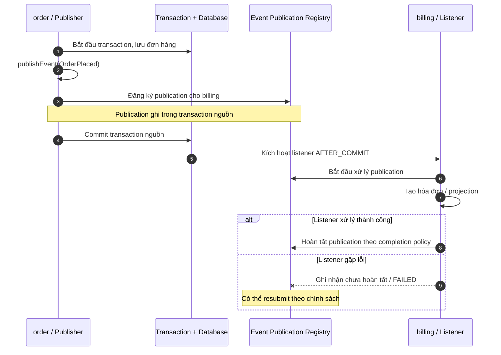
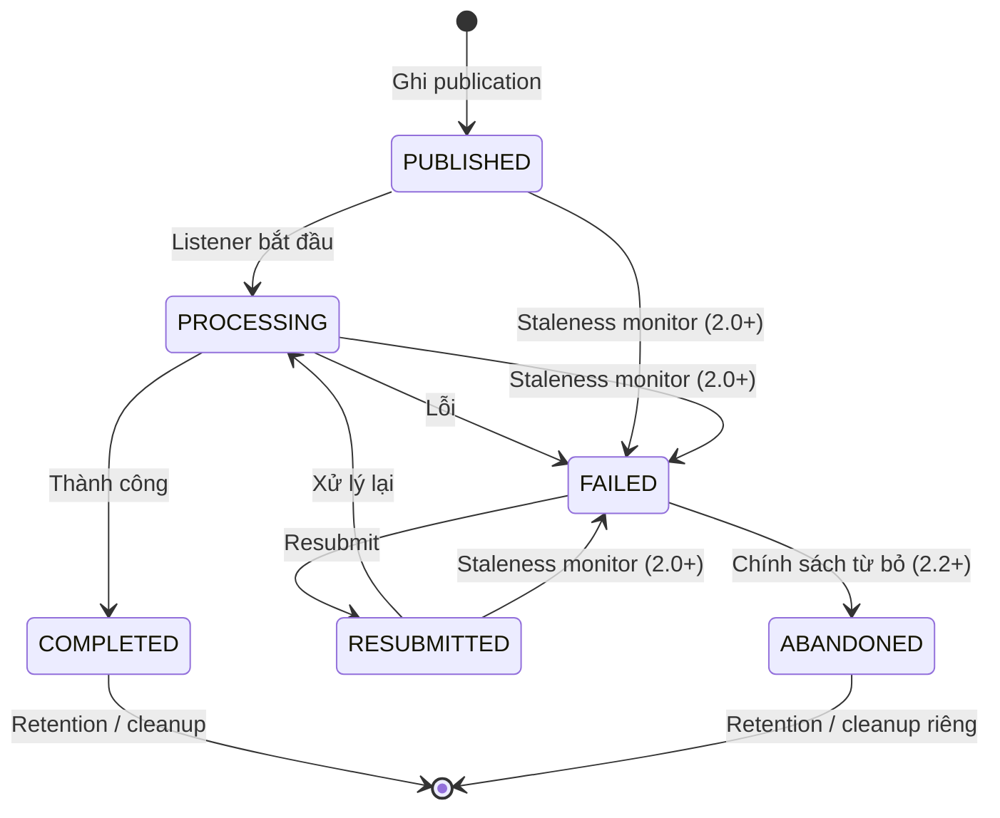
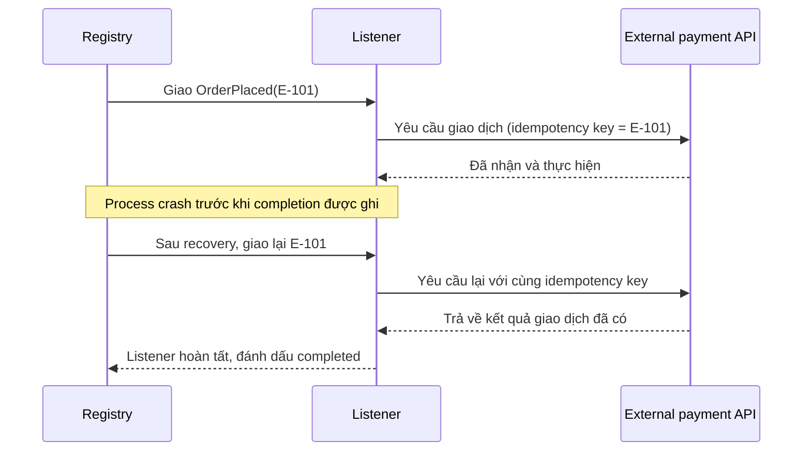

# Kết thúc vòng đời Event Publication trong Spring Modulith

## 1. Khi nào một event publication thực sự kết thúc?

Trong ứng dụng modular monolith, module `order` phát sự kiện `OrderPlaced` sau khi tạo đơn hàng; module `billing` nhận sự kiện để tạo bản ghi hóa đơn; module `notification` nhận cùng sự kiện để gửi thông báo. Các module giao tiếp qua **application events** nhằm giảm phụ thuộc trực tiếp và bảo vệ ranh giới nghiệp vụ.

Sẽ có ít nhất ba mốc khác nhau:

1. **Event được phát:** `ApplicationEventPublisher.publishEvent(...)` được gọi.
2. **Event publication được đăng ký:** Event Publication Registry, nếu được cấu hình, ghi nhận phần việc gửi cùng event tới **từng transactional listener**.
3. **Publication hoàn tất:** listener tương ứng chạy thành công và hạ tầng ghi nhận kết quả theo chính sách completion.

Ba mốc này **không đồng nghĩa**. Việc publisher trả về từ `publishEvent(...)` không chứng minh mọi listener bất đồng bộ đã xử lý. Việc order transaction commit cũng không chứng minh email đã gửi. Và việc một publication của `billing` hoàn tất không đồng nghĩa publication khác dành cho `notification` cũng đã hoàn tất.

**Kết thúc vòng đời publication** trong Spring Modulith chủ yếu là việc ghi nhận **một lượt giao event tới một listener đích** đã xử lý thành công, hoặc quản lý những trường hợp cuối cùng không tiếp tục giao lại. Sau đó ứng dụng quyết định giữ, chuyển vào kho lưu hoặc xóa bản ghi để cân bằng khả năng audit và tài nguyên vận hành.

> Bài này thuộc chương **Chu kỳ phát hành** của dịch vụ học **SPRING_MODULITH_APPLICATION_EVENTS**. Trọng tâm là completion, trạng thái cuối, transaction và lưu trữ publication. Các chủ đề publisher, after-commit, registry, retry, kiểm thử và quan sát được dùng như bối cảnh để giải thích khi nào có thể kết luận một publication đã hoàn tất.

### 1.1. Phân biệt domain event và publication

- **Domain event** `OrderPlaced`: sự thật nghiệp vụ “đơn hàng đã được tạo”, do module `order` sở hữu; có thể mang `eventId`, `orderId` và dữ liệu cần cho consumer.
- **Event publication**: bản ghi hạ tầng cho việc chuyển **một event cụ thể** đến **một listener cụ thể**. Cùng một event có thể sinh nhiều publication.
- **Completion**: kết quả hạ tầng ghi nhận một publication đã được listener xử lý thành công theo ngữ nghĩa quản lý đã cấu hình.
- **Business completion**: một quy trình kinh doanh rộng hơn đã hoàn tất, ví dụ đơn đã thu tiền, xuất hóa đơn và giao hàng. Không nên suy ra business completion chỉ từ một publication completed.

Giả sử event `E-101` có hai listener:

| Publication | Event nguồn | Listener đích | Trạng thái |
| --- | --- | --- | --- |
| `P-1` | `OrderPlaced(E-101)` | `BillingOnOrderPlaced` | `COMPLETED` |
| `P-2` | `OrderPlaced(E-101)` | `NotificationOnOrderPlaced` | `FAILED` |

Kết luận đúng: `billing` đã xử lý thành công publication của mình; `notification` chưa hoàn tất và cần điều tra hoặc khôi phục. Không thể đánh dấu **cả event** là “mọi việc đã xong” chỉ vì `P-1` thành công.

## 2. Vòng đời từ publish đến completion

Trong cấu hình có Event Publication Registry và transactional listener được theo dõi, luồng chuẩn:



**Điều kiện vận hành:** Event Publication Registry cần implementation lưu trữ phù hợp (ví dụ Spring Modulith starter JDBC/JPA, kèm database và transaction). Nếu chỉ gọi `publishEvent(...)` với listener Spring thông thường mà **không có registry persistence**, ứng dụng không tự có publication log bền vững để truy vấn hoặc khôi phục.

Spring Modulith mặc định xét các listener được (meta-)annotate bằng `@TransactionalEventListener` khi tạo publication. `@ApplicationModuleListener` là annotation tiện lợi kết hợp transactional listener sau commit, xử lý bất đồng bộ và transaction riêng. Có thể giới hạn annotation kích hoạt registry bằng cấu hình `spring.modulith.events.registry-trigger-annotation`; khi đó listener ngoài phạm vi sẽ không có bản ghi được quản lý như sơ đồ trên.

### 2.1. Transaction nguồn có thể rollback

Event publication log được ghi cùng **transaction nghiệp vụ nguồn** trong trường hợp hỗ trợ giao dịch phù hợp:

- Nếu tạo đơn và publication commit thành công, publication trở thành công việc còn phải hoàn tất.
- Nếu transaction nguồn rollback, bản ghi publication gắn với transaction đó cũng rollback; listener theo `AFTER_COMMIT` không thực hiện như một giao dịch thành công.
- Nếu không có transaction nguồn, `@TransactionalEventListener` mặc định **không chạy** trừ khi có cấu hình fallback phù hợp. Cần thử tình huống này thay vì giả định mọi lần gọi `publishEvent(...)` đều tạo kết quả như nhau.

Một điểm quan trọng: lời gọi `publishEvent(...)` diễn ra trong code đồng bộ, nhưng việc hoàn tất listener `@ApplicationModuleListener` xảy ra **sau commit**, có thể trên thread khác. Không được dùng thời điểm phương thức publisher kết thúc làm thời điểm hoàn tất listener.

## 3. Cơ chế xác định completion

Khi Event Publication Registry đã đăng ký một publication cho một transactional listener được theo dõi, Spring Modulith gắn cơ chế quản lý quanh lời gọi listener. Khi xử lý thành công, registry chuyển publication sang trạng thái hoàn tất hoặc cập nhật/xóa/chuyển lưu trữ theo completion mode. Khi lỗi được phát hiện, publication không được coi là thành công; phiên bản Spring Modulith mới có trạng thái lỗi tường minh.

### 3.1. Thành công phải gắn với việc hoàn thành công việc thật

```java
package com.example.shop.billing.internal;

import com.example.shop.order.OrderPlaced;
import org.springframework.modulith.events.ApplicationModuleListener;
import org.springframework.stereotype.Component;

@Component
class BillingOnOrderPlaced {

    private final InvoiceProjection invoices;

    BillingOnOrderPlaced(InvoiceProjection invoices) {
        this.invoices = invoices;
    }

    @ApplicationModuleListener
    void on(OrderPlaced event) {
        // Hành động có thể retry an toàn.
        invoices.createOnce(event.eventId(), event.orderId());
    }
}
```

Ở đây, listener chỉ nên kết thúc bình thường khi `createOnce(...)` đã đạt yêu cầu nghiệp vụ. Nếu lỗi DB tạm thời khiến thao tác không hoàn tất, để exception được ném ra ngoài sẽ giúp hạ tầng nhận biết publication còn cần xử lý lại.

**Anti-pattern:**

```java
@ApplicationModuleListener
void on(OrderPlaced event) {
    try {
        invoiceService.issueInvoice(event.orderId());
    } catch (Exception failure) {
        log.error("Invoice creation failed", failure);
        // Sai nếu cố ý nuốt lỗi và vẫn để method trả về thành công.
    }
}
```

Nếu listener nuốt exception và trả về thành công, hạ tầng có thể đánh dấu publication **COMPLETED**, dù nghiệp vụ tạo hóa đơn chưa hoàn tất. Nếu muốn chủ động chấp nhận một lỗi không cần retry, phải xác định rõ kết quả này có thực sự là **xử lý thành công theo hợp đồng** hay cần trạng thái từ bỏ/điều tra riêng.

### 3.2. Không nên tự gọi markCompleted trong logic thường

Spring Modulith cung cấp các API hạ tầng như `EventPublicationRegistry.markCompleted(...)`, nhưng với listener `@ApplicationModuleListener` được registry quản lý, đánh dấu hoàn tất **thường được framework thực hiện tự động**. Việc tự gọi `markCompleted` trước khi transaction hoặc side effect kết thúc có thể khiến publication biến mất khỏi hàng chờ phục hồi quá sớm.

Đối với ứng dụng, hướng ưu tiên là:

1. Định nghĩa listener đúng transaction và annotation.
2. Thực hiện logic idempotent, đảm bảo exception xuất hiện khi thất bại.
3. Chọn completion strategy ở cấu hình hạ tầng.
4. Dùng các API quan sát/quản lý publication cho nhiệm vụ vận hành, không tự thao túng trạng thái thành công trong nhánh nghiệp vụ thông thường.

## 4. Trạng thái publication qua các phiên bản Spring Modulith

**Spring Modulith 2.0 trở lên** có mô hình vòng đời tường minh `EventPublication.Status`. **Spring Modulith 2.2 trở lên** bổ sung trạng thái `ABANDONED`. Dự án dùng 1.x có thể có mô hình completion và API quản lý khác; cần tra đúng tài liệu phiên bản đang chạy, không áp nguyên máy trạng thái 2.2 cho 1.x.

| Trạng thái | Ý nghĩa | Có thể coi xử lý nghiệp vụ đã thành công? |
| --- | --- | --- |
| `PUBLISHED` | Publication đã được ghi, đang chờ hoặc sắp được listener xử lý | Chưa |
| `PROCESSING` | Listener đang được gọi để xử lý | Chưa |
| `COMPLETED` | Lời gọi listener thành công và được ghi nhận hoàn tất | Có, trong **phạm vi contract listener** |
| `FAILED` | Lời gọi listener lỗi hoặc bị đánh dấu lỗi do quá thời gian theo cấu hình | Chưa |
| `RESUBMITTED` | Publication lỗi đã được đưa vào quy trình xử lý lại | Chưa |
| `ABANDONED` *(từ 2.2)* | Chính sách quyết định ngừng cố gắng xử lý tiếp | **Không**; đây là kết thúc do từ bỏ |



Sơ đồ chỉ mô tả các chuyển trạng thái đáng quan tâm. Từng đường chuyển chịu ảnh hưởng của version, staleness configuration, resubmission policy, persistence và transaction. Không nên suy diễn từ sơ đồ rằng monitor hoặc retry đã tự được bật trong một dự án cụ thể.

### 4.1. Hai kiểu kết thúc rất khác nhau

**`COMPLETED`:** listener đã được thực thi thành công theo contract của nó. Ví dụ projection của `billing` được ghi vào database và completion được lưu lại.

**`ABANDONED`:** sự kiện **không được xử lý thành công**, nhưng hệ thống có quyết định rõ rằng publication sẽ không được tự đưa lại vào luồng retry. Ví dụ payload đã lỗi schema không thể deserialize, hoặc hệ thống đích trả lỗi vĩnh viễn. Trạng thái này có từ Spring Modulith 2.2 và thường cần kênh điều tra/bù trừ nghiệp vụ.

**Không được trình bày cả hai là “thành công”.** `ABANDONED` là trạng thái cuối về chính sách xử lý, không chứng minh yêu cầu kinh doanh đã đạt.

### 4.2. Số lần thử và lần resubmit cuối

Từ 2.0, publication có thể cung cấp `getCompletionAttempts()` và `getLastResubmissionDate()`. Số lần thử tăng khi bắt đầu lần gọi listener ở trạng thái `PROCESSING`; điều này có ích khi listener crash giữa chừng. Chính sách hồi phục có thể xét khoảng thời gian từ lần thử cuối, số attempt và loại event.

Lưu ý `completionAttempts` là **số lần thử thực thi listener**, không phải số lần một giao dịch nghiệp vụ được hoàn tất, cũng không thay thế `eventId` bất biến của event.

## 5. Completion mode: UPDATE, DELETE và ARCHIVE

Spring Modulith hỗ trợ thuộc tính:

```properties
spring.modulith.events.completion-mode=update
```

Đây là giá trị mặc định. Từ Spring Modulith 1.3, có ba cách lưu kết quả hoàn tất:

| Chế độ | Khi listener hoàn tất | Có truy vấn được completed qua `CompletedEventPublications`? | Tác động vận hành |
| --- | --- | --- | --- |
| `UPDATE` *(mặc định)* | Đặt completion date và cập nhật bản ghi publication hiện tại | Có | Cần dọn bản ghi cũ theo retention |
| `DELETE` | Xóa bản ghi publication khi hoàn tất | Không còn bản ghi completed để truy vấn | Ít phải dọn completed ở registry, giảm lịch sử audit |
| `ARCHIVE` | Di chuyển publication đã hoàn tất sang vùng lưu trữ archive và ghi completion date | Có, qua abstraction hoàn tất | Giảm tải dữ liệu active, cần quản lý kích thước archive |

### 5.1. UPDATE: giữ dấu vết để quan sát

```properties
spring.modulith.events.completion-mode=update
```

Ví dụ sau listener thành công:

```text
EVENT_PUBLICATION (minh họa)
id             = P-1
event_type     = OrderPlaced
listener_id    = BillingOnOrderPlaced...
publication_at = 2026-11-25T08:00:00Z
completion_at  = 2026-11-25T08:00:02Z
status         = COMPLETED       (mô hình 2.0+)
```

Đây là sơ đồ logic của bản ghi, **không phải tên cột SQL chính xác áp dụng cho mọi backend**. Tên bảng/cột, cấu trúc archived và thông tin status khác theo technology/phiên bản. Không viết ứng dụng phụ thuộc cứng vào hình minh họa này.

**Ưu điểm:** truy được listener nào đã xử lý event khi nào, đo thời gian hoàn tất và điều tra hành vi sau triển khai.

**Giá phải trả:** nếu không purge các publication đã hoàn tất, bảng/collection sẽ tăng mãi, khiến truy vấn, index và backup ngày càng tốn tài nguyên. Cần policy lưu trữ, backup và lịch dọn dữ liệu định kỳ.

### 5.2. DELETE: xóa ngay khi hoàn tất

```properties
spring.modulith.events.completion-mode=delete
```

Khi listener thành công, registry xóa bản ghi tương ứng. Vì vậy, `CompletedEventPublications` thường không có bản ghi hoàn tất để trả về. Đây là **lựa chọn về retention**, không phải lời hứa listener chạy nhanh hơn hay bảo đảm exactly-once.

Phù hợp khi:

- Hệ thống không cần tra cứu lịch sử publication completed trong registry.
- Lịch sử nghiệp vụ cần thiết đã có ở bảng chuyên dụng, audit log hoặc telemetry được quản lý riêng.
- Dữ liệu completed chiếm dung lượng lớn và không có yêu cầu giữ trong registry.

Hạn chế: khi điều tra “listener `billing` xử lý sự kiện `E-101` lúc nào?”, bản ghi publication có thể đã bị xóa. Không thể suy ra rằng “không tìm thấy publication” có nghĩa mọi thứ thành công; có thể do completion mode, retention, rollback, registry không hoạt động hoặc sai identifier.

### 5.3. ARCHIVE: chuyển lịch sử ra khỏi kho active

```properties
spring.modulith.events.completion-mode=archive
```

Registry chuyển một publication đã hoàn tất từ vùng lưu active sang vùng archive tương ứng. Với relational database, thường có bảng archive; backend khác có thể sử dụng collection hoặc node. `CompletedEventPublications` vẫn có thể đọc những bản completed được lưu trữ.

Phù hợp khi cần:

- Giữ lịch sử để kiểm toán, đối soát hoặc phân tích lỗi lâu dài.
- Giảm khối lượng dữ liệu hoàn tất trong bảng active.
- Có chính sách dọn archive theo thời gian, chẳng hạn dữ liệu cũ hơn 90 ngày.

**ARCHIVE không đồng nghĩa “lưu vĩnh viễn”.** Nếu archive không có retention, nó cũng phình lớn. Cần phân biệt archive publication kỹ thuật với kho audit nghiệp vụ có yêu cầu pháp lý và schema riêng.

### 5.4. Chọn chế độ theo mục tiêu

| Nhu cầu | Gợi ý | Cần chú ý |
| --- | --- | --- |
| Phát triển, điều tra dễ dàng | `UPDATE` | Dùng retention để dọn bản ghi cũ |
| Sản phẩm không cần lịch sử completed | `DELETE` | Phải có metrics/log nếu muốn xác minh lịch sử |
| Vận hành cần lịch sử nhưng bảng active phải gọn | `ARCHIVE` | Quản lý schema, index và retention archive |
| Hệ thống cần audit nghiệp vụ lâu dài | Chọn mode theo nhu cầu kỹ thuật và lưu audit riêng | Publication registry không thay thế nhật ký nghiệp vụ chuẩn |

**Lưu ý phiên bản:** trong Spring Modulith 2.2, completion mode cũng ảnh hưởng cách lưu các publication `ABANDONED`. Vì vậy, nếu chọn `DELETE` và kỳ vọng tra cứu lịch sử “từ bỏ”, cần kiểm tra chính xác behavior tương ứng; đừng đánh đồng xóa dữ liệu với xử lý thành công.

## 6. Khi nào ghi completion: in-listener và in-interceptor

Ngoài câu hỏi **sau khi hoàn tất có giữ bản ghi không**, còn câu hỏi **thao tác cập nhật completion được thực hiện trong transaction nào**. Đây là hai chiều cấu hình khác nhau.

Tài liệu Spring Modulith 2.2 có:

```properties
spring.modulith.events.completion=in-listener
```

`in-listener` là lựa chọn mặc định trong phiên bản tài liệu này. Với transactional listener phù hợp, completion được ghi ngay trước lúc transaction của listener commit, giúp cập nhật trạng thái publication **nguyên tử cùng công việc của listener** khi chúng dùng cùng tài nguyên giao dịch được hỗ trợ.

Một lựa chọn khác:

```properties
spring.modulith.events.completion=in-interceptor
```

`in-interceptor` đánh dấu publication hoàn tất trong một transaction riêng sau khi listener kết thúc. Việc này có thể tạo một khoảng thời gian: công việc nghiệp vụ đã commit, nhưng dấu completion chưa được ghi. Nếu process crash ở khoảng đó, publication có thể được phát lại.

| Nội dung | `in-listener` | `in-interceptor` |
| --- | --- | --- |
| Thời điểm hoàn tất | Trước commit listener transaction | Sau khi listener xong, trong transaction riêng |
| Khi nghiệp vụ và registry dùng chung transaction | Có thể commit công việc và completion nguyên tử | Có khoảng trống giữa hai transaction |
| Khi ghi completion lỗi | Có thể làm rollback transaction listener | Công việc listener có thể đã commit |
| Có loại bỏ mọi khả năng xử lý lặp? | Không | Không |
| Bắt buộc vẫn cần idempotency? | Có | Có |

**Ranh giới áp dụng:** nếu listener ghi ra API ngoài, gửi email hoặc ghi database khác không chung transaction, `in-listener` **không biến các side effect đó thành atomic** với registry. Cần khóa idempotency, outbox hoặc trạng thái đối soát ở hệ thống ngoài. Hành vi chính xác phụ thuộc transaction manager, persistence backend và version; phải kiểm tra trên cấu hình thật.

### 6.1. Những gì không đủ để khẳng định “đã xong”

Không nên coi các dấu hiệu sau là chứng cứ hoàn tất mọi nghiệp vụ:

- Logger đã in “start processing”.
- Listener bắt đầu chạy trên executor.
- `publishEvent(...)` đã return.
- Transaction đơn hàng nguồn đã commit.
- Broker trả ACK rằng message **đã được chấp nhận gửi đi**, nhưng consumer đích chưa xử lý.
- Một listener thành công, dù event có nhiều listeners.
- Một publication bị `ABANDONED` do chính sách từ bỏ.

Điểm “hoàn tất” phải được định nghĩa **theo consumer và side effect thực tế**.

## 7. Ví dụ xuyên suốt: OrderPlaced → Billing projection → COMPLETED

Ví dụ này dùng **Spring Boot, Spring Modulith, PostgreSQL và JDBC** để minh họa một publication kết thúc bằng cách tạo projection có thể retry an toàn. Mỗi module vẫn nằm trong một ứng dụng, không cần HTTP call giữa `order` và `billing`.

### 7.1. Tổ chức package

```text
com.example.shop
├── ShopApplication.java
├── order/
│   ├── OrderPlaced.java                API event công khai
│   └── OrderManagement.java            publisher
└── billing/
    └── internal/
        ├── BillingOnOrderPlaced.java  listener
        └── InvoiceProjection.java     persistence nội bộ
```

Chọn phiên bản Spring Modulith tương thích với Spring Boot của dự án. Ví dụ Gradle (dependency versions qua BOM/dependency management tương thích):

```groovy
dependencies {
    implementation 'org.springframework.boot:spring-boot-starter-jdbc'
    implementation 'org.springframework.modulith:spring-modulith-starter-jdbc'
    runtimeOnly 'org.postgresql:postgresql'

    testImplementation 'org.springframework.boot:spring-boot-starter-test'
    testImplementation 'org.springframework.modulith:spring-modulith-starter-test'
}
```

Starter JDBC của Spring Modulith cung cấp registry persistence qua JDBC và event serializer phù hợp trong các bản được hỗ trợ. Ứng dụng vẫn cần cấu hình `DataSource`, transaction manager, schema cho domain tables và schema của registry theo cấu hình/version. Nếu quản lý schema bằng Flyway/Liquibase, cần khai báo migration phù hợp.

### 7.2. Tạo bảng minh họa cho nghiệp vụ

Với PostgreSQL:

```sql
CREATE TABLE shop_order (
    id UUID PRIMARY KEY,
    state VARCHAR(32) NOT NULL
);

CREATE TABLE invoice_projection (
    source_event_id UUID PRIMARY KEY,
    order_id UUID NOT NULL,
    created_at TIMESTAMPTZ NOT NULL
);
```

Đây chỉ là **hai bảng nghiệp vụ của ví dụ**. Bảng publication của Spring Modulith là **hạ tầng riêng**, có schema/version riêng và không được tự tạo tùy ý bằng cách sao chép bảng `invoice_projection`.

Khóa `source_event_id` UNIQUE (PRIMARY KEY) ngăn listener tạo trùng projection cho cùng một event dù publication được giao lại.

### 7.3. Event công khai và publisher

File `order/OrderPlaced.java`:

```java
package com.example.shop.order;

import java.util.UUID;

public record OrderPlaced(UUID eventId, UUID orderId) {}
```

File `order/OrderManagement.java`:

```java
package com.example.shop.order;

import java.util.UUID;
import org.springframework.context.ApplicationEventPublisher;
import org.springframework.jdbc.core.JdbcTemplate;
import org.springframework.stereotype.Service;
import org.springframework.transaction.annotation.Transactional;

@Service
public class OrderManagement {

    private final JdbcTemplate jdbc;
    private final ApplicationEventPublisher events;

    public OrderManagement(JdbcTemplate jdbc, ApplicationEventPublisher events) {
        this.jdbc = jdbc;
        this.events = events;
    }

    @Transactional
    public UUID placeOrder() {
        UUID orderId = UUID.randomUUID();
        UUID eventId = UUID.randomUUID();

        jdbc.update(
                "INSERT INTO shop_order (id, state) VALUES (?, ?)",
                orderId, "PLACED");

        events.publishEvent(new OrderPlaced(eventId, orderId));
        return orderId;
    }
}
```

Khi sử dụng transactional listeners được registry theo dõi, publication được đăng ký trong **transaction nguồn** của `placeOrder()`. Nếu SQL insert thất bại và transaction rollback, không thể coi việc tạo đơn thành công; các publication tương ứng không được commit để xử lý sau đó.

### 7.4. Listener hoàn tất phần việc của billing

File `billing/internal/InvoiceProjection.java`:

```java
package com.example.shop.billing.internal;

import java.time.OffsetDateTime;
import java.time.ZoneOffset;
import java.util.UUID;
import org.springframework.jdbc.core.JdbcTemplate;
import org.springframework.stereotype.Component;

@Component
class InvoiceProjection {

    private final JdbcTemplate jdbc;

    InvoiceProjection(JdbcTemplate jdbc) {
        this.jdbc = jdbc;
    }

    void createOnce(UUID eventId, UUID orderId) {
        jdbc.update("""
            INSERT INTO invoice_projection
                (source_event_id, order_id, created_at)
            VALUES (?, ?, ?)
            ON CONFLICT (source_event_id) DO NOTHING
            """, eventId, orderId, OffsetDateTime.now(ZoneOffset.UTC));
    }
}
```

`ON CONFLICT ... DO NOTHING` là cú pháp **PostgreSQL** trong ví dụ. Hệ quản trị khác cần UPSERT tương đương hoặc cách xử lý unique constraint phù hợp với transaction. Không thay `ON CONFLICT` bằng kiểm tra `SELECT` rồi `INSERT` thiếu unique constraint, vì hai attempt đồng thời có thể cùng thấy “chưa tồn tại”.

File `billing/internal/BillingOnOrderPlaced.java`:

```java
package com.example.shop.billing.internal;

import com.example.shop.order.OrderPlaced;
import org.springframework.modulith.events.ApplicationModuleListener;
import org.springframework.stereotype.Component;

@Component
class BillingOnOrderPlaced {

    private final InvoiceProjection projection;

    BillingOnOrderPlaced(InvoiceProjection projection) {
        this.projection = projection;
    }

    @ApplicationModuleListener
    void on(OrderPlaced event) {
        projection.createOnce(event.eventId(), event.orderId());
        // Method trả về bình thường khi DB đã chấp nhận ghi projection.
    }
}
```

Đây là ví dụ về một việc có ý nghĩa rõ ràng và có thể lặp an toàn. Listener không cần gọi repository nội bộ của `order`, mà chỉ tham chiếu `OrderPlaced` ở **API công khai** của module nguồn.

**Đường thành công:** transaction `order` commit → listener được kích hoạt → PostgreSQL ghi projection hoặc nhận diện event đã xử lý → listener hoàn tất bình thường → publication được đánh dấu completed theo cấu hình.

**Đường thất bại:** PostgreSQL không thể kết nối hoặc câu SQL ném exception → listener không hoàn tất thành công → publication chưa thể được coi là completed; hệ thống có thể resubmit theo chính sách. Cần điều tra nếu listener lỗi liên tục do dữ liệu hoặc schema không tương thích.

### 7.5. Đăng ký scheduling khi cần retention

File `ShopApplication.java`:

```java
package com.example.shop;

import org.springframework.boot.SpringApplication;
import org.springframework.boot.autoconfigure.SpringBootApplication;
import org.springframework.scheduling.annotation.EnableScheduling;

@SpringBootApplication
@EnableScheduling
public class ShopApplication {

    public static void main(String[] args) {
        SpringApplication.run(ShopApplication.class, args);
    }
}
```

`@EnableScheduling` phục vụ job dọn retention ở phần 8; nó **không tự kích hoạt resubmit publication** và không nên được hiểu là bảo đảm việc kiểm tra staleness của framework đã được cấu hình.

## 8. Quản lý bản ghi đã hoàn tất

Spring Modulith cung cấp API `CompletedEventPublications` trong `spring-modulith-events-api`, thường có sẵn khi dùng starter registry phù hợp. Hai phương thức thường dùng:

- `findAll()`: xem các publication đã hoàn tất còn được lưu.
- `deletePublicationsOlderThan(Duration)`: xóa publication hoàn tất có **completion date** cũ hơn khoảng thời gian chỉ định.

### 8.1. Job dọn completed cũ theo chính sách

Ví dụ chính sách **30 ngày sau completion**, chạy vào 03:00 UTC mỗi ngày:

```java
package com.example.shop;

import java.time.Duration;
import org.springframework.modulith.events.CompletedEventPublications;
import org.springframework.scheduling.annotation.Scheduled;
import org.springframework.stereotype.Component;

@Component
class CompletedPublicationCleanup {

    private final CompletedEventPublications completed;

    CompletedPublicationCleanup(CompletedEventPublications completed) {
        this.completed = completed;
    }

    @Scheduled(cron = "0 0 3 * * *", zone = "UTC")
    void deleteOldCompletedPublications() {
        completed.deletePublicationsOlderThan(Duration.ofDays(30));
    }
}
```

Phương thức trên có tác dụng khi có completed publications được lưu theo `UPDATE` hoặc `ARCHIVE`. Với `DELETE`, completed entries đã bị xóa ngay nên việc dọn loại này thường không còn dữ liệu để tác động.

**Trước khi áp dụng production**, cần xác định retention thật, quan hệ với audit, thủ tục backup, thời gian điều tra lỗi và chính sách dữ liệu nhạy cảm. Nhiều instance cùng chạy `@Scheduled` có thể cùng thực hiện cleanup; nên bố trí một job/lock phân tán hoặc cơ chế chạy một lần phù hợp với hệ thống.

### 8.2. Completion date khác publication date

Một publication phát ngày 1 nhưng chỉ được xử lý thành công ngày 10 vì lỗi và retry. Nếu retention là **30 ngày sau completion**, thời gian tính từ **ngày 10**, không phải ngày 1. `CompletedEventPublications.deletePublicationsOlderThan(Duration)` xét completion date theo API này.

Không nên dùng điều kiện “event đã publish lâu hơn 30 ngày” để dọn **incomplete/failed** vì có thể xóa nhiệm vụ chưa xử lý. Mọi tác vụ dọn phải phân biệt rõ **trạng thái** và **loại timestamp**.

### 8.3. Giữ audit nghiệp vụ độc lập

Publication registry là hạ tầng quản lý việc giao event. Nó không thay thế:

- Nhật ký nghiệp vụ về đơn hàng/hóa đơn đã được quyết định.
- Bảng idempotency của từng consumer.
- Audit trail theo yêu cầu tuân thủ hoặc đối soát.
- Observability với trace, log và metrics có retention riêng.

Nếu chọn `DELETE`, dữ liệu publication completed không còn, nhưng dữ liệu nghiệp vụ cần thiết vẫn phải được lưu ở nơi phù hợp. Nếu chọn `ARCHIVE`, vẫn cần xác định retention và phương án truy vấn/backup cho vùng archive.

## 9. Khi không thể completion: FAILED, retry và ABANDONED

Không phải publication nào cũng kết thúc thành công ngay lần đầu:

```text
E-101 → billing publication:
   PUBLISHED → PROCESSING → FAILED → RESUBMITTED → PROCESSING → COMPLETED

E-101 → email publication:
   PUBLISHED → PROCESSING → FAILED → ABANDONED (2.2+ nếu policy cho phép)
```

### 9.1. Resubmit publication lỗi

Từ Spring Modulith 2.0, ứng dụng có thể sử dụng `FailedEventPublications` cùng `ResubmissionOptions`. Một ví dụ vận hành đơn giản:

```java
package com.example.shop;

import org.springframework.modulith.events.FailedEventPublications;
import org.springframework.modulith.events.ResubmissionOptions;
import org.springframework.stereotype.Component;

@Component
class FailedPublicationRecovery {

    private final FailedEventPublications failed;

    FailedPublicationRecovery(FailedEventPublications failed) {
        this.failed = failed;
    }

    void retryFailed() {
        // Chỉ gọi từ một job/đường quản trị có giới hạn tần suất phù hợp.
        failed.resubmit(ResubmissionOptions.defaults());
    }
}
```

Không nên tự gọi `retryFailed()` trong mọi request HTTP; số lượng publication lỗi lớn có thể gây tải cao hoặc làm trầm trọng thêm sự cố. Với production cần điều chỉnh `ResubmissionOptions` (batch size, max in-flight, min age, filter) theo mức chịu tải và số lần thử, tránh lặp vô hạn với lỗi cố định.

API `IncompleteEventPublications` vẫn hữu ích trong các phiên bản cũ. Tuy nhiên, trong API Spring Modulith 2.2, abstraction này đã được đánh dấu **deprecated** cho kế hoạch loại bỏ sau này. Khi nhắm phiên bản mới, nên ưu tiên các API `FailedEventPublications`/`CompletedEventPublications`/`AbandonedEventPublications` phù hợp mục tiêu, và kiểm tra lại release notes trước nâng cấp.

### 9.2. Staleness không tự bật mặc định

Từ 2.0 có **Staleness Monitor**: những publication ở `PUBLISHED`, `PROCESSING` hoặc `RESUBMITTED` vượt ngưỡng thời gian đã cấu hình có thể được đánh dấu `FAILED` để tiến hành hồi phục. Các ngưỡng `spring.modulith.events.staleness.published`, `processing` và `resubmitted` mặc định bằng zero; nếu cả ba vẫn zero thì monitor không tự chạy đánh dấu lỗi.

Ví dụ cấu hình **chỉ để minh họa**:

```properties
spring.modulith.events.staleness.published=PT10M
spring.modulith.events.staleness.processing=PT30M
spring.modulith.events.staleness.resubmitted=PT10M
spring.modulith.events.staleness.check-interval=PT1M
```

Ngưỡng phải lớn hơn thời gian xử lý hợp lệ của listener. Nếu một listener thường xử lý 45 phút mà đặt `processing=PT5M`, monitor có thể đánh dấu FAILED trong khi công việc thực tế vẫn đang chạy; resubmit sớm có nguy cơ **xử lý đồng thời** và tạo side effect lặp.

### 9.3. ABANDONED: từ bỏ có chủ đích (2.2+)

Trong Spring Modulith 2.2, `AbandonPolicy` có thể quyết định publication đang lỗi sẽ chuyển sang `ABANDONED` thay vì tiếp tục xuất hiện trong nhóm lỗi được resubmit. Framework cũng có thuộc tính:

```properties
spring.modulith.events.resubmission.abandon-after-attempts=5
```

Ví dụ này đặt ngưỡng theo chính sách giả định; **mặc định là `-1`**, tức không tự từ bỏ theo số attempt nếu không có chính sách riêng. Việc quyết định abandon được đánh giá khi **listener thực sự thất bại**, không tự động áp dụng hồi tố cho mọi bản ghi FAILED trước khi cấu hình được bật.

Publication `ABANDONED` không có nghĩa nghiệp vụ đã xong. Cần kênh điều tra, đối soát hoặc bù trừ; chỉ purge những bản abandoned sau khi đã thực hiện quy trình vận hành phù hợp. `AbandonedEventPublications` (2.2+) hỗ trợ xem và quản lý các publication đó.

## 10. Completion không tương đương exactly-once

Giả sử listener gọi cổng thanh toán, cổng đã nhận yêu cầu, rồi process Java crash trước khi registry kịp ghi completion. Khi publication được resubmit, cổng thanh toán có thể nhận yêu cầu **lần thứ hai**.



Để xử lý an toàn:

1. **Event ID bất biến:** cùng domain event bị giao lại giữ cùng `eventId`.
2. **Consumer idempotency:** kiểm tra đã xử lý theo `(listener, eventId)` hoặc khóa nghiệp vụ thích hợp; dùng unique constraint/UPSERT bảo vệ trước race.
3. **External side effects:** nếu cổng thanh toán/email hỗ trợ idempotency key, gửi cùng key cho những attempt của cùng tác vụ; nếu không, cần chiến lược đối soát.
4. **Atomic completion khi có thể:** ưu tiên completion cùng transaction với thay đổi database nội bộ; hiểu rõ các trường hợp không dùng chung resource.
5. **Retry có giới hạn:** theo dõi số attempt và thời gian lỗi; không resubmit không kiểm soát.

Sự hiện diện của `COMPLETED` không phải một bằng chứng toán học rằng side effect bên ngoài chỉ diễn ra đúng một lần. Nó chứng minh **hạ tầng đã ghi nhận listener thành công theo contract và transaction hiện có**. Exactly-once xuyên hai hệ thống độc lập đòi hỏi cơ chế bổ sung hoặc giới hạn rõ ràng.

### 10.1. Một publication có thể hoàn tất nhưng workflow vẫn chưa hoàn tất

Module `notification` có thể chỉ ghi một hàng `outgoing_email` vào outbox và trả về thành công. Khi đó publication từ `OrderPlaced` tới `notification` đã completed vì nhiệm vụ của listener là **xếp hàng gửi email**. Việc SMTP provider thực sự chấp nhận/giao email xảy ra sau đó, theo workflow khác.

Nếu hợp đồng listener cam kết “email đã được gửi”, việc chỉ đưa vào hàng chờ chưa đủ. Hãy đặt tên sự kiện, trách nhiệm listener, tiêu chí completion và trạng thái nghiệp vụ sao cho không gây hiểu nhầm.

## 11. Quan sát vòng đời đã kết thúc

Hệ thống nên theo dõi đủ để biết **publication đang tồn đọng ở đâu và đã kết thúc thế nào**:

| Chỉ số/tín hiệu đề xuất | Câu hỏi được trả lời | Lưu ý |
| --- | --- | --- |
| Số publication `PUBLISHED` | Có bao nhiêu publication đang chờ? | Cần phân biệt traffic bình thường và stuck |
| Số publication `PROCESSING` | Đang có bao nhiêu listener chạy? | So với số worker và thời gian chạy |
| Số `FAILED` và tuổi bản ghi lỗi | Có nhiệm vụ nào cần xử lý lại? | Alert theo tuổi và mức nghiêm trọng |
| Số `ABANDONED` (2.2+) | Có công việc đã bị từ bỏ không? | Cần quy trình xử lý thủ công/bù trừ |
| Completed latency | Publication mất bao lâu từ publish tới hoàn tất? | Dùng publication/completion date khi được lưu |
| Completion attempts | Listener mất bao nhiêu lần để thành công? | Có thể chỉ rõ điểm nóng lỗi |
| Tốc độ tăng completed/archived | Retention có đủ giữ dữ liệu gọn? | Phụ thuộc completion mode |
| Kết quả job cleanup | Có đang xóa đúng bản completed cũ? | Không dọn nhầm bản chưa xử lý |
| Lỗi serializer khi recovery | Event cũ có còn đọc được không? | Quan trọng sau deploy/đổi schema |

Đây là **đề xuất observability của ứng dụng**, không khẳng định Spring Modulith tự phát sẵn mọi metric theo đúng tên bảng trên. Có thể tích hợp Micrometer/Actuator, log và truy vấn registry riêng tùy khả năng phiên bản/deployment.

### 11.1. Log nên chứa những gì?

```json
{
  "eventType": "OrderPlaced",
  "eventId": "7cd398a6-1014-4c02-8b7f-896611be9d7b",
  "targetListener": "BillingOnOrderPlaced",
  "publicationId": "b62b01f8-681d-4d6b-a4d1-83a4cd08caaf",
  "status": "COMPLETED",
  "completionAttempts": 2,
  "elapsedMs": 835
}
```

JSON trên là **cấu trúc log giả định do nhóm phát triển thiết kế**; tên trường/ID không phải hợp đồng log mặc định Spring Modulith. `publicationId` là ID hạ tầng, khác `eventId` của domain event. Thêm `correlationId` và `causationId` vào **event contract** nếu hệ thống cần truy vết chuỗi nghiệp vụ qua nhiều module.

Không log payload nhạy cảm hoặc token chỉ để điều tra completion; log ID an toàn và kiểm soát retention/truy cập.

## 12. Kiểm thử hoàn tất vòng đời

Để khẳng định một publication **thực sự được đánh dấu hoàn tất**, unit test listener đơn lẻ là chưa đủ. Cần integration test có transaction nguồn, registry backend và listener thật, đặc biệt nếu đang chọn `in-listener`/`in-interceptor` hoặc `ARCHIVE`.

### 12.1. Ma trận kiểm thử cần có

| Kịch bản | Kỳ vọng |
| --- | --- |
| Source transaction commit; listener thành công | Publication của listener chuyển thành completed hoặc được lưu theo mode |
| Source transaction rollback | Publication không còn commit để giao sau commit |
| Listener throw exception | Không có completion thành công; có trạng thái lỗi/chờ phục hồi |
| Hai listener cùng nhận event, một thành công một lỗi | Chỉ publication của listener thành công hoàn tất |
| Listener chết giữa xử lý | Có cơ chế phát hiện/tái xử lý theo version, staleness và recovery policy |
| Retry sau lỗi tạm thời | Cùng event ID; listener idempotent; publication cuối cùng hoàn tất |
| `UPDATE` | Completed entry còn, có completion date |
| `DELETE` | Completed entry bị xóa; `CompletedEventPublications` không còn thấy nó |
| `ARCHIVE` | Completed entry xuất hiện ở archive và có thể đọc qua abstraction phù hợp |
| Cleanup 30 ngày | Chỉ bản completed đủ cũ bị dọn |
| `ABANDONED` (2.2+) | Không bị coi completed; loại khỏi vòng resubmit tự động |
| Sau nâng cấp code/serializer | Publication cũ còn có thể deserialize/recover |

**Tránh test chỉ bằng `Thread.sleep()` cố định.** Vì listener bất đồng bộ, dùng cơ chế chờ có timeout và điều kiện có thể quan sát, rồi kiểm tra registry lẫn side effect.

### 12.2. Test idempotency cho phần việc của listener

Từ ví dụ PostgreSQL ở phần 7, một thử nghiệm có thể **gọi trực tiếp phần persistence hai lần** cho cùng event:

```java
package com.example.shop.billing.internal;

import static org.junit.jupiter.api.Assertions.assertEquals;

import java.util.UUID;
import org.junit.jupiter.api.Test;
import org.springframework.beans.factory.annotation.Autowired;
import org.springframework.boot.test.context.SpringBootTest;
import org.springframework.jdbc.core.JdbcTemplate;

@SpringBootTest
class InvoiceProjectionIdempotencyTests {

    @Autowired InvoiceProjection projection;
    @Autowired JdbcTemplate jdbc;

    @Test
    void duplicateEventCreatesOnlyOneProjection() {
        UUID eventId = UUID.randomUUID();
        UUID orderId = UUID.randomUUID();

        projection.createOnce(eventId, orderId);
        projection.createOnce(eventId, orderId);

        Integer count = jdbc.queryForObject(
                "SELECT COUNT(*) FROM invoice_projection WHERE source_event_id = ?",
                Integer.class, eventId);

        assertEquals(1, count);
    }
}
```

Ví dụ này cần **PostgreSQL/schema/database test thực** theo phần 7 (có thể dùng Testcontainers để dựng môi trường test). Nó kiểm tra tính idempotent của projection, **chưa kiểm tra registry completion**.

Một integration test thứ hai phải publish event **trong transaction thật**, đợi listener hoàn tất, rồi đối chiếu kết quả theo completion mode. Nếu chọn `UPDATE`, có thể dùng `CompletedEventPublications.findAll()` để quan sát bản completed còn lưu; nếu chọn `DELETE`, phải dựa vào side effect, trạng thái incomplete và log/telemetry phù hợp vì completed record đã bị xóa.

### 12.3. Kiểm chứng độ nguyên tử

Để thử `spring.modulith.events.completion=in-listener` trên backend hỗ trợ:

1. Gây lỗi ở phần ghi projection trước commit listener: projection không commit và publication không được ghi nhận completed.
2. Thử listener thành công: projection và completion được ghi cùng transaction khi sử dụng cùng transaction manager/resource theo cấu hình.
3. Thử ngoại lệ hoặc crash ở các ranh giới khác nhau; xác nhận cơ chế phục hồi không mất công việc.
4. Lặp lại với `in-interceptor` để hiểu khoảng trống giữa commit listener và commit trạng thái completion.

Không nên giả lập crash bằng cách giết tiến trình trên database dùng chung nếu bài test có thể làm hỏng dữ liệu quan trọng; hãy dùng database test riêng và môi trường có thể khôi phục.

## 13. Những lỗi thiết kế và vận hành thường gặp

| Sai lầm | Hậu quả | Cách xử lý |
| --- | --- | --- |
| Tưởng `publishEvent()` return nghĩa mọi listener đã xong | Đọc sai tình trạng xử lý sau commit/async | Quan sát từng publication/side effect |
| Một listener thành công nên đánh dấu toàn event complete | Bỏ sót publication lỗi của listener khác | Theo dõi theo từng listener đích |
| Nuốt exception sau khi tạo hóa đơn thất bại | Registry có thể ghi completed giả | Chỉ return thành công khi công việc thực sự xong |
| Tự `markCompleted` quá sớm | Publication không còn được retry khi nghiệp vụ chưa xong | Để framework quản lý completion của listener |
| Dùng `DELETE` nhưng đòi query lịch sử completed | Không có record để truy vấn | Chọn `UPDATE`/`ARCHIVE` hoặc audit riêng |
| Dùng `UPDATE`/`ARCHIVE` nhưng không có retention | Registry/archive tăng không giới hạn | Job dọn theo completion date và chính sách |
| Xóa mọi publication cũ theo publication date | Có nguy cơ xóa cả công việc chưa xử lý | Chỉ dọn completed/abandoned theo chính sách |
| Gộp `ABANDONED` vào `COMPLETED` | Báo cáo sai mức độ hoàn thành nghiệp vụ | Giữ hai trạng thái và quy trình riêng |
| Cấu hình staleness quá ngắn | Resubmit khi listener vẫn đang làm | Dùng ngưỡng theo worst-case runtime |
| Bật resubmit khi startup trên nhiều node mà không xem concurrency | Nhiều instance có thể xử lý cạnh tranh | Kiểm soát resubmission, cluster policy và idempotency |
| Coi registry là cơ chế exactly-once cho API ngoài | Dễ gửi email/thanh toán lặp | Dùng idempotency, outbox/đối soát |
| Đổi class/serializer làm bản ghi cũ không đọc được | Khó resubmit publication lịch sử | Kiểm thử backward compatibility trên registry |
| Chỉ test method listener rồi khẳng định completion | Không kiểm chứng registry/transaction | Integration test có DB, commit/rollback và chế độ lưu |

## 14. Bài thực hành: kết thúc vòng đời của một publication

**Bối cảnh:** một ứng dụng đặt hàng có module `order` phát `OrderPlaced` tới hai module `billing` và `notification`. Registry đã lưu được publication cho từng transactional listener. Ban đầu, `billing` xử lý thành công nhưng `notification` lỗi khi gửi email.

### Nhiệm vụ

1. Vẽ sơ đồ **hai publication** của cùng event và điền trạng thái riêng cho từng bản sau lần giao đầu tiên.
2. Cho listener `billing` lưu projection trong database và đưa `eventId` vào unique key để chống tạo bản ghi trùng.
3. Bật `completion-mode=update` và kiểm tra rằng publication thành công có completion date; publication lỗi không được coi là completed.
4. Dùng `FailedEventPublications` với policy phù hợp để xử lý lại publication của `notification` khi lỗi là tạm thời.
5. Thử chuyển sang `completion-mode=delete` rồi giải thích vì sao không còn query được completed history.
6. Thử `completion-mode=archive` ở môi trường hỗ trợ, xác nhận bản completed rời kho active nhưng còn truy vấn qua abstraction completed.
7. Đề xuất retention cho completed publications, ví dụ 30 ngày, và thiết kế job dọn không ảnh hưởng publication chưa hoàn tất.
8. Với Spring Modulith 2.2+, giả lập lỗi không thể phục hồi và đề xuất cách dùng `ABANDONED`, cơ chế cảnh báo và đối soát.
9. Giải thích tại sao “notification publication completed” không nhất thiết đồng nghĩa email được giao đến hộp thư người nhận nếu listener chỉ đẩy yêu cầu sang SMTP provider.

### Gợi ý đối chiếu

Sau lần xử lý đầu, có thể là `P-billing = COMPLETED`, `P-notification = FAILED`. Nếu notification retry thành công, publication của nó mới đạt `COMPLETED`. Với `UPDATE` giữ bản completed; `DELETE` xóa bản completed; `ARCHIVE` chuyển bản completed sang archive. `ABANDONED` là quyết định từ bỏ retry, **không phải** trạng thái hoàn thành thành công. Một bản completed không chứng minh business workflow của toàn đơn hàng đã hoàn tất.

## 15. Checklist triển khai kết thúc vòng đời an toàn

- [ ] Xác định rõ completion có nghĩa là gì đối với **từng listener**.
- [ ] Có Event Publication Registry persistence và transaction nguồn nếu cần độ tin cậy.
- [ ] Hiểu version Spring Modulith đang dùng: 1.x, 2.0 lifecycle hay 2.2 có `ABANDONED`.
- [ ] Có cơ chế phân biệt `PUBLISHED`, `PROCESSING`, `FAILED`, `COMPLETED`, `RESUBMITTED` và `ABANDONED` khi được hỗ trợ.
- [ ] Listener chỉ return thành công khi đạt đúng trách nhiệm; exception không bị nuốt.
- [ ] Chọn `completion-mode` (`UPDATE`/`DELETE`/`ARCHIVE`) theo yêu cầu audit và retention.
- [ ] Hiểu `completion=in-listener`/`in-interceptor` và tính nguyên tử với resource thật.
- [ ] Có idempotency theo `eventId`/consumer hoặc business key cho mọi side effect có thể lặp.
- [ ] Recovery, staleness và resubmission được cấu hình có giới hạn; không mặc định auto retry đã bật.
- [ ] Không coi `ABANDONED` là thành công; có đường xử lý và đối soát riêng.
- [ ] Có retention job chỉ dọn dữ liệu đủ điều kiện, xét đúng **completion date**.
- [ ] Có quan sát latency, số attempts, tồn đọng và lỗi serialize/replay.
- [ ] Integration test bao phủ commit, rollback, listener failure, duplicate delivery, cleanup và schema cũ.
- [ ] Tài liệu nêu ranh giới giữa hoàn tất **publication** và hoàn tất **nghiệp vụ end-to-end**.

**Kết luận:** trong Spring Modulith, kết thúc vòng đời publication là việc ghi nhận một **listener cụ thể** đã xử lý thành công một event và quản lý dấu vết sau đó. `UPDATE`, `DELETE` và `ARCHIVE` quyết định số phận bản ghi hoàn tất; `FAILED`/`RESUBMITTED`/`ABANDONED` xử lý những nhánh không thành công theo chính sách. Thiết kế completion đúng phải đi cùng transaction, idempotency, retry, quan sát và retention để application events vừa giảm phụ thuộc giữa module vừa được giao đáng tin cậy.

### Tài liệu tham khảo

- [Spring Modulith Reference — Working with Application Events](https://docs.spring.io/spring-modulith/reference/events.html): Event Publication Registry, publication lifecycle, completion modes và quản lý publication.
- [Spring Modulith Reference — Configuration Properties](https://docs.spring.io/spring-modulith/reference/appendix.html): `spring.modulith.events.completion-mode`, `completion`, staleness, republish và abandon.
- [Spring Modulith API — CompletedEventPublications](https://docs.spring.io/spring-modulith/docs/current/api/org/springframework/modulith/events/CompletedEventPublications.html): `findAll()` và `deletePublicationsOlderThan(Duration)`.
- [Spring Modulith API — FailedEventPublications](https://docs.spring.io/spring-modulith/docs/current/api/org/springframework/modulith/events/FailedEventPublications.html): resubmit các publication lỗi từ 2.0.
- [Spring Modulith API — AbandonedEventPublications](https://docs.spring.io/spring-modulith/docs/current/api/org/springframework/modulith/events/AbandonedEventPublications.html): xem và dọn publication từ bỏ trong 2.2+.
- [Spring Framework Reference — Transaction-bound Events](https://docs.spring.io/spring-framework/reference/data-access/transaction/event.html): `@TransactionalEventListener`, commit/rollback và fallback.
