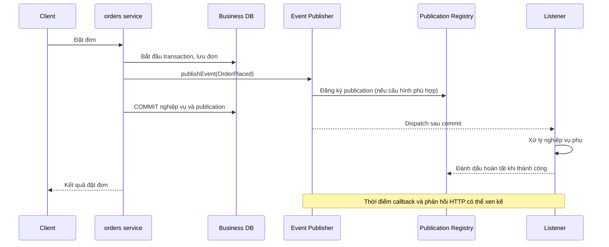
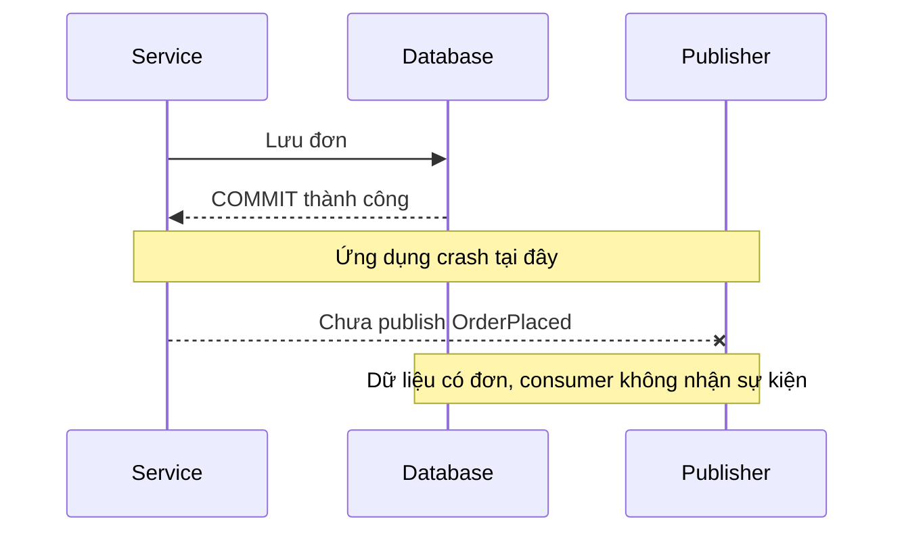
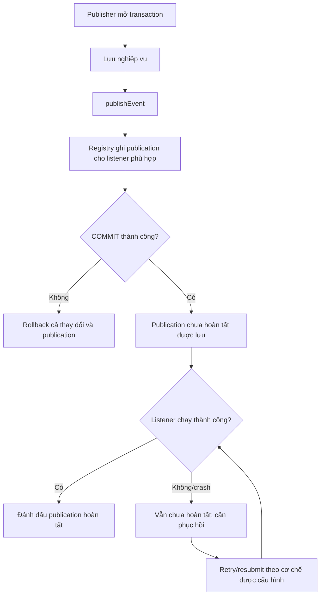
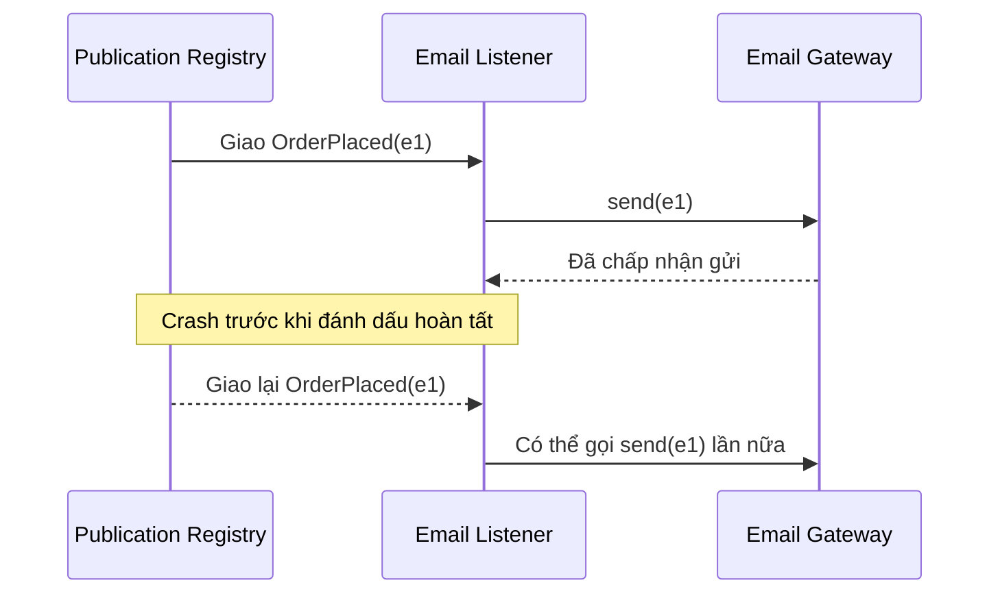

# Các điểm có thể mất event trong chu kỳ phát hành Spring Modulith

## 1. Vấn đề: nghiệp vụ đã hoàn tất nhưng tác dụng phụ không xảy ra

Trong ứng dụng **SPRING_MODULITH_APPLICATION_EVENTS**, module `orders` có thể phát `OrderPlaced` để `notifications` gửi email, `inventory` cập nhật bản đọc hoặc `reporting` ghi nhận doanh thu. Application events giúp publisher không phụ thuộc trực tiếp vào cách triển khai của từng listener, nhưng **tách module không đồng nghĩa với giao sự kiện chắc chắn**.

Một lỗi khó phát hiện là **đơn hàng đã commit thành công trong database, còn listener chưa bao giờ xử lý sự kiện**. Trên HTTP, khách hàng đã thấy “Đặt hàng thành công”; trong vận hành, email hoặc báo cáo lại thiếu dữ liệu. Đây là điểm cần phân tích theo **chu kỳ phát hành (event publication lifecycle)**, đặc biệt khi dùng listener sau commit, bất đồng bộ, Event Publication Registry và retry.

Trước hết, cần phân biệt bốn hiện tượng:

| Hiện tượng | Diễn giải | Có phải mất event thực sự? |
| --- | --- | --- |
| **Không có event hợp lệ** | Transaction tạo đơn rollback nên nghiệp vụ chưa xảy ra | Không. Bỏ qua event là hành vi đúng |
| **Mất event** | Nghiệp vụ đã commit nhưng không còn bằng chứng/hướng xử lý để consumer nhận một event đáng ra phải có | Có, nếu không thể khôi phục |
| **Event tồn đọng** | Publication đã lưu nhưng listener chưa thành công, đang chờ retry | Chưa. Có thể phục hồi nếu có chính sách và hạ tầng phù hợp |
| **Xử lý trùng** | Listener đã thực hiện tác dụng phụ nhưng event được giao lại | Không phải mất; gây lỗi khác nếu thiếu idempotency |

Mục tiêu không chỉ là “gọi `publishEvent()` mà không ném lỗi”, mà là bảo đảm mỗi **sự thật nghiệp vụ đã commit** được các consumer cần thiết xử lý theo chính sách đã cam kết, đồng thời phát hiện và phục hồi các publication chưa hoàn tất.

## 2. Quan sát toàn bộ chu kỳ phát hành

Một chu kỳ điển hình khi publisher dùng transaction và listener xử lý sau commit:



Sơ đồ thể hiện **quan hệ nhân quả**; không nên hiểu mọi callback listener bất đồng bộ đều chạy trước khi HTTP response được trả. Event Publication Registry chỉ tham gia nếu ứng dụng đã tích hợp, cấu hình backend lưu publication và dùng loại listener được hỗ trợ. Những bước riêng như retry, xử lý lỗi hoặc phát ra broker phụ thuộc stack thực tế.

Hãy đặt tên các mốc để nhận diện khoảng có rủi ro:

| Mốc | Hoạt động | Cần có gì để tránh mất? |
| --- | --- | --- |
| T0 | Bắt đầu yêu cầu nghiệp vụ | Xác định khi nào sự thật nghiệp vụ đủ điều kiện công bố |
| T1 | Thay đổi dữ liệu trong transaction | Business transaction đáng tin cậy |
| T2 | Gọi `publishEvent` | Không bỏ quên nhánh code phát event |
| T3 | Đăng ký publication, nếu có | Kho lưu và mối quan hệ transaction chính xác |
| T4 | Commit database | Nghiệp vụ và dấu vết cần khôi phục phải nhất quán |
| T5 | Dispatch listener sau commit | Listener và executor hoạt động; có đường phục hồi |
| T6 | Listener chạy nghiệp vụ phụ | Xử lý exception, retry, idempotency |
| T7 | Ghi nhận listener hoàn tất | Không đánh dấu thành công khi tác dụng phụ chưa đạt |
| T8 | Quan sát/truy vết | Phát hiện các publication chờ quá hạn hoặc bị kẹt |

Không phải tất cả hệ thống đều có tám mốc giống nhau. Với `@EventListener` đồng bộ, listener có thể chạy ngay ở T2, trước khi transaction hoàn tất. Với integration event, sau T5 còn có serialize, gửi broker, acknowledgment và consumer bên ngoài.

## 3. Điểm mất số 1: quên hoặc bỏ qua bước phát sự kiện

Giả sử một service có hai nhánh tạo đơn. Nhánh chính phát `OrderPlaced`, còn nhánh tạo đơn từ job nhập dữ liệu lại không phát. Cả hai đều commit đơn hàng, nhưng consumer chỉ biết một phần sự thật.

```java
@Transactional
public UUID placeOrder(PlaceOrderCommand command) {
    Order order = repository.create(command);
    // Nếu có nhánh tạo đơn khác không đi qua đây,
    // nhánh đó có thể ghi DB mà không phát OrderPlaced.
    events.publishEvent(new OrderPlaced(UUID.randomUUID(), order.id()));
    return order.id();
}
```

Điều này là **mất về mặt nghiệp vụ**: publisher không tạo ra event cần thiết. Registry, broker hay retry đều không thể tự suy ra sự kiện chưa từng được phát.

Các nguyên nhân thường gặp:

- Việc cập nhật dữ liệu xảy ra ở nhiều entry point nhưng chỉ một entry point publish.
- Có đường ghi trực tiếp database hoặc batch job bỏ qua application service chịu trách nhiệm phát event.
- Condition `if` lọc sự kiện theo trạng thái cũ hoặc so sánh thiếu trường hợp.
- Exception bị bắt và bỏ qua trước khi gọi publisher nhưng transaction vẫn commit.
- Một bản cập nhật được thực hiện bằng bulk SQL nhưng không đi qua logic phát domain event.

**Biện pháp:** xác định một điểm sở hữu việc thay đổi trạng thái nghiệp vụ và quy tắc phát event; kiểm thử các entry point cùng một contract. Với hệ thống nhiều đường ghi không thể gom ngay, có thể dùng kiểm tra đối soát dữ liệu nguồn với projection/event log, nhưng cần tiêu chí đối soát rõ ràng.

## 4. Điểm mất số 2: commit trước rồi mới publish

Đây là **khoảng trống nguy hiểm nhất** trong một cách triển khai đơn giản:

```java
// Ví dụ sai về độ tin cậy khi nghiệp vụ yêu cầu không mất event.
public UUID createOrder(PlaceOrderCommand command) {
    UUID orderId = transactionalOrderWriter.saveAndCommit(command);
    events.publishEvent(new OrderPlaced(UUID.randomUUID(), orderId));
    return orderId;
}
```

Giả sử `saveAndCommit(...)` kết thúc transaction riêng. Nếu ứng dụng crash **sau commit nhưng trước `publishEvent`**, database đã có đơn, không có publication nào để xử lý lại. Sự kiện bị mất vĩnh viễn trừ khi có cơ chế tái tạo/đối soát bên ngoài.



**Đưa `publishEvent(...)` vào transaction của publisher** là bước cần thiết để gắn việc phát với nghiệp vụ, nhưng **chưa đủ** nếu không có cơ chế lưu publication đáng tin cậy. Sau khi transaction commit, tiến trình vẫn có thể chết trước khi listener sau commit chạy.

Nếu phải bảo đảm việc phát thông tin ra hệ thống bên ngoài, một hướng kiến trúc là ghi **transactional outbox** trong cùng transaction với nghiệp vụ, rồi dùng relay gửi thông điệp. Nếu dùng Spring Modulith Event Publication Registry, cần kiểm chứng việc đăng ký publication thực sự được lưu trong transaction nghiệp vụ đúng theo backend đã chọn.

## 5. Điểm mất số 3: phát trong transaction nhưng không có dấu vết bền vững

Một ví dụ thường gặp:

```java
@Service
class OrderService {
    private final OrderRepository orders;
    private final ApplicationEventPublisher events;

    OrderService(OrderRepository orders, ApplicationEventPublisher events) {
        this.orders = orders;
        this.events = events;
    }

    @Transactional
    public UUID place(PlaceOrderCommand command) {
        var order = orders.create(command);
        events.publishEvent(new OrderPlaced(UUID.randomUUID(), order.id()));
        return order.id();
    }
}
```

`OrderRepository` và `PlaceOrderCommand` là những kiểu minh họa của module `orders`. Điểm chính là publisher phát event **khi transaction đang mở**.

Nếu consumer là:

```java
@Component
class OrderNotificationListener {
    @TransactionalEventListener(phase = TransactionPhase.AFTER_COMMIT)
    void on(OrderPlaced event) {
        notifications.send(event.orderId());
    }
}
```

Spring chỉ gọi listener đó khi transaction commit thành công, theo semantics `AFTER_COMMIT`. Tuy nhiên, **annotation sau commit tự nó không lưu event vào database**. Nếu tiến trình dừng ngay sau T4 và không có bản ghi publication bền vững, callback trong bộ nhớ không có nguồn để xử lý lại sau restart.

Phân biệt ba lựa chọn:

| Cách nhận event | Ưu điểm | Khoảng trống |
| --- | --- | --- |
| `@EventListener` mặc định | Dễ dùng, listener thường chạy đồng bộ trong caller | Listener chạy trước commit; side effect ngoài DB không thể rollback |
| `@TransactionalEventListener(AFTER_COMMIT)` | Chỉ xử lý khi publisher commit | Nếu chưa có registry bền vững, callback sau commit vẫn có thể biến mất khi crash |
| Transactional listener **kết hợp Event Publication Registry đã cấu hình** | Theo dõi publication chưa hoàn tất để phục hồi | Cần backend lưu bền, ràng buộc transaction, chiến lược retry, quan sát và idempotency |

Với `@TransactionalEventListener`, nếu event được phát **ngoài transaction**, listener theo mặc định không được gọi (trừ khi dùng `fallbackExecution = true`). Nếu publisher mong listener chạy nhưng không thực sự có transaction, hiện tượng không nhận được event là lỗi thiết kế cần phát hiện, không phải sự cố có thể chữa bằng retry thông thường.

## 6. Event Publication Registry thu hẹp khoảng mất như thế nào?

Spring Modulith cung cấp **Event Publication Registry** để ghi nhận các publication tới transactional listener phù hợp và biết publication nào chưa được xử lý hoàn tất. Khi đã thêm storage implementation thích hợp và đảm bảo bản ghi publication tham gia **cùng transaction nghiệp vụ**, dữ liệu nghiệp vụ và dấu vết event sẽ cùng commit hoặc cùng rollback.



Các trạng thái trong sơ đồ là **mô hình khái niệm**, không khẳng định tên enum hoặc bảng cụ thể của mọi phiên bản Spring Modulith. API, tên bảng, kiểu lưu, cách resubmission và khả năng khởi chạy phục hồi phụ thuộc phiên bản/thư viện được cấu hình.

Muốn dựa vào registry để đóng khoảng T4–T5, phải xác minh:

1. **Có storage module** tương ứng và cơ sở dữ liệu thực sự lưu publication. Chỉ thêm `@ApplicationModuleListener` chưa chứng minh đã có persistence phù hợp.
2. **Publication được ghi trong transaction nghiệp vụ** trên backend và cấu hình hiện tại. Nếu vô tình tách sang nguồn dữ liệu/transaction không phối hợp, có thể xuất hiện trạng thái nghiệp vụ đã commit nhưng publication chưa lưu.
3. **Listener thuộc loại được hỗ trợ**. Một `@EventListener` thông thường không mặc nhiên được registry theo dõi như transactional listener.
4. **Đã có cơ chế phục hồi được kích hoạt**: chẳng hạn resubmission theo lịch, khi khởi động hoặc thao tác vận hành thích hợp với phiên bản. Đừng mặc định listener lỗi sẽ được thử lại vô hạn.
5. **Có cách phát hiện backlog** bằng số publication chưa hoàn tất, tuổi sự kiện cũ nhất, lỗi và số lần retry.
6. **Payload còn đọc lại được** qua serializer/mapping của bản ứng dụng đã nâng cấp.

Registry theo dõi **đường giao publication đến listener**; nó không phải event sourcing store chứa lịch sử bất biến đầy đủ để phát lại tùy ý cho các listener được thêm sau này. Nếu tại thời điểm publish không có listener phù hợp được đăng ký, không nên kỳ vọng registry tự sinh publication cho listener mới trong tương lai.

## 7. Điểm mất số 4: listener không đăng ký hoặc không được kích hoạt

Event có thể được publish nhưng không có listener thực sự nhận:

- Bean listener không được Spring scan do package/bean configuration.
- Method có signature hoặc kiểu event không khớp với kiểu được publish.
- `@TransactionalEventListener` bị bỏ qua vì publisher không có transaction.
- Listener có điều kiện lọc (`condition`) loại sự kiện ngoài dự kiến.
- Listener bị loại khỏi deployment/module hoặc cấu hình feature flag.
- Event contract đổi package/class nhưng consumer chưa cập nhật.

Trong các trường hợp này, **lần publish có thể không tạo publication nào cần retry cho listener bị thiếu**. Registry không thay thế kiểm thử wiring, kiểm tra module boundary hoặc hợp đồng giữa publisher và consumer.

Nên có integration test cho luồng thật: tạo đơn, commit, xác minh listener được gọi đúng với event phù hợp. Nếu listener chỉ được cài đặt **sau khi** event đã xảy ra, cần một bài toán backfill riêng; event registry không phải công cụ tự động replay toàn bộ lịch sử nghiệp vụ.

## 8. Điểm mất số 5: listener thất bại nhưng hệ thống tưởng đã xong

Giả sử listener gọi một dịch vụ email. Code dưới đây có nguy cơ tạo **thành công giả**:

```java
@ApplicationModuleListener
void on(OrderPlaced event) {
    try {
        emailGateway.send(event.orderId());
    } catch (Exception ex) {
        log.warn("Could not send confirmation", ex);
        // Nuốt lỗi và kết thúc bình thường.
    }
}
```

Nếu cơ chế theo dõi xem listener **trả về thành công** là hoàn tất, publication có thể bị đánh dấu đã xử lý dù email chưa gửi. Event không còn nằm trong danh sách chờ phục hồi; **mất tác dụng phụ theo nghĩa nghiệp vụ**.

Khi công việc chưa hoàn thành và retry thực sự là điều mong muốn, hãy để thất bại được báo ra theo cơ chế mà listener/registry nhận diện:

```java
@Component
class ConfirmationListener {
    private final EmailGateway emailGateway;

    ConfirmationListener(EmailGateway emailGateway) {
        this.emailGateway = emailGateway;
    }

    @ApplicationModuleListener
    void on(OrderPlaced event) {
        // Nếu chưa gửi được, báo lỗi để publication không bị coi là thành công.
        emailGateway.sendIdempotently(event.eventId(), event.orderId());
    }
}
```

`EmailGateway` và `sendIdempotently(...)` là abstraction minh họa, chưa phải API sẵn có của framework. Cách phân loại lỗi cũng cần thiết kế: lỗi tạm thời có thể retry với backoff, còn lỗi dữ liệu không hợp lệ cần trạng thái lỗi, cảnh báo và xử lý nghiệp vụ phù hợp. **Không retry nóng vô hạn** khiến thread/executor bão hòa.

Một lỗi tinh vi khác là bắt exception trong code nghiệp vụ rồi trả giá trị mặc định “OK”. Vì listener không nhận ra thất bại, metric publication sẽ thể hiện thành công giả. Nên kiểm thử đường lỗi thực tế, không chỉ đường thành công.

## 9. Điểm không mất nhưng có thể xử lý trùng: tác dụng phụ xong trước khi đánh dấu hoàn tất

Xét trường hợp:

1. Event `OrderPlaced(eventId=e1)` được lưu trong registry.
2. Listener gửi email thành công.
3. JVM crash **trước khi publication được đánh dấu hoàn tất**.
4. Khi ứng dụng phục hồi, publication `e1` được giao lại.
5. Listener có thể gửi email lần thứ hai.



Trường hợp này cho thấy **khôi phục mất event và chống xử lý trùng phải đi cùng nhau**. Registry có thể giúp tránh bỏ quên publication, nhưng không thể tự tạo một transaction nguyên tử bao trùm cả database và email/HTTP API bên ngoài.

Nguyên tắc quan trọng:

- Giữ nguyên `eventId` cho mọi lần retry **cùng sự kiện**.
- Với thao tác database, dùng khóa duy nhất theo `(consumer, eventId)` hoặc khóa nghiệp vụ thích hợp, ghi dấu và thay đổi nghiệp vụ trong **cùng transaction consumer**.
- Với HTTP/payment/email, dùng idempotency key mà phía nhận hỗ trợ, hoặc thiết kế outbox của consumer và đối soát khi kết quả trả về không rõ.
- Không dùng mỗi `orderId` làm khóa dedup nếu cùng đơn hàng có thể phát nhiều sự kiện cùng loại với ý nghĩa khác nhau.
- Nếu consumer cập nhật snapshot, cần version hoặc đọc trạng thái mới nhất để tránh retry event cũ ghi đè dữ liệu mới.

Trong thực tế, mục tiêu phổ biến là **at-least-once delivery kèm xử lý idempotent** khi các thành phần được cấu hình đúng, chứ không khẳng định “end-to-end exactly once” cho mọi tác dụng phụ.

## 10. Điểm mất số 6: publication tồn đọng nhưng không được phục hồi

Một publication được lưu với trạng thái chưa hoàn tất **chưa bị mất**. Nhưng nếu không ai theo dõi và không có cơ chế resubmission, chức năng nghiệp vụ có thể bị thiếu vô thời hạn.

Các tình huống phổ biến:

- Listener lỗi một lần, sau đó hệ thống không gọi lại.
- Cấu hình resubmission không được bật, scheduler ngừng hoạt động hoặc chỉ chạy tại instance khác.
- Publication bị “kẹt” bởi lỗi không thể deserialize event đã lưu.
- Thông điệp được retry nhưng listener luôn lỗi vì dữ liệu không hợp lệ.
- Thread pool đầy hoặc service ngoài liên tục timeout khiến backlog tăng.
- Việc thay tên bean/listener hoặc thay loại event làm publication cũ không còn ánh xạ được đến listener cần xử lý.
- Người vận hành xóa bản ghi tồn đọng hoặc retention job dọn dữ liệu quá sớm.

Trong đó, **bị kẹt** khác với **mất**; nhưng **xóa publication khi chưa giải quyết** có thể biến tồn đọng thành mất thực sự.

Một quy trình vận hành cần xác định:

| Tín hiệu | Câu hỏi vận hành | Hành động phù hợp |
| --- | --- | --- |
| Số publication chưa hoàn tất tăng | Có listener hoặc dependency nào đang lỗi? | Điều tra lỗi gốc và backlog theo consumer |
| Tuổi publication cũ nhất tăng | Sự kiện nào vượt SLA xử lý? | Ưu tiên phục hồi và cảnh báo |
| Retry liên tục thất bại cùng lỗi | Lỗi tạm thời hay dữ liệu không thể xử lý? | Backoff, giới hạn lần thử, sửa schema/dữ liệu |
| Lỗi deserialize sau deploy | Payload cũ còn tương thích không? | Adapter/upcaster/migration phù hợp |
| Không thấy publication ở một listener kỳ vọng | Listener có đăng ký và được theo dõi tại lúc publish không? | Kiểm tra cấu hình và contract; backfill nếu cần |

Không tự giả định registry cung cấp sẵn mọi metric hay tên query chuẩn ở mọi phiên bản. Hãy triển khai quan sát dựa vào API/bảng lưu thực tế và bảo vệ dữ liệu nhạy cảm trong log.

## 11. Điểm mất số 7: schema hoặc payload khiến publication cũ không đọc được

Khi lưu event để phục hồi, event không chỉ tồn tại trong RAM; hệ thống có thể cần **deserialize** payload sau khi ứng dụng được cập nhật.

Ví dụ:

```java
// Phiên bản A đã phát và lưu publication:
public record OrderPlaced(UUID eventId, UUID orderId) {}

// Phiên bản B đổi package và tên field:
public record PurchaseConfirmed(UUID eventId, UUID purchaseId) {}
```

Nếu bản ghi cũ tham chiếu tên kiểu hoặc cấu trúc cũ, phiên bản B có thể không còn đọc được publication đó. Hậu quả là event tồn tại trong storage nhưng **không thể xử lý lại**.

Những thay đổi rủi ro gồm: đổi package/class, đổi tên field, thêm tham số constructor bắt buộc, thay kiểu số tiền, đổi định dạng thời gian, đổi serializer hoặc xóa listener cũ. **Schema version** chỉ có tác dụng khi có chiến lược tương thích hoặc migration tương ứng.

Khi nâng cấp:

1. Xác định có publication chưa hoàn tất hay không.
2. Kiểm thử **đọc lại bản ghi của phiên bản cũ** bằng serializer, classpath và storage thực tế.
3. Nếu cần, giữ adapter tương thích hoặc thực hiện migration có kiểm soát.
4. Chỉ loại bỏ khả năng đọc event cũ khi đã xử lý hoặc chuyển đổi những publication còn lại.

**Không tự dọn bản ghi không deserialize được để làm backlog về 0**. Điều đó có thể che giấu mất dữ liệu nghiệp vụ.

## 12. Điểm mất số 8: externalization và broker có thêm nhiều khoảng lỗi

Khi event nội bộ cần phát cho CRM hoặc đối tác vận chuyển, hệ thống phải đưa sự kiện qua ranh giới tiến trình bằng một transport. Spring Modulith có các cơ chế **Event Externalization** cho stack được hỗ trợ, nhưng **application event trong một JVM không tự chạy tới instance hoặc hệ thống khác**.

Một tuyến tích hợp có thể có các mốc:

```text
Đơn hàng commit
  → Có publication/outbox bền vững?
  → Adapter chọn lọc và map integration payload
  → Serialize thành message
  → Gửi đến broker
  → Broker chấp nhận và ghi durable?
  → Consumer nhận, xử lý, commit dữ liệu
  → Consumer ACK/ghi nhận offset thành công?
```

Mỗi mũi tên có một failure window khác nhau:

| Khoảng lỗi | Điều có thể xảy ra | Phòng ngừa |
| --- | --- | --- |
| Commit DB → tạo message ngoài DB | Ứng dụng crash trước khi gửi | Outbox/registry được ghi bền trong transaction phù hợp |
| Serialize integration event | Schema sai, field không hợp lệ | Validation và test tương thích payload |
| Gửi broker | Timeout, mất mạng, broker từ chối | Retry có backoff và trạng thái gửi rõ |
| Broker nhận, publisher không nhận ACK | Không biết broker đã nhận chưa; gửi lại có thể trùng | Stable event/message ID và consumer idempotent |
| Broker → consumer | Consumer offline, retention ngắn, cấu hình queue/topic sai | Kiểm tra routing, retention, consumer group, ACL |
| Consumer xử lý thành công → ACK | Crash trước ACK dẫn tới redelivery | Consumer ghi dữ liệu và trạng thái xử lý an toàn |
| Hạ tầng xóa message lỗi | Dead-letter/retention purge quá sớm | Chính sách lưu, cảnh báo, khả năng replay/đối soát |

Nếu chọn **transactional outbox**, ứng dụng ghi ý định gửi trong **cùng transaction database** với thay đổi nghiệp vụ, sau đó một relay chuyển message tới broker. Cách này đóng khoảng trống commit trước gửi, nhưng relay vẫn có thể gửi trùng nếu crash sau khi broker đã nhận mà trước khi đánh dấu đã gửi.

**Event Publication Registry và transactional outbox không phải hai tên gọi đồng nhất.** Registry theo dõi việc phát đến transactional listener được hỗ trợ; outbox là mẫu kiến trúc ghi ý định gửi bên ngoài cùng transaction nghiệp vụ. Cấu hình Spring Modulith externalization có thể kết hợp các cơ chế giao nhận và persistence tùy module/transport, cần kiểm chứng cụ thể trước khi công bố guarantee.

## 13. Mẫu thiết kế giảm mất event theo nhu cầu

Không phải mọi ứng dụng cần cùng một mức độ bảo đảm. Cần phân loại mức thiệt hại nếu listener không chạy:

| Mức yêu cầu | Ví dụ | Cơ chế phù hợp để cân nhắc |
| --- | --- | --- |
| Best effort | Làm mới một cache có thể tự tái tạo | Event đơn giản; có thể chấp nhận bỏ sót và làm mới theo TTL |
| Quan trọng trong cùng ứng dụng | Cập nhật báo cáo, gửi thông báo đơn hàng | Transactional listener, registry bền vững, phục hồi, idempotency |
| Quan trọng giữa hệ thống | Gửi thông điệp cho CRM hoặc hệ thống giao hàng | Durable outbox/registry + broker/transport + consumer dedup |
| Bất biến nghiệp vụ tức thời | Không chấp nhận đơn nếu không giữ được tồn kho | API/transaction hoặc workflow có trạng thái, không chỉ event xử lý muộn |

**Không tự gắn nhãn “giao đảm bảo”** chỉ vì dùng `@ApplicationModuleListener`. Annotation giúp thể hiện xử lý listener sau commit, bất đồng bộ và transaction riêng; độ tin cậy còn phụ thuộc storage của publication, việc resubmit, tính tương thích payload và cách consumer xử lý trùng.

Một thiết kế nên công khai rõ:

- Sự thật nghiệp vụ nào làm phát event và ai là module sở hữu.
- Event được publish **trong transaction nào**, thời điểm listener nhận được công việc.
- Có hay không publication registry/outbox và backend bền vững.
- Ai khởi chạy retry, điều kiện retry và giới hạn thất bại không thể phục hồi.
- Consumer có thể xử lý lặp, trễ, đảo thứ tự hay không.
- Mức độ **eventual consistency** được chấp nhận và cách phát hiện sai lệch.

## 14. Kiểm thử các điểm có thể mất event

Một test chỉ assert `publishEvent(...)` được gọi không chứng minh được việc listener xử lý sau commit hoặc publication sống sót qua restart. Cần kiểm thử các **failure window** có ý nghĩa:

| Thử nghiệm | Kết quả mong đợi |
| --- | --- |
| Giao dịch tạo đơn rollback sau khi publish | Business data và publication trong cùng transaction không commit; listener sau commit không chạy |
| Business commit nhưng listener lỗi | Đơn vẫn tồn tại; publication chưa hoàn tất được phát hiện nếu registry được cấu hình phù hợp |
| Crash ngay sau commit, trước dispatch | Có bản ghi cần xử lý sau restart nếu cơ chế lưu publication thực sự atomic |
| Crash sau side effect nhưng trước mark completed | Phục hồi có thể giao lại; consumer không thực hiện tác dụng phụ trùng |
| Phát event ngoài transaction | Transactional listener có hành vi đúng như thiết kế, không âm thầm mất |
| Listener bị gỡ cấu hình hoặc sai event type | Test phát hiện wiring không tồn tại; xác định cần backfill hay sửa registration |
| Retry một event nhiều lần | Trạng thái nghiệp vụ đúng, có báo cáo lỗi/backlog khi chưa hoàn tất |
| Deploy bản mới khi còn publication cũ | Payload cũ deserialize và xử lý được hoặc có đường migration |
| Broker nhận nhưng ACK từ broker bị mất | Hệ thống chấp nhận gửi trùng; consumer idempotent |
| Retention/cleanup | Không xóa publication chưa hoàn tất trước thời hạn xử lý |

Có thể dùng integration test của Spring Modulith kết hợp database thật hoặc tương đương production để kiểm tra transaction/registry. Với crash injection, cần điều khiển điểm lỗi và xác minh lại bằng **một tiến trình mới**; gọi lại listener trong cùng một test không thể thay thế kiểm chứng độ bền qua restart.

Trong môi trường thử nghiệm, có thể mô phỏng timeout của email gateway, broker mất kết nối hoặc dữ liệu cần deserialize ở version cũ. Tránh thử crash hay xóa dữ liệu thật trong production; thực hành trên môi trường cô lập có dữ liệu kiểm thử.

## 15. Quan sát và quy trình xử lý khi nghi mất event

Khi nhận phản ánh “đơn đã được tạo nhưng chưa có email”, nên kiểm tra theo chuỗi:

1. **Kiểm tra nghiệp vụ gốc:** đơn đã commit hay bị rollback? Đơn nào, request nào, thời điểm nào?
2. **Kiểm tra contract phát:** đường ghi đã gọi publisher chưa; event type và `eventId` có được ghi nhận không?
3. **Kiểm tra registration:** listener có tồn tại và được hỗ trợ/đăng ký khi event phát không?
4. **Kiểm tra publication storage:** có bản ghi chưa hoàn tất tương ứng không? Không thấy bản ghi cần phân biệt “chưa từng đăng ký” với “đã xử lý xong” bằng nguồn chứng cứ khác.
5. **Kiểm tra listener:** lỗi bị nuốt, timeout, exception, backoff, executor hoặc downstream dependency?
6. **Kiểm tra externalization nếu có:** message đã serialize/route/gửi, broker đã ACK chưa; consumer có nhận và ACK chưa?
7. **Kiểm tra dấu vết nghiệp vụ cuối:** email/CRM/projection đã cập nhật chưa, có trùng hay sai thứ tự không?
8. **Phục hồi có kiểm soát:** xác định idempotency, backfill/retry theo công cụ đúng với phiên bản, rồi đối chiếu trạng thái cuối.

Các tín hiệu vận hành nên theo dõi là số **publication chưa hoàn tất**, tuổi publication lớn nhất, độ trễ từ commit tới xử lý xong, tỷ lệ lỗi listener, số lần retry, backlog theo consumer và số bản ghi không thể deserialize. Các metric/bảng cụ thể tùy hệ thống; cần tránh đưa địa chỉ email, mã truy cập và dữ liệu cá nhân không cần thiết vào log.

Tính tin cậy còn phụ thuộc **khả năng phát hiện mất thực sự**. Nếu không lưu đủ dấu vết về business commit hoặc publication, có thể không phân biệt được “đã xử lý và xóa log” với “không hề phát”. Với quy trình quan trọng, hãy thiết kế truy vết và đối soát dựa trên business ID cùng event ID ổn định.

## 16. Checklist rà soát chu kỳ phát hành

1. **Điểm phát:** mọi đường ghi nghiệp vụ cần công bố event đều đi qua logic phát đúng?
2. **Transaction:** event được phát trong transaction thích hợp; không có khoảng commit xong mới publish thiếu persistence?
3. **Sau commit:** consumer không thực hiện side effect ngoài DB trước khi nghiệp vụ commit nếu nghiệp vụ yêu cầu?
4. **Publication Registry:** có backend lưu, cùng transaction, listener được theo dõi và cơ chế phục hồi đã kiểm chứng?
5. **Listener:** exception không bị nuốt khiến publication bị đánh dấu thành công giả?
6. **Idempotency:** cùng `eventId` xử lý lại không gây gửi trùng/cộng dồn sai?
7. **Tương thích:** event cũ còn đọc được sau khi đổi package, payload hoặc serializer?
8. **Khả năng phục hồi:** publication chưa hoàn tất có thể được tìm, retry/resubmit và xử lý lỗi tồn đọng?
9. **External integration:** có durable handoff, cấu hình broker, ACK và xử lý duplicate đúng với cam kết?
10. **Quan sát:** có dashboard/alert và quy trình đối soát theo business ID/event ID?
11. **Thử nghiệm:** các trường hợp rollback, crash ở từng khoảng và restart đã có bằng chứng tích hợp?

**Ghi nhớ:** Trong Spring Modulith, event có thể bị bỏ sót từ lúc **không được phát**, bị mất ở khoảng **commit rồi mới publish**, biến mất khi **callback sau commit chưa được lưu bền**, bị hiểu nhầm là thành công khi **listener nuốt lỗi**, hoặc không thể phục hồi do **retry, serializer, retention và hạ tầng tích hợp**. Event Publication Registry giúp quản lý publication chưa hoàn tất khi được cấu hình phù hợp, nhưng vẫn cần event contract rõ nghĩa, listener idempotent, cơ chế xử lý lại, kiểm thử crash và quan sát xuyên suốt chu kỳ phát hành.
