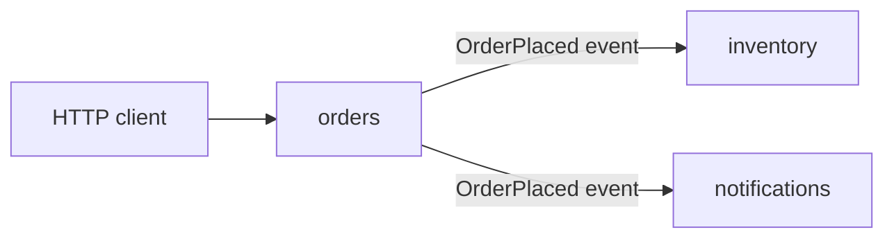
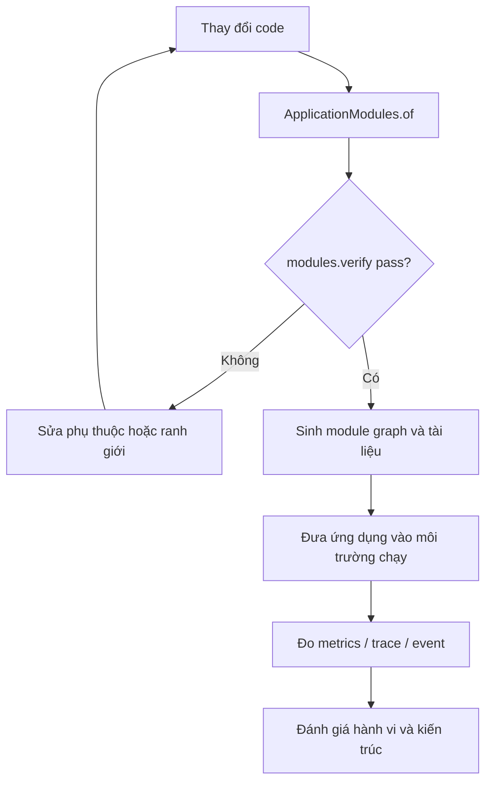
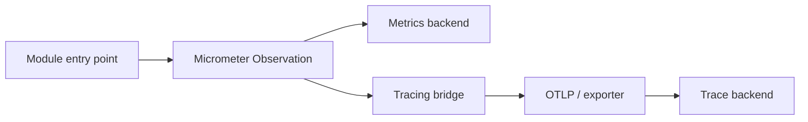

# Spring Modulith Documentation Observability là gì?

## 1. Bức tranh tổng quan

**Spring Modulith Documentation & Observability** là nhóm khả năng của Spring Modulith giúp một ứng dụng Spring Boot dạng *modular monolith* trả lời hai câu hỏi bổ sung cho nhau:

1. **Kiến trúc được thiết kế như thế nào?** Ứng dụng có những *application module* nào, mỗi module công khai giao diện gì và phụ thuộc module khác ra sao?
2. **Kiến trúc thực sự vận hành như thế nào?** Một yêu cầu đi qua những module nào, sự kiện được phát và xử lý ra sao, thao tác nào chậm hoặc thất bại, và ngữ cảnh trace có còn xuyên suốt các bước bất đồng bộ hay không?

Trong chủ đề **SPRING_MODULITH_DOCUMENTATION_OBSERVABILITY**, ta kết hợp **module graph**, tài liệu kiến trúc được sinh từ mã nguồn, **Spring Boot Actuator**, **Micrometer metrics/observations**, **distributed tracing** và **context propagation** để kiểm chứng ranh giới mô-đun cả ở thời điểm phát triển lẫn khi ứng dụng đang chạy.

Một điểm phân biệt quan trọng: **documentation mô tả cấu trúc**, **verification kiểm tra quy tắc phụ thuộc**, còn **observability cung cấp bằng chứng về hành vi lúc chạy**. Không công cụ nào tự mình thay thế cả ba việc đó.

| Khả năng | Trả lời câu hỏi | Kết quả thường thấy |
| --- | --- | --- |
| Module model / module graph | Có các module nào, cạnh phụ thuộc đi đâu? | Mô hình module và sơ đồ quan hệ |
| Documentation | Làm sao chia sẻ kiến trúc đang có trong mã? | Sơ đồ PlantUML, tài liệu module được sinh ra |
| Verification | Có chu trình hoặc truy cập sai ranh giới không? | Bài kiểm tra kiến trúc pass/fail |
| Actuator | Ứng dụng đang chạy nhận diện các module thế nào? | Metadata của module qua endpoint quản trị |
| Observability / tracing | Lời gọi nào đi qua ranh giới module, chậm ở đâu? | Observation, span và trace |
| Event monitoring | Event được xử lý thành công, lỗi hay còn tồn đọng? | Log, chỉ số và trạng thái publication nếu đã cấu hình |
| Context propagation | Có nối được các tác vụ bất đồng bộ vào cùng hành trình xử lý? | Trace context / MDC được truyền qua executor phù hợp |

## 2. Application module trong modular monolith

Một *modular monolith* được triển khai như một ứng dụng, nhưng mã nguồn được tổ chức thành các phần có trách nhiệm rõ ràng. Spring Modulith phân tích cấu trúc package và các bean để suy ra mô hình module. Theo quy ước thông thường, các package con trực tiếp dưới package gốc của ứng dụng là các application module.

Ví dụ ứng dụng bán hàng:

```text
com.example.shop
├── ShopApplication.java
├── orders
│   ├── OrderService.java          # API được module khác nhìn thấy
│   ├── OrderPlaced.java           # Event công khai
│   └── internal
│       └── OrderRepository.java   # Chi tiết triển khai nội bộ
├── inventory
│   ├── InventoryService.java
│   └── internal
│       └── StockRepository.java
└── notifications
    ├── NotificationService.java
    └── internal
        └── MailSenderAdapter.java
```

Theo ranh giới mặc định, kiểu dữ liệu nằm ngay trong package gốc của module có thể thuộc bề mặt API của module; các package lồng sâu thường được xem là nội bộ. Có thể khai báo thêm giao diện được đặt tên (*named interface*) và quy tắc phụ thuộc cho trường hợp cần thiết. Tuy nhiên, **tính `public` của Java không đồng nghĩa với việc truy cập một class nội bộ là phù hợp về mặt module**.

Ví dụ luồng nghiệp vụ:



Trong sơ đồ này, `orders` phát sự kiện `OrderPlaced` và hai module còn lại đăng ký xử lý. Mũi tên biểu diễn sự cộng tác về nghiệp vụ; việc triển khai bằng event giúp tránh gọi trực tiếp vào chi tiết nội bộ của module khác. Không nên mặc định rằng phát event là giao hàng đáng tin cậy, hoặc các listener luôn chạy cùng luồng và cùng transaction: điều đó phụ thuộc kiểu listener và cấu hình.

## 3. Documentation: sinh bản đồ kiến trúc từ code

Thay vì vẽ sơ đồ thủ công rồi để tài liệu dần lỗi thời, Spring Modulith cung cấp `ApplicationModules` để thu thập mô hình và `Documenter` để sinh tài liệu. Cách đơn giản là đặt một bài test trong dự án:

```java
import org.junit.jupiter.api.Test;
import org.springframework.modulith.core.ApplicationModules;
import org.springframework.modulith.docs.Documenter;

class ModuleArchitectureDocumentationTests {

    @Test
    void verifyAndDocumentModules() {
        var modules = ApplicationModules.of(ShopApplication.class);

        modules.verify();
        new Documenter(modules).writeDocumentation();
    }
}
```

`ShopApplication` là class `@SpringBootApplication` ở package gốc `com.example.shop`. Cần khai báo dependency `org.springframework.modulith:spring-modulith-docs` ở phạm vi test, bên cạnh các dependency Spring Modulith cần thiết cho dự án. Quản lý phiên bản bằng BOM/thiết lập dependency tương thích với phiên bản Spring Boot đang dùng.

Hai bước trong bài test phục vụ hai mục đích khác nhau:

- `modules.verify()` kiểm tra các vi phạm kiến trúc mà Spring Modulith có khả năng phát hiện, chẳng hạn chu trình phụ thuộc và truy cập trái quy tắc ranh giới module.
- `new Documenter(modules).writeDocumentation()` xuất tài liệu dựa trên mô hình vừa phân tích; các dạng thường gặp gồm sơ đồ module dưới dạng PlantUML và phần mô tả module, tùy phiên bản và tùy chọn `Documenter`.

Có thể đưa việc chạy test này vào CI, lưu tài liệu sinh ra thành build artifact và dùng trong code review. Nếu muốn xuất hình PNG/SVG từ PlantUML, dự án cần bước render sơ đồ tương ứng; `writeDocumentation()` không nên bị hiểu là tự tạo mọi định dạng hình ảnh.

### 3.1. Cách đọc module graph

Đọc graph theo ba câu hỏi:

1. **Node có phản ánh đúng bounded responsibility không?** Ví dụ module `orders` chịu trách nhiệm vòng đời đơn hàng, không xử lý toàn bộ logic tồn kho.
2. **Cạnh phụ thuộc có hợp lý không?** Nếu `inventory` phụ thuộc ngược vào `orders.internal`, cần điều tra API đang bị vượt ranh giới.
3. **Có chu trình không?** Nếu `orders -> inventory -> orders`, rất khó thay đổi, kiểm thử hay tách module độc lập.

Graph được rút ra từ những phụ thuộc Spring Modulith phân tích được; nó không phải sơ đồ tuần tự thể hiện mọi lời gọi tại runtime. Một cạnh kiến trúc không nói được lời gọi mất bao nhiêu thời gian, còn trace runtime cũng không thay thế được kiểm tra chu trình phụ thuộc ở mức code.

### 3.2. Khi nào cần tài liệu bổ sung?

Sơ đồ tự sinh nên đi cùng một số giải thích do nhóm phát triển duy trì: module sở hữu dữ liệu nào, event contract gồm những field gì, tác dụng phụ của listener là gì, điều kiện idempotency và ràng buộc vận hành. Các nội dung nghiệp vụ này thường không thể suy đầy đủ chỉ từ quan hệ giữa class/package.

## 4. Kiểm chứng kiến trúc bằng test

Một vòng phản hồi kiến trúc hiệu quả gồm:



Nếu `verify()` thất bại, nên sửa nguyên nhân, ví dụ đưa hợp đồng công khai vào package API của module hoặc chuyển tương tác sang event. Không giải quyết bằng cách tùy tiện nới quyền truy cập giữa các module. Đối với luồng nghiệp vụ có ràng buộc nhất quán mạnh, cần cân nhắc rõ giao dịch và thứ tự xử lý thay vì mặc định mọi tương tác đều có thể đổi sang bất đồng bộ.

## 5. Actuator: xem metadata của module khi ứng dụng chạy

Spring Boot Actuator cung cấp các endpoint phục vụ giám sát và vận hành. Thành phần Actuator của Spring Modulith bổ sung thông tin về mô hình module để người vận hành nhìn thấy cấu trúc mà ứng dụng đang khởi động sử dụng.

Các dependency liên quan thường là:

```xml
<!-- Metadata module qua Spring Boot Actuator -->
<dependency>
    <groupId>org.springframework.modulith</groupId>
    <artifactId>spring-modulith-actuator</artifactId>
</dependency>
<dependency>
    <groupId>org.springframework.boot</groupId>
    <artifactId>spring-boot-starter-actuator</artifactId>
</dependency>
```

Ví dụ cấu hình exposure ở môi trường phát triển:

```yaml
management:
  endpoints:
    web:
      exposure:
        include: health,info,modulith
```

Với phiên bản cung cấp endpoint ID `modulith`, có thể kiểm tra discovery endpoint `/actuator`, sau đó truy cập `/actuator/modulith`. **Luôn đối chiếu ID endpoint, đường dẫn base và cách cấu hình với phiên bản thư viện đang chạy**; không coi cấu hình minh họa là cam kết áp dụng được cho mọi phiên bản.

Endpoint có thể giúp đối chiếu module hiện diện và quan hệ mà framework nhận diện, nhưng **không tự hiển thị lịch sử mọi request hay thay thế distributed tracing**. Trong production cần giới hạn exposure và áp dụng authentication/authorization hoặc mạng quản trị phù hợp; metadata kiến trúc không nhất thiết nên công khai ra Internet.

## 6. Observability: đo lời gọi đi qua ranh giới module

Spring Modulith kết hợp với hệ sinh thái **Micrometer Observation** để quan sát tương tác ở ranh giới module. Khi cấu hình phù hợp, việc đi vào các thành phần module được hỗ trợ quan sát có thể tạo observation; tracing bridge chuyển các observation đó thành span và liên kết chúng với trace hiện có.

Hiểu ba khái niệm nền tảng:

| Khái niệm | Chức năng | Cách dùng khi phân tích |
| --- | --- | --- |
| **Metric** | Tổng hợp số liệu theo thời gian, như số request, lỗi, độ trễ | Dùng dashboard, SLO, cảnh báo |
| **Observation** | API chuẩn để ghi nhận một hoạt động, bao gồm tên, tag và thời gian | Nối instrumentation với metrics/tracing |
| **Trace / Span** | Trace biểu diễn hành trình; span biểu diễn một thao tác trong hành trình đó | Tìm module và bước gây chậm/lỗi |

Sơ đồ minh họa một trace:

```text
Trace: checkout HTTP request
└── HTTP POST /orders
    └── orders: place order
        ├── persist order
        └── publish OrderPlaced
            ├── inventory: reserve stock       [async, nếu có liên kết context]
            └── notifications: send confirmation [async, nếu có liên kết context]
```

Sơ đồ trên thể hiện hành vi **mong muốn**. Nếu listener bất đồng bộ không nhận được trace context, hệ thống có thể tạo trace riêng thay vì span con của trace ban đầu. Với event xử lý sau commit hoặc được xử lý lại sau thời gian dài, đôi khi quan hệ *span link* hay correlation ID có ý nghĩa hơn quan hệ cha–con trực tiếp.

### 6.1. Dependency và pipeline quan sát

Một cấu hình phổ biến gồm thư viện observability của Spring Modulith và các thành phần Micrometer/Spring Boot theo nhu cầu:

```xml
<dependency>
    <groupId>org.springframework.modulith</groupId>
    <artifactId>spring-modulith-observability</artifactId>
</dependency>
<dependency>
    <groupId>org.springframework.boot</groupId>
    <artifactId>spring-boot-starter-actuator</artifactId>
</dependency>

<!-- Ví dụ chọn OpenTelemetry làm tracing bridge -->
<dependency>
    <groupId>io.micrometer</groupId>
    <artifactId>micrometer-tracing-bridge-otel</artifactId>
</dependency>
```

Nếu muốn xuất trace ra một backend cụ thể, cần thêm exporter/transport tương ứng với stack và phiên bản đang dùng (chẳng hạn OTLP) và cấu hình endpoint. Chỉ thêm bridge **chưa có nghĩa** trace tự động xuất hiện trong Jaeger, Tempo hay một backend bất kỳ. Cần xem cả mức sampling, pipeline mạng và cấu hình quan sát được bật của thư viện tương ứng.

Ví dụ luồng quan sát:



Tùy phiên bản và instrumentation, không phải mọi phương thức nội bộ đều được tạo span tự động. Nên kiểm tra trên chính ứng dụng rằng thao tác quan trọng có observation/span và tên/tag thực tế như kỳ vọng. Nếu muốn đo một phương thức nghiệp vụ cụ thể chưa được instrument, có thể dùng `@Observed` hoặc `ObservationRegistry` theo cơ chế Micrometer phù hợp.

### 6.2. Đọc trace để phát hiện sai lệch kiến trúc

Giả sử trace checkout cho thấy `orders` gọi trực tiếp một phương thức quản lý dữ liệu bên trong `inventory.internal`. Hãy so sánh với module graph và API công khai: nếu thực tế code vượt qua ranh giới, `modules.verify()` phải là lớp kiểm soát chính; trace đóng vai trò làm rõ mức độ sử dụng và chi phí runtime.

Một trace dài với phần lớn thời gian ở `notifications` có thể gợi ý tách gửi email ra xử lý bất đồng bộ. Nhưng trước khi đổi, cần xem yêu cầu nhất quán, khả năng retry và trải nghiệm người dùng. **Tracing giúp chẩn đoán; bản thân nó không chứng minh một kiến trúc là đúng hoặc sai**.

## 7. Theo dõi domain event và event publication

Event giúp module giao tiếp qua hợp đồng nghiệp vụ. Ví dụ module `orders` công bố một sự kiện bất biến:

```java
package com.example.shop.orders;

import java.util.UUID;

public record OrderPlaced(UUID orderId) { }
```

Trong service đặt hàng:

```java
package com.example.shop.orders;

import java.util.UUID;
import org.springframework.context.ApplicationEventPublisher;
import org.springframework.stereotype.Service;
import org.springframework.transaction.annotation.Transactional;

@Service
class OrderService {

    private final ApplicationEventPublisher events;

    OrderService(ApplicationEventPublisher events) {
        this.events = events;
    }

    @Transactional
    void placeOrder(UUID orderId) {
        // Lưu đơn hàng trong transaction hiện tại.
        events.publishEvent(new OrderPlaced(orderId));
    }
}
```

Và một listener ở module khác:

```java
package com.example.shop.inventory;

import com.example.shop.orders.OrderPlaced;
import org.springframework.modulith.events.ApplicationModuleListener;
import org.springframework.stereotype.Component;

@Component
class ReserveStockOnOrderPlaced {

    @ApplicationModuleListener
    void on(OrderPlaced event) {
        // Dự trữ tồn kho; nên hỗ trợ xử lý lặp theo orderId.
    }
}
```

`@ApplicationModuleListener` hỗ trợ mô hình listener sự kiện theo transaction và bất đồng bộ của Spring Modulith; cần kiểm tra thời điểm chạy, executor và chính sách transaction thực tế theo phiên bản sử dụng. Ví dụ chỉ minh họa vai trò, chưa thể chạy độc lập nếu thiếu phần lưu đơn hàng và dự trữ tồn kho.

### 7.1. Metric nào có ý nghĩa?

Đối với mỗi loại event quan trọng, hãy thiết kế cách đo các chỉ số sau (dùng metric có sẵn của stack nếu có; nếu không, tự instrument):

| Chỉ số | Câu hỏi cần trả lời | Gợi ý hành động |
| --- | --- | --- |
| Event được phát | Lượng event tăng đột biến không? | So với lưu lượng nghiệp vụ |
| Listener xử lý thành công | Tỷ lệ xử lý thành công là bao nhiêu? | Theo dõi giảm tỷ lệ thành công |
| Listener thất bại | Có lỗi lặp hoặc lỗi kéo dài không? | Điều tra exception và retry |
| Độ trễ xử lý | Từ lúc nhận đến lúc hoàn tất mất bao lâu? | Phân tích bottleneck |
| Publication còn tồn đọng | Có sự kiện chưa được xử lý hoàn tất không? | Rà soát registry, retry và độ tuổi tồn đọng |

**Không giả định** mọi metric ở bảng trên đều được Spring Modulith tự tạo với cùng một tên. Tên và khả năng đo tự động phụ thuộc module tích hợp, phiên bản framework và cấu hình observability. Với phần metric tự định nghĩa, nên dùng tag có số lượng giá trị nhỏ như `event_type`, `listener`, `outcome`; không gắn trực tiếp `orderId` hay `userId` làm metric tag vì gây bùng nổ cardinality.

### 7.2. Event Publication Registry và độ tin cậy

Spring Modulith có cơ chế **event publication registry** và các module lưu trữ phù hợp để theo dõi publication tới các listener giao dịch. Khi đã tích hợp persistence tương ứng, ứng dụng có thể ghi nhận publication còn cần hoàn tất, phục vụ quan sát và các chiến lược xử lý lại. Cần phân biệt:

- **Event đã được publish** chưa chắc listener đã xử lý thành công.
- **Listener xử lý thành công** chưa chắc tác dụng phụ bên ngoài, ví dụ gửi email qua dịch vụ thứ ba, đã hoàn tất đúng một lần.
- **Có registry** không tự giải quyết retry, idempotency và exactly-once ở mọi hệ thống ngoài tiến trình.

Vì thế, cần lưu correlation key, chuẩn bị cách xử lý lặp an toàn, đo thời gian tồn đọng và xác định quy trình retry theo yêu cầu nghiệp vụ. Không nên đưa sự kiện chưa hoàn tất lên dashboard như một lỗi vận hành nếu không biết cửa sổ chờ xử lý hợp lệ của hệ thống.

## 8. Context propagation: giữ dấu vết qua luồng bất đồng bộ

Trong xử lý đồng bộ, thông tin trace/span thường được truyền trong context của luồng hiện tại. Khi chuyển sang `@Async`, `Executor`, thread pool hoặc callback, **ThreadLocal context có thể không đi theo tác vụ**. Khi đó, log ở listener có thể mất `traceId`, còn span mới không gắn với phần đầu của yêu cầu.

Micrometer Context Propagation và cơ chế `TaskDecorator` của Spring hỗ trợ sao chép/khôi phục context ở ranh giới executor. Với Spring Framework có `ContextPropagatingTaskDecorator`, một cách cấu hình minh họa là:

```java
import java.util.concurrent.Executor;
import org.springframework.context.annotation.Bean;
import org.springframework.context.annotation.Configuration;
import org.springframework.core.task.support.ContextPropagatingTaskDecorator;
import org.springframework.scheduling.concurrent.ThreadPoolTaskExecutor;

@Configuration
class AsyncTracingConfiguration {

    @Bean(name = "taskExecutor")
    Executor taskExecutor() {
        var executor = new ThreadPoolTaskExecutor();
        executor.setCorePoolSize(4);
        executor.setMaxPoolSize(8);
        executor.setThreadNamePrefix("module-event-");
        executor.setTaskDecorator(new ContextPropagatingTaskDecorator());
        executor.initialize();
        return executor;
    }
}
```

Ví dụ trên chỉ hữu ích nếu **listener thật sự sử dụng executor đó** và phiên bản Spring Framework hỗ trợ class này; nếu dự án đã có executor hoặc cơ chế propagating context riêng, phải cấu hình tại đúng điểm giao tác vụ. Với listener xử lý trễ, nhận event từ broker hay retry sau khi request gốc kết thúc, cần thiết kế correlation/trace link phù hợp chứ không cố giữ nguyên span đang hoạt động.

Nên kiểm tra bằng một request thực tế:

1. Ghi nhận `traceId` ở HTTP handler hoặc service `orders`.
2. Kích hoạt `OrderPlaced` và quan sát log/span tại `inventory`.
3. Đối chiếu correlation giữa các điểm và bảo đảm executor thực sự có propagation.
4. Lặp lại với trường hợp listener ném exception, retry và tác vụ trễ.

Thông tin như `traceId`, `spanId` thích hợp cho log/traces, nhưng tránh ghi dữ liệu nhạy cảm hay nội dung event nguyên bản vào tag hoặc log tràn lan.

## 9. Bài thực hành tích hợp từ kiến trúc tới runtime

Mục tiêu là chứng minh một hệ thống Spring Boot gồm `orders`, `inventory`, `notifications` có ranh giới rõ và đủ dữ liệu để theo dõi khi chạy.

| Bước | Thực hiện | Tiêu chí hoàn thành |
| --- | --- | --- |
| 1. Thiết kế package | Tách module; đưa `OrderPlaced` vào API công khai của `orders` | Module khác không import `orders.internal` |
| 2. Kiểm tra module | Chạy test `ApplicationModules.of(...).verify()` | Không phát hiện vi phạm/chu trình theo quy tắc đang bật |
| 3. Sinh tài liệu | Gọi `Documenter.writeDocumentation()`; xem graph | Node và cạnh phản ánh thiết kế mong muốn |
| 4. Quan sát metadata | Bật Actuator và endpoint Modulith được hỗ trợ | Nhìn thấy các module của phiên bản ứng dụng đang chạy |
| 5. Gắn metrics/traces | Cấu hình observability, tracing bridge và exporter phù hợp | Có dữ liệu cho một lần đặt hàng thực tế |
| 6. Phát/nhận event | `orders` phát `OrderPlaced`, `inventory` và `notifications` xử lý | Theo dõi được thành công, thất bại và độ trễ cần thiết |
| 7. Kiểm tra async | Dùng executor có context propagation khi cần | Liên hệ được log/trace của producer với listener |
| 8. Tạo lỗi có kiểm soát | Cho listener thất bại trong môi trường test | Nhận diện được lỗi, trạng thái publication và hành vi retry |

Sau khi chạy, hãy đối chiếu **ba nguồn bằng chứng**: kết quả verification, tài liệu module graph và số liệu runtime. Ví dụ một module không xuất hiện trong các trace có thể đơn giản là chưa được kích hoạt trong kịch bản kiểm thử hoặc chưa được instrument, không nhất thiết là module đó không tồn tại. Ngược lại, một graph hợp lệ không bảo đảm mọi event đều xử lý thành công.

## 10. Lỗi thường gặp và cách khoanh vùng

| Triệu chứng | Điều cần kiểm tra trước |
| --- | --- |
| `modules.verify()` báo chu trình | Xem cạnh phụ thuộc giữa package/module; kiểm tra truy cập ngược qua type hoặc bean |
| Sơ đồ khác cấu trúc nhóm dự kiến | Kiểm tra vị trí package gốc, quy ước module, named interface và cấu hình mô hình module |
| Endpoint module trả `404` | Xem đúng artifact Actuator của Modulith, exposure, ID endpoint và base path ở phiên bản hiện tại |
| Endpoint trả `401/403` | Kiểm tra Spring Security, quyền truy cập management endpoint |
| Không thấy span/trace | Kiểm tra instrumentation, tracing bridge, exporter, endpoint collector và sampling |
| Span của listener không nối trace gốc | Xác minh listener có chạy async, executor dùng, propagation/correlation và kiểu retry |
| Event đã publish nhưng nghiệp vụ chưa hoàn tất | Kiểm tra exception của listener, giao dịch, trạng thái publication, retry và idempotency |
| Metrics tăng đột biến số chuỗi thời gian | Kiểm tra tag có ID riêng từng request/order/user hay không |

Đặc biệt, **không dùng trạng thái `200 OK` của HTTP request làm bằng chứng rằng toàn bộ listener bất đồng bộ đã chạy thành công**. HTTP, transaction, event publication và thực thi listener có các thời điểm hoàn tất khác nhau.

## 11. Những nguyên tắc cần ghi nhớ

- **Module graph là bản đồ cấu trúc**: giúp thấy ranh giới và phụ thuộc ở thời điểm build/test.
- **`modules.verify()` là hàng rào kiến trúc**: phát hiện nhiều vi phạm rõ ràng trước khi merge, nhưng chỉ trong phạm vi các quy tắc và dependency mà công cụ phân tích được.
- **Actuator là cửa sổ quản trị**: cho thấy metadata của ứng dụng đang chạy; bảo vệ endpoint khi triển khai thật.
- **Metrics và tracing là bằng chứng runtime**: cho biết chi phí xử lý, đường đi và lỗi tại những điểm đã instrument; chúng không chứng minh mọi tương tác đều được quan sát.
- **Event cần lifecycle và idempotency**: publication, delivery, completion và tác dụng phụ là những bước khác nhau.
- **Context propagation phải được xác nhận qua ranh giới async**: cùng một yêu cầu nghiệp vụ có thể đi qua nhiều thread, transaction và thời điểm xử lý.

Khi kết hợp những khả năng này, Spring Modulith giúp nhóm phát triển duy trì *modular monolith* có cấu trúc dễ hiểu, dễ kiểm tra và có thể chẩn đoán được khi hệ thống vận hành, trước khi cần cân nhắc tách thành các dịch vụ độc lập.
