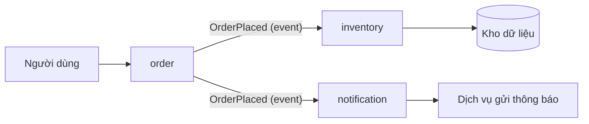
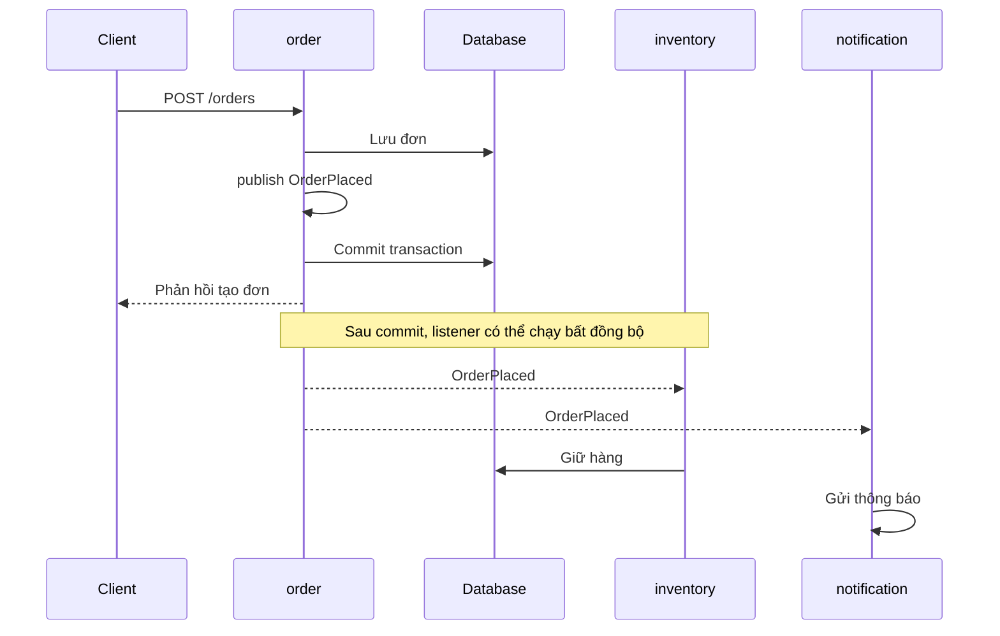

# Khả năng quan sát giúp hiểu ứng dụng mô-đun đang chạy như thế nào

Trong một **modular monolith**, các application module chạy chung một tiến trình Spring Boot nhưng cần giữ ranh giới trách nhiệm rõ ràng. Nhìn vào cấu trúc package hoặc sơ đồ phụ thuộc, ta biết module *được phép* tương tác với nhau ra sao. Khi hệ thống phục vụ người dùng thật, câu hỏi chuyển thành: **yêu cầu vừa đi qua những module nào, mất thời gian ở đâu, sự kiện nào đã được xử lý và vì sao một luồng nghiệp vụ thất bại?**

Spring Modulith giúp kết nối hai góc nhìn đó: **tài liệu kiến trúc mô-đun** (module graph, API và phụ thuộc) và **khả năng quan sát khi chạy** (Actuator, metrics, tracing, log tương quan và trạng thái xử lý sự kiện). Bài học này tập trung vào cách dùng các tín hiệu ấy để kiểm chứng ranh giới và hành vi của các application module trong một ứng dụng Spring Boot.

## 1. Mục tiêu học tập

Sau bài học, bạn có thể:

1. Phân biệt kiến trúc mô-đun được mô tả tĩnh với tương tác mô-đun quan sát được khi ứng dụng hoạt động.
2. Giải thích vai trò riêng của module graph, Spring Boot Actuator, Micrometer metrics, tracing và log tương quan.
3. Thiết lập đường đi tối thiểu để thấy thông tin module và các điểm gọi qua ranh giới module.
4. Theo dõi xử lý sự kiện giữa module, bao gồm độ trễ, lỗi, cơ chế xử lý lại và giới hạn của việc theo dõi bất đồng bộ.
5. Nhận biết vấn đề **context propagation** khi luồng thực thi chuyển thread hoặc đi qua message broker.
6. Đọc bằng chứng quan sát để tìm nơi cần điều tra, đồng thời biết điều gì các bằng chứng ấy chưa thể khẳng định.

## 2. Từ module graph đến dấu vết vận hành

Giả sử ứng dụng bán hàng có ba application module:

- `order`: nhận đơn và phát sự kiện `OrderPlaced`.
- `inventory`: nhận sự kiện, giữ hàng hoặc báo hết hàng.
- `notification`: nhận sự kiện, chuẩn bị thông báo cho khách.

Một cách tổ chức package có thể là:

```text
com.example.shop
├── ShopApplication.java
├── order/
│   ├── OrderService.java
│   └── OrderPlaced.java
├── inventory/
│   └── ReserveInventoryOnOrderPlaced.java
└── notification/
    └── NotifyCustomerOnOrderPlaced.java
```

Sơ đồ nghiệp vụ ở mức khái niệm:



**Lưu ý về sơ đồ:** mũi tên `OrderPlaced` biểu diễn quan hệ phát/nhận sự kiện trong nghiệp vụ. Nó **không mặc nhiên** là lời gọi Java đồng bộ hay cạnh phụ thuộc tĩnh có cùng chiều. Chẳng hạn, module lắng nghe có thể cần tham chiếu đến kiểu sự kiện công khai của `order`, còn `order` không cần tham chiếu trực tiếp đến lớp xử lý của `inventory`.

Hãy phân biệt các nguồn thông tin:

| Công cụ hoặc tín hiệu | Trả lời câu hỏi | Giới hạn chính |
| --- | --- | --- |
| **Module graph / tài liệu mô-đun** | Có những module nào? API và phụ thuộc tĩnh giữa chúng là gì? | Không cho biết yêu cầu thực tế nào vừa chạy hoặc tốn bao lâu. |
| **Actuator** | Ứng dụng đang hoạt động ra sao? Endpoint và các số đo nào được mở? | Có thể chỉ thấy trạng thái tổng hợp, không có đường đi của một yêu cầu cụ thể. |
| **Metrics** | Tần suất, độ trễ, số lỗi, backlog thay đổi thế nào? | Dữ liệu tổng hợp thường không đủ để tái dựng một giao dịch đơn lẻ. |
| **Distributed tracing** | Một yêu cầu đã đi qua các bước được instrument nào, mỗi bước mất bao lâu? | Chỉ thấy các bước được ghi nhận và các trace được lấy mẫu. |
| **Log có trace ID** | Lỗi hoặc quyết định nghiệp vụ cụ thể đã xảy ra ở đâu? | Phụ thuộc chất lượng log và khả năng truyền ngữ cảnh qua các luồng. |
| **Event publication registry** (khi cấu hình) | Publication nào đang chờ, đã hoàn tất hoặc cần xử lý lại? | Không thay thế đo thời gian xử lý nghiệp vụ hay quan sát hệ thống bên ngoài. |

Không có một nguồn nào là “sự thật đầy đủ”. Khả năng quan sát có giá trị khi nối **cấu trúc dự kiến**, **hành vi thực tế** và **hậu quả nghiệp vụ**.

## 3. Tài liệu ranh giới module: biết điều gì *nên* xảy ra

Spring Modulith mô hình hóa các application module từ cấu trúc ứng dụng và có thể kiểm tra quy tắc phụ thuộc. Trong test của dự án, ta có thể xác minh ranh giới và xuất tài liệu kiến trúc:

```java
import org.junit.jupiter.api.Test;
import org.springframework.modulith.core.ApplicationModules;
import org.springframework.modulith.docs.Documenter;

class ModularityDocumentationTests {

    @Test
    void verifyAndDocumentModules() {
        var modules = ApplicationModules.of(ShopApplication.class);

        modules.verify();
        new Documenter(modules).writeDocumentation();
    }
}
```

`ApplicationModules.of(...)` khám phá mô-đun, `verify()` kiểm tra các ràng buộc kiến trúc mà Spring Modulith hỗ trợ; `Documenter` sinh tài liệu mô tả cấu trúc và quan hệ giữa chúng. Muốn chạy ví dụ cần có dependency cho Spring Modulith Core, tính năng tài liệu (`spring-modulith-docs`) và JUnit trong phạm vi test, theo BOM/phiên bản tương thích của dự án.

Module graph giúp trả lời:

- Một module có gọi vào phần nội bộ của module khác ngoài API công khai không?
- Các phụ thuộc trực tiếp có hợp lệ theo cách định nghĩa module và named interface không?
- Sau một lần refactor, xuất hiện phụ thuộc hoặc chu trình không mong muốn nào?

Đây là **kiểm chứng tĩnh**, có thể chạy trong CI mà không cần traffic thật. Nó không chứng minh rằng lời gọi diễn ra trong production, listener đã nhận sự kiện hoặc một request đáp ứng SLA. Muốn trả lời các câu hỏi đó cần quan sát lúc chạy.

## 4. Actuator: nhìn vào ứng dụng Spring Boot đang sống

Spring Boot Actuator cung cấp endpoint quản trị và các điểm truy cập tới health, metrics. Khi có phần tích hợp Actuator tương ứng của Spring Modulith, endpoint `modulith` có thể cung cấp thông tin về những application module đã được phát hiện. Sự sẵn có của endpoint phụ thuộc vào **phiên bản và dependency** của ứng dụng; cần kiểm tra danh sách endpoint thực tế qua `/actuator`.

Ví dụ cấu hình cho **môi trường phát triển**:

```yaml
management:
  endpoints:
    web:
      exposure:
        include: health,info,metrics,modulith
```

Kiểm tra lần lượt:

```bash
curl http://localhost:8080/actuator
curl http://localhost:8080/actuator/health
curl http://localhost:8080/actuator/modulith
curl http://localhost:8080/actuator/metrics
```

Ở đây `health` trả trạng thái sức khỏe, `metrics` liệt kê các meter đã đăng ký, còn `modulith` (nếu được cung cấp và đã expose) mô tả cấu trúc module. **Nội dung JSON và các meter khả dụng có thể khác nhau giữa các phiên bản**. Endpoint trả `404` có thể do dependency chưa được đưa vào, endpoint không tồn tại ở phiên bản đang dùng hoặc chưa được expose; chưa đủ cơ sở kết luận rằng không có module.

Trong môi trường production, chỉ mở các endpoint cần thiết cho hệ thống giám sát và áp dụng xác thực, phân quyền hoặc giới hạn mạng. Đồ thị module có thể làm lộ cấu trúc nội bộ, còn endpoint quản trị khác có thể chứa dữ liệu nhạy cảm. Expose endpoint là quyết định vận hành, không phải bước bắt buộc để ứng dụng có kiến trúc mô-đun.

## 5. Quan sát lời gọi qua ranh giới module bằng tracing

Với Spring Modulith, việc thêm phần tích hợp observability (thường qua `spring-modulith-starter-insight` ở các phiên bản hỗ trợ) cho phép ghi nhận thông tin khi lời gọi đi qua các API/bean của application module. Nền tảng của hướng tiếp cận này là **Micrometer Observation**; khi cấu hình tracing bridge và exporter, observation có thể trở thành span trong hệ thống trace.

Một tập dependency minh họa cho ứng dụng Spring Boot dùng Maven và quản lý phiên bản tương thích:

```xml
<dependencies>
    <dependency>
        <groupId>org.springframework.modulith</groupId>
        <artifactId>spring-modulith-starter-insight</artifactId>
    </dependency>
    <dependency>
        <groupId>org.springframework.boot</groupId>
        <artifactId>spring-boot-starter-actuator</artifactId>
    </dependency>
    <dependency>
        <groupId>io.micrometer</groupId>
        <artifactId>micrometer-tracing-bridge-otel</artifactId>
    </dependency>
    <dependency>
        <groupId>io.opentelemetry</groupId>
        <artifactId>opentelemetry-exporter-otlp</artifactId>
    </dependency>
</dependencies>
```

Các tọa độ trên **không chỉ định phiên bản**: sử dụng BOM Spring Boot/Spring Modulith phù hợp. Tùy phiên bản, starter có thể đã kéo theo một số dependency nên cần xem dependency tree để tránh thêm trùng. Muốn xem trace trong hệ thống như Jaeger hoặc Tempo còn phải cấu hình endpoint OTLP và collector đang hoạt động. Có Actuator hay Micrometer trên classpath **chưa đồng nghĩa** đã có trace xuất ra ngoài.

Khi request đi từ REST controller vào service của `order`, rồi gọi một API công khai của module khác, tracing giúp nhận ra:

- **Trace**: đường đi logic của một yêu cầu; thường có `traceId` dùng để liên kết các bước.
- **Span**: một công đoạn được instrument, có thời điểm bắt đầu, kết thúc, trạng thái và thông tin cha/con khi có context phù hợp.
- **Span attributes**: thông tin tổng quát như tên module, thao tác, kết quả; tùy instrumentation.

Ví dụ dấu vết minh họa (không phải tên span hoặc output cố định của Spring Modulith):

```text
traceId = 7f3a... (ví dụ)

HTTP POST /orders                 120 ms
└── order.submit                   80 ms
    └── inventory.checkAvailability 25 ms
```

Trace cho ta biết **có một lần gọi được quan sát** từ `order` sang `inventory`. Nó không cho biết mọi lời gọi của mọi người dùng: sampling có thể bỏ qua trace; các lời gọi nội bộ, tự gọi trong cùng bean (self-invocation), code không đi qua cơ chế instrument hoặc thao tác ngoài ứng dụng có thể không sinh span tương ứng. Vì vậy hãy so kết quả trace với module graph và cấu hình instrumentation.

### Phân biệt observation, metric và span

Một *observation* là điểm đo có ngữ cảnh. Tùy registry/handler đang cấu hình, observation có thể phát sinh **timer/counter** phục vụ tổng hợp và **span** phục vụ tracing. Không phải mọi metric tạo một span, cũng không phải cứ có một span là đã xuất metric có thể truy vấn. Chỉ số cần có tên, thuộc tính và backend thu thập thích hợp.

Nếu có một bước nghiệp vụ quan trọng chưa được tự động instrument, ta có thể tự định nghĩa observation:

```java
import io.micrometer.observation.Observation;
import io.micrometer.observation.ObservationRegistry;

class ReservationService {

    private final ObservationRegistry registry;

    ReservationService(ObservationRegistry registry) {
        this.registry = registry;
    }

    void reserve(java.util.UUID orderId) {
        Observation.createNotStarted("inventory.reserve", registry)
                .lowCardinalityKeyValue("module", "inventory")
                .observe(() -> doReserve(orderId));
    }

    private void doReserve(java.util.UUID orderId) {
        // Thực thi logic giữ hàng và ghi nhận lỗi nếu thất bại.
    }
}
```

`module=inventory` có tập giá trị hữu hạn nên phù hợp làm tag metric. **Không** dùng `orderId`, email hoặc `traceId` làm tag metric: mỗi giá trị mới tạo thêm chuỗi thời gian, gây tăng cardinality và chi phí lưu trữ. Khi cần truy một đơn hàng riêng, dùng log có kiểm soát hoặc span attributes phù hợp với chính sách dữ liệu.

## 6. Theo dõi tương tác bất đồng bộ qua application event

Trong mô-đun hóa, sự kiện thường được dùng để tránh việc module phát sự kiện phải gọi trực tiếp vào tất cả module tiêu thụ. Ví dụ đơn giản:

```java
// com.example.shop.order.OrderPlaced
package com.example.shop.order;

import java.util.UUID;

public record OrderPlaced(UUID orderId) { }
```

```java
// com.example.shop.order.OrderService
@Service
class OrderService {

    private final ApplicationEventPublisher publisher;

    OrderService(ApplicationEventPublisher publisher) {
        this.publisher = publisher;
    }

    @Transactional
    public void place(UUID orderId) {
        // Lưu đơn hàng trong transaction của module order.
        publisher.publishEvent(new OrderPlaced(orderId));
    }
}
```

```java
// com.example.shop.inventory.ReserveInventoryOnOrderPlaced
@Component
class ReserveInventoryOnOrderPlaced {

    @ApplicationModuleListener
    void on(OrderPlaced event) {
        // Giữ hàng; nếu có lỗi, ném exception để cơ chế xử lý
        // publication/lần thử lại (nếu được cấu hình) phát hiện.
    }
}
```

Trong ví dụ này, các import Spring liên quan là `ApplicationEventPublisher`, `@Service`, `@Component`, `@Transactional` và `org.springframework.modulith.events.ApplicationModuleListener`; `OrderPlaced` là API kiểu sự kiện công khai của module `order`.

`@ApplicationModuleListener` hỗ trợ listener sự kiện theo giao dịch, thường xử lý bất đồng bộ sau khi transaction phát sự kiện commit. Vì thế **HTTP request có thể đã hoàn tất trước khi `inventory` giữ hàng xong**. Một response `200` hay `201` cho thao tác tạo đơn không đủ chứng minh các hành động sau sự kiện đều đã thành công. Tính bất đồng bộ và ranh giới transaction chính là lý do cần theo dõi riêng từng publication/consumer.



Để vận hành tin cậy, cần xét **hai lớp tín hiệu**:

1. **Publication lifecycle:** số sự kiện đã phát, publication còn chờ, hoàn tất, lỗi và xử lý lại. Spring Modulith có *Event Publication Registry* và các triển khai lưu trữ thích hợp khi được bổ sung/cấu hình. Việc tồn tại class sự kiện hoặc annotation listener **không tự bảo đảm mọi publication được lưu bền**.
2. **Consumer processing:** thời gian xử lý thực tế, số thành công/thất bại, timeout và tác động lên downstream. Nên đo riêng cho từng consumer/module để tránh một consumer chậm bị che bởi số đo tổng.

Chẳng hạn, nếu publication đã được gửi nhưng `inventory` ném exception, ta cần biết trạng thái publication có bị treo hay chưa được hoàn tất, số lần thử lại và có cần hành động khôi phục hay không. Tùy backend lưu publication và chính sách vận hành, trạng thái và công cụ xử lý lại sẽ khác nhau; không nên ngầm giả định có cơ chế *exactly-once* hoặc tự phục hồi vô hạn.

### Đo thời gian và lỗi của consumer bằng Micrometer

Ta có thể dùng `Timer` để xây dựng metric có tên do ứng dụng tự đặt, **không phụ thuộc tên metric tích hợp của một phiên bản Spring Modulith cụ thể**:

```java
@Component
class ReserveInventoryOnOrderPlaced {

    private final MeterRegistry meters;

    ReserveInventoryOnOrderPlaced(MeterRegistry meters) {
        this.meters = meters;
    }

    @ApplicationModuleListener
    void on(OrderPlaced event) {
        Timer.Sample sample = Timer.start(meters);
        String outcome = "success";

        try {
            reserve(event.orderId());
        } catch (RuntimeException exception) {
            outcome = "failure";
            throw exception;
        } finally {
            sample.stop(Timer.builder("shop.module.event.processing")
                    .description("Thoi gian xu ly su kien theo module")
                    .tag("consumer_module", "inventory")
                    .tag("event_type", "OrderPlaced")
                    .tag("outcome", outcome)
                    .register(meters));
        }
    }

    private void reserve(java.util.UUID orderId) {
        // Xử lý nghiệp vụ thật tại đây.
    }
}
```

Đoạn mã minh họa dùng `io.micrometer.core.instrument.MeterRegistry` và `Timer` cùng annotation Spring Modulith ở trên. Nó đo **mỗi lượt chạy listener**, kể cả lượt xử lý lại; do đó `count` là số lần thực thi, **không nhất thiết bằng số sự kiện duy nhất**. Muốn tính số đơn thành công duy nhất phải có quy tắc idempotency và một nguồn dữ liệu nghiệp vụ tương ứng.

Các câu hỏi có thể trả lời bằng metric này: “Consumer `inventory` xử lý bao nhiêu lượt?”, “Tỷ lệ failure tăng từ lúc nào?”, “p95 độ trễ có cao bất thường không?”. Chỉ tính p95 nếu hệ thống metric đã cấu hình histogram/percentile thích hợp; một timer đơn thuần không bảo đảm backend tính được p95 toàn hệ thống.

## 7. Context propagation: vì sao trace có thể bị đứt?

Trong lời gọi đồng bộ trên một thread, tracing context thường dễ được duy trì. Khi chuyển sang `@Async`, `Executor`, reactive pipeline hoặc message broker, thread thực thi có thể thay đổi, trong khi ngữ cảnh trace/log thường được gắn với execution context. Nếu không truyền context thích hợp, bạn sẽ thấy:

- HTTP request có `traceId=A`, nhưng listener bất đồng bộ có `traceId=B` hoặc không có trace ID.
- Log của `inventory` không thể lọc cùng một trace với log của `order`.
- Backend trace hiển thị các đoạn rời, khiến việc so sánh độ trễ end-to-end khó hơn.

Với các phiên bản Spring Framework hỗ trợ `ContextPropagatingTaskDecorator`, một executor chạy tác vụ bất đồng bộ có thể được cấu hình để mang theo context khi submit task:

```java
@Configuration
@EnableAsync
class AsyncExecutionConfiguration {

    @Bean(name = "taskExecutor")
    ThreadPoolTaskExecutor taskExecutor() {
        var executor = new ThreadPoolTaskExecutor();
        executor.setCorePoolSize(4);
        executor.setMaxPoolSize(8);
        executor.setThreadNamePrefix("module-events-");
        executor.setTaskDecorator(new ContextPropagatingTaskDecorator());
        executor.initialize();
        return executor;
    }
}
```

Các kiểu trên lần lượt đến từ cấu hình Spring (`@Configuration`, `@Bean`, `@EnableAsync`), `ThreadPoolTaskExecutor` và `org.springframework.core.task.support.ContextPropagatingTaskDecorator`. Cần dependency Micrometer Context Propagation phù hợp; cấu hình executor thực sự được listener dùng và kiểm chứng trace sau khi chạy. Trong các dự án đã có executor riêng, hãy cấu hình decorator ở **đúng executor đó**, không tạo bean mới rồi giả định mọi tác vụ đều dùng nó.

**Quan trọng:** truyền tracing context không làm hai transaction trở thành một, không bảo đảm event được xử lý và cũng không bảo đảm event đi qua broker được trace liên tục. Với Kafka/RabbitMQ hoặc HTTP call ra dịch vụ khác, cần cơ chế truyền/đọc trace headers của thư viện instrumentation tương ứng. Trace ID nên dùng để **liên kết tín hiệu vận hành**; transaction ID, idempotency key và event ID giải quyết các nhu cầu nghiệp vụ khác.

## 8. Ghép các tín hiệu để tìm nguyên nhân sự cố

Tình huống: khách tạo đơn thành công nhưng hàng chưa được giữ, trong khi đội vận hành thấy độ trễ tạo đơn ở HTTP vẫn thấp.

| Bước điều tra | Dữ liệu cần xem | Điều muốn xác định |
| --- | --- | --- |
| 1. Kiểm tra sơ đồ module | Module graph, API và kiểu sự kiện | `inventory` có thực sự là consumer mong đợi của `OrderPlaced` không? |
| 2. Kiểm tra luồng tạo đơn | HTTP metric, trace của `order`, log theo trace ID | Transaction tạo đơn và thao tác phát event có được thực thi không? |
| 3. Kiểm tra publication | Registry và dữ liệu publication nếu đã cấu hình | Sự kiện đang chờ, đã hoàn tất hay có lỗi xử lý? |
| 4. Kiểm tra listener | `shop.module.event.processing`, log lỗi, trace/span listener | Consumer có chạy không, có bị timeout hoặc exception không? |
| 5. Kiểm tra ranh giới ngữ cảnh | Trace ID trước/sau tác vụ async | Hai đoạn trace rời nhau do thiếu propagation hay thực sự không hề chạy? |
| 6. Kiểm tra hậu quả nghiệp vụ | Trạng thái đơn và giữ hàng trong nguồn dữ liệu chính | Đơn có được giữ hàng đúng một lần, có cần xử lý bù hoặc thử lại không? |

Ví dụ: trace HTTP kết thúc sau 90 ms, còn timer `inventory` ghi nhiều lần thất bại sau 2 giây. Đây là dấu hiệu vấn đề nằm ở **consumer sau commit**, không nhất thiết ở endpoint tạo đơn. Nếu registry còn publication chưa hoàn tất, ưu tiên xem exception và cấu hình retry; nếu không có bản ghi publication, kiểm tra cơ chế phát event, listener được đăng ký và cấu hình lưu trữ. Không suy luận nguyên nhân chỉ từ một đồ thị CPU hay một trace đã lấy mẫu.

### Bộ tiêu chí vận hành gợi ý

Một dashboard phù hợp có thể chia thành: request latency/error rate; độ trễ tại các ranh giới module; số lượt xử lý và lỗi theo consumer; số publication đang chờ/quá hạn (nếu có registry lưu bền); và liên kết log–trace để đi từ bất thường tổng hợp đến ví dụ cụ thể. Threshold phải xuất phát từ SLA/SLO và đặc điểm tải thực tế, không có một ngưỡng mặc định đúng cho mọi hệ thống.

## 9. Những giới hạn cần nhớ

1. **Module graph đúng không đồng nghĩa hệ thống chạy đúng.** Kiểm tra dependency không phát hiện được mọi lỗi nghiệp vụ, SQL chậm, lỗi mạng hoặc tác vụ không được kích hoạt.
2. **Trace đẹp không chứng minh mọi request đều tốt.** Sampling và các điểm chưa instrument có thể che phần đường đi quan trọng.
3. **Có metric không có nghĩa biết được nguyên nhân.** Metrics phát hiện xu hướng; trace/log và dữ liệu nghiệp vụ giúp giải thích từng trường hợp.
4. **Đã publish không đồng nghĩa đã consume thành công.** Theo dõi publication lifecycle, số lần chạy listener, retry và trạng thái nghiệp vụ cuối cùng.
5. **Truyền trace context không thay thế idempotency.** Một consumer có thể được gọi lại; xử lý nghiệp vụ cần chịu được việc nhận trùng khi áp dụng cơ chế retry/at-least-once.
6. **Tên meter, span, endpoint và cấu hình phụ thuộc phiên bản.** Kiểm tra dependency tree, danh sách Actuator endpoint và metric thực tế trước khi viết alert hoặc dashboard cố định.
7. **Observability có chi phí và yêu cầu bảo mật.** Giới hạn cardinality, sampling và dữ liệu cá nhân trong logs/attributes; hạn chế truy cập các endpoint quản trị.

## 10. Thực hành tự kiểm chứng

Hãy áp dụng trên một ứng dụng có ít nhất hai module, một lời gọi đồng bộ qua API module và một listener sự kiện:

1. Chạy test `ApplicationModules.verify()` và tạo tài liệu bằng `Documenter`; ghi nhận các module, API và cạnh phụ thuộc dự kiến.
2. Khởi động ứng dụng với Actuator; liệt kê endpoint tại `/actuator`, đối chiếu thông tin module nếu endpoint `modulith` khả dụng.
3. Bật observability/tracing phù hợp với phiên bản; gửi một request gọi qua ranh giới module; tìm trace và so đường đi quan sát được với module graph.
4. Phát một application event và đo listener bằng `Timer`; cố ý tạo một lỗi trong consumer ở môi trường test để kiểm tra metric thất bại, log và trạng thái publication nếu có registry.
5. Cho listener chạy bất đồng bộ; so trace ID trước và sau khi có context propagation. Kiểm tra listener có thực sự sử dụng executor được cấu hình không.
6. Viết một nhận xét gồm **điều thấy được**, **điều chưa được instrument** và **bằng chứng nghiệp vụ cần kiểm tra thêm**.

Tự hỏi: Nếu HTTP request trả thành công nhưng listener lỗi, tín hiệu nào phát hiện được? Nếu trace chỉ thể hiện `order` mà thiếu `inventory`, nguyên nhân có thể là không có lời gọi, thiếu instrumentation, thiếu propagation hay sampling? Nếu module graph chỉ ra `order` không tham chiếu `inventory`, tại sao `inventory` vẫn xử lý được sự kiện từ `order`?

## 11. Tổng kết

Spring Modulith giúp diễn đạt và kiểm chứng **ranh giới application module** bằng module graph và tài liệu kiến trúc. Spring Boot Actuator, Micrometer, tracing và các tín hiệu xử lý application event giúp quan sát **đường đi và kết quả khi hệ thống chạy**. Khi đặt hai góc nhìn cạnh nhau, bạn có thể tìm ra tương tác ngoài dự kiến, điểm nghẽn và thất bại sau commit; đồng thời phân biệt lỗi kiến trúc với lỗi vận hành. Giá trị lớn nhất đến từ việc liên kết **module → lời gọi/sự kiện → metric/trace/log → trạng thái nghiệp vụ**, và kiểm chứng từng kết luận bằng bằng chứng phù hợp.
