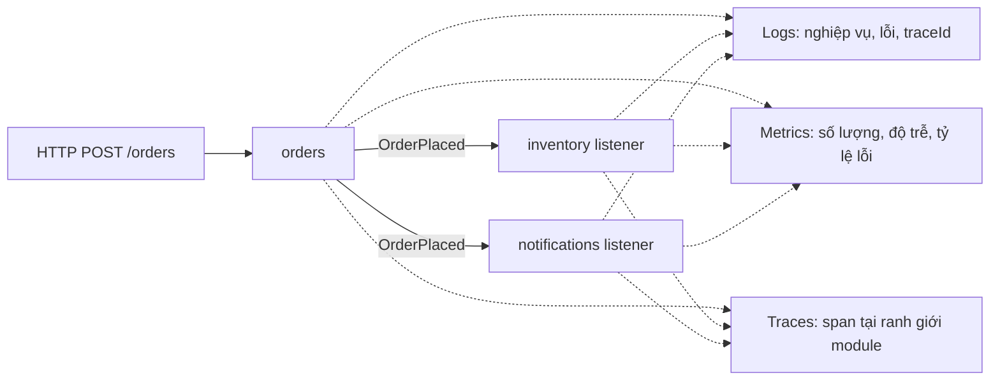

# Ba trụ cột logging, metrics và tracing

Trong ứng dụng Spring Boot tổ chức theo **Spring Modulith**, các application module như `orders`, `inventory` và `notifications` cùng chạy trong một tiến trình nhưng có ranh giới chức năng riêng. Khi xảy ra lỗi, biết rằng HTTP trả về `500` chưa đủ: cần biết **điều gì đã xảy ra, hiện tượng có phổ biến không và luồng xử lý đi qua những module nào**. Ba trụ cột của observability — **logging, metrics và tracing** — trả lời ba nhóm câu hỏi đó.

Mục tiêu của bài:

- Phân biệt giá trị, đơn vị dữ liệu và giới hạn của logging, metrics, tracing.
- Liên hệ từng trụ cột với application module, domain event và công cụ Actuator trong Spring Modulith.
- Hiểu cách `traceId`/`spanId` liên kết log với trace, cách metric dùng tag và ảnh hưởng của xử lý bất đồng bộ đến context propagation.
- Thiết kế quy trình điều tra một lỗi đi qua nhiều module bằng cả ba tín hiệu.

## 1. Vì sao cần cả ba trụ cột?

Xét nghiệp vụ đặt hàng:

1. Client gọi `POST /orders`.
2. Module `orders` lưu đơn và phát domain event `OrderPlaced`.
3. Module `inventory` tiếp nhận event, giữ hàng.
4. Module `notifications` nhận event và gửi thông báo.

Khi việc gửi thông báo đột nhiên chậm, mỗi trụ cột cung cấp một góc nhìn:

| Trụ cột | Dữ liệu điển hình | Câu hỏi phù hợp | Điểm cần lưu ý |
| --- | --- | --- | --- |
| **Logging** | Bản ghi sự kiện theo thời điểm, có mức độ và ngữ cảnh | “Đơn nào lỗi? Exception là gì? Listener đã chạy chưa?” | Tìm kiếm log khó nếu thiếu định dạng và correlation ID; log quá chi tiết gây tốn chi phí và lộ dữ liệu. |
| **Metrics** | Giá trị số tổng hợp theo thời gian: counter, gauge, timer/histogram | “Lỗi tăng từ khi nào? P95 tăng ở module nào? Tốc độ phát event biến động ra sao?” | Metric không kể lại chính xác toàn bộ diễn biến của một yêu cầu; tag có quá nhiều giá trị khác nhau làm tăng cardinality. |
| **Tracing** | Các span có quan hệ trong một trace, biểu diễn chuỗi hoạt động và thời lượng | “Yêu cầu đi qua ranh giới module nào? Bước nào chiếm phần lớn độ trễ?” | Trace có thể bị sampling và đứt mạch khi mất context ở thread, hàng đợi hoặc tiến trình khác. |

Ba tín hiệu hỗ trợ lẫn nhau: **metrics** phát hiện bất thường trên toàn hệ thống; **tracing** khoanh vùng đường đi và đoạn chậm; **logging** giải thích sự kiện và dữ liệu nghiệp vụ ở đoạn đó.



Sơ đồ này mô tả **nguồn tín hiệu**, không có nghĩa cả ba loại dữ liệu tự xuất hiện chỉ bằng cách chia package thành module. Logging cần các điểm ghi log hợp lý; metrics cần instrumentation và registry; tracing cần tracer/exporter và context phù hợp. Spring Modulith cung cấp thêm khả năng quan sát **ranh giới module** và **event được phát**, trên nền hạ tầng observability của Spring Boot/Micrometer.

## 2. Logging: chuyện gì đã xảy ra?

### 2.1. Nội dung của một log có ích

Một log hỗ trợ điều tra nên trả lời: **lúc nào**, **mức độ gì**, **thành phần nào**, **thao tác nào**, **kết quả ra sao** và **liên hệ với yêu cầu nào**. Trong ứng dụng nhiều module, nên có tên module hoặc logger/package đủ nhận diện module. Khi tracing được bật, thêm `traceId` và `spanId` để tìm các log cùng một trace.

| Mức log | Cách dùng tiêu biểu |
| --- | --- |
| `ERROR` | Xử lý thất bại, cần can thiệp hoặc điều tra; kèm exception có ngữ cảnh. |
| `WARN` | Bất thường nhưng hệ thống vẫn tiếp tục được, ví dụ retry hoặc dữ liệu đầu vào không hợp lệ. |
| `INFO` | Cột mốc nghiệp vụ đáng theo dõi, ví dụ đơn hàng đã được tiếp nhận, event đã được phát. |
| `DEBUG`/`TRACE` | Chi tiết phục vụ chẩn đoán, thường chỉ bật có kiểm soát. |

Ví dụ Java (rút gọn để tập trung vào logging và event):

```java
import java.util.UUID;
import org.slf4j.Logger;
import org.slf4j.LoggerFactory;
import org.springframework.context.ApplicationEventPublisher;
import org.springframework.stereotype.Service;

record OrderPlaced(UUID orderId) {}

@Service
class PlaceOrderService {
    private static final Logger log = LoggerFactory.getLogger(PlaceOrderService.class);
    private final ApplicationEventPublisher events;

    PlaceOrderService(ApplicationEventPublisher events) {
        this.events = events;
    }

    void place(UUID orderId) {
        // Giả sử bước validate và lưu đơn đã thành công.
        log.info("order.accepted orderId={}", orderId);
        events.publishEvent(new OrderPlaced(orderId));
        log.info("order.event.published type=OrderPlaced orderId={}", orderId);
    }
}
```

Thông điệp “event đã phát” chỉ khẳng định phía publisher đã đi qua lệnh phát event. Nó **không chứng minh** listener bất đồng bộ đã hoàn tất việc giữ hàng hay gửi email. Muốn biết kết quả xử lý cần log/metric/tracing ở phía consumer và, nếu cần bảo đảm tin cậy, cơ chế theo dõi hoàn tất event riêng.

### 2.2. Correlation ID liên kết log với trace

Với **Micrometer Tracing**, Spring Boot có thể đưa `traceId` và `spanId` vào MDC (Mapped Diagnostic Context), rồi hiển thị correlation ID trong log. Một ví dụ minh họa:

```text
2026-11-27 09:12:08 INFO [7fa3...c912-2b4e...08a1] orders.PlaceOrderService - order.accepted orderId=...
2026-11-27 09:12:08 INFO [7fa3...c912-c961...a325] inventory.ReservationHandler - stock.reserved orderId=...
```

Cùng `traceId` cho phép gom log của các span liên quan; `spanId` chỉ ra thao tác cụ thể đang ghi log. Hai giá trị này **khác** với mã đơn hàng: `orderId` là định danh nghiệp vụ, còn `traceId` định danh một hành trình xử lý được quan sát. Các đoạn trace trong ví dụ chỉ mang tính minh họa; không mặc định mọi listener bất đồng bộ đều duy trì cùng `traceId`.

Để log có thể tìm kiếm và tập hợp hiệu quả:

- Dùng tham số `{}` của SLF4J, tránh nối chuỗi hoặc in cả đối tượng chứa thông tin bí mật.
- Ghi các khóa có ý nghĩa ổn định như `eventType`, `module`, `outcome`; cấu hình JSON logging nếu hệ thống thu thập log hỗ trợ.
- Ghi exception **một cách có chủ đích** tại nơi xử lý lỗi; tránh cùng một stack trace xuất hiện lặp lại ở nhiều tầng.
- Tránh ghi password, token, thông tin thanh toán và dữ liệu cá nhân không cần thiết. Correlation ID giúp liên kết nên không cần sao chép toàn bộ payload vào log.

## 3. Metrics: hiện tượng xảy ra nhiều đến mức nào?

Metrics cung cấp dữ liệu gọn, dễ tổng hợp và dùng để đặt cảnh báo. Ba loại thường gặp:

- **Counter:** tăng theo số lần xảy ra sự kiện; ví dụ số event được phát hoặc số yêu cầu lỗi. Muốn đánh giá tốc độ, tính **rate** theo một khoảng thời gian thay vì chỉ nhìn tổng tích lũy.
- **Gauge:** ảnh chụp giá trị hiện tại; ví dụ số tác vụ đang đợi xử lý, số kết nối đang dùng.
- **Timer/Histogram:** đo thời lượng; tính throughput, trung bình, phân vị như P95/P99 nếu backend và cấu hình hỗ trợ.

### 3.1. Spring Modulith quan sát domain event

Khi bật hỗ trợ observability tương ứng với phiên bản Spring Modulith, framework cung cấp metric cho **sự kiện domain được phát**. Theo tài liệu Spring Modulith 2.x:

| Metric (tên theo Micrometer) | Ý nghĩa |
| --- | --- |
| `module.events.published` | Counter tổng hợp việc phát domain event, có tag như `module.identifier`, `module.name`, `module.event.type`. |
| `module.events.published.$moduleIdentifier.$simpleEventTypeName` | Counter cho một loại event cụ thể của một module, có thể tùy biến thêm tag qua API phù hợp. |

Đây là **tần suất phát event**, không phải số listener chạy thành công, số event được tiêu thụ đúng một lần hoặc số công việc đã hoàn tất. Chẳng hạn counter `OrderPlaced` tăng bình thường nhưng lượng notification gửi thành công giảm, cần kiểm tra listener, retry và trạng thái xử lý event.

Tên metric hiển thị trong Prometheus thường được chuẩn hóa khác tên Micrometer (chẳng hạn dấu chấm chuyển thành dấu gạch dưới, counter có hậu tố thích hợp). Khi tạo dashboard, hãy kiểm tra tên series thực tế được exporter sinh ra.

### 3.2. Cardinality: chọn tag đúng

Một metric dạng `orders.validation` có tag `result=accepted|rejected` là hợp lý vì tập giá trị nhỏ, ổn định. Gắn `orderId`, `userId` hoặc URL đầy đủ có ID riêng cho từng yêu cầu vào metric là nguy hiểm: mỗi tổ hợp tag có thể tạo thêm một time series, khiến hệ thống giám sát tốn bộ nhớ và chi phí.

Nguyên tắc:

| Nên là tag metric (low cardinality) | Thường để trong log/trace có kiểm soát (high cardinality) |
| --- | --- |
| `module=orders`, `event=OrderPlaced`, `result=success|failure` | `orderId`, `requestId`, đường dẫn chứa ID động |
| `region=ap-southeast-1`, `operation=reserve` | Email, nội dung payload, token (dữ liệu nhạy cảm không nên ghi) |

Trong **Micrometer Observation**, `lowCardinalityKeyValue(...)` có thể được dùng cho metrics và traces; `highCardinalityKeyValue(...)` dành cho traces. Dù trace hỗ trợ giá trị có độ đa dạng cao, vẫn phải cân nhắc quyền riêng tư và kích thước dữ liệu.

### 3.3. Đo một thao tác nghiệp vụ tùy chỉnh

Có thể dùng `ObservationRegistry` để tạo observation cho một đoạn quan trọng chưa được instrument sẵn:

```java
import io.micrometer.observation.Observation;
import io.micrometer.observation.ObservationRegistry;

class StockValidator {
    private final ObservationRegistry registry;

    StockValidator(ObservationRegistry registry) {
        this.registry = registry;
    }

    void validateStock(Runnable validation) {
        Observation.createNotStarted("inventory.stock.validation", registry)
            .lowCardinalityKeyValue("module", "inventory")
            .observe(validation);
    }
}
```

Khi đã cấu hình observation handlers thích hợp, đoạn này có thể tạo metric thời lượng và span tương ứng. Cần đo **một thao tác có ý nghĩa**: đừng tự bọc lặp một method đã được framework quan sát, vì có thể tạo span/metric trùng và làm dashboard khó hiểu.

## 4. Tracing: một yêu cầu đi qua đâu và mất bao lâu?

**Trace** mô tả một hành trình xử lý; mỗi **span** là một công việc có thời điểm bắt đầu, kết thúc, trạng thái và thuộc tính. Các span thường có quan hệ parent/child; với công việc bất đồng bộ, quan hệ có thể được thể hiện bằng một trace tiếp nối, liên kết span hoặc một trace khác, tùy hạ tầng và cách truyền context.

- **`traceId`:** nhận diện toàn bộ hành trình được liên kết.
- **`spanId`:** nhận diện một thao tác trong hành trình.
- **Span attributes/tags:** mô tả thao tác, ví dụ tên module hoặc kiểu gọi.
- **Sampling:** chỉ giữ một phần trace để kiểm soát chi phí; việc không tìm thấy trace không tự chứng minh thao tác chưa diễn ra.

### 4.1. Span tại ranh giới application module

Spring Modulith có khả năng instrument lời gọi đến các **Spring component nằm trong API của application module**, tạo span phản ánh tương tác giữa các module. Với hỗ trợ observability tương ứng, span vào module có thể có:

| Thuộc tính span | Dùng để đọc điều gì? |
| --- | --- |
| `module.identifier` | Module nào được gọi. |
| `module.name` | Tên hiển thị của module. |
| `module.invocation-type` | Lời gọi bean hay event listener. |
| `module.method` | Phương thức ở ranh giới được thực thi. |

Một luồng minh họa trong công cụ như Zipkin, Grafana Tempo hoặc Jaeger:

```text
Trace: HTTP POST /orders
  ├─ HTTP server span
  └─ orders: place(UUID)
       └─ inventory: reserve(OrderPlaced)  [nếu có trace context liên kết]
```

Không phải mọi method nội bộ trong package `orders.internal` đều tự có span. Instrumentation ranh giới chỉ cho thấy **những tương tác thực tế được quan sát**, không thay thế toàn bộ đồ thị dependency của mã nguồn.

Trong xử lý event bất đồng bộ, listener có thể chạy sau khi HTTP request đã kết thúc. Vì thế đừng mặc định span listener luôn nằm dưới HTTP span như cấu trúc trên; hãy kiểm tra context propagation và cơ chế liên kết trace thực tế của cấu hình đang dùng.

### 4.2. Context propagation khi đổi thread

Thông tin tracing và MDC thường gắn với context đang hoạt động trên **thread hiện tại**. Một `@Async` method, executor tùy chỉnh hoặc listener bất đồng bộ có thể chạy trên thread khác. Nếu không chuyển context, triệu chứng thường là:

1. Log bên publisher có `traceId`, log bên listener không có hoặc có traceId khác.
2. Trên tracing backend, hành trình bị chia thành nhiều đoạn không liên kết.
3. Không thể từ trace của HTTP request lần ra thời gian xử lý event một cách đáng tin cậy.

Với Spring Framework/Spring Boot có Micrometer Context Propagation, có thể cấu hình `ContextPropagatingTaskDecorator` cho executor do ứng dụng quản lý:

```java
import org.springframework.context.annotation.Bean;
import org.springframework.context.annotation.Configuration;
import org.springframework.core.task.support.ContextPropagatingTaskDecorator;

@Configuration(proxyBeanMethods = false)
class ObservabilityContextConfiguration {
    @Bean
    ContextPropagatingTaskDecorator contextPropagatingTaskDecorator() {
        return new ContextPropagatingTaskDecorator();
    }
}
```

Ở các phiên bản Spring Boot hỗ trợ thuộc tính `spring.task.execution.propagate-context`, có thể bật truyền context cho `AsyncTaskExecutor` được Boot tự cấu hình theo hướng dẫn của phiên bản đó. Với executor do ứng dụng tự tạo, phải bảo đảm decorator **thực sự được gắn vào executor đang chạy listener**. Với Reactor, cơ chế truyền context khác với executor thông thường và có tùy chọn `spring.reactor.context-propagation=auto` ở phiên bản hỗ trợ.

Lưu ý: truyền `ThreadLocal` giữa các thread **trong cùng ứng dụng** không đồng nghĩa tự động truyền trace qua message broker hoặc sang service khác. Qua HTTP, nên dùng client builder được Spring Boot instrument; qua message broker, cần cơ chế inject/extract trace context phù hợp với thư viện truyền tin. Không nên giả lập cùng trace bằng cách tự sửa chuỗi `traceId` trong log.

## 5. Kết nối Spring Boot Actuator, Spring Modulith và hệ thống giám sát

### 5.1. Các lớp cấu hình có vai trò khác nhau

| Thành phần | Vai trò |
| --- | --- |
| Spring Boot Actuator | Cung cấp endpoint vận hành như `/actuator/health`, `/actuator/metrics` và tích hợp observability. |
| Micrometer Metrics/Observation | Thu nhận số liệu, observation và truyền đến registry/handler tương ứng. |
| Micrometer Tracing + tracer/exporter | Tạo, truyền và xuất trace đến tracing backend. |
| Spring Modulith Actuator | Cho xem cấu trúc application module tại `/actuator/modulith`. |
| Spring Modulith Observability | Bổ sung span tương tác module và metric phát domain event. |
| Prometheus/Grafana/Zipkin/Tempo… | Thu thập, lưu trữ, truy vấn hoặc hiển thị tín hiệu vận hành. |

Nếu sử dụng Spring Modulith 2.x, một cách khởi tạo thường gặp là phụ thuộc `spring-modulith-starter-insight`; starter này kết hợp hỗ trợ Actuator và observability của Modulith. Trong Gradle, dự án cần quản lý phiên bản Spring Boot/Spring Modulith tương thích bằng plugin hoặc BOM:

```groovy
dependencies {
    implementation 'org.springframework.boot:spring-boot-starter-actuator'
    runtimeOnly 'org.springframework.modulith:spring-modulith-starter-insight'
    runtimeOnly 'io.micrometer:micrometer-registry-prometheus'
    // Thêm tracer/exporter tương ứng với phiên bản Spring Boot đang dùng.
}
```

Ví dụ này không có tracer exporter: **muốn quan sát trace trên backend vẫn phải bổ sung và cấu hình hệ thống tracing**. Với Spring Boot 4.x, tài liệu hướng dẫn starter OpenTelemetry/OTLP hoặc Zipkin tương ứng; các tổ hợp dependency và tên property có thể khác ở Spring Boot 3.x. Cần đối chiếu tài liệu đúng phiên bản project thay vì sao chép nguyên cấu hình giữa hai dòng phiên bản.

Trong môi trường phát triển, có thể mở các actuator endpoint cần thiết:

```yaml
management:
  endpoints:
    web:
      exposure:
        include: health,info,metrics,prometheus,modulith
  tracing:
    sampling:
      probability: 1.0  # Chỉ để quan sát đầy đủ trong bài thực hành
```

`/actuator/prometheus` chỉ hoạt động khi có registry Prometheus và endpoint tương ứng; `/actuator/modulith` cần hỗ trợ Modulith Actuator. Việc khai báo `include` không tự tạo ra endpoint chưa có. Trong môi trường thật, chỉ expose endpoint theo nhu cầu và bảo vệ quyền truy cập; sampling 100% thường không thích hợp cho lưu lượng lớn.

### 5.2. Đọc đồ thị module cùng telemetry

Endpoint `/actuator/modulith` mô tả **cấu trúc module và dependency** mà Spring Modulith nhận diện khi ứng dụng chạy, ví dụ:

```json
{
  "orders": {
    "basePackage": "com.example.shop.orders",
    "displayName": "Orders",
    "dependencies": []
  },
  "inventory": {
    "basePackage": "com.example.shop.inventory",
    "displayName": "Inventory",
    "dependencies": [
      {
        "target": "orders",
        "types": ["EVENT_LISTENER"]
      }
    ]
  }
}
```

Đây là **ví dụ dữ liệu giả định**, không phải kết quả quét của một ứng dụng cụ thể. Đồ thị trả lời “module nào phụ thuộc module nào theo cấu trúc”; trace trả lời “ở lần thực thi được ghi nhận, thao tác đã đi qua đâu”; event metrics trả lời “đã phát bao nhiêu sự kiện”; logs trả lời “chính xác hành động nào thành công hoặc thất bại”. Dùng kết hợp các nguồn đó mới kiểm chứng được kiến trúc module trong vận hành.

## 6. Một quy trình điều tra sự cố theo ba trụ cột

**Tình huống:** Từ 09:00, khách hàng thấy email xác nhận đơn đến muộn. HTTP `POST /orders` vẫn trả `201`.

| Bước | Tín hiệu / thao tác | Diễn giải hợp lý |
| --- | --- | --- |
| 1. Xác định phạm vi | Dashboard cho thấy P95 của luồng gửi thông báo tăng, số đơn thành công vẫn ổn định. | Sự cố nhiều khả năng xảy ra sau bước tiếp nhận đơn; chưa thể khẳng định nguyên nhân. |
| 2. Kiểm tra event | `module.events.published` cho `OrderPlaced` vẫn tăng đều. | Publisher vẫn phát event; metric này **chưa xác nhận** listener xử lý xong. |
| 3. Lần theo trace | Các trace được lấy mẫu cho thấy đoạn `notifications` kéo dài hoặc không xuất hiện. | Nếu có span chậm: khoanh vùng tại listener; nếu thiếu span: phải kiểm tra sampling, instrumentation, context propagation trước. |
| 4. Đọc log liên quan | Tìm theo `traceId`, sau đó theo `orderId` ở các log nghiệp vụ có quyền truy cập. | Có thể phân biệt timeout, retry, lỗi kết nối đến dịch vụ email, hoặc đơn giản là trace bị tách. |
| 5. Đối chiếu ranh giới | Xem `/actuator/modulith` và tài liệu/module graph để nhận diện dependency thực tế. | Kiểm tra sự tương tác có phù hợp thiết kế module hay đang có sự ghép nối ngoài ý muốn. |

Một kết luận có chứng cứ sẽ có dạng: “Trong khoảng 09:00–09:15, metric thời lượng gửi email tăng mạnh; trace của các yêu cầu được lấy mẫu cho thấy listener `notifications` đợi dịch vụ email; log cùng correlation ID ghi nhận timeout, sau đó retry.” Không kết luận “Spring Modulith làm mất event” chỉ vì log listener vắng mặt.

## 7. Tự kiểm chứng trên ứng dụng mẫu

Thực hiện lần lượt:

1. **Xác định cấu trúc:** dùng `/actuator/modulith` (khi đã cấu hình), tìm tên module và những dependency qua bean/event listener; so sánh với ranh giới API mà nhóm thiết kế.
2. **Phát một event:** gọi API đặt hàng, xác nhận log phía publisher, sau đó đối chiếu log phía listener. Phân biệt “đã phát” với “đã xử lý xong”.
3. **Quan sát metrics:** mở `/actuator/metrics` hoặc `/actuator/metrics/module.events.published` khi metric đã được đăng ký; lặp lại yêu cầu và xem giá trị counter thay đổi. Nếu dùng Prometheus, kiểm tra tên series thực tế trên `/actuator/prometheus`.
4. **Quan sát trace:** bật exporter và tracing backend theo phiên bản đang dùng; truy vấn trace của request, tìm span ở ranh giới module cùng `module.identifier` và `module.invocation-type` nếu chúng được ghi nhận.
5. **Thử đổi thread:** chạy listener bất đồng bộ, so sánh correlation ID trước/sau; cấu hình context propagation đúng executor rồi chạy lại. Kiểm tra thay đổi ngay trên log và tracing UI.
6. **Kiểm tra chất lượng dữ liệu:** xác minh không gắn `orderId` làm metric tag; bảo vệ endpoint Actuator, giảm sampling và mức logging khi chuyển từ demo sang môi trường có tải.

### Những lỗi quan sát thường gặp

| Triệu chứng | Những điểm kiểm tra đầu tiên |
| --- | --- |
| `/actuator/modulith` trả `404` | Đã có Modulith Actuator/Insight chưa; endpoint có được expose không; application module có được nhận diện không. |
| Không có `module.events.published` | Đã bật observability của Modulith chưa; có phát domain event qua cơ chế được instrument không; metric có được đăng ký/xuất ra backend không. |
| Có log nhưng không có `traceId` | Có tracer và sampling phù hợp không; log pattern có correlation ID không; ở thread mới có truyền context không. |
| Có trace HTTP nhưng thiếu span module | Có Modulith observability chưa; lời gọi có thực sự đi qua API component của module không; trace có bị sampling hoặc async tách context không. |
| Số time series tăng đột biến | Kiểm tra metric tags chứa ID động, URI thô, thông tin người dùng hoặc giá trị không giới hạn. |

## 8. Ghi nhớ

- **Logging** giúp giải thích từng sự kiện và lỗi cụ thể, đặc biệt hiệu quả khi có correlation ID.
- **Metrics** cho biết xu hướng, mức độ và điểm bất thường; metric **event published** chỉ đo lúc phát event.
- **Tracing** cho thấy đường đi và thời lượng của những thao tác đã được instrument và ghi nhận; dấu vết qua xử lý bất đồng bộ phụ thuộc context propagation.
- **Spring Modulith** bổ sung ý nghĩa kiến trúc vào các tín hiệu: module graph/Actuator cho biết ranh giới và dependency; spans ở module entry và event metrics phản ánh một phần tương tác khi vận hành.
- **Micrometer Observation** là cầu nối thuận tiện giữa metrics và tracing trong Spring Boot; lựa chọn tag, sampling và bảo vệ dữ liệu quyết định chất lượng quan sát.

## Tài liệu tham khảo

- [Spring Modulith — Production-ready Features](https://docs.spring.io/spring-modulith/reference/production-ready.html): application module Actuator, observability spans, event metrics.
- [Spring Boot — Observability](https://docs.spring.io/spring-boot/reference/actuator/observability.html): ba trụ cột, `ObservationRegistry`, cardinality và context propagation.
- [Spring Boot — Tracing](https://docs.spring.io/spring-boot/reference/actuator/tracing.html): tracer/exporter, sampling, correlation ID và propagation.
- [Spring Modulith — Fundamentals](https://docs.spring.io/spring-modulith/reference/fundamentals.html): API, nội bộ module và dependency giữa các application module.

> **Lưu ý phiên bản:** API, artifact và property cấu hình có thể thay đổi giữa các dòng Spring Boot và Spring Modulith. Khi triển khai, ưu tiên tài liệu đúng phiên bản mà dự án đang dùng.
