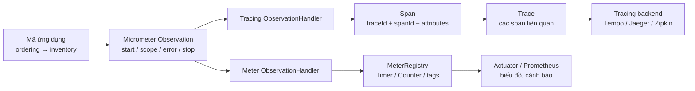
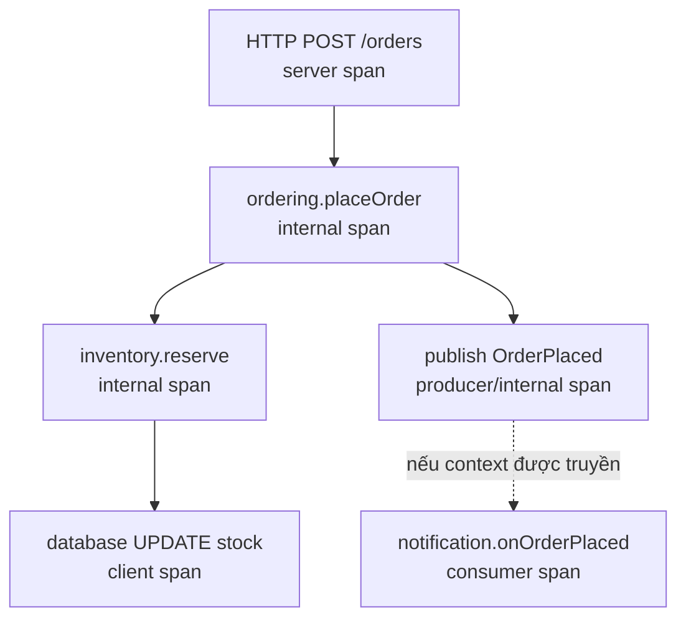

# Phân biệt Observation, Meter, Span và Trace

## 1. Vì sao phải phân biệt bốn khái niệm?

Trong ứng dụng Spring Boot được tổ chức bằng **Spring Modulith**, tài liệu kiến trúc có thể cho biết các application module nào tồn tại, module nào phụ thuộc module nào. Tuy nhiên, khi hệ thống đang chạy, ta còn cần biết: thao tác nào thực sự được gọi, mất bao lâu, lỗi xảy ra ở đâu và một yêu cầu đã đi qua những module nào. Đây là phạm vi của **observability**.

Micrometer và hệ sinh thái quan sát của Spring Boot sử dụng bốn khái niệm thường xuất hiện cạnh nhau:

- **Observation**: cách đánh dấu và theo dõi một thao tác ở mức mã nguồn; thông tin của observation có thể được nhiều bộ xử lý sử dụng.
- **Meter**: đối tượng đo lường và tổng hợp số liệu định lượng, chẳng hạn số lần thực thi hoặc thời gian xử lý.
- **Span**: một đơn vị công việc có mốc bắt đầu/kết thúc và ngữ cảnh truy vết.
- **Trace**: chuỗi hoặc cây các span có liên hệ, mô tả hành trình của một yêu cầu hay một luồng xử lý.

Ví dụ, khi module `ordering` gọi module `inventory` để giữ hàng, ta có thể tạo một observation quanh thao tác giữ hàng. Nếu các handler tương ứng đã được cấu hình, observation đó có thể sinh **metric** về thời lượng và **span** mô tả lần gọi cụ thể. Span này có thể trở thành một phần của **trace** đang xử lý yêu cầu đặt hàng.

> **Điểm cốt lõi:** Observation là giao diện instrument thao tác; Meter phục vụ thống kê; Span ghi một công việc cụ thể; Trace kết nối các công việc có quan hệ nhân quả. Bốn khái niệm không phải bốn tên gọi khác nhau của cùng một dữ liệu.

## 2. Bảng so sánh nhanh

| Khái niệm | Bản chất | Phạm vi / vòng đời | Thông tin tiêu biểu | Trả lời tốt câu hỏi |
| --- | --- | --- | --- | --- |
| **Observation** | API/lifecycle của Micrometer để quan sát một thao tác | Một thao tác được `start`, ghi ngữ cảnh/sự kiện/lỗi, rồi `stop` | Tên observation, key-value, lỗi, event, scope | “Ta sẽ instrument điểm nào trong mã để phát dữ liệu quan sát?” |
| **Meter** | Bộ đo/tổng hợp trong `MeterRegistry` | Thường tồn tại và tích lũy qua rất nhiều lần gọi | Counter, Timer, Gauge, DistributionSummary; tên và tags | “Module nào có nhiều lỗi?”, “p95 thời gian xử lý đang tăng không?” |
| **Span** | Bản ghi một đơn vị công việc trong hệ thống tracing | Một lần xử lý cụ thể, có start/end | `traceId`, `spanId`, parent, duration, attributes, events, error/status | “Lần xử lý này chậm ở thao tác nào?” |
| **Trace** | Tập hợp các span liên quan, thường có cùng `traceId` | Hành trình của một request/luồng công việc | Cây span, quan hệ cha-con, thứ tự và thời gian | “Yêu cầu này đi qua các module hoặc service nào?” |

Đừng nhầm **Meter** (đối tượng giữ phép đo trong Micrometer) với **metric sample/time series** (số liệu được registry hoặc hệ giám sát xuất ra). Một Timer có thể được cập nhật hàng nghìn lần, trong khi mỗi span đại diện cho một lần chạy cụ thể.

## 3. Observation: điểm instrument chung cho metrics và tracing

### 3.1. Observation hoạt động như thế nào?

Micrometer Observation cung cấp `ObservationRegistry`, `Observation`, ngữ cảnh (`Observation.Context`), convention và các `ObservationHandler`. Một observation có vòng đời điển hình:

1. Tạo observation với tên ổn định và registry.
2. Bắt đầu theo dõi bằng `start()` hoặc dùng `observe(...)`.
3. Gắn key-value, ghi event hoặc error khi cần; có thể mở `Scope` để đưa observation vào ngữ cảnh hiện hành.
4. Kết thúc bằng `stop()`, hoặc để `observe(...)` đóng vòng đời tự động.

Các handler đăng ký với registry được thông báo về vòng đời đó. **Meter handler** có thể cập nhật Timer hoặc Counter; **tracing handler** có thể tạo và kết thúc span. Observation **không tự bảo đảm** có cả metric và span: kết quả phụ thuộc các handler, registry, tracer và cấu hình ứng dụng.



Sơ đồ thể hiện **các nhánh có thể được cấu hình**, không khẳng định Spring Boot luôn tự sinh cả hai loại telemetry cho mọi observation. Metric và trace thường được xuất qua những pipeline riêng.

### 3.2. Ví dụ tạo observation trong Spring Boot

Giả sử application module `checkout` gọi cổng thanh toán. Ta instrument tại ranh giới thao tác để có tên và nhãn nhất quán:

```java
import io.micrometer.observation.Observation;
import io.micrometer.observation.ObservationRegistry;
import org.springframework.stereotype.Service;

@Service
public class CheckoutService {

    private final ObservationRegistry observationRegistry;
    private final PaymentPort paymentPort;

    public CheckoutService(ObservationRegistry observationRegistry,
                           PaymentPort paymentPort) {
        this.observationRegistry = observationRegistry;
        this.paymentPort = paymentPort;
    }

    public void submit(String orderId) {
        Observation.createNotStarted("checkout.payment", observationRegistry)
                .contextualName("checkout authorize payment")
                .lowCardinalityKeyValue("module", "checkout")
                .lowCardinalityKeyValue("operation", "authorize")
                .observe(() -> paymentPort.authorize(orderId));
    }

    public interface PaymentPort {
        void authorize(String orderId);
    }
}
```

Ở ví dụ này:

- `checkout.payment` là **tên observation** ổn định, dùng chung qua nhiều lần gọi.
- `module=checkout` và `operation=authorize` là nhãn có ít giá trị khả dĩ, phù hợp để làm metric tags.
- `observe(...)` bao quanh một lần thực thi, quản lý vòng đời observation và ghi nhận exception khi thao tác thất bại.
- Nếu đã tích hợp metrics, có thể xuất một phép đo thời lượng với các tags trên; nếu đã tích hợp tracing, có thể tạo một span tương ứng.

Không cần tự tạo `Timer` và một span khác cho cùng thao tác nếu Observation đã được các handler phù hợp instrument, vì dễ làm tăng số phép đo hoặc tạo các span trùng mục đích.

### 3.3. Low cardinality và high cardinality

Observation có hai loại key-value cần phân biệt:

| Loại | Ví dụ hợp lý | Cách sử dụng |
| --- | --- | --- |
| **Low cardinality** | `module=checkout`, `operation=authorize`, `outcome=success/failure` | Có số lượng tổ hợp nhãn hữu hạn; thích hợp cho tags của metrics và cũng có thể xuất hiện trên spans |
| **High cardinality** | Mã tham chiếu một lần xử lý có rất nhiều giá trị khác nhau | Có thể hữu ích cho span attributes nếu tracing handler hỗ trợ; **không nên đưa làm metric tags** |

Nếu gắn `orderId`, `userId`, URL đầy đủ chứa ID hoặc timestamp làm nhãn Timer, hệ thống metrics có thể tạo rất nhiều time series, tiêu tốn bộ nhớ và chi phí lưu trữ. Với trace attributes, cũng phải lọc thông tin cá nhân, token và dữ liệu nhạy cảm; không phải cứ là high-cardinality thì được phép ghi lại.

Ngoài ra, `Observation.Scope` giúp thiết lập observation hiện hành trong luồng xử lý. Khi đi qua luồng khác hoặc message broker, scope hiện hành **không đương nhiên** được mang theo; đây là lý do cần context propagation ở phần sau.

## 4. Meter: đo xu hướng và sức khỏe vận hành

### 4.1. Các loại meter thường gặp

Micrometer Metrics quản lý meter qua `MeterRegistry`. Mỗi meter được nhận diện bằng tên cùng bộ tags, và bộ thu thập như Prometheus đọc số liệu từ registry qua cơ chế tích hợp tương ứng.

| Meter | Ý nghĩa | Ví dụ trong ứng dụng Modulith |
| --- | --- | --- |
| `Counter` | Giá trị đếm tăng dần | Số lần thanh toán thất bại, số event được xử lý |
| `Timer` | Số lần gọi và phân phối/thống kê thời lượng | Thời gian gọi `inventory.reserve`, thời gian handler xử lý event |
| `Gauge` | Giá trị đo tại thời điểm quan sát | Số publication đang chờ được xử lý, kích thước queue |
| `DistributionSummary` | Phân phối của số đo không phải thời gian | Kích thước payload event hoặc số dòng trong một batch |

Tùy registry và cấu hình phân phối, Timer có thể cung cấp count, tổng thời lượng, max, histogram hoặc percentile. **p95 không tự xuất hiện trong mọi hệ thống**: cần bật thống kê phù hợp hoặc dùng truy vấn histogram ở backend hỗ trợ.

### 4.2. Ví dụ ghi meter trực tiếp

Khi chỉ cần một phép đếm hoặc thống kê không thuận tiện gắn với vòng đời observation, có thể sử dụng API metrics trực tiếp:

```java
import io.micrometer.core.instrument.Counter;
import io.micrometer.core.instrument.MeterRegistry;
import io.micrometer.core.instrument.Timer;

public class PaymentMetrics {
    private final Counter failedPayments;
    private final Timer authorizationTimer;

    public PaymentMetrics(MeterRegistry registry) {
        this.failedPayments = Counter.builder("checkout.payment.failed")
                .tag("module", "checkout")
                .register(registry);

        this.authorizationTimer = Timer.builder("checkout.payment.duration")
                .tag("module", "checkout")
                .register(registry);
    }

    public void recordFailure() {
        failedPayments.increment();
    }

    public void timeAuthorization(Runnable action) {
        authorizationTimer.record(action);
    }
}
```

Đoạn này mô tả **instrumentation thay thế hoặc bổ sung cho trường hợp khác**; không nên vừa đo `checkout.payment` bằng Observation handler, vừa ghi Timer thủ công cho đúng cùng phạm vi mà không có chủ đích. Tên metrics, tập tags và cơ chế xuất số liệu cần được thống nhất theo convention của dự án.

### 4.3. Meter trả lời được gì và không trả lời được gì?

Nếu sau 15 phút ta thấy số lỗi từ `inventory` tăng và thời lượng xử lý ở percentile cao tăng, metric cho thấy **xu hướng bất thường** và giúp tạo alert. Nhưng một giá trị Timer không tiết lộ yêu cầu cụ thể nào đã chậm, gọi phương thức nào trước đó hay bị chặn bởi bước nào. Muốn điều tra một lần xử lý, cần spans/traces hoặc thông tin tương quan khác.

**Metrics không đồng nghĩa tracing.** Một ứng dụng có thể ghi đầy đủ Timer/Counter mà không hề xuất trace; ngược lại, tracing có thể hoạt động dù không có meter cho thao tác cụ thể.

## 5. Span: một bước thực thi có thể quan sát chi tiết

Một **span** thường thể hiện một công việc có thời điểm bắt đầu và kết thúc: nhận HTTP request, thực thi lệnh nghiệp vụ, gọi database, gọi HTTP sang service khác hoặc chạy event listener. Span có các trường tiêu biểu:

- `traceId`: định danh trace mà span thuộc về.
- `spanId`: định danh duy nhất của span trong trace.
- `parentSpanId`: span cha, nếu có; hỗ trợ tái dựng cây công việc.
- Tên, start/end time, duration, attributes, events và thông tin lỗi/trạng thái tùy instrumentation.
- Ngữ cảnh span có thể được **propagate** để thao tác kế tiếp tiếp tục cùng trace.

Ví dụ một span chứa dữ liệu **minh họa**:

```text
name          = inventory.reserve
traceId       = 4bf92f3577b34da6a3ce929d0e0e4736
spanId        = 00f067aa0ba902b7
parentSpanId  = 7d3a2f29e0c9f111
duration      = 84 ms
attributes    = {module: "inventory", operation: "reserve"}
```

Hai lần gọi `inventory.reserve` có thể cập nhật **cùng một Timer**, nhưng mỗi lần sẽ có **span riêng** nếu được tracing và chọn lấy mẫu. Span cũng có thể có child spans: `inventory.reserve` gọi database và các child spans thể hiện query.

Một span là đơn vị nhỏ để điều tra độ trễ và lỗi; bản thân nó chưa mô tả đầy đủ hành trình của yêu cầu.

## 6. Trace: hành trình qua nhiều span

**Trace** là tập hợp các span liên quan bằng ngữ cảnh truy vết, thường cùng `traceId`. Quan hệ cha-con biểu diễn nguồn gốc thao tác; mốc thời gian biểu diễn thứ tự và mức độ chồng lấn. Trace không nhất thiết là một đường thẳng và không nhất thiết luôn bắt đầu ở HTTP.

Giả sử một đơn hàng được xử lý theo luồng:



Nếu tracing và propagation được cấu hình cho từng điểm, các span trên có thể cùng trace ID, đồng thời mỗi span có span ID riêng. Trong trường hợp event được xử lý bất đồng bộ sau commit hoặc qua broker, **không được mặc định** listener tiếp tục trace gốc: cần cơ chế truyền/khôi phục context phù hợp. Một số hệ thống chọn tạo trace mới và lưu **span link** để biểu diễn quan hệ bất đồng bộ; cách làm tùy thư viện, kiến trúc và chính sách sampling.

Trace cho phép đối chiếu thời lượng giữa các bước, ví dụ: tổng request 900 ms, `inventory.reserve` chiếm 650 ms, query database 620 ms. Đây là hướng điều tra cụ thể mà chỉ số p95 của `ordering` không thể hiện.

**Lưu ý:** Không phải mọi span đều được xuất. Sampling có thể giữ lại một phần trace; instrumentation thiếu có thể tạo “khoảng trống” trong cây. Một trace thiếu span không chứng minh thao tác tương ứng chưa từng chạy.

## 7. Bốn khái niệm phối hợp trong Spring Modulith

Với Spring Modulith, **application module** là đơn vị tổ chức và kiểm soát ranh giới logic của monolith. Khả năng sinh tài liệu/module graph mô tả **cấu trúc và phụ thuộc thiết kế**; quan sát runtime cung cấp chứng cứ về **đường đi thực thi**.

Một chuỗi làm việc điển hình:

1. Từ module graph, xác định `ordering` được phép tương tác với API được công bố của `inventory`.
2. Instrument tương tác ở ranh giới module, qua Spring Modulith observability hoặc Micrometer Observation tại các điểm nghiệp vụ quan trọng.
3. Theo dõi Timer/Counter để phát hiện độ trễ hoặc tỷ lệ lỗi theo các nhãn có cardinality thấp.
4. Khi có bất thường, mở một trace tiêu biểu để xem spans và xác định công việc nào chiếm thời gian hoặc phát sinh lỗi.
5. Đối chiếu kết quả runtime với cấu trúc module và kiểm thử kiến trúc để tìm phụ thuộc sai hoặc tương tác không như thiết kế.

Spring Modulith có cơ chế quan sát tương tác ở ranh giới application module khi được tích hợp và cấu hình phù hợp. **Phạm vi chính xác của các spans/metrics do framework tạo ra phụ thuộc phiên bản và instrumentation đang bật**: không phải cứ có method call trong module là có span, và tên metric/span thực tế cần được kiểm tra trong ứng dụng.

| Câu hỏi cần trả lời | Tín hiệu phù hợp |
| --- | --- |
| “Module `inventory` có được module `ordering` phụ thuộc theo kiến trúc không?” | Module graph, quy tắc dependency và kiểm thử kiến trúc của Spring Modulith |
| “Tỷ lệ lỗi gọi `inventory` tăng trong giờ cao điểm không?” | Counter/Timer hoặc metric với tags theo module, operation, outcome |
| “Yêu cầu đặt hàng số X vì sao chậm?” | Trace của yêu cầu, xem span và duration của từng bước |
| “Lần gọi database nào gây ra lỗi?” | Span tương ứng, error attributes, logs có correlation ID |
| “Event đã được publish và được listener xử lý hoàn tất chưa?” | Trạng thái event publication/handler, số liệu xử lý event, logs; trace hỗ trợ điều tra khi có propagation |

Một event publication được lưu để đảm bảo xử lý bền vững **không tự động bằng** một span hay một metric. Dùng đúng cơ chế theo dõi publication của Spring Modulith để xác minh trạng thái xử lý; dùng trace để phân tích luồng thực thi, và metrics để giám sát xu hướng.

## 8. Quan sát từ Spring Boot Actuator và tracing backend

### 8.1. Thành phần cần có

Tùy phiên bản Spring Boot, một cấu hình quan sát thường bao gồm:

- **Spring Boot Actuator**: cung cấp hạ tầng metrics/observation và các endpoint quản trị như `/actuator/metrics`.
- **Micrometer metrics registry** phù hợp với nơi thu thập (chẳng hạn Prometheus registry): cung cấp đường xuất metrics.
- **Micrometer Tracing bridge** và exporter phù hợp (chẳng hạn OpenTelemetry/OTLP): tạo và gửi spans đến tracing backend.
- **Spring Modulith observability** nếu muốn quan sát các tương tác module mà phần tích hợp đó hỗ trợ; vẫn cần kiểm tra các điều kiện instrumentation/sampling.

Việc có Actuator hoặc tạo một `Observation` **chưa đủ** để kết luận spans đã xuất sang hệ thống tracing. Tracing bridge, exporter, endpoint và sampling đều có vai trò riêng.

### 8.2. Cấu hình Actuator và sampling tham khảo

```yaml
management:
  endpoints:
    web:
      exposure:
        include: health, metrics, prometheus
  tracing:
    sampling:
      probability: 1.0
```

Cấu hình trên mang tính **minh họa trong môi trường thử nghiệm**: cần có Prometheus registry thì endpoint `/actuator/prometheus` mới khả dụng. `probability: 1.0` giúp giữ toàn bộ trace khi học/kiểm thử, nhưng trên production cần chọn tỷ lệ lấy mẫu dựa trên lưu lượng, chi phí và yêu cầu vận hành. Tracing backend/exporter và địa chỉ nhận spans phải được cấu hình theo stack thực tế; không có endpoint Actuator mặc định nào thay thế một trace viewer.

Thử kiểm tra metrics:

```bash
curl http://localhost:8080/actuator/metrics
curl http://localhost:8080/actuator/metrics/checkout.payment
curl http://localhost:8080/actuator/prometheus
```

`/actuator/metrics` liệt kê những metric hiện có trong registry; `/actuator/metrics/{name}` trả thông tin cho tên đã đăng ký. Tên `checkout.payment` chỉ xuất hiện nếu instrumentation/handler tương ứng thực sự tạo meter với tên đó. Các tên Prometheus có thể được chuẩn hóa và thêm hậu tố theo loại phép đo; không nên giả định tên series giống hệt tên observation.

Để xem **traces**, phát sinh một yêu cầu, tìm `traceId` trong logs có cấu hình correlation hoặc trong tracing backend, rồi mở trace và xem các span. Những backend như Tempo, Jaeger hoặc Zipkin hỗ trợ cách điều tra này, tùy hệ thống đang triển khai.

### 8.3. Kiểm chứng bằng một kịch bản cụ thể

Ví dụ thao tác đặt hàng đi qua `ordering → inventory`:

1. Gửi nhiều request hợp lệ và một số request cố ý gây lỗi để hình thành dữ liệu.
2. Mở `/actuator/metrics` để xác nhận meter về số lần gọi/thời lượng có được đăng ký; xem các tags và giá trị sau khi phát request.
3. Mở trace có sample; kiểm tra `traceId`, tên các span, quan hệ parent/child và khoảng thời gian thực thi.
4. Nếu có event listener bất đồng bộ, kiểm tra listener có tiếp tục trace hoặc tạo span link theo thiết kế không.
5. Đối chiếu tên module/operation trong dữ liệu runtime với module graph. Nếu không nhìn thấy dữ liệu mong đợi, kiểm tra xem điểm đó đã thực sự được instrument chưa.

Một metric có thể cho thấy `inventory` chậm trên diện rộng, trong khi một trace cung cấp ví dụ cụ thể về đường đi và tác nhân gây chậm. Hai tín hiệu bổ sung cho nhau.

## 9. Context propagation: điều kiện để trace không bị đứt

**Context propagation** là việc chuyển ngữ cảnh tracing/observation qua các ranh giới thực thi. Những thông tin như trace ID, span ID hiện hành và baggage (khi dùng) cần được mang sang nơi công việc tiếp tục, sau đó khôi phục vào đúng scope. Việc chỉ copy một chuỗi `traceId` để log **không tự tạo** quan hệ parent/child giữa các spans.

Các tình huống thường gây mất ngữ cảnh:

- Dùng `@Async`, `Executor`, `CompletableFuture` hoặc thread mới mà không có cơ chế capture/restore context.
- Chuyển sang Reactor/reactive pipeline nhưng không cấu hình propagation tương thích với runtime.
- Publish event qua queue/broker mà không đưa trace context vào message headers hoặc không extract ở consumer.
- Listener của Spring Modulith chạy bất đồng bộ hay sau transaction, khiến scope xử lý ban đầu đã kết thúc.

Tùy hệ sinh thái, có thể dùng **Micrometer Context Propagation**, các wrapper/task decorator phù hợp, hỗ trợ quan sát của Spring hoặc instrumentation của message client để chuyển context. Với giao tiếp HTTP/message giữa tiến trình, W3C Trace Context (ví dụ header `traceparent`) là một cơ chế phổ biến. Việc cấu hình cụ thể phụ thuộc thư viện và phiên bản; hãy xác nhận trên một trace thật.

**Baggage** mang thêm dữ liệu ngữ cảnh có thể truyền giữa các bước nhưng không thay thế span attributes, không mặc định truyền trong mọi môi trường và cần giới hạn theo chính sách riêng tư. Không đưa mật khẩu, access token hoặc dữ liệu cá nhân vào baggage.

## 10. Lỗi diễn giải và vận hành thường gặp

| Hiện tượng | Nguyên nhân khả dĩ | Cách kiểm tra |
| --- | --- | --- |
| Có số liệu Timer nhưng không có trace | Chưa có tracing bridge/exporter; sampling bỏ qua; backend không nhận; operation không có tracing handler | Kiểm tra cấu hình tracing, khả năng gửi spans, sampling và một request thử |
| Có trace nhưng không thấy metric mong đợi | Chưa có meter handler/registry phù hợp; metric chưa phát sinh; endpoint chưa expose; sai tên meter | Kiểm tra `/actuator/metrics`, registry, tên/tags và traffic thử |
| Trace kết thúc trước event listener | Không propagate context qua async/event/broker; listener tạo luồng riêng | Kiểm tra context trong producer/consumer và cơ chế capture/extract |
| Metrics tiêu tốn bộ nhớ hoặc có quá nhiều series | Tags chứa ID, URL động hoặc dữ liệu gần như duy nhất | Rà soát low-cardinality keys, giới hạn tập giá trị nhãn |
| Thời lượng hoặc số lần gọi bị đếm hai lần | Instrument trùng bằng Observation handler và Timer thủ công | Liệt kê tất cả điểm instrument và thống nhất convention |
| Trace thiếu một số bước xử lý | Chưa instrument, proxy không áp dụng, sampling, exporter lỗi hoặc scope không được giữ | Xác nhận từng điểm instrument và trace context khi thực thi |
| Trace thể hiện đường đi “đúng”, nhưng vẫn nghi có vi phạm module boundary | Trace chỉ ghi những đường chạy được instrument, không chứng minh toàn bộ phụ thuộc tĩnh hợp lệ | Kiểm tra module graph và kiểm thử quy tắc kiến trúc độc lập |

Trong vận hành, nên đặt **metric alert** cho xu hướng, dùng **trace** để khoanh vùng lần xử lý, dùng **log có correlation ID** để đọc chi tiết lỗi và dùng **kiểm thử kiến trúc Spring Modulith** để kiểm chứng ranh giới module. Mỗi nguồn chứng cứ có giới hạn riêng.

## 11. Ghi nhớ bằng một tình huống

Một API đặt hàng có thời gian xử lý tăng từ vài trăm mili giây lên vài giây:

- **Observation**: đoạn mã đã được instrument quanh `ordering.placeOrder` và `inventory.reserve`, làm điểm phát telemetry thống nhất.
- **Meter**: Timer cho thấy p95 của `inventory.reserve` tăng theo thời gian, với tag `module=inventory`; xác định phạm vi và xu hướng sự cố.
- **Span**: ở một request chậm cụ thể, span `inventory.reserve` kéo dài bất thường và có child span database mất phần lớn thời gian.
- **Trace**: đặt span đó trong hành trình `HTTP → ordering → inventory → database`, cho thấy quan hệ giữa các công việc và bước chịu trách nhiệm chính.

Khi module tương tác qua event bất đồng bộ, cần kiểm tra propagation và trạng thái xử lý event trước khi kết luận tất cả bước nằm trong một trace. Đồng thời, trace quan sát được không thay thế việc xác minh phụ thuộc module từ cấu trúc Spring Modulith.

**Mô hình tư duy cần giữ:** đánh dấu **một thao tác** bằng Observation; tổng hợp **nhiều lần thao tác** bằng Meter; xem **một bước thực thi** qua Span; dựng lại **một hành trình xử lý** qua Trace.
