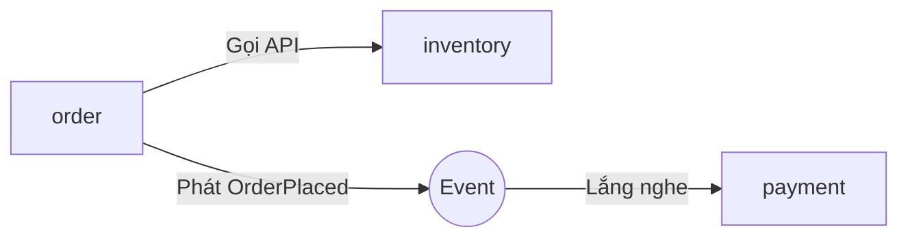
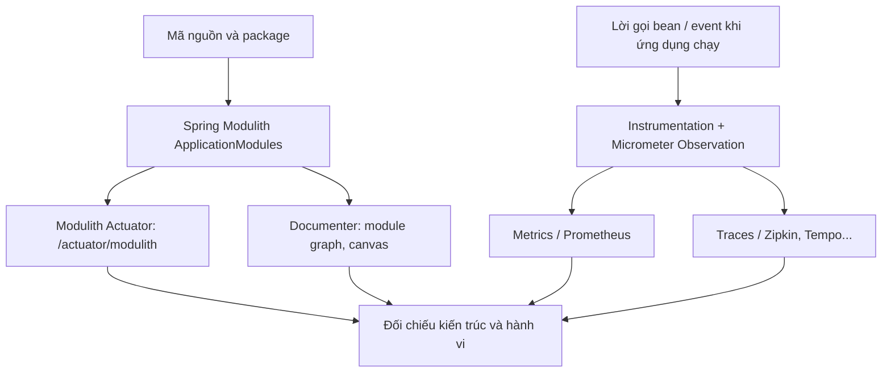

# Kiến thức Spring Boot Actuator, Micrometer và application module cần có

## 1. Bối cảnh và mục tiêu học tập

Trong một ứng dụng Spring Boot phát triển theo kiến trúc **modular monolith**, tất cả các miền nghiệp vụ có thể chạy trong cùng một tiến trình JVM, nhưng mã nguồn được chia thành các **application module** với ranh giới trách nhiệm rõ ràng. Khi hệ thống lớn dần, hai câu hỏi thường xuất hiện:

1. **Về kiến trúc:** Module nào phụ thuộc module nào? Một thay đổi ở `order` có đang truy cập trực tiếp phần triển khai nội bộ của `inventory` không?
2. **Về vận hành:** Trong một yêu cầu đặt hàng đang chạy, các module trao đổi ra sao? Phần nào xử lý chậm, phát sinh lỗi, hoặc phát ra sự kiện bất thường?

Spring Modulith hỗ trợ cả việc **mô tả/kiểm chứng cấu trúc module** lẫn **quan sát tương tác giữa module**. Để sử dụng các tính năng này đúng cách, trước hết cần phân biệt ba lớp công cụ:

| Thành phần | Câu hỏi chính | Đối tượng quan sát | Ví dụ đầu ra |
| --- | --- | --- | --- |
| **Spring Modulith – application module model** | Hệ thống được phân rã thành những module nào và có phụ thuộc gì? | Cấu trúc package, API công khai, phụ thuộc trong mã | Module graph, Application Module Canvas, kết quả `verify()` |
| **Spring Boot Actuator** | Ứng dụng đang chạy có thể cung cấp thông tin quản trị nào? | Trạng thái và endpoint vận hành của ứng dụng | `/actuator/health`, `/actuator/metrics`, `/actuator/modulith` |
| **Micrometer (Metrics, Observation, Tracing)** | Đã có bao nhiêu lần xử lý, mất bao lâu và luồng thực thi đi qua đâu? | Số đo và hoạt động thực tế lúc chạy | Counter, timer, observation, trace/span |

**Kết quả mong đợi:** Sau bài này, người học hiểu được cách Spring Boot công bố dữ liệu vận hành qua Actuator; cách Micrometer tổ chức metrics, observations và traces; cách Spring Modulith nhận diện ranh giới module; và vì sao cần kết hợp **tài liệu kiến trúc tĩnh** với **dấu vết vận hành động** để kiểm chứng một hệ thống mô-đun.

> Phạm vi: Đây là bài nền tảng cho chủ đề **Spring Modulith Documentation & Observability**. Các ví dụ minh họa cơ chế và cách đọc dữ liệu; chưa thay thế cấu hình monitoring, bảo mật và kiểm thử đầy đủ của một hệ thống sản xuất.

## 2. Application module là gì?

### 2.1. Từ package Java đến module nghiệp vụ

Một `application module` là đơn vị đóng gói một khả năng nghiệp vụ trong ứng dụng. Với cách phát hiện module mặc định của Spring Modulith, các package con trực tiếp dưới package gốc chứa lớp `@SpringBootApplication` thường đại diện cho các module.

Ví dụ:

```text
com.example.shop
├── ShopApplication.java
├── order
│   ├── OrderManagement.java
│   ├── OrderPlaced.java
│   └── internal
│       └── JpaOrderRepository.java
├── inventory
│   ├── InventoryManagement.java
│   └── internal
│       └── StockRepository.java
└── payment
    ├── PaymentManagement.java
    └── internal
        └── PaymentGatewayAdapter.java
```

Ở ví dụ trên, `order`, `inventory` và `payment` là các ứng viên application module. Chúng vẫn là những package Java trong cùng một ứng dụng Spring Boot, **không phải** ba microservice và cũng không tự động trở thành các tiến trình riêng.

Thông thường, các kiểu dữ liệu có thể truy cập từ package gốc của mỗi module tạo thành **API được công bố** của module. Các kiểu nằm trong package `internal` được xem là chi tiết triển khai và không nên bị module khác tham chiếu trực tiếp. Spring Modulith còn hỗ trợ `@NamedInterface` để công bố rõ thêm những nhóm API ở package con.

Phân biệt:

- **Ranh giới logic:** Mỗi module sở hữu nghiệp vụ, dữ liệu và các điểm tích hợp của mình.
- **Ranh giới mã nguồn:** Package và API công khai cho biết module khác được phép phụ thuộc vào đâu.
- **Ranh giới tiến trình:** Trong modular monolith, nhiều module có thể dùng chung JVM, Spring ApplicationContext và cơ sở hạ tầng.

### 2.2. Đồ thị phụ thuộc module (module graph)

Nếu `order` gọi một Spring bean thuộc API của `inventory` thì xuất hiện phụ thuộc `order → inventory`. Nếu `payment` lắng nghe sự kiện do `order` công bố, mô hình cũng có thể biểu diễn quan hệ do event listener tạo ra.



Sơ đồ là mô hình khái niệm: chiều cạnh diễn tả loại tương tác; hình dạng cụ thể của module graph phải được **suy ra từ mã nguồn thật**, không dựa vào tên package hay sơ đồ vẽ tay.

Trong test, có thể dùng mô hình Spring Modulith để kiểm tra cấu trúc:

```java
import org.junit.jupiter.api.Test;
import org.springframework.modulith.core.ApplicationModules;

class ArchitectureTests {

    @Test
    void modulesFollowBoundaries() {
        ApplicationModules.of(ShopApplication.class).verify();
    }
}
```

Các quy tắc mặc định của `verify()` bao gồm việc phát hiện phụ thuộc vòng, truy cập trái phép vào phần nội bộ module, và vi phạm danh sách phụ thuộc được khai báo (nếu có). Ví dụ, `order.internal` không nên bị `payment` sử dụng như API công khai.

**Điểm cốt lõi:** `verify()` kiểm tra **cấu trúc mã**. Nó không cho biết một giao dịch đặt hàng ngoài thực tế đang chậm bao nhiêu mili giây. Bài toán đó thuộc **observability**.

### 2.3. Documentation là ảnh chụp kiến trúc

Spring Modulith cung cấp `Documenter` để tạo các tạo tác mô tả module từ `ApplicationModules`, trong đó có:

- Sơ đồ component kiểu **C4** hoặc **UML** cho toàn bộ module và cho từng module.
- **Application Module Canvas** ghi lại package gốc, Spring components, aggregate roots, các sự kiện được phát/lắng nghe và configuration properties mà công cụ nhận diện được.
- Tài liệu tổng hợp liên kết các sơ đồ và canvas.

Ví dụ khái niệm trong bài kiểm thử/tạo tài liệu (cần thêm `spring-modulith-docs` vào classpath tương ứng):

```java
import org.junit.jupiter.api.Test;
import org.springframework.modulith.core.ApplicationModules;
import org.springframework.modulith.docs.Documenter;

class DocumentationTests {

    @Test
    void generateModuleDocumentation() {
        ApplicationModules modules = ApplicationModules.of(ShopApplication.class);

        new Documenter(modules)
                .writeModulesAsPlantUml()
                .writeIndividualModulesAsPlantUml()
                .writeModuleCanvases()
                .writeAggregatingDocument();
    }
}
```

Các tệp được tạo thường nằm trong thư mục `spring-modulith-docs` dưới thư mục build. Đây là **mô tả tại thời điểm sinh tài liệu**; cần chạy lại khi cấu trúc mã đổi. Sơ đồ cấu trúc không tự thể hiện tốc độ, tần suất hay lỗi của các lời gọi ở runtime.

## 3. Spring Boot Actuator: cổng truy cập thông tin vận hành

### 3.1. Endpoint quản trị là gì?

Spring Boot Actuator bổ sung các endpoint quản lý/giám sát cho ứng dụng. Khi có dependency `spring-boot-starter-actuator` và cấu hình tương ứng, các endpoint HTTP thường dùng tiền tố `/actuator`.

| Endpoint | Dùng để làm gì? | Lưu ý |
| --- | --- | --- |
| `/actuator/health` | Kiểm tra sức khỏe ứng dụng và các health indicator | Thông tin chi tiết phụ thuộc cấu hình/quyền truy cập |
| `/actuator/info` | Cung cấp thông tin ứng dụng được cấu hình | Không mặc định chứa mọi metadata |
| `/actuator/metrics` | Liệt kê, xem phép đo và lọc theo tag | Cần meter phù hợp đã được đăng ký |
| `/actuator/prometheus` | Xuất metric theo định dạng Prometheus | Cần thêm Prometheus registry và cho phép truy cập |
| `/actuator/modulith` | Trình bày metadata application module của Spring Modulith | Cần hỗ trợ Modulith Actuator, không phải endpoint mặc định của Boot |

Ví dụ kiểm tra thủ công khi ứng dụng chạy ở cổng 8080:

```bash
curl http://localhost:8080/actuator/health
curl http://localhost:8080/actuator
curl http://localhost:8080/actuator/metrics
```

Danh sách endpoint thực sự truy cập được tùy thuộc phiên bản Spring Boot, các dependency đang có, cấu hình **access/exposure** và bảo mật. Endpoint chưa được phép expose có thể không xuất hiện trong HTTP discovery hoặc trả về lỗi khi gọi.

### 3.2. Bật endpoint có chọn lọc

Ví dụ cấu hình dành cho môi trường phát triển có nhu cầu học về modularity và metrics:

```yaml
management:
  endpoints:
    web:
      exposure:
        include: "health,info,metrics,modulith,prometheus"
```

Đây là danh sách **cho phép công bố qua HTTP**, không phải lệnh tạo ra endpoint còn thiếu. Nếu chưa có Modulith Actuator thì `modulith` không xuất hiện; nếu chưa có Prometheus registry thì `prometheus` không có dữ liệu để cung cấp.

Trong môi trường sản xuất, chỉ expose các endpoint thật sự cần thiết qua mạng quản trị có kiểm soát; áp dụng xác thực, phân quyền và giới hạn thông tin nhạy cảm. Không nên mở `*` trên endpoint quản trị công khai chỉ để tiện debug.

### 3.3. Actuator nhìn thấy module graph như thế nào?

Khi đã tích hợp phần Modulith Actuator, endpoint `/actuator/modulith` có thể trả về biểu diễn JSON của các module, chẳng hạn:

```json
{
  "inventory": {
    "displayName": "Inventory",
    "basePackage": "com.example.shop.inventory",
    "dependencies": []
  },
  "order": {
    "displayName": "Order",
    "basePackage": "com.example.shop.order",
    "dependencies": [
      {
        "target": "inventory",
        "types": ["USES_COMPONENT"]
      }
    ]
  }
}
```

*Đây là dữ liệu minh họa*, không phải phản hồi từ ứng dụng đã chạy. Trong cấu trúc JSON, `dependencies[].target` chỉ module đích; `dependencies[].types` cho biết kiểu phụ thuộc, ví dụ `DEFAULT`, `USES_COMPONENT` hoặc `EVENT_LISTENER`.

Endpoint này hữu ích để hỏi: *Bản đang chạy thực sự nhận diện những module và quan hệ nào?* Tuy nhiên, JSON module graph **không đếm số lần gọi** và **không đo độ trễ** của từng cạnh. Muốn biết mức độ tương tác khi thực thi, cần metrics và traces.

## 4. Micrometer: nền tảng đo lường và quan sát

### 4.1. Metrics, logs và traces bổ sung cho nhau

**Observability** là khả năng suy ra trạng thái bên trong hệ thống từ tín hiệu mà hệ thống phát ra. Ba nhóm tín hiệu thường gặp:

| Tín hiệu | Giải đáp | Điển hình |
| --- | --- | --- |
| **Logs** | Ở thời điểm này ứng dụng ghi nhận sự kiện hoặc lỗi gì? | Log có timestamp, mức độ, mã lỗi, trace ID |
| **Metrics** | Hiện tượng diễn ra bao nhiêu lần, nhanh hay chậm, xu hướng thế nào? | Tổng số sự kiện, p95 thời gian xử lý, lỗi mỗi phút |
| **Traces** | Một luồng công việc đi qua những bước nào, mỗi bước chiếm bao lâu? | Trace gồm các span HTTP → order → inventory → payment |

Metrics thường thích hợp để vẽ dashboard và cảnh báo theo xu hướng. Traces phù hợp để điều tra **một lần xử lý cụ thể**. Logs cung cấp bối cảnh kỹ thuật hoặc nghiệp vụ tại từng điểm. Chỉ có một trong ba loại tín hiệu thường chưa đủ để hiểu nguyên nhân sự cố.

### 4.2. Các kiểu đo trong Micrometer

`Micrometer Metrics` cung cấp API chung cho nhiều hệ thống giám sát. Các khái niệm nền tảng:

- **MeterRegistry:** Nơi đăng ký, quản lý và xuất các meter theo backend phù hợp.
- **Counter:** Đếm giá trị chỉ tăng, như số lần nhận đơn hàng hoặc số lần phát event.
- **Timer:** Đo số lần thực thi và tổng thời gian; có thể cấu hình phân bố/histogram theo nhu cầu.
- **Gauge:** Theo dõi giá trị hiện tại có thể lên xuống, như số phần tử trong hàng đợi.
- **Tag:** Kích thước phân loại một metric, chẳng hạn `module=order` hoặc `result=success`.

Ví dụ đếm số đơn được xác nhận:

```java
import io.micrometer.core.instrument.MeterRegistry;
import org.springframework.stereotype.Service;

@Service
class OrderMetrics {

    private final MeterRegistry meterRegistry;

    OrderMetrics(MeterRegistry meterRegistry) {
        this.meterRegistry = meterRegistry;
    }

    void recordConfirmation(String outcome) {
        // outcome chỉ nhận các giá trị hữu hạn như "success", "failure".
        meterRegistry.counter(
                "orders.confirmed",
                "module", "order",
                "outcome", outcome
        ).increment();
    }
}
```

Tên metric `orders.confirmed` do ứng dụng tự định nghĩa. Nó **không phải tên metric mặc định của Spring Modulith**. Ví dụ sử dụng các giá trị tag có số lượng hữu hạn; đừng gắn `orderId`, email hay mã giao dịch duy nhất làm tag metric vì sẽ làm tăng **cardinality** (số chuỗi metric riêng biệt), gây tốn tài nguyên lưu trữ và truy vấn.

Một phép đo thời gian có thể được tạo bằng `Timer`:

```java
Timer.Sample sample = Timer.start(meterRegistry);
try {
    confirmOrder();
} finally {
    sample.stop(meterRegistry.timer("orders.confirm.duration", "module", "order"));
}
```

Đây là mẫu kỹ thuật đo bao quanh một thao tác; `confirmOrder()` đại diện cho phương thức nghiệp vụ có sẵn. Trong mã thực tế, cần cân nhắc vị trí đặt đo đạc, xử lý lỗi và tránh đăng ký trùng nhiều meter cho cùng một thông tin.

### 4.3. Observation gắn metrics với tracing

Trong hệ sinh thái Spring, **Micrometer Observation** cung cấp điểm đo thống nhất. Một `Observation` có tên, ngữ cảnh và các key-value; các `ObservationHandler` được đăng ký có thể biến nó thành dữ liệu metrics và/hoặc tracing tùy các dependency, handler và exporter thực tế.

```java
import io.micrometer.observation.Observation;
import io.micrometer.observation.ObservationRegistry;
import org.springframework.stereotype.Service;

@Service
class OrderConfirmationService {

    private final ObservationRegistry observationRegistry;

    OrderConfirmationService(ObservationRegistry observationRegistry) {
        this.observationRegistry = observationRegistry;
    }

    void confirm() {
        Observation.createNotStarted("orders.confirm", observationRegistry)
                .lowCardinalityKeyValue("module", "order")
                .observe(() -> {
                    // Thực hiện tác vụ xác nhận đơn hàng.
                    performConfirmation();
                });
    }

    private void performConfirmation() {
        // Logic nghiệp vụ minh họa.
    }
}
```

Đặc biệt cần hiểu hai loại key-value:

- **Low cardinality:** Tập giá trị nhỏ, tương đối ổn định (`module=order`, `operation=confirm`). Phù hợp đưa vào **metrics** và **traces**.
- **High cardinality:** Nhiều giá trị khác nhau (`orderId=...`, `userId=...`). Trong mô hình Micrometer Observation, nhóm này dành cho **traces** chứ không dùng làm tag metrics; vẫn phải cân nhắc bảo mật và dữ liệu cá nhân.

`ObservationRegistry` là điểm phối hợp quan sát. Chỉ tạo `Observation` chưa bảo đảm thấy span trong Zipkin/Tempo hoặc một metric trên Prometheus: phải cấu hình và kết nối đúng thành phần ghi nhận/xuất dữ liệu.

### 4.4. Trace, span và propagation

Một **trace** biểu diễn toàn bộ một chuỗi xử lý; các **span** biểu diễn những đoạn công việc có quan hệ cha–con, có thời điểm bắt đầu/kết thúc và thuộc tính.

Ví dụ luồng xác nhận đơn:

```text
Trace: HTTP POST /orders/42/confirm
└── Span: HTTP request
    └── Span: order.confirm
        ├── Span: inventory.reserve
        └── Span: payment.charge
```

Trong modular monolith, các span có thể thuộc **cùng một tiến trình**, vì chúng là các thao tác logic khác nhau chứ không nhất thiết là các lời gọi mạng.

**Context propagation** là việc chuyển tiếp ngữ cảnh quan sát, bao gồm trace/span hiện tại, khi mã chuyển sang thread hoặc pipeline khác. Ví dụ, một listener xử lý bằng `@Async` trên executor riêng có thể làm mất quan hệ parent–child nếu không chuyển tiếp ngữ cảnh đúng cách.

Một cách cho executor tự cấu hình là gắn `ContextPropagatingTaskDecorator` của Spring Framework; với Spring Boot/Reactor còn có các tùy chọn propagation tương ứng, tùy phiên bản và môi trường thực thi. Vì vậy, khi trace bị đứt tại sự kiện bất đồng bộ, hãy kiểm tra **cách chạy listener, executor và cấu hình propagation** trước khi kết luận module không tương tác.

**Phân biệt rõ:** Metrics có thể thống kê toàn bộ lượt gọi; tracing thường dùng cơ chế **sampling**, nên một số yêu cầu không được xuất trace. Không nên dùng số lượng trace được lấy mẫu để suy ra tổng số sự kiện nếu chưa tính đến sampling.

## 5. Spring Modulith kết nối Actuator và Micrometer ra sao?

### 5.1. Các mảnh ghép

Spring Modulith tận dụng metadata application module để nhận biết thành phần nào thuộc API của module và cung cấp tích hợp quan sát tương tác module.

| Khả năng | Thành phần Spring Modulith thường dùng | Vai trò |
| --- | --- | --- |
| Mô hình/kiểm chứng cấu trúc | `spring-modulith-core` | Phát hiện module, dependencies, `verify()` |
| Sinh tài liệu kiến trúc | `spring-modulith-docs` | `Documenter`, sơ đồ, canvas |
| Công bố module qua Actuator | `spring-modulith-actuator` | Endpoint `/actuator/modulith` |
| Quan sát runtime | `spring-modulith-observability-core` | Instrumentation cho các tương tác được hỗ trợ |
| Gói tích hợp tiện dụng | `spring-modulith-starter-insight` | Gom hỗ trợ Actuator và observability |

Với phiên bản Spring Modulith có `spring-modulith-starter-insight`, ví dụ Gradle sau thể hiện phần phụ thuộc runtime cơ bản:

```groovy
dependencies {
    runtimeOnly 'org.springframework.modulith:spring-modulith-starter-insight'

    // Chỉ cần khi muốn xuất định dạng Prometheus:
    runtimeOnly 'io.micrometer:micrometer-registry-prometheus'
}
```

Ví dụ giả định dự án đã cấu hình dependency management/BOM tương thích cho **Spring Boot và Spring Modulith**; phiên bản cụ thể của từng thư viện phải lấy theo bộ phiên bản dự án. Starter insight bổ sung phần Actuator và quan sát module; muốn **xuất trace đến hệ thống bên ngoài** vẫn cần tracer/bridge/exporter thích hợp với phiên bản Spring Boot. Nếu không dùng starter insight, có thể khai báo riêng phần Actuator và observability.

### 5.2. Khi nào tạo được module span?

Spring Modulith có thể instrument các Spring component nằm trên **API module** và tạo Micrometer span cho các lời gọi đi qua những điểm được hỗ trợ. Thông tin gắn với span có thể gồm:

- `module.identifier`: định danh kỹ thuật của module.
- `module.name`: tên hiển thị của module.
- `module.invocation-type`: loại lời gọi, chẳng hạn lời gọi bean hay event listener.
- `module.method`: phương thức liên quan.

Ví dụ, khi xử lý `OrderPlaced`, trace có thể cho thấy từ `order` sang listener thuộc `payment` và thời gian từng bước. Tuy nhiên, không nên giả định **mọi lời gọi Java nội bộ** đều có span: instrumentation phụ thuộc vào điểm cắt được hỗ trợ, Spring bean/proxy, module API và cấu hình runtime.

Sơ đồ kết hợp các lớp:



Cách đọc: đường từ mã nguồn đến tài liệu/endpoint thể hiện **cấu trúc**; đường từ thực thi đến metrics/traces thể hiện **hành vi**. Kết hợp hai nhánh giúp phát hiện chỗ kiến trúc mong đợi và vận hành thực tế cần được xem xét.

### 5.3. Event metrics trong Spring Modulith

Ngoài span tương tác module, tài liệu Spring Modulith mô tả hai nhóm counter cho **các domain event được công bố**:

- `module.events.published`: số lần công bố sự kiện, có thể phân tích theo `module.identifier`, `module.name` và `module.event.type`.
- `module.events.published.<moduleIdentifier>.<simpleEventTypeName>`: metric chuyên biệt cho một loại event của một module, có thể được tùy biến thêm khi cần.

Ví dụ tên minh họa `module.events.published.order.OrderPlaced`; chỉ có metric thực tế khi có event được công bố và phần instrument tương ứng hoạt động. Phân biệt **event được công bố** với **event đã xử lý thành công**: một counter tăng khi publish không chứng minh listener hoàn tất, dữ liệu đã được ghi hoặc giao dịch nghiệp vụ đã thành công.

Với Actuator metrics đã bật, thử:

```bash
curl http://localhost:8080/actuator/metrics
curl http://localhost:8080/actuator/metrics/module.events.published
curl "http://localhost:8080/actuator/metrics/module.events.published?tag=module.identifier:order"
```

URL cuối chỉ có ý nghĩa nếu meter đã xuất hiện và thực sự chứa tag/giá trị `module.identifier=order`. Cần tạo dữ liệu thử bằng một luồng nghiệp vụ có phát event trước khi kiểm tra.

**Chú ý khi dùng Prometheus:** Tên meter theo kiểu Micrometer (`module.events.published`) có thể được chuyển đổi khi xuất sang naming convention của Prometheus; đừng dùng tên đã chuyển đổi để truy vấn `/actuator/metrics/<meter-name>`.

## 6. Bài thực hành dẫn dắt: quan sát quy trình đặt hàng

Giả sử hệ thống có ba application module: `order` (nhận đơn), `inventory` (giữ tồn kho) và `payment` (xử lý thanh toán). Yêu cầu là kiểm chứng cả quan hệ phụ thuộc và những tương tác phát sinh khi xác nhận đơn.

### Bước 1 — Xác nhận ranh giới thiết kế

Dùng `ApplicationModules.of(ShopApplication.class)` để liệt kê mô hình, gọi `verify()` trong test kiến trúc, sau đó tạo sơ đồ với `Documenter`.

Cần đọc được: `order` sử dụng API nào của `inventory`, các loại event nào được công bố và lắng nghe, và có module nào truy cập package `internal` hay tạo chu trình phụ thuộc hay không.

### Bước 2 — Kiểm tra điều ứng dụng đang công bố

Khởi động ứng dụng có tích hợp Modulith Actuator và cấu hình exposure phù hợp, gọi:

```bash
curl http://localhost:8080/actuator/modulith
```

Tìm khóa module `order` và mảng `dependencies`. So sánh với module graph được sinh từ mã nguồn cùng phiên bản build. Nếu hai nguồn khác nhau, hãy xem lại bản ứng dụng đang chạy, cách phát hiện module và cấu hình nằm trong mã nguồn runtime.

### Bước 3 — Tạo hoạt động thực tế

Gửi một yêu cầu xác nhận đơn vào API thử nghiệm; nghiệp vụ có thể gọi `InventoryManagement` hoặc publish `OrderPlaced`. Theo dõi:

- Counter `module.events.published` có tăng sau khi ứng dụng phát event không?
- Trace có span biểu diễn bước vào module hoặc listener phù hợp không?
- Nếu listener chạy bất đồng bộ, trace có giữ được quan hệ ngữ cảnh qua thread không?
- Khi cố tình tạo tình huống thanh toán thất bại, logs/metrics/traces cung cấp những góc nhìn khác nhau nào?

Không kết luận rằng sự kiện bị mất chỉ vì thiếu span. Hãy kiểm tra khả năng instrumentation, sampling, exporter và context propagation.

### Bước 4 — Đối chiếu kết quả

| Quan sát | Kết luận có thể rút ra | Chưa thể kết luận |
| --- | --- | --- |
| `verify()` đạt | Các ràng buộc cấu trúc đang kiểm tra không phát hiện vi phạm | Toàn bộ nghiệp vụ đều chạy đúng |
| `/actuator/modulith` hiển thị `order → inventory` | Runtime model nhận diện phụ thuộc đó | Có bao nhiêu lượt gọi thực tế |
| Counter `module.events.published` tăng | Đã ghi nhận việc công bố event | Listener đã hoàn tất thành công |
| Trace có span của `inventory` chậm | Bước được instrument có thời lượng cao trong trace đó | Mọi request đều chậm giống vậy |
| Không thấy trace event async | Cần kiểm tra sampling, exporter, instrumentation và propagation | Không có event hoặc module không tương tác |

### Bước 5 — Đưa ra quyết định cải thiện

Nếu module graph có cạnh không mong muốn, sửa cách các module phụ thuộc nhau (chỉ dùng API được công bố hoặc giao tiếp sự kiện phù hợp) rồi chạy `verify()` lại. Nếu trace cho thấy phần `inventory` chậm, kiểm tra truy vấn, khóa giao dịch, tài nguyên hoặc I/O của đúng thao tác đó. Đây là hai loại thay đổi khác nhau: **sửa kiến trúc** và **tối ưu hành vi runtime**.

## 7. Các lỗi hiểu sai thường gặp

1. **“Có Actuator là có tracing.”** Actuator cung cấp cơ chế endpoint và hỗ trợ quan sát, nhưng tracing cần thêm các thành phần phù hợp để tạo và xuất span đến backend.
2. **“`/actuator/modulith` là biểu đồ lời gọi trực tiếp.”** Endpoint này trình bày metadata cấu trúc module. Muốn xem luồng gọi, cần instrument và xem traces.
3. **“Metrics có thể gắn mọi ID để lọc.”** Tag mang giá trị duy nhất cho từng order/user làm cardinality tăng mạnh; nên dùng tập giá trị hữu hạn và giữ dữ liệu định danh ra khỏi metric tags.
4. **“Event được publish tức là đã xử lý.”** Counter publication chỉ đo việc phát sự kiện. Muốn xác nhận kết quả listener, cần kiểm tra trạng thái thực thi, logs, traces hoặc cơ chế theo dõi event publication tương ứng.
5. **“Cứ bật `@Async` là tự có cùng trace.”** Chuyển thread đòi hỏi propagation đúng với executor/pipeline. Thiếu propagation có thể làm đứt quan hệ span.
6. **“Tài liệu đã sinh luôn phản ánh bản chạy.”** Sơ đồ sinh từ một commit khác có thể không trùng code đang triển khai. Cần ghi nhận phiên bản build và tái tạo tài liệu khi kiến trúc thay đổi.
7. **“Không có metric/trace nghĩa là không xảy ra tương tác.”** Có thể chưa có dữ liệu thử, endpoint chưa expose, instrumentation không áp dụng tại điểm gọi, trace bị sampling, hoặc exporter chưa hoạt động.

## 8. Tiêu chí tự kiểm tra kiến thức

Sau bài này, hãy tự trả lời được các câu hỏi sau mà không tra cấu hình:

- Khi nào dùng `ApplicationModules.verify()`, khi nào dùng `Documenter` và khi nào xem `/actuator/modulith`?
- Vì sao `order.internal.JpaOrderRepository` không nên bị `payment` truy cập trực tiếp?
- Sự khác nhau giữa `Counter`, `Timer`, `Observation`, `trace` và `span` là gì?
- Tại sao `module=order` có thể là metric tag còn `orderId=42` thường không nên?
- Nếu một listener `@Async` không xuất hiện trong cùng trace, cần kiểm tra những điểm nào?
- Làm sao phân biệt “đã công bố event” với “listener đã xử lý thành công”?
- Vì sao phải đối chiếu **module graph** với **metrics/traces** trước khi kết luận một thiết kế mô-đun đang vận hành đúng?

## 9. Tài liệu tham khảo chính thức

- [Spring Modulith — Fundamentals](https://docs.spring.io/spring-modulith/reference/fundamentals.html): cách nhận diện module, API và named interfaces.
- [Spring Modulith — Verifying Application Module Structure](https://docs.spring.io/spring-modulith/reference/verification.html): các quy tắc kiểm chứng module.
- [Spring Modulith — Documenting Application Modules](https://docs.spring.io/spring-modulith/reference/documentation.html): module diagrams và Application Module Canvas.
- [Spring Modulith — Production-ready Features](https://docs.spring.io/spring-modulith/reference/production-ready.html): Modulith Actuator, module spans và event metrics.
- [Spring Boot — Actuator Endpoints](https://docs.spring.io/spring-boot/reference/actuator/endpoints.html): endpoint exposure và bảo mật.
- [Spring Boot — Metrics](https://docs.spring.io/spring-boot/reference/actuator/metrics.html): MeterRegistry, metric endpoint và tags.
- [Spring Boot — Observability](https://docs.spring.io/spring-boot/reference/actuator/observability.html): ObservationRegistry và context propagation.
- [Spring Boot — Tracing](https://docs.spring.io/spring-boot/reference/actuator/tracing.html): tracer, exporter và trace propagation.

> **Ghi nhớ:** Spring Modulith cho ta mô hình **module nào được phép tương tác với module nào**; Actuator giúp kiểm tra metadata và các số đo được ứng dụng công bố; Micrometer giúp quan sát **những tương tác đã thực sự diễn ra**. Cả ba cùng hỗ trợ việc giải thích và kiểm chứng kiến trúc mô-đun khi ứng dụng Spring Boot vận hành.
