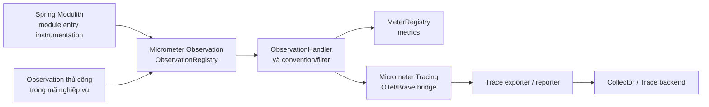
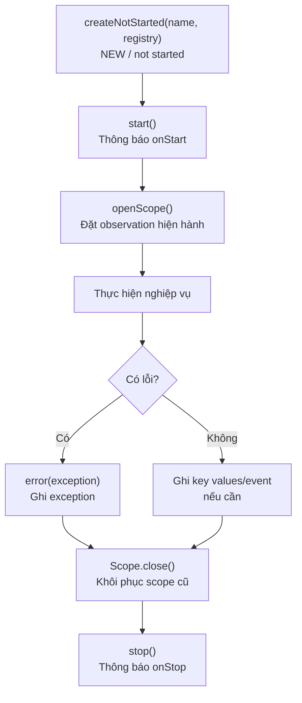
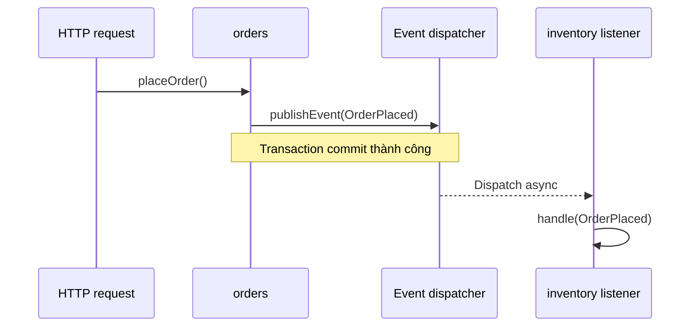

# ObservationRegistry và vòng đời observation

> **Chương:** Observation API  
> **Bối cảnh:** Spring Modulith bổ sung khả năng quan sát ranh giới application module trong một ứng dụng Spring Boot. Micrometer Observation API cung cấp các thành phần nền tảng để mô tả, quản lý và mở rộng việc quan sát tương tác giữa các module. Bài học tập trung vào `ObservationRegistry` và vòng đời một `Observation`, đồng thời liên hệ với module graph, Actuator, event metrics và tracing.

## Mục tiêu học tập

Sau bài học, bạn có thể:

1. Giải thích `ObservationRegistry` giữ vai trò gì và khác `Tracer`, `MeterRegistry`, trace exporter như thế nào.
2. Mô tả đúng trình tự `createNotStarted() → start() → openScope() → error()/event() → close() → stop()`.
3. Viết observation thủ công bằng Java, bảo đảm đóng scope và dừng observation cả khi method ném exception.
4. Phân biệt tên observation, contextual name, low-cardinality và high-cardinality key values; biết cách đặt tag an toàn cho event và các application module.
5. Dự đoán quan hệ cha–con của span sinh từ observation khi có lời gọi module đồng bộ và khi có tác vụ bất đồng bộ.
6. Kết hợp observation thủ công với instrumentation tự động của Spring Modulith mà không đo trùng hoặc suy diễn sai từ module graph.

## 1. Observation API nằm ở đâu trong kiến trúc quan sát?

Spring Modulith coi các package/module nghiệp vụ là **application module** có ranh giới rõ ràng. Trong lúc hệ thống chạy, module observability của Spring Modulith có thể đo các **điểm vào module** đã được hỗ trợ, chẳng hạn lời gọi bean thuộc API module và event listener. Thông tin này có thể được đưa qua Micrometer Observation API để ghi nhận thời gian, trạng thái, metadata và liên kết tracing.

Luồng khái niệm:



Các thành phần có trách nhiệm khác nhau:

| Thành phần | Trách nhiệm | Không trực tiếp bảo đảm |
| --- | --- | --- |
| `Observation` | Mô tả và ghi nhận vòng đời một hoạt động cụ thể | Span luôn được lưu ở tracing backend |
| `ObservationRegistry` | Chứa cấu hình, context và các handler tham gia quá trình xử lý observation | Tự lưu trữ metric/trace hoặc gửi dữ liệu qua mạng |
| `ObservationHandler` | Nhận callback khi observation bắt đầu, lỗi, sinh event, mở/đóng scope, kết thúc | Tất cả handler đều tạo cả metric và span |
| `MeterRegistry` | Quản lý và xuất các meter như timer, counter | Tự mô tả parent-child của trace |
| `Micrometer Tracing` + bridge | Tạo/liên kết tracing span theo context hiện hành | Event listener luôn cùng trace với bên phát |
| `Spring Modulith` | Xác định module và điểm tương tác được instrument | Mọi method Java đều có observation |

Vì vậy, inject được `ObservationRegistry` là điều kiện để sử dụng Observation API nhưng **chưa phải bằng chứng trace đã xuất thành công**. Còn cần handler, tracer bridge, exporter, sampling và backend phù hợp.

### 1.1. Observation, span và metric khác nhau ra sao?

Ví dụ module `orders` gọi module `pricing` để tính giá cho đơn hàng:

- **Observation:** ghi nhận thao tác `orders.quote` có bắt đầu, kết thúc và metadata.
- **Span:** nếu hệ thống tracing được kết nối, một khoảng hoạt động có `traceId`, `spanId`, `parentSpanId` và thời lượng.
- **Metric:** nếu có handler đo metric, có thể tạo timer cho tên observation và các low-cardinality tags.
- **Module graph:** mô tả phụ thuộc `orders → pricing`; đây là thông tin kiến trúc tĩnh, không phải một lần thực thi.

Một observation có thể cung cấp dữ liệu cho nhiều handler. Không được cộng số observation với số span hoặc số metric và coi đó là những lượt thực thi độc lập.

## 2. ObservationRegistry là gì?

`io.micrometer.observation.ObservationRegistry` là điểm đăng ký và điều phối việc quan sát. Ứng dụng sử dụng một registry được cấu hình phù hợp, sau đó tạo observation từ registry đó:

```java
Observation observation = Observation.createNotStarted(
        "shop.orders.checkout",
        observationRegistry
);
```

Lệnh này chỉ tạo một observation **chưa bắt đầu**. Nó không có nghĩa thao tác đã chạy, cũng chưa tạo một span được xuất tới backend.

Registry liên quan đến:

1. **Các `ObservationHandler`:** quyết định sẽ làm gì khi nhận callback của một observation.
2. **Observation convention:** điều chỉnh quy ước tên và key values của observation khi phù hợp.
3. **Observation predicates/filters:** cho phép chọn hoặc bổ sung dữ liệu tùy cấu hình của registry.
4. **Current observation:** cho phép truy xuất observation đang ở trong scope hiện hành của luồng thực thi.

Trong ứng dụng Spring Boot có Micrometer Observation và Actuator auto-configuration phù hợp, `ObservationRegistry` thường được đăng ký làm Spring bean; có thể inject qua constructor. Nếu ứng dụng không bật auto-configuration liên quan, cần tự cấu hình registry/handler. Không nên tạo nhiều registry tách biệt một cách vô tình, bởi một registry tự tạo không mang theo handlers mà Spring Boot đã cài cho registry chính.

### 2.1. Tại sao không tự tạo registry trong từng service?

Giả sử ứng dụng được Boot cấu hình một `ObservationRegistry` có tracing handler. Nếu một class tự gọi `ObservationRegistry.create()` rồi dùng registry mới, observation ở class đó có thể **không có handler tracing/metrics như registry chính**.

Nên inject registry của ứng dụng:

```java
import io.micrometer.observation.ObservationRegistry;
import org.springframework.stereotype.Service;

@Service
public class QuoteWorkflow {

    private final ObservationRegistry observationRegistry;

    public QuoteWorkflow(ObservationRegistry observationRegistry) {
        this.observationRegistry = observationRegistry;
    }
}
```

Khi viết unit test tách biệt với Spring Boot, có thể dùng registry phù hợp với mục tiêu test; nhưng bài kiểm tra tracing thực tế cần chạy với configuration gần môi trường ứng dụng để chắc chắn handler và exporter được kích hoạt.

## 3. Vòng đời của một observation

Một observation thủ công thường đi qua các bước:



Lược đồ mô tả phương pháp phổ biến để sử dụng API. Trong thực tế có thể thêm event/key values ở nhiều thời điểm khác nhau trước `stop()`, và có thể không cần `openScope()` nếu không cần đặt observation làm context hiện hành.

### 3.1. Tạo: `createNotStarted()`

```java
Observation observation = Observation.createNotStarted(
        "shop.orders.place",
        registry
);
```

Giai đoạn này chủ yếu thiết lập tên, registry và context. Có thể thêm metadata trước khi gọi `start()`:

```java
Observation observation = Observation
        .createNotStarted("shop.orders.place", registry)
        .contextualName("place order")
        .lowCardinalityKeyValue("operation", "place-order");
```

**Tên observation** nên ổn định, ngắn, có ý nghĩa nghiệp vụ và không chứa ID biến thiên theo từng request. Contextual name thường phục vụ việc trình bày span; tên meter cuối cùng phụ thuộc vào handler/convention thực tế.

### 3.2. Bắt đầu: `start()`

```java
observation.start();
```

Một observation đã bắt đầu có thể thông báo `onStart` cho những handler phù hợp. Các handler có thể chuẩn bị việc đo thời gian hoặc tạo span khi được cấu hình. `start()` **không tự động tương đương** với việc đưa observation vào scope hiện hành; đây là lý do cần hiểu bước tiếp theo.

### 3.3. Mở scope: `openScope()`

```java
try (Observation.Scope scope = observation.openScope()) {
    // Observation hiện hành có thể được các thao tác bên trong sử dụng.
}
```

Scope ghi nhận observation hiện hành trong bối cảnh thực thi thích hợp để các observation con/instrumentation bên trong có thể liên hệ với nó. Khi đóng scope, context trước đó được khôi phục. Trong Java, `try-with-resources` giúp đóng scope ngay cả khi xảy ra lỗi.

**Hai thao tác khác nhau:** `start()` xác định vòng đời đo, còn `openScope()` xác định *khi nào* observation là context hiện hành. Mở một scope quá lâu có thể khiến các hoạt động ngoài phạm vi nghiệp vụ bị ghép dưới sai parent context.

### 3.4. Event và lỗi trong quá trình đo

Trong phạm vi hoạt động, có thể ghi:

```java
observation.event(Observation.Event.of("order.validated"));
```

Và khi có exception:

```java
observation.error(exception);
```

`event()` là **sự kiện quan sát** để bổ sung metadata về quá trình thực thi; nó **khác** domain event như `OrderPlaced` được phát qua Spring `ApplicationEventPublisher`. Ghi `Observation.Event` không có nghĩa Spring Modulith gửi sự kiện nghiệp vụ cho các module khác hoặc tăng metric publish của domain event.

`error(exception)` ghi nhận lỗi cho handler. Nó không tự động rollback database transaction và không thay thế việc ném tiếp hoặc xử lý exception đúng trong nghiệp vụ.

### 3.5. Đóng scope trước, rồi dừng: `stop()`

```java
observation.stop();
```

`stop()` hoàn tất observation và thông báo `onStop` cho handler. Đối với timer, đây thường là điểm kết thúc phép đo; đối với tracing handler, đây là nơi kết thúc span.

Một observation nên có phạm vi rõ ràng và được dừng **đúng một lần** trong đường xử lý được thiết kế. Nếu không dừng, thời lượng hoặc các tín hiệu có thể thiếu. Nếu dừng quá sớm, các bước sau không nằm trong phạm vi measurement.

## 4. Hai cách viết observation thủ công

### 4.1. Cách ngắn gọn với `observe()`

Micrometer cung cấp API tiện ích giúp thực hiện vòng đời khi mã nghiệp vụ chạy:

```java
import io.micrometer.observation.Observation;
import io.micrometer.observation.ObservationRegistry;
import java.math.BigDecimal;
import org.springframework.stereotype.Service;

@Service
public class PriceCalculation {

    private final ObservationRegistry registry;

    public PriceCalculation(ObservationRegistry registry) {
        this.registry = registry;
    }

    public BigDecimal calculate(int quantity) {
        return Observation
                .createNotStarted("shop.pricing.calculate", registry)
                .contextualName("calculate price")
                .lowCardinalityKeyValue("operation", "calculate-price")
                .observe(() -> new BigDecimal("100000")
                        .multiply(BigDecimal.valueOf(quantity)));
    }
}
```

`observe(Supplier<T>)` phù hợp cho các đoạn mã ngắn vì API hỗ trợ điều phối việc start, mở scope, ghi nhận lỗi phù hợp và stop khi công việc hoàn tất. Không cần tự gọi `start()/stop()` một lần nữa bên ngoài đoạn này.

Đối với thao tác trả về `void`, có thể dùng `observe(Runnable)`. Nếu cần điều khiển metadata theo outcome, ghi event trong quá trình chạy hoặc chủ động mở/đóng scope, dùng mẫu tường minh ở mục tiếp theo.

### 4.2. Cách tường minh với `try/finally`

Ví dụ module `orders` muốn đo riêng bước kiểm tra đầu vào trước khi gọi API của module khác:

```java
package com.example.shop.orders.internal;

import io.micrometer.observation.Observation;
import io.micrometer.observation.ObservationRegistry;
import org.springframework.stereotype.Component;

@Component
public class CheckoutValidation {

    private final ObservationRegistry registry;

    public CheckoutValidation(ObservationRegistry registry) {
        this.registry = registry;
    }

    public void requirePositiveQuantity(int quantity) {
        Observation observation = Observation
                .createNotStarted("shop.orders.validate", registry)
                .contextualName("validate checkout")
                .lowCardinalityKeyValue("operation", "validate-quantity");

        observation.start();
        try (Observation.Scope scope = observation.openScope()) {
            if (quantity <= 0) {
                throw new IllegalArgumentException(
                        "quantity must be positive");
            }
            observation.event(Observation.Event.of("validation.passed"));
        } catch (RuntimeException ex) {
            observation.error(ex);
            throw ex;
        } finally {
            observation.stop();
        }
    }
}
```

Những điểm đáng chú ý:

1. Tạo observation với tên/metadata nhất quán trước khi đo.
2. `start()` được gọi trước nghiệp vụ; `openScope()` giúp công việc lồng trong đó dùng context hiện hành.
3. Khi nghiệp vụ ném lỗi, `observation.error(ex)` ghi nhận exception, còn `throw ex` giữ nguyên hành vi của method.
4. `try-with-resources` đóng scope trước khi luồng xử lý thoát khỏi block tương ứng.
5. `finally` bảo đảm `stop()` được gọi kể cả khi có lỗi.

Ví dụ chỉ thể hiện exception runtime để đơn giản. Khi có checked exception, phải chủ động xử lý/khai báo theo hợp đồng của method, đồng thời ghi lỗi vào observation trước khi ném tiếp nếu muốn handler nhận thông tin.

### 4.3. Những lỗi thường gặp trong mã

| Sai sót | Hệ quả | Cách sửa |
| --- | --- | --- |
| Chỉ gọi `createNotStarted()` rồi trả về | Observation chưa được chạy | Dùng `observe()` hoặc gọi `start()/stop()` đúng vòng đời |
| Gọi `start()` nhưng bỏ `stop()` khi exception | Có thể mất kết quả/timer/span hoàn tất | Đưa `stop()` vào `finally` |
| Mở scope nhưng không đóng | Context có thể rò sang hoạt động khác cùng thread | Dùng `try (Observation.Scope scope = ...)` |
| Gọi `stop()` rồi vẫn ghi metadata nghiệp vụ | Metadata có thể không được handler nhận như mong đợi | Ghi trước khi stop |
| Dùng `observe()` rồi tự `start()/stop()` thêm | Vòng đời bị thao tác trùng hoặc khó kiểm soát | Chọn một cách quản lý vòng đời |
| Tạo registry rỗng trong từng method | Có thể thiếu handlers/tracing của ứng dụng | Inject `ObservationRegistry` đã được Spring cấu hình |
| Đặt tên observation bằng `orderId` | Sinh nhiều tên metric/span không ổn định | Dùng tên hoạt động cố định; giữ ID nghiệp vụ ở nguồn dữ liệu phù hợp |

## 5. ObservationHandler làm gì trong các giai đoạn?

`ObservationRegistry` không tự quyết định kiểu dữ liệu sẽ xuất. Nó phối hợp với các `ObservationHandler`. Một handler có thể quan tâm các callback như:

| Callback | Thời điểm khái niệm | Ví dụ việc handler thực hiện |
| --- | --- | --- |
| `onStart(context)` | Observation bắt đầu | Ghi mốc thời gian hoặc chuẩn bị tracing span |
| `onScopeOpened(context)` | Scope được mở | Đưa tracing context vào scope hiện hành |
| `onEvent(event, context)` | Ứng dụng ghi `Observation.Event` | Ghi một span event hoặc thông tin bổ sung |
| `onError(context)` | Ứng dụng báo lỗi | Ghi lỗi trên span hoặc metadata |
| `onScopeClosed(context)` | Scope đóng | Khôi phục context trước đó |
| `onStop(context)` | Observation kết thúc | Hoàn tất duration/timer hoặc span |

Chính xác callback nào được hỗ trợ và cách xử lý tùy loại handler, trình tự thao tác và integration đang dùng. Một metric handler có thể quan tâm đến thời gian/tags; tracing handler còn cần current span, parent và các sự kiện tracing.

### 5.1. Thêm một handler riêng khi thật sự cần

Nếu tổ chức có yêu cầu mở rộng đo lường, có thể đăng ký handler. Ví dụ dưới đây chỉ minh họa cấu trúc API; không nên ghi log cho mọi observation trong production vì lưu lượng có thể rất lớn:

```java
import io.micrometer.observation.Observation;
import io.micrometer.observation.ObservationHandler;
import org.springframework.context.annotation.Bean;
import org.springframework.context.annotation.Configuration;

@Configuration(proxyBeanMethods = false)
class ObservationHandlerConfiguration {

    @Bean
    ObservationHandler<Observation.Context> shopHandler() {
        return new ObservationHandler<>() {

            @Override
            public boolean supportsContext(Observation.Context context) {
                return context.getName() != null
                        && context.getName().startsWith("shop.");
            }

            @Override
            public void onStart(Observation.Context context) {
                // Ví dụ: cập nhật một cơ chế quan sát nội bộ.
            }

            @Override
            public void onStop(Observation.Context context) {
                // Ví dụ: hoàn tất cơ chế quan sát đó.
            }
        };
    }
}
```

Khi dùng Spring Boot auto-configuration, cần xác nhận bean handler thực sự được kết nối với registry. Cũng cần lưu ý sự khác nhau giữa custom handler và observation conventions/filters: nếu mục tiêu chỉ là chuẩn hóa tên và tag, convention hoặc filter có thể phù hợp hơn.

**Không nên** viết handler tự xuất trace nếu ứng dụng đã có tracing handler của Micrometer: dễ tạo span trùng, parent-child không đúng hoặc tăng chi phí quan sát.

## 6. Metadata: tên, contextual name và cardinality

Một observation có thể mang tên và key values:

```java
Observation observation = Observation
        .createNotStarted("shop.orders.checkout", registry)
        .contextualName("checkout order")
        .lowCardinalityKeyValue("operation", "checkout")
        .lowCardinalityKeyValue("result", "accepted");
```

| Thành phần | Ý nghĩa | Ví dụ nên dùng |
| --- | --- | --- |
| Observation name | Tên hoạt động ổn định để handler tạo số liệu | `shop.orders.checkout` |
| Contextual name | Tên dễ đọc hơn cho tracing/span | `checkout order` |
| Low-cardinality key values | Chiều lọc metric có số giá trị nhỏ và hữu hạn | `operation=checkout`, `result=accepted/rejected` |
| High-cardinality key values | Metadata chi tiết có thể thay đổi nhiều, thường không phù hợp metric label | Một request ID cho debug, nếu chính sách dữ liệu cho phép |
| Observation event | Một mốc có ý nghĩa trong một hoạt động đang được quan sát | `checkout.validated` |
| Error | Exception gắn với hoạt động | `IllegalArgumentException` |

**Nguyên tắc cardinality:** tránh đặt `orderId`, `customerId`, email, số điện thoại, token hoặc message tự do vào **low-cardinality tags**. Chúng có thể làm phát sinh cực nhiều time series, gây tốn bộ nhớ/lưu trữ hoặc rò rỉ dữ liệu nhạy cảm.

High-cardinality metadata có thể phù hợp với tracing trong một số tình huống, nhưng vẫn phải giới hạn dữ liệu nhạy cảm, tuân thủ chính sách lưu giữ và nhận thức rằng không phải backend nào cũng xử lý tag nhiều giá trị hiệu quả. Nếu chỉ cần điều tra theo đơn hàng, thường nên giữ `orderId` trong log hoặc hệ thống nghiệp vụ có phân quyền.

### 6.1. Nên gắn `module.identifier` bằng tay không?

Spring Modulith có instrumentation module entry riêng với metadata như `module.identifier`, `module.name`, `module.method`, `module.invocation-type`. Đây là metadata để nhận diện **điểm vào module được Spring Modulith quan sát**.

Một observation tự tạo bằng `Observation.createNotStarted("shop.orders.validate", registry)` là **observation thủ công**. Nó không tự động trở thành module entry span chỉ vì được tạo trong package `orders`.

Nếu gắn `module.identifier=orders` cho mọi observation thủ công mà không có quy ước rõ ràng, dashboard có thể nhầm nó với span do Modulith instrument. Khi cần phân biệt, dùng tên observation riêng (ví dụ `shop.orders.validate`) và metadata như `operation=validate`. Dùng module tag theo convention của tổ chức chỉ khi hiểu rõ cách nó được kết hợp với các tag tự động.

## 7. Parent-child của observation và span

Một lợi ích quan trọng của `openScope()` là giúp các hoạt động trong scope có thể nhận **context cha**.

Xét:

```java
public void placeOrder() {
    Observation.createNotStarted("shop.orders.place", registry)
            .observe(() -> {
                // Scope của shop.orders.place đang active.
                pricing.calculatePrice();
                payments.authorize();
            });
}
```

Nếu `calculatePrice()` và `authorize()` cũng có instrumentation và tracing handler hoạt động, trace có thể hình thành:

```text
HTTP POST /orders
└── shop.orders.place                 [observation thủ công]
    ├── pricing.calculatePrice        [module span hoặc observation riêng]
    └── payments.authorize            [module span hoặc observation riêng]
```

Hai span con thường là **anh em** nếu cùng bắt đầu khi scope cha đang active. Nếu `pricing` thực hiện thêm lời gọi `discounts` trong scope của nó, `discounts` có thể là cháu của `shop.orders.place`.

Khi đọc parent-child:

- `traceId` xác định trace.
- `spanId` xác định span cụ thể.
- `parentSpanId` liên kết span con với span cha trực tiếp.

Không kết luận cha–con chỉ từ việc hai span cùng module hoặc cùng `traceId`. Instrumentation trung gian có thể tạo thêm HTTP, JDBC hoặc manual spans giữa chúng.

### 7.1. Scope khác transaction scope

`Observation.Scope` quản lý context quan sát, **không phải** `@Transactional`. Việc tạo một observation không mở transaction database; đóng observation không commit transaction. Ngược lại, Spring Transaction có thể rollback nhưng observation vẫn hoàn tất và ghi lỗi.

Vì vậy, một trace có span con thuộc module `inventory` không chứng minh nghiệp vụ ở `inventory` đã commit thành công.

## 8. Observation trong môi trường Spring Modulith

### 8.1. Tự động quan sát và thủ công quan sát

Trong Spring Modulith, cần tách hai nguồn:

| Nguồn | Ví dụ | Ai quyết định phạm vi? |
| --- | --- | --- |
| Module entry instrumentation | Lời gọi bean công khai của `payments` | Spring Modulith dựa trên mô hình/điểm vào module được hỗ trợ |
| Event listener instrumentation | Listener của `inventory` nhận `OrderPlaced` | Spring Modulith và mô hình xử lý listener |
| Observation thủ công | Đo riêng bước đánh giá rủi ro nội bộ | Người viết mã đặt `Observation` tại vị trí cần thiết |
| HTTP/JDBC/messaging instrumentation | HTTP request, SQL call, message | Spring Boot/Micrometer/agent hoặc integration chuyên biệt |

Nếu module `orders` gọi bean API `payments.PaymentService`, Spring Modulith có thể tạo module entry observation. Nếu bên trong `PaymentService` có một bước xử lý phức tạp ở class `payments.internal.FraudCheck`, bạn có thể bổ sung observation thủ công để đo bước đó mà **không mở public API của module chỉ để tạo span**.

### 8.2. Ví dụ hoàn chỉnh: module API và bước nội bộ

```text
com.example.shop
├── orders
│   └── Checkout.java
└── pricing
    ├── PriceService.java
    └── internal
        └── DiscountPolicy.java
```

Bean API thuộc `pricing`:

```java
package com.example.shop.pricing;

import com.example.shop.pricing.internal.DiscountPolicy;
import io.micrometer.observation.Observation;
import io.micrometer.observation.ObservationRegistry;
import java.math.BigDecimal;
import org.springframework.stereotype.Service;

@Service
public class PriceService {

    private final DiscountPolicy discounts;
    private final ObservationRegistry registry;

    public PriceService(DiscountPolicy discounts, ObservationRegistry registry) {
        this.discounts = discounts;
        this.registry = registry;
    }

    public BigDecimal quote(String sku, int quantity) {
        return Observation.createNotStarted("shop.pricing.apply-discount", registry)
                .contextualName("apply discount")
                .lowCardinalityKeyValue("operation", "apply-discount")
                .observe(() -> discounts.totalFor(sku, quantity));
    }
}
```

Bean nội bộ:

```java
package com.example.shop.pricing.internal;

import java.math.BigDecimal;
import org.springframework.stereotype.Component;

@Component
public class DiscountPolicy {

    public BigDecimal totalFor(String sku, int quantity) {
        // Giá cố định chỉ minh họa cấu trúc ví dụ.
        return new BigDecimal("100000")
                .multiply(BigDecimal.valueOf(quantity));
    }
}
```

Module `orders` chỉ sử dụng API công khai:

```java
package com.example.shop.orders;

import com.example.shop.pricing.PriceService;
import java.math.BigDecimal;
import org.springframework.stereotype.Service;

@Service
public class Checkout {

    private final PriceService pricing;

    public Checkout(PriceService pricing) {
        this.pricing = pricing;
    }

    public BigDecimal estimate(String sku, int quantity) {
        return pricing.quote(sku, quantity);
    }
}
```

Một trace minh họa khi các thành phần tracing được cấu hình:

```text
HTTP GET /orders/estimate
└── orders.Checkout.estimate          [nếu điểm vào được instrument]
    └── pricing.PriceService.quote    [Modulith module entry observation]
        └── shop.pricing.apply-discount [manual observation]
```

**Điểm khác nhau:** span `pricing.PriceService.quote` có thể mang module entry tags của Spring Modulith, còn `shop.pricing.apply-discount` là span thủ công theo tên chúng ta định nghĩa. Đừng giả định hai span có cùng tập tags.

### 8.3. Phát domain event khác ghi observation event

Ví dụ:

```java
// Domain event:
publisher.publishEvent(new OrderPlaced(orderId));

// Observation event:
observation.event(Observation.Event.of("order.validated"));
```

Hai lệnh có trách nhiệm hoàn toàn khác:

- `publishEvent(...)` gửi domain event qua cơ chế application event của Spring, có thể được module khác lắng nghe.
- `observation.event(...)` chỉ thêm một sự kiện vào hoạt động quan sát đang diễn ra, để handler/trace backend sử dụng nếu được cấu hình.

Do đó, observation event **không** tạo cạnh `EVENT_LISTENER` mới trong module graph và không đồng nghĩa counter `module.events.published` tăng. Counter đó đo việc công bố domain event theo instrumentation của Modulith.

## 9. Khi observation chạy bất đồng bộ

Ứng dụng Modulith thường dùng `@ApplicationModuleListener` để xử lý event theo transaction và bất đồng bộ. Trong luồng:



Observation được tạo trong listener có thể hoàn tất bình thường nhưng lại xuất hiện trong **trace khác** nếu trace context không được truyền từ bên phát sang executor/listener.

Hai vấn đề cần tách:

1. **Listener có được instrument và tạo observation hay không?** Kiểm tra cấu hình Spring Modulith, listener và đường thực thi.
2. **Observation của listener có cùng trace với request hay không?** Kiểm tra cách context được capture/restore qua executor/dispatch.

### 9.1. Context propagation

Các scope đồng bộ thường dựa trên current context trong thread hiện hành. Khi chuyển sang thread khác, `ThreadLocal` không tự theo công việc. Trong hệ sinh thái Micrometer, có thể sử dụng **Context Propagation** và task decorator phù hợp để đưa context sang executor.

Ví dụ với những bản Spring Boot 3.x có hỗ trợ `ContextPropagatingTaskDecorator`:

```java
import org.springframework.context.annotation.Bean;
import org.springframework.context.annotation.Configuration;
import org.springframework.core.task.support.ContextPropagatingTaskDecorator;

@Configuration(proxyBeanMethods = false)
class AsyncObservationConfiguration {

    @Bean
    ContextPropagatingTaskDecorator contextPropagatingTaskDecorator() {
        return new ContextPropagatingTaskDecorator();
    }
}
```

Nếu ứng dụng tự tạo `ThreadPoolTaskExecutor` cho listener, cần bảo đảm decorator được **gắn vào executor thực tế**. Đăng ký bean decorator chưa chứng minh mọi custom executor dùng nó. Các phiên bản Spring Boot 4.x có đường cấu hình context propagation khác; cần dùng tài liệu đúng phiên bản.

**Lưu ý:** truyền trace context không đồng nghĩa truyền transaction context. Listener chạy trong transaction mới sau commit vẫn tách biệt transaction của bên phát ngay cả khi cả hai span cùng `traceId`.

### 9.2. Observation được tạo ở thread khác không tự thành con

Nếu một task bắt đầu khi scope cha đã kết thúc hoặc không có capture/restore context, span mới có thể thành root của trace khác. Việc hai task cùng xử lý `orderId` không tự làm chúng có cùng trace. Để đối chiếu nghiệp vụ qua retry, nên ghi business correlation ID phù hợp trong event và log; đừng biến business ID thành metric tag có cardinality cao.

## 10. Kích hoạt Observation API trong Spring Boot

### 10.1. Dependency cơ bản

Trong dự án Spring Boot có Micrometer Observation, API Java thường đến từ:

```groovy
dependencies {
    implementation 'io.micrometer:micrometer-observation'
}
```

Nếu sử dụng Spring Modulith Insight starter để quan sát ranh giới module:

```groovy
dependencies {
    implementation 'io.micrometer:micrometer-observation'
    runtimeOnly 'org.springframework.modulith:spring-modulith-starter-insight'
}
```

Đây là ví dụ **giả định dự án đã dùng dependency management/BOM phù hợp** với Spring Boot và Spring Modulith. Việc khai báo API ở `implementation` cho phép mã Java compile khi import `Observation` hoặc `ObservationRegistry`; starter ở runtime giúp kích hoạt tính năng theo cấu hình module.

Nếu cần xuất trace, bổ sung Micrometer Tracing bridge và exporter. Ví dụ **Spring Boot 3.5 + OpenTelemetry/OTLP HTTP**:

```groovy
dependencies {
    implementation 'io.micrometer:micrometer-observation'
    runtimeOnly 'org.springframework.modulith:spring-modulith-starter-insight'
    runtimeOnly 'io.micrometer:micrometer-tracing-bridge-otel'
    runtimeOnly 'io.opentelemetry:opentelemetry-exporter-otlp'
}
```

```yaml
spring:
  application:
    name: shop-service

management:
  tracing:
    sampling:
      probability: 1.0
  otlp:
    tracing:
      endpoint: http://localhost:4318/v1/traces
  endpoints:
    web:
      exposure:
        include: health,info,metrics,modulith
```

`sampling.probability: 1.0` chỉ nên dùng trong lab hoặc khi đủ điều kiện về chi phí. `localhost:4318` giả định exporter gửi OTLP HTTP đến collector/backend trên host thích hợp; bên trong container, `localhost` thường trỏ đến chính container đó.

**Spring Boot 4.x:** tên starter tracing và nhóm properties export thay đổi so với các ví dụ Boot 3.x. Khi thực hành trên Boot 4, chọn bộ dependency/tracing tương thích theo tài liệu phiên bản; không trộn các cấu hình qua hai dòng Boot.

### 10.2. Nếu không thấy observation trong backend

Kiểm tra theo thứ tự:

1. Method có thực sự chạy và đoạn code `observe()`/`start()`/`stop()` đã được thực thi?
2. Service có inject đúng `ObservationRegistry` được auto-configure không?
3. Registry có handler phù hợp và tracing bridge thực sự hoạt động không?
4. Sampling có bỏ request không?
5. Exporter có gửi được dữ liệu tới backend không?
6. Trên backend có đang lọc sai `service.name`, time range hoặc tên span không?

Không thấy span trên tracing UI **không đủ để kết luận observation chưa được tạo**; có thể thiếu handler, exporter hoặc dữ liệu đã bị sampling.

## 11. Đọc Observation API cạnh module graph và event metrics

Spring Modulith còn có Actuator endpoint mô hình module:

```http
GET /actuator/modulith
```

Endpoint này hiển thị **cấu trúc application module**, ví dụ `orders → pricing` với loại phụ thuộc `USES_COMPONENT`. Nó không liệt kê mọi observation được tạo trong một request.

Tương tự, metric như `module.events.published` là counter của **domain event được publish**, khác với timer/span của observation `shop.pricing.apply-discount`. Một lần phát `OrderPlaced` có thể có:

- Module entry span của bên phát hoặc listener, nếu đường đó được instrument.
- Event publish counter tăng khi việc publish được đo.
- Observation thủ công cho bước xử lý nội bộ.
- Publication Registry (nếu được bật) theo dõi việc xử lý transactional listener.

Không cộng các số này với nhau thành “số lượt xử lý”. Chúng quan sát các mốc khác nhau.

| Bằng chứng | Có thể kết luận | Không thể kết luận |
| --- | --- | --- |
| `/actuator/modulith` có `orders → pricing` | Ứng dụng có dependency kiến trúc được phát hiện | Request hiện tại chắc chắn gọi `pricing` |
| Manual span `shop.pricing.apply-discount` | Đoạn quan sát thủ công đã chạy và được xuất | Nó là một module entry span do Modulith tạo |
| Span có `module.identifier=pricing` | Điểm vào module `pricing` đã được instrument trong trace được thu thập | Mọi method nội bộ đều có span |
| Event counter tăng | Có publish domain event theo bộ đo | Listener đã commit thành công |
| Observation báo error | Handler đã được thông báo lỗi trong phạm vi đo | Database chắc chắn đã rollback |

## 12. Kiểm chứng và chẩn đoán vòng đời

### 12.1. Thử đường thành công

Trong ứng dụng ví dụ:

1. Gọi endpoint đi đến `Checkout.estimate()`, sau đó vào `pricing.PriceService.quote()`.
2. Kiểm tra log nghiệp vụ để xác nhận method thực thi.
3. Tra trace theo service name, tìm span có tên `shop.pricing.apply-discount`.
4. Quan sát span cha: có thể là module entry span của `pricing` nếu context được truyền và tracing được instrument.
5. Kiểm tra duration, tag `operation=apply-discount` và thông tin success/error mà handler thực tế ghi nhận.

Nếu module span không xuất hiện nhưng manual span có, cần kiểm tra riêng instrumentation của Modulith. Nếu manual span cũng không xuất hiện, xem registry/handler/exporter/sampling trước khi sửa logic nghiệp vụ.

### 12.2. Thử đường thất bại

Gọi `CheckoutValidation.requirePositiveQuantity(0)` ở mục 4.2. Kỳ vọng:

- Method ném `IllegalArgumentException` như quy định.
- `observation.error(ex)` thông báo lỗi cho các handler phù hợp.
- `Scope.close()` và `stop()` vẫn được thực hiện.
- Nếu tracing bridge và exporter hoạt động, backend có thể hiển thị lỗi trên span theo cách handler và backend biểu diễn.

Không nên dựa vào số lượng span ở backend làm **tiêu chí duy nhất** để chứng minh khối `finally` đã chạy; cần kiểm tra code path hoặc test kiểm chứng bằng handler/registry phù hợp.

### 12.3. Bảng lỗi thường gặp

| Triệu chứng | Khả năng cần kiểm tra | Bước tiếp theo |
| --- | --- | --- |
| Không inject được `ObservationRegistry` | Thiếu Micrometer/Actuator auto-configuration hoặc dependency không phù hợp | Xem dependency và bean registry có được tạo |
| Observation được gọi nhưng backend không thấy span | Thiếu tracing bridge, exporter, sampling hoặc endpoint sai | Kiểm tra registry handlers và đường xuất trace |
| `start()` được gọi nhưng timer không có dữ liệu | Không gọi `stop()`, thiếu handler metric hoặc cấu hình registry khác | Kiểm tra `finally` và meter backend |
| Scope đang active sau khi method kết thúc | Quên đóng `Observation.Scope` | Dùng `try-with-resources` |
| Trace parent-child không như kỳ vọng | Tạo observation ngoài scope cha, instrumentation xen giữa hoặc async mất context | Đọc `traceId/spanId/parentSpanId` và thời điểm mở scope |
| Cùng thao tác có hai span giống nhau | Instrumentation Modulith và manual `Observation`/`@Observed` cùng bọc method | Rà lại các lớp instrumentation, bỏ span thừa |
| Method ném lỗi nhưng span không có error | Không gọi `error()` khi dùng vòng đời thủ công | Bổ sung error handling hoặc dùng `observe()` đúng API |
| Metric có hàng triệu series | Dùng ID riêng từng request vào low-cardinality tags | Loại tag biến thiên cao; chuyển sang log/tracing thích hợp |
| Event counter không tăng khi gọi `Observation.Event` | Observation event không phải domain event | Muốn kiểm tra publish, sử dụng `ApplicationEventPublisher` và meter Modulith |
| Listener có span nhưng traceId khác request | Async task không mang trace context | Kiểm tra executor và context propagation |

## 13. Những sai lầm cần tránh

**Nhầm registry với exporter.** `ObservationRegistry` cung cấp hạ tầng theo dõi observation trong ứng dụng; muốn xem trace trên backend phải có các handler và pipeline xuất dữ liệu phù hợp.

**Nhầm `start()` với `openScope()`.** Một observation có thể đã bắt đầu mà chưa trở thành current observation. Parent-child của các span phụ thuộc vào context hiện hành khi span mới được tạo.

**Đo mọi helper trong một module.** Modulith đã tập trung quan sát ranh giới mô-đun; observation thủ công chỉ nên bổ sung cho bước thực sự cần kiểm tra hiệu năng/lỗi. Đo quá dày làm trace khó đọc và tốn chi phí.

**Dùng tên observation chứa dữ liệu động.** Tên như `order-<UUID>` khiến dữ liệu metric bị phân mảnh; dùng tên cố định và tags có cardinality phù hợp.

**Quên xử lý lỗi và dừng observation.** Nếu tự điều phối vòng đời, phải có `try/finally` và gọi `observation.error(ex)` khi cần báo lỗi. `observe()` giảm rủi ro thao tác thiếu.

**Cho rằng có span nghĩa là transaction đã thành công.** Observation/tracing ghi diễn tiến; kết quả nghiệp vụ cần dựa vào trạng thái dữ liệu, transaction, log và cơ chế giao event.

**Nhầm observation event với Spring domain event.** `Observation.Event` là tín hiệu nội bộ của một observation; nó không tự kích hoạt event listener ở module khác.

## 14. Bài tập tự kiểm tra

### Bài 1 — Vòng đời

Xét code:

```java
Observation obs = Observation.createNotStarted("shop.orders.place", registry);
obs.start();
paymentService.pay();
```

Đoạn code còn thiếu bước quan trọng nào? Nếu `pay()` ném exception, làm sao bảo đảm observation hoàn tất?

### Bài 2 — Scope và parent-child

Một HTTP span đang active, bên trong mở `Observation.Scope` cho `shop.orders.place`, sau đó gọi `PriceService.quote()` được Modulith instrument. Đường parent-child nào thường mong đợi khi tracing handler hoạt động?

### Bài 3 — Registry tự tạo

Ứng dụng đã bật tracing trong Spring Boot nhưng một service tự dùng `ObservationRegistry.create()` riêng. Observation của service không xuất hiện ở backend. Nguyên nhân nào đáng kiểm tra trước?

### Bài 4 — Event

Nhóm gọi `observation.event(Observation.Event.of("OrderPlaced"))` rồi kỳ vọng listener `@ApplicationModuleListener` ở `inventory` chạy. Kỳ vọng này đúng không? API nào cần dùng nếu muốn công bố domain event?

### Bài 5 — Metadata

Cho các key values: `operation=checkout`, `result=accepted`, `orderId=8c...`, `customerEmail=a@b.com`. Những giá trị nào phù hợp làm low-cardinality tags và tại sao?

### Bài 6 — Async

Listener xử lý event thành công nhưng span của nó có traceId khác request đã phát event. Điều này có chứng minh `ObservationRegistry` lỗi không? Cần xem thành phần nào?

### Bài 7 — Chọn API

Khi nào nên dùng `Observation.observe()` và khi nào nên dùng `start()/openScope()/stop()` tường minh?

### Gợi ý đáp án

1. Thiếu `stop()` và có thể thiếu scope. Dùng `observe()` hoặc bao bằng `try/finally` để bảo đảm `stop()`; ghi `error(ex)` và ném tiếp nếu cần.
2. Có thể thấy HTTP → `shop.orders.place` → module entry span của `pricing`, trừ khi có instrumentation khác xen giữa hoặc cấu hình không tạo span tương ứng.
3. Registry tự tạo có thể thiếu tracing/metrics handlers do Boot đã cấu hình ở registry chính. Nên inject registry được quản lý bởi Spring.
4. Không đúng. Observation event chỉ phục vụ quan sát; muốn phát domain event cần `ApplicationEventPublisher.publishEvent(new OrderPlaced(...))`.
5. `operation` và `result` có tập giá trị ít, có thể dùng low-cardinality tags. `orderId` và email có cardinality cao, còn có rủi ro bảo mật.
6. Không. Context propagation qua async executor có thể bị thiếu; kiểm tra tracing handler, task decorator, executor được dùng và log/business ID.
7. `observe()` thích hợp cho tác vụ ngắn cần ít điều khiển; cách tường minh cần khi muốn quản lý scope, ghi nhiều event/metadata và kiểm soát error lifecycle chi tiết.

## 15. Checklist áp dụng

- [ ] Đã inject đúng `ObservationRegistry` do Spring Boot cấu hình.
- [ ] Đã chọn tên observation ổn định, không chứa ID biến thiên theo request.
- [ ] Đã chọn low-cardinality key values có tập giá trị nhỏ, không chứa dữ liệu nhạy cảm.
- [ ] Đã dùng `observe()` hoặc cặp `start()/stop()` với exception handling đầy đủ.
- [ ] Nếu mở `Observation.Scope`, luôn đóng bằng `try-with-resources`.
- [ ] Đã kiểm tra instrumentation tự động của Modulith để tránh tạo span trùng.
- [ ] Đã cấu hình tracing bridge/exporter/backend nếu cần xem spans.
- [ ] Đã kiểm tra sampling khi không thấy trace trên UI.
- [ ] Đã xác minh context propagation đối với executor/listener bất đồng bộ.
- [ ] Đã phân biệt `Observation.Event` với domain event và event publish metrics.
- [ ] Đã đối chiếu trace/metric với module graph và trạng thái nghiệp vụ trước khi kết luận kết quả.

## 16. Ghi nhớ

`ObservationRegistry` là trung tâm điều phối observation của ứng dụng, kết nối các vòng đời đo lường với handler phù hợp. Một observation cần được **tạo, bắt đầu, đưa vào scope khi cần, ghi lỗi/sự kiện, đóng scope và kết thúc**. Các API tiện ích như `observe()` giúp giảm lỗi quản lý vòng đời.

Trong Spring Modulith, observation tự động có ý nghĩa đặc biệt tại ranh giới application module. Observation thủ công là cách bổ sung độ chi tiết cho công việc bên trong module, miễn là tên và tags được chọn cẩn thận. Muốn hiểu hệ thống lúc chạy, hãy xem **module graph** cho phụ thuộc tĩnh, **tracing spans** cho đường thực thi, **metrics** cho xu hướng và **kết quả nghiệp vụ** để xác định điều gì thực sự hoàn tất.

### Tài liệu tham khảo

- [Micrometer — Observation Documentation](https://docs.micrometer.io/micrometer/reference/observation.html): Observation API, ObservationRegistry, lifecycle, scopes và handlers.
- [Micrometer — Observation Components](https://docs.micrometer.io/micrometer/reference/observation/components.html): observation handler, convention và registry configuration.
- [Spring Boot — Observability](https://docs.spring.io/spring-boot/reference/actuator/observability.html): Micrometer Observation, Spring Boot integration và context propagation.
- [Spring Boot 3.5 — Tracing](https://docs.spring.io/spring-boot/3.5/reference/actuator/tracing.html): tracing bridge, OTLP exporter và sampling.
- [Spring Modulith — Production-ready Features](https://docs.spring.io/spring-modulith/reference/production-ready.html): module observability, module entry spans và event metrics.
- [Spring Modulith — Working with Application Events](https://docs.spring.io/spring-modulith/reference/events.html): transactional listeners và event publication registry.
