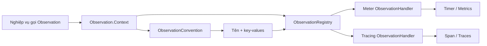

# ObservationConvention và cách đặt tên

## 1. Vì sao tên observation cần một quy ước?

Trong ứng dụng Spring Boot được tổ chức bằng **Spring Modulith**, một request đặt hàng có thể đi qua các application module `order`, `payment` và `inventory`. Chúng ta muốn theo dõi thời lượng gọi API module, số sự kiện được công bố và những thao tác nghiệp vụ bên trong như kiểm tra tồn kho. Nếu mỗi lập trình viên tự đặt tên theo một kiểu — `reserveOrder`, `inventory-reserve`, `stock.check.12345` — dữ liệu sẽ khó lọc, khó so sánh giữa các bản triển khai và có thể tạo quá nhiều chuỗi thời gian.

**Micrometer Observation API** cung cấp một cách định nghĩa hoạt động quan sát được (*observation*) mà không gắn chặt logic nghiệp vụ với Prometheus hay một tracing backend. **`ObservationConvention`** tập trung quy định **tên** và **nhãn** của hoạt động ấy. Còn Spring Modulith có **`ModulithObservationConvention`** để tùy biến convention riêng cho việc quan sát lời gọi vào application module.

Bài thuộc chương **Observation API** của **SPRING_MODULITH_DOCUMENTATION_OBSERVABILITY**, nằm trong lộ trình dùng Spring Modulith để tạo tài liệu về ranh giới application module, xem module graph/Actuator và kiểm chứng tương tác qua event metrics, tracing và context propagation khi hệ thống chạy.

Sau bài học, bạn có thể:

1. Phân biệt tên kỹ thuật `name` và tên theo ngữ cảnh `contextualName` của một observation.
2. Chọn key/value **low cardinality** và **high cardinality** đúng mục đích.
3. Viết `ObservationConvention<T>` và `Observation.Context` cho một thao tác nghiệp vụ được quan sát.
4. Hiểu thứ tự ưu tiên custom convention, global convention và default convention.
5. Khai báo `ModulithObservationConvention` như Spring bean để điều chỉnh tên/nhãn của module observation.
6. Kiểm chứng tên và nhãn trên Actuator, Prometheus hoặc trace mà không nhầm chúng với dependency graph tĩnh.

## 2. Observation, Context, Registry và Convention

Một observation đi qua chu trình tạo → bắt đầu → mở scope (nếu cần) → thực hiện công việc → dừng. Các vai trò chính:

| Thành phần | Trách nhiệm |
| --- | --- |
| `Observation` | Đại diện một lần đo; có vòng đời `start/stop`, có thể báo lỗi và event |
| `Observation.Context` | Chứa dữ liệu của lần thực thi hiện tại để convention/handler sử dụng |
| `ObservationRegistry` | Nơi quản lý cấu hình observation, handler, filter và convention |
| `ObservationConvention<T>` | Định nghĩa tên kỹ thuật, tên theo ngữ cảnh và các tập key-value từ một context |
| `ObservationHandler` | Phản ứng với vòng đời observation, ví dụ ghi Micrometer timer hoặc tạo tracing span |
| `ObservationFilter` | Bổ sung/sửa context theo chính sách chung; thường áp dụng trước bước xử lý dừng |
| `ObservationPredicate` | Cho phép hoặc từ chối tạo observation tương ứng |



**Một đoạn instrumentation có thể phục vụ nhiều loại tín hiệu**, nếu registry có các handler phù hợp. Có code tạo `Observation` không đồng nghĩa hệ thống đã xuất được trace tới Zipkin, Tempo hoặc OTLP; exporter và backend là cấu hình riêng. Tương tự, một observation không có meter handler thì không bảo đảm xuất hiện ở `/actuator/metrics`.

Ví dụ tạo một observation trực tiếp, chưa cần convention riêng:

```java
import io.micrometer.observation.Observation;
import io.micrometer.observation.ObservationRegistry;

public void reserve(ObservationRegistry registry) {
    Observation.createNotStarted("shop.inventory.reserve", registry)
        .contextualName("inventory reserve")
        .lowCardinalityKeyValue("sales.channel", "web")
        .observe(() -> {
            // Thao tác giữ hàng.
        });
}
```

`observe(...)` tự mở/bắt đầu observation, đặt nó vào scope, chạy lambda, ghi nhận lỗi runtime xảy ra và đóng/dừng observation. Với chương trình lớn, đưa tên/nhãn vào convention giúp các lần quan sát cùng loại luôn sử dụng **một hợp đồng thống nhất**, thay vì lặp chuỗi hard-code ở mọi service.

## 3. Bốn phần cần đặt tên cho đúng

| Thành phần | Ví dụ tốt | Mục đích và quy tắc |
| --- | --- | --- |
| **`getName()`** | `shop.inventory.reserve` | Tên kỹ thuật ổn định cho **loại thao tác**; dùng làm tên meter/timer khi có handler tương ứng |
| **`getContextualName(context)`** | `inventory reserve` | Nhãn dễ đọc cho span/trace; nên có số lượng biến thể nhỏ |
| **Low-cardinality keys** | `sales.channel=web`, `outcome=success` | Dùng để nhóm và lọc metrics; số giá trị phải hữu hạn |
| **High-cardinality keys** | `correlation.id=...` | Giúp chẩn đoán một lần xử lý trên trace; không xuất thành metric tag mặc định |

### 3.1. `name` là tên loại thao tác, không phải ID của một lần chạy

Đặt tên kỹ thuật sao cho **mọi lần giữ hàng dùng một tên giống nhau**:

```text
NÊN:   shop.inventory.reserve
NÊN:   shop.payment.authorize
NÊN:   shop.order.validate

TRÁNH:  shop.inventory.reserve.437a1c9e
TRÁNH:  /orders/2d7e.../reserve
TRÁNH:  reserve.for.user@example.com
```

Tên có ID hoặc địa chỉ người dùng tạo vô số meter khác nhau; lỗi nghiêm trọng hơn việc có nhiều **tag** vì ngay cả khi tag rỗng, mỗi tên mới cũng có thể là một chuỗi thời gian mới. Dùng chữ thường, tên phân cấp cách nhau bằng dấu chấm và mô tả **hành động có nghĩa**; đừng ghép tên module, thời điểm hay mã yêu cầu động vào tên kỹ thuật.

Lưu ý: các chữ `shop.*` là **quy ước của ứng dụng ví dụ**, không phải tên meter mặc định mà Spring Modulith tự tạo.

### 3.2. `contextualName` phục vụ việc đọc span

Tên ngữ cảnh có thể dễ đọc hơn tên kỹ thuật, chẳng hạn `inventory reserve` hoặc `payment authorize`. Handler tracing thường dùng tên này làm **span name**; còn handler metrics thường lấy `getName()`. Việc từng backend hiển thị trường nào phụ thuộc instrumentation và exporter.

Đừng đặt contextual name theo `orderId` hoặc `email`. Nếu cần tìm một giao dịch cụ thể, đặt ID trong thuộc tính có kiểm soát của trace/log, cân nhắc bảo vệ dữ liệu, retention và sampling.

### 3.3. Cardinality là thuộc tính của **giá trị**

`sales.channel` có giá trị `web`, `partner`, `other` là low cardinality. `order.id` có thể có hàng triệu UUID nên là high cardinality. Cùng một key bất kỳ cũng có thể trở thành rủi ro nếu developer vô tình truyền giá trị không giới hạn.

| Dữ liệu | Phân loại phù hợp | Giải thích |
| --- | --- | --- |
| `module.identifier=inventory` | Low | Số lượng module hữu hạn |
| `sales.channel=web/partner/other` | Low | Bộ giá trị xác định |
| `result=success/failure` | Low | Số giá trị ít |
| `retry.kind=none/manual/automatic` | Low | Tập giá trị nhỏ |
| `order.id=<UUID>` | High | Mỗi đơn thường có ID khác nhau |
| `request.id=<UUID>` | High | Mỗi request có thể khác nhau |
| `user.email` | Tránh thu thập nếu không cần | Có rủi ro dữ liệu cá nhân, cardinality rất lớn |

**Micrometer metrics handler dùng low-cardinality key-values làm tag; high-cardinality key-values không được thêm vào meter mặc định.** Với tracing, các thuộc tính high-cardinality có thể xuất hiện nếu tracing handler/exporter hỗ trợ và được cấu hình. Quy tắc dữ liệu nhạy cảm vẫn áp dụng cho cả hai.

## 4. Ví dụ thực tế: tạo ObservationConvention cho inventory

Giả định application module `inventory` có service giữ hàng. Ta muốn quan sát riêng một **bước giữ hàng** nằm trong nghiệp vụ, với tên metric ổn định, contextual span name dễ đọc và tag phân biệt kênh bán.

Cấu trúc file minh họa:

```text
com.example.shop
└── inventory
    ├── InventoryReservationService.java
    └── observability
        ├── ReservationContext.java
        └── ReserveObservationConvention.java
```

### 4.1. Context giữ dữ liệu của một lần xử lý

```java
// ReservationContext.java
package com.example.shop.inventory.observability;

import io.micrometer.observation.Observation;

public class ReservationContext extends Observation.Context {

    private final String channel;
    private final String correlationId;

    public ReservationContext(String channel, String correlationId) {
        this.channel = channel;
        this.correlationId = correlationId;
    }

    public String channel() {
        return channel;
    }

    public String correlationId() {
        return correlationId;
    }
}
```

Context không quyết định cách biến từng trường thành metric tag hoặc span attribute; đó là trách nhiệm của convention. Tách hai lớp này giúp thay cách đặt tên và phân loại nhãn mà không sửa thuật toán giữ hàng.

### 4.2. Convention cung cấp tên và key-values

```java
// ReserveObservationConvention.java
package com.example.shop.inventory.observability;

import io.micrometer.common.KeyValue;
import io.micrometer.common.KeyValues;
import io.micrometer.observation.Observation;
import io.micrometer.observation.ObservationConvention;
import org.springframework.stereotype.Component;

@Component
public class ReserveObservationConvention
        implements ObservationConvention<ReservationContext> {

    @Override
    public boolean supportsContext(Observation.Context context) {
        return context instanceof ReservationContext;
    }

    @Override
    public String getName() {
        return "shop.inventory.reserve";
    }

    @Override
    public String getContextualName(ReservationContext context) {
        return "inventory reserve";
    }

    @Override
    public KeyValues getLowCardinalityKeyValues(ReservationContext context) {
        return KeyValues.of(
            KeyValue.of("sales.channel", context.channel())
        );
    }

    @Override
    public KeyValues getHighCardinalityKeyValues(ReservationContext context) {
        return KeyValues.of(
            KeyValue.of("correlation.id", context.correlationId())
        );
    }
}
```

Ý nghĩa của từng method:

- `supportsContext(...)` nhận diện loại context mà convention hỗ trợ.
- `getName()` trả về tên **ổn định**, không phụ thuộc dữ liệu của một đơn hàng.
- `getContextualName(context)` mô tả thao tác để xem nhanh trong trace, cũng giữ dạng ổn định.
- `getLowCardinalityKeyValues(context)` đưa kênh bán vào metric tag khi có meter handler.
- `getHighCardinalityKeyValues(context)` đặt correlation ID ở loại dữ liệu có khả năng xuất sang span, **không phải Prometheus label**.

Trong ứng dụng thật, `correlationId` chỉ nên được ghi khi có mục đích điều tra rõ ràng, không chứa bí mật hoặc thông tin nhận dạng nhạy cảm, và tuân thủ retention. Không truyền event payload hoặc thông tin thanh toán vào context/trace một cách tùy tiện.

### 4.3. Dùng convention trong Spring service

```java
// InventoryReservationService.java
package com.example.shop.inventory;

import com.example.shop.inventory.observability.ReservationContext;
import com.example.shop.inventory.observability.ReserveObservationConvention;
import io.micrometer.observation.Observation;
import io.micrometer.observation.ObservationRegistry;
import java.util.Locale;
import java.util.UUID;
import org.springframework.stereotype.Service;

@Service
public class InventoryReservationService {

    private final ObservationRegistry registry;
    private final ReserveObservationConvention convention;

    public InventoryReservationService(
            ObservationRegistry registry,
            ReserveObservationConvention convention) {
        this.registry = registry;
        this.convention = convention;
    }

    public void reserve(UUID orderId, String channel, String correlationId) {
        String normalized = switch (channel.toLowerCase(Locale.ROOT)) {
            case "web", "partner" -> channel.toLowerCase(Locale.ROOT);
            default -> "other";
        };

        Observation.createNotStarted(
                convention,
                () -> new ReservationContext(normalized, correlationId),
                registry
            )
            .observe(() -> performReservation(orderId));
    }

    private void performReservation(UUID orderId) {
        // Ví dụ: kiểm tra, ghi trạng thái giữ hàng trong transaction.
        // Phần nghiệp vụ thực tế được lược bỏ.
    }
}
```

Giải thích:

1. Spring Boot cung cấp `ObservationRegistry` khi các thành phần observation được cấu hình phù hợp; ta inject thay vì tạo registry riêng trong mỗi service.
2. Convention là Spring bean nên có thể thay thế hoặc kiểm thử độc lập.
3. Supplier tạo `ReservationContext` cho chính lần xử lý hiện tại.
4. `observe(...)` quản lý vòng đời, scope và báo lỗi; `performReservation(...)` không cần biết backend metric/trace.
5. Giá trị `channel` bị **chuẩn hóa** về tập `web/partner/other` trước khi làm low-cardinality tag.

Trong ví dụ này, high-cardinality ID chỉ phục vụ phân tích; dùng cùng một correlation ID cho những span cần liên kết nếu chính sách dữ liệu cho phép. Tránh đưa ID vào tên observation hoặc `sales.channel`.

**Không nhân đôi instrumentation:** nếu `InventoryReservationService.reserve()` đã là entry point được Spring Modulith instrument, chương trình có thể sinh một **module span** và một **custom observation span** con cho cùng method. Chỉ giữ observation bổ sung khi nó đo được bước nghiệp vụ cần phân tích; nếu hai span trùng hệt nhau, chọn một ranh giới rõ ràng hoặc đặt custom observation quanh đoạn hẹp hơn.

## 5. Convention, filter, handler: dùng cái nào?

| Nhu cầu | Cơ chế phù hợp | Lưu ý |
| --- | --- | --- |
| Đặt tên kỹ thuật và tag mặc định cho một **loại observation** | `ObservationConvention<T>` | Nên gắn với kiểu context cụ thể |
| Thay convention mặc định theo hướng áp dụng rộng cho những context phù hợp | `GlobalObservationConvention<T>` | Đăng ký trong registry; `supportsContext` phải chính xác |
| Thêm nhãn chung cho mọi observation bất kể convention nào | `ObservationFilter` | Dùng cho chính sách chung, tránh ghi đè tag quan trọng |
| Chặn một số observation không cần thu thập | `ObservationPredicate` | Có thể tạo no-op observation |
| Ghi Timer, span hoặc tín hiệu khác | `ObservationHandler` | Handler phải có mặt trên registry |
| Thay cách đặt tên/nhãn **module observations của Spring Modulith** | `ModulithObservationConvention` | SPI riêng của Modulith, cấu hình như Spring bean |

### 5.1. Thứ tự ưu tiên khi chọn convention

Khi instrumentation sử dụng API `Observation.createNotStarted(customConvention, defaultConvention, contextSupplier, registry)`, Micrometer chọn:

1. **Custom convention** được truyền trực tiếp, nếu khác `null`.
2. **Global convention** trong `ObservationRegistry` có `supportsContext(...)` phù hợp.
3. **Default convention** do instrumentation cung cấp.

Điểm dễ nhầm: một class chỉ implement `ObservationConvention<T>` và được đánh `@Component` **không có nghĩa mọi observation trong ứng dụng tự động dùng nó**. Trong ví dụ inventory ở trên, service **truyền instance convention trực tiếp** cho Micrometer nên nó được áp dụng. Nếu muốn cơ chế global, dùng `GlobalObservationConvention<T>` và đăng ký với registry theo cách Spring Boot/Micrometer hỗ trợ.

Ví dụ khung đăng ký global convention bằng code thuần (minh họa; tránh trùng registry trong Spring Boot):

```java
ObservationRegistry registry = ObservationRegistry.create();
registry.observationConfig()
    .observationConvention(new MyGlobalReservationConvention());
```

`MyGlobalReservationConvention` trong ví dụ trên phải implement `GlobalObservationConvention<ReservationContext>` và lọc đúng context. Với ứng dụng Spring Boot, ưu tiên cấu hình các convention/handler trên **registry được Boot quản lý**; không tự tạo một registry tách biệt rồi mong mọi instrumentation mặc định dùng chung.

### 5.2. Tạo Observation không sử dụng convention riêng

Nếu chỉ có một đoạn code ngắn, API trực tiếp vẫn phù hợp:

```java
Observation.createNotStarted("shop.payment.gateway.call", registry)
    .contextualName("payment gateway call")
    .lowCardinalityKeyValue("provider", "primary")
    .observe(() -> gateway.call());
```

Khi số lượng điểm đo tăng hoặc muốn cho phép đội vận hành thay quy ước tên/tag, đưa các giá trị này vào `ObservationConvention` sẽ dễ bảo trì hơn.

## 6. Spring Modulith: ModulithObservationConvention

Spring Modulith có instrumentation sẵn cho **Spring components thuộc API application module**. Những lời gọi qua ranh giới module được quan sát bằng một `ModulithContext` mang thông tin module và lời gọi. Thay vì viết thủ công observation cho từng module entry, có thể cung cấp một bean `ModulithObservationConvention` để tùy biến convention mà Spring Modulith sử dụng.

Các type liên quan trong Spring Modulith 2.2:

| Type | Vai trò |
| --- | --- |
| `org.springframework.modulith.observability.ModulithContext` | `Observation.Context` chuyên biệt cho invocation vào module |
| `org.springframework.modulith.observability.ModulithObservationConvention` | `ObservationConvention<ModulithContext>`; API đặt tên và nhãn |
| `org.springframework.modulith.observability.support.DefaultModulithObservationConvention` | Convention mặc định của Spring Modulith |
| `ModulithContext.DEFAULT_CONVENTION_NAME` | Tên kỹ thuật mặc định, ở dòng 2.2 là `module.invocations` |

Theo tài liệu Spring Modulith, convention mặc định **ủy quyền các giá trị cho `ModulithContext`**, bao gồm tên theo ngữ cảnh và key-values. Cách dễ nhất để bảo toàn các tag có sẵn là tiếp tục sử dụng dữ liệu mà `ModulithContext` cung cấp.

### 6.1. Thêm một low-cardinality tag cho mọi module invocation

Ví dụ minh họa một giá trị có tập hữu hạn, cố định cho toàn ứng dụng:

```java
// ShopModulithObservationConvention.java
package com.example.shop.config;

import io.micrometer.common.KeyValue;
import io.micrometer.common.KeyValues;
import org.springframework.modulith.observability.ModulithContext;
import org.springframework.modulith.observability.ModulithObservationConvention;

public class ShopModulithObservationConvention
        implements ModulithObservationConvention {

    @Override
    public KeyValues getLowCardinalityKeyValues(ModulithContext context) {
        return context.getLowCardinalityValues()
            .and(KeyValue.of("application.family", "shop"));
    }
}
```

Đăng ký cho auto-configuration nhận diện:

```java
// ObservabilityConfiguration.java
package com.example.shop.config;

import org.springframework.context.annotation.Bean;
import org.springframework.context.annotation.Configuration;
import org.springframework.modulith.observability.ModulithObservationConvention;

@Configuration
class ObservabilityConfiguration {

    @Bean
    ModulithObservationConvention modulithObservationConvention() {
        return new ShopModulithObservationConvention();
    }
}
```

Trong ví dụ này, ta **chỉ thêm** `application.family=shop` vào low-cardinality values, còn các method `getName()`, `getContextualName(...)`, `getHighCardinalityKeyValues(...)` dùng triển khai mặc định của interface. Điều đó giữ nguyên tên/nhãn module mà Spring Modulith tính từ `ModulithContext`. Đây là cách an toàn hơn so với ghi lại toàn bộ low-cardinality keys và vô tình mất `module.identifier`, `module.name` hoặc những tag quan trọng khác.

Nếu muốn cố ý đổi tên kỹ thuật cho **toàn bộ module invocation**:

```java
@Override
public String getName() {
    return "shop.module.invocations";
}
```

Phương thức trên chỉ là **phương án thay đổi có chủ đích**; không được thêm cùng lúc nếu bạn đang muốn giữ các dashboard hiện có. Đổi `getName()` có thể tạo series metric mới (nếu có meter handler), khiến truy vấn Prometheus, dashboard và alert dựa trên `module.invocations` bị mất dữ liệu liên tục hoặc không còn khớp. Cần chuẩn bị migration dashboard và kiểm tra trace backend trước khi triển khai.

### 6.2. Các tag module hữu ích có sẵn

Spring Modulith mô tả các tag của **module entry span**:

| Tag | Ví dụ ý nghĩa |
| --- | --- |
| `module.identifier` | Định danh module, ví dụ `payment` |
| `module.name` | Tên module |
| `module.invocation-type` | Loại lời gọi: `bean` hoặc `event listener` |
| `module.method` | Method được instrument |

Chúng giúp tìm một lời gọi từ `order` sang `payment` hoặc listener nhận `OrderPlaced` trong trace. Việc một tag có mặt trên span **không đảm bảo** nó tự động có cùng hình thức trong mọi metric series; phân loại low/high và handler cụ thể quyết định đầu ra. Không tự đưa `orderId` vào low-cardinality tag của module observation chỉ để “lọc một đơn hàng”.

### 6.3. Phân biệt với ModulithEventMetricsCustomizer

Spring Modulith còn có `ModulithEventMetricsCustomizer` để tùy biến các **counter công bố domain event**. Đây là nhu cầu khác với việc đổi convention cho module invocation:

| Mục tiêu | Công cụ |
| --- | --- |
| Tùy biến tên/nhãn của observation khi gọi API module | `ModulithObservationConvention` |
| Bổ sung tag tùy biến cho counter event riêng lẻ | `ModulithEventMetricsCustomizer` |
| Thêm timer/span cho nghiệp vụ giữ hàng | `ObservationConvention<ReservationContext>` và `Observation` tại bước nghiệp vụ |

Counter `module.events.published` ghi nhận **lần công bố sự kiện**, không đồng nghĩa số listener đã xử lý thành công. Tùy biến convention quan sát module không làm thay đổi ý nghĩa nghiệp vụ của counter này.

## 7. Dependency và cấu hình cơ bản

Ví dụ Gradle Groovy DSL cho một dự án **Spring Boot 4.x và Spring Modulith 2.2.x** với BOM được quản lý tương thích:

```groovy
dependencies {
    // Spring Modulith (phiên bản do BOM của dự án quản lý).
    implementation "org.springframework.modulith:spring-modulith-starter-core"
    runtimeOnly "org.springframework.modulith:spring-modulith-starter-insight"

    // API dùng khi triển khai ModulithObservationConvention trong mã nguồn.
    implementation "org.springframework.modulith:spring-modulith-observability-api"

    // Dùng Observation API trong mã nguồn.
    implementation "io.micrometer:micrometer-observation"

    // Tùy chọn khi cần scrape Prometheus.
    runtimeOnly "io.micrometer:micrometer-registry-prometheus"
}
```

Lưu ý: phải chọn phiên bản Spring Modulith phù hợp với Spring Boot đang dùng và khai báo BOM hoặc dependency management theo cách của dự án. `spring-modulith-starter-insight` ở runtime kích hoạt hỗ trợ Modulith Actuator/observability; có đủ metric/tracing backend hay không vẫn phụ thuộc các dependency và cấu hình bổ sung. Khi dùng Boot 3.x, hãy đối chiếu artifact/tracer setup theo tài liệu của dòng tương ứng.

Cấu hình Actuator mẫu cho môi trường phát triển:

```yaml
spring:
  application:
    name: shop-modulith

management:
  endpoints:
    web:
      exposure:
        include: "health,info,modulith,metrics,prometheus"
```

Nếu chưa thêm Prometheus registry, endpoint `/actuator/prometheus` không tự xuất hiện chỉ vì có tên trong exposure. Nếu chưa cấu hình tracer/bridge, exporter và backend, observation vẫn có thể sinh metric nhưng không có trace trong Zipkin/Grafana. Những endpoint như `metrics`, `modulith` và `prometheus` cần được bảo vệ trong môi trường không công khai.

## 8. Kiểm chứng tên và tag ngoài thực tế

### 8.1. Đọc Actuator metrics sau khi gọi nghiệp vụ

Sau khi chạy code giữ hàng với `channel=web`:

```powershell
curl.exe http://localhost:8080/actuator/metrics
curl.exe http://localhost:8080/actuator/metrics/shop.inventory.reserve
curl.exe http://localhost:8080/actuator/prometheus
```

Nếu registry có meter handler, bạn có thể tìm timer tên `shop.inventory.reserve`, tag `sales.channel=web` và số lần gọi/tổng thời gian của các lần giữ hàng. Tên series ở Prometheus thường được chuyển sang dạng snake case có đơn vị, ví dụ:

```promql
sum by (sales_channel) (
  rate(shop_inventory_reserve_seconds_count[5m])
)
```

Đây là **PromQL minh họa**. Hãy đối chiếu tên timer, hậu tố `_seconds_count` và key label thực tế trong `/actuator/prometheus`, vì cách xuất tên phụ thuộc registry và phiên bản Micrometer. Nếu không thấy meter, trước hết xác minh observation đã thực sự chạy và meter handler đã được cấu hình, rồi mới suy luận có vấn đề với convention.

### 8.2. Đọc trace/span

Với tracing/exporter/backend được cấu hình và request được sampling giữ lại, có thể quan sát luồng:

```text
HTTP POST /orders
└── module: order.place(...)
    └── module: inventory.reserve(...)
        └── inventory reserve                [custom observation]
```

Trên span custom, tìm `sales.channel=web`; `correlation.id` chỉ nên xuất hiện nếu tracer/exporter thực sự ghi high-cardinality attributes và chính sách dữ liệu cho phép. Tên `inventory reserve` là contextual name nên có thể dễ đọc hơn `shop.inventory.reserve`. Với các span module có sẵn, tìm `module.identifier`, `module.name` và tên span mà `ModulithObservationConvention` tạo.

Không coi một trace vắng mặt là bằng chứng `ObservationConvention` không chạy: trace sampling, context propagation hoặc exporter có thể làm một observation không xuất hiện trên UI, trong khi meter vẫn được ghi.

### 8.3. Một kiểm thử nhỏ cho tên và low-cardinality tag

Để kiểm tra convention mà không cần backend tracing, có thể tạo `ObservationRegistry` và meter handler trong test:

```java
import static org.assertj.core.api.Assertions.assertThat;

import com.example.shop.inventory.observability.ReservationContext;
import com.example.shop.inventory.observability.ReserveObservationConvention;
import io.micrometer.core.instrument.simple.SimpleMeterRegistry;
import io.micrometer.observation.Observation;
import io.micrometer.observation.ObservationRegistry;
import io.micrometer.core.instrument.observation.DefaultMeterObservationHandler;
import org.junit.jupiter.api.Test;

class ReservationObservationTests {

    @Test
    void recordsStableNameAndBoundedTag() {
        try (var meters = new SimpleMeterRegistry()) {
            var observations = ObservationRegistry.create();
            observations.observationConfig().observationHandler(
                DefaultMeterObservationHandler.builder(meters).build()
            );

            var convention = new ReserveObservationConvention();

            Observation.createNotStarted(
                    convention,
                    () -> new ReservationContext("web", "test-correlation"),
                    observations
                )
                .observe(() -> { /* mô phỏng giữ hàng thành công */ });

            var timer = meters.get("shop.inventory.reserve")
                .tag("sales.channel", "web")
                .timer();

            assertThat(timer.count()).isEqualTo(1);
            assertThat(timer.getId().getTag("correlation.id")).isNull();
        }
    }
}
```

Test chỉ chứng minh **metric name và nhãn low-cardinality** được tạo theo convention khi có meter handler. Nó không xác nhận span đã được xuất hoặc parent/child context được truyền qua `@Async`; các việc đó phải kiểm chứng ở cấu hình tracing.

## 9. Quy tắc naming khi vận hành lâu dài

Các tên/nhãn là **hợp đồng dữ liệu** giữa code và dashboard. Một nhóm có thể thống nhất:

| Hạng mục | Quy tắc đề xuất | Ví dụ |
| --- | --- | --- |
| Tên observation nghiệp vụ | `<system>.<module>.<operation>` | `shop.payment.authorize` |
| Tên Modulith có sẵn | Giữ mặc định nếu không có yêu cầu migration | `module.invocations` |
| Contextual span name | Dễ đọc, ổn định theo hành động | `payment authorize` |
| Tag xác định module | Dùng key framework đã cung cấp | `module.identifier=payment` |
| Tag outcome | Tập kết quả hữu hạn | `result=success/failure` |
| Tag kênh | Tập enum/chuẩn hóa | `sales.channel=web` |
| ID yêu cầu/đơn hàng | High-cardinality trace/log có kiểm soát | `correlation.id=...` |

Khi phải đổi tên:

1. Ghi lại tên cũ, tên mới và chủ sở hữu dashboard/alert.
2. Kiểm tra time series và rule truy vấn đang dùng.
3. Chuyển dashboard/alert theo kế hoạch, có thể hỗ trợ cả tên cũ và tên mới trong giai đoạn quá độ nếu hệ thống cho phép.
4. Theo dõi số series, số giá trị tag và chi phí sau thay đổi.
5. Không tự đưa version động hoặc instance ID vào tên observation.

Với tag mới, ước lượng **số tổ hợp** trước khi áp dụng. Nếu có 20 module, 10 operation, 3 channel và 4 outcome thì riêng các chiều này có thể tạo tối đa khoảng **2.400** tổ hợp meter series trước khi tính các chiều khác. Thêm `orderId` hàng triệu giá trị sẽ làm cardinality tăng rất lớn và không phù hợp cho Prometheus.

## 10. Những nhầm lẫn phổ biến

| Nhầm lẫn | Cách hiểu đúng |
| --- | --- |
| “`getName()` nên chứa ID để dễ tìm request.” | `getName()` là tên **loại hoạt động**; ID thuộc high-cardinality data của trace/log nếu cần. |
| “`getContextualName()` và `getName()` luôn dùng giống nhau.” | Tên kỹ thuật thường dùng làm meter name; contextual name thường phục vụ span dễ đọc. |
| “High-cardinality key-value luôn xuất hiện trên Prometheus.” | Meter handler mặc định chỉ dùng low-cardinality key-values cho tag. |
| “Đánh `@Component` lên mọi `ObservationConvention` thì Boot tự chọn nó cho mọi operation.” | Phải được instrumentation truyền/đăng ký đúng cách; global convention có cơ chế riêng. |
| “Dùng `ObservationFilter` để thay đổi tên mọi metric là hợp lý.” | Filter thích hợp bổ sung/chỉnh context chung; convention là nơi thiết kế tên/nhãn theo loại observation. |
| “Thêm `ModulithObservationConvention` làm thay đổi module graph.” | Convention chỉ tác động dữ liệu quan sát; ranh giới và dependency tĩnh do Spring Modulith phân tích từ code. |
| “Có module span nghĩa là tất cả phương thức trong module có span.” | Instrumentation của Modulith chủ yếu ở điểm vào Spring component thuộc API module. |
| “Đã tạo Observation thì chắc chắn có trace.” | Còn cần tracer, handler, exporter, backend, sampling và context propagation. |
| “Đổi tên convention không ảnh hưởng dashboard.” | Tên meter hoặc span thay đổi có thể làm hỏng truy vấn và biểu đồ đang dựa trên tên cũ. |
| “Gắn `orderId` vào low-cardinality tag là an toàn vì dễ debug.” | Đây là chiều có cardinality rất cao, nên dùng trace/log có kiểm soát. |

## 11. Checklist thực hành

- [ ] Giải thích được `ObservationRegistry`, `Observation.Context`, `ObservationConvention` và `ObservationHandler`.
- [ ] Viết được `ObservationConvention<ReservationContext>` có `getName()` ổn định.
- [ ] Phân biệt được `getName()` với `getContextualName(context)`.
- [ ] Chuẩn hóa `sales.channel` thành tập low-cardinality hữu hạn.
- [ ] Không đưa UUID/email/order ID vào metric name hay low-cardinality tag.
- [ ] Dùng `Observation.createNotStarted(convention, contextSupplier, registry).observe(...)` để instrument một đoạn công việc.
- [ ] Hiểu thứ tự ưu tiên custom → global → default convention.
- [ ] Biết thêm `ModulithObservationConvention` vào Spring context và kế thừa tag mặc định từ `ModulithContext`.
- [ ] Kiểm tra metric trên Actuator/Prometheus và span trên backend tracing khi cấu hình đầy đủ.
- [ ] Đối chiếu module span với module graph nhưng không dùng trace để kết luận hợp lệ về kiến trúc tĩnh.
- [ ] Có quy trình quản lý thay đổi tên/tag khi dashboard và alert đã sử dụng.

## 12. Tài liệu tham khảo

- [Micrometer — Observation Components](https://docs.micrometer.io/micrometer/reference/observation/components.html): `ObservationConvention`, `ObservationFilter`, handler và thứ tự ưu tiên convention.
- [Micrometer — Observation Introduction](https://docs.micrometer.io/micrometer/reference/observation/introduction.html): tên observation, contextual name và low/high cardinality.
- [Micrometer — Observation API (Javadoc)](https://javadoc.io/doc/io.micrometer/micrometer-observation/latest/io/micrometer/observation/Observation.html): các overload của `createNotStarted(...)` và vòng đời observation.
- [Spring Modulith — Production-ready Features](https://docs.spring.io/spring-modulith/reference/production-ready.html): `spring-modulith-starter-insight`, các span tag và `ModulithObservationConvention`.
- [Spring Modulith — ModulithObservationConvention API](https://docs.spring.io/spring-modulith/docs/current/api/org/springframework/modulith/observability/ModulithObservationConvention.html): tên/context/tập key-values của module observation.
- [Spring Modulith — ModulithContext API](https://docs.spring.io/spring-modulith/docs/current/api/org/springframework/modulith/observability/ModulithContext.html): dữ liệu module/MethodInvocation và các giá trị convention mặc định.
- [Spring Boot — Metrics](https://docs.spring.io/spring-boot/reference/actuator/metrics.html): Actuator, Micrometer, Prometheus và phân phối metric.
- [Spring Boot — Tracing](https://docs.spring.io/spring-boot/reference/actuator/tracing.html): tracing backend, sampling, span và context propagation.
