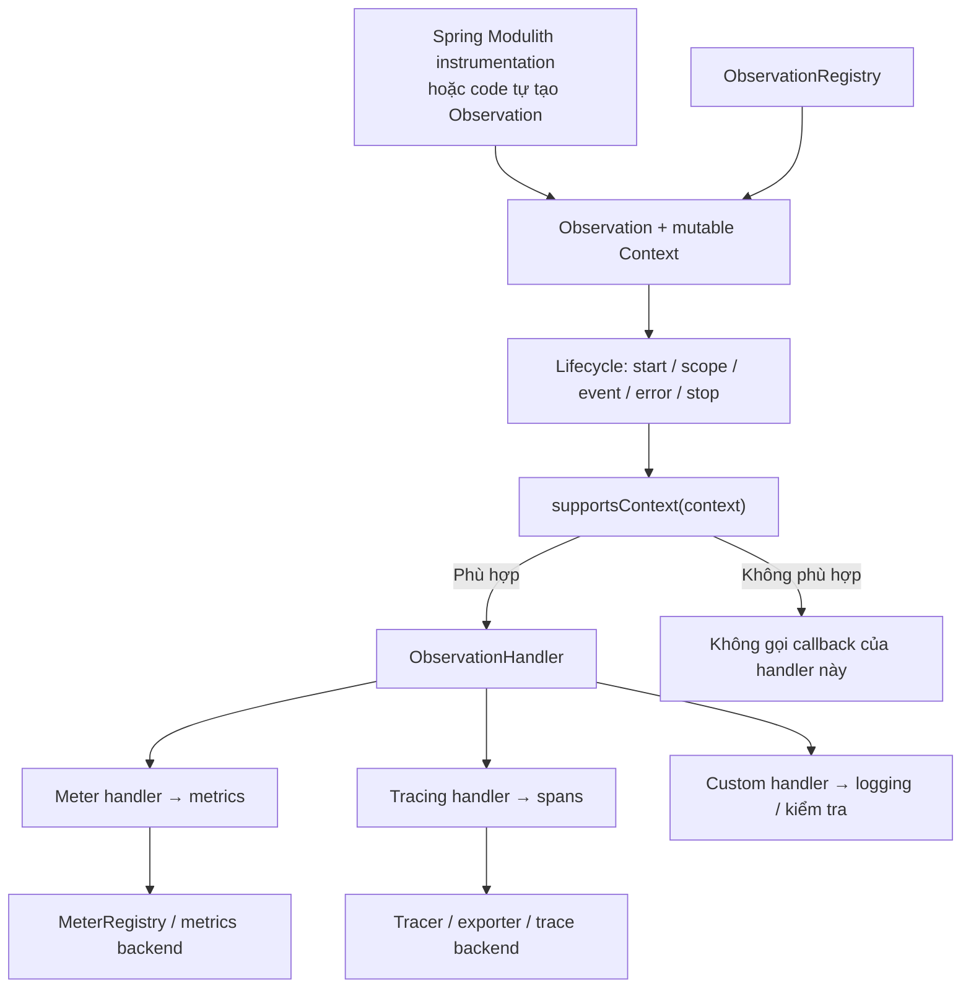
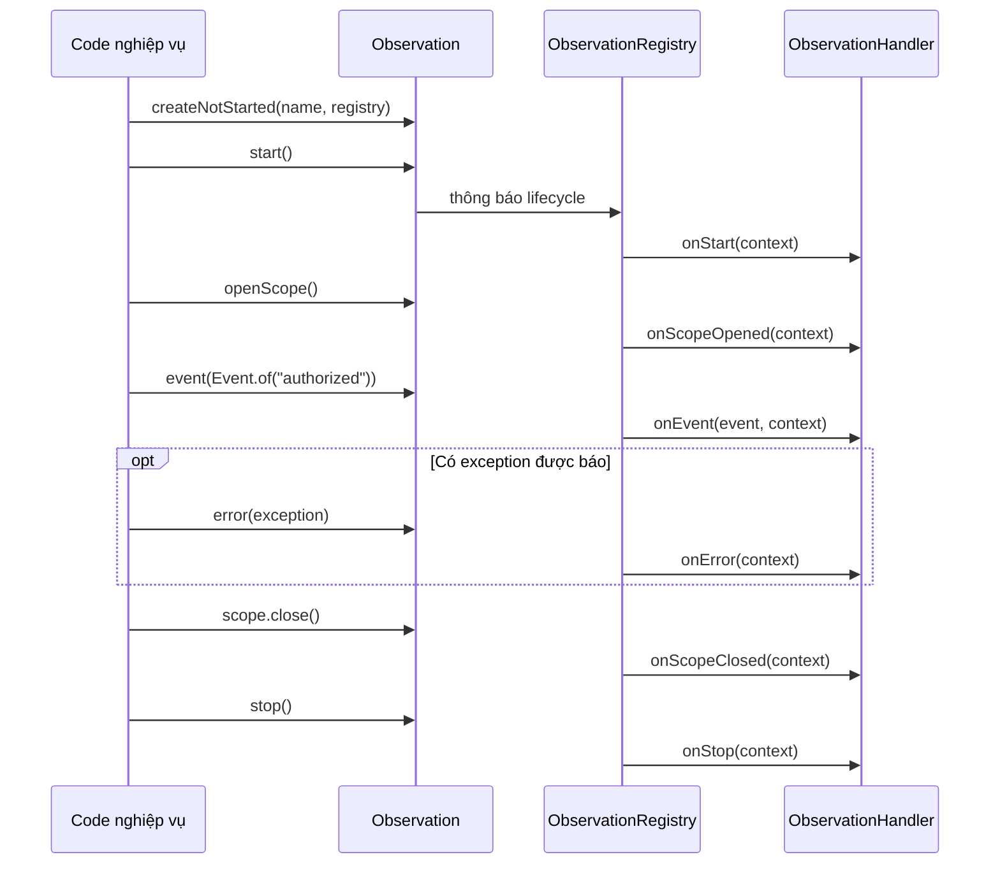
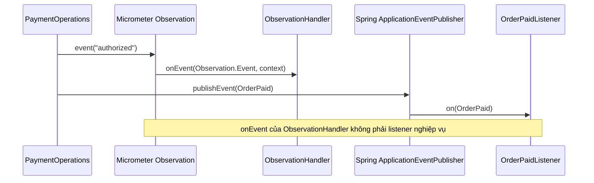
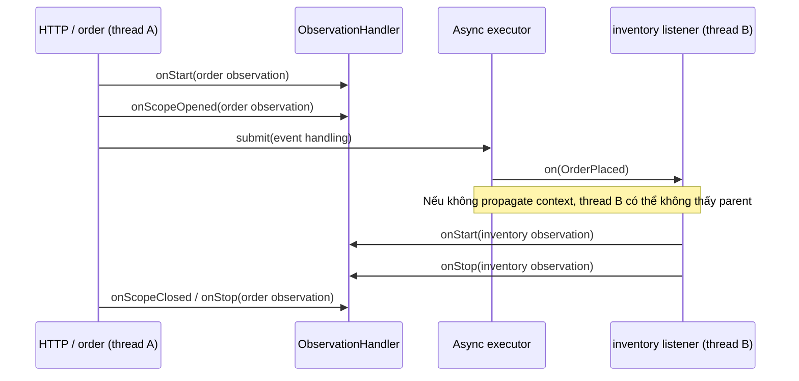

# ObservationHandler và nơi nhận sự kiện lifecycle

## 1. ObservationHandler giải quyết vấn đề gì?

Trong chương **Observation API** của học phần **SPRING_MODULITH_DOCUMENTATION_OBSERVABILITY**, ta tìm hiểu cách Spring Modulith giúp sinh tài liệu ranh giới application module và quan sát tương tác giữa các phần của ứng dụng Spring Boot. **Module graph** và **Actuator** mô tả cấu trúc và dependency; **Micrometer Observation** tạo điểm đo khi nghiệp vụ thực thi; còn **ObservationHandler** là thành phần **nhận các tín hiệu vòng đời** của những điểm đo đó để tạo metrics, traces hoặc hành vi bổ sung.

Giả sử một luồng đặt hàng đi qua các module `order` và `payment`. Để biết khi nào một lời gọi vào API module `payment` bắt đầu, kết thúc, có lỗi hay đang nằm trong scope hiện hành, ta cần hai vai trò khác nhau:

1. **Bên tạo Observation (instrumentation)**: Spring Modulith instrument Spring component thuộc API module; hoặc code nghiệp vụ tự tạo Observation qua `ObservationRegistry`.
2. **Bên nhận lifecycle (ObservationHandler)**: Micrometer thông báo `onStart`, `onStop`, `onError`, `onEvent` và các callback scope; những handler phù hợp có thể ghi timer, tạo span, xuất log hoặc bổ sung xử lý.

Một lần instrument có thể phục vụ **nhiều cách quan sát**. Không cần viết riêng logic bấm giờ và logic tạo span tại từng phương thức nghiệp vụ; việc lựa chọn handler trong registry quyết định cách xử lý dữ liệu phát sinh.

**Mục tiêu học tập:** Sau bài này, bạn có thể giải thích lifecycle của `Observation`, viết và đăng ký một `ObservationHandler`, hiểu khi nào callback chạy, phân biệt Micrometer `Observation.Event` với domain event Spring Modulith, đồng thời xác minh dữ liệu handler nhận được trong ứng dụng có module spans, event metrics và xử lý async.

## 2. Các thành phần trong luồng quan sát



| Thành phần | Trách nhiệm | Không nên hiểu nhầm |
| --- | --- | --- |
| `Observation` | Đại diện cho một vùng thao tác đang được quan sát; có vòng đời bắt đầu, scope, sự kiện tùy ý, lỗi và kết thúc | Không phải bản thân một Prometheus metric hay OpenTelemetry span |
| `Observation.Context` | Giữ tên, key-value, lỗi và dữ liệu bổ sung để handler dùng; có thể thay đổi qua vòng đời | Không phải Spring `ApplicationContext` và không tự là storage bền vững |
| `ObservationRegistry` | Nơi lưu cấu hình predicate, convention, filter và các handler áp dụng cho Observations | Không phải `MeterRegistry` chứa các counter/timer |
| `ObservationHandler` | Nhận callback khi một Observation thay đổi trạng thái | Không tự động phát sinh domain event của Modulith |
| `MeterRegistry` | Nơi quản lý meter (counter, timer, gauge...) trong ứng dụng | Không quản lý `Observation.Scope` |
| Tracer/exporter | Chuyển thông tin observation thành span và gửi đi | Không thể thay thế context propagation khi chuyển thread |

Trong Spring Boot, `ObservationRegistry` do hệ thống auto-configuration quản lý thường đã được cấu hình với các handler quan sát tương ứng. Nếu muốn dùng chung pipeline đó, hãy **inject bean `ObservationRegistry`** thay vì tạo một registry trống mới trong service.

## 3. Các callback của ObservationHandler

Interface ở package `io.micrometer.observation`:

```java
import io.micrometer.observation.Observation;
import io.micrometer.observation.ObservationHandler;

class ExampleHandler implements ObservationHandler<Observation.Context> {
    @Override
    public boolean supportsContext(Observation.Context context) {
        return true;
    }

    @Override
    public void onStart(Observation.Context context) {
        // Observation bắt đầu.
    }

    @Override
    public void onScopeOpened(Observation.Context context) {
        // Observation được đưa vào scope hiện tại.
    }

    @Override
    public void onEvent(Observation.Event event, Observation.Context context) {
        // Observation đã báo một event tùy ý.
    }

    @Override
    public void onError(Observation.Context context) {
        // Một lỗi đã được báo bằng observation.error(exception).
    }

    @Override
    public void onScopeClosed(Observation.Context context) {
        // Scope được đóng, khôi phục scope bao quanh.
    }

    @Override
    public void onStop(Observation.Context context) {
        // Observation kết thúc.
    }
}
```

Các callback mặc định là phương thức có thể override tùy nhu cầu; không nhất thiết phải triển khai tất cả.

| Callback | Trigger tương ứng | Việc thường làm |
| --- | --- | --- |
| `supportsContext(context)` | Micrometer xem handler có hỗ trợ kiểu/ngữ cảnh observation này không | Lọc handler theo `Context` hoặc kiểu quan sát |
| `onStart(context)` | `observation.start()` | Bắt đầu đo thời gian, khởi tạo state, tạo span |
| `onScopeOpened(context)` | `observation.openScope()` | Thiết lập ngữ cảnh hiện hành, ví dụ current span/thread-local |
| `onEvent(event, context)` | `observation.event(Observation.Event.of(...))` | Ghi nhận annotation/event trong một observation |
| `onError(context)` | `observation.error(exception)` | Đánh dấu lỗi, phân loại exception, gắn error vào span |
| `onScopeClosed(context)` | `Observation.Scope.close()` | Khôi phục hoặc dọn thread-local/scope |
| `onStop(context)` | `observation.stop()` | Hoàn tất timer, kết thúc span, gửi dữ liệu |

`onScopeReset(context)` cũng tồn tại trong một số API Micrometer nhưng là callback liên quan các thao tác reset scope đã deprecated; **không dựa vào nó để triển khai luồng mới**.

### Một timeline điển hình



Sơ đồ thể hiện **một nhánh xử lý đơn giản**. Thực tế, `Observation` có thể mở nhiều scope, phát nhiều `Observation.Event` hoặc không có event nào. Một observation kết thúc không đồng nghĩa mọi scope đều được quản lý đúng: người viết code phải đóng scope đã mở.

### Không đồng nhất start/stop với scope

- `start()` mở **vòng đời observation**. Nó chưa nhất thiết đặt observation thành *current observation* của thread.
- `openScope()` đặt observation vào **ngữ cảnh hiện hành**; các handler tracing thường dùng đây để quản lý current span. Có thể mở/đóng scope nhiều lần khi observation vẫn chưa stop.
- `scope.close()` kết thúc một **lần đưa vào scope**; chưa tự kết thúc observation.
- `stop()` kết thúc observation và kích hoạt callback cuối; có thể xảy ra sau khi scope đã đóng.

Khi có nested observation, việc đóng scope của observation con giúp khôi phục scope của observation cha. Thiếu đóng scope dễ gây nhiễm ngữ cảnh sang tác vụ kế tiếp trên cùng thread.

## 4. Viết ObservationHandler để xem lifecycle

Ví dụ sau tạo một handler chẩn đoán cho thao tác `shop.payment.authorize`. Handler chỉ ghi **tên observation, loại event và kiểu lỗi** ở mức DEBUG, tránh ghi ID người dùng hoặc toàn bộ exception message.

```java
// com/acme/shop/observability/PaymentLifecycleHandler.java
package com.acme.shop.observability;

import io.micrometer.observation.Observation;
import io.micrometer.observation.ObservationHandler;
import org.slf4j.Logger;
import org.slf4j.LoggerFactory;
import org.springframework.stereotype.Component;

@Component
public class PaymentLifecycleHandler
        implements ObservationHandler<Observation.Context> {

    private static final Logger log =
            LoggerFactory.getLogger(PaymentLifecycleHandler.class);

    private static final String OBSERVATION_NAME =
            "shop.payment.authorize";

    @Override
    public boolean supportsContext(Observation.Context context) {
        return OBSERVATION_NAME.equals(context.getName());
    }

    @Override
    public void onStart(Observation.Context context) {
        log.debug("Observation started: {}", context.getName());
    }

    @Override
    public void onScopeOpened(Observation.Context context) {
        log.debug("Observation scope opened: {}", context.getName());
    }

    @Override
    public void onEvent(Observation.Event event, Observation.Context context) {
        log.debug("Observation event: {} / {}", context.getName(),
                event.getName());
    }

    @Override
    public void onError(Observation.Context context) {
        Throwable error = context.getError();
        log.debug("Observation error: {} / {}", context.getName(),
                error == null ? "unspecified" : error.getClass().getSimpleName());
    }

    @Override
    public void onScopeClosed(Observation.Context context) {
        log.debug("Observation scope closed: {}", context.getName());
    }

    @Override
    public void onStop(Observation.Context context) {
        log.debug("Observation stopped: {}", context.getName());
    }
}
```

Trong Spring Boot có Actuator/Micrometer Observation auto-configuration, **bean `ObservationHandler` sẽ được đăng ký vào `ObservationRegistry` do Boot quản lý**. Vì vậy bạn thường **không cần** gọi `registry.observationConfig().observationHandler(...)` lần nữa đối với bean trên; đăng ký lặp có thể tạo callback trùng.

`supportsContext()` ở ví dụ này lọc **một observation nghiệp vụ tự đặt tên**. Tên observation do Spring Modulith tạo cho module entry **không bắt buộc trùng** `shop.payment.authorize`. Muốn handler bắt các observation do Spring Modulith tạo, hãy kiểm tra observation name, context type hoặc convention thực tế rồi viết điều kiện hỗ trợ tương ứng; không đoán tên method/module là tên observation.

### Vì sao cần supportsContext?

Nếu `supportsContext()` luôn trả `true`, một handler tùy chỉnh có thể nhận nhiều observation không liên quan, gồm HTTP server, database, messaging và module entry tùy cấu hình. Điều đó có thể tạo log quá nhiều hoặc làm tăng overhead.

Ngược lại, filter quá chặt sẽ khiến handler **không nhận callback**, dù observation vẫn được tạo và các handler tracing/metrics khác hoạt động. `supportsContext` chỉ kiểm soát **handler hiện tại**; nó không phải điều kiện tắt toàn bộ observation trong registry.

## 5. Tạo Observation và kích hoạt các callback

Code sau inject `ObservationRegistry` của Spring Boot, khai báo một điểm quan sát cho nghiệp vụ thanh toán:

```java
// com/acme/shop/payment/PaymentOperations.java
package com.acme.shop.payment;

import io.micrometer.observation.Observation;
import io.micrometer.observation.ObservationRegistry;
import java.util.UUID;
import org.springframework.stereotype.Service;

@Service
public class PaymentOperations {

    private final ObservationRegistry registry;

    public PaymentOperations(ObservationRegistry registry) {
        this.registry = registry;
    }

    public void authorize(UUID orderId) {
        Observation observation = Observation.createNotStarted(
                "shop.payment.authorize", registry)
                .lowCardinalityKeyValue("payment.operation", "authorize");

        observation.observe(() -> {
            validate(orderId);
            observation.event(Observation.Event.of("validated"));

            // Ví dụ: gọi cổng thanh toán và cập nhật dữ liệu.
            observation.event(Observation.Event.of("authorization.requested"));
        });
    }

    private void validate(UUID orderId) {
        if (orderId == null) {
            throw new IllegalArgumentException("orderId must not be null");
        }
    }
}
```

`observation.observe(Runnable)` quản lý các thao tác thiết yếu: bắt đầu observation, mở scope, chạy lambda, báo lỗi khi có exception, đóng scope và kết thúc observation. Vì vậy ta **không cần tự gọi `start()`/`stop()`** bao quanh đoạn `observe()`.

Khi `authorize(validId)` chạy thành công, handler trong phần 4 có thể ghi chuỗi DEBUG gần như sau:

```text
Observation started: shop.payment.authorize
Observation scope opened: shop.payment.authorize
Observation event: shop.payment.authorize / validated
Observation event: shop.payment.authorize / authorization.requested
Observation scope closed: shop.payment.authorize
Observation stopped: shop.payment.authorize
```

Đây là **minh họa thứ tự đơn giản**, không cam kết thứ tự tuyệt đối giữa nhiều handler khác nhau. Nếu `validate(orderId)` ném lỗi, handler sẽ nhận `onError` khi `observe()` báo lỗi cho observation; sau đó scope vẫn được đóng và observation kết thúc. Không nên nhầm `onError` với trạng thái lỗi nghiệp vụ *đã được ghi DB hoặc xử lý bù*.

### Khi muốn quản lý vòng đời thủ công

```java
Observation observation =
        Observation.start("shop.payment.authorize", registry);

try (Observation.Scope scope = observation.openScope()) {
    authorizePayment();
    observation.event(Observation.Event.of("authorized"));
} catch (RuntimeException ex) {
    observation.error(ex);
    throw ex;
} finally {
    observation.stop();
}
```

Đoạn code này minh họa cách tự gọi callback tương ứng; `authorizePayment()` là phương thức nghiệp vụ giả định. Hãy dùng `finally` để không bỏ sót `stop()` khi code ném exception. Nếu muốn tránh viết lặp boilerplate, ưu tiên `observe(...)`.

## 6. Cách đăng ký handler vào ObservationRegistry

### 6.1. Trong ứng dụng Spring Boot

Spring Boot tự đăng ký các bean thuộc những loại sau vào `ObservationRegistry` do Boot cấu hình:

- `ObservationHandler`;
- `ObservationPredicate`;
- `GlobalObservationConvention`;
- `ObservationFilter`.

Ngoài ra có thể tạo `ObservationRegistryCustomizer` để tùy chỉnh registry. Vì vậy với ví dụ `@Component PaymentLifecycleHandler`, việc bean có mặt trong application context thường đã đủ để Boot quản lý registration.

Nếu chỉ muốn đăng ký handler trong một profile dev:

```java
package com.acme.shop.observability;

import io.micrometer.observation.Observation;
import io.micrometer.observation.ObservationHandler;
import org.slf4j.Logger;
import org.slf4j.LoggerFactory;
import org.springframework.context.annotation.Bean;
import org.springframework.context.annotation.Configuration;
import org.springframework.context.annotation.Profile;

@Configuration(proxyBeanMethods = false)
class ObservationDebugConfiguration {

    private static final Logger log =
            LoggerFactory.getLogger(ObservationDebugConfiguration.class);

    @Bean
    @Profile("dev")
    ObservationHandler<Observation.Context> observationDebugHandler() {
        return new ObservationHandler<>() {
            @Override
            public boolean supportsContext(Observation.Context context) {
                return true;
            }

            @Override
            public void onStart(Observation.Context context) {
                log.debug("OBS START {}", context.getName());
            }

            @Override
            public void onStop(Observation.Context context) {
                log.debug("OBS STOP {}", context.getName());
            }
        };
    }
}
```

**Đây là một lựa chọn thay thế** handler ở phần 4 khi cần debug rộng, không phải bắt buộc khai báo cả hai trong dự án. `supportsContext=true` có thể tạo nhiều log, nên chỉ bật profile phù hợp trong môi trường thử nghiệm.

### 6.2. Micrometer thuần, không dùng Spring Boot

```java
import io.micrometer.observation.Observation;
import io.micrometer.observation.ObservationRegistry;

ObservationRegistry registry = ObservationRegistry.create();
registry.observationConfig()
        .observationHandler(new ExampleHandler());

Observation.createNotStarted("example.operation", registry)
        .observe(() -> System.out.println("Doing work"));
```

Trong đoạn trên, `ExampleHandler` là class đã định nghĩa ở phần 3. Đây là ví dụ **Micrometer thuần**: registry không được Boot quản lý, vì vậy cần đăng ký handler trực tiếp. Trong service Spring Boot thật, tạo một registry mới như thế có thể tách observation khỏi tracing/metrics auto-configured và khiến dashboard không thấy dữ liệu.

## 7. Observation.Context là dữ liệu chung của lifecycle

`Observation.Context` là một container mutable cho metadata và state cần chia sẻ giữa các callback của cùng một observation. Micrometer cho phép context lưu dữ liệu theo key:

```java
// Ví dụ ý tưởng trong một ObservationHandler, không phải constructor bean.
private static final String START_NANOS = "sample.start.nanos";

@Override
public void onStart(Observation.Context context) {
    context.put(START_NANOS, System.nanoTime());
}

@Override
public void onStop(Observation.Context context) {
    Long startedAt = context.get(START_NANOS);
    if (startedAt != null) {
        long elapsedNanos = System.nanoTime() - startedAt;
        // Có thể ghi debug hoặc chuyển sang Timer nếu thật sự cần.
    }
}
```

Đây là ví dụ **snippet bên trong một class triển khai `ObservationHandler`** (không phải file Java đứng độc lập). Để đo duration trong production, **ưu tiên meter handler chuẩn** và `Timer`, vì chúng xử lý time unit, tag và exporter phù hợp. Không nên tự viết thêm timer cho cùng một observation nếu Boot đã có meter handler, vì có thể tạo **hai cách đo trùng lặp**.

### Low-cardinality và high-cardinality key-value

```java
Observation observation = Observation.createNotStarted(
        "shop.payment.authorize", registry)
    .lowCardinalityKeyValue("payment.operation", "authorize")
    .highCardinalityKeyValue("payment.request.ref", "opaque-reference");
```

| Loại | Ví dụ | Nên đi đâu? |
| --- | --- | --- |
| Low cardinality | `payment.operation=authorize/capture/refund` | Metrics và traces |
| High cardinality | Một mã tương quan cho từng request (nếu được phép) | Chủ yếu traces, cần kiểm soát quyền truy cập và dữ liệu nhạy cảm |
| Không phù hợp làm metric tag | Email, số điện thoại, `orderId`/UUID không giới hạn | Tránh vì cardinality cao và nguy cơ lộ dữ liệu |

Các key-value được bổ sung ở những thời điểm khác nhau của lifecycle có thể ảnh hưởng dữ liệu mà handler đọc. Theo tài liệu Micrometer, `ObservationFilter` được gọi trước các callback `onStop`, có thể sửa context trước khi stop. Với meter đo tác vụ đang chạy từ `onStart`, những tag chỉ xuất hiện sau `start()` không thể mặc nhiên gắn ngược lại vào meter đã khởi tạo.

## 8. Handler chuẩn tạo metrics, traces và logs như thế nào?

### 8.1. Meter handler

Micrometer có `DefaultMeterObservationHandler`. Khi được đăng ký trên registry, nó có thể chuyển vòng đời observation thành:

| Tín hiệu | Meter điển hình | Mốc ghi |
| --- | --- | --- |
| Thời gian thao tác | `Timer` với tên observation | Khi `stop()` |
| Observation event | `Counter` theo tên observation/event | Khi `Observation.event(...)` |
| Thời gian tác vụ còn chạy | `LongTaskTimer` tùy chọn | Bắt đầu từ `start()` và kết thúc ở `stop()` |

Một ví dụ Micrometer thuần để minh họa **handler thật sự nhận lifecycle và tạo meter**:

```java
import io.micrometer.core.instrument.MeterRegistry;
import io.micrometer.core.instrument.observation.DefaultMeterObservationHandler;
import io.micrometer.core.instrument.simple.SimpleMeterRegistry;
import io.micrometer.observation.Observation;
import io.micrometer.observation.ObservationRegistry;

MeterRegistry meterRegistry = new SimpleMeterRegistry();
ObservationRegistry observationRegistry = ObservationRegistry.create();

observationRegistry.observationConfig().observationHandler(
        DefaultMeterObservationHandler.builder(meterRegistry).build());

Observation observation = Observation.createNotStarted(
        "shop.payment.authorize", observationRegistry)
        .lowCardinalityKeyValue("payment.operation", "authorize");

observation.observe(() -> {
    observation.event(Observation.Event.of("validated"));
});

long operations = meterRegistry
        .get("shop.payment.authorize")
        .timer()
        .count(); // 1

double events = meterRegistry
        .get("shop.payment.authorize.validated")
        .counter()
        .count(); // 1.0
```

Đây là **minh họa độc lập bằng Micrometer**: timer và counter được tạo từ callback của `DefaultMeterObservationHandler`. Khi dùng Spring Boot, thông thường không cần tự lắp lại handler này vì Boot đã có cơ chế cấu hình meter/tracing phù hợp. Và **counter của `Observation.Event` ở ví dụ không phải counter domain event `module.events.published` của Spring Modulith**.

### 8.2. Tracing handler

Micrometer Tracing cung cấp các `TracingObservationHandler` kết hợp tracer, span và context hiện hành. Handler tracing có thể:

1. Tạo/nhận span khi observation bắt đầu.
2. Đưa span vào scope hiện hành khi `openScope()`.
3. Ghi error/event vào span khi nhận callback tương ứng.
4. Kết thúc span khi observation stop.

Để xem span trong Zipkin, Grafana Tempo, Jaeger hoặc backend khác, cần cả tracer, exporter, endpoint nhận, sampling và cấu hình truy cập phù hợp. `ObservationHandler` chỉ là một thành phần trong pipeline; **có callback không bảo đảm trace đã được xuất thành công**.

### 8.3. Handler tùy chỉnh có nên tự ghi log hay gọi hệ thống ngoài?

Nên giữ handler nhẹ, không chặn lâu và giới hạn dữ liệu ghi. Callback có thể chạy **trong luồng xử lý request**, ảnh hưởng trực tiếp latency. Không nên thực hiện network call chậm, transaction nghiệp vụ mới hoặc khởi phát vòng quan sát lặp lại bên trong mọi `onStart`/`onStop`.

Nếu cần log audit bền vững, nên thiết kế pipeline chuyên biệt với chính sách retry/idempotency; **debug lifecycle handler không thay thế nhật ký giao dịch**.

## 9. Phân biệt Observation.Event với domain event Spring Modulith

Hai loại cùng có từ “event”, nhưng khác lớp trừu tượng:

| Khía cạnh | `Observation.Event` | Domain/application event |
| --- | --- | --- |
| API phát | `observation.event(Observation.Event.of("validated"))` | `ApplicationEventPublisher.publishEvent(new OrderPlaced(...))` |
| Ý nghĩa | Gắn một mốc tùy ý trong **vòng đời một observation** | Gửi thông điệp nghiệp vụ tới listener |
| Nơi nhận | `ObservationHandler.onEvent(event, context)` | Spring `@EventListener`, `@TransactionalEventListener`, `@ApplicationModuleListener` |
| Có tự mở transaction riêng không? | Không | Phụ thuộc loại listener, transaction và executor |
| Có tự tăng `module.events.published` không? | Không theo cơ chế domain event của Spring Modulith | Spring Modulith event metrics có thể ghi nhận sự kiện thuộc phạm vi instrument |
| Dùng để làm gì? | Ghi annotation trong trace hoặc meter sự kiện observation | Liên kết module, kích hoạt xử lý nghiệp vụ |

### Hai luồng độc lập có thể cùng xuất hiện



Lời gọi `onEvent` không mang `OrderPaid` theo contract của Spring `ApplicationEventPublisher`. Nếu mã đã publish domain event, một handler observation có thể thấy module entry observation của listener **nếu** instrumentation tương ứng hoạt động, nhưng không phải vì handler đã “nhận” domain event trực tiếp.

Đây là điểm đặc biệt quan trọng khi đánh giá **event metrics**: `module.events.published` đo hoạt động publication ở tầng Modulith; `onEvent` của Micrometer là callback gắn với **Observation.Event**.

## 10. Spring Modulith tạo observation ở đâu?

Spring Modulith có khả năng instrument **Spring component thuộc API của application module** để tạo module entry observation/span cho lời gọi đi qua ranh giới được nhận diện. Chẳng hạn:

```text
com.acme.shop
├── ShopApplication.java
├── order
│   └── OrderOperations.java        # Bean API order
├── payment
│   ├── PaymentOperations.java      # Bean API payment
│   └── internal
│       └── GatewayAdapter.java     # Bean nội bộ payment
└── inventory
    └── InventoryListener.java      # Xử lý OrderPlaced
```

Giả sử `order` inject Spring bean `PaymentOperations` và gọi `authorize()`. Modulith có thể tạo observation ở điểm vào module `payment`. Khi đó, **Micrometer handlers được cấu hình trong cùng `ObservationRegistry`** tiếp nhận lifecycle của observation này; handler tracing tạo span, còn handler metrics có thể tạo dữ liệu đo theo convention tương ứng.

Module entry span có các key tiêu biểu:

| Key | Diễn giải |
| --- | --- |
| `module.identifier` | ID module như `payment` |
| `module.name` | Tên hiển thị module |
| `module.invocation-type` | Kiểu gọi, như `bean` hoặc `event listener` |
| `module.method` | Method được thực thi tại điểm vào module |

`module.method` là high-cardinality key của observation; khi phân tích traces, nó hữu ích để biết phương thức nào được instrument. Không nên mặc nhiên dùng nó làm metric tag có nhiều giá trị.

### Bật hỗ trợ observability module

Ví dụ Gradle dành cho Spring Boot và Spring Modulith phiên bản tương thích:

```groovy
dependencies {
    implementation platform('org.springframework.modulith:spring-modulith-bom:2.2.0')
    implementation 'org.springframework.modulith:spring-modulith-starter-core'
    runtimeOnly 'org.springframework.modulith:spring-modulith-starter-insight'
}
```

`spring-modulith-starter-insight` kéo theo Modulith Actuator và observability; để xuất trace vào backend còn cần **Micrometer Tracing + exporter** phù hợp với dòng Spring Boot đang dùng. Nếu không cần Modulith Actuator, có thể dùng dependency `spring-modulith-observability-core` tương thích.

**Lưu ý:** Tên module trong trace phụ thuộc package/module detection; một bean `@Service` trong `payment.internal` không mặc nhiên trở thành module entry API được instrument. Và việc dependency xuất hiện trên module graph không chứng minh method đã được gọi trong một request.

### Handler tùy chỉnh nhìn thấy Modulith observation như thế nào?

`ObservationHandler<Observation.Context>` có thể nhận những observation mà nó hỗ trợ từ registry. Với ứng dụng thực, hãy xác nhận:

1. Modulith instrumentation đã đăng ký trong runtime và bean API đã được intercept.
2. Bean `ObservationHandler` đã được Spring Boot đăng ký vào registry dùng bởi instrumentation.
3. `supportsContext(context)` không loại bỏ observation đang muốn xem.
4. Request thật đã đi qua API module; không chỉ tồn tại cạnh dependency trong graph.
5. Logging/tracing exporter/sampling không che mất tín hiệu cần kiểm tra.

Đối với custom handler cần lọc **riêng Modulith observation**, nên dựa vào context/convention có thật trong phiên bản đang dùng. Đừng lọc chỉ bằng một tên method tự đoán hoặc giả định mọi `Observation.Context` đều có tag `module.identifier` ngay từ `onStart`.

## 11. ObservationHandler trong xử lý bất đồng bộ

`Observation.Scope` thường liên quan đến ngữ cảnh hiện hành của thread. Khi một listener của Spring Modulith chạy bằng executor khác, cần phân biệt:

- **Observation được tạo ở thread A** và handler nhận `onStart` ở đó.
- **Task được đưa sang thread B** có thể thiếu observation/trace context nếu không có cơ chế truyền.
- **Listener ở thread B** vẫn có thể tạo observation riêng nếu instrument, nhưng không bảo đảm trở thành child span của request ở thread A.



**Điểm mấu chốt:** Handler nhận lifecycle cho **mỗi observation được tạo**, còn **parent-child trace relationship** phụ thuộc việc có truyền trace context khi giao việc hay không.

Với Spring Boot, có thể sử dụng Micrometer Context Propagation và cấu hình executor/`ContextPropagatingTaskDecorator` phù hợp. Khi event được lưu bền và replay sau restart, scope/trace context cũ không còn; cần correlation ID nghiệp vụ nếu muốn đối chiếu các lần xử lý ở những trace khác nhau.

Đừng cố giữ nguyên một `Observation.Scope` qua nhiều thread hoặc nhiều transaction bằng cách chuyển thẳng đối tượng scope; dùng cơ chế propagation được framework hỗ trợ.

## 12. Kiểm soát handler bằng Predicate, Filter và Convention

`ObservationHandler` chỉ là một mắt xích. Khi muốn thay đổi điều kiện quan sát, tên metric hoặc metadata, có các điểm mở rộng khác:

| Extension point | Câu hỏi xử lý | Khi nào dùng |
| --- | --- | --- |
| `ObservationPredicate` | Có tạo observation thật hay biến thành no-op? | Loại bỏ những observation theo chính sách |
| `ObservationConvention` / `GlobalObservationConvention` | Observation tên gì, có key-value nào? | Chuẩn hóa tên, tag và ngữ nghĩa đo |
| `ObservationFilter` | Có cần sửa Context trước khi stop? | Bổ sung/chỉnh metadata khi kết thúc |
| **`ObservationHandler`** | Làm gì khi observation start, event, error, scope, stop? | Ghi metrics, span, debug lifecycle |
| `ObservationRegistryCustomizer` | Cấu hình registry như thế nào? | Thêm/tùy chỉnh handler và extension points |

Ví dụ một predicate loại bỏ observation tên `shop.internal.noise`:

```java
import io.micrometer.observation.ObservationPredicate;
import org.springframework.context.annotation.Bean;
import org.springframework.context.annotation.Configuration;

@Configuration(proxyBeanMethods = false)
class ObservationPolicyConfiguration {

    @Bean
    ObservationPredicate ignoreNoisyObservation() {
        return (name, context) -> !"shop.internal.noise".equals(name);
    }
}
```

Với Spring Boot auto-configuration, bean predicate này được đăng ký vào registry; observation có tên bị loại sẽ trở thành no-op và không tạo callback như một observation bình thường.

**Phân biệt:**

- `supportsContext=false`: handler này không phản ứng với observation, nhưng handler khác vẫn có thể nhận.
- `ObservationPredicate=false`: observation đó bị bỏ qua theo chính sách registry.
- `management.observations.enable.*=false` (nếu phiên bản Boot hỗ trợ): tắt một nhóm observation theo cấu hình.
- Không có exporter: observation/callback có thể chạy nhưng không có trace gửi ra backend.

## 13. Chẩn đoán khi handler không nhận lifecycle

| Triệu chứng | Nguyên nhân có thể | Cách kiểm tra |
| --- | --- | --- |
| Không thấy `onStart` | Observation không được tạo; code không chạy; predicate loại bỏ; sai registry | Đặt breakpoint tại chỗ tạo observation, xem `isNoop()` và registry được inject |
| `onStart` có nhưng không có `onScopeOpened` | Code chỉ `start()`, chưa gọi `openScope()` | Dùng `observe(...)` hoặc mở/đóng scope rõ ràng |
| Không có `onEvent` | Không gọi `observation.event(...)` | Kiểm tra đúng API; domain `ApplicationEvent` không tự gọi `onEvent` |
| Có exception nhưng không thấy `onError` | Bắt exception nhưng không gọi `observation.error(ex)`; không dùng `observe()` | Báo lỗi cho observation hoặc dùng `observe(...)` |
| Có `onScopeClosed` mà không thấy `onStop` | Đóng scope nhưng không gọi `stop()` | Dùng `finally` hoặc `observe(...)` |
| Handler chỉ nhận HTTP observation, không có module span | Modulith instrumentation thiếu hoặc bean không thuộc API module | Kiểm tra dependency, package API, Spring proxy, lời gọi thực tế |
| Handler nhận rất nhiều callback | `supportsContext()` trả `true` cho mọi observation | Giới hạn theo context/observation name khi đã kiểm chứng |
| Handler có log nhưng trace backend trống | Không có tracer/exporter/backend hoặc bị sampling | Kiểm tra cấu hình tracing độc lập với custom handler |
| Span của async listener không nằm trong trace cha | Context không được propagate hoặc retry sau transaction/restart | Kiểm tra executor, task decorator và correlation ID |
| Metrics/timer bị nhân đôi | Đăng ký cùng handler nhiều lần hoặc tự ghi meter trùng | Kiểm tra bean registration và `ObservationRegistryCustomizer` |

### Quy trình thực nghiệm đề xuất

1. Dùng `ObservationRegistry` từ Spring Boot, đăng ký một handler chẩn đoán có `supportsContext` phù hợp.
2. Gọi `PaymentOperations.authorize()` với dữ liệu hợp lệ, quan sát `onStart → onScopeOpened → onEvent → onScopeClosed → onStop`.
3. Gọi với dữ liệu lỗi; xem `onError` và xác minh scope vẫn đóng, observation vẫn stop.
4. Thêm một lời gọi vào API module khác để xem module entry observation do Spring Modulith tạo.
5. Kiểm tra `/actuator/modulith` hoặc module graph để đối chiếu ranh giới tĩnh; nếu có trace backend, xem `module.identifier`, `module.method` và parent/child spans.
6. Thử listener bất đồng bộ và kiểm tra trace context; đối chiếu event metrics/registry riêng nếu mục tiêu là biết event đã xử lý thành công.

## 14. Bài tập tự kiểm tra

Cho đoạn code:

```java
Observation obs = Observation.createNotStarted("checkout.place", registry);
obs.start();

try (Observation.Scope scope = obs.openScope()) {
    reserveInventory();
    obs.event(Observation.Event.of("inventory.reserved"));
    chargePayment();
} catch (RuntimeException ex) {
    obs.error(ex);
    throw ex;
} finally {
    obs.stop();
}
```

Giả sử `ObservationHandler` hỗ trợ context của `checkout.place` và cả hai phương thức nghiệp vụ đều thành công.

**Câu hỏi:**

1. Các callback lifecycle nào sẽ được kích hoạt và theo thứ tự cơ bản nào?
2. Vì sao callback `onEvent` chạy nhưng Spring `@EventListener` không nhất thiết nhận được domain event?
3. Nếu `chargePayment()` ném `IllegalStateException`, callback nào xuất hiện thêm? Có còn `onScopeClosed` và `onStop` không?
4. Nếu bỏ `obs.openScope()` nhưng vẫn giữ `start()`/`stop()`, hai callback nào không xuất hiện?
5. Nếu `supportsContext()` của handler này trả `false`, điều đó có tắt cả metrics và trace không?
6. Vì sao không nên gọi `ObservationRegistry.create()` trong service Spring Boot đã được auto-configured rồi chuyển registry này vào `Observation`?
7. Một event `OrderPlaced` do `ApplicationEventPublisher` gửi có làm tăng counter `module.events.published` không? `obs.event(...)` ở ví dụ có phải chính event đó không?

**Gợi ý đáp án:**

1. `onStart` → `onScopeOpened` → `onEvent` → `onScopeClosed` → `onStop`; các handler khác có thể được gọi xen kẽ.
2. `Observation.Event` chỉ là một sự kiện gắn với operation, không đi qua `ApplicationEventPublisher`.
3. `onError` xuất hiện sau khi `obs.error(ex)`; cấu trúc try-with-resources và `finally` bảo đảm đóng scope/stop khi không có lỗi khác cản trở cleanup.
4. `onScopeOpened` và `onScopeClosed` sẽ không chạy trong trường hợp không có scope nào được mở.
5. Không; handler hiện tại bị bỏ qua, những handler khác vẫn có thể hoạt động.
6. Registry mới có thể thiếu meter/tracing handlers và customizers Boot đã đăng ký.
7. Spring Modulith có thể ghi nhận domain event được publish vào các counter sự kiện khi observability được bật; `obs.event(...)` là API Micrometer riêng, không phải domain event đó.

## 15. Tổng kết kiến thức

**`ObservationHandler` là nơi nhận callback vòng đời của Micrometer `Observation` thông qua `ObservationRegistry`**. Nó có thể ghi metrics, tạo trace spans hoặc debug bằng log. Các callback `onStart`, `onScopeOpened`, `onEvent`, `onError`, `onScopeClosed` và `onStop` mô tả những giai đoạn khác nhau; hiểu đúng chúng giúp tránh bỏ sót error, scope và stop.

Trong hệ thống Spring Modulith, instrumentation ở ranh giới **API module** có thể tạo module entry observations mà các handler Micrometer tiếp nhận. Cần kết hợp những tín hiệu này với **module graph/Actuator** để xác định dependency tĩnh, **event metrics** để đo publication, **tracing** để xem đường thực thi và **context propagation** khi công việc chuyển thread. Đặc biệt, **`Observation.Event` không phải domain event**, và một callback trong handler không tự chứng minh giao dịch nghiệp vụ đã thành công.

## Tài liệu tham khảo

1. [Micrometer – Observation Components](https://docs.micrometer.io/micrometer/reference/observation/components.html): `Observation.Context`, `ObservationHandler`, lifecycle, meter handler, predicate/filter và ví dụ đăng ký handler.
2. [Micrometer – Observation Introduction](https://docs.micrometer.io/micrometer/reference/observation/introduction.html): vòng đời observation, scope, các callback và cardinality.
3. [Micrometer – ObservationHandler API](https://javadoc.io/doc/io.micrometer/micrometer-observation/latest/io/micrometer/observation/ObservationHandler.html): các phương thức `onStart`, `onStop`, `onError`, `onEvent`, `onScopeOpened` và `onScopeClosed`.
4. [Spring Boot – Observability](https://docs.spring.io/spring-boot/reference/actuator/observability.html): `ObservationRegistry`, auto-registration `ObservationHandler` và tracing context.
5. [Spring Modulith – Production-ready Features](https://docs.spring.io/spring-modulith/reference/production-ready.html): module entry spans, instrumentation của component API và event metrics.
6. [Spring Boot – Tracing](https://docs.spring.io/spring-boot/reference/actuator/tracing.html): exporter, sampling và khả năng hiển thị trace trên backend.
