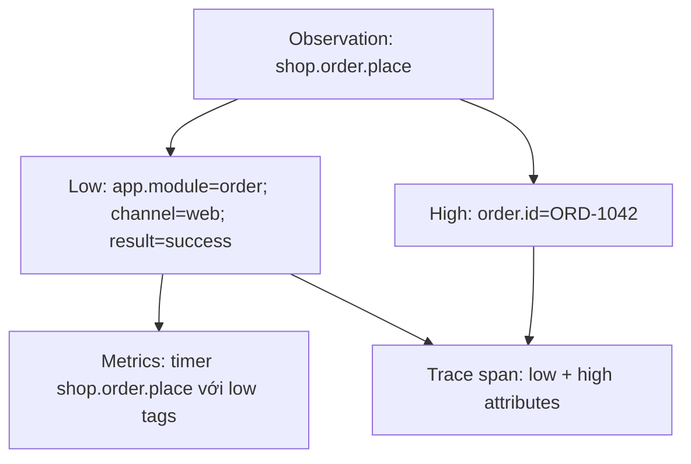
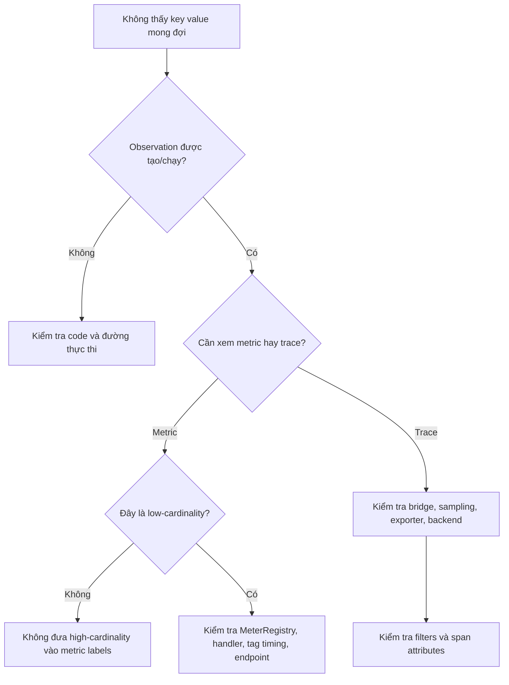

# Low-cardinality key value và high-cardinality key value

Trong Spring Boot sử dụng **Spring Modulith**, một yêu cầu nghiệp vụ có thể đi qua các application module như `order`, `inventory` và `payment`. Khi một yêu cầu đặt hàng chậm, người vận hành cần hai kiểu thông tin khác nhau:

- **Thông tin để tổng hợp:** trong 10 phút gần nhất, bao nhiêu thao tác `order.place` từ kênh `web` bị lỗi, và độ trễ p95 là bao nhiêu?
- **Thông tin để điều tra một lần chạy:** thao tác gắn với mã đơn hàng nào, span nào trong trace tương ứng mất nhiều thời gian, và bước thanh toán nào gặp lỗi?

Micrometer **Observation API** phân chia metadata theo hai nhóm: **low-cardinality key value** và **high-cardinality key value**. Lựa chọn đúng nhóm giúp bạn tạo metrics dễ tổng hợp và traces đủ chi tiết mà không làm bùng nổ số chuỗi thời gian.

Đây là bài thuộc chương **Observation API** của học phần `SPRING_MODULITH_DOCUMENTATION_OBSERVABILITY`. Học phần sử dụng Spring Modulith để sinh tài liệu ranh giới application module và quan sát tương tác giữa các phần trong một ứng dụng Spring Boot thông qua module graph, Actuator, event metrics, tracing và context propagation. Hai nhóm key value là nền tảng để thiết kế dữ liệu quan sát có ý nghĩa, tiết kiệm và an toàn.

Sau bài học, bạn có thể:

1. Giải thích `Observation`, `ObservationRegistry`, `ObservationHandler` và `KeyValue`.
2. Phân biệt low/high cardinality theo **số giá trị có thể xuất hiện**, không chỉ theo tên field.
3. Sử dụng `lowCardinalityKeyValue(...)` và `highCardinalityKeyValue(...)` trong code Java.
4. Dự đoán metadata nào có thể xuất hiện trong Micrometer metrics và spans.
5. Kiểm tra dữ liệu qua Spring Boot Actuator, Prometheus và tracing backend.
6. Áp dụng cách phân loại vào module/event metrics mà không đưa mã nghiệp vụ riêng lẻ vào nhãn metric.

## 1. Observation API và khái niệm key value

Trong Micrometer, **Observation** đại diện cho một hoạt động có bắt đầu và kết thúc, ví dụ xử lý `POST /orders`, gọi một API module hoặc thực hiện nghiệp vụ `order.place`. Một observation có **tên**, **ngữ cảnh**, **vòng đời** và **metadata**.

Một cặp **key value** gồm:

- **Key:** tên thuộc tính, ví dụ `app.module`, `order.channel` hoặc `order.id`.
- **Value:** giá trị thuộc tính trong một lần thực thi, ví dụ `order`, `mobile` hoặc một mã đơn hàng cụ thể.

Ví dụ:

```text
Observation name: shop.order.place

app.module    = order
order.channel = mobile
order.id      = ORD-2026-1042
```

Cả ba cặp đều có giá trị để chẩn đoán, nhưng mục đích sử dụng của chúng khác nhau: `app.module` và `order.channel` có tập giá trị nhỏ; `order.id` thường thay đổi theo từng đơn hàng.

Micrometer cung cấp hai phương thức tương ứng:

```java
observation.lowCardinalityKeyValue("app.module", "order");
observation.highCardinalityKeyValue("order.id", "ORD-2026-1042");
```

Đây là hai cách phân loại metadata trong Observation API. Chúng **không phải** hai kiểu biến Java khác nhau; về mặt logic, cả hai vẫn là các cặp chuỗi key/value.

### Các thành phần tham gia

| Thành phần | Vai trò |
| --- | --- |
| `Observation` | Đại diện một thao tác đang được ghi nhận; hỗ trợ start, scope, error, stop |
| `Observation.Context` | Mang thông tin của thao tác và các key value được gắn |
| `ObservationRegistry` | Nơi đăng ký cấu hình và handlers của observations |
| `ObservationHandler` | Phản ứng với vòng đời observation để tạo metrics, spans hoặc xử lý khác |
| `ObservationConvention` | Chuẩn hóa tên observation và cách trích xuất key values theo loại ngữ cảnh |
| `KeyValue` / `KeyValues` | Đại diện một hoặc nhiều cặp metadata |
| Micrometer Meter Registry | Ghi nhận meter (timer, counter...) với các nhãn được cho phép |
| Micrometer Tracing bridge | Chuyển observation thành span khi tracing được cấu hình |

Một `ObservationRegistry` có mặt trên classpath **chưa bảo đảm** backend đã nhận dữ liệu. Muốn xem metrics cần handler/registry phù hợp; muốn xem traces cần tracing bridge, exporter, sampling và collector/backend phù hợp.

## 2. Cardinality là gì?

**Cardinality** là số lượng giá trị phân biệt mà một thuộc tính có thể nhận được trong tập dữ liệu đang quan sát. Trong observability, người ta thường quan tâm đến **số tổ hợp label khác nhau** tạo nên các time series.

Ví dụ:

| Key | Một số giá trị | Cardinality dự kiến | Phân loại thường dùng |
| --- | --- | --- | --- |
| `app.module` | `order`, `inventory`, `payment` | Ít, do kiến trúc quyết định | Low |
| `order.channel` | `web`, `mobile`, `pos` | 3 | Low |
| `operation.result` | `success`, `failure` | 2 | Low |
| `http.method` | `GET`, `POST`, `PUT` | Nhỏ, có giới hạn | Low |
| `http.route` | `/orders/{id}`, `/payments/{id}` | Thường có giới hạn theo route template | Low |
| `order.id` | Mỗi đơn hàng một ID | Có thể tăng theo số đơn | High |
| `customer.id` | Mỗi khách hàng một ID | Có thể rất lớn | High; đồng thời nhạy cảm |
| `http.url` nguyên bản | `/orders/1001`, `/orders/1002`... | Có thể vô hạn | High |
| `exception.message` | Nội dung lỗi phát sinh tự do | Không kiểm soát | High; thường nên tránh ghi nguyên văn |

**Low cardinality** nghĩa là key value thuộc nhóm có số giá trị **ít và được giới hạn hợp lý**. **High cardinality** nghĩa là tập giá trị có thể rất lớn hoặc không có giới hạn thực tế.

Điều đáng chú ý: tên key giống nhau không bảo đảm cardinality giống nhau. `http.route=/orders/{id}` là một mẫu route ổn định, trong khi `http.url=/orders/20261042` thay đổi theo từng request. Tương tự, `error.type=payment_declined` thường hữu hạn nhưng `error.message=Payment declined for card ...` có thể có vô số biến thể và chứa dữ liệu cần bảo vệ.

## 3. Low-cardinality key value đi vào đâu?

Trong mô hình thông dụng của Spring Boot/Micrometer Observation:

- **Low-cardinality key values** được dùng làm **metric tags** và cũng có thể được gắn thành **span attributes/tags** khi tracing handler hoạt động.
- **High-cardinality key values** được dành cho **traces**, không được đưa vào meter tags bởi meter observation handler chuẩn.



Sơ đồ mô tả **luồng kỳ vọng khi handlers phù hợp được cấu hình**. Không phải mọi installation đều có exporter tracing; một span có thể không được lấy mẫu hoặc không được gửi thành công. Việc key value nằm trong observation cũng không tự ghi nó vào log.

### Ví dụ bộ metric từ một observation

Nếu tạo observation tên `shop.order.place` với:

```text
Low:
  app.module       = order
  order.channel    = mobile
  operation.result = success

High:
  order.id         = ORD-1042
```

Một meter/timer có thể lưu số lần, tổng thời gian và thời gian tối đa cho nhóm:

```text
name: shop.order.place
tags:
  app.module       = order
  order.channel    = mobile
  operation.result = success
measurements:
  COUNT
  TOTAL_TIME
  MAX
```

`order.id` **không được dùng để tạo một metric series riêng cho đơn hàng ORD-1042** khi sử dụng meter observation handler chuẩn. Mỗi đơn hàng có thể có một ID mới; nếu đưa ID vào tags, hệ thống metrics có nguy cơ không thể tổng hợp hiệu quả.

Trong backend tracing, span tương ứng có thể chứa thêm `order.id=ORD-1042` để điều tra một lần chạy. Quyết định gửi mã đơn hàng vào backend tracing vẫn phải tuân thủ chính sách dữ liệu và quyền truy cập.

## 4. Vì sao high cardinality nguy hiểm đối với metrics?

Một time series thường được phân biệt bằng **tên metric + bộ nhãn + nguồn thu thập**. Mỗi tổ hợp giá trị nhãn khác nhau có thể tạo ra một chuỗi thời gian khác nhau.

Giả sử timer `shop.order.place` có ba nhãn low-cardinality:

| Nhãn | Số giá trị minh họa |
| --- | ---: |
| `app.module` | 4 |
| `order.channel` | 3 |
| `operation.result` | 2 |

Nếu mọi tổ hợp đều xuất hiện, riêng ba chiều này có thể tạo tối đa:

\[
4 \times 3 \times 2 = 24 \text{ tổ hợp nhãn.}
\]

Giả sử hệ thống triển khai trên 5 instance và backend còn phân biệt `instance`, số chuỗi có thể lên đến khoảng `24 × 5 = 120` cho một tên metric, trước khi tính các nhãn khác. Những con số này chỉ nhằm minh họa nguyên tắc nhân tổ hợp.

Nếu thêm `order.id` với 100.000 giá trị khác nhau vào **metric tags**, số chuỗi có thể tăng thêm hàng chục hoặc hàng trăm nghìn, tùy tổ hợp thực tế. Khi ấy:

- Registry phải lưu nhiều meter/series và tốn thêm bộ nhớ.
- Prometheus hoặc metrics backend phải nhận, index và lưu nhiều chuỗi thời gian hơn.
- Truy vấn và dashboard khó tổng hợp, có thể chậm hoặc tốn kém.
- Alert có thể thiếu ổn định nếu biểu thức không xử lý đầy đủ nhãn phát sinh.

**Kết luận về thiết kế tag:** nhãn metric nên diễn tả **nhóm nghiệp vụ ổn định**, còn thuộc tính nhận diện **một thực thể cụ thể** thường không phù hợp để làm metric tag.

### High cardinality trong traces có miễn phí không?

Không. Traces cũng có chi phí lưu trữ, truyền tải, index và tìm kiếm; giá trị high-cardinality còn có thể chứa thông tin cá nhân hoặc bí mật. Việc Observation API cho phép high-cardinality không có nghĩa mọi dữ liệu đều nên đưa vào span.

Ví dụ `order.id` giả lập có thể hữu ích để tìm trace, nhưng trong hệ thống thật cần kiểm tra:

1. ID có được phép gửi tới tracing backend không?
2. Backend/collector có retention và quyền truy cập phù hợp không?
3. Có thể thay bằng mã correlation không mang dữ liệu nhạy cảm không?
4. Việc tìm theo ID có thực sự cần thiết, hay tra cứu qua log/transaction database đã đủ?

Tuyệt đối tránh đưa password, token, số thẻ thanh toán, email chưa xử lý hoặc nội dung request nhạy cảm vào trace chỉ vì thuộc nhóm high-cardinality.

## 5. Ví dụ Java: gắn hai loại key value khi đặt hàng

Giả sử module `order` xử lý lệnh `PlaceOrder` có `orderId` và `channel`. Module này gọi các API công khai của `inventory` và `payment`.

```java
package com.example.shop.order;

import io.micrometer.observation.Observation;
import io.micrometer.observation.ObservationRegistry;
import java.util.Locale;
import org.springframework.stereotype.Service;

@Service
class OrderPlacementService {

    private final ObservationRegistry observationRegistry;
    private final InventoryPort inventory;
    private final PaymentPort payment;

    OrderPlacementService(
            ObservationRegistry observationRegistry,
            InventoryPort inventory,
            PaymentPort payment) {
        this.observationRegistry = observationRegistry;
        this.inventory = inventory;
        this.payment = payment;
    }

    void place(PlaceOrder command) {
        Observation.createNotStarted("shop.order.place", observationRegistry)
                .contextualName("place order")
                .lowCardinalityKeyValue("app.module", "order")
                .lowCardinalityKeyValue(
                        "order.channel",
                        command.channel().name().toLowerCase(Locale.ROOT))
                .highCardinalityKeyValue(
                        "order.id",
                        command.orderId().toString())
                .observe(() -> {
                    inventory.reserve(command.orderId());
                    payment.capture(command.orderId());
                });
    }
}
```

**Giả định của đoạn code:** `PlaceOrder`, `InventoryPort` và `PaymentPort` là các kiểu nghiệp vụ do ứng dụng tự định nghĩa; ví dụ không thể biên dịch độc lập nếu chưa có chúng. Các API observation được minh họa theo Micrometer Observation tích hợp với Spring Boot. Trong hệ thống có Spring Modulith observability tự động, hãy xem những module calls đã có span trước khi thêm observation thủ công, để tránh tạo dữ liệu trùng lặp.

Giải thích theo thứ tự:

1. `Observation.createNotStarted(...)` tạo một observation chưa bắt đầu.
2. `contextualName(...)` cung cấp tên dễ đọc khi hiển thị tracing; tên metric vẫn dựa trên observation name và convention áp dụng.
3. `lowCardinalityKeyValue("app.module", "order")` tạo nhãn nhóm module có số lượng giá trị hạn chế.
4. `lowCardinalityKeyValue("order.channel", ...)` biến enum thành một tập giá trị cố định như `web`, `mobile`, `pos`.
5. `highCardinalityKeyValue("order.id", ...)` thêm metadata chi tiết của lượt xử lý, **không dùng làm nhãn metric**.
6. `observe(...)` bắt đầu observation, mở scope, chạy nghiệp vụ, ghi nhận exception thích hợp, đóng scope và kết thúc observation.

Nếu `inventory.reserve(...)` hoặc `payment.capture(...)` tạo các observation/span con trong cùng tracing context, chúng có thể nằm dưới span `shop.order.place`. Đây là **quan hệ runtime**; API không tự tạo hay kiểm chứng dependency trên module graph.

### Vì sao chọn `order.channel` làm low, còn `order.id` làm high?

| Thuộc tính | Ví dụ | Số giá trị dự kiến | Lựa chọn |
| --- | --- | --- | --- |
| `app.module` | `order` | Số module có giới hạn | Low |
| `order.channel` | `mobile` | Enum có 3 giá trị | Low |
| `order.id` | `ORD-2026-1042` | Tăng theo số đơn hàng | High nếu chính sách cho phép |
| `customer.email` | `example@example.com` | Rất lớn và nhạy cảm | **Không đưa vào telemetry mặc định** |

Khi không cần tra cứu span theo `order.id` hoặc chính sách dữ liệu không cho phép, **bỏ hẳn high-cardinality attribute**. Không có yêu cầu phải gắn cả hai loại key value vào mọi observation.

## 6. Thêm trạng thái thành công/thất bại đúng thời điểm

Thao tác đặt hàng có thể thành công hoặc thất bại. Trạng thái thường phù hợp với low cardinality vì chỉ có vài giá trị như `success`, `failure`.

Nếu cần gắn kết quả **sau khi xử lý**, có thể quản lý vòng đời observation bằng `start()`, `openScope()` và `stop()`:

```java
Observation observation = Observation
        .createNotStarted("shop.order.place", observationRegistry)
        .lowCardinalityKeyValue("app.module", "order")
        .highCardinalityKeyValue("order.id", command.orderId().toString())
        .start();

try (Observation.Scope scope = observation.openScope()) {
    inventory.reserve(command.orderId());
    payment.capture(command.orderId());
    observation.lowCardinalityKeyValue("operation.result", "success");
} catch (RuntimeException ex) {
    observation.lowCardinalityKeyValue("operation.result", "failure");
    observation.error(ex);
    throw ex;
} finally {
    observation.stop();
}
```

Đoạn trên là **mã bên trong một phương thức đã có** các biến `observationRegistry`, `command`, `inventory` và `payment`; không phải class hoàn chỉnh. Việc gọi `observation.error(ex)` ghi nhận lỗi cho các handlers hỗ trợ, còn `throw ex` giữ nguyên hành vi lỗi của nghiệp vụ.

**Chú ý về thời điểm gắn tag:** với nhiều loại meter thông thường, low-cardinality keys có thể được thu thập khi observation kết thúc; nhưng một số handlers/meter, như long task timer, dùng nhãn **đã có tại thời điểm bắt đầu**. Vì thế khi có thể, nên xác định key values có tính nhóm như module/kênh **trước khi `start()`**. Những giá trị chỉ biết sau khi kết thúc có thể cần convention hoặc chiến lược observation riêng, tùy cách instrument.

Nếu hệ thống cần phân loại lỗi chi tiết, sử dụng mã lỗi hữu hạn như `payment_declined`, `stock_unavailable` hoặc `unexpected`. Không lấy `ex.getMessage()` làm low-cardinality tag: thông báo exception có thể chứa vô số chuỗi hoặc dữ liệu nhạy cảm.

## 7. Phân biệt với Spring Modulith module observations

Spring Modulith có khả năng quan sát tương tác giữa các application module. Khi gọi từ API công khai của module này sang module khác, instrumentation có thể tạo observation/span cho **ranh giới module**.

Một trace minh họa:

```text
Trace T1
└── HTTP POST /orders
    └── shop.order.place             [app.module=order]
        ├── inventory.reserve        [module=inventory]
        └── payment.capture          [module=payment]
```

Các tên span và thuộc tính trong ngoặc là **dữ liệu minh họa**: tên key thực tế của Spring Modulith và của code tự instrument có thể khác nhau theo phiên bản/config. Không phải mọi Java method đều tự được quan sát. Bởi vậy:

- **Module graph** xác định module nào tồn tại và những phụ thuộc cấu trúc nào được phát hiện.
- **Observation/trace** cho biết những công việc đã được instrument của một lượt xử lý.
- **Low-cardinality key value** giúp nhóm theo module, loại thao tác, kết quả hoặc kênh.
- **High-cardinality key value** có thể giúp điều tra lượt xử lý cụ thể nếu backend lưu dữ liệu đó.
- **Context propagation** quyết định liệu span ở thread/message khác có giữ được ngữ cảnh liên quan đến trace gốc hay không.

Khi xử lý sự kiện bằng `@ApplicationModuleListener` hoặc executor bất đồng bộ, một sự kiện có thể đi vào trace khác hoặc không có span nếu context không được truyền. Việc thêm `order.id` vào observation ở module phát **không tự truyền nó sang listener**, không tự mở rộng scope và không biến thuộc tính này thành trace ID. Nếu cần correlation bền vững, dùng event ID hoặc mã nghiệp vụ trong payload/log theo quy định dữ liệu và thiết kế propagation phù hợp.

### Observation API và event metrics customizer có giống nhau?

Không. Hai cơ chế có liên hệ về ý tưởng cardinality, nhưng khác nơi tác động:

| Cơ chế | Đối tượng đang chỉnh | Kết quả |
| --- | --- | --- |
| `Observation.lowCardinalityKeyValue(...)` | Observation của một thao tác | Metadata low-cardinality cho metrics và có thể cho spans |
| `Observation.highCardinalityKeyValue(...)` | Observation của một thao tác | Metadata high-cardinality dành cho tracing |
| `ModulithEventMetricsCustomizer` | Micrometer `Counter.Builder` cho event metric riêng của Modulith | Tùy chỉnh **metric tags** của counter event |
| Spring Modulith module instrumentation | Lời gọi qua ranh giới application module | Observations/spans tự động theo khả năng hỗ trợ |

Khi dùng `ModulithEventMetricsCustomizer`, bạn nên bổ sung **chỉ những tag ít giá trị** vào counter. Không nhầm API này với việc thêm high-cardinality attributes cho span của từng lượt phát event.

## 8. Quan sát dữ liệu qua Actuator và tracing backend

Giả sử ứng dụng Spring Boot đã có Actuator và meter registry/tracing bridge phù hợp. Với local, có thể expose các endpoint cần học tập:

```yaml
management:
  endpoints:
    web:
      exposure:
        include: "health,metrics,prometheus"
  tracing:
    sampling:
      probability: 1.0
```

`management.tracing.sampling.probability=1.0` phù hợp với **local có lưu lượng thấp** để tìm trace dễ hơn; production phải cân nhắc sampling, chi phí và chính sách dữ liệu. Việc cấu hình sampling **không tự cài exporter/collector**.

Tạo một đơn hàng thử, rồi kiểm tra Actuator:

```bash
curl -s http://localhost:8080/actuator/metrics
curl -s http://localhost:8080/actuator/metrics/shop.order.place
```

Nếu observation đã được meter handler ghi nhận, một response **minh họa** có thể chứa:

```json
{
  "name": "shop.order.place",
  "measurements": [
    { "statistic": "COUNT", "value": 1.0 },
    { "statistic": "TOTAL_TIME", "value": 0.15 },
    { "statistic": "MAX", "value": 0.15 }
  ],
  "availableTags": [
    { "tag": "app.module", "values": ["order"] },
    { "tag": "order.channel", "values": ["mobile"] }
  ]
}
```

Chỉ xem response này như **mẫu để đọc**, không phải dữ liệu đã chạy. Số đo, unit, những tag bổ sung và tên meter thay đổi theo registry/handler và configuration. Tên `order.id` sẽ **không xuất hiện trong `availableTags`** của meter handler chuẩn chỉ vì đã được gắn high-cardinality vào observation.

### Xem trong Prometheus

Khi có Prometheus registry và endpoint `/actuator/prometheus`, tên `shop.order.place` thường được chuyển thành tên tuân thủ Prometheus naming convention. Một timer có thể xuất ra những series như:

```text
shop_order_place_seconds_count
shop_order_place_seconds_sum
shop_order_place_seconds_max
```

Tên cụ thể có thể khác theo Micrometer, naming convention và cấu hình percentile/histogram. Hãy kiểm tra output **thực tế** trước khi xây dựng PromQL.

Ví dụ, nếu series count có tên `shop_order_place_seconds_count` và label `order_channel`:

```promql
sum by (order_channel) (
  rate(shop_order_place_seconds_count[5m])
)
```

Truy vấn trên biểu diễn tốc độ hoàn thành observation theo kênh trong một khoảng thời gian. Để đo p95, cần cấu hình histogram/SLO buckets phù hợp và dùng metric bucket thực tế; **không thể suy ra p95 chính xác chỉ từ `COUNT` và `TOTAL_TIME`**.

### Xem trong tracing backend

Khi có Micrometer Tracing bridge + exporter + collector/backend phù hợp, hãy tìm trace của `shop.order.place`:

- Low-cardinality attributes có thể gồm `app.module=order` và `order.channel=mobile`.
- High-cardinality attribute có thể gồm `order.id=ORD-2026-1042` nếu được gắn, không bị filter và span đã được sample/export.
- `traceId`/`spanId` xác định quan hệ thực thi; chúng **khác** `order.id`.
- Nếu attribute không xuất hiện, kiểm tra sampling, tracing handler, exporter và filter, thay vì mặc định API không hoạt động.

**Dùng ít nhất hai góc nhìn** trong bài thực hành: Actuator/metrics để xác minh low-cardinality, và tracing backend để xác minh high-cardinality.

## 9. Common tags, conventions và quản trị tên thuộc tính

Spring Boot có thể cấu hình một số low-cardinality key values chung qua property:

```yaml
management:
  observations:
    key-values:
      application: shop-modulith
      environment: staging
```

Những thuộc tính ổn định này thường hữu ích để phân biệt telemetry theo dịch vụ và môi trường. Tuy nhiên `environment` chỉ là một giá trị nhãn tự khai báo; nó không thay thế cấu hình deployment hoặc chứng minh trace đang đi đúng collector.

Với nhiều observation cùng loại, nên cân nhắc sử dụng `ObservationConvention` để tập trung quy tắc đặt tên và cung cấp `KeyValues` từ một `Observation.Context` thay vì để mỗi lớp tự gắn key theo cách khác nhau. Ví dụ nhóm thống nhất một bảng quy ước:

| Key thống nhất | Ý nghĩa | Nguồn | Cardinality |
| --- | --- | --- | --- |
| `app.module` | Identifier ứng dụng | Metadata module | Low |
| `operation.result` | Kết quả nghiệp vụ | Mã trạng thái hữu hạn | Low |
| `order.channel` | Kênh đặt hàng | Enum đã chuẩn hóa | Low |
| `order.id` | ID của đơn hàng | Lệnh nghiệp vụ | High nếu được phép |
| `event.id` | ID một event publication cụ thể | Metadata sự kiện | High nếu được phép |

Nên có **danh sách key được phê duyệt**, kiểu dữ liệu/khoảng giá trị dự kiến, nơi phát sinh, chính sách retention và người sở hữu. Khi đổi `order.channel=mobile` thành `order.channel=app`, dashboard sẽ thấy những chuỗi thời gian khác nhau; thay đổi nhãn cần được review cùng alert và tài liệu vận hành.

### Phân biệt key với value

Một key **có tên cố định** vẫn có thể high-cardinality nếu value có rất nhiều biến thể. Chẳng hạn key `order.id` luôn giống nhau nhưng value thay đổi theo đơn hàng. Ngược lại key `app.module` có thể chỉ nhận vài giá trị trong một ứng dụng dù người dùng tạo hàng triệu request.

Do đó, tiêu chí low/high **nằm chủ yếu ở số lượng giá trị phân biệt của cặp key/value**, không phải độ dài của key, kiểu String hay việc field có nằm trong domain event hay không.

## 10. Các lỗi phổ biến và cách đọc đúng

| Hiện tượng / ngộ nhận | Cách hiểu và kiểm tra |
| --- | --- |
| “Đưa `order.id` vào low tags để tìm từng đơn hàng.” | Sẽ có thể tạo quá nhiều time series; dùng high attribute có kiểm soát hoặc log/correlation store. |
| “High-cardinality sẽ có trong Prometheus vì đã gắn vào observation.” | Meter observation handler chuẩn không dùng high-cardinality làm meter tags. |
| “Low-cardinality chỉ dành cho metrics.” | Trong Spring Boot/Micrometer tracing, low key values có thể được đưa vào cả metrics **và** traces. |
| “Một key luôn low/high bất kể dữ liệu.” | Phải xem tập giá trị thực tế và khả năng phát triển của chúng. |
| “Cùng trace ID là cùng module.” | Một trace có thể có spans từ nhiều module; trace là runtime execution, module là ranh giới kiến trúc. |
| “Bật `sampling=1.0` là có trace trên giao diện.” | Còn cần tracing handler/bridge, exporter, collector, backend và kết nối đúng. |
| “Không thấy tag trong meter nghĩa là observation không chạy.” | Kiểm tra meter handler, filter, thời điểm gắn key và đúng tên meter. |
| “Thêm high-cardinality tự liên kết listener async vào request gốc.” | Cần context propagation hoặc correlation riêng khi qua executor/broker. |
| “Exception message là tag trạng thái hợp lý.” | Message có thể có giá trị không giới hạn và thông tin nhạy cảm; nên dùng mã lỗi hữu hạn. |
| “Metric có low tag là đã an toàn tuyệt đối.” | Low cardinality không tự loại bỏ dữ liệu nhạy cảm; vẫn cần rà soát nội dung và quyền truy cập. |

### Quy trình tìm lỗi khi tag không xuất hiện



Khi chạy qua nhiều instance, Actuator ở một tiến trình chỉ hiển thị metrics của tiến trình đó. Nếu muốn tổng hợp toàn hệ thống, cần Prometheus hoặc metrics backend thu thập và nhóm đúng nhãn như `service`, `instance`, `environment`.

## 11. Bài thực hành: thiết kế metadata cho một luồng đặt hàng

**Bối cảnh:** ứng dụng Spring Modulith có các module `order`, `inventory`, `payment`. Lệnh đặt hàng mang `orderId`, `channel` và `customerEmail`; kết quả là `success` hoặc `failure`.

Thực hiện các bước:

1. **Lập bảng phân loại:** ghi rõ nhóm low/high/không thu thập cho `app.module`, `order.channel`, `operation.result`, `order.id` và `customerEmail`. Giải thích giới hạn cardinality, tính nhạy cảm và nhu cầu vận hành.
2. **Tạo observation:** viết code dùng `Observation.createNotStarted("shop.order.place", registry)`, gắn low keys cho module/kênh, high key cho ID giả lập nếu được phép. Đóng scope và stop đúng cách hoặc dùng `observe(...)`.
3. **Thử hai kênh:** phát ba yêu cầu `web` và hai yêu cầu `mobile`. Kiểm tra trong `/actuator/metrics/shop.order.place` các tags hiện có và cách bộ đếm/timer phân nhóm.
4. **Kiểm tra trace:** mở một span `shop.order.place` đã được lấy mẫu; xác định nhãn low, high, `traceId` và các span con tương ứng với module khác nếu có.
5. **Thử lỗi:** cho `payment.capture` ném exception. Xác nhận exception không bị nuốt và tag `operation.result` có giá trị hữu hạn thay vì nội dung message.
6. **Đo cardinality:** giả lập 10.000 order ID. Giải thích vì sao vẫn chỉ có vài nhóm metric nếu ID nằm ở high attributes, nhưng trace backend vẫn chịu chi phí khi xuất nhiều span.
7. **Thử bất đồng bộ:** phát `OrderPlaced` cho một listener. Kiểm tra propagation qua executor và mô tả vì sao `order.id` trên span ban đầu không tự chuyển thành tag trên span listener.
8. **Đối chiếu module graph:** xác minh module `order` có quan hệ hợp lệ với `inventory`/`payment` trong cấu trúc; dùng trace để kiểm tra luồng cụ thể, metrics để đánh giá nhiều lần chạy.
9. **Review dữ liệu:** xác định nơi lưu, retention và quyền xem attributes; bỏ email/token/định danh nhạy cảm khỏi telemetry nếu không được phép.

**Kết quả mong đợi:** người học phân biệt được data để **tổng hợp theo nhóm** với data để **điều tra một lần thực thi**; code không phát sinh metric tags cardinality cao; và kiểm chứng được low/high key values bằng các tín hiệu runtime phù hợp.

## 12. Nguyên tắc áp dụng ở production

Đối với từng observation nghiệp vụ, hãy đặt câu hỏi: **chúng ta cần thống kê theo chiều nào, và cần biết chi tiết đến đâu khi điều tra?**

- Đưa vào **low-cardinality keys** các chiều nhóm hữu hạn, ổn định và cần thiết cho dashboard/alerts, chẳng hạn module, operation, channel, outcome.
- Đưa vào **high-cardinality keys** một lượng nhỏ thông tin chi tiết có mục đích rõ và được phép theo chính sách bảo mật, chẳng hạn ID correlation giả lập.
- **Không đưa bí mật và dữ liệu cá nhân không cần thiết vào cả hai nhóm**.
- Tránh tag động như UUID, path thô, exception message và dữ liệu nhập tự do trên metrics.
- Xác nhận instrumentation và exporters thực tế hoạt động; kiểm tra sampling, pipeline, cardinality/chi phí và retention theo môi trường.
- Giữ thống nhất key names giữa các module, tài liệu module graph, dashboard và alert; kiểm tra tác động khi thay đổi convention.

Một observation được thiết kế tốt cho phép **metrics trả lời tình hình chung**, còn **trace cho biết chi tiết một lần chạy**. Khi kết hợp với module graph và các công cụ Spring Modulith, hai loại key value giúp nhóm phát triển hiểu không chỉ hệ thống đang hoạt động ra sao mà còn hành vi đó tương ứng với ranh giới module nào.

## Tài liệu tham khảo

- [Spring Boot — Observability](https://docs.spring.io/spring-boot/reference/actuator/observability.html): ví dụ chính thức về `lowCardinalityKeyValue(...)` và `highCardinalityKeyValue(...)`, cùng cách hai nhóm xuất vào metrics/traces.
- [Micrometer — Observation Introduction](https://docs.micrometer.io/micrometer/reference/observation/introduction.html): Observation API, vòng đời observation và khái niệm cardinality.
- [Micrometer — Observation Components](https://docs.micrometer.io/micrometer/reference/observation/components.html): handlers, meter tags, conventions và thời điểm metadata được sử dụng.
- [Micrometer Tracing — Configuring with Observation](https://docs.micrometer.io/tracing/reference/configuring.html): minh họa cùng một observation tạo metrics và spans với các tags khác nhau.
- [Spring Framework — Observability Support](https://docs.spring.io/spring-framework/reference/integration/observability.html): `ObservationContext`, `ObservationHandler` và `ObservationConvention`.
- [Spring Modulith — Production-ready Features](https://docs.spring.io/spring-modulith/reference/production-ready.html): module instrumentation và dữ liệu quan sát runtime.
- [Spring Boot — Actuator Metrics](https://docs.spring.io/spring-boot/reference/actuator/metrics.html): tra cứu meter qua Actuator, registry và Prometheus.

**Lưu ý:** các ví dụ Java, YAML, tên span và output metric trong bài là mẫu để học và cần điều chỉnh theo BOM, cấu hình observability và chính sách quản lý dữ liệu của ứng dụng thực tế.
