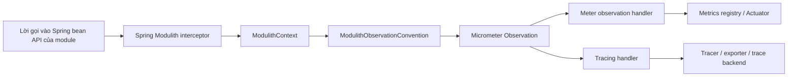
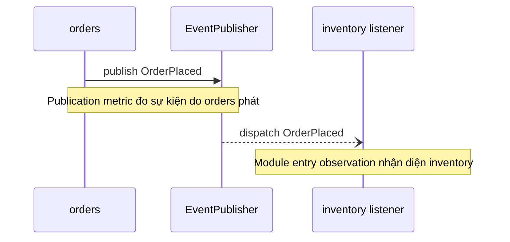

# ModulithObservationConvention là gì

## 1. Vì sao cần quy ước quan sát cho application module?

Một ứng dụng Spring Boot dùng **Spring Modulith** có thể gồm các application module như `orders`, `payments`, `inventory` và `notifications`. Khi người dùng đặt hàng, request đi vào module `orders`, gọi API của `payments`, rồi phát sự kiện để `inventory` tiếp nhận. Để kiểm chứng kiến trúc mô-đun khi ứng dụng vận hành, nhóm phát triển cần biết **lời gọi đi qua ranh giới module nào**, thời gian thực thi bao lâu và thông tin nào được gắn vào metrics/traces.

Spring Modulith tích hợp **Micrometer Observation** để ghi nhận các điểm vào application module. Mỗi observation có thể mang tên, tên hiển thị trong tracing và các cặp key-value mô tả module. Khi muốn tiêu chuẩn hóa cách đặt tên hoặc bổ sung thuộc tính có kiểm soát, ta sử dụng **`ModulithObservationConvention`**.

Đây là chủ đề mở đầu chương **Observation convention** của module học **SPRING_MODULITH_DOCUMENTATION_OBSERVABILITY**: dùng Spring Modulith để sinh tài liệu ranh giới module, xem module graph qua Actuator, theo dõi event metrics, tracing và context propagation nhằm đối chiếu kiến trúc với tương tác thực tế.

Sau bài học, bạn có thể:

- Giải thích `ModulithObservationConvention` là gì, quan hệ của nó với `ModulithContext` và Micrometer `ObservationConvention`.
- Phân biệt observation **name**, **contextual name**, low-cardinality và high-cardinality key-values.
- Hiểu cách Spring Modulith mặc định tạo metadata cho **module entry observation**.
- Đăng ký một custom convention dưới dạng Spring bean, giữ các tag mặc định và bổ sung tag có tập giá trị giới hạn.
- Nhận diện khác biệt giữa custom convention của module entry và `ModulithEventMetricsCustomizer` của domain event.
- Kiểm tra hiệu quả bằng trace, Actuator metrics và đối chiếu với module graph, kể cả khi có xử lý bất đồng bộ.

## 2. Khái niệm và vị trí trong Micrometer

Trong Spring Modulith 2.x, **`ModulithObservationConvention` là một interface** ở package:

```text
org.springframework.modulith.observability.ModulithObservationConvention
```

Interface này mở rộng:

```java
ObservationConvention<ModulithContext>
```

trong Micrometer. Nói cách khác, đây là **hợp đồng đặt quy ước cho observation tại ranh giới module**, được chuyên biệt hóa bằng một `ModulithContext` chứa ngữ cảnh của lời gọi module.

Thay vì tự viết code instrumentation ở mỗi service, Spring Modulith có thể intercept những **Spring component thuộc API của application module**. Từ đó framework tạo observation. Convention quyết định cách observation được **đặt tên** và **gắn metadata**, còn các Micrometer observation handlers và tracer/exporter quyết định cách dữ liệu được đo hoặc chuyển đi.



Sơ đồ mô tả **vai trò**, không biểu diễn thứ tự nội bộ của mọi callback. `ModulithObservationConvention` không tự tạo module graph, không tạo HTTP endpoint, và không tự cấu hình exporter. Nó là điểm tùy biến **metadata của observation** mà instrumentation của Modulith đã tạo.

### 2.1. Phân biệt các khái niệm thường bị nhầm

| Khái niệm | Công việc chính | Ví dụ |
| --- | --- | --- |
| `Observation` | Đại diện một công việc được quan sát, có vòng đời bắt đầu/kết thúc và có thể ghi nhận lỗi. | Lời gọi vào `inventory.reserve(...)` |
| `ModulithContext` | Mang ngữ cảnh lời gọi: module được quan sát, method invocation, thuộc tính liên quan. | Module `inventory`, invocation qua bean |
| `ModulithObservationConvention` | Quy định tên và key-values của observation từ ngữ cảnh đó. | Tên contextual, `module.identifier`, tag phân nhóm |
| `ObservationHandler` | Chuyển vòng đời observation thành tín hiệu, ví dụ timer hoặc span. | Meter handler, tracing handler |
| `MeterRegistry` | Đăng ký và lưu meter trong phạm vi ứng dụng trước khi export. | Counter, timer, tags |
| Tracer/exporter | Tạo và xuất span/trace tới hệ thống giám sát. | OpenTelemetry/OTLP |

Nhờ tách các trách nhiệm, có thể thay cách đặt tên span hoặc nhóm các module theo chức năng mà không phải chép logic tracing vào từng application service.

## 3. Những phương thức của ModulithObservationConvention

Javadoc Spring Modulith 2.2 cho thấy interface có các phương thức **mặc định** sau:

| Phương thức | Giá trị điều khiển | Ý nghĩa thực tế |
| --- | --- | --- |
| `getName()` | Tên observation ở mức kỹ thuật, thường ổn định. | Dùng cho tên meter/observation, ví dụ mặc định `module.invocations`. |
| `getContextualName(ModulithContext)` | Tên mô tả thao tác trong ngữ cảnh. | Giúp người xem trace nhận diện đoạn đang chạy. |
| `getLowCardinalityKeyValues(ModulithContext)` | Các cặp tag có số giá trị giới hạn. | Có thể tham gia metrics và traces. |
| `getHighCardinalityKeyValues(ModulithContext)` | Các cặp thuộc tính nhiều giá trị hơn. | Hữu ích cho traces, tránh đưa vào metric labels. |
| `supportsContext(Observation.Context)` | Xác định context tương thích. | Chỉ áp dụng convention cho `ModulithContext` phù hợp. |

**Observation name** và **contextual name** khác nhau:

- **`getName()`** là tên ổn định dùng để phân loại những observation cùng loại. Giá trị mặc định `ModulithContext.DEFAULT_CONVENTION_NAME` là `module.invocations` trong dòng API được tham khảo. Nếu thay đổi nó, dashboard hoặc quy tắc giám sát theo tên meter có thể cần đổi theo.
- **`getContextualName(context)`** là nhãn dễ đọc cho một hành động cụ thể trong trace. Có thể diễn đạt theo module/operation; không nên gắn dữ liệu bí mật hay ID riêng của từng request vào tên.
- **Key-values** là metadata phân tích được theo trường, thay vì chỉ là một chuỗi tên hiển thị. Khi cần lọc các span của module `inventory`, hãy dùng `module.identifier`; không cần phân tích chuỗi contextual name.

### 3.1. Low-cardinality và high-cardinality

Micrometer Observation phân biệt hai nhóm key-values:

| Nhóm | Dữ liệu phù hợp | Được dùng ở đâu? | Điều cần tránh |
| --- | --- | --- | --- |
| **Low cardinality** | `module.identifier=orders`, `module.invocation-type=bean`, `module.group=commerce` | Metrics và tracing tùy handler | Không đặt ID tùy ý của user/request làm tag. |
| **High cardinality** | Method/operation có nhiều giá trị hơn, metadata chẩn đoán được phép. | Thường ở trace attributes | Không mặc định an toàn cho PII; vẫn phải kiểm soát quyền truy cập. |

**Cardinality** là số tổ hợp giá trị mà một metric có thể mang. Ví dụ có 5 module, 2 kiểu invocation và 3 nhóm nghiệp vụ, giới hạn trên lý thuyết là `5 × 2 × 3 = 30` tổ hợp trước các tag khác. Nhưng nếu thêm `requestId` có 100.000 giá trị, con số này có thể tăng cực lớn.

Micrometer meter handlers dùng **low-cardinality key-values** làm metric tags. High-cardinality key-values thường phù hợp để bổ sung ngữ cảnh tracing nhưng vẫn gây chi phí lưu trữ và nguy cơ lộ thông tin nếu không kiểm soát. **Đừng sử dụng `userId`, `requestId`, `traceId` hoặc `orderId` như một low-cardinality metric tag.**

## 4. Dữ liệu mặc định từ ModulithContext

Spring Modulith có implementation mặc định `DefaultModulithObservationConvention`. Theo tài liệu chính thức, implementation này **ủy quyền các phương thức cho `ModulithContext`**. Nhờ đó các quy ước sẵn có lấy metadata trực tiếp từ mô hình module và lời gọi thực tế.

`ModulithContext` cung cấp những phương thức đáng chú ý:

| API | Mô tả |
| --- | --- |
| `getModule()` | Module mà lời gọi được quan sát; đối tượng `ObservedModule`. |
| `getInvocation()` | Method invocation tại điểm vào module. |
| `getApplicationName()` | Tên ứng dụng nếu cấu hình có thể cung cấp. |
| `getContextualName()` | Tên hiển thị theo ngữ cảnh mặc định. |
| `getLowCardinalityValues()` | Các cặp key-value có tập giá trị giới hạn. |
| `getHighCardinalityValues()` | Các thuộc tính có độ đa dạng cao hơn. |

Trong **module entry span**, tài liệu Spring Modulith liệt kê:

| Tag | Mục đích | Phân nhóm trong API docs |
| --- | --- | --- |
| `module.identifier` | Định danh logic module đang được gọi. | Low |
| `module.name` | Tên hiển thị module. | Low |
| `module.invocation-type` | Kiểu gọi, chẳng hạn bean hoặc event listener. | Low |
| `module.method` | Method được thực thi tại điểm vào module. | High |

Ví dụ minh họa:

```text
Observation:
  name = "module.invocations"
  contextualName = "inventory"       # Minh họa, tên thực tế do convention quyết định
  low:
    module.identifier = inventory
    module.name = Inventory
    module.invocation-type = bean
  high:
    module.method = reserve(...)
```

Đây **không phải bản dump từ ứng dụng thực**. Tên contextual, định dạng method và cấu trúc span hiển thị có thể khác giữa các phiên bản và tracing backend. Ý chính là các tag cho biết **module đang được quan sát**, còn `traceId`/`spanId` liên kết những thao tác trong một hành trình.

### 4.1. Vì sao nên giữ mặc định?

Các key `module.identifier`, `module.name` và `module.invocation-type` được Modulith chuẩn hóa, giúp dashboard và trace dễ đối chiếu với module graph. Nếu custom convention trả về một tập key-values hoàn toàn mới và quên giữ các key mặc định, người vận hành có thể mất thông tin module cần dùng để lọc.

Khi chỉ muốn thêm một nhóm module, nên **lấy key-values mặc định rồi nối thêm một key-value mới**. Khi chỉ muốn đổi tên contextual, chỉ override `getContextualName(...)` và để các default methods còn lại hoạt động.

## 5. Cài dependency để dùng custom convention

Với **Spring Modulith 2.x**, mã ứng dụng tham chiếu interface `ModulithObservationConvention` ở compile time, còn hạ tầng instrument có thể được kéo vào ở runtime. Ví dụ Gradle Groovy DSL:

```groovy
dependencies {
    implementation 'org.springframework.boot:spring-boot-starter-actuator'

    // API dùng trong mã Java của custom convention.
    implementation 'org.springframework.modulith:spring-modulith-observability-api'

    // Phần thực thi instrument application module khi chạy.
    runtimeOnly 'org.springframework.modulith:spring-modulith-observability-core'

    // Thêm tracer/exporter tùy phiên bản Spring Boot và backend muốn dùng.
}
```

Ví dụ giả định dự án đã cấu hình Spring Boot và **Spring Modulith BOM tương thích**. Nếu đã dùng `spring-modulith-starter-insight` thì starter này kéo theo core và Actuator; khi source code tham chiếu API, vẫn cần bảo đảm artifact API có mặt ở compile classpath. Không tự trộn artifact của các dòng 1.x/2.x có cách đặt tên khác nhau.

Muốn xem trace trong Zipkin, Tempo hoặc Jaeger, cần thêm tracer/exporter và cấu hình kết nối tương ứng, ví dụ OpenTelemetry/OTLP theo Spring Boot đang sử dụng. Chỉ thêm dependency Modulith không tự biến observation thành trace có thể tìm trên backend.

## 6. Ví dụ Java: định nghĩa một convention an toàn

Giả sử dashboard cần phân nhóm module `orders` và `payments` thành `commerce`, các module khác thành `other`. Hai giá trị nhóm này **cố định** và không lấy từ input người dùng.

### 6.1. Tạo class implement interface

```java
// com/example/shop/observability/ShopModulithObservationConvention.java
package com.example.shop.observability;

import io.micrometer.common.KeyValue;
import io.micrometer.common.KeyValues;
import org.springframework.modulith.observability.ModulithContext;
import org.springframework.modulith.observability.ModulithObservationConvention;

public final class ShopModulithObservationConvention
        implements ModulithObservationConvention {

    @Override
    public String getContextualName(ModulithContext context) {
        // Tên dễ đọc, ổn định theo module; không chèn orderId/requestId.
        return "module " + context.getModule().getIdentifier() + " entry";
    }

    @Override
    public KeyValues getLowCardinalityKeyValues(ModulithContext context) {
        String moduleId = context.getModule().getIdentifier().toString();

        String group = switch (moduleId) {
            case "orders", "payments" -> "commerce";
            default -> "other";
        };

        // Giữ module.identifier, module.name, module.invocation-type...
        return ModulithObservationConvention.super
                .getLowCardinalityKeyValues(context)
                .and(KeyValue.of("module.group", group));
    }
}
```

Phần chính:

1. **`implements ModulithObservationConvention`**: class đóng vai trò quy ước cho `ModulithContext`.
2. **`getContextualName(...)`**: thay đổi nhãn hiển thị của observation, không làm thay đổi tên module trong metadata.
3. **`getLowCardinalityKeyValues(...)`**: đọc identifier logic từ `ObservedModule`, ánh xạ sang một nhóm có tập giá trị giới hạn.
4. **`ModulithObservationConvention.super.getLowCardinalityKeyValues(context)`**: giữ các key-values sẵn có của Spring Modulith rồi thêm `module.group`.
5. Không override `getName()` hoặc `getHighCardinalityKeyValues(...)` khi chưa có yêu cầu, nhờ đó giữ cách đặt tên kỹ thuật và metadata mặc định.

Ví dụ dùng cú pháp `switch` hiện đại của Java; điều chỉnh theo phiên bản Java mà project hỗ trợ nếu cần. `module.group` là key ứng dụng **tự định nghĩa**, không phải tag mặc định do Spring Modulith công bố.

### 6.2. Đăng ký dưới dạng Spring bean

```java
// com/example/shop/observability/ObservabilityConfiguration.java
package com.example.shop.observability;

import org.springframework.context.annotation.Bean;
import org.springframework.context.annotation.Configuration;
import org.springframework.modulith.observability.ModulithObservationConvention;

@Configuration(proxyBeanMethods = false)
class ObservabilityConfiguration {

    @Bean
    ModulithObservationConvention modulithObservationConvention() {
        return new ShopModulithObservationConvention();
    }
}
```

Đảm bảo package cấu hình được Spring component scan hoặc import rõ ràng, ứng dụng có observability core trên runtime classpath và chỉ cung cấp convention theo cơ chế lựa chọn mong muốn. Theo Spring Modulith reference, **đăng ký bean kiểu `ModulithObservationConvention`** là cách framework nhận custom convention.

**Kết quả kỳ vọng** cho module entry observation `inventory`: giữ `module.identifier=inventory`, `module.name` và `module.invocation-type`, thêm `module.group=other`. Với `orders` và `payments`, giá trị là `commerce`. Tên contextual có dạng `module inventory entry`. Kết quả cuối cùng phụ thuộc instrumentation thực tế và handler/exporter được cấu hình.

### 6.3. Khi nào nên đổi getName()?

Phương thức `getName()` có thể thay observation name, ví dụ từ `module.invocations` sang tên tùy chỉnh. Điều này có thể ảnh hưởng đến **tên meter, truy vấn dashboard, recording rules và cảnh báo**. Để tránh làm đứt các công cụ đang dùng, trong ví dụ ta **không thay** `getName()`.

Nếu buộc phải đổi, quản lý thay đổi như một hợp đồng vận hành: ghi tên cũ/mới, triển khai đồng bộ dashboard và kiểm tra metric/trace trên backend. Thay đổi cách hiển thị `getContextualName(...)` thường ít phá vỡ truy vấn kỹ thuật hơn, nhưng vẫn cần xác minh với tracer thực tế.

## 7. Phân biệt ModulithObservationConvention và ModulithEventMetricsCustomizer

Hai API đều nằm trong phần observability của Spring Modulith nhưng **can thiệp vào tín hiệu khác nhau**:

| API | Đối tượng tùy biến | Ví dụ phù hợp |
| --- | --- | --- |
| `ModulithObservationConvention` | **Observation của lời gọi tại ranh giới application module** (`ModulithContext`). | Đặt contextual name; bổ sung `module.group` cho module entry observation. |
| `ModulithEventMetricsCustomizer` | **Counter riêng cho mỗi loại domain event** được công bố. | Thêm `channel=web|mobile` vào counter `OrderPlaced`. |

Trong Spring Modulith, counter domain event gồm `module.events.published` (tổng hợp) và dạng per-event `module.events.published.$moduleIdentifier.$simpleEventTypeName`. Event metrics có cấu trúc và customizer riêng. **Đổi `ModulithObservationConvention` không đồng nghĩa custom tag sẽ được thêm vào mọi counter event**, và ngược lại.

Ví dụ `orders` phát `OrderPlaced` rồi `inventory` xử lý:



Metric publication có thể ghi `module.identifier=orders` (module **phát** event), trong khi module entry span ở listener mang `module.identifier=inventory` (module **được gọi/đang xử lý**). Hai giá trị đều có ý nghĩa đúng trong ngữ cảnh của tín hiệu.

## 8. Tác động lên metrics và tracing

### 8.1. Quan sát qua Spring Boot Actuator

Nếu cấu hình Spring Boot Actuator và MeterRegistry phù hợp, bạn có thể kiểm tra meter:

```yaml
management:
  endpoints:
    web:
      exposure:
        include: "health,metrics"
```

```bash
curl http://localhost:8080/actuator/metrics
curl http://localhost:8080/actuator/metrics/module.invocations
```

Lệnh thứ hai dựa vào observation name mặc định `module.invocations`; nó **chỉ trả kết quả khi meter với tên đó thực sự được ghi nhận**. Nếu chưa có tương tác qua module API, chưa có meter handler hoặc tên đã được convention thay đổi, meter có thể không tồn tại. Hãy đọc danh sách tên thực tế từ `/actuator/metrics` trước khi kết luận.

Với cấu hình ví dụ, khi có meter dạng timer từ module entry observation, kỳ vọng các tag ở mức thấp có thêm `module.group` cùng những key mặc định. Nhưng nếu muốn truy vấn counter `module.events.published`, phải xem hệ metric event độc lập; việc có timer module entry không nói số domain event đã được phát.

### 8.2. Quan sát trong tracing backend

Ví dụ trace dạng diễn giải:

```text
Trace: POST /orders
  HTTP server span
    module orders entry
      attributes:
        module.identifier = orders
        module.group = commerce
    module payments entry
      attributes:
        module.identifier = payments
        module.group = commerce
    module inventory entry
      attributes:
        module.identifier = inventory
        module.group = other
```

Trong tracing UI, có thể lọc theo `module.identifier` hoặc `module.group` khi backend lưu và hỗ trợ tìm theo các attributes. **Traces có thể bị sampling**; việc không nhìn thấy một span chưa chứng minh module không được gọi. Quan hệ parent/child cũng phụ thuộc cách instrumentation và propagation của từng luồng.

### 8.3. Kết hợp module graph để kiểm chứng kiến trúc

- **Module graph** do Spring Modulith Documenter tạo hoặc `/actuator/modulith` xuất ra cho thấy module và dependency **có thể tồn tại theo mã nguồn/mô hình runtime**.
- **Module entry observation/span** cho thấy một lời gọi **thực sự được ghi nhận** qua điểm vào module, cùng metadata từ convention.
- **Event metrics** cho biết số lần công bố domain event, không xác nhận listener hoàn thành.
- **Logging** bổ sung diễn biến hoặc exception cụ thể, và `traceId`/`spanId` có thể liên kết log với trace khi tracing được cấu hình.

Vì vậy convention giúp **chuẩn hóa cách đọc tín hiệu runtime theo module**, làm việc đối chiếu kiến trúc dễ hơn; nó **không tự kiểm chứng dependency hợp lệ**. Việc xác minh cấu trúc vẫn cần module tests, kiến trúc kiểm tra bằng `ApplicationModules.verify()` hoặc công cụ tương đương.

## 9. Context propagation khi xử lý bất đồng bộ

Listener domain event thường được xử lý bằng `@Async`, executor riêng hoặc message broker. Observation/tracing context của luồng hiện tại có thể bị mất khi chuyển thread hoặc vượt ranh giới tiến trình:

1. Request ban đầu tạo trace và các module entry spans.
2. Publisher phát event; listener chuyển sang executor khác.
3. Nếu trace context không được truyền, listener có thể tạo một trace mới hoặc mất correlation ID với request ban đầu.
4. Convention vẫn mô tả **module của điểm vào được instrument**, nhưng không tự nối `traceId` giữa các thread hoặc broker.

Trên Spring Framework phù hợp, có thể dùng `ContextPropagatingTaskDecorator` khi cấu hình **đúng executor** thực thi listener:

```java
import org.springframework.core.task.support.ContextPropagatingTaskDecorator;
import org.springframework.scheduling.concurrent.ThreadPoolTaskExecutor;

ThreadPoolTaskExecutor executor = new ThreadPoolTaskExecutor();
executor.setCorePoolSize(2);
executor.setMaxPoolSize(4);
executor.setTaskDecorator(new ContextPropagatingTaskDecorator());
executor.initialize();
```

Đoạn trên là ví dụ thiết lập executor, chưa đăng ký nó vào `@Async` hoặc event multicaster; muốn propagation hoạt động phải **bảo đảm listener thực sự dùng executor này**. Qua broker hoặc HTTP giữa các tiến trình, cần tích hợp inject/extract trace headers phù hợp.

Việc truyền context không có nghĩa nên đưa ID của từng request vào low-cardinality tags. Tracing và correlation logs là nơi phù hợp hơn để lần theo một hành trình cụ thể, với chính sách dữ liệu và quyền truy cập rõ ràng.

## 10. Kiểm chứng một custom convention trong ứng dụng

Thực hiện từng bước trên ứng dụng mẫu có module `orders` và `inventory`:

| Bước | Thao tác | Kỳ vọng |
| --- | --- | --- |
| 1. Xác nhận runtime | Kiểm tra dependency core/Insight, Micrometer và tracer/exporter nếu muốn trace. | Instrumentation được kích hoạt theo phiên bản đang dùng. |
| 2. Đăng ký bean | Thêm `ShopModulithObservationConvention` và bean `ModulithObservationConvention`. | Spring quét được configuration, không có bean conflict. |
| 3. Gọi module API | Tạo yêu cầu đi qua Spring bean API ở `orders`/`inventory`. | Có observation tại điểm vào phù hợp. |
| 4. Kiểm tra tags | Mở Actuator metrics hoặc trace. | Giữ `module.identifier` và có `module.group=commerce|other`. |
| 5. Kiểm tra tên | So sánh contextual name trước/sau cấu hình. | Tên như `module inventory entry` xuất hiện khi backend hiển thị contextual name. |
| 6. Kiểm tra phạm vi | Phát một domain event, xem event counter riêng. | Event publication counter không tự có tag `module.group` chỉ vì convention đã thay. |
| 7. Kiểm tra async | Chạy listener bất đồng bộ, truy vấn trace/log correlation. | Có thể đối chiếu context propagation khi executor được cấu hình đúng. |
| 8. Kiểm tra cardinality | Quan sát tập giá trị của `module.group`. | Chỉ có `commerce` hoặc `other`, không xuất hiện user/request IDs. |

### 10.1. Khi muốn kiểm thử bằng code

Có thể viết **unit test** cho convention bằng cách tạo `ModulithContext` phù hợp trong môi trường test/module model, rồi kiểm tra:

- `getContextualName(context)` có chuỗi ổn định theo module.
- `getLowCardinalityKeyValues(context)` giữ lại các key mặc định và bổ sung `module.group` đúng theo identifier.
- Các giá trị mới chỉ thuộc tập `commerce|other`.
- Không có `requestId`, `userId` hoặc payload nhạy cảm trong low-cardinality tags.

Integration test hoặc trace thực tế vẫn cần thiết nếu muốn xác nhận framework đã **chọn bean convention** và instrumentation đã tạo observation đúng như dự kiến. Không nên chỉ test class mapper rồi tuyên bố pipeline metrics/tracing đã chạy.

## 11. Những lỗi thường gặp

| Triệu chứng | Nguyên nhân có thể | Cách xử lý |
| --- | --- | --- |
| Không import được `ModulithObservationConvention` | Chỉ có `observability-core` ở runtime, thiếu API trong compile classpath; version không phù hợp. | Thêm `spring-modulith-observability-api` vào `implementation`, kiểm tra BOM. |
| Bean custom không có tác dụng | Configuration không được scan, runtime thiếu core, bean bị xung đột, hoặc lời gọi không đi qua module API được instrument. | Xác nhận bean/auto-configuration, module model và đường gọi thực tế. |
| Trace có span HTTP nhưng thiếu module entry span | Không có instrumentation ở module API, thiếu tracer/exporter hoặc bị sampling. | Kiểm tra core/Insight, pointcut, tracing handler/exporter và sampling. |
| Sau khi custom mất `module.identifier` | Ghi đè toàn bộ low-cardinality key-values nhưng quên giữ mặc định. | Delegate về default method rồi nối tag bổ sung. |
| Không thấy `module.group` trong `module.events.published` | Convention tác động đến module entry observations, không phải event counter. | Nếu muốn tag event riêng, dùng `ModulithEventMetricsCustomizer` đúng phạm vi. |
| Số series tăng rất nhanh | Gắn `requestId`, `orderId`, `userId` hoặc giá trị tự do vào low-cardinality tags/name. | Bỏ tag động, dùng allowlist, kiểm tra cardinality và backend retention. |
| Dashboard không tìm thấy `module.invocations` | Đã override `getName()`, meter chưa tạo hoặc backend chuẩn hóa tên. | Đọc tên meter thực tế, cập nhật truy vấn theo thay đổi có kiểm soát. |
| Listener không có cùng trace với publisher | Async executor/broker không propagate trace context. | Cấu hình propagation trên đúng executor hoặc transport. |
| Module group sai sau refactor | Identifier đã đổi hoặc quy tắc ánh xạ nhóm không được cập nhật. | Đối chiếu module graph và bổ sung kiểm tra mapping. |

## 12. Checklist thiết kế một observation convention tốt

| Câu hỏi | Tiêu chí |
| --- | --- |
| Có thực sự cần custom convention? | Chỉ custom khi naming/tag mặc định chưa đáp ứng một nhu cầu quan sát rõ ràng. |
| Tên observation có ổn định? | Ưu tiên giữ `getName()` mặc định; nếu đổi, quản lý tác động lên dashboards. |
| Có giữ key-values mặc định? | Giữ `module.identifier`/`module.name`/`module.invocation-type` khi bổ sung metadata. |
| Low-cardinality tags có giới hạn? | Không có user ID, order ID, request ID, token hoặc chuỗi tự do. |
| Contextual name có rõ? | Thể hiện hành động/module, không chứa payload hoặc thông tin nhạy cảm. |
| Phân biệt module observation với event metrics? | Không mong custom convention tự tác động đến counter publication. |
| Đã quan sát qua handler thật? | Xác minh trong Actuator/tracing backend, không chỉ nhìn thấy bean trong context. |
| Có xem xét bất đồng bộ? | Kiểm tra context propagation khi listener/worker đổi thread. |
| Có quyền truy cập phù hợp? | Metrics, traces và Actuator/module graph chỉ được xem bởi đối tượng được phép. |

## 13. Ghi nhớ

**`ModulithObservationConvention` là interface chuẩn hóa metadata cho observation tại ranh giới application module**, hoạt động trên `ModulithContext` và kế thừa quy ước của Micrometer. Nó cho phép thay observation name, contextual name và các low/high-cardinality key-values. Mặc định, Spring Modulith đã cung cấp `DefaultModulithObservationConvention` và các thuộc tính module hữu ích.

Khi cần mở rộng, đăng ký một Spring bean kiểu `ModulithObservationConvention`, **giữ các tag mặc định**, chỉ bổ sung những giá trị ổn định. Dùng module graph/Actuator để hiểu cấu trúc, event metrics để đo các lần công bố event, module entry spans và tracing để thấy tương tác runtime, và context propagation để liên kết những bước bất đồng bộ. Đó là cách sử dụng convention để hỗ trợ kiểm chứng kiến trúc mô-đun khi ứng dụng Spring Boot vận hành.

## Tài liệu tham khảo

- [Spring Modulith 2.2 — Production-ready Features](https://docs.spring.io/spring-modulith/reference/production-ready.html): observability module entry, tags và cách đăng ký bean `ModulithObservationConvention`.
- [Spring Modulith — ModulithObservationConvention API](https://docs.spring.io/spring-modulith/docs/current/api/org/springframework/modulith/observability/ModulithObservationConvention.html): interface, methods và generic context.
- [Spring Modulith — ModulithContext API](https://docs.spring.io/spring-modulith/docs/current/api/org/springframework/modulith/observability/ModulithContext.html): module, invocation, default name và key-values.
- [Spring Modulith — DefaultModulithObservationConvention API](https://docs.spring.io/spring-modulith/docs/current/api/org/springframework/modulith/observability/support/DefaultModulithObservationConvention.html): implementation mặc định.
- [Spring Modulith — ModulithObservations.LowKeys API](https://docs.spring.io/spring-modulith/docs/current/api/org/springframework/modulith/observability/ModulithObservations.LowKeys.html): danh sách low-cardinality keys.
- [Micrometer — Observation Components](https://docs.micrometer.io/micrometer/reference/observation/components.html): ObservationContext, ObservationConvention, handler và low/high cardinality.
- [Spring Boot — Tracing](https://docs.spring.io/spring-boot/reference/actuator/tracing.html): cấu hình tracer/exporter, sampling và context propagation.

> **Giới hạn phiên bản:** Các ví dụ sử dụng Spring Modulith 2.x và API Micrometer tương thích, với dependency được quản lý theo BOM của dự án. Tên tag, meter, khả năng export và cách backend hiển thị phải được đối chiếu với bản chạy thực tế. Bài thuộc STEP 4; vòng đánh giá nội dung chuyên môn sẽ được thực hiện ở bước QA tiếp theo.
