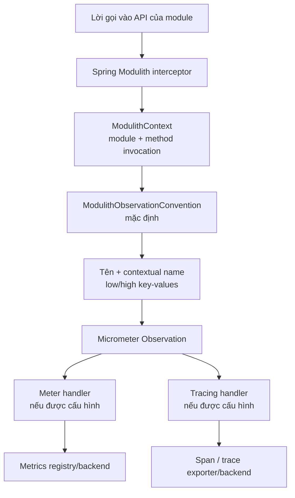
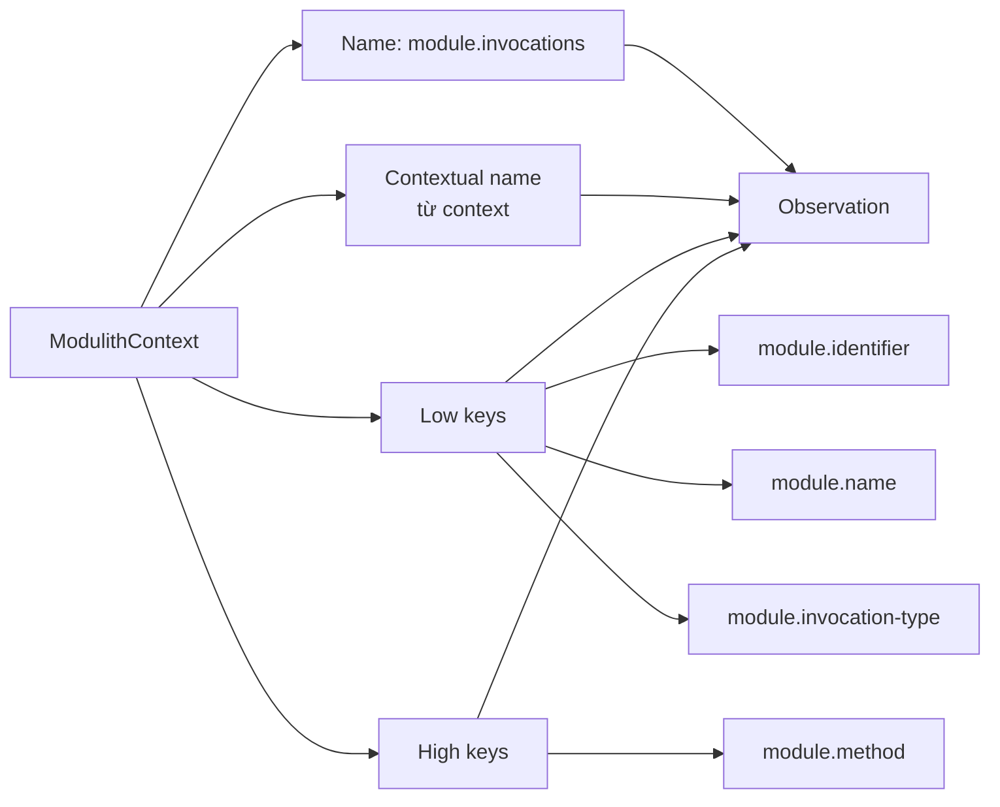
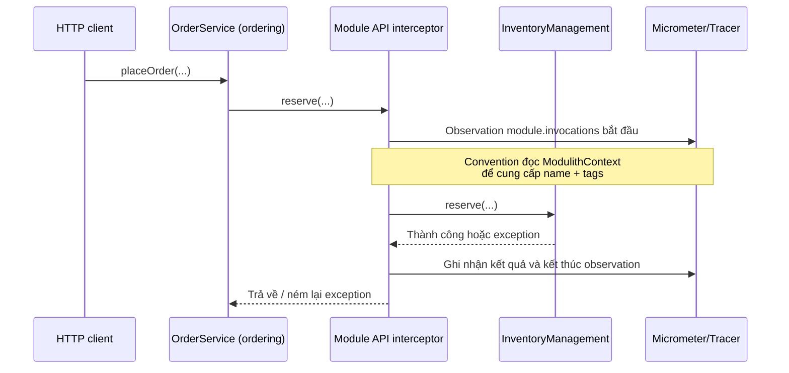

# Convention mặc định của Spring Modulith

## 1. Vì sao application module cần observation convention?

Một ứng dụng **Spring Boot** tổ chức bằng **Spring Modulith** có thể gồm các application module như `ordering`, `inventory`, `payment` và `notification`. Module graph mô tả các ranh giới và quan hệ phụ thuộc được phát hiện trong mã. Nhưng khi ứng dụng đang chạy, đội phát triển muốn biết một lần thực thi đã đi qua API của module nào, mất bao lâu, có lỗi hay không và tương tác đó là lời gọi bean hay event listener.

Spring Modulith cung cấp **module observability**: các Spring component nằm trong API của application module có thể được intercept để tạo **Micrometer Observation**. Observation có thể được xử lý thành metrics và spans/traces thông qua các handler, registry và exporter tương ứng.

**Observation convention** là quy ước chung về **tên observation**, **tên ngữ cảnh (contextual name)** và **key-values (tags)** mô tả thao tác. Spring Modulith đã có convention mặc định, vì thế đa số dự án **không cần tự viết convention** chỉ để quan sát tương tác giữa các module.

> **Mục tiêu bài học:** hiểu đúng `DefaultModulithObservationConvention` và `ModulithContext`, nắm tên observation và các tag mặc định, phân biệt low/high cardinality, đọc được một trace minh họa và biết khi nào thực sự cần override convention.

## 2. Các lớp và interface tham gia

Trong API của Spring Modulith, phần này có các thành phần chính:

| Thành phần | Vai trò |
| --- | --- |
| `ModulithObservationConvention` | Interface dành riêng cho observation có context loại `ModulithContext`; kế thừa `ObservationConvention<ModulithContext>` của Micrometer |
| `DefaultModulithObservationConvention` | Hiện thực mặc định, là **enum singleton** với hằng `INSTANCE` |
| `ModulithContext` | Context chứa thông tin module, lời gọi method và environment; cung cấp tên cùng bộ key-values mặc định |
| `ModulithObservations.LowKeys` | Danh sách key có cardinality thấp dành cho module observation |
| `ModulithObservations.HighKeys` | Danh sách key có cardinality cao dành cho module observation |
| `ModuleObservabilityBeanPostProcessor` | Thành phần bổ sung interceptor cho Spring beans được expose ở API module |
| `ObservationRegistry` và handlers của Micrometer | Nơi quản lý observation và chuyển tín hiệu sang meter/tracing tùy cấu hình |

Quan hệ khái niệm:



Đây là sơ đồ **vai trò**, không phải cam kết về thứ tự gọi hàm nội bộ trong mọi bản Spring Modulith. Nếu không có bridge/exporter, observation vẫn có thể được instrument nhưng **không tự xuất hiện** trong Zipkin, Jaeger hoặc Grafana Tempo.

## 3. Convention mặc định thực hiện những gì?

### 3.1. `DefaultModulithObservationConvention.INSTANCE`

Theo JavaDoc Spring Modulith hiện hành, `DefaultModulithObservationConvention` là một **enum**, không phải class thường:

```java
// Minh họa API, không phải mã cần khai báo lại trong dự án
public enum DefaultModulithObservationConvention
        implements ModulithObservationConvention {
    INSTANCE
}
```

Các phương thức như `getName()`, `getContextualName(context)`, `getLowCardinalityKeyValues(context)`, `getHighCardinalityKeyValues(context)` và `supportsContext(context)` được cung cấp qua interface `ModulithObservationConvention`.

**Tài liệu chính thức nêu rằng convention mặc định ủy quyền các lời gọi cho `ModulithContext`.** Cụ thể, muốn biết tên hiển thị hoặc tags của một module invocation, dữ liệu được lấy từ context của lần gọi đó thay vì tự suy từ tên package trong code nghiệp vụ.

Điểm cần nhớ: **không cần tạo `new DefaultModulithObservationConvention()`**; dạng enum singleton sử dụng `INSTANCE`. Với ứng dụng chưa có custom convention bean, Spring Modulith có cơ chế chọn mặc định của framework.

### 3.2. Tên observation mặc định: `module.invocations`

`ModulithContext.DEFAULT_CONVENTION_NAME` có giá trị:

```text
module.invocations
```

Đây là **tên observation ở cấp Micrometer**, không phải tên class event hay URL của Spring Boot Actuator. Tên đó đại diện cho một loại thao tác được instrument khi đi vào module.

Ví dụ một lần gọi `InventoryManagement.reserve(...)` có thể tạo observation mang tên `module.invocations`, còn **contextual name** và các tags cho biết observation đó thuộc module/method nào.

Không nên nhầm:

| Tên | Nguồn | Ý nghĩa |
| --- | --- | --- |
| `module.invocations` | Modulith module observation convention | Tên của observation cho lời gọi vào module |
| `module.events.published` | Event publication metrics của Spring Modulith | Counter tổng hợp các lượt publish event |
| `module.events.published.ordering.OrderPlaced` | Event publication metric riêng | Counter cho event type cụ thể trong một module |
| `/actuator/modulith` | Application Module Actuator | Endpoint trả JSON mô hình module và dependency |

Các dữ liệu này bổ sung cho nhau nhưng **không dùng thay nhau**. Ví dụ, giá trị event counter không thể hiện phương thức nào bên trong module đã chậm; ngược lại, trace của một request không tự chứng minh toàn bộ event đã publish trong một giờ.

### 3.3. Contextual name lấy từ `ModulithContext`

Trong `ModulithObservationConvention`, phương thức mặc định:

```java
String getContextualName(ModulithContext context);
```

được dùng để đặt **tên ngữ cảnh của một invocation**. Thay vì gán một chuỗi cố định cho mọi observation, dữ liệu đi qua `context.getContextualName()`.

Tên này giúp trace viewer thể hiện điểm vào module với thông tin dễ đọc. Tuy nhiên, **đừng hardcode một format contextual name cụ thể** như `ModuleName#method` cho mọi phiên bản. Cách render method signature và tên module có thể thay đổi theo phiên bản, loại invocation hoặc quy ước tùy biến; cần xem trace thực tế.

`getName()` và `getContextualName(...)` phục vụ hai mục đích khác nhau: tên ổn định dùng để phân loại observation; contextual name giúp nhận ra **một thao tác cụ thể**.

## 4. Tags mặc định: low cardinality và high cardinality

Một phần quan trọng của convention là phân loại **key-values**. Micrometer phân biệt low-cardinality (tập giá trị có giới hạn) với high-cardinality (có thể có nhiều giá trị khác nhau).

### 4.1. Low-cardinality keys

Theo `ModulithObservations.LowKeys`, Spring Modulith định nghĩa ba key sau:

| Key | Giá trị minh họa | Diễn giải |
| --- | --- | --- |
| `module.identifier` | `inventory` | Identifier kỹ thuật của application module |
| `module.name` | `Inventory` | Tên hiển thị của module |
| `module.invocation-type` | `bean` hoặc `event listener` | Phân biệt lời gọi bean và invocation của event listener |

**Module identifier** không nhất thiết phải bằng tên hiển thị hoặc package đầy đủ. Trong hệ thống có tùy chỉnh module detection/named interfaces, cần đối chiếu `ApplicationModules` hoặc `/actuator/modulith` để biết identifier thực tế.

`module.invocation-type` diễn tả **loại điểm instrument**, không cho biết listener đã xử lý thành công hay bean được gọi bao nhiêu lần. Giá trị phải được đọc từ môi trường/phiên bản đang sử dụng; tài liệu mô tả hai nhóm `bean` và `event listener`.

### 4.2. High-cardinality key

`ModulithObservations.HighKeys` định nghĩa:

| Key | Giá trị minh họa | Diễn giải |
| --- | --- | --- |
| `module.method` | `reserve` hoặc biểu diễn method có thông tin class/signature | Phương thức được thực thi ở API module |

Sự tách biệt này có chủ ý:

- Ba low keys có tập giá trị gắn với số module và loại invocation — thường nhỏ và phù hợp làm nhãn khi tổng hợp số liệu.
- `module.method` có thể nhiều giá trị hơn và được phân loại **high cardinality**; muốn dùng thông tin method để điều tra **một trace**, nên xem span attributes thay vì tùy tiện đưa nó vào metric tags có cardinality thấp.
- Giá trị cụ thể của `module.method` có thể phụ thuộc cách Spring Modulith biểu diễn method và proxy invocation. Không cam kết nó luôn bằng tên đơn giản như `reserve`.

**Cảnh báo:** high cardinality không có nghĩa nên đưa method arguments, `orderId`, email, token hoặc dữ liệu nhạy cảm vào observation. Method identity là metadata kỹ thuật; dữ liệu từ request/user có nguy cơ lộ thông tin và nổ số lượng series nếu dùng làm metric tags.

### 4.3. Sơ đồ tổng hợp dữ liệu mặc định



Không cần viết thêm code cho bảng key-values trên nếu mục tiêu chỉ là có convention mặc định. Đây là một lợi ích của việc dùng Spring Modulith observability theo thiết kế.

## 5. `ModulithContext` chứa dữ liệu gì?

JavaDoc mô tả constructor của `ModulithContext` nhận ba đối tượng:

```java
// Chữ ký để giải thích API
ModulithContext(
        ObservedModule module,
        MethodInvocation invocation,
        Environment environment);
```

Các phương thức cung cấp thông tin liên quan:

| API | Ý nghĩa |
| --- | --- |
| `getModule()` | Module được quan sát |
| `getInvocation()` | Method invocation đã kích hoạt observation |
| `getApplicationName()` | Tên ứng dụng lấy từ environment, có thể `null` |
| `getContextualName()` | Tên ngữ cảnh được xây dựng cho invocation |
| `getLowCardinalityValues()` | Các key-values có cardinality thấp |
| `getHighCardinalityValues()` | Các key-values có cardinality cao |

Ví dụ `ModulithObservationConvention` có thể ủy quyền trực tiếp:

```java
// Minh họa quan hệ delegation, không phải phần cần tự cấu hình:
String name = ModulithContext.DEFAULT_CONVENTION_NAME;
String contextualName = context.getContextualName();
var lowValues = context.getLowCardinalityValues();
var highValues = context.getHighCardinalityValues();
```

`context` trong ví dụ là một instance `ModulithContext` do framework tạo cho lần thực thi, **không phải một biến static toàn ứng dụng**. Mỗi lời gọi module khác nhau có thể nhận contextual name và method metadata khác nhau, trong khi tên observation `module.invocations` vẫn ổn định.

**Lưu ý runtime:** nếu ứng dụng tùy chỉnh cách phát hiện application module, phần cấu hình đó phải có trong source/runtime classpath của bản chạy. Chỉ khai báo customization trong test có thể khiến metadata runtime khác với module graph ở môi trường test.

## 6. Ví dụ: quan sát lời gọi API bean giữa hai module

Giả sử cấu trúc package tối giản:

```text
com.example.shop
├── ShopApplication.java
├── ordering/
│   ├── OrderService.java
│   └── internal/OrderRepository.java
└── inventory/
    ├── InventoryManagement.java
    └── internal/StockRepository.java
```

### 6.1. Bean thuộc API module inventory

```java
package com.example.shop.inventory;

import org.springframework.stereotype.Service;

@Service
public class InventoryManagement {

    public void reserve(String sku, int quantity) {
        if (quantity <= 0) {
            throw new IllegalArgumentException("Quantity must be positive");
        }

        // Ví dụ học tập: hệ thống thật sẽ kiểm tra và cập nhật tồn kho.
    }
}
```

### 6.2. Ordering gọi API của inventory

```java
package com.example.shop.ordering;

import com.example.shop.inventory.InventoryManagement;
import org.springframework.stereotype.Service;

@Service
public class OrderService {

    private final InventoryManagement inventory;

    public OrderService(InventoryManagement inventory) {
        this.inventory = inventory;
    }

    public void placeOrder(String sku, int quantity) {
        inventory.reserve(sku, quantity);
        // Tiếp tục xử lý nghiệp vụ đặt hàng...
    }
}
```

Nếu `ordering` và `inventory` được Spring Modulith nhận diện là hai module, bean `InventoryManagement` thuộc API được expose và lời gọi đi qua interceptor, observability có thể ghi một observation cho invocation đó.

Một tập dữ liệu **minh họa** trong trace viewer:

```text
observation name:  module.invocations
contextual name:  <được suy từ ModulithContext>
traceId:          <trace-id từ tracing backend>
spanId:           <span-id từ tracing backend>
low keys:
  module.identifier:      inventory
  module.name:            Inventory
  module.invocation-type: bean
high keys:
  module.method:          <biểu diễn method reserve(...)>
```

Các giá trị dạng `<...>` là placeholder. Spring Modulith cung cấp thông tin module/method, còn định dạng trace ID, span ID, operation name và cách hiển thị low/high attributes phụ thuộc tracing stack đang dùng.

### 6.3. Observation và trace thể hiện điều gì?



Đây là sơ đồ **khái niệm** để học quy ước đặt tên và metadata; nó không mô tả chính xác mọi proxy/bean hay bảo đảm sẽ xuất đủ các span lồng nhau ở mọi phiên bản. Trường hợp self-invocation, object tạo bằng `new` hoặc bean nằm ngoài API module có thể không đi qua điểm instrument.

## 7. Bean invocation và event-listener invocation có dùng cùng convention?

Spring Modulith observability phục vụ nhiều kiểu tương tác ở ranh giới module. Cùng một convention dựa trên `ModulithContext` có thể phân biệt loại lời gọi qua `module.invocation-type`.

Ví dụ:

| Tình huống | `module.identifier` | `module.invocation-type` | Metadata method |
| --- | --- | --- | --- |
| `OrderService` gọi `InventoryManagement.reserve(...)` | `inventory` | `bean` | Method nhận yêu cầu giữ hàng |
| Listener trong `notification` nhận `OrderPlaced` | `notification` | `event listener` | Method xử lý `OrderPlaced` |

Điểm phân biệt **không phải** tên observation `module.invocations`, vì tên đó vẫn có thể được dùng cho cả hai. Điều làm rõ hình thái giao tiếp là contextual name, low-cardinality key `module.invocation-type` và high-cardinality metadata `module.method`.

Với event listener chạy bất đồng bộ, có thể xảy ra tình huống listener thực sự được gọi nhưng span không nối trực tiếp với trace của request ban đầu. **Observation convention không tự xử lý context propagation qua `@Async`, executor hoặc message broker**. Việc chuyển ngữ cảnh tracing phụ thuộc thư viện/instrumentation và cách luồng async được cấu hình.

## 8. Thêm dependencies và quan sát convention mặc định

### 8.1. Bật observability

Nếu dự án đã có cơ chế quản lý phiên bản Spring Boot và Spring Modulith tương thích, dùng Insight starter:

```kotlin
// build.gradle.kts
dependencies {
    runtimeOnly("org.springframework.modulith:spring-modulith-starter-insight")
}
```

Hoặc chỉ dùng phần module observability:

```kotlin
dependencies {
    runtimeOnly("org.springframework.modulith:spring-modulith-observability-core")
}
```

Các ví dụ **không ghim version** vì giả định dự án đã dùng BOM/dependency management tương thích. `spring-modulith-starter-insight` bao gồm phần observability cùng Module Actuator/Boot Actuator; không cần thêm observability core trùng lặp chỉ để kích hoạt mặc định lần nữa.

**Quan trọng:** starter cung cấp hạ tầng instrument, **không tự cài tracing backend**. Muốn xem spans cần Micrometer Tracing bridge, exporter và backend (ví dụ OpenTelemetry/OTLP, Zipkin hoặc hệ thống phù hợp với phiên bản Spring Boot).

### 8.2. Expose Actuator phù hợp

Với môi trường thử nghiệm:

```yaml
management:
  endpoints:
    web:
      exposure:
        include: health, metrics, modulith
```

Sau khi khởi chạy:

```bash
curl -sS http://localhost:8080/actuator/modulith
curl -sS http://localhost:8080/actuator/metrics
```

- `/actuator/modulith` trả mô hình module, giúp xác minh identifier và quan hệ `ordering → inventory`.
- `/actuator/metrics` liệt kê các meter đã đăng ký; nếu observation có meter handler phù hợp thì có thể tìm nhóm meter liên quan `module.invocations`.
- **Không mặc định có endpoint `/actuator/traces`** để xem raw spans chỉ vì đã thêm Spring Modulith; dùng tracing backend khi cần duyệt trace.

Nếu `module.invocations` chưa xuất hiện trong `/actuator/metrics`, đừng vội kết luận convention không hoạt động: có thể chưa có lời gọi được instrument, thiếu meter handler, registry hoặc cấu hình quan sát. Tương tự, thấy meter không đồng nghĩa spans đã được export.

### 8.3. Tracing sampling và context

Trong một số phiên bản Spring Boot, có thể dùng cấu hình **dành cho môi trường học tập**:

```yaml
management:
  tracing:
    sampling:
      probability: 1.0
```

Giá trị này chỉ giúp giữ các traces khi hạ tầng tracing được cấu hình thích hợp. Không nên dùng sampling 100% một cách mặc định ở production có lưu lượng cao; cần cân bằng chi phí, độ nhạy dữ liệu và nhu cầu quan sát.

Trường hợp `inventory` được gọi bên trong thread khác, `CompletableFuture` hoặc message handler, việc span có đúng trace parent còn phụ thuộc **context propagation**, không phụ thuộc riêng convention.

## 9. Khi nào cần thay convention mặc định?

Mặc định phù hợp khi muốn có tên và tags chuẩn để lọc theo module. Chỉ tùy biến khi có **lý do rõ ràng**, ví dụ muốn chỉnh contextual name để phù hợp quy ước hiển thị của đội vận hành hoặc cần thay đổi key-values theo một hợp đồng thống nhất.

Spring Modulith cho phép đăng ký một **Spring bean `ModulithObservationConvention`**:

```java
package com.example.shop.config;

import org.springframework.context.annotation.Bean;
import org.springframework.context.annotation.Configuration;
import org.springframework.modulith.observability.ModulithContext;
import org.springframework.modulith.observability.ModulithObservationConvention;

@Configuration(proxyBeanMethods = false)
class ModuleObservationConfiguration {

    @Bean
    ModulithObservationConvention observationConvention() {
        return new ModulithObservationConvention() {

            @Override
            public String getContextualName(ModulithContext context) {
                // Giữ nội dung mặc định, thêm tiền tố phục vụ hiển thị.
                return "shop/" + context.getContextualName();
            }
        };
    }
}
```

Đây là **ví dụ minh họa một thay đổi có chủ đích**, không phải cấu hình cần thêm để convention mặc định hoạt động. Do interface có default methods, các phương thức khác như `getName()`, `getLowCardinalityKeyValues(...)` và `getHighCardinalityKeyValues(...)` vẫn dùng hành vi mặc định nếu không override.

Vì đoạn code tham chiếu API Spring Modulith lúc compile, cần đưa artifact **`spring-modulith-observability-api`** vào compile classpath:

```kotlin
dependencies {
    implementation("org.springframework.modulith:spring-modulith-observability-api")
    runtimeOnly("org.springframework.modulith:spring-modulith-starter-insight")
}
```

Không cần đặt một custom bean chỉ để “bật” tracing. Bean convention đổi metadata; còn việc xuất spans cần tracer/exporter/backend phù hợp.

### 9.1. Đừng vô tình phá hợp đồng metric

Nếu override `getName()`, bạn có thể làm thay đổi tên observation/metric logic mà dashboard đang dựa vào. Nếu override low-cardinality keys, bạn có thể làm mất `module.identifier` hoặc các nhãn phân loại quan trọng. Một số lưu ý:

1. **Giữ tên `module.invocations` nếu chưa có yêu cầu thay đổi rõ ràng.**
2. **Giữ các low keys có ích**: `module.identifier`, `module.name`, `module.invocation-type`, trừ khi đã xác định kế hoạch migration dashboards.
3. Không thêm `orderId`, `userId`, email, tài khoản hoặc token vào low-cardinality tags.
4. Nếu cần bổ sung attributes có cardinality cao, xem xét phạm vi retention/bảo mật trước khi đẩy sang tracing backend.
5. Kiểm tra các bộ lọc/handlers của hệ thống: một convention mới không bảo đảm tất cả tags đều được xuất ở mọi backend.

### 9.2. Không nhầm với `ModulithEventMetricsCustomizer`

Đây là hai extension point khác nhau:

| Nhu cầu | Extension point phù hợp |
| --- | --- |
| Điều chỉnh observation name, contextual name hoặc tags của module invocation | `ModulithObservationConvention` |
| Bổ sung tag nghiệp vụ cho **counter công bố một loại event cụ thể** | `ModulithEventMetricsCustomizer` |
| Điều chỉnh cách module được phát hiện và expose | Cấu hình module detection / API module |
| Bảo đảm xử lý event bền vững, theo dõi completion/retry | Event Publication Registry |
| Truyền trace context qua thread/message | Context propagation và instrumentation của stack tương ứng |

Nếu muốn đo số event `OrderPlaced` theo `channel=web`, **không nhất thiết** phải thay observation convention của mọi lời gọi module. Hãy cân nhắc customizer của event counter. Nếu muốn thay cách hiển thị một module entry span, mới xem đến `ModulithObservationConvention`.

## 10. Quy trình kiểm chứng convention mặc định

Giả sử ứng dụng `shop` có request tạo đơn gọi từ `ordering` sang `inventory`:

1. **Xác minh module detection.** Gọi `/actuator/modulith` để biết Spring Modulith nhận diện `ordering` và `inventory` như mong đợi.
2. **Bật instrumentation.** Đảm bảo dependency `spring-modulith-observability-core` hoặc Insight có trong runtime classpath.
3. **Bật exporter nếu muốn xem span.** Cấu hình Micrometer Tracing bridge, sampling, exporter và backend tương thích phiên bản Boot.
4. **Tạo request thực tế.** Gọi một endpoint nghiệp vụ khiến `OrderService` sử dụng bean API của `inventory`.
5. **Tìm module observation/span.** Trong trace viewer, tìm operation thuộc `inventory` và kiểm tra `module.identifier`, `module.invocation-type` cùng `module.method`.
6. **Đối chiếu naming.** Xác minh observation name theo mặc định `module.invocations` nếu backend bộc lộ trường đó; contextual name lấy từ context tương ứng.
7. **Kiểm tra metric nếu có meter handler.** Tìm các meter tạo từ module observation trong `/actuator/metrics`; không suy ra rằng mọi observation luôn có timer cùng tên trong mọi môi trường.
8. **Thử lời gọi listener.** Nếu có event listener được instrument, kiểm tra cách `module.invocation-type` thay đổi và trace context có còn nối liên tục khi listener chạy bất đồng bộ.

### 10.1. Bảng chẩn đoán

| Triệu chứng | Nguyên nhân có thể | Cách xử lý |
| --- | --- | --- |
| Có graph nhưng không có module spans | Graph mô tả cấu trúc; chưa chắc lời gọi được instrument/traced | Xác minh request, API bean, tracing dependencies và sampling |
| `module.identifier` không khớp tên dự kiến | Module detection hoặc identifier khác suy đoán từ package | Đọc `/actuator/modulith`, kiểm tra source/config của module |
| Không thấy `module.method` ở metric tags | Đây là **high-cardinality key**, không mặc định là nhãn metric | Kiểm tra span attributes; không ép chuyển thành low key chỉ để xuất metrics |
| Tìm thấy `module.invocations` nhưng không thấy trace | Meter handler có thể hoạt động trong khi exporter/tracing chưa sẵn sàng | Kiểm tra bridge, endpoint exporter, backend và sampling |
| Trace có span nhưng contextual name khác ví dụ | Format tùy implementation hoặc đã có custom convention | Xem metadata trên span và bean `ModulithObservationConvention` |
| Trace listener tách khỏi trace ban đầu | Mất context qua `@Async`, executor, broker hoặc không đủ instrumentation | Kiểm tra capture/restore hoặc inject/extract tracing context |
| Thêm custom convention làm dashboard mất dữ liệu | Tên/tags đã thay đổi | So contract mới/cũ; rollback hoặc migrate dashboard |
| Có thêm nhiều time series bất thường | Một tag động/ID bị đưa vào low-cardinality keys | Giới hạn cardinality, lọc dữ liệu nhạy cảm, review override |
| Không truy cập được `/actuator/modulith` | Endpoint chưa expose, port/base path khác, security chặn | Kiểm tra Actuator config và quyền quản trị |

## 11. Bài tập tự kiểm tra

**Bài tập 1.** Một span minh họa có:

```text
module.identifier      = inventory
module.name            = Inventory
module.invocation-type = bean
module.method          = reserve
```

Hỏi: Ba trường nào thuộc low cardinality theo định nghĩa của Spring Modulith, trường nào thuộc high cardinality?

**Gợi ý:** `module.identifier`, `module.name`, `module.invocation-type` là low keys; `module.method` là high key.

**Bài tập 2.** Đội phát triển muốn thay observation name của mọi module invocation từ `module.invocations` thành `shop.module.invocations`. Họ cần lưu ý điều gì?

**Gợi ý:** Đây là thay đổi convention có thể ảnh hưởng đến metrics, dashboards, queries và bất kỳ instrumentation nào đang dựa vào tên cũ. Nên cân nhắc giữ tên mặc định và chỉ đổi contextual name nếu mục tiêu là hiển thị dễ đọc.

**Bài tập 3.** Counter `module.events.published.ordering.OrderPlaced` tăng, nhưng không tìm thấy `module.invocations` trong tracing backend. Có thể kết luận Spring Modulith không hoạt động không?

**Gợi ý:** Không. Event publication counter và module observation/span là tín hiệu khác nhau. Cần kiểm tra request có đi qua điểm instrument, tracing bridge/exporter, sampling và context propagation.

**Bài tập 4.** Muốn đưa `orderId` vào low-cardinality key để truy vấn “mọi observation của đơn hàng A”, nên làm không?

**Gợi ý:** Không phù hợp: giá trị ID có cardinality rất cao và có thể là dữ liệu nhạy cảm. Hãy dùng trace correlation hoặc cơ chế log/trace được kiểm soát; tránh đưa ID nghiệp vụ vào nhãn metric.

## 12. Kết luận

**Convention mặc định của Spring Modulith** chính là quy tắc được cung cấp bởi `DefaultModulithObservationConvention.INSTANCE`, **ủy quyền metadata cho `ModulithContext`**. Trong các bản API hiện hành:

- Tên observation mặc định là **`module.invocations`**.
- **Low-cardinality keys:** `module.identifier`, `module.name`, `module.invocation-type`.
- **High-cardinality key:** `module.method`.
- Contextual name được suy từ `ModulithContext` và có thể thay đổi theo module/method được instrument.
- Có thể tùy biến bằng bean `ModulithObservationConvention`, nhưng không bắt buộc; cần giữ ổn định contract đặt tên/tags và kiểm chứng bằng telemetry thật.

Nhờ quy ước này, đội phát triển có thể liên hệ **module graph và Actuator** với **spans/traces** của các lời gọi module, đồng thời không nhầm lẫn với **event publication metrics** hay vấn đề **context propagation** ở các luồng bất đồng bộ.

### Tài liệu tham khảo

- [Spring Modulith — Production-ready Features: Observing Application Modules và Conventions](https://docs.spring.io/spring-modulith/reference/production-ready.html): instrumentation module, tag keys và default convention delegation.
- [Spring Modulith — `ModulithObservationConvention` API](https://docs.spring.io/spring-modulith/docs/current/api/org/springframework/modulith/observability/ModulithObservationConvention.html): các default methods và phạm vi `ModulithContext`.
- [Spring Modulith — `DefaultModulithObservationConvention` API](https://docs.spring.io/spring-modulith/docs/current/api/org/springframework/modulith/observability/support/DefaultModulithObservationConvention.html): enum singleton `INSTANCE`.
- [Spring Modulith — `ModulithContext` API](https://docs.spring.io/spring-modulith/docs/current/api/org/springframework/modulith/observability/ModulithContext.html): tên mặc định, method invocation, contextual name, low/high key-values.
- [Spring Modulith — `ModulithObservations.LowKeys`](https://docs.spring.io/spring-modulith/docs/current/api/org/springframework/modulith/observability/ModulithObservations.LowKeys.html) và [HighKeys](https://docs.spring.io/spring-modulith/docs/current/api/org/springframework/modulith/observability/ModulithObservations.HighKeys.html): danh sách keys.
- [Spring Boot — Observability](https://docs.spring.io/spring-boot/reference/actuator/observability.html): Micrometer Observation, metrics/tracing handlers và tích hợp backend.
