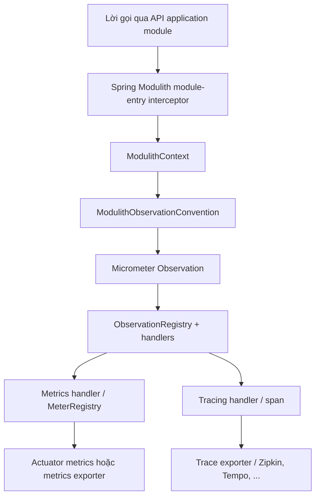
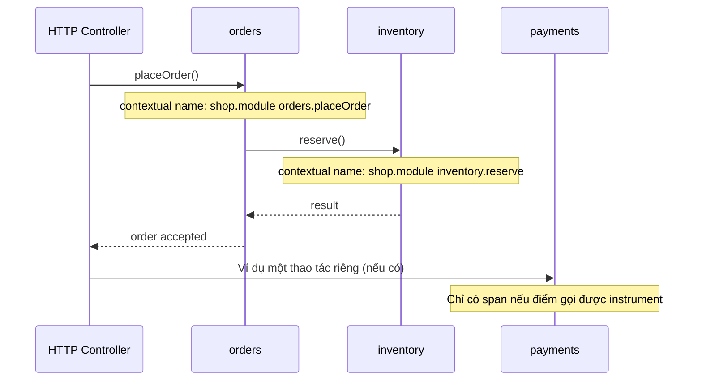

# Tùy chỉnh tên observation

## 1. Bối cảnh và mục tiêu

Một ứng dụng Spring Boot được chia theo các **application module** như `orders`, `inventory` và `payments` có thể sử dụng Spring Modulith để mô tả ranh giới, dựng module graph và kiểm chứng dependency. Khi bật observability, Spring Modulith còn có thể instrument các **điểm vào API module** để tạo Micrometer Observation, từ đó xuất metrics và traces nếu hạ tầng được cấu hình phù hợp.

Trong công cụ xem trace, tên mặc định đôi khi chưa diễn đạt rõ bước nghiệp vụ. Ví dụ, nhóm vận hành mong muốn nhìn thấy các span theo dạng:

```text
shop.module orders.placeOrder
shop.module inventory.reserve
shop.module payments.onOrderPlaced
```

Để có tên dễ nhận diện, ứng dụng có thể đăng ký **`ModulithObservationConvention`**. Tuy nhiên, Micrometer có nhiều khái niệm “tên”, và tùy chỉnh nhầm có thể khiến tên meter bị phân mảnh, dashboard cũ ngừng hoạt động hoặc số chuỗi metric tăng mạnh.

Bài **“Tùy chỉnh tên observation”** thuộc chương **Observation convention**, trong học phần **SPRING_MODULITH_DOCUMENTATION_OBSERVABILITY**. Học phần dùng Spring Modulith để sinh tài liệu ranh giới application module và quan sát tương tác thông qua module graph, Actuator, event metrics, tracing và context propagation. Bài này tập trung vào **quy tắc đặt tên observation của module entry**, cách đăng ký convention, bảo toàn metadata và xác minh kết quả sau khi đổi tên.

Sau bài này, người học cần:

1. Phân biệt `observation name`, `contextual name`, `span name`, `meter name` và `tag`.
2. Hiểu cơ chế mặc định của `ModulithObservationConvention` và `ModulithContext`.
3. Viết bean tùy chỉnh **tên dễ đọc của module-entry observation** mà vẫn giữ tên kỹ thuật ổn định.
4. Biết khi nào mới nên override `getName()` và những hệ quả đối với metrics.
5. Giữ các low-cardinality keys cần thiết để đối chiếu module graph và traces.
6. Kiểm chứng convention qua unit test, Spring application context, Actuator và trace backend.
7. Phát hiện lỗi thường gặp khi đổi tên, listener bất đồng bộ hoặc thiếu instrumentation.

> **Phạm vi:** Ví dụ minh họa API trong các dòng Spring Modulith hỗ trợ `ModulithObservationConvention` và `ModulithContext`. Cấu hình dependency, tracing bridge và exporter phải tương thích với Spring Boot/Spring Modulith của dự án. Các ví dụ kết quả là giả định để học cách xác minh, chưa phải dữ liệu từ hệ thống đang chạy.

## 2. Năm khái niệm “tên” dễ nhầm lẫn

### 2.1. Observation name

`Observation` là một hoạt động có vòng đời bắt đầu/kết thúc, ngữ cảnh và metadata. **Observation name** là tên kỹ thuật tương đối ổn định được dùng để nhận diện **loại hoạt động**. Trong mô hình Micrometer, tên này thường là cơ sở để một metrics observation handler đặt tên timer/meter.

Spring Modulith có hằng số mặc định:

```java
ModulithContext.DEFAULT_CONVENTION_NAME
```

Trong tài liệu API được kiểm tra, giá trị của hằng số này là:

```text
module.invocations
```

Đây là tên kỹ thuật được dùng bởi convention module-entry mặc định của dòng phiên bản đó. Khi cập nhật phiên bản, hãy kiểm tra tài liệu/chính phép đo của bản đang chạy, tránh coi một tên được truyền miệng là hợp đồng bất biến.

### 2.2. Contextual name

**Contextual name** diễn tả hoạt động trong ngữ cảnh cụ thể, ví dụ `orders.placeOrder` hoặc `inventory.reserve`. Nó thường phù hợp để làm **tên span dễ đọc** khi Micrometer Tracing được cấu hình.

Một observation có thể có:

```text
observation name  = module.invocations
contextual name   = shop.module inventory.reserve
```

Hai tên này cùng tồn tại mà không mâu thuẫn. Không cần biến tên kỹ thuật thành một tên mới cho **mỗi đơn hàng** chỉ để có span dễ xem hơn.

### 2.3. Span name

**Span** là đơn vị thời gian trong một trace. Tracing handler thường sử dụng **contextual name** của observation nếu có; nếu không, nó dùng **observation name** làm tên span. Backend có thể chuẩn hóa, hiển thị hoặc nhóm span theo cơ chế riêng.

Do đó, đổi `getContextualName(...)` có thể làm **tên span** dễ đọc hơn, nhưng **không tự bảo đảm** một trace được tạo hoặc được xuất. Việc có span còn phụ thuộc instrumentation, tracing bridge, sampling, exporter và nơi gọi.

### 2.4. Meter name

**Meter** của Micrometer là một phép đo như Counter hoặc Timer. Khi observation được metrics handler xử lý, tên kỹ thuật của observation có thể được dùng làm **meter name**.

Ví dụ, timer có thể xuất hiện qua Actuator với tên `module.invocations`, trong khi span lại có contextual name `shop.module inventory.reserve`.

Cần kiểm tra tên meter **trên runtime** qua `/actuator/metrics`; không được giả định mọi span đều tạo timer tương ứng hoặc mọi backend giữ nguyên tên. Event publication counters của Spring Modulith thuộc một nhóm riêng, không phải chính meter của module-entry observation.

### 2.5. Tags hoặc key-values

**Tags** phân loại phép đo hoặc mô tả span. Những key-value như `module.identifier=inventory` và `module.invocation-type=bean` giúp lọc theo module hoặc kiểu tương tác mà không cần đặt các giá trị đó vào **observation name**.

| Thành phần | Ví dụ | Có nên đổi theo mỗi request? | Dùng để làm gì? |
| --- | --- | --- | --- |
| Observation name | `module.invocations` | **Không** | Nhận diện loại hoạt động, có thể dùng làm tên meter |
| Contextual name | `shop.module inventory.reserve` | Chỉ biến đổi theo tập module/operation hữu hạn | Tên dễ hiểu cho span |
| Span name | `shop.module inventory.reserve` | Không chứa dữ liệu riêng từng đơn | Đọc đường thực thi trong tracing |
| Meter name | `module.invocations` | **Không** | Tổng hợp đo lường cùng loại operation |
| Low-cardinality tag | `module.identifier=inventory` | Theo tập module nhỏ | Phân nhóm metrics và traces |
| High-cardinality attribute | `order.id=...` | Có thể riêng từng hoạt động nhưng phải kiểm soát bảo mật | Điều tra trace cụ thể, **không** dùng làm metric tag |

**Nguyên tắc thiết kế:** Giữ **tên kỹ thuật ít biến thể**, dùng **low-cardinality tags** để chia nhóm, dùng **contextual name** cho chuỗi mô tả operation có giới hạn, và dùng logs/traces để điều tra dữ liệu của từng yêu cầu.

## 3. Observation của Spring Modulith được tạo ở đâu?

### 3.1. Module-entry instrumentation

Khi có phần observability của Spring Modulith, những Spring component nằm trong **API được công bố của application module** có thể được bọc bằng aspect/interceptor. Lời gọi đi qua điểm được hỗ trợ có thể tạo **module-entry observation**, sau đó chuyển thành span hoặc timer thông qua Micrometer.

Ví dụ kiến trúc:

```text
com.example.shop
├── ShopApplication.java
├── orders
│   ├── OrderManagement.java
│   └── internal
│       └── JpaOrderRepository.java
├── inventory
│   ├── InventoryManagement.java
│   └── internal
│       └── JpaStockRepository.java
└── payments
    ├── PaymentManagement.java
    └── internal
        └── PaymentGatewayAdapter.java
```

Nếu `orders.OrderManagement` gọi bean API `inventory.InventoryManagement`, instrumentation có thể tạo module-entry observation khi lời gọi đi qua bean của `inventory`. Dưới trace có HTTP instrumentation, ta có thể thấy:

```text
HTTP POST /orders
└── module/orders: OrderManagement.placeOrder
    └── module/inventory: InventoryManagement.reserve
```

Sơ đồ là **minh họa khả năng instrument**, không phải cam kết có span cho mọi method. Một lời gọi Java trên object tự tạo bằng `new`, self-invocation bên trong cùng bean hoặc method thuộc package `internal` có thể không đi qua interceptor đó.

### 3.2. Các metadata sẵn có trên module-entry span

Theo tài liệu Spring Modulith, module-entry observation/span gắn với các metadata quan trọng:

| Key | Ý nghĩa |
| --- | --- |
| `module.identifier` | Định danh kỹ thuật của module |
| `module.name` | Tên hiển thị module |
| `module.invocation-type` | Loại invocation, ví dụ `bean` hoặc `event listener` |
| `module.method` | Phương thức được gọi |

Đây là những dữ liệu nên ưu tiên sử dụng khi phân tích module graph với dữ liệu runtime. Không cần nhét toàn bộ metadata vào tên span; nếu tên span đổi, tag vẫn hỗ trợ lọc và so sánh theo module.

### 3.3. Sơ đồ đường đi của observation name



Convention nằm ở **bước xác định tên và metadata của observation**. Nó không thay thế hạ tầng xác nhận ranh giới module, không tạo HTTP endpoint mới và không tự đảm bảo dữ liệu đến backend.

## 4. `ModulithObservationConvention` và `ModulithContext`

### 4.1. Interface tùy chỉnh

Spring Modulith cung cấp:

```java
org.springframework.modulith.observability.ModulithObservationConvention
```

Interface này mở rộng Micrometer `ObservationConvention<ModulithContext>`. Các phương thức chính:

| API | Tác dụng | Khi nào override? |
| --- | --- | --- |
| `getName()` | Quyết định **observation name** kỹ thuật | Khi muốn đổi thống nhất tên loại observation, có kế hoạch cập nhật dashboards |
| `getContextualName(ModulithContext)` | Quyết định **contextual name** theo module/method | Khi muốn tên span dễ hiểu hơn |
| `getLowCardinalityKeyValues(ModulithContext)` | Metadata thích hợp cho metrics và traces | Chỉ khi cần chính sách tag rõ ràng |
| `getHighCardinalityKeyValues(ModulithContext)` | Metadata chi tiết, chủ yếu cho traces | Khi có nhu cầu điều tra được kiểm soát |
| `supportsContext(Observation.Context)` | Xác định context được convention hỗ trợ | Thường giữ mặc định của interface |

Trong những phiên bản Spring Modulith hiện đại được tham khảo, các phương thức này có triển khai mặc định, và convention mặc định lấy thông tin từ `ModulithContext`. **Nếu chỉ muốn đổi tên dễ đọc, hãy override `getContextualName(...)` trước**, giữ các quy tắc còn lại.

### 4.2. Context cung cấp thông tin gì?

`ModulithContext` nắm giữ:

- `getModule()`: thông tin module đang được quan sát thông qua `ObservedModule`.
- `getInvocation()`: invocation của method được instrument.
- `getApplicationName()`: tên ứng dụng, nếu có.
- `getLowCardinalityValues()` và `getHighCardinalityValues()`: các key-value mà Spring Modulith chuẩn bị.
- `getContextualName()`: contextual name mặc định dựa trên thông tin sẵn có.

`ObservedModule` cung cấp `getIdentifier()` và `getDisplayName()`. Identifier ổn định cho truy vấn kỹ thuật; display name thích hợp để người đọc phân biệt module.

Nên đọc `context.getModule().getIdentifier()` nếu cần định danh module nhất quán, thay vì tự suy từ tên package hoặc bean class. Với method, có thể đọc `context.getInvocation().getMethod().getName()` hoặc sử dụng các API định dạng của `ObservedModule` phù hợp phiên bản.

### 4.3. Phân biệt module identifier và tên span

Giả sử `inventory` có technical identifier là `inventory` và tên hiển thị là `Inventory`. Một contextual name dạng `shop.module inventory.reserve` có thể dễ đọc hơn trong trace. Nhưng module identifier vẫn phải là `inventory` để đối chiếu với `/actuator/modulith`.

Việc đổi tên span **không đổi ranh giới module**, không đổi dependency `orders → inventory`, không làm thay đổi business event type và không làm thay đổi logic tự động phát sự kiện.

## 5. Cấu hình dependency cho convention tùy chỉnh

### 5.1. Đặt đúng API trên compile classpath

Ví dụ Gradle Groovy DSL:

```groovy
dependencies {
    // Cần API compile-time để viết class implement ModulithObservationConvention.
    implementation 'org.springframework.modulith:spring-modulith-observability-api'

    // Bật phần Actuator + Modulith Observability ở runtime.
    runtimeOnly 'org.springframework.modulith:spring-modulith-starter-insight'
}
```

Dự án cần quản lý phiên bản Spring Boot/Spring Modulith tương thích bằng BOM hoặc dependency management hiện có. Ví dụ trên chưa gồm Spring Web, persistence, tracing bridge, exporter hoặc backend giám sát; bổ sung theo ứng dụng thực tế.

Nếu chỉ sử dụng observability core mà không cần Insight starter, có thể cấu hình `spring-modulith-observability-core` cùng những thành phần Boot/Micrometer cần thiết. Không bắt buộc thêm cả starter và mọi dependency con trong cùng dự án.

### 5.2. Muốn xem span cần tracing infrastructure

Để quan sát tên span trong Tempo, Zipkin hoặc backend OpenTelemetry, còn cần:

- Tracing bridge thích hợp với dòng Spring Boot.
- Exporter/collector được cấu hình đúng địa chỉ và quyền kết nối.
- Sampling phù hợp với môi trường thử nghiệm.
- Spring component được instrument thực sự được gọi.
- Context propagation nếu xử lý chuyển qua thread hoặc pipeline bất đồng bộ.

Chỉ đăng ký `ModulithObservationConvention` **không tạo trace backend**. Nếu chỉ có `MeterRegistry` và metrics handler, bạn có thể kiểm tra thay đổi ở observation/meter nhưng không thấy bất kỳ span nào bên ngoài.

## 6. Ví dụ chuẩn: đổi contextual name, giữ observation name

### 6.1. Yêu cầu

Hệ thống bán hàng muốn:

- Giữ **observation name** `module.invocations` để không làm thay đổi những query metrics đang dùng.
- Đặt **contextual name** dạng `shop.module <moduleIdentifier>.<methodName>`.
- Bảo toàn các low/high-cardinality key-values mặc định do Spring Modulith cung cấp.
- Không đưa `orderId`, email, request URL động hoặc tên class phát sinh theo user vào tên.

### 6.2. Implement convention

```java
package com.example.shop.observability;

import org.springframework.modulith.observability.ModulithContext;
import org.springframework.modulith.observability.ModulithObservationConvention;

public final class ShopModuleObservationConvention
        implements ModulithObservationConvention {

    @Override
    public String getContextualName(ModulithContext context) {

        String moduleId = context.getModule()
                .getIdentifier()
                .toString();

        String methodName = context.getInvocation()
                .getMethod()
                .getName();

        return "shop.module " + moduleId + "." + methodName;
    }
}
```

Cơ chế trên dùng **technical identifier từ mô hình Spring Modulith** và tên method từ invocation. Các giá trị này thường đến từ **tập module/method hữu hạn trong code**, không phụ thuộc ID của từng request.

Không override `getName()`, `getLowCardinalityKeyValues(...)` hoặc `getHighCardinalityKeyValues(...)`: các phương thức mặc định tiếp tục sử dụng dữ liệu `ModulithContext`. Nhờ đó, thay đổi có phạm vi rõ ràng: **làm tên span dễ đọc** trong khi giảm nguy cơ thay đổi các meter và tags đang được dashboard dùng.

### 6.3. Đăng ký dưới dạng Spring bean

```java
package com.example.shop.observability;

import org.springframework.context.annotation.Bean;
import org.springframework.context.annotation.Configuration;
import org.springframework.modulith.observability.ModulithObservationConvention;

@Configuration(proxyBeanMethods = false)
public class ObservabilityNamingConfiguration {

    @Bean
    ModulithObservationConvention moduleObservationConvention() {
        return new ShopModuleObservationConvention();
    }
}
```

Đảm bảo `ObservabilityNamingConfiguration` nằm trong phạm vi component scan của Spring Boot application hoặc được `@Import` rõ ràng. Nếu ứng dụng đã có một bean `ModulithObservationConvention` khác, cần thống nhất một chính sách; nhiều bean cùng loại có thể gây xung đột auto-configuration hoặc khiến không rõ bean nào được sử dụng.

### 6.4. Kết quả kỳ vọng

Giả sử một method `reserve()` trên API của `inventory` được instrument:

| Dữ liệu | Trước tùy chỉnh | Sau tùy chỉnh |
| --- | --- | --- |
| Observation name | Theo convention mặc định, ví dụ `module.invocations` | **Vẫn** `module.invocations` |
| Contextual name | Theo định dạng mặc định của `ModulithContext` | `shop.module inventory.reserve` |
| `module.identifier` | `inventory` | `inventory` |
| `module.method` | Method thực thi | Method thực thi |
| Module graph | Phụ thuộc từ mã nguồn | Không đổi |
| Event publication counter | Theo cơ chế riêng | Không đổi bởi convention tên module-entry |

Tên “trước” của contextual name phụ thuộc vào cách Spring Modulith dựng `ModulithContext` trên phiên bản đang dùng; không nên viết cứng một chuỗi trước khi quan sát dữ liệu thực tế.

### 6.5. Mẫu module entry khi có nhiều lời gọi



Sơ đồ thể hiện khả năng đặt tên, không khẳng định một controller HTTP luôn gọi `payments` hay mọi method ở trên đều tạo span. Khi dùng event listener, quan hệ runtime và trace parent-child còn phụ thuộc cấu hình publish, listener và propagation.

## 7. Khi nào cần override `getName()`?

### 7.1. Đổi tên kỹ thuật là một thay đổi hợp đồng

Một nhóm muốn thống nhất tên metric với prefix `shop.` có thể yêu cầu `module.invocations` thành `shop.module.invocations`. Khi đó `getName()` có thể được override:

```java
@Override
public String getName() {
    return "shop.module.invocations";
}
```

Đặt phương thức trên **trong cùng `ShopModuleObservationConvention`**, và giữ `getContextualName(...)` nếu cần tên span tùy chỉnh.

**Hệ quả cần xem trước:**

1. Metrics handler có thể bắt đầu ghi meter với tên mới. Dashboard truy vấn tên cũ sẽ cần cập nhật.
2. Nếu hai phiên bản ứng dụng cũ/mới chạy song song, backend có thể có cả hai tên trong một thời gian.
3. Alert dựa vào tên `module.invocations` có thể không còn theo dõi dữ liệu mới.
4. Một số exporter có naming convention riêng; tên trong Actuator và Prometheus có thể khác nhau.
5. Việc thay tên **không tạo thêm module** hoặc thay đổi payload sự kiện; đó là thay đổi contract quan sát.

Đây là lý do **chỉ muốn đổi tên hiển thị trong trace thì ưu tiên `getContextualName(...)`**, tránh động chạm tên kỹ thuật đang được truy vấn.

### 7.2. Tuyệt đối tránh tên kỹ thuật sinh động theo module hoặc request

Không nên tạo observation name theo:

```text
module.invocations.orders
module.invocations.inventory
module.invocations.orders.1a2b3c-order-id
module.invocations.user.email@example.com
```

Hai tên đầu có thể là tập hữu hạn nhưng vẫn làm phân tán phép đo theo module vào nhiều **metric names**; đã có `module.identifier` tag để phân loại. Hai tên sau mang dữ liệu riêng từng request/user và có rủi ro cardinality rất cao.

Trong Micrometer, `getName()` của `ObservationConvention` **không nhận `ModulithContext` làm tham số**. API được thiết kế để tên kỹ thuật mang tính ổn định ở cấp convention. Nếu một triển khai cố lấy thông tin request từ `ThreadLocal`, global state hoặc một biến thay đổi ngoài vòng đời observation để trả về name, kết quả rất khó kiểm soát, dễ gây mất correlation và tạo metric name explosion.

### 7.3. Ngay contextual name cũng cần tập giá trị kiểm soát

Dù tên span có thể giàu ngữ cảnh hơn, nó vẫn nên dựa trên **operation ổn định**:

| Contextual name | Đánh giá |
| --- | --- |
| `shop.module orders.placeOrder` | Tốt: module + method hữu hạn |
| `shop.module inventory.reserve` | Tốt: dễ phân biệt bước xử lý |
| `shop.module orders.placeOrder-<orderId>` | Không nên: mỗi đơn tạo tên khác |
| `shop.module /orders/123456` | Không nên: URL chứa ID cụ thể |
| `shop.module orders.handle-<userEmail>` | Không nên: PII trong trace |
| `shop.module orders.<dynamicErrorText>` | Không nên: khó nhóm và có thể lộ lỗi nhạy cảm |

Khi cần biết **đơn nào** tạo span, hãy dùng metadata trace phù hợp chính sách bảo mật hoặc tra logs bằng correlation ID. Không giải quyết vấn đề bằng cách gắn dữ liệu có một giá trị riêng vào **tên span**.

## 8. Giữ nguyên low-cardinality và high-cardinality keys

### 8.1. Vì sao không nên thay cả convention nếu chỉ cần tên?

`ModulithObservationConvention` có các phương thức lấy key-values. Khi chỉ override contextual name, những phương thức mặc định tiếp tục lấy metadata từ `ModulithContext`.

Nếu override `getLowCardinalityKeyValues(...)` nhưng chỉ trả về một tag mới, bạn có thể vô tình **làm mất** những tag mặc định như `module.identifier` hoặc `module.invocation-type`. Điều đó khiến dashboard khó lọc theo module, dù tên span mới trông rõ ràng.

Ví dụ mục tiêu hợp lệ:

```text
contextual name = shop.module inventory.reserve

low-cardinality:
  module.identifier     = inventory
  module.name           = Inventory
  module.invocation-type = bean
  [các key khác tùy instrumentation]

high-cardinality:
  module.method = ... (nếu được xuất theo convention tương ứng)
```

Bảng là **mô tả vai trò**; bộ key nào xuất dưới dạng low/high-cardinality phải xác định từ tài liệu `ModulithObservations` và dữ liệu runtime của phiên bản đang dùng. `module.method` là tag được tài liệu Spring Modulith liệt kê cho module-entry span, nhưng không nên tự đồng nhất toàn bộ span attributes với meter tags.

### 8.2. Nếu bắt buộc thêm một low-cardinality key

Ví dụ muốn bổ sung `application.area=commerce`, giá trị cố định:

```java
import io.micrometer.common.KeyValues;
import org.springframework.modulith.observability.ModulithContext;

@Override
public KeyValues getLowCardinalityKeyValues(ModulithContext context) {

    // Giữ metadata do Spring Modulith cung cấp.
    KeyValues defaults = context.getLowCardinalityValues();

    return defaults.and("application.area", "commerce");
}
```

Đặt phương thức này vào class implement convention nếu cần thật sự. `application.area` không thay đổi theo order ID hoặc user ID, nên không gây bùng nổ số giá trị như các định danh động. Tuy nhiên, **mỗi tag mới vẫn nhân thêm số tổ hợp time series** và cần có mục đích vận hành rõ ràng.

Nếu thư viện thay đổi cách xây `ModulithContext` giữa các phiên bản, hãy xác minh những key-values giữ được bằng kiểm thử. Tránh override tags chỉ để đổi tên observation; đó là hai yêu cầu riêng.

### 8.3. High-cardinality và dữ liệu nhạy cảm

Micrometer phân biệt:

- `lowCardinalityKeyValue`: tập giá trị nhỏ, phù hợp dùng làm metric tag.
- `highCardinalityKeyValue`: metadata có nhiều giá trị, thường dùng trong tracing; không đưa vào metrics handler mặc định.

Dù một giá trị được đánh dấu “high cardinality”, **không có nghĩa có thể xuất PII tùy ý**. Email, token, thông tin thanh toán và mã định danh khách hàng vẫn cần tuân theo chính sách ghi log/tracing của tổ chức.

Tùy chỉnh tên observation **không phải** nơi để thực hiện enrichment dữ liệu người dùng; giữ tên theo module và operation.

## 9. Phân biệt convention của module-entry với event metrics customizer

Trong Spring Modulith có hai cơ chế thường được nhắc chung nhưng giải quyết các nhu cầu khác nhau:

| Mục đích | Extension point | Ví dụ |
| --- | --- | --- |
| Đổi tên observation/span khi đi vào module API | `ModulithObservationConvention` | `shop.module orders.placeOrder` |
| Đổi tên kỹ thuật của module-entry observation | Override `getName()` trong `ModulithObservationConvention` | `shop.module.invocations` |
| Bổ sung tag nghiệp vụ cho **counter riêng** của domain event | `ModulithEventMetricsCustomizer` | `sales.channel=web` cho `OrderPlaced` |
| Kiểm tra cấu trúc module | Spring Modulith `ApplicationModules` / `/actuator/modulith` | `orders → inventory` |
| Truy vấn metrics hiện tại | Spring Boot Actuator `/actuator/metrics` | Xem timer/counter và tags |

Spring Modulith công bố hai họ **event publication counters**:

- `module.events.published`: counter tổng hợp có tags như `module.event.type`, `module.identifier`, `module.name`.
- `module.events.published.<moduleIdentifier>.<simpleEventTypeName>`: counter riêng từng event type, có thể mở rộng bằng customizer.

Những counter đó theo dõi **việc công bố event**. Đổi `getContextualName(...)` của module-entry observation **không tự đổi tên hai họ counter**. Nếu muốn đổi tag của counter riêng, hãy dùng đúng event metrics customizer; nếu muốn đọc một lần gọi module trong tracing, dùng observation convention.

Đây là một ranh giới khái niệm quan trọng: **module graph nói về cấu trúc**, **module-entry observation nói về tương tác được instrument**, và **event metrics nói về publication được ghi nhận**.

## 10. Kiểm thử logic đặt tên và bean wiring

### 10.1. Unit test không cần chạy cả ứng dụng

Vì `getContextualName(...)` là một phương thức thuần dựa trên `ModulithContext`, có thể test bằng JUnit 5 và Mockito. Ví dụ:

```java
package com.example.shop.observability;

import static org.assertj.core.api.Assertions.assertThat;
import static org.mockito.Mockito.mock;
import static org.mockito.Mockito.when;

import java.lang.reflect.Method;

import org.aopalliance.intercept.MethodInvocation;
import org.junit.jupiter.api.Test;
import org.springframework.modulith.core.ApplicationModuleIdentifier;
import org.springframework.modulith.observability.ModulithContext;
import org.springframework.modulith.observability.ObservedModule;

class ShopModuleObservationConventionTests {

    interface ExampleOperations {
        void reserve();
    }

    @Test
    void createsReadableNameFromModuleAndMethod() throws Exception {
        ModulithContext context = mock(ModulithContext.class);
        ObservedModule module = mock(ObservedModule.class);
        MethodInvocation invocation = mock(MethodInvocation.class);
        Method method = ExampleOperations.class.getMethod("reserve");

        when(context.getModule()).thenReturn(module);
        when(context.getInvocation()).thenReturn(invocation);
        when(module.getIdentifier())
                .thenReturn(ApplicationModuleIdentifier.of("inventory"));
        when(invocation.getMethod()).thenReturn(method);

        var convention = new ShopModuleObservationConvention();

        assertThat(convention.getContextualName(context))
                .isEqualTo("shop.module inventory.reserve");

        assertThat(convention.getName())
                .isEqualTo(ModulithContext.DEFAULT_CONVENTION_NAME);
    }
}
```

Test này xác nhận hai điều:

1. Contextual name được tạo đúng từ identifier và method.
2. Tên kỹ thuật `getName()` vẫn theo mặc định.

Đây là **unit test** về logic tên, chưa chứng minh component được Spring Modulith instrument khi ứng dụng chạy. Nếu thư viện phiên bản khác không có các API được minh họa, phải điều chỉnh source và dependency theo Javadoc của chính phiên bản đó.

### 10.2. Kiểm tra Spring thực sự thấy bean convention

Ví dụ trong một test tích hợp:

```java
package com.example.shop;

import static org.assertj.core.api.Assertions.assertThat;

import org.junit.jupiter.api.Test;
import org.springframework.beans.factory.annotation.Autowired;
import org.springframework.boot.test.context.SpringBootTest;
import org.springframework.context.ApplicationContext;
import org.springframework.modulith.observability.ModulithObservationConvention;

@SpringBootTest
class ModuleObservationWiringTests {

    @Autowired
    ApplicationContext applicationContext;

    @Test
    void customConventionBeanIsRegistered() {

        var beans = applicationContext
                .getBeansOfType(ModulithObservationConvention.class);

        assertThat(beans).containsKey("moduleObservationConvention");
        assertThat(beans.get("moduleObservationConvention"))
                .isInstanceOf(
                    com.example.shop.observability
                        .ShopModuleObservationConvention.class
                );
    }
}
```

Test chỉ xác nhận **bean có mặt** trong context, không tự chứng minh auto-configuration đã chọn bean đó cho module-entry instrumentation. Bước tiếp theo là gọi Spring bean ở API module và **kiểm tra một observation/span thực tế** có contextual name mới.

### 10.3. Kiểm tra qua handler thử nghiệm

Để xác định tên mà Micrometer nhận được, trong staging/test có thể thêm một `ObservationHandler` chẩn đoán:

```java
import io.micrometer.observation.Observation;
import io.micrometer.observation.ObservationHandler;
import org.slf4j.Logger;
import org.slf4j.LoggerFactory;
import org.springframework.context.annotation.Profile;
import org.springframework.stereotype.Component;

@Component
@Profile("obs-name-debug")
class ObservationNameProbe
        implements ObservationHandler<Observation.Context> {

    private static final Logger log =
            LoggerFactory.getLogger(ObservationNameProbe.class);

    @Override
    public boolean supportsContext(Observation.Context context) {
        return context.getName() != null
            && context.getName().equals("module.invocations");
    }

    @Override
    public void onStart(Observation.Context context) {
        log.info("module observation started: name={} contextual={}",
                context.getName(),
                context.getContextualName());
    }

    @Override
    public void onStop(Observation.Context context) {
        log.info("module observation stopped: name={} contextual={}",
                context.getName(),
                context.getContextualName());
    }
}
```

Gắn profile `obs-name-debug` để giới hạn phạm vi log; không triển khai handler ghi nhận toàn bộ request/metadata trên production chỉ vì muốn thử tên.

**Lưu ý về handler:** Nó chỉ thấy observation đi qua **đúng ObservationRegistry** và được `supportsContext()` chấp nhận. Nếu bạn đã đổi `getName()` thành `shop.module.invocations`, bộ lọc `context.getName().equals("module.invocations")` trong ví dụ phải đổi tương ứng. Nếu observation bị predicate loại hoặc instrumentation không áp dụng, handler cũng không có dữ liệu.

Một log minh họa:

```text
module observation started:
  name=module.invocations
  contextual=shop.module inventory.reserve

module observation stopped:
  name=module.invocations
  contextual=shop.module inventory.reserve
```

Nếu backend tracing không hiện span nhưng probe có log observation, vấn đề có thể nằm ở **tracing bridge, sampling, exporter hoặc truy vấn backend**; chưa cần kết luận convention không hoạt động.

## 11. Kiểm tra kết quả trên Actuator, metrics và traces

### 11.1. Actuator Metrics

Ví dụ cấu hình dành cho môi trường local:

```yaml
management:
  endpoints:
    web:
      exposure:
        include: "health,metrics,modulith"
```

Khi ứng dụng chạy, trước tiên truy vấn:

```bash
curl -i http://localhost:8080/actuator/metrics
```

Nếu metrics handler tạo timer cho module-entry observation và meter đã có hoạt động, bạn có thể tìm `module.invocations`:

```bash
curl -i http://localhost:8080/actuator/metrics/module.invocations
```

Ở đây việc thấy/không thấy meter phụ thuộc registry, handler và instrumentation thực tế. **Không coi HTTP 404 của tên meter là bằng chứng chắc chắn module-entry observation không được tạo**: có thể chưa gọi bean, chưa đăng ký metrics handler, meter chưa được tạo hoặc metric bị filter.

Nếu đã override `getName()` thành `shop.module.invocations`, cần xem `/actuator/metrics` để xác nhận **meter name mới** trước khi truy vấn.

### 11.2. Actuator Modulith graph

```bash
curl -i http://localhost:8080/actuator/modulith
```

Endpoint này trình bày **metadata application module** và quan hệ phụ thuộc được nhận diện. Nó không liệt kê contextual names của observations. Hãy dùng nó để xác nhận `inventory` thực sự là module và API được công bố nằm ở đâu, rồi so sánh với `module.identifier` trên span.

Đừng dùng thay đổi tên span như một cách “đổi tên module” trong module graph. Hai hệ thống metadata có mục đích khác nhau.

### 11.3. Trace backend

Nếu backend tracing đã được cấu hình, tạo một request kích hoạt `OrderManagement.placeOrder()` và `InventoryManagement.reserve()`. Trong trace, kiểm tra:

- Span nào đến từ HTTP instrumentation và span nào đến từ module-entry instrumentation.
- `name` của module-entry span có theo mẫu `shop.module inventory.reserve` không.
- Các thuộc tính `module.identifier`, `module.name`, `module.invocation-type` và `module.method` còn tồn tại không.
- Parent–child có phản ánh thứ tự thao tác thực tế không.
- Một event listener bất đồng bộ có giữ được trace context hay được hiển thị ở trace khác không.

Nếu trace backend có chức năng tìm theo span name, hãy xem bộ lọc/search query có đang dùng tên **cũ**. Việc đổi contextual name có thể làm các truy vấn tracing trước đây không còn tìm thấy span dù instrumentation vẫn hoạt động.

### 11.4. Prometheus exporter có thể đổi tên meter

Nếu có `micrometer-registry-prometheus` và expose `/actuator/prometheus`:

```bash
curl -s http://localhost:8080/actuator/prometheus
```

Prometheus chuẩn hóa metric name và label keys. Tên `module.invocations` trong Micrometer có thể được xuất ở dạng khác theo naming convention; không dùng tên Prometheus đã chuẩn hóa để gọi `/actuator/metrics/{name}`.

Đổi **contextual name** của span thông thường không phải cách phân loại metrics theo module: hãy dùng tag như `module.identifier`. Điều này giúp dashboard đo được **tốc độ/latency** mà không cần một metric name mới cho từng method.

## 12. Context propagation và giới hạn của việc đổi tên

### 12.1. Đổi tên không tự tạo parent-child

Một event listener có thể chạy trên executor riêng. Nếu context propagation chưa được cấu hình, listener có thể có một span với tên **đúng theo custom convention** nhưng lại nằm ở **trace riêng**.

Ví dụ:

```text
Trace A:
  HTTP POST /orders
  └── shop.module orders.placeOrder

Trace B:
  shop.module payments.onOrderPlaced
```

Tên đẹp không sửa được quan hệ trace. Cần kiểm tra listener execution model, executor, Micrometer Context Propagation và tracing bridge. Với Spring Framework/Boot tương thích, `ContextPropagatingTaskDecorator` là một cơ chế có thể dùng cho executor, nhưng phải cấu hình đúng executor thực sự chạy listener.

### 12.2. Khi trace thiếu span dự kiến

Không thấy `shop.module inventory.reserve` có thể do:

1. Bean/method không thuộc **API application module** được instrument.
2. Code tạo đối tượng bằng `new` hoặc gọi self-invocation không đi qua Spring proxy.
3. Bean là internal implementation, hoặc không qua điểm cắt được hỗ trợ.
4. Custom convention bean chưa được auto-configuration nhận.
5. Tracing bridge, exporter hoặc sampling chưa phù hợp.
6. Trace backend đang lọc theo service/tên span cũ.
7. Context propagation bị thiếu khi thao tác chuyển thread.

Cách điều tra nên bắt đầu từ **luồng code và điểm instrument**. Đổi `getName()` hoặc thêm tags không làm một method chưa instrument tự sinh span.

### 12.3. Observation context và metric tags có thể được truyền theo cách khác nhau

Spring Modulith có cơ chế gắn/truyền metadata về module trong các observation liên quan. Khi một child observation kế thừa tag module từ parent, tag có thể phản ánh **module đang được quan sát trong ngữ cảnh**, không nhất thiết là module sở hữu mọi method con.

Nếu thấy `module.identifier` không như dự kiến, hãy đọc **span hiện tại, span cha và module graph**, rồi kiểm tra module instrumentation và context propagation. Việc đổi contextual name của span không giải quyết nguyên nhân tag được kế thừa sai.

## 13. Quy trình triển khai an toàn

### Bước 1 — Chốt hợp đồng tên trước khi viết code

Viết rõ kỳ vọng:

```text
Observation name:  module.invocations
Contextual format: shop.module {moduleIdentifier}.{methodName}
Module tags:       giữ nguyên mặc định Spring Modulith
Scope:             module-entry observations
No PII/IDs:        không dùng order ID, user ID, email hoặc payload
```

Nếu cần đổi cả tên kỹ thuật, ghi nhận chủ động **tên cũ → tên mới** và các dashboards/alerts bị ảnh hưởng.

### Bước 2 — Thêm đúng compile/runtime dependencies

Dùng `spring-modulith-observability-api` ở compile scope và Insight starter/observability-core ở runtime theo cách dự án quản lý dependency. Xác nhận ứng dụng dùng bộ phiên bản Spring Boot và Spring Modulith tương thích.

### Bước 3 — Implement convention và đăng ký bean

Tạo `ShopModuleObservationConvention` chỉ override `getContextualName(...)` và đăng ký bean qua `@Configuration`. Giữ class trong package được Spring Boot scan.

### Bước 4 — Kiểm thử logic trong isolation

Mock `ModulithContext` để test cùng một module/method cho ra cùng một contextual name, và `getName()` vẫn là tên mặc định. Thêm case với method khác để tránh cứng hóa tên cố định trong code.

### Bước 5 — Kiểm thử integration của module instrumentation

Khởi động một Spring Boot test context phù hợp, gọi một **bean nằm trong API module** từ bên ngoài điểm cắt (ví dụ bean của module `orders` gọi bean API `inventory`). Dùng tracing test handler hoặc probe để khẳng định **observation thực sự được tạo** và có tên mới.

### Bước 6 — Xác nhận tags không bị mất

Đọc `module.identifier`, `module.name`, `module.invocation-type`, `module.method` ở trace hoặc dữ liệu observation để kiểm tra còn phản ánh module/method đúng. Đừng chỉ assert span name.

### Bước 7 — So sánh trước và sau trên staging

Kiểm tra cùng một nghiệp vụ trước/sau đổi tên:

| Tiêu chí | Kỳ vọng nếu chỉ đổi contextual name |
| --- | --- |
| Module graph | Không đổi |
| Số lượt thực thi nghiệp vụ | Không đổi |
| Observation name kỹ thuật | Không đổi |
| Tên span module-entry | Đổi theo mẫu mới |
| Tags của module | Không đổi |
| Event publication counters | Không đổi |
| Tracing topology | Không đổi, trừ sai khác do sampling/async |
| Metrics dashboard | Không cần đổi tên meter |

### Bước 8 — Cập nhật tài liệu vận hành

Ghi nhận tên kỹ thuật, mẫu contextual name, các module tags, quy trình truy vấn trace, bộ version, cấu hình sampling và các cảnh báo liên quan. Nếu thay `getName()`, cập nhật truy vấn Actuator/Prometheus và thiết kế cách chuyển đổi dashboard trong giai đoạn hai phiên bản chạy song song.

## 14. Chẩn đoán những lỗi thường gặp

| Triệu chứng | Nguyên nhân có thể | Hướng kiểm tra |
| --- | --- | --- |
| Không thấy contextual name mới | Bean convention chưa được scan/chọn; method không instrument | Bean lookup, instrumentation, probe |
| Unit test tên PASS nhưng trace không đổi | Chỉ test hàm thuần, không test Spring wiring | Integration test với Spring bean thực |
| Có span tên mới nhưng không thấy metric | Metrics handler/registry không có, tên query sai | `/actuator/metrics`, registry, filters |
| Metric name đã đổi ngoài ý muốn | Đã override `getName()` | Kiểm tra implementation và diff config |
| Dashboard mất dữ liệu sau deploy | Query vẫn dùng meter name cũ | Đối chiếu tên mới, song song version |
| Trace search không tìm span | Bộ lọc vẫn dùng span name cũ | Kiểm tra raw trace/tên mới |
| Tên span chứa UUID hoặc email | Contextual name lấy input động | Đổi sang module/method hữu hạn |
| Mất `module.identifier` tag | Override low-cardinality keys không giữ mặc định | Kiểm tra `getLowCardinalityKeyValues` |
| Span bị tách khỏi HTTP trace | Thiếu context propagation hoặc trace khác chủ ý | Executor, async listener, sampling |
| Không có module-entry span | Không qua proxy/API module hoặc không có tracing | Kiểm tra pointcut, bean type, bridge/exporter |
| Có quá nhiều meter names | Dùng observation name sinh động | Giữ `getName()` ổn định, phân loại bằng tag |
| Nhầm event counter với module timer | Truy vấn sai họ metric | So sánh `module.events.published` và `module.invocations` |
| Một bean trả về nhiều conventions | Nhiều config xung đột hoặc auto-config chọn khác | Kiểm tra số bean và chính sách lựa chọn |
| HTTP Actuator 404 | Endpoint chưa expose/thiếu dependency/sai port | Exposure, base path, management port |
| HTTP Actuator 403 | Caller thiếu quyền | Spring Security và proxy authorization |

**Cách đọc lỗi:** Khi tên span chưa đúng nhưng observation xuất hiện, ưu tiên kiểm tra convention. Khi **không có observation nào**, ưu tiên kiểm tra điểm instrument và registry. Khi observation có nhưng backend không nhận, ưu tiên kiểm tra handler/exporter/sampling. Khi metrics đúng mà dashboard sai, kiểm tra naming convention và query trước.

## 15. Bài thực hành: quy ước tên cho quy trình đặt hàng

Giả sử một modular monolith có:

```text
orders:
  OrderManagement.placeOrder()
inventory:
  InventoryManagement.reserve()
payments:
  PaymentManagement.authorize()
```

Yêu cầu của nhóm vận hành:

- Tên span module-entry theo mẫu `shop.module {module}.{method}`.
- Metrics hiện có sử dụng observation name `module.invocations` không bị đổi.
- Mọi span module-entry phải giữ được identifier và type của invocation.
- Không thêm `orderId` hoặc email vào tên.
- Nếu module `payments` xử lý listener bất đồng bộ, trace context phải được kiểm tra riêng.

### 15.1. Kết quả kỳ vọng

| Điểm gọi được instrument | Contextual name kỳ vọng | Module tag |
| --- | --- | --- |
| `OrderManagement.placeOrder()` | `shop.module orders.placeOrder` | `orders` |
| `InventoryManagement.reserve()` | `shop.module inventory.reserve` | `inventory` |
| `PaymentManagement.authorize()` | `shop.module payments.authorize` | `payments` |

Lưu ý đây là **mẫu đặt tên**, không phải cam kết ba method luôn xuất hiện trong một trace. Phải có luồng nghiệp vụ thực sự gọi qua đúng điểm instrument.

### 15.2. Những phép thử cần làm

| Mã kiểm thử | Thao tác | PASS khi |
| --- | --- | --- |
| T1 | Mock context `inventory.reserve` | Contextual name đúng mẫu |
| T2 | Gọi `getName()` | Trả tên kỹ thuật mặc định |
| T3 | Kiểm tra Spring bean | Có một convention đúng kỳ vọng |
| T4 | Kích hoạt module-entry invocation | Có observation với contextual name mới |
| T5 | Đọc trace/span tags | `module.identifier` và `module.method` phản ánh đúng |
| T6 | Đọc Actuator Metrics | Không có đổi tên meter ngoài ý muốn |
| T7 | Publish `OrderPlaced` nếu có | Counter event không bị đổi tên bởi convention này |
| T8 | Chạy async listener | Phân biệt thay đổi tên với context propagation |
| T9 | Kiểm tra nhiều đơn có UUID khác nhau | Span name vẫn cùng mẫu operation |
| T10 | So sánh dashboard trước/sau | Query/timer không bị đứt do đổi tên kỹ thuật |

### 15.3. Tình huống phản ví dụ

Một lập trình viên đề xuất:

```java
return "shop.module.orders.placeOrder."
        + orderId.toString();
```

Mặc dù tên này giúp tìm từng đơn khi nhìn riêng một trace, nó tạo **mỗi order một span name**, gây khó tổng hợp, tăng số tên duy nhất và có thể tiết lộ dữ liệu nghiệp vụ. Cách sửa là để contextual name ở cấp `orders.placeOrder`, sau đó dùng trace ID/log correlation (với chính sách dữ liệu phù hợp) để tìm một giao dịch cụ thể.

Một đề xuất khác là đổi `getName()` thành `"module.invocations." + moduleId`. Nhưng `getName()` không nhận context, và giá trị trả về nên là hằng số kỹ thuật. Muốn thống kê latency theo module, hãy **giữ một meter name** và phân nhóm theo tag `module.identifier` nếu registry và metrics handler cung cấp.

## 16. Câu hỏi tự kiểm tra

1. `getName()` và `getContextualName(ModulithContext)` khác nhau ở đâu?
2. Vì sao nên giữ `module.invocations` ổn định khi chỉ muốn cải thiện tên span?
3. Trong Spring Modulith, dữ liệu nào của `ModulithContext` cho phép xây tên từ identifier module và method?
4. Nếu đổi tên module-entry span, liệu `/actuator/modulith` có tự thay đổi module graph không?
5. Tại sao không nên đặt `orderId` hoặc `customerEmail` trong contextual name?
6. Việc override `getLowCardinalityKeyValues(...)` mà không giữ mặc định có thể làm mất thông tin gì?
7. `ModulithObservationConvention` khác `ModulithEventMetricsCustomizer` như thế nào?
8. Vì sao unit test của `getContextualName(...)` chưa đủ để kết luận module span trên runtime đã đổi tên?
9. Nếu application context có bean convention nhưng không thấy trace, cần kiểm tra những lớp nào?
10. Khi listener `@Async` có span tên đúng nhưng ở trace khác, tên observation có phải nguyên nhân không?
11. Nếu đổi `getName()` thành `shop.module.invocations`, các dashboard, alerts và exporter cần được kiểm tra gì?
12. Trong một trace có HTTP span và module-entry span, làm sao xác định span nào do Spring Modulith instrument?
13. Lý do nào khiến một method public trong package `internal` không nhất thiết tạo module-entry observation?
14. Khi nào `module.identifier` tag hữu ích hơn việc đưa identifier vào tên meter?
15. Làm sao so sánh kết quả trước/sau để chứng minh đã cải thiện tên mà không làm thay đổi metrics?

## 17. Tài liệu tham khảo chính thức

- [Spring Modulith — Production-ready Features](https://docs.spring.io/spring-modulith/reference/production-ready.html): module-entry observability, `ModulithObservationConvention`, spans và event metrics.
- [Spring Modulith — ModulithObservationConvention API](https://docs.spring.io/spring-modulith/docs/current/api/org/springframework/modulith/observability/ModulithObservationConvention.html): `getName()`, `getContextualName(...)` và key-value methods.
- [Spring Modulith — ModulithContext API](https://docs.spring.io/spring-modulith/docs/current/api/org/springframework/modulith/observability/ModulithContext.html): module metadata, invocation và contextual name.
- [Spring Modulith — ObservedModule API](https://docs.spring.io/spring-modulith/docs/current/api/org/springframework/modulith/observability/ObservedModule.html): identifier, display name, method và event listener invocation.
- [Spring Modulith — DefaultModulithObservationConvention API](https://docs.spring.io/spring-modulith/docs/current/api/org/springframework/modulith/observability/support/DefaultModulithObservationConvention.html): convention mặc định.
- [Micrometer — Observation Convention](https://javadoc.io/doc/io.micrometer/micrometer-observation/latest/io/micrometer/observation/ObservationConvention.html): tên, contextual name và key-values.
- [Micrometer Tracing — Configuring with Micrometer Observation](https://docs.micrometer.io/tracing/reference/configuring.html): tên span, scope và trace handling.
- [Spring Boot — Observability](https://docs.spring.io/spring-boot/reference/actuator/observability.html): `ObservationRegistry`, conventions, filters và context propagation.
- [Spring Boot — Metrics](https://docs.spring.io/spring-boot/reference/actuator/metrics.html): tên meter, tags và Actuator metrics endpoint.
- [Spring Boot — Tracing](https://docs.spring.io/spring-boot/reference/actuator/tracing.html): tracing bridge, sampling và exporters.

> **Ghi nhớ:** Tùy chỉnh tên module-entry observation có hai cấp: **`getName()`** là tên kỹ thuật có thể ảnh hưởng tới meter/query; **`getContextualName(ModulithContext)`** là tên theo ngữ cảnh thường giúp span dễ đọc. Khi mục tiêu chỉ là đọc trace rõ hơn, hãy đổi contextual name theo **module identifier + method hữu hạn**, giữ tên kỹ thuật và metadata mặc định, rồi kiểm chứng bằng unit test, Spring context, Actuator và trace backend. Cách làm này giúp kết nối dấu vết runtime với module graph mà không làm nhiễu phép đo kiến trúc mô-đun.
