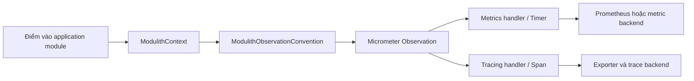
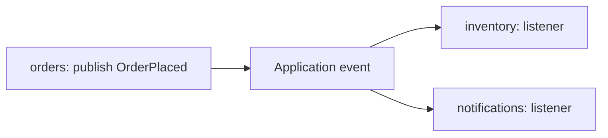

# Tùy chỉnh low-cardinality key values

## 1. Vấn đề: quan sát ranh giới module bằng những nhãn ổn định

Trong ứng dụng Spring Boot tổ chức theo **Spring Modulith**, các application module như `orders`, `inventory` và `notifications` cùng chạy trong một ứng dụng. Mỗi lần lời gọi đi vào API của module được instrument, Spring Modulith có thể tạo một **Micrometer Observation**. Observation đó có thể trở thành metric và span khi ứng dụng đã cấu hình các observation handler, registry và tracing bridge tương ứng.

Các trường được gắn lên observation cho phép trả lời: module nào đang xử lý, tương tác đến qua lời gọi Spring bean hay listener, hoạt động nào chậm hoặc lỗi. Nhưng không phải trường nào cũng nên làm **low-cardinality key value**, vì hệ thống metrics thường tạo một time series riêng cho mỗi tổ hợp nhãn.

Trong chương **Observation convention** của `SPRING_MODULITH_DOCUMENTATION_OBSERVABILITY`, bài này tập trung vào câu hỏi:

> Làm sao tùy chỉnh low-cardinality key values cho observation của Spring Modulith mà vẫn giữ được danh tính module, giới hạn số chuỗi metrics và không làm sai dữ liệu tracing?

Đây là một phần của mục tiêu tổng thể: sinh tài liệu ranh giới application module, xem module graph/Actuator và kết hợp event metrics, tracing, context propagation để kiểm chứng kiến trúc mô-đun khi hệ thống vận hành.

Sau bài này, bạn sẽ biết cách sử dụng `ModulithObservationConvention`, chọn nhãn ít giá trị, bổ sung nhãn dựa trên module được quan sát, đối chiếu dữ liệu thực tế và phân biệt convention này với customizer dành riêng cho event publication metrics.

## 2. Low-cardinality key value nghĩa là gì?

**Key value** là cặp khóa và giá trị đi kèm một observation, ví dụ `module.identifier=orders`. **Cardinality** là số giá trị khác nhau của một khóa hoặc số tổ hợp nhãn có thể xuất hiện trong một nhóm metric.

Micrometer phân biệt:

| Loại dữ liệu | Đặc điểm | Ví dụ | Ứng dụng chính |
| --- | --- | --- | --- |
| **Low cardinality** | Tập giá trị hữu hạn, nhỏ và có kiểm soát | `module.identifier=orders`, `architecture.domain=commerce` | Dùng cho metric tags và span attributes |
| **High cardinality** | Giá trị đa dạng, có thể tăng theo giao dịch hoặc request | `order.id`, URL chứa ID, phương thức có thông tin quá chi tiết | Chủ yếu phục vụ trace/log khi được phép; tránh dùng làm metric tag |

Trong Micrometer, các observation handler tạo meter mặc định sử dụng **low-cardinality key values** làm tag metrics; high-cardinality key values không được dùng làm meter tags vì có thể làm số time series tăng rất lớn. Tùy hệ thống tracing và handler, cả hai loại đều có thể trở thành thuộc tính trên span.

Giả sử một Timer `module.invocations` được ghi lại theo các nhãn:

```text
module.identifier = orders
module.name = Orders
module.invocation-type = bean
architecture.domain = commerce
```

Những giá trị này giúp nhóm vận hành lọc và tổng hợp theo ranh giới module. Đối lập, nếu thêm `order.id=<UUID mới cho từng đơn>` vào cùng Timer, ứng dụng có nguy cơ tạo một chuỗi metrics cho hầu như mỗi lần gọi.

### 2.1. Observation, metric và span liên quan thế nào?



Sơ đồ mô tả luồng khái niệm. Một observation **không tự bảo đảm** xuất hiện trên mọi backend: metric handler, tracing bridge, sampling, exporter và cấu hình Actuator đều phải phù hợp. `ModulithObservationConvention` quyết định tên và key values cho observation theo contract API, chứ không thay thế các thành phần truyền/xuất dữ liệu này.

## 3. Những key mặc định trên module entry observation

Spring Modulith nhận diện module thông qua mô hình `ApplicationModules`; observability hỗ trợ instrument những Spring component thuộc API của application module. Tài liệu về **Module Entry Span** mô tả các thuộc tính:

| Key | Ý nghĩa | Phân loại trong API `ModulithObservations` |
| --- | --- | --- |
| `module.identifier` | Định danh kỹ thuật của module | Low cardinality |
| `module.name` | Tên module dùng hiển thị | Low cardinality |
| `module.invocation-type` | Cách gọi vào module, như `bean` hoặc `event listener` | Low cardinality |
| `module.method` | Phương thức đang thực thi ở module entry | High cardinality |

Phân loại trên dựa vào `ModulithObservations.LowKeys` và `ModulithObservations.HighKeys` trong API Spring Modulith 2.2.x. Ví dụ một span nghiệp vụ có thể có:

```text
Trace ID: abc...
Service: shop-app
Span: module invocation
Attributes:
  module.identifier = orders
  module.name = Orders
  module.invocation-type = bean
  module.method = placeOrder(...)
```

Đây là dữ liệu minh họa, không phải cam kết về **span name** hoặc cách hiển thị chính xác của mọi backend. `service.name` nhận diện workload được triển khai, còn `module.identifier` nhận diện phần chức năng **bên trong** modular monolith; một trace có thể chứa nhiều module entry spans nhưng vẫn cùng `service.name`.

**Tùy chỉnh low-cardinality keys nên giữ lại các key module mặc định**. Nếu bỏ `module.identifier`, dashboard và trace rất khó nối về module graph hoặc metadata của `GET /actuator/modulith`. Nếu biến `module.method` thành low cardinality mà không đánh giá, có thể làm tăng số series theo số phương thức, overload và cách refactor mã nguồn.

## 4. `ModulithObservationConvention` là điểm mở rộng nào?

Spring Modulith cung cấp interface `org.springframework.modulith.observability.ModulithObservationConvention`, kế thừa `ObservationConvention<ModulithContext>` của Micrometer. `ModulithContext` chứa ngữ cảnh observation gắn với module và lời gọi được intercept.

Các phương thức liên quan gồm:

| Phương thức | Chức năng | Nên làm gì khi tùy chỉnh? |
| --- | --- | --- |
| `getLowCardinalityKeyValues(ModulithContext)` | Trả về những tag ít giá trị | Giữ các tag mặc định, bổ sung nhãn mới có tập giá trị giới hạn |
| `getHighCardinalityKeyValues(ModulithContext)` | Trả về key values chi tiết hơn | Thường giữ mặc định; không tự động chuyển sang low cardinality |
| `getName()` | Tên observation dùng cho instrumentation | Giữ tên mặc định nếu chưa có lý do và kế hoạch đổi metric |
| `getContextualName(ModulithContext)` | Tên ngữ cảnh dễ đọc của hoạt động | Giữ hoặc điều chỉnh khi có quy ước tracing thống nhất |
| `supportsContext(Observation.Context)` | Xác định context mà convention xử lý | Để cơ chế mặc định nhận `ModulithContext` khi không cần tùy biến |

Trong Spring Modulith 2.2, interface đã cung cấp **default methods**, thường ủy quyền việc lấy tên và key values về `ModulithContext`. Default convention được triển khai bằng `DefaultModulithObservationConvention.INSTANCE`. Vì vậy, một cách mở rộng đơn giản là implement interface và **override đúng phương thức low cardinality**, gọi lại implementation mặc định cho các khóa sẵn có.

Không nên tạo một convention bằng cách trả về duy nhất nhãn mới:

```java
// Anti-pattern: đánh mất các nhãn module mặc định.
@Override
public KeyValues getLowCardinalityKeyValues(ModulithContext context) {
    return KeyValues.of("architecture.domain", "commerce");
}
```

Đoạn minh họa trên dùng sai ý đồ vì loại bỏ `module.identifier`, `module.name`, `module.invocation-type`; đây không phải giải pháp nên áp dụng.

## 5. Cấu hình dependency để viết convention

Với các phiên bản Spring Modulith dùng cấu trúc artifact của dòng 2.2.x, ứng dụng có thể dùng **Insight starter** cho runtime và **Observability API** để code tùy chỉnh biên dịch được:

```xml
<dependencies>
    <!-- Cần trong compile classpath để import convention và context. -->
    <dependency>
        <groupId>org.springframework.modulith</groupId>
        <artifactId>spring-modulith-observability-api</artifactId>
    </dependency>

    <!-- Kích hoạt hỗ trợ Actuator và observability khi ứng dụng chạy. -->
    <dependency>
        <groupId>org.springframework.modulith</groupId>
        <artifactId>spring-modulith-starter-insight</artifactId>
        <scope>runtime</scope>
    </dependency>
</dependencies>
```

Sử dụng Spring Modulith BOM và dependency management tương thích Spring Boot để quản lý version, tránh trộn nhiều phiên bản API/runtime. Nếu dự án không dùng starter, có thể khai báo thành phần observability runtime tương ứng, ví dụ `spring-modulith-observability-core` ở dòng 2.2.x. Tên artifact từng thay đổi giữa các nhánh phiên bản; hãy đối chiếu tài liệu API đúng phiên bản đang triển khai.

Để quan sát HTTP management endpoint hoặc xuất traces ra hệ thống ngoài, còn cần cấu hình Spring Boot Actuator, Micrometer registry, tracing bridge và exporter tương thích. Có một `@Bean ModulithObservationConvention` **không tự bật tracing hay sinh dashboard**.

## 6. Ví dụ: thêm `architecture.domain` theo module ID

Giả sử nhóm quy định ba domain nghiệp vụ ổn định:

| Module ID | Domain quan sát | Lý do |
| --- | --- | --- |
| `orders` | `commerce` | Luồng đơn hàng |
| `payments` | `commerce` | Thanh toán |
| `inventory` | `fulfillment` | Quản lý tồn kho |
| `notifications` | `engagement` | Thông báo |
| Module mới chưa phân loại | `other` | Giá trị dự phòng hữu hạn |

Mục tiêu là thêm tag `architecture.domain` có **bốn giá trị tối đa** (`commerce`, `fulfillment`, `engagement`, `other`) vào các observation điểm vào module, giúp lọc dashboard theo domain nhưng vẫn biết module cụ thể.

Định nghĩa class `DomainModulithObservationConvention.java`:

```java
package com.example.shop.observability;

import io.micrometer.common.KeyValue;
import io.micrometer.common.KeyValues;
import org.springframework.modulith.observability.ModulithContext;
import org.springframework.modulith.observability.ModulithObservationConvention;

final class DomainModulithObservationConvention
        implements ModulithObservationConvention {

    @Override
    public KeyValues getLowCardinalityKeyValues(ModulithContext context) {
        String moduleId = context.getModule().getIdentifier().toString();

        String domain = switch (moduleId) {
            case "orders", "payments" -> "commerce";
            case "inventory" -> "fulfillment";
            case "notifications" -> "engagement";
            default -> "other";
        };

        // Giữ nguyên toàn bộ key mặc định của Spring Modulith.
        return ModulithObservationConvention.super
            .getLowCardinalityKeyValues(context)
            .and(KeyValue.of("architecture.domain", domain));
    }
}
```

Đây là ví dụ cho **Java 17+** dùng switch expression. `context.getModule().getIdentifier()` lấy identifier của module được framework quan sát. Tính năng này giúp tránh suy module ID từ tên class, URL HTTP hoặc `traceId`. Nếu dự án có nested modules hoặc quy tắc ID riêng, bảng mapping cần được quản lý tương ứng.

Đăng ký convention làm Spring bean qua class cấu hình `ModulithObservationConfiguration.java`:

```java
package com.example.shop.observability;

import org.springframework.context.annotation.Bean;
import org.springframework.context.annotation.Configuration;
import org.springframework.modulith.observability.ModulithObservationConvention;

@Configuration(proxyBeanMethods = false)
class ModulithObservationConfiguration {

    @Bean
    ModulithObservationConvention modulithObservationConvention() {
        return new DomainModulithObservationConvention();
    }
}
```

Lúc chạy, tích hợp Spring Modulith sẽ dùng convention bean phù hợp tại những module entry observations được instrument. Nếu ứng dụng có nhiều bean cùng kiểu convention, cơ chế chọn bean/auto-configuration cần được kiểm tra với phiên bản; tránh đăng ký nhiều convention cạnh tranh mà không có quy tắc rõ ràng.

### 6.1. Tại sao cách nối với giá trị mặc định quan trọng?

Đoạn:

```java
ModulithObservationConvention.super
    .getLowCardinalityKeyValues(context)
    .and(KeyValue.of("architecture.domain", domain));
```

thực hiện hai việc: lấy những key mặc định và nối thêm key nghiệp vụ. Về ý nghĩa, một observation có thể có:

```text
module.identifier = inventory
module.name = Inventory
module.invocation-type = bean
architecture.domain = fulfillment
```

Không cần ghi lại thủ công từng key mặc định. Cách ủy quyền này giảm nguy cơ bỏ sót tag sau khi nâng phiên bản framework. Tên observation, contextual name và high-cardinality values vẫn do các default methods điều khiển vì ví dụ không override chúng.

### 6.2. Có nên đưa môi trường vào `architecture.domain`?

Không. Domain ở đây là phân loại **trách nhiệm kiến trúc**; môi trường `dev`, `staging`, `production` là chiều **triển khai**. Nếu cần lọc theo môi trường, nên kiểm tra resource attributes hoặc nhãn hạ tầng đã có trong registry/collector, tránh tạo nhiều key khác nhau cùng biểu diễn `environment`.

## 7. Những yêu cầu với một tag low-cardinality tốt

| Tiêu chí | Cách đánh giá | Ví dụ đúng / sai |
| --- | --- | --- |
| Tập giá trị hữu hạn | Giá trị có thể được liệt kê hoặc giới hạn bằng enum | `commerce` đúng; `customerId` sai |
| Ổn định qua request | Không lấy dữ liệu ngẫu nhiên/tạo mới từng lần | Module ID đúng; UUID request sai |
| Ý nghĩa rõ ràng | Trả lời được câu hỏi dashboard hoặc cảnh báo | `architecture.domain` phân nhóm module |
| Dùng chung convention | Tất cả module dùng cùng quy tắc chuẩn hóa | `fulfillment`, tránh `Fulfillment`/`fulfilment` lẫn lộn |
| Không tiết lộ dữ liệu nhạy cảm | Không gắn email, mã thông báo, danh tính cá nhân | Bucket nghiệp vụ đúng; email sai |
| Không nhân đôi metadata | Kiểm tra tag có sẵn ở Modulith/OTel | Không thêm `app.module` nếu đã dùng `module.identifier` |
| Có chính sách thay đổi | Đổi tên module/domain cần cập nhật dashboard, alert | Ghi rõ mapping theo version |

Một lời gọi tới `orders` có thể có nhiều thuộc tính nghiệp vụ trong method arguments, nhưng `ModulithContext` chủ yếu phản ánh **module và method invocation**. Không nên dùng convention như điểm đọc bất kỳ tham số nghiệp vụ nào để tạo tag, đặc biệt là ID hoặc nội dung payload; dễ làm cardinality tăng và tạo rủi ro dữ liệu.

Khi cần metric cho các thuộc tính riêng của **event**, dùng công cụ phù hợp hơn là `ModulithEventMetricsCustomizer` (xem phần tiếp theo), với các giá trị đã được kiểm soát cardinality.

## 8. Phân biệt ba cơ chế mở rộng observability

| Cơ chế | Đối tượng chính | Khi nào dùng? | Điểm cần lưu ý |
| --- | --- | --- | --- |
| **`ModulithObservationConvention`** | Observation cho các điểm vào application module (`ModulithContext`) | Thêm/sửa tên hoặc low/high key values dựa trên module/entry context | Giữ các key mặc định để không mất khả năng đối chiếu kiến trúc |
| **`ModulithEventMetricsCustomizer`** | Counter cho một loại domain event được publish | Thêm tag nghiệp vụ hữu hạn như `sales.channel` vào counter riêng cho `OrderPlaced` | Không mặc định áp dụng cho mọi module span hoặc mọi counter tổng hợp |
| **Micrometer `ObservationFilter`** | Observation contexts đi qua registry mà filter được đăng ký | Quy tắc rộng hơn, ví dụ bổ sung một nhãn áp dụng cho nhiều loại observation | Có thể ảnh hưởng cả HTTP/DB và các observation ngoài Modulith; cần giới hạn phạm vi |

Ví dụ bài toán:

- Muốn nhóm **thời gian gọi vào module** theo `architecture.domain`: dùng `ModulithObservationConvention` như phần 6.
- Muốn nhóm **lần publish `OrderPlaced`** theo `sales.channel`: dùng `ModulithEventMetricsCustomizer`, không cố đọc toàn bộ event payload từ `ModulithContext`.
- Muốn thêm `deployment.environment` lên nhiều loại observation: cân nhắc **resource attribute/registry/collector** trước khi viết một filter toàn cục.

Hai khái niệm còn cần tách riêng: **module graph** mô tả dependency tĩnh, còn **Observation** mô tả phần thực thi được instrument. Một module có trong graph nhưng không có span của một request cụ thể không có nghĩa module đó đã biến mất khỏi hệ thống.

## 9. Cardinality và chi phí sau khi thêm key

Số time series phụ thuộc số **tổ hợp nhãn thực sự xuất hiện**. Một ước lượng biên trên đơn giản cho các chiều độc lập là:

\[
S_{\max} \leq \prod_{i=1}^{n} C_i
\]

với `C_i` là số giá trị của nhãn thứ `i`. Nhưng các chiều thường **không độc lập**. Trong ví dụ của phần 6, `architecture.domain` được suy ra một cách xác định từ `module.identifier`:

```text
module.identifier=orders        -> architecture.domain=commerce
module.identifier=payments      -> architecture.domain=commerce
module.identifier=inventory     -> architecture.domain=fulfillment
module.identifier=notifications -> architecture.domain=engagement
```

Điều này có một hệ quả quan trọng: **không thể tự động nhân số series lên bốn lần** chỉ vì `architecture.domain` có bốn giá trị. Với mỗi giá trị module ID, domain đã cố định; nếu các chiều khác không đổi, số tổ hợp label có thể **giữ nguyên** trước và sau khi thêm tag. Dù vậy, label mới vẫn tăng độ dài mỗi series, dữ liệu index và công sức bảo trì mapping.

Ví dụ sizing:

| Trường hợp | Giả định | Số chuỗi tối đa minh họa |
| --- | --- | ---: |
| Trước khi thêm domain | 4 module × 2 invocation type × 3 instance | 24 |
| Thêm domain **suy ra từ module ID** | Mỗi module ánh xạ đúng 1 domain | Vẫn tối đa 24 nếu không đổi các nhãn khác |
| Thêm một nhãn độc lập có 5 giá trị | Mỗi module/type/instance có thể gặp cả 5 giá trị | Tối đa 120 |
| Thêm `orderId` thay đổi từng request | Giá trị gần như vô hạn | Có thể tăng theo số giao dịch |

Số chuỗi thực tế có thể ít hơn biên trên vì không phải module nào cũng có listener và bean entry ở mọi instance. Ngoài chi phí cardinality, còn phải xem số samples, scrape payload, chi phí lưu trữ, backend indexing và latency truy vấn. Với một series scrape 30 giây/lần, nếu tồn tại và được xuất liên tục trong ngày thì có khoảng `86.400 / 30 = 2.880` samples/ngày; số này mới chỉ là một thành phần của ước lượng dung lượng.

### 9.1. Lựa chọn nhãn độc lập phải có lý do rõ

Một giá trị như `business.priority=HIGH/NORMAL/LOW` **có thể** hữu ích nếu mỗi module entry có thể thực sự được phân vào một nhóm trong tập hữu hạn. Nhưng lấy `priority` từ một request rồi đưa vào convention cần bảo đảm nguồn dữ liệu và cách xử lý ranh giới; nếu yêu cầu là đo theo đơn hàng cụ thể, metrics thường không phải công cụ phù hợp nhất.

**Không dùng một số lượng giá trị nhỏ được ước lượng từ vài request để kết luận nhãn có cardinality thấp.** Giá trị có thể tăng sau deploy, do người dùng nhập chuỗi mới hoặc do kết hợp với các tag khác.

## 10. Kiểm chứng observation sau khi áp dụng convention

Hãy thử trong **môi trường phát triển** với ít nhất hai luồng nghiệp vụ: một lời gọi vào module `orders`, một lời gọi vào `inventory`, và nếu ứng dụng hỗ trợ, một listener của `notifications`.

1. **Xác nhận code được instrument**: lời gọi đi qua Spring component thuộc API module; không phải mọi method nội bộ đều có module entry observation riêng.
2. **Xác nhận convention bean được tạo**: class cấu hình được Spring Boot quét, có dependency API/runtime phù hợp và không bị một cấu hình khác thay thế.
3. **Tạo traffic thực tế**: gọi API đặt hàng hoặc phát event hợp lệ để tạo observation.
4. **Kiểm tra meter**: dùng Spring Boot Actuator `/actuator/metrics` nếu đã cấu hình Micrometer meter handler/registry.
5. **Kiểm tra span**: nếu đã cấu hình tracing bridge và exporter, mở trace, kiểm tra các attributes `module.identifier`, `module.name`, `architecture.domain`.
6. **Đối chiếu metadata**: so với module graph và `GET /actuator/modulith` của **cùng build**; tên module phải khớp nguồn mô hình.

Ví dụ cấu hình Actuator tối thiểu cho dev:

```yaml
management:
  endpoints:
    web:
      exposure:
        include: health,metrics,modulith,prometheus
```

`prometheus` cần registry tương ứng; nếu không có, endpoint đó có thể không hiện diện. Các endpoint quản trị cần được bảo vệ trong production và đường dẫn thực có thể thay đổi theo cổng management và base path.

### 10.1. Đọc tag qua `/actuator/metrics`

Observation name mặc định của Modulith 2.2.x là `module.invocations` theo `ModulithContext.DEFAULT_CONVENTION_NAME`. Sau khi tạo traffic, thử:

```bash
curl -sS http://localhost:8080/actuator/metrics/module.invocations | jq .
```

Một phản hồi **minh họa**, rút gọn:

```json
{
  "name": "module.invocations",
  "measurements": [
    { "statistic": "COUNT", "value": 42.0 }
  ],
  "availableTags": [
    { "tag": "module.identifier", "values": ["orders", "inventory"] },
    { "tag": "module.invocation-type", "values": ["bean"] },
    { "tag": "architecture.domain", "values": ["commerce", "fulfillment"] }
  ]
}
```

Đây là JSON mô phỏng. Meter thực tế có thể có nhiều tag khác, tên và kết quả phụ thuộc Spring Boot/Micrometer handler, phiên bản và những lời gọi đã được instrument. Trước khi kết luận convention thất bại, hãy kiểm tra `GET /actuator/metrics` có liệt kê meter đó hay không.

Lọc một module và một domain bằng các query parameter `tag`:

```bash
curl -sS \
  'http://localhost:8080/actuator/metrics/module.invocations?tag=module.identifier:orders&tag=architecture.domain:commerce' \
  | jq .
```

Nếu Meter hiện không có tên này, kiểm tra danh sách meter thực tế, observation handler, việc tạo traffic và custom convention trước khi chọn tên khác.

### 10.2. Đọc span trên tracing backend

Sơ đồ span giả định sau khi instrument:

```text
trace: checkout
  HTTP POST /orders             (service.name=shop-app)
    module entry: orders        (module.identifier=orders,
                                 architecture.domain=commerce)
      module entry: inventory   (module.identifier=inventory,
                                 architecture.domain=fulfillment)
```

Thứ tự và quan hệ span phụ thuộc instrumentation, sampling và context propagation; đây là luồng mong đợi để kiểm tra, không phải bảo đảm mỗi bước đều có span. Tên module được xác định tại **module đang thực thi**, không phải sao chép nhãn của module gọi sang mọi span con.

## 11. Kiểm tra kết quả trong Prometheus/Grafana

Với Micrometer Prometheus registry và meter Timer được xuất, tên metric và label sẽ được chuẩn hóa theo naming convention của backend. **Đừng tự mặc định** mọi phiên bản đều đặt tên giống nhau; mở `/actuator/prometheus` để xem tên thực tế trước.

Giả sử metric được xuất với tên `module_invocations_seconds_count`, label `module_identifier` và `architecture_domain`, truy vấn PromQL minh họa:

```promql
sum by (architecture_domain) (
  rate(module_invocations_seconds_count[5m])
)
```

Kết quả là **tốc độ invocation được đo theo domain** (lần/giây), không phải số request HTTP và cũng không phải số publication event. Nếu một HTTP request đi qua nhiều module, có thể có nhiều module entry invocations được ghi nhận.

Với histogram/timer phù hợp đã được cấu hình để xuất bucket, có thể xem độ trễ phân vị bằng `histogram_quantile`, nhưng không nên viết truy vấn dựa trên `_bucket` nếu ứng dụng chưa bật histogram buckets và backend chưa có chuỗi tương ứng.

Để xem số tổ hợp nhãn đang tồn tại:

```promql
count by (module_identifier, architecture_domain) (
  module_invocations_seconds_count
)
```

Giá trị có thể phản ánh nhiều instance hoặc chiều nhãn khác nhau; cần hiểu cấu hình scrape trước khi xem nó là “số module”. Nếu một module bị đổi tên, các series cũ và mới có thể cùng xuất hiện một thời gian trong dữ liệu lịch sử. Dashboard cần quản lý việc đổi nhãn theo version.

## 12. Một điểm dễ nhầm: convention khác event counter customizer

Giả sử `orders` publish `OrderPlaced`, được `inventory` và `notifications` xử lý:



Observation của lời gọi module và **counter lần publish event** có nguồn instrument khác nhau. Ví dụ:

| Câu hỏi | Công cụ nên dùng |
| --- | --- |
| Tên module nào đang chạy trong một module entry span? | `ModulithObservationConvention` + tracing |
| Tần suất đi vào module `inventory` theo domain là bao nhiêu? | Timer/metric từ module entry observation với `architecture.domain` |
| Số lần publish `OrderPlaced` qua kênh `MOBILE` là bao nhiêu? | `ModulithEventMetricsCustomizer` tùy chỉnh counter của `OrderPlaced` |
| Listener `notifications` đã hoàn tất hay thất bại? | Event Publication Registry, listener metrics/logs và traces |

Một lần publish `OrderPlaced` có thể dẫn đến nhiều listener; không nên lấy count của module entry invocations làm số event được publish. Ngược lại, counter `module.events.published` không tự cho biết độ trễ và kết quả xử lý của từng listener.

Nếu listener chạy **bất đồng bộ**, trace context có thể phải được truyền qua executor hoặc broker. Việc truyền đúng `traceId` giúp liên hệ hành trình, còn `module.identifier`/`architecture.domain` tại listener cần được tính theo **module đích**. Một span bị tách trace do thiếu context propagation không nhất thiết có module tag sai.

## 13. Sai lầm phổ biến và cách xử lý

| Triệu chứng / sai lầm | Nguyên nhân hoặc rủi ro | Cách xử lý |
| --- | --- | --- |
| Sau tùy chỉnh không thấy `module.identifier` | Convention trả về chỉ các tag mới | Nối tag mới với `getLowCardinalityKeyValues` mặc định |
| `architecture.domain` có hàng nghìn giá trị | Lấy domain từ ID request/tenant hoặc input tự do | Dùng enum/bucket/mapping hữu hạn; đưa ID sang logs/traces |
| Đổi `getName()` làm dashboard cũ trống | Tên observation/meter thay đổi | Giữ tên mặc định hoặc cập nhật truy vấn có kiểm soát |
| Không thấy metric `module.invocations` | Chưa có traffic, Meter handler/registry chưa bật hoặc instrumentation không áp dụng | Kiểm tra startup, beans, đường gọi và metrics endpoint |
| Có trace nhưng không thấy nhãn mới | Span không phải module entry span, khác convention, exporter/processor loại bỏ tag | Kiểm tra đúng span, handler và pipeline |
| Thấy nhãn trên `orders` nhưng listener vẫn mang `orders` | Nhãn tự gắn theo producer bị sao chép sang consumer | Xác định module ở entry point listener từ `ModulithContext` |
| Không thấy span của phương thức `internal` | Module instrumentation không bao phủ mọi method | Kiểm tra bề mặt API và cơ chế intercept, không ép suy luận từ trace |
| Tag có vẻ ít giá trị nhưng series vẫn lớn | Kết hợp với nhiều chiều khác, instance và histogram | Đo active series, query latency, memory và scrape size |
| Không thấy `architecture.domain` trên counter `OrderPlaced` | Custom observation convention không áp dụng cho event counter tùy chỉnh | Dùng đúng event metrics customizer cho counter này |
| Graph và trace dùng tên module khác nhau | Khác build, module detection hoặc custom mapping | Đối chiếu module ID ở `ApplicationModules`/Actuator và bản chạy |

Nhớ rằng một thay đổi làm `modules.verify()` pass không có nghĩa metrics đã đúng, và một dashboard đẹp không chứng minh ranh giới module hợp lệ. **Verification kiểm tra kiến trúc tĩnh; observability mô tả hoạt động đã được instrument.**

## 14. Bài thực hành: thiết kế và xác minh low-cardinality keys

**Bối cảnh:** dự án có `orders`, `inventory` và `notifications`. Nhóm muốn báo cáo số lời gọi vào module và độ trễ theo domain nghiệp vụ mà không làm mất các tag module mặc định.

| Bước | Thao tác | Tiêu chí hoàn thành |
| --- | --- | --- |
| 1 | Liệt kê module ID qua `ApplicationModules` hoặc Actuator của cùng build | Có `orders`, `inventory`, `notifications` đúng như thiết kế |
| 2 | Định nghĩa mapping domain hữu hạn | `orders -> commerce`, `inventory -> fulfillment`, `notifications -> engagement` |
| 3 | Thêm `spring-modulith-observability-api` khi cần code compile, runtime Insight/Observability phù hợp | Context và convention có trên classpath |
| 4 | Implement `ModulithObservationConvention`, giữ low keys mặc định | Có thêm `architecture.domain` bên cạnh module ID/name/invocation type |
| 5 | Đăng ký một bean convention | Ứng dụng khởi động và instrumentation áp dụng đúng convention |
| 6 | Chạy lời gọi qua API từng module | Có module entry observations được hỗ trợ tạo ra |
| 7 | Xem `/actuator/metrics` và traces | Xác nhận tag và giá trị thực tế |
| 8 | Kiểm tra active series/heap/scrape | Không vượt ngân sách metrics của nhóm |
| 9 | Kích hoạt listener bất đồng bộ | Module đích được gắn tag đúng, correlation được kiểm tra riêng |
| 10 | So sánh với module graph, kiểm tra `modules.verify()` | Dữ liệu runtime phản ánh đúng danh tính module của kiến trúc |

### 14.1. Những câu hỏi cần tự trả lời

1. **Low-cardinality key value là gì?** Cặp khóa–giá trị có số giá trị tiềm năng hữu hạn và được kiểm soát, thích hợp cho metric tags.
2. **Tại sao không return chỉ `KeyValues.of("architecture.domain", "commerce")`?** Vì cách đó xóa các key mặc định dùng nhận diện module.
3. **Nên đọc module ID từ đâu?** Từ `ModulithContext`/module model mà Spring Modulith nhận diện, không từ HTTP path hoặc ID giao dịch.
4. **Domain có bốn giá trị có làm series nhân bốn không?** Không nhất thiết. Nếu domain suy ra một cách xác định từ module ID, số tổ hợp nhãn có thể không đổi.
5. **Metric cho biết listener `OrderPlaced` đã xử lý thành công chưa?** Timer module invocation và counter publish không tự khẳng định điều đó; cần đo outcome hoặc xem Event Publication Registry.
6. **Tại sao trace thiếu span chưa chứng minh module thiếu?** Vì có thể request chưa vào module, instrumentation chưa bao phủ phương thức, sampling hoặc context propagation không phù hợp.
7. **Khi nào dùng `ModulithEventMetricsCustomizer`?** Khi muốn thêm tag cho counter xuất bản một loại domain event cụ thể, thay vì module entry observation nói chung.

## 15. Nguyên tắc ghi nhớ

`ModulithObservationConvention` giúp tùy chỉnh các thuộc tính của observation tại ranh giới application module. Khi cần **thêm low-cardinality key values**, hãy mở rộng giá trị mặc định từ `ModulithContext`, dùng tên tag nhất quán và chọn tập giá trị hữu hạn, ổn định. Dùng `module.identifier`, `module.name`, `module.invocation-type` để nối dữ liệu quan sát với cấu trúc Spring Modulith; tránh đưa ID giao dịch hoặc thông tin cá nhân vào metric labels.

Tính cardinality dựa trên **tổ hợp nhãn thực tế**, đặc biệt lưu ý nhãn mới có thể phụ thuộc hoàn toàn vào một nhãn đã có và không làm tăng số series theo phép nhân đơn giản. Luôn kiểm tra bằng Actuator/Prometheus và trace backend, phân biệt module invocation observations với event publication counters, và dùng module graph cùng `modules.verify()` để kiểm chứng các quy tắc kiến trúc tĩnh.

### Tài liệu tham khảo

- [Spring Modulith — Production-ready Features](https://docs.spring.io/spring-modulith/reference/production-ready.html): module spans, event metrics và cách đăng ký `ModulithObservationConvention`.
- [Spring Modulith — `ModulithObservationConvention` API](https://docs.spring.io/spring-modulith/docs/current/api/org/springframework/modulith/observability/ModulithObservationConvention.html): các default methods và hợp đồng `ObservationConvention<ModulithContext>`.
- [Spring Modulith — `ModulithContext` API](https://docs.spring.io/spring-modulith/docs/current/api/org/springframework/modulith/observability/ModulithContext.html): module, invocation và low/high cardinality values.
- [Spring Modulith — `ModulithObservations.LowKeys` API](https://docs.spring.io/spring-modulith/docs/current/api/org/springframework/modulith/observability/ModulithObservations.LowKeys.html): các key ít giá trị mặc định.
- [Spring Modulith — `ModulithObservations.HighKeys` API](https://docs.spring.io/spring-modulith/docs/current/api/org/springframework/modulith/observability/ModulithObservations.HighKeys.html): `module.method`.
- [Micrometer — Observation Components](https://docs.micrometer.io/micrometer/reference/observation/components.html): convention, handlers và việc dùng low cardinality tags cho metrics.
- [Prometheus — Data Model](https://prometheus.io/docs/concepts/data_model/): nhãn và chuỗi thời gian.
