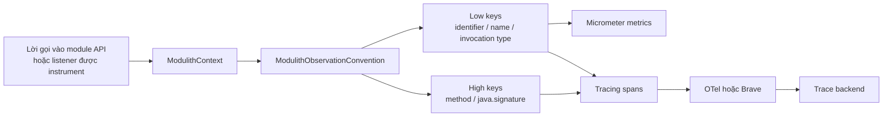

# Tùy chỉnh high-cardinality key values

> **Chương:** Observation convention  
> **Ngữ cảnh:** Spring Modulith trong ứng dụng Spring Boot. Bài này tập trung vào cách tùy chỉnh **high-cardinality key values** của observation tại điểm vào application module, đọc chúng trong tracing, và giữ nguyên các chiều metric có số giá trị hữu hạn.

## Mục tiêu học tập

Sau khi học, bạn có thể:

1. Giải thích low-cardinality và high-cardinality key values trong Micrometer Observation, cùng hệ quả đối với metrics và tracing.
2. Nhận diện các key mặc định của Spring Modulith trong một **module entry observation**, đặc biệt `module.method`.
3. Viết Spring bean `ModulithObservationConvention` để bổ sung high-cardinality key, **giữ các key mặc định** và không đổi tên observation ngoài ý muốn.
4. Chọn dữ liệu truy vết phù hợp, tránh đưa request ID hoặc dữ liệu nhạy cảm vào metric tags.
5. Kiểm chứng kết quả ở trace backend và chẩn đoán khi key tùy chỉnh không xuất hiện.

## 1. Nhu cầu thực tế

Giả sử ứng dụng `shop-service` có các application module:

```text
com.example.shop
├── ShopApplication.java
├── orders
│   ├── CheckoutService.java
│   └── OrderPlaced.java
├── pricing
│   └── PriceCalculator.java
└── inventory
    └── internal
        └── OnOrderPlaced.java
```

Module `orders` gọi một bean công khai tại `pricing.PriceCalculator`. Spring Modulith có thể tạo một **module entry observation** khi lời gọi đi vào module `pricing`. Khi Micrometer Tracing và exporter được cấu hình, observation ấy có thể trở thành span chứa metadata về module, phương thức và loại lời gọi.

Người vận hành cần phân biệt hai overload:

```java
BigDecimal calculate(String sku);
BigDecimal calculate(String sku, int quantity);
```

Một cách là thêm `module.java.signature` để nhìn thấy **chữ ký Java đầy đủ** trên span. Nhưng nếu đưa chữ ký hoặc một `orderId` thay đổi theo từng request vào metric label, hệ thống giám sát có thể tạo quá nhiều time series.

Bài toán đặt ra là: **thêm thông tin chi tiết vào trace như thế nào mà không làm sai số liệu metrics hoặc mất những key mặc định của Modulith?**

## 2. Low cardinality và high cardinality

**Cardinality** là số lượng giá trị khác nhau của một key trên tập dữ liệu quan sát.

| Tiêu chí | Low-cardinality key values | High-cardinality key values |
| --- | --- | --- |
| Số giá trị | Nhỏ, hữu hạn, có thể dự đoán | Có thể nhiều hoặc biến thiên lớn |
| Ví dụ | `module.identifier=orders`, `module.invocation-type=bean` | `business.correlation_id=<ID riêng>` |
| Đích sử dụng thường gặp | Metric labels và trace attributes | Trace attributes; không đưa vào metric labels theo convention thông thường |
| Hệ quả lưu trữ | Số series thường có thể quản lý | Không làm nở metric series nếu chỉ là high key, nhưng làm tăng dữ liệu trace |
| Hạn chế | Đổi giá trị nhiều lần có thể tách lịch sử metric | Phải kiểm soát bí mật, PII, kích thước, thời gian lưu |

Trong Micrometer, một `ObservationConvention<T>` có thể trả về hai tập `KeyValues`:

```java
KeyValues getLowCardinalityKeyValues(T context);
KeyValues getHighCardinalityKeyValues(T context);
```

Các observation handler dành cho metrics thường chỉ dùng **low-cardinality keys** để tránh nổ số lượng chuỗi số liệu. Tracing handler có thể dùng cả high và low keys để tạo span attributes. Dữ liệu có thực sự đến backend hay không còn tùy sampling, exporter, filtering và giới hạn attribute.

### 2.1. Hệ quả khi gắn ID riêng vào metric

Giả sử 100.000 lượt đặt hàng có 100.000 `orderId` khác nhau. Nếu dùng `orderId` làm label của timer hoặc counter:

```text
module.invocations{module="orders",orderId="A0001"}
module.invocations{module="orders",orderId="A0002"}
module.invocations{module="orders",orderId="A0003"}
...
```

Số lượng time series có thể tăng gần theo số đơn hàng. Khi thêm nhiều chiều như status, instance và environment, số kết hợp còn lớn hơn.

Đặt ID ở **high-cardinality span attribute** có thể giúp tra một lần xử lý cụ thể, nhưng cũng **không mặc nhiên an toàn**: trace có thời gian lưu, quyền truy cập và chi phí riêng. Đừng đưa email, token, thông tin thanh toán hoặc dữ liệu cá nhân thô vào tracing.

## 3. Key mặc định của module entry observation

Spring Modulith định nghĩa `ModulithObservations.LowKeys` và `ModulithObservations.HighKeys` cho observation lúc đi vào module.

| Key | Nhóm | Mô tả |
| --- | --- | --- |
| `module.identifier` | **Low** | Định danh logic của application module được đi vào |
| `module.name` | **Low** | Tên hiển thị của application module |
| `module.invocation-type` | **Low** | Loại lời gọi, ví dụ `bean` hoặc `event listener` |
| `module.method` | **High** | Phương thức được thực thi tại điểm vào module |

Các tên constant trên API:

```java
ModulithObservations.LowKeys.MODULE_IDENTIFIER;
ModulithObservations.LowKeys.MODULE_NAME;
ModulithObservations.LowKeys.INVOCATION_TYPE;
ModulithObservations.HighKeys.MODULE_METHOD;
```

Đây là các constant mô tả key, không phải lệnh gọi bắt buộc ở thời điểm khởi động.

**Điểm dễ nhầm:** tài liệu trace có thể liệt kê cả bốn thuộc tính trong cùng bảng "module entry span tags", nhưng ở mức Micrometer convention, `module.method` thuộc nhóm **high-cardinality**. Việc biết nhóm chính xác giúp tránh đưa nhầm method vào metric label.

### 3.1. Vì sao `module.method` là high key?

Thông tin một method cụ thể có ích khi điều tra span, chẳng hạn:

```text
module.identifier = pricing
module.method     = PriceCalculator.calculate(String,int)
```

Tập method được giới hạn theo một phiên bản phần mềm, nhưng số lượng có thể tăng theo hệ thống và mức chi tiết này thường chỉ cần cho tracing. Spring Modulith chủ động phân loại method ở nhóm high; các chiều tổng hợp như module và invocation type ở nhóm low.

### 3.2. Module graph và event metrics là nguồn khác

| Nguồn | Dữ liệu chính | Có chứa high-cardinality values của module entry span không? |
| --- | --- | --- |
| `/actuator/modulith` | Cấu trúc application module và dependencies | Không |
| `/actuator/metrics` | Meter name, measurements, available tags | Không kỳ vọng chứa high key như chiều metric |
| Tracing backend | Spans, parent-child, attributes, status | Có thể, nếu span được thu thập và exporter giữ thuộc tính |
| `module.events.published` | Số lượt event được công bố | Không được điều khiển bằng module entry convention |

Metric theo event và module entry observation phục vụ mục tiêu riêng. Một custom convention cho module entry **không tự động thay đổi** counter `module.events.published`.

## 4. API mở rộng của Spring Modulith

Spring Modulith cung cấp:

```java
org.springframework.modulith.observability.ModulithObservationConvention
org.springframework.modulith.observability.ModulithContext
```

`ModulithObservationConvention` là chuyên biệt của `ObservationConvention<ModulithContext>` và có các phương thức:

| Phương thức | Chức năng |
| --- | --- |
| `getName()` | Đặt tên kỹ thuật cho observation |
| `getContextualName(ModulithContext)` | Tên theo ngữ cảnh, hữu ích khi xem span |
| `getLowCardinalityKeyValues(ModulithContext)` | Các key dành cho nhóm dữ liệu tổng hợp |
| `getHighCardinalityKeyValues(ModulithContext)` | Các key dành cho thông tin truy vết chi tiết |
| `supportsContext(Observation.Context)` | Cho biết convention hỗ trợ loại context nào |

`ModulithContext` kế thừa `Observation.Context` và cung cấp:

```java
context.getModule();                  // Module được quan sát
context.getInvocation();              // MethodInvocation của lời gọi
context.getApplicationName();         // Tên ứng dụng, có thể null
context.getLowCardinalityValues();    // Low keys mặc định
context.getHighCardinalityValues();   // High keys mặc định
context.getContextualName();          // Tên theo ngữ cảnh
```

Default convention của Modulith sử dụng dữ liệu từ `ModulithContext`. Khi tùy chỉnh high keys, nên **lấy tập mặc định trước rồi bổ sung**, giữ nguyên những keys như `module.method`.

## 5. Chuẩn bị dependency và tracing

Nếu code ứng dụng trực tiếp import `ModulithObservationConvention`/`ModulithContext`, cần đặt artifact API ở **compile classpath**:

```groovy
dependencies {
    implementation 'org.springframework.modulith:spring-modulith-observability-api'
    runtimeOnly 'org.springframework.modulith:spring-modulith-starter-insight'
}
```

Ví dụ giả định Spring Boot và Spring Modulith BOM/dependency management đã chọn **phiên bản tương thích**. Không tùy tiện phối hợp jar Modulith từ các dòng khác nhau. Nếu muốn xem spans ở backend, cần thêm tracing bridge và exporter, ví dụ **Spring Boot 3.5 + OpenTelemetry/OTLP HTTP**:

```groovy
dependencies {
    implementation 'org.springframework.modulith:spring-modulith-observability-api'
    runtimeOnly 'org.springframework.modulith:spring-modulith-starter-insight'
    runtimeOnly 'io.micrometer:micrometer-tracing-bridge-otel'
    runtimeOnly 'io.opentelemetry:opentelemetry-exporter-otlp'
}
```

```yaml
spring:
  application:
    name: shop-service

management:
  tracing:
    sampling:
      probability: 1.0          # Chỉ phục vụ lab.
  otlp:
    tracing:
      endpoint: http://localhost:4318/v1/traces
  endpoints:
    web:
      exposure:
        include: health,info,modulith,metrics
```

Trong Spring Boot 4.x, nhóm tracing starter và đường cấu hình OTLP đã thay đổi. Hãy dùng tài liệu tương ứng với Boot đang chạy, không sao chép nguyên các properties Boot 3.5. Bên trong Docker/Kubernetes, `localhost` của ứng dụng không tự trỏ tới collector ở container/pod khác.

## 6. Ví dụ chính: bổ sung chữ ký Java method

Mục tiêu: bổ sung high key `module.java.signature` với chữ ký đầy đủ, ví dụ `public java.math.BigDecimal ...PriceCalculator.calculate(java.lang.String,int)`. Ta không đọc **giá trị argument** của method.

### 6.1. Đăng ký custom convention

```java
package com.example.shop.observability;

import io.micrometer.common.KeyValues;
import org.springframework.context.annotation.Bean;
import org.springframework.context.annotation.Configuration;
import org.springframework.modulith.observability.ModulithContext;
import org.springframework.modulith.observability.ModulithObservationConvention;

@Configuration(proxyBeanMethods = false)
class ModuleObservationConfiguration {

    @Bean
    ModulithObservationConvention moduleObservationConvention() {
        return new ModulithObservationConvention() {

            @Override
            public KeyValues getHighCardinalityKeyValues(ModulithContext context) {
                // Không làm mất module.method và high keys mặc định.
                KeyValues defaults =
                        ModulithObservationConvention.super
                                .getHighCardinalityKeyValues(context);

                // Đọc chữ ký khai báo method; không truy xuất argument runtime.
                String signature =
                        context.getInvocation().getMethod().toGenericString();

                return defaults.and("module.java.signature", signature);
            }
        };
    }
}
```

Các API được dùng:

- `getHighCardinalityKeyValues(ModulithContext)` là default method trên `ModulithObservationConvention`.
- `getInvocation()` cung cấp `MethodInvocation` của lời gọi đang được instrument.
- `getMethod().toGenericString()` cung cấp **chữ ký method Java**, không chạy lại logic nghiệp vụ.
- `KeyValues.and(String, String)` tạo tập `KeyValues` mới có thêm key và value.

Chỉ override phương thức high-cardinality giúp giữ cách hoạt động mặc định của `getName()`, `getContextualName(...)`, `getLowCardinalityKeyValues(...)` và `supportsContext(...)`.

### 6.2. Sai lầm làm mất key mặc định

Nếu viết:

```java
@Override
public KeyValues getHighCardinalityKeyValues(ModulithContext context) {
    return KeyValues.of(
            "module.java.signature",
            context.getInvocation().getMethod().toGenericString()
    );
}
```

bạn đang **thay toàn bộ** tập high keys mặc định. Khi đó `module.method` có thể biến mất khỏi span và làm hỏng query/dashboard đang dựa vào key này.

Thay vào đó:

```java
KeyValues defaults =
        ModulithObservationConvention.super.getHighCardinalityKeyValues(context);
return defaults.and("module.java.signature", signature);
```

Tránh đặt tên key mới trùng với `module.method`. Nếu muốn thay đổi key mặc định một cách chủ đích, phải hiểu quy tắc merge/deduplication của `KeyValues` và cập nhật hợp đồng truy vấn tracing liên quan.

### 6.3. Bean nghiệp vụ mẫu

```java
// com/example/shop/pricing/PriceCalculator.java
package com.example.shop.pricing;

import java.math.BigDecimal;
import org.springframework.stereotype.Service;

@Service
public class PriceCalculator {

    public BigDecimal calculate(String sku, int quantity) {
        return BigDecimal.valueOf(100000L * quantity);
    }
}
```

Module `orders` gọi `PriceCalculator` qua Spring bean ở API module. Khi điểm vào được Modulith instrument, một span minh họa có thể chứa:

```text
Span: pricing.PriceCalculator.calculate
  module.identifier      = pricing
  module.name            = Pricing
  module.invocation-type = bean
  module.method          = <giá trị mặc định do Modulith ghi nhận>
  module.java.signature  = public java.math.BigDecimal
                           com.example.shop.pricing.PriceCalculator
                           .calculate(java.lang.String,int)
```

Kết quả thực tế phụ thuộc kiểu proxy, method được intercept, phiên bản Modulith, tracer bridge và cách backend hiển thị attribute. Ví dụ này không hứa span name sẽ luôn có đúng chuỗi trên.

### 6.4. Có nên gọi chữ ký Java là high cardinality?

Số chữ ký Java trong một bản release là hữu hạn. Tuy vậy, chữ ký là **chi tiết kỹ thuật cấp method**, phù hợp hơn với tracing, và không cần tạo chiều metric theo từng method cho nhu cầu quan sát ranh giới module. Sử dụng high-key channel là một **quyết định thiết kế về nơi tiêu thụ dữ liệu**, không có nghĩa bất kỳ method signature nào cũng vô hạn hoặc nhạy cảm.

## 7. Nếu muốn dùng correlation ID của nghiệp vụ

Một `orderId` hoặc correlation ID đáng tin cậy có thể giúp điều tra nhiều lần xử lý. Nhưng cần rõ:

1. ID được hệ thống phát sinh/xác thực, không dùng chuỗi tùy ý người dùng gửi.
2. Không chứa email, số điện thoại, token, dữ liệu thanh toán hoặc PII.
3. Được giới hạn độ dài, kiểu ký tự và phạm vi lưu trữ.
4. Chỉ thêm vào **đúng observation/span** cần truy vết.
5. Không tự động chuyển thành metric label.

### 7.1. Observation nghiệp vụ do ứng dụng tạo

Nếu chỉ cần gắn correlation ID vào một bước nghiệp vụ cụ thể, có thể tạo observation riêng:

```java
package com.example.shop.orders.internal;

import io.micrometer.observation.Observation;
import io.micrometer.observation.ObservationRegistry;
import java.util.function.Supplier;
import org.springframework.stereotype.Component;

@Component
class CheckoutTracing {

    private final ObservationRegistry registry;

    CheckoutTracing(ObservationRegistry registry) {
        this.registry = registry;
    }

    <T> T observe(String correlationId, Supplier<T> action) {
        // correlationId đã được sinh và kiểm tra ở lớp gọi.
        return Observation.createNotStarted("orders.checkout", registry)
                .highCardinalityKeyValue("business.correlation_id", correlationId)
                .observe(action);
    }
}
```

Mã sử dụng:

```java
var result = checkoutTracing.observe(correlationId,
        () -> orderService.placeOrder(command));
```

Khi tracing được bật, observation này có thể tạo span mang `business.correlation_id`. Nó **không tự thêm** attribute đó vào mọi module entry span. Các spans con có thể được truy theo **cùng trace**, nhưng không mặc nhiên sao chép toàn bộ high-key attributes của span cha.

### 7.2. Muốn convention đọc thông tin từ context?

`ModulithContext` kế thừa API lưu metadata của `Observation.Context`, như `put(...)` và `get(...)`. Về mặt ý tưởng, nếu một thành phần **đã đặt** giá trị hợp lệ vào context trước thời điểm convention xử lý, custom convention có thể đọc:

```java
// Chỉ minh họa phần đọc giá trị; Modulith không tự tạo key này.
Object raw = context.get("business.correlation_id");
if (raw instanceof String correlationId && !correlationId.isBlank()) {
    return defaults.and("business.correlation_id", correlationId);
}
return defaults;
```

Đoạn này **không hoàn chỉnh nếu dùng độc lập**, vì còn phải có cơ chế đưa ID vào **đúng `ModulithContext`** đúng thời điểm. Không nên ngầm cho rằng `orderId` sẵn có chỉ vì module vừa xử lý đơn hàng. Kiểm tra lifecycle của Micrometer và tích hợp Modulith thực tế trước khi dùng cách này.

### 7.3. Không tự động lấy toàn bộ arguments

Đây là cách làm cần tránh:

```java
// KHÔNG dùng trong hệ thống thật.
String rawArgs =
        java.util.Arrays.toString(context.getInvocation().getArguments());
return defaults.and("module.arguments", rawArgs);
```

Argument của method có thể chứa password, API token, email, thông tin thanh toán và DTO rất lớn. Việc gọi `toString()` cũng có thể phát sinh chi phí hoặc lazy loading ngoài ý muốn. Hãy thiết kế **danh sách trường được phép**, chuẩn hóa và cắt ngắn giá trị nếu thực sự cần metadata riêng cho một lần thực thi.

## 8. Chọn đúng cơ chế mở rộng

| Cơ chế | Phạm vi | Nên dùng khi |
| --- | --- | --- |
| `ModulithObservationConvention` | Các module entry observations được Spring Modulith instrument | Muốn thêm high key có thể suy ra an toàn từ `ModulithContext` |
| `Observation.highCardinalityKeyValue(...)` | Một observation mà ứng dụng tự tạo/quản lý | Muốn thêm metadata cho một bước nghiệp vụ cụ thể |
| `ModulithEventMetricsCustomizer` | Counter publish event của Spring Modulith | Muốn thêm tag **cardinality thấp** theo loại domain event |
| `ObservationFilter` | Observation context theo lifecycle của Micrometer | Muốn điều chỉnh metadata có điều kiện; phải kiểm tra thời điểm chạy và phạm vi tác động |

`ModulithEventMetricsCustomizer` **không phải** API để bổ sung high-cardinality span attribute cho module entry. Ngược lại, `ModulithObservationConvention` không thay đổi trực tiếp counter `module.events.published`.

## 9. Hình dung dòng dữ liệu sau tùy chỉnh



Sơ đồ mang ý nghĩa logic: các observation handlers khác nhau có thể tiêu thụ tập giá trị khác nhau. Việc có high keys trong convention **không bảo đảm** chúng xuất hiện trên UI nếu không có sampled span hoặc exporter bỏ thuộc tính.

### 9.1. Vì sao `/actuator/metrics` không thấy high key?

Endpoint:

```http
GET /actuator/metrics
```

trả các meter/metrics trong Micrometer registry. High key `module.java.signature` không được kỳ vọng là một metric label. Vì vậy **không thấy nó tại endpoint này là bình thường**.

Để xác minh high key, hãy mở một **module entry span** trên trace UI và kiểm tra attributes. Nếu ứng dụng chỉ cài Micrometer metrics nhưng không có tracing bridge/exporter, không thể xác nhận high key thông qua tracing UI.

### 9.2. Event metrics và module spans độc lập về mục đích

Spring Modulith có counter `module.events.published` và các counter `module.events.published.<moduleIdentifier>.<simpleEventTypeName>`. Chúng trả lời câu hỏi **event đã được công bố bao nhiêu lần**; module entry spans trả lời **điểm vào module nào được gọi khi chạy**.

`module.method` hoặc `module.java.signature` không phải mặc định là chiều của các counter event. Nếu cần tùy chỉnh event counters, dùng SPI của event metrics và tránh tạo series theo từng `orderId`.

## 10. Quy trình kiểm chứng trong môi trường thực hành

### Bước 1 — Xác nhận module graph

Nếu Actuator đã được expose phù hợp:

```http
GET http://localhost:8080/actuator/modulith
```

Tìm `orders`, `pricing` và API được công bố. Endpoint này trình bày **cấu trúc kiến trúc**, không hiển thị high-cardinality values.

### Bước 2 — Xác nhận convention bean

Đảm bảo ứng dụng khởi động không lỗi classpath. Kiểm tra chỉ có một convention bean phù hợp với Modulith hoặc quy tắc lựa chọn bean là rõ ràng. Nếu IDE không nhận ra interface, kiểm tra `spring-modulith-observability-api` ở compile scope.

### Bước 3 — Gọi một nghiệp vụ đi qua module boundary

Thực hiện một request khiến `orders` gọi bean API tại `pricing.PriceCalculator`. Trong lab có thể đặt sampling 100% và bảo đảm collector/backend đang lắng nghe.

### Bước 4 — Tìm module entry span

Trên Zipkin/Tempo/Jaeger hoặc trace backend tương đương, tìm:

```text
module.identifier      = pricing
module.invocation-type = bean
module.method          = ...
module.java.signature  = ...
```

Kết quả kỳ vọng: cả key mặc định lẫn key mới cùng xuất hiện trong span. Nếu `module.method` biến mất sau thay đổi, xem lại method convention có **giữ defaults** hay không.

### Bước 5 — Kiểm tra metrics

Kiểm tra `/actuator/metrics` hoặc hệ thống lưu metrics. `module.java.signature` **không nên tự xuất hiện** như một label chỉ nhờ custom high-key convention. Nếu nó xuất hiện, tìm code thêm key đó vào `getLowCardinalityKeyValues(...)`, custom metric tags hoặc observation khác.

### Bước 6 — So sánh overload/proxy

Nếu có hai overload của `calculate`, chạy hai lời gọi và so `module.java.signature` trên các span. Nếu chữ ký hiện ra theo interface thay vì implementation, kiểm tra proxy và đối tượng `MethodInvocation` thay vì kết luận method không được thực thi.

### Bước 7 — Thử listener bất đồng bộ

Khi `inventory` có `@ApplicationModuleListener`, high key tùy chỉnh có thể xuất hiện trên listener span nếu nó được instrument. Tuy nhiên listener có thể ở trace khác nếu context tracing không được truyền qua executor. Custom convention **không sửa được lỗi context propagation**.

## 11. Những giới hạn quan trọng

### 11.1. High cardinality không đồng nghĩa bảo mật

Một high key có thể mang giá trị riêng từng yêu cầu, nhưng tracer/exporter vẫn có thể gửi nó qua mạng đến backend và lưu lại nhiều ngày. Không đưa thông tin định danh cá nhân, secrets, bearer tokens hoặc full request payload lên trace.

### 11.2. Span attributes cũng có chi phí

Ngay cả khi không làm nở metric time series, nhiều attributes có thể làm tăng dung lượng spans, chi phí lưu trữ, độ trễ export và công sức điều tra. Dùng một ít key có mục đích rõ ràng.

### 11.3. Có sampling và attribute filtering

Một observation có thể được tạo nhưng trace không được lấy mẫu. Collector hoặc backend có thể loại bớt attributes, cắt ngắn value hoặc áp dụng giới hạn số attributes. Khi không thấy key, hãy kiểm tra cả pipeline xuất dữ liệu.

### 11.4. Lời gọi phải được instrument

Không phải mọi method Java đều có module entry observation. Lời gọi nội bộ `this.method()`, object tạo bằng `new`, method riêng tư hoặc lời gọi không qua cơ chế Spring bean/proxy có thể không sinh span riêng. Custom convention chỉ tác động trên **observation đã được Modulith tạo**.

### 11.5. Lưu ý phiên bản API

Package và chữ ký API ở bài này dựa trên `ModulithObservationConvention`/`ModulithContext` được công bố từ Spring Modulith 1.4 và ở nhánh 2.x. Luôn kiểm tra dependency management và Javadoc tương ứng với thư viện trong ứng dụng. Không ghép một snippet tracing của Spring Boot 3.x với nhóm properties Boot 4.x.

## 12. Bảng xử lý sự cố

| Triệu chứng | Nguyên nhân có thể | Cách xử lý |
| --- | --- | --- |
| Không thấy module entry span | Không có lời gọi qua điểm vào được instrument hoặc thiếu tracing bridge/exporter | Kiểm tra module boundary, Spring bean, starter và backend |
| Có span nhưng thiếu `module.java.signature` | Custom convention bean chưa được dùng, method override sai hoặc exporter lọc thuộc tính | Kiểm tra bean, API signature và trace attributes |
| Mất `module.method` sau khi tùy chỉnh | Trả về `KeyValues.of(...)` và bỏ qua defaults | Dùng `ModulithObservationConvention.super.getHighCardinalityKeyValues(context)` trước `.and(...)` |
| Không thấy `module.java.signature` tại `/actuator/metrics` | Đây là **high** key dành cho trace | Xem tracing backend; hành vi này bình thường |
| Metric series tăng quá nhanh | Có request ID/argument bị đưa vào **low** key | Rà `getLowCardinalityKeyValues`, meter customizer và tags tự thêm |
| Signature thể hiện interface method | Proxy AOP trả method được intercept | Xem `context.getInvocation().getMethod()` và thiết kế proxy |
| Chữ ký dài hoặc nhiều giá trị khó đọc | Dùng `toGenericString()` và project có kiểu generic/phức tạp | Cân nhắc chỉ lưu signature tối giản có kiểm soát |
| Local thấy key, production không thấy | Sampling, exporter, collector attribute filtering hoặc build khác | So cấu hình/version và pipeline traces |
| Listener có span nhưng trace khác request | Mất trace context qua async executor | Kiểm tra task decorator, propagation và listener lifecycle |
| Trace có dữ liệu nhạy cảm | Trích toàn bộ method arguments hoặc baggage không kiểm soát | Loại trường, cập nhật chính sách logging/export |
| Ứng dụng không biên dịch custom convention | Thiếu `spring-modulith-observability-api` ở compile scope hoặc lệch version | Kiểm tra BOM và dependency scope |

## 13. Bài tập tự kiểm tra

**Tình huống A.** Bạn thấy `module.identifier=pricing`, `module.name=Pricing`, `module.invocation-type=bean`, `module.method=PriceCalculator.calculate(..)`. Trường nào thuộc high cardinality theo Modulith mặc định?

**Tình huống B.** Một custom convention chỉ trả `KeyValues.of("module.java.signature", signature)`. Vì sao cần sửa và sửa như thế nào?

**Tình huống C.** Nhóm vận hành muốn xem `orderId` trong trace nhưng không muốn tăng số series Prometheus. Dùng high-cardinality attribute có đủ chưa? Nêu ít nhất hai điều kiện bổ sung.

**Tình huống D.** Nhóm kinh doanh muốn thêm `sales-channel=web/mobile` (hai giá trị hữu hạn) cho counter `module.events.published.orders.OrderPlaced`. Nên dùng SPI nào?

**Tình huống E.** Span của `inventory.OnOrderPlaced` có `module.java.signature` nhưng traceId khác HTTP request đã phát event. Có thể sửa bằng cách thay đổi high keys không?

**Tình huống F.** High key không xuất hiện trong `/actuator/metrics`, nhưng có trong span trên Tempo. Đây là lỗi hay đúng thiết kế?

### Gợi ý đáp án

1. **`module.method`** là high; ba key còn lại thuộc low.
2. Vì làm mất high keys mặc định; lấy default bằng `ModulithObservationConvention.super.getHighCardinalityKeyValues(context)` rồi `.and("module.java.signature", signature)`.
3. Chưa đủ. Cần ID hợp lệ đã kiểm soát, tránh PII, giới hạn độ dài, kiểm tra retention/quyền truy cập và gắn đúng span. Không đưa ID vào low tags.
4. Dùng **`ModulithEventMetricsCustomizer`**, không dùng module entry convention.
5. **Không.** Cần xem async executor và context propagation; high-key metadata không quyết định trace parent-child.
6. **Đúng thiết kế.** High values dành cho tracing, không phải metric tags mặc định.

## 14. Checklist thực hành

- [ ] Đã xác định đúng loại observation cần tùy chỉnh là **module entry observation**.
- [ ] Đã có API artifact ở compile classpath và Insight/instrumentation ở runtime.
- [ ] Đã giữ mặc định từ `ModulithObservationConvention.super`.
- [ ] Key mới không trùng key mặc định hoặc gây hiểu nhầm ý nghĩa.
- [ ] Không lấy toàn bộ method arguments, secrets hoặc PII.
- [ ] Không gắn giá trị biến thiên lớn vào low-cardinality metric tags.
- [ ] Đã xác minh key mới và `module.method` cùng xuất hiện trên module span.
- [ ] Đã kiểm tra sampling, exporter và giới hạn attributes nếu thiếu key.
- [ ] Đã đối chiếu listener async với context propagation nếu có.
- [ ] Đã ghi quy ước key, tên và quyền truy cập trace vào tài liệu vận hành.

## 15. Ghi nhớ

`ModulithObservationConvention` là điểm mở rộng dành cho metadata của **module entry observations** trong Spring Modulith. Khi ghi đè `getHighCardinalityKeyValues(ModulithContext)`, hãy bắt đầu từ **high keys mặc định** rồi bổ sung thông tin có mục đích. Key `module.method` vốn là high cardinality; `module.identifier`, `module.name` và `module.invocation-type` là low cardinality.

High-cardinality key values phục vụ điều tra chi tiết trên trace; chúng không thay thế metric labels, không tự có giá trị nghiệp vụ từ method arguments và không tự bảo đảm propagation qua async. Kết hợp module graph, traces, event metrics và dữ liệu nghiệp vụ để kiểm chứng ranh giới mô-đun trong lúc ứng dụng Spring Boot vận hành.

### Tài liệu tham khảo

- [Spring Modulith — Production-ready Features](https://docs.spring.io/spring-modulith/reference/production-ready.html): module entry spans, conventions và event metrics.
- [Spring Modulith — ModulithObservationConvention API](https://docs.spring.io/spring-modulith/docs/current/api/org/springframework/modulith/observability/ModulithObservationConvention.html): phương thức của custom convention.
- [Spring Modulith — ModulithContext API](https://docs.spring.io/spring-modulith/docs/current/api/org/springframework/modulith/observability/ModulithContext.html): dữ liệu context và high/low default values.
- [Spring Modulith — ModulithObservations.HighKeys](https://docs.spring.io/spring-modulith/docs/current/api/org/springframework/modulith/observability/ModulithObservations.HighKeys.html): `MODULE_METHOD`.
- [Spring Modulith — ModulithObservations.LowKeys](https://docs.spring.io/spring-modulith/docs/current/api/org/springframework/modulith/observability/ModulithObservations.LowKeys.html): `MODULE_IDENTIFIER`, `MODULE_NAME`, `INVOCATION_TYPE`.
- [Micrometer — Observation](https://docs.micrometer.io/micrometer/reference/observation.html): Observation API, conventions và handlers.
- [Spring Boot — Observability](https://docs.spring.io/spring-boot/reference/actuator/observability.html): cấu hình Observation, metrics và tracing.
