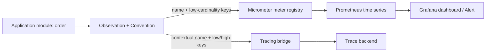
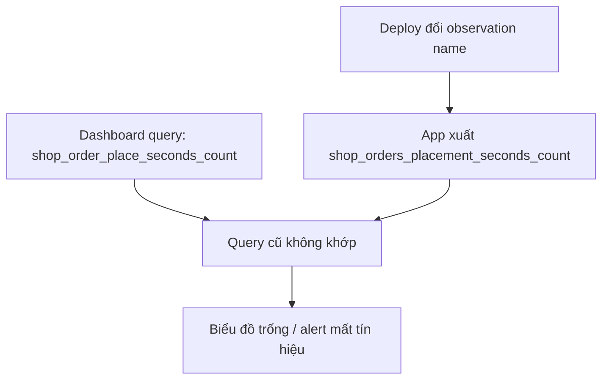
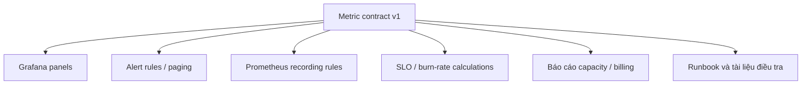

# Tránh thay đổi convention làm hỏng dashboard

Trong một ứng dụng Spring Boot xây dựng bằng **Spring Modulith**, việc thay đổi cách đặt tên *observation*, *metric* hoặc *tag* có thể làm dashboard và cảnh báo ngừng hiển thị dữ liệu dù luồng nghiệp vụ vẫn hoạt động bình thường. Ví dụ, nhóm phát triển đổi tên observation từ `shop.order.place` thành `shop.orders.placement` cho “dễ đọc hơn”. Sau khi triển khai, truy vấn Prometheus cũ đang tìm `shop_order_place_seconds_count` có thể không còn khớp; biểu đồ đột nhiên trống và cảnh báo dựa trên dữ liệu đó mất hiệu lực.

Tình huống này không nhất thiết là lỗi của Spring Modulith hay Prometheus. Đây là **thay đổi hợp đồng dữ liệu quan sát (observability contract)** mà các bên tiêu thụ như Grafana dashboard, PromQL alert, báo cáo SLO và quy trình xử lý sự cố đang phụ thuộc.

Bài thuộc chương **Observation convention** của học phần `SPRING_MODULITH_DOCUMENTATION_OBSERVABILITY`. Học phần hướng dẫn sinh tài liệu ranh giới *application module* và quan sát tương tác giữa các phần của ứng dụng Spring Boot qua module graph, Actuator, event metrics, tracing và context propagation. Ở đây, trọng tâm là **giữ ổn định convention khi phát triển và nâng cấp**, hoặc chuyển đổi có kiểm soát khi bắt buộc phải thay đổi.

Sau bài học, bạn có thể giải thích convention gồm những thành phần nào; chỉ ra tác động lên metrics/traces/dashboard; xây dựng quy ước tên và tag có phiên bản; kiểm tra bằng Actuator/Prometheus; và thực hiện migration an toàn qua local, staging, production.

> **Phạm vi ví dụ:** mô hình Micrometer Observation của Spring Boot 3.x, kết hợp Spring Modulith 1.4.x để minh họa cách đăng ký `ModulithObservationConvention`. Tên meter, package API và cấu hình mặc định có thể thay đổi ở các dòng Spring Boot/Modulith khác; luôn kiểm tra dependency management và dữ liệu xuất ra từ chính phiên bản dự án.

## 1. Observation convention là hợp đồng giữa code và hệ thống quan sát

Một `ObservationConvention` trong Micrometer quy định tên và metadata của một loại thao tác được quan sát. Các phương thức quan trọng gồm:

| Phương thức | Vai trò | Hệ quả khi đổi |
| --- | --- | --- |
| `getName()` | Tên kỹ thuật của observation, thường được dùng để hình thành tên meter/timer | Truy vấn metric theo tên cũ có thể mất dữ liệu |
| `getContextualName(context)` | Tên theo ngữ cảnh, thường giúp đọc tên span trong trace | Tìm kiếm hoặc bộ lọc span theo tên cũ có thể không còn khớp |
| `getLowCardinalityKeyValues(context)` | Các cặp key/value có tập giá trị giới hạn | Metrics labels, nhóm dữ liệu, alert và dashboard có thể đổi |
| `getHighCardinalityKeyValues(context)` | Metadata nhiều giá trị, thường phục vụ trace | Truy vấn chi tiết trace hoặc tương quan sự cố có thể bị ảnh hưởng |
| `supportsContext(context)` | Chọn đúng loại context mà convention hỗ trợ | Sai điều kiện có thể làm convention không áp dụng hoặc áp dụng quá rộng |

**Phân biệt hai tên:** `getName()` và `getContextualName(...)` không đồng nghĩa. Đổi tên hiển thị span chưa chắc đổi tên meter, trong khi đổi tên kỹ thuật có thể tạo một metric family khác hoàn toàn. Trong ứng dụng có tracing, các low-cardinality key values thường cũng được bổ sung vào span; high-cardinality values được dùng cho tracing, không trở thành meter tags ở handler chuẩn.



Có thể coi tên và các tag của metric như **schema của một bảng dữ liệu**. Đổi `order.channel` thành `sales.channel` gần giống đổi tên cột: chương trình vẫn ghi dữ liệu nhưng các truy vấn dựa vào cột cũ cần được cập nhật.

### Phạm vi của “convention”

Ngoài API `ObservationConvention`, hợp đồng monitoring còn bị ảnh hưởng bởi:

- Quy tắc đổi tên của từng backend: Micrometer name `shop.order.place` có thể xuất sang Prometheus dưới dạng `shop_order_place_seconds_count` hoặc tên tương đương, tùy loại meter và registry.
- `MeterFilter` có thể đổi meter ID, rename tag, thay giá trị hoặc từ chối meter.
- Common tags như `application`, `environment` hoặc `region`.
- Tên của event counters Spring Modulith và các tag module/event.
- Cấu hình collection/exporter và các dashboard/recording rules bên ngoài ứng dụng.

Vì vậy, cần kiểm tra **cả tên gốc trong Actuator lẫn tên sau chuyển đổi trên backend**.

## 2. Ví dụ một lần đổi tên gây mất biểu đồ

Giả sử module `order` được instrument bằng observation tên `shop.order.place`. Ứng dụng dùng Micrometer Timer và Prometheus registry. Bộ đo có thể được xuất thành các series tương tự:

```text
# Tên Prometheus minh họa; xác nhận ở /actuator/prometheus của dự án thật.
shop_order_place_seconds_count{order_channel="web",outcome="success"} 100
shop_order_place_seconds_sum{order_channel="web",outcome="success"} 14.2
```

Một dashboard Grafana đang dùng:

```promql
sum by (order_channel) (
  rate(shop_order_place_seconds_count[5m])
)
```

Người viết code sau đó thay convention:

```text
Trước: getName() -> "shop.order.place"
Sau:   getName() -> "shop.orders.placement"
```

Với cùng Prometheus registry, tên series có thể chuyển sang:

```text
shop_orders_placement_seconds_count
shop_orders_placement_seconds_sum
```

Khi đó dashboard cũ không tìm thấy series mang tên đã hard-code. Nếu alert dựa trên chuỗi cũ, alert có thể trở thành **no data**, bị ngắt hoặc có trạng thái khác nhau theo cấu hình đánh giá của hệ thống cảnh báo.



**Điểm quan trọng:** việc thiếu metric không chứng minh request đặt hàng không chạy. Để khẳng định nguyên nhân, hãy xem meter đang có trên ứng dụng, payload Prometheus, trạng thái scrape và truy vấn đang dùng ở dashboard.

### Các thay đổi phá hợp đồng khác

| Thay đổi | Ví dụ | Tác động |
| --- | --- | --- |
| Đổi observation name | `shop.order.place` → `shop.orders.placement` | Truy vấn theo metric name cũ mất kết quả |
| Đổi tag key | `module.identifier` → `module.id` | `sum by(...)`, filter/alert và nhãn dashboard bị đổi |
| Đổi tag value | `channel=mobile` → `channel=app` | Series lịch sử và series mới bị tách |
| Xóa một tag | Bỏ `operation.result` | Không còn lọc theo success/failure như trước |
| Thêm một tag low cardinality | Thêm `region` | Mở rộng số series; query tổng hợp cần xem lại chiều nhóm |
| Đưa ID vào low tags | `order.id=...` | Tăng cardinality, chi phí và nguy cơ rò rỉ dữ liệu |
| Đổi contextual name | `place order` → `order workflow` | Bộ lọc trong trace backend theo span name có thể mất kết quả |
| Đổi loại meter/unit | Timer tính giây sang metric khác | Query về rate/latency có thể sai hoặc không còn ý nghĩa |
| Nâng BOM đổi semantic conventions | Thay đổi version Micrometer/Boot/Modulith | Cần kiểm tra lại metric names, tags và dữ liệu xuất ra |

Không phải mọi thay đổi đều cần giữ tương thích mãi mãi, nhưng cần **đánh giá ai đang phụ thuộc vào schema cũ** trước khi sửa.

## 3. Đặc điểm riêng của Spring Modulith

Spring Modulith quan sát tương tác giữa các *application module*, chẳng hạn module `order` gọi API công khai của `payment` hoặc `inventory`. Với thành phần observability phù hợp, framework có thể tạo observation/span ở ranh giới module.

Theo tài liệu Spring Modulith, thông tin liên quan tới module có thể gồm:

| Key xuất hiện ở module entry observation/span | Ý nghĩa |
| --- | --- |
| `module.identifier` | Identifier logic của application module |
| `module.name` | Tên module dành cho hiển thị |
| `module.invocation-type` | Loại lời gọi, ví dụ method của bean hoặc event listener |
| `module.method` | Phương thức được thực thi |

Việc những key này nằm trong meter tags hay span attributes cần đối chiếu với **convention và instrumentation của đúng phiên bản**. Không nên tự suy rằng toàn bộ các key trên đều là low cardinality. Chẳng hạn `module.method` có thể có nhiều giá trị hơn `module.identifier` và việc ghi nó vào metric tags sẽ ảnh hưởng chi phí.

Spring Modulith **1.4.x** cung cấp interface `org.springframework.modulith.observability.support.ModulithObservationConvention` để tùy chỉnh observation module. Có thể đăng ký một bean kiểu này trong Spring:

```java
@Configuration(proxyBeanMethods = false)
class ModulithObservabilityConfiguration {

    @Bean
    ModulithObservationConvention modulithObservationConvention() {
        return new ReviewedModulithObservationConvention();
    }
}
```

Đoạn trên minh họa **điểm mở rộng**, giả định bạn đã tự định nghĩa `ReviewedModulithObservationConvention` và dùng import phù hợp. Đây chưa phải class Java hoàn chỉnh. Việc triển khai convention phải làm rõ `getName()`, `getContextualName(...)`, low/high key values và cách tạo giá trị từ `ModulithContext`. Nếu chỉ muốn đổi cách hiển thị trên dashboard, có thể đổi nhãn hiển thị trong Grafana mà **không cần** thay convention được xuất bởi ứng dụng.

**Đừng sao chép nguyên tên package từ ví dụ 1.4.x sang Spring Modulith 2.x**. Ở các dòng hiện hành, package của `ModulithObservationConvention` có thể khác. `DefaultModulithObservationConvention` của 1.4.x cũng không phải một class public để kế thừa tùy ý từ ứng dụng; hãy dựa trên API được công bố.

### Modulith convention và event metrics customizer khác nhau

Spring Modulith còn có các counter cho domain event publications:

- `module.events.published`: metric tổng hợp.
- `module.events.published.$moduleIdentifier.$simpleEventTypeName`: metric riêng theo loại event.

`ModulithEventMetricsCustomizer` bổ sung tags vào **individual event counters**. Nó **không đồng nghĩa** với `ModulithObservationConvention` tùy chỉnh observation của lời gọi qua ranh giới module. Khi nâng cấp, phải kiểm kê **cả hai nhóm** nếu dashboard sử dụng chúng.

Ví dụ một dashboard lọc `module_identifier="order"` trên Prometheus có thể dựa trên tag `module.identifier` gốc được registry chuẩn hóa. Nếu team đổi identifier `order` thành `sales` hoặc thay cách normalize tag, truy vấn và dữ liệu lịch sử cũng có thể bị ảnh hưởng. Việc thay display name của module chỉ là thay đổi trình bày trong kiến trúc, nhưng khi display name được dùng trực tiếp như tag value ở metric thì thay đổi đó cũng có thể tạo series mới.

## 4. Viết convention ổn định cho observation do ứng dụng sở hữu

Trước khi sửa convention mặc định của framework, hãy thực hành với **observation nghiệp vụ do ứng dụng tự định nghĩa**. Ví dụ `shop.order.place` được coi là tên kỹ thuật ổn định; kênh đặt hàng là low cardinality, còn một correlation ID chỉ dành cho trace khi chính sách dữ liệu cho phép.

Ta tạo một `Observation.Context` riêng để convention có kiểu dữ liệu rõ ràng:

```java
package com.example.shop.observation;

import io.micrometer.observation.Observation;

final class PlaceOrderContext extends Observation.Context {

    private final String channel;
    private final String correlationId;

    PlaceOrderContext(String channel, String correlationId) {
        this.channel = channel;
        this.correlationId = correlationId;
    }

    String channel() {
        return channel;
    }

    String correlationId() {
        return correlationId;
    }
}
```

Định nghĩa convention:

```java
package com.example.shop.observation;

import io.micrometer.common.KeyValues;
import io.micrometer.observation.Observation;
import io.micrometer.observation.ObservationConvention;

public final class PlaceOrderObservationConvention
        implements ObservationConvention<PlaceOrderContext> {

    public static final String NAME = "shop.order.place";

    @Override
    public boolean supportsContext(Observation.Context context) {
        return context instanceof PlaceOrderContext;
    }

    @Override
    public String getName() {
        // Tên hợp đồng metric; không đổi chỉ vì muốn thay tiêu đề dashboard.
        return NAME;
    }

    @Override
    public String getContextualName(PlaceOrderContext context) {
        // Tên dễ đọc trên trace; nếu đổi, kiểm tra query span name.
        return "place order";
    }

    @Override
    public KeyValues getLowCardinalityKeyValues(PlaceOrderContext context) {
        return KeyValues.of("order.channel", context.channel());
    }

    @Override
    public KeyValues getHighCardinalityKeyValues(PlaceOrderContext context) {
        return KeyValues.of("order.correlation_id", context.correlationId());
    }
}
```

Nếu sử dụng convention này tại một service:

```java
// Mã bên trong service đã được inject ObservationRegistry.
// channel phải là giá trị đã chuẩn hóa: web, mobile hoặc pos.
// correlationId chỉ là mã giả lập được phép đưa vào trace.

Observation.createNotStarted(
        new PlaceOrderObservationConvention(),
        () -> new PlaceOrderContext(channel, correlationId),
        observationRegistry)
    .observe(() -> {
        // Thực hiện logic đặt hàng ở đây.
    });
```

Cú pháp trên sử dụng overload `Observation.createNotStarted(ObservationConvention<T>, Supplier<T>, ObservationRegistry)` của Micrometer Observation. Các biến `channel`, `correlationId` và `observationRegistry` có sẵn trong service; đoạn này minh họa phần gọi chứ không phải một class tự biên dịch độc lập.

**Quy tắc quan trọng trong ví dụ:** giữ ổn định `NAME` và key `order.channel` vì dashboard sẽ dùng chúng. Khi muốn đổi câu hiển thị “place order” sang tiếng Việt trong Grafana, ưu tiên sửa **panel title**; chỉ đổi `getContextualName(...)` khi đã kiểm tra những bộ lọc trace theo span name.

### Tại sao chọn low/high như vậy?

- `order.channel` chỉ nhận ba giá trị, có thể dùng để nhóm metrics và traces.
- `order.correlation_id` có thể khác cho từng lượt xử lý, nên chỉ là high-cardinality attribute nếu cần; không đưa vào metric labels.
- Giá trị `correlationId` không được chứa token, email hoặc dữ liệu cá nhân không được phép. High cardinality không có nghĩa là tự động an toàn.
- Tên `shop.order.place` nên phản ánh một **loại thao tác**, không tạo tên động như `shop.order.place.ORD-12345`.

Một observation có thể có các tags bổ sung bởi Spring Boot common tags hoặc các observation filters khác. Vì vậy, cần kiểm tra tổng bộ labels thực tế sau khi các handler và meter filters hoạt động.

## 5. Chia sẻ và quản lý hợp đồng tên/tag như một API

Conventions cần được quản lý có chủ đích. Hãy lập một bảng “observability contract” ngay trong tài liệu kiến trúc hoặc bộ quy ước nội bộ:

| Thành phần hợp đồng | Ví dụ ổn định | Quy ước |
| --- | --- | --- |
| Observation/meter name | `shop.order.place` | Không chứa ID hoặc giá trị theo request |
| Loại meter | Timer | Duration đo bằng đơn vị do registry chuẩn hóa |
| Low tag key | `order.channel` | Giữ tên nhất quán giữa các module |
| Low tag values | `web`, `mobile`, `pos` | Dùng enum/mapping có kiểm soát |
| Low tag key | `operation.result` | Sử dụng vocabulary hữu hạn |
| High attribute | `order.correlation_id` | Chỉ trace nếu chính sách cho phép |
| Nguồn dữ liệu | Actuator/Micrometer | Backend Prometheus/Grafana được chỉ định |
| Consumers | Panel/alerts/recording rules/SLO | Có người sở hữu và được review khi sửa |
| Compatibility policy | Giữ trong cùng release line | Thay đổi phá vỡ phải có kế hoạch migration |

Trong nhóm phát triển, một thay đổi thuộc những cột **meter name, tag key, tag values, unit, metric type** phải được review tương tự thay đổi API. Khi nâng cấp thư viện, hãy so sánh **kết quả runtime** với bảng trên vì việc giữ nguyên source code không bảo đảm mọi semantic convention mặc định đều bất biến.

### Quy tắc đặt tên có thể áp dụng

1. Dùng danh từ/hành động ổn định cho tên observation, ví dụ `shop.order.place`, không dùng mã phiên bản trong tên nếu không có chiến lược rõ.
2. Key low-cardinality diễn đạt một chiều nhóm có giá trị hữu hạn; ví dụ `order.channel`, `operation.result`.
3. Chuẩn hóa tag values trước khi ghi (chữ thường, định nghĩa enum, quy tắc cho `unknown`).
4. Ghi rõ unit của timer, counter hoặc gauge và kiểm tra cách backend đổi đơn vị.
5. Không dùng display name đa ngôn ngữ làm tag kỹ thuật nếu dễ bị chỉnh sửa trong tài liệu.
6. Không dùng raw URL path, exception message, ID đơn hàng, email khách hàng làm metric tags.
7. Đặt tên và tag chung trong hằng số, convention hoặc tài liệu dùng chung để tránh mỗi module viết một kiểu.

## 6. Tại sao thay đổi tag key hoặc tag value cũng có thể “phá” dashboard?

Giả sử counter dùng tag:

```text
module.identifier=order
operation.result=success
```

Một dashboard lọc:

```promql
sum(
  rate(shop_order_place_seconds_count{
    module_identifier="order",
    operation_result="success"
  }[5m])
)
```

Tùy registry và kiểu metric, tên thực tế có thể khác ví dụ trên. Nếu đổi giá trị `module.identifier=order` thành `sales`, biểu thức lọc cứng theo `order` không còn dữ liệu mới. Nếu đổi key `operation.result` thành `outcome`, query theo `operation_result` cũng không còn khớp.

**Cũng cần xem lại câu hỏi nghiệp vụ khi thêm tag.** Ví dụ thêm `region` vào timer có thể tăng số series theo vùng. Một dashboard tổng hợp bằng `sum(rate(...))` vẫn tính đủ nếu scraping đầy đủ, nhưng dashboard biểu diễn theo `sum by (...)` hoặc filter không phù hợp có thể thay đổi ý nghĩa. Nếu tag có giá trị vô hạn, số series có thể tăng mạnh dù biểu đồ vẫn nhìn có vẻ đúng.

### Khác biệt giữa chỉ đổi cách hiển thị và đổi dữ liệu

| Nhu cầu | Cách thay đổi ít tác động nhất |
| --- | --- |
| Đổi tên ô “Đặt hàng” trên Grafana | Đổi **panel title** |
| Muốn hiển thị `web` thành “Website” trên biểu đồ | Dùng value mapping/legend ở dashboard |
| Muốn đổi span name để dễ đọc | Đánh giá các truy vấn span name và search rules trước |
| Muốn đổi metric name | Cần migration có phiên bản, cập nhật query/alert |
| Muốn bỏ tag cũ | Kiểm tra consumers, deprecation và cách giữ dữ liệu lịch sử |
| Muốn phân tích thêm `region` | Thêm low tag hữu hạn, kiểm soát cardinality và điều chỉnh aggregation |

Đặc biệt, **Prometheus series có tag set khác sẽ được coi là series khác**. Thời điểm chuyển sang bộ nhãn mới có thể tạo ngắt quãng đồ thị lịch sử khi dashboard filter theo nhãn cũ.

## 7. Kiểm kê những consumers phụ thuộc convention

Trước một thay đổi, cần biết mọi nơi đang sử dụng tên và tags hiện tại. Không chỉ có một dashboard Grafana.



Một bảng kiểm kê tối thiểu:

| Consumer | Ví dụ phụ thuộc | Người cần phối hợp |
| --- | --- | --- |
| Dashboard | `shop_order_place_seconds_count`, `order_channel` | Nhóm sở hữu dashboard |
| Alert | Alert khi latency tăng hoặc thiếu metric | On-call/SRE |
| Recording rule | Series đã tổng hợp cho SLO | Chủ sở hữu monitoring |
| Trace search | `span.name="place order"` | Nhóm vận hành tracing |
| Runbook | Hướng dẫn tra cứu tên meter cũ | Nhóm phát triển và vận hành |
| Kiểm thử tích hợp | Assert có meter và tag cụ thể | Người duy trì automated checks |

Khi không thể tìm đủ consumers, hãy **xem thay đổi convention là có nguy cơ phá tương thích** và chuẩn bị giai đoạn chuyển đổi có quan sát, thay vì sửa tên đồng loạt và hy vọng dashboard tự thích nghi.

## 8. Chiến lược migration an toàn

Một thay đổi tên/tag có chủ đích nên đi qua các giai đoạn rõ ràng.

### Giai đoạn A — Baseline và đánh giá tác động

1. Chụp lại tên meter gốc qua `/actuator/metrics`.
2. Ghi lại series, labels và đơn vị trên `/actuator/prometheus` hoặc backend thực tế.
3. Lưu các PromQL của dashboard, alert, recording rules và SLO liên quan.
4. Xác định dashboard nào cần dữ liệu lịch sử liên tục và khoảng thời gian retention.
5. Kiểm tra thay đổi có liên quan tới tên observation, contextual span name, tag key, tag value, unit hay loại metric.

### Giai đoạn B — Thử nghiệm với hợp đồng mới

Đưa thay đổi lên local hoặc staging, dùng cùng version Spring Boot/Modulith/Micrometer dự kiến chạy production. Tạo traffic đại diện và xác nhận tên/tag mới được xuất. Nếu backend đổi naming convention, cập nhật mapping từ tên Micrometer sang tên Prometheus sau khi xem dữ liệu thật.

Đối với **thay đổi bổ sung tag** có cardinality thấp, có thể giữ metric name và các tag cũ rồi thêm tag mới, nhưng phải kiểm tra query aggregation. Đối với **đổi metric name hoặc xóa tag**, cần cân nhắc phát song song hoặc cung cấp một tầng tương thích chuyển tiếp, tùy công cụ và chi phí.

### Giai đoạn C — Chuyển dashboard và alert

Có hai mô hình triển khai phổ biến:

- **Chuyển đồng bộ trong một release:** chỉ dùng khi ứng dụng và các consumers có thể cập nhật gần như cùng lúc, đã có rollback rõ ràng.
- **Chuyển theo giai đoạn:** giữ đầu ra cũ trong thời hạn giới hạn, bổ sung đầu ra mới, kiểm tra chúng rồi chuyển từng consumer.

Khi phát hai meter cũ/mới song song, **không cộng cả hai như hai nguồn nghiệp vụ độc lập**. Nếu Prometheus lưu cả hai series cho cùng thao tác, biểu thức `sum(rate(old[5m])) + sum(rate(new[5m]))` sẽ đếm trùng. Cần biết khi nào mỗi metric đang được phát và chọn query tương ứng.

Một cách an toàn để review dashboard trong giai đoạn chuyển là có **hai panel/series rõ ràng “v1” và “v2”** rồi so sánh dưới cùng một workload. Chỉ chuyển query chính sau khi hiểu được chênh lệch và xác định thời điểm cutover.

### Giai đoạn D — Dọn dẹp có thời hạn

Sau khi tất cả consumers đã chuyển:

1. Xác nhận alert mới hoạt động và các biểu đồ thiết yếu có dữ liệu.
2. Kiểm tra runbook, bản đồ dashboard và hệ thống tổng hợp không còn tham chiếu cũ.
3. Xem xét retention: dữ liệu lịch sử có thể vẫn mang tên/tag cũ cho tới khi hết hạn.
4. Gỡ code tạo metric tương thích cũ để tránh tiếp tục tốn chi phí; lưu biên bản thay đổi.
5. Có quy tắc rollback nếu deployment hoặc dashboard mới thất bại.

Không xóa metric cũ chỉ vì đã đổi code; trước hết cần xác nhận **consumer cuối cùng đã chuyển**.

## 9. Kiểm tra convention tại runtime bằng Actuator và Prometheus

Đối với **local** hoặc staging nội bộ, có thể expose Actuator metrics và Prometheus theo chính sách bảo mật:

```yaml
management:
  endpoints:
    web:
      exposure:
        include: "health,metrics,prometheus"
```

Ví dụ các lệnh đọc:

```bash
# Xem các meter name mà Actuator biết trong tiến trình
curl -s http://localhost:8080/actuator/metrics

# Truy cập tên Micrometer gốc
curl -s http://localhost:8080/actuator/metrics/shop.order.place

# Lọc theo một tag đã xác nhận có trong availableTags
curl -s 'http://localhost:8080/actuator/metrics/shop.order.place?tag=order.channel:web'

# Xem tên/label ở định dạng Prometheus được xuất thực tế
curl -s http://localhost:8080/actuator/prometheus
```

Với Prometheus backend, tìm tên đã chuẩn hóa. Có thể xảy ra:

```text
Tên trong Actuator:   shop.order.place
Tên trên Prometheus:  shop_order_place_seconds_count
Tag trong Actuator:   order.channel
Label Prometheus:     order_channel
```

Dữ liệu ở đây là **mô hình thường gặp với một Timer**, không phải cam kết tên chính xác. Loại meter, base unit, Micrometer registry và phiên bản có thể tạo tên khác. Spring Boot hướng dẫn dùng **tên trong code** khi gọi `/actuator/metrics/{name}`, không dùng tên đã đổi theo convention của backend.

### Kiểm tra không bỏ quên chiều nhãn

Giả sử app có ba kênh `web`, `mobile`, `pos`. Một query đếm tốc độ theo kênh có thể là:

```promql
sum by (order_channel) (
  rate(shop_order_place_seconds_count[5m])
)
```

Nếu bạn đổi `order.channel` thành `sales.channel`, label Prometheus có thể đổi thành `sales_channel`. Query cũ theo `order_channel` không tự hiểu nhãn mới. Khi kiểm chứng cần xem:

- Các series có còn đủ ba giá trị được định nghĩa không?
- Tổng số lần đo sau đổi convention có khớp số thao tác thực hiện không?
- Query của dashboard còn nhóm đúng theo từng kênh không?
- Alert đã được thử với dữ liệu đầu vào tương ứng với trường hợp lỗi chưa?
- Trong nhiều instance, số liệu có đang bị đếm thiếu hoặc đếm trùng do cấu hình scrape không?

**Lưu ý:** không nên chỉ dùng `curl` tới một instance để kết luận số liệu toàn hệ thống đúng; Prometheus thường tổng hợp từ nhiều instance.

## 10. Kiểm tra hợp đồng tự động trong test

Có thể viết một bài test nhỏ sử dụng `SimpleMeterRegistry` để phát hiện việc đổi tên/tag do code của chính ứng dụng gây ra. Ví dụ minh họa cho `PlaceOrderObservationConvention` ở phần 4:

```java
import io.micrometer.core.instrument.Timer;
import io.micrometer.core.instrument.simple.SimpleMeterRegistry;
import io.micrometer.core.instrument.observation.DefaultMeterObservationHandler;
import io.micrometer.observation.Observation;
import io.micrometer.observation.ObservationRegistry;
import org.junit.jupiter.api.Test;

import static org.junit.jupiter.api.Assertions.*;

class PlaceOrderObservationContractTest {

    @Test
    void keepsNameAndLowCardinalityTags() {
        SimpleMeterRegistry meters = new SimpleMeterRegistry();
        ObservationRegistry observations = ObservationRegistry.create();

        observations.observationConfig()
                .observationHandler(new DefaultMeterObservationHandler(meters));

        Observation.createNotStarted(
                new PlaceOrderObservationConvention(),
                () -> new PlaceOrderContext("web", "demo-correlation-1"),
                observations)
            .observe(() -> { /* thao tác giả lập */ });

        Timer timer = meters.find("shop.order.place")
                .tag("order.channel", "web")
                .timer();

        assertNotNull(timer);
        assertEquals(1L, timer.count());

        // High-cardinality ID không trở thành metric label.
        assertTrue(meters.find("shop.order.place")
                .tag("order.correlation_id", "demo-correlation-1")
                .meters().isEmpty());
    }
}
```

Đây là **đoạn test mẫu** cần đặt cùng package hoặc điều chỉnh visibility/import của các class ví dụ, với Micrometer và JUnit phù hợp trên test classpath. Nó giúp bắt lỗi ở **hợp đồng meter name và tag của observation do ứng dụng sở hữu**; không thay thế test tích hợp exporter/Prometheus hay test của instrumentation Spring Modulith.

Nếu muốn viết test cho các metric do Spring Modulith tự sinh, nên chạy ứng dụng test với đúng auto-configuration và module model, thực hiện lời gọi qua ranh giới module, rồi kiểm tra meter/span thực tế. Không nên mock một counter rồi coi đó là bằng chứng end-to-end.

### Snapshot schema khi nâng cấp dependency

Ngoài test đơn lẻ, nhóm có thể lưu một snapshot có chủ đích gồm:

```text
Metric name: shop.order.place
Type: timer
Required low tags: order.channel
Allowed channel values: web, mobile, pos
Prohibited meter tags: order.id, customer.email
Consumers: dashboard Order Overview, alert Order Place Latency
```

Khi nâng Spring Boot, Micrometer hay Spring Modulith BOM, so sánh snapshot với output từ staging. Với các meter do framework sở hữu, cần phân biệt **thay đổi được framework công bố** với việc cấu hình ứng dụng vô tình đổi schema.

## 11. Tránh rủi ro khi sửa convention trong thực tế

### 11.1. Giữ key ổn định và tách nhãn trình bày

Để dashboard dùng thuật ngữ mới, ưu tiên sửa panel title hoặc legend mapping. Tên technical của meter/label nên có vòng đời ổn định hơn văn bản hướng đến con người. Tương tự, display name của application module có thể thay đổi vì nhu cầu truyền thông, còn identifier thường phù hợp hơn cho dữ liệu nhóm lâu dài.

### 11.2. Không trộn identifier với display name

Trong Spring Modulith, `module.identifier=order` và `module.name=Quản lý đơn hàng` diễn tả hai khía cạnh của một module. Khi đổi display name thành “Đơn hàng”, một dashboard lọc cứng `module.name="Quản lý đơn hàng"` có thể bị ảnh hưởng. Nếu nhóm cần nhãn dùng để lọc/alert ổn định, hãy cân nhắc khóa kỹ thuật như `module.identifier`. Cần kiểm tra khóa đó có sẵn và được xuất trong meter series đang dùng.

### 11.3. Cẩn trọng với `MeterFilter`

Spring Boot hỗ trợ `MeterFilter` để tùy chỉnh meter theo điều kiện, ví dụ rename tag. Đây là công cụ hợp lệ, nhưng khi áp dụng một filter mới trên toàn ứng dụng, có thể ảnh hưởng nhiều meter và khiến dashboard khác cũng đổi schema.

Ví dụ API minh họa:

```java
@Bean
MeterFilter renameOrderTag() {
    // Không nên áp dụng vào production khi chưa chuyển dashboard/alerts.
    return MeterFilter.renameTag(
        "shop.order.place", "order.channel", "sales.channel");
}
```

Chú ý: đoạn ví dụ chỉ minh họa **một thay đổi mang tính phá tương thích**, chưa bao gồm import và cấu hình security. Một filter không tự tạo alias cho tag cũ để cả hai query cùng hoạt động; thông thường nó thay đổi meter ID mà registry dùng.

### 11.4. Không sửa query để “che” việc mất metric

Khi một panel trống, việc thay nhanh tên series có thể khiến panel có hình trở lại nhưng che đi thay đổi về unit, số instance được scrape hoặc cách tính. Cần kiểm tra **ý nghĩa của phép đo**, đặc biệt với timer, histogram buckets và counters. Độ trễ trung bình không tương đương p95; counter không tương đương gauge.

### 11.5. Kiểm tra đầy đủ các môi trường

- **Local:** chạy một luồng nghiệp vụ để kiểm tra meter và tag ngay khi sửa convention.
- **Staging:** kiểm tra backend Prometheus, Grafana, trace search và alert rules gần với production; chạy cả phiên bản cũ/mới khi có rollout đồng thời.
- **Production:** monitor no-data, số series, scrape errors, ingest volume, histogram coverage và alert behavior sau triển khai.

Đối với event-driven modules, hãy kiểm tra riêng `module.events.published` và các counter riêng theo event type. Nếu đổi tên Java class của event, metric riêng gắn tên event cũng có thể thay đổi; cần đánh giá dashboard phụ thuộc các tên đó.

## 12. Bài thực hành: phát hiện và xử lý migration làm hỏng dashboard

**Bối cảnh:** ứng dụng Spring Boot có Spring Modulith gồm `order`, `inventory` và `payment`. Nhóm đã có dashboard ghi nhận số lượt đặt hàng theo kênh, độ trễ của observation `shop.order.place` và counter `module.events.published`.

Thực hiện tuần tự:

1. **Lập baseline:** ghi tên Micrometer của từng meter đang dùng, các tag key và giá trị, tên Prometheus thật và truy vấn PromQL của ít nhất một panel cùng một alert.
2. **Đặt convention ổn định:** tạo `PlaceOrderObservationConvention` như ví dụ, dùng `getName()="shop.order.place"`, `order.channel` là low-cardinality; không thêm order ID vào metrics.
3. **Viết kiểm tra hợp đồng:** dùng `SimpleMeterRegistry` hoặc test tích hợp phù hợp để xác nhận tên meter và tag cũ; kiểm tra khi thay giá trị kênh.
4. **Tạo thay đổi thử nghiệm:** đổi `getName()` thành `shop.orders.placement` trong nhánh học tập, chạy lại và xác nhận biểu đồ/quy tắc cũ không còn khớp.
5. **Thử đổi tag:** đổi `order.channel` thành `sales.channel`; kiểm tra tên label trong Prometheus, ghi nhận những dashboard/alerts bị ảnh hưởng.
6. **Lập kế hoạch migration:** chọn cập nhật đồng bộ hay chuyển theo giai đoạn, ghi rõ người sở hữu từng consumer, thời điểm cutover và điều kiện rollback.
7. **Kiểm tra trường hợp đếm trùng:** nếu có hai meter cũ/mới cùng đo một nghiệp vụ trong giai đoạn chuyển, giải thích vì sao không được cộng chúng một cách vô điều kiện.
8. **Khôi phục và xác minh:** đưa tên/tag về hợp đồng đã chốt hoặc hoàn tất migration có kiểm soát; xác nhận panel, alert và runbook hoạt động với dữ liệu mới.
9. **Đối chiếu Modulith:** sinh module graph hoặc kiểm tra module metadata để biết identifier và display name hiện hành; giải thích vì sao metric schema không phải bằng chứng duy nhất về ranh giới kiến trúc hợp lệ.
10. **Kiểm tra observability rộng hơn:** nếu có tracing, xem span name/attributes; với listener bất đồng bộ, kiểm tra context propagation và liên hệ trace IDs. Nêu rõ vì sao thay convention không tự sửa lỗi propagation.

**Tiêu chí hoàn thành:** người học xác định được cái gì là hợp đồng của metrics/tracing, dự đoán được thay đổi nào làm dashboard hoặc alert thiếu dữ liệu, kiểm tra tên/tag tại runtime, và biết xây dựng migration có baseline, kiểm thử, cutover, rollback và giám sát sau phát hành.

## Tài liệu tham khảo

- [Spring Modulith — Production-ready Features](https://docs.spring.io/spring-modulith/reference/production-ready.html): module observations, event metrics và `ModulithObservationConvention`.
- [Spring Modulith 1.4 — `ModulithObservationConvention`](https://docs.spring.io/spring-modulith/docs/1.4.x/api/org/springframework/modulith/observability/support/ModulithObservationConvention.html): interface áp dụng cho `ModulithContext`.
- [Micrometer — Observation Components](https://docs.micrometer.io/micrometer/reference/observation/components.html): lifecycle, contexts, conventions, filters và handlers.
- [Micrometer — Observation Introduction](https://docs.micrometer.io/micrometer/reference/observation/introduction.html): naming và low/high cardinality.
- [Spring Boot — Observability](https://docs.spring.io/spring-boot/reference/actuator/observability.html): observation registry, conventions và metric/trace tags.
- [Spring Boot — Metrics](https://docs.spring.io/spring-boot/reference/actuator/metrics.html): meter naming, `MeterFilter` và Actuator metrics endpoint.
- [Prometheus — Query Functions](https://prometheus.io/docs/prometheus/latest/querying/functions/): `rate()` và cách xử lý series counter.
- [Grafana — Prometheus query editor](https://grafana.com/docs/grafana/latest/datasources/prometheus/query-editor/): xem và kiểm tra truy vấn PromQL trong dashboard.

**Ghi nhớ:** convention là giao diện dữ liệu mà người vận hành sử dụng mỗi ngày. Mọi thay đổi tên, key, value, unit hoặc loại meter cần được xem như thay đổi API: có lý do, có consumer được kiểm kê, có kiểm thử và có kế hoạch chuyển đổi.
