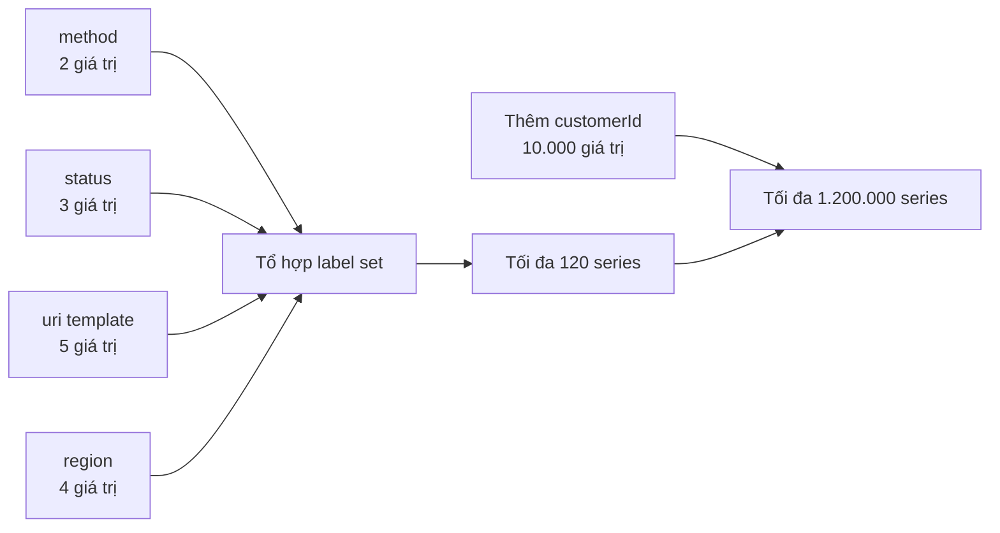

# Cardinality là gì trong telemetry

## 1. Cardinality quan trọng thế nào với Spring Modulith?

Trong chương **Cardinality** thuộc học phần **SPRING_MODULITH_DOCUMENTATION_OBSERVABILITY**, chúng ta học cách dùng Spring Modulith để tài liệu hóa ranh giới **application module** và quan sát tương tác bên trong ứng dụng Spring Boot. Module graph và Actuator cho biết các module phụ thuộc nhau như thế nào; module spans, event metrics và tracing giúp nhìn thấy hoạt động khi hệ thống vận hành. Khi thu thập telemetry ở quy mô lớn, một câu hỏi thiết kế then chốt là: **nên gắn bao nhiêu loại thông tin vào metric, trace và log?**

Ví dụ, module `order` phát `OrderPlaced`. Gắn `module.identifier=order` và `module.event.type=OrderPlaced` vào một metric thường hữu ích, vì số module và loại sự kiện trong mã nguồn có giới hạn. Nhưng nếu gắn `orderId=<UUID>` vào metric cho mỗi đơn hàng, số lượng chuỗi đo riêng biệt có thể tăng theo tổng số đơn hàng đã đi qua tiến trình. Hiện tượng này liên quan trực tiếp đến **cardinality**.

**Mục tiêu học tập**

1. Định nghĩa cardinality của tag/label, metric và time series.
2. Tính hoặc ước lượng số time series khi kết hợp nhiều chiều phân loại.
3. Phân biệt low cardinality và high cardinality; hiểu vì sao cùng một dữ liệu có thể phù hợp với tracing nhưng không phù hợp với metrics.
4. Nhận biết các tag của Spring Modulith event metrics và module entry observations.
5. Sử dụng Micrometer `Observation`, `MeterRegistry`, `MeterFilter` và truy vấn Prometheus để phòng ngừa, chẩn đoán sự tăng cardinality.
6. Thiết kế bộ tag đủ phục vụ kiểm chứng kiến trúc module mà vẫn kiểm soát được tài nguyên và độ nhạy cảm của dữ liệu.

## 2. Cardinality là gì?

Trong telemetry, **cardinality** là số lượng **giá trị phân biệt** có thể xuất hiện ở một trường hoặc số lượng tổ hợp phân biệt dùng để định danh các bản ghi đo. Ý nghĩa cụ thể phụ thuộc tín hiệu quan sát.

Đối với **metrics** dạng time series, mỗi cặp **tên metric + tập nhãn/tag và giá trị nhãn** xác định một series riêng. Chẳng hạn:

```text
shop_orders_total{module="order", channel="WEB"}   120
shop_orders_total{module="order", channel="STORE"}  35
shop_orders_total{module="payment", channel="WEB"}  90
```

Đây là **3 time series khác nhau**, mặc dù cả ba cùng dùng tên metric `shop_orders_total`. Trong một hệ thống Prometheus, mỗi series còn gồm các mẫu dữ liệu theo thời gian.

### 2.1. Phân biệt key, value, label set và series

| Khái niệm | Ví dụ | Cardinality liên quan |
| --- | --- | --- |
| **Tên metric** | `module.events.published` | Có bao nhiêu tên metric được đăng ký |
| **Tag/label key** | `module.identifier` | Tên của một chiều phân loại |
| **Tag/label value** | `order`, `inventory`, `payment` | Các giá trị khác nhau của một key |
| **Label set** | `module=order, event=OrderPlaced` | Một tổ hợp key-value cụ thể |
| **Time series** | `module_events_published_total{module_identifier="order", ...}` | Một chuỗi đo riêng biệt cho một tên metric và một label set |

**Cardinality của một tag** thường nói tới số lượng giá trị phân biệt của nó. Ví dụ `channel` chỉ có `WEB`, `STORE`, `MOBILE` thì cardinality của tag `channel` là **3**. Nếu `orderId` thay đổi với mỗi đơn hàng, cardinality của tag `orderId` có thể tăng không giới hạn theo hoạt động nghiệp vụ.

**Cardinality của một nhóm metric** nói tới số tổ hợp label set thực sự được tạo, trong phạm vi tên metric hoặc nhóm metric đang xét. Hai khái niệm liên quan nhưng không giống nhau: tag `region` có 4 giá trị và tag `channel` có 3 giá trị **không đảm bảo** có đủ 12 tổ hợp; chúng chỉ cho biết mức tối đa lý thuyết nếu mọi tổ hợp đều xảy ra.

### 2.2. Đếm sự kiện khác đếm time series

Giả sử `module.events.published` có:

```text
{module.identifier="order", module.event.type="OrderPlaced"}     count=1000
{module.identifier="order", module.event.type="OrderCancelled"}  count=40
```

Ở đây:

- Có **2 time series** của counter tổng hợp (trong phạm vi label set đang xét).
- Số lần tăng counter là **1.000** và **40**.
- Tổng số lần publish theo hai series là **1.040**, nhưng cardinality của chúng vẫn là **2**.

**Không nhầm giá trị `Counter.count()` với số series.** Một counter có thể tăng một triệu lần mà chỉ là **một series** nếu bộ tag không thay đổi.

## 3. Vì sao nhiều tag làm số series tăng theo cấp số nhân?

Giả sử metric `http_server_requests_seconds_count` được phân loại theo:

| Tag | Số giá trị giả định |
| --- | ---: |
| `method` | 2: GET, POST |
| `status` | 3 nhóm |
| `uri` | 5 mẫu route |
| `region` | 4 vùng |

Nếu mọi tổ hợp đều xuất hiện, số series của **một time series family** là:

\[
2 \times 3 \times 5 \times 4 = 120
\]

Nếu thêm `customerId` có 10.000 giá trị khác nhau và mọi tổ hợp đều xảy ra, giới hạn tổ hợp tăng thành:

\[
120 \times 10.000 = 1.200.000
\]

**Con số 1,2 triệu là giới hạn minh họa**, không phải dự đoán chính xác: nhiều khách hàng có thể chỉ dùng một method/route/region. Tuy nhiên, ngay cả khi chỉ một phần nhỏ tổ hợp xuất hiện, một tag có giá trị gần như duy nhất theo request vẫn có thể tạo ra lượng series rất lớn.



Quy tắc tính tổng quát, khi các chiều có số giá trị lần lượt là `c₁, c₂, ..., cₙ`:

\[
\text{Số tổ hợp tối đa} = \prod_{i=1}^{n} c_i
\]

Số series thực tế phụ thuộc những tổ hợp đã từng được đăng ký và còn tồn tại trong registry/backend. Trong hệ thống nhiều instance còn có các nhãn hạ tầng như `instance`, `job`, `pod`; chúng tiếp tục phân chia series. **Histogram** cũng thường xuất thêm nhiều series cho bucket/count/sum, làm số series lớn hơn số meter logic trong ứng dụng.

### Phân biệt cardinality với sample volume

Tăng tần suất scrape từ 30 giây lên 10 giây có thể làm **số điểm dữ liệu theo thời gian tăng**, nhưng không nhất thiết làm **số series phân biệt** tăng. Ngược lại, thêm tag `orderId` có thể làm số series tăng mạnh dù tần suất scrape giữ nguyên.

Đây là hai nguồn chi phí khác nhau: **nhiều series** làm tốn metadata/index/bộ nhớ; **nhiều samples** làm tăng dữ liệu cần ghi và xử lý. Khi phân tích một sự cố giám sát, cần kiểm tra cả hai.

## 4. Low cardinality và high cardinality

Một chiều là **low cardinality** khi số giá trị được kiểm soát và tương đối nhỏ so với ngân sách telemetry của hệ thống. Một chiều là **high cardinality** khi có rất nhiều giá trị hoặc tập giá trị tăng liên tục, khó dự đoán giới hạn.

| Thuộc tính | Giá trị ví dụ | Nhận định |
| --- | --- | --- |
| `module.identifier` | `order`, `payment`, `inventory` | Thường thấp; số module hữu hạn |
| `module.event.type` | `OrderPlaced`, `PaymentCaptured` | Thường thấp nếu tập loại event được quản lý trong code |
| `channel` | `WEB`, `STORE`, `APP` | Thấp nếu enum hữu hạn |
| `payment.outcome` | `SUCCESS`, `DECLINED`, `FAILED` | Thấp nếu nhóm trạng thái cố định |
| `http.method` | `GET`, `POST`, `PUT`... | Thấp |
| `http.route` | `/orders/{orderId}` | Thấp nếu dùng **route template**, không phải URL mở rộng |
| `uri` với ID thực | `/orders/4e5...`, `/orders/8a1...` | Cao; mỗi đơn có thể sinh giá trị mới |
| `orderId`, `userId` | UUID/ID thật | Cao; tăng theo entity/request |
| `traceId` hoặc `requestId` | ID gần như duy nhất | Rất cao |
| `error.message` | Chuỗi lỗi có giá trị động | Có thể rất cao và có nguy cơ lộ dữ liệu |
| `tenantId` | Tùy hệ thống | Có thể thấp nếu ít tenant, cao nếu hàng nghìn tenant |

**Không có con số tuyệt đối** để kết luận mọi tag dưới một ngưỡng cố định đều an toàn. Nên đánh giá quy mô toàn hệ thống, số instance, loại meter, tần suất thay đổi và mức ngân sách mà backend chịu được. Một tag có 20 giá trị có thể ổn cho một counter; cùng tag đó kết hợp với nhiều chiều khác và nhiều histogram có thể tạo nhiều series hơn dự kiến.

### Route template và raw URI

So sánh:

```text
Không nên dùng làm metric label:
uri="/orders/3fda0a31-..."
uri="/orders/871b4c55-..."
uri="/orders/b6297ad1-..."

Nên dùng:
uri="/orders/{orderId}"
```

Route template giữ nguyên ý nghĩa cần biết để đo latency theo endpoint mà không tạo một series mới cho từng đơn hàng. Khi ứng dụng có nhiều route động không thể chuẩn hóa hoàn toàn, cần cân nhắc nhóm chúng vào `UNKNOWN` hoặc giá trị giới hạn khác theo quy ước của framework.

## 5. Cardinality tác động đến metrics, traces và logs khác nhau

Telemetry gồm nhiều loại tín hiệu. Không nên áp nguyên một quy tắc tag cho mọi loại:

| Tín hiệu | Đơn vị quan sát chính | High cardinality ảnh hưởng thế nào? |
| --- | --- | --- |
| **Metrics** | Một time series cho mỗi tên metric + label set | Thêm series tốn bộ nhớ, tài nguyên scrape/ingest/index, tăng thời gian query và chi phí lưu trữ |
| **Traces** | Span và các thuộc tính của từng lần thực thi | Thuộc tính nhiều giá trị thường có thể được ghi theo từng span, nhưng vẫn tốn dữ liệu, chi phí truy vấn/index và cần kiểm soát dữ liệu nhạy cảm |
| **Logs** | Bản ghi sự kiện và structured fields | Có thể lưu ID cụ thể để điều tra, nhưng volume, indexing, quyền truy cập và dữ liệu cá nhân vẫn cần kiểm soát |

Trong **Micrometer Observation**, framework phân biệt `lowCardinalityKeyValue(...)` và `highCardinalityKeyValue(...)`. Meter handler chuẩn **chỉ chuyển low-cardinality key-value thành metric tags**; high-cardinality key-value được dành cho backend có khả năng xử lý các thuộc tính theo bản ghi, thường là tracing.

Điều đó **không có nghĩa tracing miễn phí hoặc nên lưu mọi thông tin**. Một `traceId` hoặc mã đơn hàng có thể hữu ích cho tương quan, nhưng không nên đưa thông tin bí mật, dữ liệu cá nhân hoặc payload thô lên trace backend mà chưa kiểm soát quyền truy cập và retention.

### Chi phí còn gồm series churn

Một metric gắn `requestId` có thể tạo một series mới mỗi request, rồi series cũ ngừng nhận dữ liệu. Không chỉ số series hoạt động cùng lúc, **tốc độ tạo ra series mới** (churn) cũng gây áp lực lên bộ nhớ/index/ingestion của backend. Chỉ nhìn số series hiện tại ở một thời điểm có thể bỏ sót vấn đề này.

## 6. Low/high cardinality trong Micrometer Observation API

Xét đoạn Java:

```java
package com.acme.shop.observability;

import io.micrometer.observation.Observation;
import io.micrometer.observation.ObservationRegistry;
import org.springframework.stereotype.Service;

@Service
public class OrderTiming {

    private final ObservationRegistry registry;

    public OrderTiming(ObservationRegistry registry) {
        this.registry = registry;
    }

    public void measure(String channel, String correlationRef, Runnable action) {
        // channel phải được chuẩn hóa về một tập giá trị hữu hạn.
        String normalizedChannel = switch (channel) {
            case "WEB", "STORE", "APP" -> channel;
            default -> "OTHER";
        };

        Observation observation = Observation.createNotStarted(
                "shop.order.process", registry)
                .lowCardinalityKeyValue("channel", normalizedChannel)
                .highCardinalityKeyValue("correlation.ref", correlationRef);

        observation.observe(action);
    }
}
```

Giải thích:

- Tên observation `shop.order.process` **cố định**, không nối `orderId` hay thông tin người dùng.
- `channel` được whitelist thành `WEB`, `STORE`, `APP` hoặc `OTHER`, tối đa **4** giá trị, nên phù hợp để phân nhóm metric.
- `correlation.ref` là một giá trị kỹ thuật có thể khác nhau theo mỗi request. Đánh dấu high cardinality để meter handler chuẩn **không đưa nó vào metric tags**. Khi có tracing handler phù hợp, thuộc tính này có thể xuất hiện trong span metadata.
- `observation.observe(action)` quản lý vòng đời start/scope/error/stop theo Micrometer. Code hành động cần có ngữ nghĩa nghiệp vụ riêng, còn instrumentation chỉ quan sát.

**Cẩn trọng với `correlationRef`:** Chỉ truyền định danh phi nhạy cảm và đã được phép đưa vào trace; sử dụng ID kỹ thuật ngẫu nhiên không làm nó trở thành dữ liệu công khai. Đừng truyền email, access token hoặc payload thanh toán vào key này.

### Tại sao không dùng `lowCardinalityKeyValue("orderId", orderId)`?

Vì Micrometer sẽ xem đây là một dimension hợp lệ cho metrics khi meter handler chuyển observation thành timer/counter. Với mỗi order mới, label set có thể thay đổi:

```text
shop_order_process_seconds_count{channel="WEB",orderId="order-001"} ...
shop_order_process_seconds_count{channel="WEB",orderId="order-002"} ...
shop_order_process_seconds_count{channel="WEB",orderId="order-003"} ...
...
```

Tag có tên là `orderId` không tự xấu; vấn đề nằm ở **tập giá trị gần như không giới hạn**. Cách đúng để đối chiếu một đơn cụ thể là tìm bằng log hoặc trace có quyền truy cập phù hợp, rồi dùng metrics để đánh giá mức tải/độ trễ theo các nhóm đã chuẩn hóa.

## 7. Cardinality trong Spring Modulith event metrics

Spring Modulith có các counter để quan sát domain events:

1. `module.events.published` — counter tổng hợp cho các sự kiện được publish.
2. `module.events.published.$moduleIdentifier.$simpleEventTypeName` — counter cho từng loại event trong từng module.

Các tag của counter tổng hợp gồm `module.event.type`, `module.identifier`, `module.name`. Counter riêng theo event có các tag module và có thể được enrich bằng tag nghiệp vụ thông qua `ModulithEventMetricsCustomizer`.

### 7.1. Ví dụ số series trong một ứng dụng

Giả sử có ba module và các event:

| Module | Event types |
| --- | --- |
| `order` | `OrderPlaced`, `OrderCancelled` |
| `payment` | `PaymentAuthorized`, `PaymentFailed` |
| `inventory` | `StockReserved` |

Nếu mỗi module/event type tạo đúng một bộ tag `module.identifier` / `module.event.type` và không có các chiều phân loại khác, counter tổng hợp có **5 series**. Việc có 10, 1.000 hoặc 1 triệu lần phát event **không làm tăng số series** miễn các tag của từng series giữ nguyên.

Hai counter khác nhau không nên cộng trực tiếp để tính số lần publish: counter tổng hợp và counter riêng cùng có thể phản ánh những lần publish đó ở hai mức phân loại.

### 7.2. Tùy biến bằng tag nghiệp vụ hữu hạn

Giả sử `OrderPlaced` có một enum `SalesChannel`:

```java
package com.acme.shop.order;

import java.util.UUID;

public enum SalesChannel { WEB, STORE, APP }

public record OrderPlaced(UUID orderId, SalesChannel channel) {}
```

Trong Java thực tế, mỗi kiểu top-level `public` phải nằm trong file `.java` tương ứng. Đoạn trên trình bày gộp để minh họa mô hình dữ liệu.

Nếu muốn phân tích lượng event theo kênh bán, có thể thêm một tag **chỉ cho metric riêng theo `OrderPlaced`**:

```java
// com/acme/shop/observability/EventMetricConfiguration.java
package com.acme.shop.observability;

import com.acme.shop.order.OrderPlaced;
import org.springframework.context.annotation.Bean;
import org.springframework.context.annotation.Configuration;
import org.springframework.modulith.observability.ModulithEventMetricsCustomizer;

@Configuration(proxyBeanMethods = false)
class EventMetricConfiguration {

    @Bean
    ModulithEventMetricsCustomizer orderPlacedCustomizer() {
        return metrics -> metrics.customize(
                OrderPlaced.class,
                (event, builder) ->
                        builder.tag("channel", event.channel().name()));
    }
}
```

Tag `channel` có đúng 3 giá trị nếu enum được kiểm soát. Vì vậy counter riêng cho `OrderPlaced` có thể có tối đa **3 series theo channel** trên mỗi bộ tag module khác. `OrderPlaced` chứa `orderId`, nhưng không gắn `orderId` làm metric tag.

Tùy biến này cần API observability của Spring Modulith trong compile classpath và runtime instrumentation phù hợp. Ví dụ chỉ nhằm minh họa lựa chọn tag; **không đồng nghĩa listener đã xử lý event thành công**. Counter `module.events.published` đo mốc publish, còn trạng thái xử lý cần xem listener, Event Publication Registry hoặc metric chuyên biệt.

### 7.3. Khi bổ sung tag không an toàn

Không nên viết:

```java
// PHẢN VÍ DỤ — tuyệt đối tránh trong metrics production.
(event, builder) ->
        builder.tag("orderId", event.orderId().toString())
```

Nếu mỗi `OrderPlaced` mang `orderId` mới, mỗi ID gần như tạo một meter series mới. Sau một triệu đơn hàng, số series đã đăng ký có thể cực lớn ngay cả khi ứng dụng chỉ có **một event type**.

**Thiết kế thay thế:** Giữ `channel`, `payment.method`, `outcome` hoặc những chiều nghiệp vụ hữu hạn. Nếu cần tra cứu một đơn cụ thể, ghi `orderId` có kiểm soát trong log/trace hoặc dùng hệ thống truy vấn dữ liệu nghiệp vụ, tránh chuyển nó sang labels của metrics.

## 8. Module spans: vì sao `module.method` là high cardinality?

Spring Modulith gắn metadata lên module entry observations/spans, tiêu biểu:

| Thuộc tính | Vai trò | Cardinality theo convention |
| --- | --- | --- |
| `module.identifier` | ID application module | Low |
| `module.name` | Tên hiển thị của module | Low |
| `module.invocation-type` | Kiểu gọi, ví dụ bean/event listener | Low |
| `module.method` | Phương thức thực thi tại điểm vào module | **High** |

`module.method` là một **high-cardinality observation key** theo convention của Modulith. Một module có thể có nhiều method API, và theo thời gian/phiên bản ứng dụng có thể phát sinh nhiều giá trị method khác nhau. Vì thế nên xem method-level attribute trong **traces** để điều tra lời gọi, thay vì mặc nhiên biến nó thành metric tag cho mọi thao tác.

Ví dụ:

```text
trace A:
  module.identifier = "payment"
  module.invocation-type = "bean"
  module.method = "PaymentOperations.authorize"

trace B:
  module.identifier = "payment"
  module.invocation-type = "bean"
  module.method = "PaymentOperations.capture"
```

Trong module graph, cả hai method vẫn thuộc module `payment`. Trên metric tổng hợp, nên ưu tiên tag `module.identifier=payment` để theo dõi health/throughput của module. Trong trace, `module.method` giúp tìm điểm vào cụ thể đang chậm.

**Không mặc định** rằng giá trị `module.method` sẽ luôn được in đúng như ví dụ: nó phụ thuộc observation convention và phiên bản Spring Modulith. Muốn query chính xác, hãy kiểm tra attributes thực tế của span trên backend.

## 9. Quan sát cardinality trong MeterRegistry

Micrometer `MeterRegistry` quản lý các meter có tên và bộ tag tương ứng. Muốn chẩn đoán cardinality, hãy **đếm meter theo tên**, không cộng `Counter.count()`.

```java
package com.acme.shop.observability;

import io.micrometer.core.instrument.Counter;
import io.micrometer.core.instrument.Meter;
import io.micrometer.core.instrument.MeterRegistry;
import java.util.Comparator;
import java.util.List;
import java.util.Map;
import java.util.stream.Collectors;
import org.springframework.stereotype.Component;

@Component
public class MetricCardinalityInspector {

    private final MeterRegistry registry;

    public MetricCardinalityInspector(MeterRegistry registry) {
        this.registry = registry;
    }

    // Mỗi Meter ID là một tên meter + tập tag tương ứng trong registry.
    public Map<String, Long> metersPerName() {
        return registry.getMeters().stream()
                .collect(Collectors.groupingBy(
                        meter -> meter.getId().getName(),
                        Collectors.counting()));
    }

    // Danh sách metric đang có nhiều Meter ID nhất.
    public List<Map.Entry<String, Long>> largestMeterFamilies(int limit) {
        return metersPerName().entrySet().stream()
                .sorted(Map.Entry.<String, Long>comparingByValue(
                        Comparator.reverseOrder()))
                .limit(limit)
                .toList();
    }

    // Đếm series của counter tổng hợp Modulith trong registry hiện tại.
    public int countPublishedEventSeries() {
        return registry.find("module.events.published")
                .counters()
                .size();
    }

    // Xem các tag thực tế của từng series thay vì đoán tên/giá trị.
    public List<Meter.Id> publishedEventMeterIds() {
        return registry.find("module.events.published")
                .counters()
                .stream()
                .map(Counter::getId)
                .toList();
    }
}
```

Điểm cần lưu ý khi đọc kết quả:

- `registry.getMeters()` liệt kê các **meter IDs đã đăng ký** trong registry mà ứng dụng đang dùng, không phải mọi series lịch sử đã từng tồn tại ở Prometheus.
- `countPublishedEventSeries()` đếm những `Counter` đã có cho tên `module.events.published`, **không phải số lần publish**.
- `Counter#count()` là giá trị đo của counter, thường tăng mỗi lần metric được ghi nhận.
- Với `Timer` hoặc `DistributionSummary` cấu hình histogram, **một meter logic** có thể xuất ra nhiều series ở backend (bucket, sum, count, v.v.). Vì thế kết quả đếm meter ID **không luôn bằng** số time series Prometheus.
- Nếu có `CompositeMeterRegistry` hoặc nhiều registry/backend, số meter được nhìn thấy phụ thuộc registry được inject và cách xuất dữ liệu.

Đây là công cụ **chẩn đoán read-only**. Không tạo thêm meter bằng `registry.counter(name)` chỉ để kiểm tra tồn tại, vì hàm đó có thể đăng ký meter mới với tag sai hoặc thiếu.

### Đọc riêng giá trị của counter

Để kiểm tra sự khác biệt giữa cardinality và giá trị:

```java
var counters = registry.find("module.events.published").counters();

int numberOfSeries = counters.size();
double totalPublished = counters.stream()
        .mapToDouble(Counter::count)
        .sum();
```

`numberOfSeries` là số series của counter trong registry hiện tại. `totalPublished` là **tổng các giá trị Counter** của những series đó, dùng để mô tả số lần ghi nhận publication trong phạm vi chúng đo. Hai phép đo trả lời hai câu hỏi khác nhau.

## 10. Đọc cardinality từ Actuator và Prometheus

Nếu đã có Spring Boot Actuator, bạn có thể expose endpoint phục vụ chẩn đoán trong **môi trường được bảo vệ**:

```yaml
management:
  endpoints:
    web:
      exposure:
        include: "health,metrics,prometheus"
```

`/actuator/prometheus` yêu cầu `micrometer-registry-prometheus` ở runtime. Tùy yêu cầu vận hành, hãy bảo vệ endpoint bằng xác thực/phân quyền và giới hạn mạng.

### 10.1. Actuator

```bash
curl -s http://localhost:8080/actuator/metrics
curl -s http://localhost:8080/actuator/metrics/module.events.published
```

Endpoint `/actuator/metrics` hiển thị tên metric, measurement và `availableTags`. Đây là cách xác định những tag/value đang xuất hiện. Tuy nhiên, một response tổng hợp có thể **cộng nhiều series cùng tên**, nên không dùng `COUNT` của metric để kết luận có bao nhiêu series.

### 10.2. Prometheus

Micrometer/Prometheus thường chuẩn hóa tên meter có dấu chấm thành dấu gạch dưới, và counter có hậu tố `_total`. Ví dụ output minh họa:

```text
module_events_published_total{module_identifier="order",module_event_type="OrderPlaced",module_name="Order"} 120
module_events_published_total{module_identifier="order",module_event_type="OrderCancelled",module_name="Order"} 6
```

Với tên series **đã xác minh trên backend**, có thể chạy:

```promql
# Số series đang khớp ở thời điểm query.
count(module_events_published_total)
```

```promql
# Đếm series theo application module.
count by (module_identifier) (module_events_published_total)
```

```promql
# Đây là tốc độ publish theo module, KHÔNG phải cardinality.
sum by (module_identifier) (
  rate(module_events_published_total[5m])
)
```

**Giải thích:**

- `count(metric)` đếm số series trong một instant vector đang tồn tại và khớp truy vấn tại thời điểm đó.
- `count by (...)` nhóm số series theo label.
- `rate(counter[5m])` đo tốc độ tăng counter mỗi giây; không đếm số label set.
- Instant vector không cho biết tất cả series đã từng tồn tại hoặc bị churn trong nhiều ngày. Để điều tra churn/series lịch sử, dùng thêm số liệu lưu trữ hoặc TSDB diagnostics của Prometheus/backend.

Đừng chép nguyên tên `module_events_published_total` nếu exporter/phiên bản của bạn xuất tên khác. Xem `/actuator/prometheus` hoặc metric explorer trước rồi điều chỉnh PromQL.

### 10.3. Vì sao số series có thể cao hơn phép tính tại source?

Giả sử mỗi Spring Boot instance có 5 series event counter. Khi Prometheus scrape 8 instance khác nhau, label `instance` phân biệt nguồn, nên riêng phần đó có thể tạo **40 series**. Nếu backend còn gắn `environment`, `cluster`, `namespace` hay các nhãn hạ tầng khác, cần tính thêm từng chiều. Histogram metrics còn có nhiều bucket và series `_count`/`_sum`, nên càng cần phân biệt số meter ID với số series được xuất.

## 11. Phòng ngừa cardinality explosion bằng thiết kế và MeterFilter

Cách khắc phục tốt nhất là **giảm những chiều phân loại không có ý nghĩa tổng hợp** ngay ở nơi tạo telemetry:

1. Chỉ thêm tag để trả lời một câu hỏi vận hành có thật (theo module, outcome, channel, route template).
2. Dùng enum/whitelist/mapping cho giá trị không được kiểm soát, như `OTHER` hoặc `UNKNOWN`.
3. Dùng route template thay URL đầy đủ; chỉ ghi loại exception thay vì message có dữ liệu động.
4. Đưa ID cụ thể vào trace/log đã kiểm soát quyền truy cập, không đưa vào metric tags.
5. Kiểm soát số series tăng khi thêm mỗi tag mới bằng một **ngân sách cardinality** cho metric quan trọng.

### 11.1. Ví dụ counter an toàn

```java
package com.acme.shop.observability;

import io.micrometer.core.instrument.Counter;
import io.micrometer.core.instrument.MeterRegistry;
import org.springframework.stereotype.Component;

@Component
public class OrderOutcomeMetrics {

    private final MeterRegistry registry;

    public OrderOutcomeMetrics(MeterRegistry registry) {
        this.registry = registry;
    }

    public void record(String outcome) {
        String safeOutcome = switch (outcome) {
            case "SUCCESS", "REJECTED", "FAILED" -> outcome;
            default -> "OTHER";
        };

        Counter.builder("shop.order.outcomes")
                .description("Số lần ghi nhận kết quả xử lý đơn hàng")
                .tag("module", "order")
                .tag("outcome", safeOutcome)
                .register(registry)
                .increment();
    }
}
```

Trong ví dụ, `outcome` có tối đa **4** giá trị. `register(registry)` lấy lại meter đã có cùng ID, không tạo series mới khi `outcome` trùng giá trị cũ. Counter này đo **mốc mà code gọi `record`**, vì vậy phải gọi đúng vị trí nghiệp vụ (sau khi biết kết quả) nếu muốn ý nghĩa `SUCCESS/FAILED` đáng tin cậy. Nó **không thay thế** Spring Modulith `module.events.published`.

### 11.2. MeterFilter để đặt giới hạn phòng vệ

Micrometer hỗ trợ `MeterFilter.maximumAllowableTags(...)`. Đây là hàng rào bảo vệ **khi không kiểm soát được nguồn tag**, không phải cách sửa ngữ nghĩa telemetry đã thiết kế sai.

```java
package com.acme.shop.observability;

import io.micrometer.core.instrument.config.MeterFilter;
import org.springframework.context.annotation.Bean;
import org.springframework.context.annotation.Configuration;

@Configuration(proxyBeanMethods = false)
class MeterCardinalityGuardConfiguration {

    @Bean
    MeterFilter limitOrderOutcomeValues() {
        return MeterFilter.maximumAllowableTags(
                "shop.order.",        // Tiền tố tên meter cần bảo vệ.
                "outcome",            // Tag được giới hạn.
                8,                    // Tối đa 8 giá trị khác nhau.
                MeterFilter.deny()); // Từ chối đăng ký meter vượt ngưỡng.
    }
}
```

Khi Spring Boot nhận bean `MeterFilter` và áp dụng vào registry, các meter mới vượt giới hạn có thể bị **từ chối đăng ký**. Kết quả là **có thể mất dữ liệu metric** cho những giá trị tới sau, dù ứng dụng nghiệp vụ vẫn chạy. Vì vậy cần giám sát tín hiệu bị từ chối và sửa nơi tạo tag; không xem đây là giải pháp duy nhất.

Lưu ý: `maximumAllowableTags` giới hạn **số giá trị của một tag trong tập meter khớp tiền tố**, không phải giới hạn tổng dung lượng của backend. Nó không thu hồi những series đã tồn tại, và không chống lại trường hợp người viết mã chèn ID động vào **tên metric** thay vì tag.

### 11.3. HighCardinalityTagsDetector

Micrometer cũng cung cấp `HighCardinalityTagsDetector` để phát hiện dấu hiệu một tên meter có **quá nhiều Meter IDs**. Detector hữu ích để cảnh báo vấn đề khi ứng dụng chạy, nhưng kết quả phải được diễn giải đúng:

- Nhiều meter cùng tên **có thể** chỉ ra tag cardinality cao.
- Detector không trực tiếp chứng minh tag nào là nguyên nhân.
- Nếu ứng dụng tạo **tên metric khác nhau theo request ID**, việc đếm meter theo cùng tên có thể **không phát hiện** vấn đề.

Nên kết hợp detector với thống kê số meter theo tên trong `MeterRegistry`, inspection của tag keys/values và số liệu TSDB của backend.

## 12. Quy trình xử lý khi metrics tăng bất thường

Giả sử sau một bản deploy, số series trong backend tăng nhanh, memory của Prometheus tăng và dashboard module `order` chậm.

| Bước | Cách kiểm tra | Điều cần tìm |
| --- | --- | --- |
| 1 | So sánh số series theo tên metric trước/sau deploy | Metric nào có tốc độ tăng series bất thường |
| 2 | Xem tag keys và một số tag values thực tế | `orderId`, `userId`, `uri` mở rộng, `error.message` hay ID động |
| 3 | Kiểm tra thay đổi instrumentation | Có thêm tag trong `ModulithEventMetricsCustomizer`, `ObservationConvention` hoặc manual `Counter.builder(...)` không |
| 4 | Dùng `MeterRegistry` để đếm meter IDs theo tên | Vấn đề xuất phát từ registry ứng dụng hay nhân lên do nhiều instance/bucket |
| 5 | Tính lại cardinality theo từng chiều | Giới hạn tổ hợp lý thuyết và quy mô xuất hiện thật |
| 6 | Chuẩn hóa tag hoặc loại bỏ chiều không cần thiết | Chuyển ID sang trace/log, dùng enum/route template |
| 7 | Thiết lập ngưỡng cảnh báo và filter dự phòng | Phòng ngừa hồi quy sau deploy |
| 8 | Kiểm tra lại dashboards và alerts | Có còn đáp ứng mục tiêu quan sát mà không làm mất tín hiệu quan trọng không |

**Thận trọng khi sửa:** Thay tên tag hoặc gộp giá trị tag sẽ ảnh hưởng PromQL, dashboard và alert hiện có. Cần cập nhật các truy vấn liên quan; việc hệ thống đo đạc thay đổi schema thường cần kế hoạch chuyển đổi phù hợp.

### Ví dụ suy luận nhanh

Một hệ thống có:

```text
module.events.published.order.OrderPlaced{channel="WEB"}     150
module.events.published.order.OrderPlaced{channel="STORE"}    25
```

Hai series có thể tồn tại ổn định qua một triệu lần publish. Nếu thêm `orderId` vào mỗi series, bạn có thể tạo một series mới cho mỗi đơn hàng — đó là vấn đề cardinality; **số đơn nhiều không phải lỗi**, mà **tổ chức tag không phù hợp** mới khiến hệ thống quan sát khó mở rộng.

## 13. Những hiểu nhầm phổ biến

| Nhận định | Đúng/sai | Giải thích |
| --- | --- | --- |
| “Counter tăng đến một triệu nghĩa là có một triệu series.” | **Sai** | Counter value và số series là hai đại lượng độc lập |
| “Chỉ số lượng tag keys mới quyết định cardinality.” | **Sai** | Tập **giá trị** và tổ hợp các giá trị mới quyết định số series |
| “Một tag chỉ có 10 giá trị luôn an toàn.” | **Chưa chắc** | Còn phụ thuộc các tag khác, số instance và loại metric |
| “Cardinality chỉ là vấn đề của Prometheus.” | **Sai** | Nó cũng ảnh hưởng registry trong JVM, các backend metrics khác và chi phí index/query |
| “High-cardinality metadata không thể dùng ở đâu.” | **Sai** | Có thể phù hợp trong traces/logs nếu được quản lý đúng |
| “Đổi ID thành tag high cardinality trên Observation vẫn tăng metrics.” | **Thường sai với meter handler chuẩn** | Micrometer meter handler dùng low-cardinality keys; high keys không đưa vào metric tags |
| “Có thể dùng `orderId` làm metric name thay vì tag.” | **Sai về thiết kế** | Tạo nhiều tên meter không kiểm soát được; detector theo tên có thể không bắt gặp |
| “Module graph có 5 module tức là chỉ có 5 metric series.” | **Sai** | Các loại event, tags, instance và meter family còn tạo thêm series |
| “`module.method` phải là low-cardinality tag để tìm method chậm.” | **Sai** | Theo Modulith đây là high-cardinality observation key; tìm method bằng trace, còn metrics cần quy ước riêng |
| “MeterFilter giải quyết triệt để mọi cardinality explosion.” | **Sai** | Filter là giới hạn dự phòng, có thể làm rơi số liệu và không sửa được thiết kế nguồn |

## 14. Bài tập thực hành

### Bài 1 — Tính cardinality

Ứng dụng có một metric `shop_checkout_duration` với các tag:

- `module`: 4 giá trị.
- `outcome`: 3 giá trị.
- `channel`: 2 giá trị.
- `region`: 3 giá trị.

**Câu hỏi:** Nếu mọi tổ hợp đều xảy ra, một series family có tối đa bao nhiêu label sets? Nếu thêm `orderId` với 20.000 giá trị khác nhau, giới hạn tổ hợp lý thuyết tăng thành bao nhiêu?

**Đáp án:** `4 × 3 × 2 × 3 = 72` tổ hợp; thêm ID: `72 × 20.000 = 1.440.000` tổ hợp tối đa. Số thực tế thấp hơn khi không xuất hiện đầy đủ mọi tổ hợp.

### Bài 2 — Chọn nơi lưu thông tin

Hệ thống phát `OrderPlaced(orderId, channel)`. Bạn muốn (a) xem throughput theo channel, (b) truy vết một đơn hàng cụ thể bị lỗi, (c) xem module nào gọi `payment`.

**Đáp án gợi ý:** (a) Metric `module.events.published`/metric riêng với tag `channel` hữu hạn; (b) trace/log hoặc dữ liệu nghiệp vụ được bảo vệ để liên hệ `orderId`; (c) module graph để xem dependency tĩnh và module entry spans để xác định lời gọi thực tế.

### Bài 3 — Đọc MeterRegistry

Giả sử `registry.find("module.events.published").counters()` trả về ba counter, lần lượt `count()` là 10, 200 và 30.

**Câu hỏi:** Cardinality của counter family trong registry này là bao nhiêu? Tổng counter value là bao nhiêu?

**Đáp án:** **3 meter series** và **240** lần tăng counter theo những series đó, với giả định mỗi lần publish phù hợp tăng một đơn vị.

### Bài 4 — Chẩn đoán tag gây nổ series

Sau deploy, bạn thấy:

```text
shop_payment_requests_total{status="SUCCESS",paymentId="p-00001"} 1
shop_payment_requests_total{status="SUCCESS",paymentId="p-00002"} 1
shop_payment_requests_total{status="SUCCESS",paymentId="p-00003"} 1
...
```

**Yêu cầu:** Chỉ ra nguy cơ, thiết kế sửa đổi và một phép kiểm tra sau sửa.

**Đáp án gợi ý:** `paymentId` có giá trị gần như duy nhất → series tăng theo số payment. Bỏ tag này, giữ `status` trong tập enum; đưa `paymentId` vào trace/log có quyền truy cập phù hợp. Sau sửa, đo lại `count(shop_payment_requests_total)` và kiểm tra các truy vấn `rate(...[5m])` theo status vẫn hữu ích.

## 15. Ghi nhớ

**Cardinality trong metrics là số lượng tổ hợp tên metric và bộ tag-value tạo ra các time series riêng.** Cần đặc biệt chú ý **số giá trị khác nhau của mỗi tag** và tác động nhân khi thêm nhiều chiều. Một counter có thể tăng hàng triệu lần mà chỉ là một series; ngược lại, chỉ một metric kèm ID thay đổi theo request có thể sinh lượng series khổng lồ.

Với Spring Modulith, hãy dùng `module.identifier`, `module.name`, `module.event.type` và các tag nghiệp vụ **có tập giá trị hữu hạn** để đo event metrics. Dùng `module.method` và metadata chi tiết trong traces để kiểm tra thực thi; dùng log/trace được bảo vệ cho định danh đơn hàng và correlation. Micrometer `Observation` phân biệt low/high cardinality, `MeterRegistry` giúp kiểm tra meter IDs, còn `MeterFilter` và detector giúp bảo vệ, cảnh báo khi vượt giới hạn. Kết hợp các tín hiệu đúng cách sẽ giữ được giá trị kiểm chứng kiến trúc mà không biến hệ thống giám sát thành nút thắt mới.

## Tài liệu tham khảo

1. [Micrometer – Observation Introduction](https://docs.micrometer.io/micrometer/reference/observation/introduction.html): low/high cardinality, vòng đời Observation và cách gắn key-value.
2. [Micrometer – Observation Components](https://docs.micrometer.io/micrometer/reference/observation/components.html): meter handler dùng low-cardinality tags, xử lý Observation.Context.
3. [Micrometer – High Cardinality Tags Detector](https://docs.micrometer.io/micrometer/reference/concepts/high-cardinality-tags-detector.html): cardinality explosion, phát hiện meter families bất thường và `MeterFilter.maximumAllowableTags`.
4. [Micrometer – Meter Filters](https://docs.micrometer.io/micrometer/reference/concepts/meter-filters.html): giới hạn/chuyển đổi tên meter và tags.
5. [Spring Modulith – Production-ready Features](https://docs.spring.io/spring-modulith/reference/production-ready.html): module entry span tags, event metrics và `ModulithEventMetricsCustomizer`.
6. [Prometheus – Data Model](https://prometheus.io/docs/concepts/data_model/): tên metric, labels và cách định danh series.
7. [Prometheus – Metric and Label Naming](https://prometheus.io/docs/practices/naming/): hướng dẫn nhãn và cảnh báo high-cardinality label values.
8. [Prometheus – Instrumentation](https://prometheus.io/docs/practices/instrumentation/): chi phí label sets và kiểm soát cardinality.
