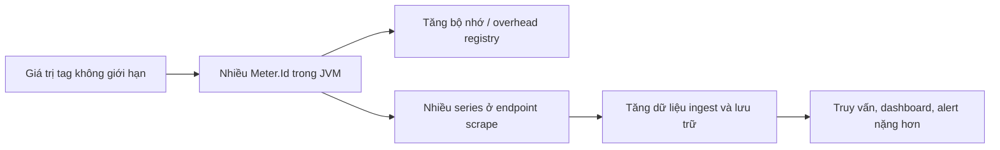

# High cardinality và giới hạn trong metrics

## 1. Vì sao cardinality là vấn đề của kiến trúc quan sát?

Trong một hệ thống Spring Boot tổ chức bằng **Spring Modulith**, giả sử module `order` phát `OrderPlaced` và module `inventory` xử lý sự kiện đó. Đội vận hành muốn biết mỗi phút có bao nhiêu event được công bố, tỷ lệ thất bại của listener và module nào gây ra độ trễ. Những câu hỏi này rất phù hợp với **metrics**.

Một developer thêm nhãn `order_id` cho counter để “dễ lọc theo đơn hàng”. Khi mỗi ngày có hàng trăm nghìn đơn mới, số chuỗi thời gian có thể tăng gần tương ứng với số đơn, dù ứng dụng chỉ định nghĩa **một** tên counter. Điều này có thể làm đầy bộ nhớ registry, tăng tải thu thập dữ liệu và khiến hệ thống metrics tiêu tốn nhiều tài nguyên.

Vấn đề này gọi là **high cardinality**: một chiều nhãn có quá nhiều giá trị khác nhau hoặc có tập giá trị không bị giới hạn một cách có kiểm soát. Trong chương **Cardinality** thuộc **SPRING_MODULITH_DOCUMENTATION_OBSERVABILITY**, chúng ta học cách giữ metrics đủ gọn để giám sát lâu dài, đồng thời dùng tracing, log và context propagation khi cần phân tích một giao dịch cụ thể.

Sau bài học, bạn có thể:

- Giải thích cardinality của một tag và số time series của một metric, bao gồm tác động khi phối hợp nhiều nhãn.
- Phân biệt nhãn low-cardinality với dữ liệu high-cardinality trong Micrometer Observation.
- Chọn nhãn an toàn cho module spans, event metrics và listener metrics của Spring Modulith.
- Ước lượng ngân sách time series; hiểu sự khác biệt giữa một `Meter` của Micrometer và các series Prometheus xuất ra.
- Chuẩn hóa giá trị nhãn từ ứng dụng, dùng `MeterFilter` như một lớp phòng vệ và kiểm tra mức tăng cardinality sau triển khai.

## 2. Các khái niệm cần nắm

### 2.1. Metric, tag và time series

Một meter Micrometer có tên và tập các cặp `key=value` gọi là **tags**. Ví dụ:

```text
Tên metric:  shop.inventory.reservation
Tags:        module=inventory, outcome=success, region=ap-southeast-1
```

Khi được xuất tới Prometheus, tên và tags được chuyển thành tên/labels phù hợp với registry. Một counter có thể xuất hiện dưới dạng:

```promql
shop_inventory_reservation_total{
  module="inventory",
  outcome="success",
  region="ap-southeast-1",
  job="shop",
  instance="shop-1"
}
```

Ở Prometheus, **một time series được nhận diện bởi tên metric và toàn bộ bộ giá trị label**. Đổi `outcome` hoặc `instance` sẽ tạo một series khác. Trong Micrometer, các meter được đăng ký theo `Meter.Id`, gồm tên và tags, trước khi được chuyển thành các loại series cụ thể khi xuất.

Không nên nhầm “có một counter trong code” với “chỉ có một time series”. Cùng một `Counter.builder(...)` có thể tạo nhiều meter nếu mỗi lần gọi đăng ký nó với bộ tag khác.

### 2.2. Cardinality là số giá trị phân biệt của một chiều

| Nhãn hoặc dữ liệu | Cardinality dự kiến | Có nên là metric tag? | Lý do |
| --- | --- | --- | --- |
| `module.identifier` | Số lượng module hữu hạn | Có | Thuận tiện tổng hợp theo ranh giới ứng dụng |
| `module.event.type` | Số loại domain event trong code | Thường có | Các event type cố định theo mô hình ứng dụng |
| `outcome=success/failure/duplicate` | 3 | Có | Tập enum nhỏ |
| `region` | Một số vùng triển khai | Có, sau khi chuẩn hóa | Giới hạn được số giá trị |
| `http.method` | Vài phương thức HTTP | Có | Tập giá trị hữu hạn |
| `http.route=/orders/{id}` | Số route template | Có | Không mang giá trị ID thực |
| `order_id`, `event_id`, `request_id` | Gần bằng số giao dịch/request | Không | Tập giá trị tăng theo lưu lượng |
| `trace_id`, `span_id` | Rất lớn | Không | Mỗi trace/span có định danh khác nhau |
| Email, user ID, token | Rất lớn, có thể nhạy cảm | Không | Rủi ro hiệu năng và dữ liệu cá nhân |
| URL đầy đủ `/orders/4f7...` | Tăng theo từng resource | Không | Phải thay bằng route template nếu có |
| Exception message, SQL, event payload | Gần như không bị giới hạn | Không | Dễ chứa ID, text biến thiên và thông tin nhạy cảm |

**Low cardinality** không có nghĩa số giá trị bắt buộc bằng một con số cố định. Nó có nghĩa tập giá trị **nhỏ, dự đoán được và có giới hạn thực tế** so với ngân sách metrics. Nhãn có một nghìn giá trị có thể vẫn quá lớn khi nhân với nhiều chiều khác. Một nhãn tưởng như “trạng thái” cũng trở thành high cardinality nếu chứa nguyên văn lỗi hoặc input tự do.

## 3. Vì sao cardinality có thể tăng theo cấp số nhân?

Với một tên metric có các chiều độc lập tương đối, số tổ hợp tối đa xấp xỉ:

\[
S_{\mathrm{meter}} \le \prod_{i=1}^{n} c_i
\]

trong đó `c_i` là số giá trị có thể có ở chiều nhãn thứ `i`. Dấu “không vượt quá” xuất phát từ việc có thể **không phải mọi tổ hợp đều thực sự xảy ra**.

Giả sử một metric listener có:

| Chiều | Số giá trị giả định |
| --- | ---: |
| `module` | 12 |
| `event_type` | 20 |
| `outcome` | 3 |
| `region` | 4 |
| **Tổ hợp tối đa trong một nhóm triển khai** | **2.880** |

Nếu Prometheus thu thập từ **6 instance** với label `instance` phân biệt, số series tối đa của một counter có thể lên khoảng **17.280** trước khi xét các label bổ sung. Đây là con số minh họa, không phải một ngưỡng mặc định của Prometheus hay Spring Modulith.

Nếu thay `region` (4 giá trị) bằng `order_id` có 100.000 giá trị, giới hạn lý thuyết trở thành:

\[
12 \times 20 \times 3 \times 100{.}000
=72{.}000{.}000
\]

Không phải tất cả tổ hợp này sẽ tồn tại; nhưng chỉ riêng việc mỗi `order_id` sinh một series mới cũng đã đủ gây vấn đề.

### 3.1. Meter và time series không nhất thiết là một-một

Một **counter** thường xuất một chuỗi giá trị cho mỗi tổ hợp label trong từng instance. Một **timer** có thể xuất nhiều series từ cùng meter:

- Số lần gọi (`_count`).
- Tổng thời gian (`_sum`).
- Các bucket `_bucket` nếu bật histogram.
- Những series phụ khác, tùy loại meter, registry và cấu hình.

Ví dụ nếu cấu hình histogram Prometheus có **12 ranh giới bucket hữu hạn**, mỗi tổ hợp label có thể sinh **13 bucket series** (bao gồm bucket `+Inf`), cộng ít nhất `_sum` và `_count`, tức khoảng **15 series**. Khi nhân với 17.280 tổ hợp ở ví dụ trên, riêng histogram có thể lên khoảng **259.200 series**. Số thực tế phụ thuộc histogram, label bổ sung, các giá trị đã phát sinh và cách exporter triển khai.

**Kết luận kỹ thuật:** ngân sách series cần xem cả số chiều, số instance và kiểu metric; chỉ đếm số dòng code khai báo `Timer` hoặc `Counter` là không đủ.

### 3.2. Tăng tải xuất hiện ở nhiều tầng



Tùy registry và hệ thống metrics, hệ quả có thể gồm:

1. JVM giữ nhiều meter, khiến registry tốn bộ nhớ và CPU đăng ký/duyệt.
2. Scrape response lớn hơn, tăng băng thông và thời gian scrape.
3. TSDB cần lưu nhiều bộ nhãn và mẫu dữ liệu hơn, làm tăng kích thước index.
4. PromQL group-by hoặc regex match trên tập series lớn trở nên nặng.
5. Alert thiếu ổn định hoặc quota/cost của nền tảng observability tăng.

Những vấn đề này có thể xuất hiện ngay cả khi mỗi counter chỉ tăng **một lần** trong suốt vòng đời instance: meter vẫn có thể được tạo với bộ tag khác. Việc ứng dụng ngừng phát giá trị đó không đồng nghĩa meter tự biến mất ngay khỏi registry hay dữ liệu lịch sử trong backend.

## 4. Cardinality trong Spring Modulith

Spring Modulith cung cấp observability cho application module, gồm các span lời gọi module và counter công bố domain event. Phải phân biệt **tag do framework cung cấp** với **tag nghiệp vụ tự thêm**.

### 4.1. Counter công bố event

Tài liệu Spring Modulith mô tả:

| Meter | Ý nghĩa |
| --- | --- |
| `module.events.published` | Counter tổng hợp các lần domain event được công bố |
| `module.events.published.$moduleIdentifier.$simpleEventTypeName` | Counter theo module và kiểu event |

Các **low-cardinality keys** của meter tổng hợp:

- `module.identifier`: định danh module.
- `module.name`: tên module.
- `module.event.type`: loại event.

Meter riêng từng event có `module.identifier` và `module.name`. Số lượng module và số loại event thường do mã nguồn quyết định nên tương đối có giới hạn; điều này thuận lợi cho dashboard.

**Cảnh báo:** Spring Modulith có `ModulithEventMetricsCustomizer` cho phép bổ sung tag vào counter riêng từng event. Nếu tùy biến bằng `event.getOrderId().toString()` hoặc `event.getUserEmail()`, bạn đã đưa dữ liệu high-cardinality vào metrics dù các tag mặc định an toàn.

Ví dụ ý tưởng tùy biến cần tránh:

```java
// KHÔNG NÊN: mỗi event khác orderId có thể sinh meter/series mới.
metrics.customize(OrderPlaced.class, (event, counter) -> {
    counter.tags("order_id", event.orderId().toString());
});
```

Giả định đoạn trên nằm trong cấu hình sử dụng API customizer tương thích với phiên bản Spring Modulith của dự án. Mục đích chỉ để nêu **sai lầm về cardinality**, không phải cấu hình khuyến nghị.

Thay thế bằng nhãn có bộ giá trị giới hạn, chẳng hạn `channel=web/partner/other`, `priority=normal/urgent` hoặc `event_schema=v1/v2`. Những tag này vẫn cần được quản lý về ngân sách.

### 4.2. Module spans không phải metric theo từng request

Spring Modulith có thể instrument lời gọi qua Spring component thuộc API module. Module span mang các thuộc tính như:

| Thuộc tính | Ví dụ |
| --- | --- |
| `module.identifier` | `inventory` |
| `module.name` | `Inventory` |
| `module.invocation-type` | `bean` hoặc `event listener` |
| `module.method` | Phương thức được gọi |

Số module/phương thức là tập hữu hạn theo code, nhưng điều đó **không có nghĩa mọi thuộc tính span đều nên biến thành metric label**. Module spans giúp xem một lần tương tác khi tracing được cấu hình; một bộ metric tổng hợp nên chỉ mang các chiều đủ ít để theo dõi toàn hệ thống.

**Module graph** mô tả phụ thuộc tĩnh; `module.events.published` mô tả hành vi phát event; trace mô tả các lời gọi được quan sát ở một giao dịch. Không thêm UUID vào metric chỉ để làm cầu nối giữa ba nguồn dữ liệu này.

## 5. Low và high cardinality trong Micrometer Observation API

Micrometer Observation hỗ trợ khai báo riêng:

```java
Observation.createNotStarted("shop.order.place", observationRegistry)
    .lowCardinalityKeyValue("channel", "web")
    .highCardinalityKeyValue("order.id", orderId.toString())
    .observe(() -> placeOrder(orderId));
```

Trong đó:

- `shop.order.place` là **tên observation ổn định** cho cả loại thao tác.
- `channel=web` có tập giá trị nhỏ nên là low-cardinality key-value; meter handler dùng nó làm tag cho metrics.
- `order.id` có rất nhiều giá trị nên được khai báo high cardinality; **meter handler mặc định không đưa nó vào metric tags**.
- Khi tracing handler được cấu hình, high-cardinality key-value **có thể** được ghi thành span attribute, tùy instrumentation và exporter.

Phân loại high cardinality trong Observation API **không làm ID trở nên an toàn vô điều kiện**. Trace storage cũng có chi phí, quyền riêng tư và retention. Nếu order ID có thể liên kết với thông tin nhạy cảm, cần áp dụng chính sách dữ liệu phù hợp, hoặc không ghi nó.

### 5.1. Sự khác nhau giữa Metrics và Traces

| Câu hỏi | Nguồn dữ liệu phù hợp | Nhãn/thuộc tính |
| --- | --- | --- |
| “Trong 5 phút qua, tỷ lệ lỗi inventory có tăng?” | Metrics | `module=inventory`, `outcome=failure` |
| “Event type nào đang phát nhiều?” | Event metrics | `module.event.type` |
| “Request cụ thể này đi qua module nào?” | Trace | Trace ID, span ID, module spans |
| “Vì sao đơn X bị chậm?” | Trace + log tương quan | Có thể dùng correlation/order ID ở nơi được phép |
| “Dependency nào giữa module là không hợp lệ?” | Module graph + `ApplicationModules.verify()` | Phân tích phụ thuộc tĩnh từ code |

Một trace bị sampling loại vẫn có thể đóng góp vào metrics tổng hợp. Không vì trace của một request bị thiếu mà thêm `trace_id` vào Prometheus.

### 5.2. Tránh lỗi đặt ID ngay trong tên metric

Ngay cả khi không có tag nào, cách đặt tên sau vẫn gây bùng nổ:

```java
// KHÔNG NÊN:
Counter.builder("shop.order.placed." + orderId)
    .register(registry)
    .increment();
```

Tên metric mới được tạo ra mỗi khi có order ID mới. Các giới hạn số giá trị của **tag** không tự phát hiện được lỗi cardinality nằm trong **metric name**. Dùng tên ổn định:

```java
Counter.builder("shop.order.placed")
    .tag("channel", "web")
    .register(registry)
    .increment();
```

Một khi tên và tag đã được dùng trong dashboard/alert, coi chúng là **hợp đồng dữ liệu** cần quản lý thay đổi.

## 6. Thiết kế metric với enum và chuẩn hóa giá trị

Một chiến lược hiệu quả là xác định tập giá trị tag ngay trong code, không chấp nhận text tự do từ request.

Giả sử `inventory` cần đếm **số lần listener thử xử lý** và kết quả được phân loại. Ví dụ:

```java
package com.example.shop.inventory;

import io.micrometer.core.instrument.Counter;
import io.micrometer.core.instrument.MeterRegistry;
import java.util.Locale;
import org.springframework.stereotype.Component;

@Component
public class InventoryEventMetrics {

    public enum EventKind {
        ORDER_PLACED,
        PAYMENT_CAPTURED
    }

    public enum Outcome {
        SUCCESS,
        FAILURE,
        DUPLICATE
    }

    private final MeterRegistry registry;

    public InventoryEventMetrics(MeterRegistry registry) {
        this.registry = registry;
    }

    public void record(EventKind event, Outcome outcome) {
        Counter.builder("shop.inventory.listener.attempts")
            .description("Number of listener processing attempts")
            .tag("event_type", event.name().toLowerCase(Locale.ROOT))
            .tag("outcome", outcome.name().toLowerCase(Locale.ROOT))
            .register(registry)
            .increment();
    }
}
```

Trong ví dụ này:

- `event_type` tối đa 2 giá trị.
- `outcome` tối đa 3 giá trị.
- Nếu không có tag khác, một instance chỉ cần tối đa **6 tổ hợp** cho tên counter này.
- Dữ liệu `eventId`, `orderId` và `traceId` không đi vào tags.

Các enum trên cố ý **không được sinh động từ payload**. Đối với tên event được lấy từ bên ngoài, map những giá trị không biết về `other` hoặc từ chối request ở tầng validation trước khi ghi metric. Việc gọi `new Counter`/`Counter.builder` ở mỗi invocation không nhất thiết tạo meter mới nếu tên/tags giống nhau: registry thường trả lại meter đã đăng ký. Tuy nhiên, nếu tag có ID mới thì mỗi bộ tag khác sẽ là meter mới.

### 6.1. Dữ liệu vận hành nào cần metric riêng?

Với event có retry, có thể đo:

| Metric đề xuất | Nhãn được phép | Cần hiểu đúng |
| --- | --- | --- |
| `shop.inventory.listener.attempts` | `event_type`, `outcome` | Đếm lần handler được gọi, gồm retry |
| `shop.inventory.listener.duration` | `event_type`, `outcome` | Timer cho thời gian xử lý |
| `shop.inventory.publication.backlog` | `state` với tập trạng thái hữu hạn | Gauge lấy từ registry publication khi ứng dụng có cơ chế đọc dữ liệu |
| `shop.order.placed` | `channel` | Counter do nghiệp vụ tự định nghĩa, không đồng nhất mặc định với thành công DB |

Không dùng `event_id` làm label để phân biệt retry. Nếu cần điều tra chính xác một event, lưu ID ở log/trace hoặc truy vấn Event Publication Registry; metric thể hiện **xu hướng tổng hợp**.

## 7. Ngăn rủi ro bằng MeterFilter

Micrometer có `MeterFilter` để thay đổi, chấp nhận hoặc từ chối meter tại thời điểm đăng ký. Hai công cụ đáng chú ý:

- `MeterFilter.maximumAllowableTags(meterNamePrefix, tagKey, maximumTagValues, onMaxReached)`: giới hạn số giá trị khác nhau của **một tag** trên nhóm tên metric phù hợp.
- `MeterFilter.maximumAllowableMetrics(maximumTimeSeries)`: chặn đăng ký thêm meter sau một ngưỡng trong registry, nhưng không phân biệt meter nghiệp vụ quan trọng và không quan trọng.

Trong Spring Boot, có thể cung cấp các `MeterFilter` dưới dạng Spring beans để áp dụng vào registry được Boot quản lý:

```java
package com.example.shop.config;

import io.micrometer.core.instrument.config.MeterFilter;
import org.springframework.context.annotation.Bean;
import org.springframework.context.annotation.Configuration;

@Configuration(proxyBeanMethods = false)
class MetricsCardinalityGuard {

    @Bean
    MeterFilter limitInventoryEventTypes() {
        return MeterFilter.maximumAllowableTags(
            "shop.inventory.listener.attempts",
            "event_type",
            10,
            MeterFilter.deny()
        );
    }

    @Bean
    MeterFilter denyIdentifiersAsTags() {
        return MeterFilter.deny(id ->
            id.getTag("order_id") != null
                || id.getTag("event_id") != null
                || id.getTag("trace_id") != null
        );
    }
}
```

Lưu ý phạm vi và giới hạn của lớp bảo vệ này:

1. Ngưỡng **10** là **ví dụ**, không phải giá trị khuyến nghị chung cho mọi dự án. Nó cần khớp số event type được phép và budget.
2. `maximumAllowableTags` giới hạn số giá trị khác nhau của key trên những metric có tên khớp prefix **trong registry cụ thể**. Nó không đặt giới hạn tổng hợp cho cả cụm nhiều instance.
3. `MeterFilter.deny()` khiến meter vượt ngưỡng bị từ chối; điều đó có thể làm **mất dữ liệu đo**, không tự gom các giá trị vượt ngưỡng thành `other`.
4. Bộ lọc tên key ví dụ chỉ chặn đúng ba tên, chưa chặn các biến thể như `order.id`, `session_id` hay URL thô. Phải có quy ước naming và review để phát hiện các kiểu tương tự.
5. Bộ lọc cần được đăng ký **trước khi meter phát sinh**. Không coi việc thêm filter sau khi hệ thống đã tạo nhiều meter là cơ chế tự động dọn sạch dữ liệu tồn tại.

**Ưu tiên đầu tiên luôn là chuẩn hóa ngay tại nơi ghi metric.** MeterFilter là biện pháp dự phòng để tránh sự cố phình cardinality, không thay thế thiết kế tag và validation.

## 8. Phát hiện cardinality cao trong ứng dụng

### 8.1. HighCardinalityTagsDetector

Micrometer có tiện ích **`HighCardinalityTagsDetector`** giúp phát hiện nghi vấn bằng cách đếm số meter có **cùng tên** trong một registry và cảnh báo khi vượt ngưỡng cấu hình.

Nó hữu ích để nhận biết tên metric đang bị đăng ký nhiều bộ tag khác nhau. Tuy nhiên:

- Đây là tín hiệu **heuristic**: nhiều meter cùng tên không tự chứng minh toàn bộ tag sai; phải xem tập tag.
- Nó tập trung vào **số meter cùng tên**, nên **không phát hiện** trực tiếp lỗi ghép ID động vào metric name, nơi mỗi tên mới có thể chỉ có một meter.
- Nó quan sát registry hiện tại của ứng dụng, không thay thế giám sát số time series ở Prometheus cho tất cả instance.
- Ngưỡng cảnh báo nên được xác định theo budget của metric và xem xét hoạt động tăng trưởng hợp lệ.

Khi dùng detector, ưu tiên cấu hình phù hợp với phiên bản Micrometer đang chạy theo tài liệu chính thức; tên class/phương thức khởi tạo và lifecycle có thể khác giữa các dòng phát hành.

### 8.2. Kiểm tra endpoint Actuator

Khi đã bật Spring Boot Actuator và Prometheus registry, có thể cho phép:

```yaml
management:
  endpoints:
    web:
      exposure:
        include: "health,info,metrics,prometheus,modulith"
```

Từ môi trường được cấp quyền:

```powershell
curl.exe http://localhost:8080/actuator/metrics
curl.exe http://localhost:8080/actuator/metrics/shop.inventory.listener.attempts
curl.exe http://localhost:8080/actuator/prometheus
```

Trong `/actuator/metrics/<meter-name>`, kiểm tra các tag đang xuất hiện và giá trị sẵn có. Đây là cách khám phá **meter được đăng ký**, không phải là báo cáo đầy đủ về số series lịch sử hoặc toàn bộ dữ liệu backend. Nếu chưa có sự kiện nào được ghi nhận, meter có thể chưa xuất hiện.

**Bảo mật:** hạn chế người truy cập Actuator chi tiết; endpoint metrics và module graph có thể tiết lộ tên thành phần nội bộ. Không expose endpoint quản trị cho Internet công cộng khi chưa có chính sách truy cập phù hợp.

## 9. Đo cardinality trực tiếp trong Prometheus

Giả sử metric counter được xuất với tên `shop_inventory_listener_attempts_total`; nhãn thực tế cần kiểm tra trong `/actuator/prometheus` vì Micrometer registry có quy tắc chuẩn hóa tên và tag.

Đếm **số series hiện tại** của counter:

```promql
count(shop_inventory_listener_attempts_total)
```

Đếm số series phân theo giá trị `event_type`:

```promql
count by (event_type) (
  shop_inventory_listener_attempts_total
)
```

Đếm số giá trị `event_type` phân biệt đang xuất hiện:

```promql
count(
  count by (event_type) (
    shop_inventory_listener_attempts_total
  )
)
```

So theo instance khi metric có label `instance`:

```promql
count by (job, instance) (
  shop_inventory_listener_attempts_total
)
```

Các truy vấn trên xem các series **đang hiện diện tại thời điểm truy vấn**. Chúng không tự đưa ra tổng số series từng tồn tại trong khoảng nhiều tháng, cũng không đo chính xác bộ nhớ TSDB. Muốn điều tra lâu dài, cần nhìn thêm metrics nội bộ của Prometheus/nhà cung cấp, lịch sử ingest và cấu hình retention.

Khi kiểm tra **số lượng series** không cần dùng `rate()`. Khi kiểm tra **tần suất sự kiện**, dùng `rate()` hoặc `increase()` trên counter:

```promql
sum by (event_type, outcome) (
  rate(shop_inventory_listener_attempts_total[5m])
)
```

Một metric có cardinality cao nhưng rất ít lần tăng vẫn gây chi phí lưu trữ/đăng ký. Ngược lại, một counter có cardinality thấp có thể tăng hàng triệu lần và vẫn phù hợp cho giám sát tổng hợp. **Tốc độ phát event khác với số time series**.

## 10. Xây dựng cardinality budget

Không có một ngưỡng “an toàn” áp dụng đồng đều cho mọi hệ thống. Budget phụ thuộc bộ nhớ và CPU của ứng dụng, mô hình scrape, retention, giá lưu trữ, loại metric và số instance.

Đối với mỗi metric quan trọng, ghi bảng kiểm kê:

| Thuộc tính | Ví dụ cho listener của inventory |
| --- | --- |
| Tên metric | `shop.inventory.listener.attempts` |
| Loại | Counter |
| Chủ sở hữu | Module `inventory` |
| Nhãn | `event_type`, `outcome` |
| Tập giá trị mỗi nhãn | 2 loại event, 3 outcome |
| Giới hạn tổ hợp trên mỗi instance | 6 |
| Số instance dự kiến | 8 |
| Series xấp xỉ ở Prometheus | 48, trước các label bổ sung |
| Chính sách tăng trưởng | Event type mới phải cập nhật enum, review và budget |
| Điểm giám sát | Alert khi số series vượt ngưỡng cho phép của metric |

Nếu cần histogram latency cho listener, hãy tính riêng số bucket và các chuỗi `_sum/_count`. Nếu cần phân tích độ trễ theo từng đơn hàng, dùng trace/log với ID có kiểm soát thay vì tạo histogram có tag `order_id`.

### Một quy trình review khi thêm tag

1. **Định nghĩa mục đích**: tag mới giúp quyết định vận hành nào, dashboard nào dùng nó?
2. **Liệt kê giá trị**: tập enum có hữu hạn không? Có thể đến từ user input, URL, message hoặc payload tự do không?
3. **Ước lượng tổ hợp**: nhân với các tag hiện có, số instance và số series của loại meter.
4. **Thử tải có dữ liệu đa dạng**: không chỉ test một request cùng một ID.
5. **Kiểm tra registry và backend**: đo số meter và số series trước/sau.
6. **Có giới hạn/rollback**: nếu cardinality tăng bất thường, có thể vô hiệu hóa tag hoặc giảm chiều không cần thiết.

Ngân sách nên được review lại khi thêm module, event type, số môi trường/region hoặc histogram. Một giá trị tag hữu hạn vẫn cần đánh giá khi số tổ hợp với các chiều khác tăng đáng kể.

## 11. Tình huống điều tra: dashboard chậm sau khi thêm order ID

Giả sử trước một đợt triển khai, timer `shop.order.processing` có 3 tag: `channel` (3 giá trị), `outcome` (2) và `region` (2). Mỗi instance có tối đa **12** tổ hợp tag. Sau triển khai, developer thêm `order_id`, rồi hàng chục nghìn đơn được xử lý.

| Bước | Bằng chứng cần tìm | Ý nghĩa |
| --- | --- | --- |
| 1 | Diff code có `.tag("order_id", orderId)` | Có chiều tag tăng theo số đơn |
| 2 | Số meter cùng tên tăng mạnh trong registry | Ứng dụng đang đăng ký nhiều tổ hợp mới |
| 3 | Số series tương ứng tại Prometheus tăng | Backend phải ingest và lưu thêm label sets |
| 4 | Scrape duration/payload tăng | Metrics endpoint trở nên nặng hơn |
| 5 | Kiểm tra dashboard và alert | Chỉ những truy vấn thực sự cần tag mới mới bị ảnh hưởng về chức năng |
| 6 | Xóa tag động khỏi instrumentation, chuyển ID sang trace/log | Cắt nguồn sinh series mới |
| 7 | Theo dõi sau triển khai | Series đang hoạt động giảm theo vòng đời instance/scrape; dữ liệu cũ tuân theo retention |

**Điểm dễ bỏ qua:** Sửa code để ngừng tạo series mới chưa chắc khiến toàn bộ series lịch sử biến mất tức thì. Micrometer registry có thể đã giữ meter cũ đến khi instance restart hoặc bộ nhớ được quản lý theo cơ chế của registry; Prometheus còn dữ liệu lịch sử cho đến khi hết retention.

Nếu tên metric cũng chứa ID động, việc chỉ tìm các meter có cùng tên sẽ bỏ sót vấn đề. Hãy review cả **mẫu tên** lẫn **tag values**.

## 12. Các sai lầm phổ biến

| Nhận định sai | Cách hiểu đúng |
| --- | --- |
| “Một Counter trong code tương đương một time series.” | Mỗi tổ hợp tên và tags có thể là một meter/series; một timer histogram còn có nhiều series. |
| “Tag có ít key nên cardinality thấp.” | Số lượng **giá trị** mỗi key và tổ hợp mới là yếu tố chính. |
| “Metric ít update sẽ rẻ dù có orderId.” | Meter/series vẫn tồn tại và tốn tài nguyên dù mỗi series chỉ có một mẫu hoặc ít lần tăng. |
| “`module.event.type` luôn an toàn.” | Thường hữu hạn vì dựa vào loại event trong code, nhưng phải quản lý số loại và mọi tag tùy biến. |
| “High-cardinality key-value của Observation được đưa vào Prometheus.” | Meter handler mặc định dùng low-cardinality key-values; high-cardinality chủ yếu dành cho tracing/log. |
| “`MeterFilter.maximumAllowableTags` tự gom giá trị tràn vào `other`.” | Nó có thể từ chối meter mới; muốn gom cần chuẩn hóa giá trị trước khi ghi. |
| “Giới hạn ở một JVM là giới hạn của toàn cluster.” | Backend có thể nhận nhiều series hơn vì các instance và label hạ tầng khác nhau. |
| “Một số UUID được đưa vào trace thì không có rủi ro.” | Trace vẫn có chi phí, privacy, retention và yêu cầu kiểm soát dữ liệu. |
| “Xóa tag khỏi code là dữ liệu cũ biến mất ngay.” | Meter đã tạo và dữ liệu lịch sử có vòng đời riêng. |
| “Tăng tốc độ publish luôn làm tăng số series.” | Rate cao với cùng tag không làm tăng cardinality; số tổ hợp tag mới mới tạo series. |

## 13. Bài thực hành

**Mục tiêu:** So sánh cách đo đúng/sai khi phải đếm số lần listener `inventory` xử lý event.

1. Tạo counter `shop.inventory.listener.attempts` với hai chiều enum `event_type` và `outcome` như phần 6. Gửi 1.000 event ngẫu nhiên nhưng giữ tập enum cố định. Xác nhận số meter không tăng tương ứng số event.
2. Trong môi trường test, thử thêm `event_id` vào tags với mỗi event một UUID. So sánh số meter/series và kích thước phản hồi `/actuator/prometheus`. Không triển khai phiên bản này vào môi trường dùng chung.
3. Loại `event_id` khỏi metric. Nếu cần correlation, thử `Observation.highCardinalityKeyValue("event.id", ...)` trong trace có sampling và quyền xem phù hợp.
4. Bật `MeterFilter.maximumAllowableTags(...)` cho một nhãn cố ý phát nhiều giá trị. Quan sát series bị từ chối sau ngưỡng; ghi nhận đây là **mất dữ liệu**, không phải tự động gộp.
5. Tạo bảng budget cho counter và một timer histogram. Tính số tổ hợp labels, số instance và các series bucket, rồi so với số thực tế.
6. Kiểm tra `module.events.published` để xác nhận tag mặc định của Spring Modulith; đánh giá mọi tùy biến thêm tag đã có trong dự án.

Checklist tự đánh giá:

- [ ] Phân biệt được high/low cardinality, metric name, Meter.Id và time series.
- [ ] Tính được giới hạn tổ hợp tag theo các chiều, số instance và kiểu metric.
- [ ] Không dùng order ID, event ID, trace ID, email, URL đầy đủ hoặc error text làm metric tag.
- [ ] Hiểu vì sao `module.identifier` và `module.event.type` phù hợp hơn ID sự kiện cho Spring Modulith metrics.
- [ ] Dùng enum/validation/nhóm `other` để giới hạn dữ liệu đầu vào cho tag.
- [ ] Biết high-cardinality Observation key-value thường dành cho trace, không phải meter tag.
- [ ] Dùng MeterFilter và HighCardinalityTagsDetector đúng vai trò, biết giới hạn của từng công cụ.
- [ ] Đo được số series hiện tại bằng PromQL và tách biệt nó với tốc độ tăng counter.
- [ ] Có quy trình review budget khi thêm metric, tag hoặc histogram mới.

## 14. Tài liệu tham khảo

- [Micrometer — High Cardinality Tags Detector](https://docs.micrometer.io/micrometer/reference/concepts/high-cardinality-tags-detector.html): lý do high cardinality gây tốn tài nguyên, detector và cách giới hạn bằng MeterFilter.
- [Micrometer — Meter Filters](https://docs.micrometer.io/micrometer/reference/concepts/meter-filters.html): `maximumAllowableTags`, `maximumAllowableMetrics` và các hành vi accept/deny.
- [Micrometer — Observation Introduction](https://docs.micrometer.io/micrometer/reference/observation/introduction.html): low/high-cardinality key-values của Observation API.
- [Micrometer — Observation Components](https://docs.micrometer.io/micrometer/reference/observation/components.html): meter handler chỉ dùng low-cardinality tags.
- [Spring Modulith — Production-ready Features](https://docs.spring.io/spring-modulith/reference/production-ready.html): `module.events.published`, tags mặc định và `ModulithEventMetricsCustomizer`.
- [Spring Boot — Metrics](https://docs.spring.io/spring-boot/reference/actuator/metrics.html): xuất Micrometer metrics, registry và endpoint Prometheus.
- [Prometheus — Data Model](https://prometheus.io/docs/concepts/data_model/): series được nhận diện bằng metric name và labels.
- [Prometheus — Histograms and Summaries](https://prometheus.io/docs/practices/histograms/): buckets, counts, sums và chi phí/ý nghĩa của histogram.
