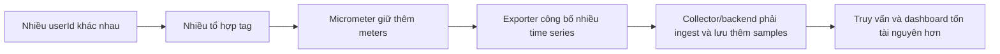
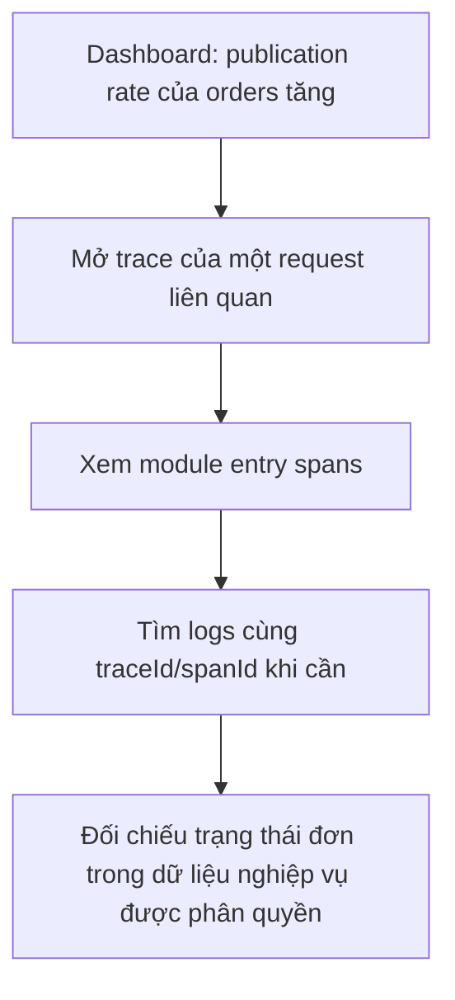
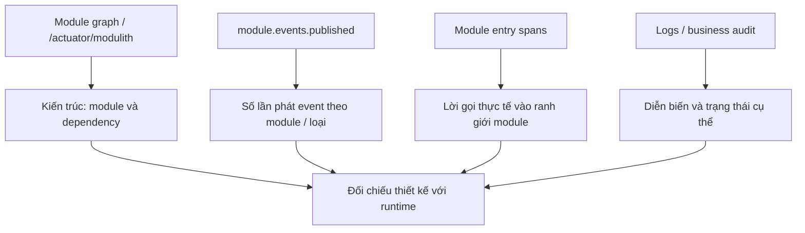

# Vì sao user id không phù hợp làm metric tag

## 1. Bối cảnh: quan sát kiến trúc mô-đun đang vận hành

Trong ứng dụng Spring Boot sử dụng **Spring Modulith**, các application module như `orders`, `inventory` và `notifications` thực hiện những trách nhiệm khác nhau. Module `orders` có thể phát `OrderPlaced`; module `inventory` nhận sự kiện và giữ hàng; module `notifications` xử lý thông báo. Nhóm vận hành cần đo số lần phát event, tốc độ xử lý, tỷ lệ lỗi và thời lượng tương tác giữa các module.

Spring Modulith tích hợp Micrometer để phát sinh **event metrics** và các observation/span tại ranh giới module. Một nhóm kỹ sư muốn bổ sung tag `userId` cho counter `OrderPlaced` để “sau này lọc tất cả đơn hàng của một người dùng”. Ý tưởng có vẻ tiện, nhưng lại phá vỡ mục đích của hệ thống **metrics**.

Bài **“Vì sao user id không phù hợp làm metric tag”** thuộc chương **Cardinality** của **SPRING_MODULITH_DOCUMENTATION_OBSERVABILITY**. Mục tiêu là hiểu bằng cơ chế, con số và ví dụ cụ thể tại sao ID người dùng không phù hợp với metric tags, cách thay bằng các chiều đo giới hạn, và cách kết hợp **module graph, Actuator, event metrics, tracing, context propagation** để điều tra từng request mà vẫn giữ hệ thống giám sát ổn định.

Sau khi học, bạn có thể:

- Giải thích *metric identity*, *tag*, *time series* và *cardinality*.
- Ước lượng số series khi tag chứa `userId`, `requestId` hoặc `orderId`.
- Phân tích tác hại với bộ nhớ Micrometer, hệ thống thu thập metrics và tính riêng tư.
- Viết tùy biến Spring Modulith event metric sử dụng tag có giá trị giới hạn.
- Phân biệt việc đo **tổng hợp theo module/event** với việc tra cứu **một user hoặc một request**.
- Kiểm tra cardinality và bổ sung guardrail trước khi triển khai.

## 2. Metric tag và time series là gì?

Một metric thường có **tên**, **giá trị số** và các **tag** dạng key-value. Ví dụ một counter ghi số event được phát:

```text
module.events.published
  module.identifier = orders
  module.event.type = OrderPlaced
  module.name = Orders
```

Trong Micrometer, **meter ID** được nhận diện theo tên và các tag. Đối với hệ thống time series như Prometheus, mỗi tổ hợp tên metric và bộ nhãn có thể tạo một **time series riêng**. Giá trị counter tăng dần theo thời gian trên chính series đó.

Ví dụ, thêm tag `channel` từ một enum giới hạn tạo ba nhóm có ý nghĩa:

```text
orders.order.placed{channel="web"}      120
orders.order.placed{channel="mobile"}    80
orders.order.placed{channel="store"}     15
```

Ba chuỗi trả lời được câu hỏi “kênh nào phát nhiều đơn hơn?”, trong khi tổng là 215 lần. Các tên và số liệu trên chỉ để minh họa khái niệm; chúng **không phải** counter mặc định hay dữ liệu đo từ một ứng dụng cụ thể.

### 2.1. Cardinality là số tổ hợp giá trị có thể xuất hiện

*Cardinality* trong ngữ cảnh metric là số chuỗi khác nhau khi kết hợp các giá trị tag. Với một metric:

\[
N_{\text{series}} \leq \prod_{i=1}^{k} V_i
\]

Trong đó `V_i` là số giá trị khác nhau của tag thứ `i`. Đây là **giới hạn trên** khi xét mọi tổ hợp lý thuyết. Số thực tế có thể ít hơn vì không phải tổ hợp nào cũng xảy ra.

Ví dụ hệ thống có 4 module, 5 loại event và 3 kênh. Giới hạn lý thuyết là `4 × 5 × 3 = 60` tổ hợp, trước khi xét các nhãn như instance, môi trường hay outcome. Trên thực tế, một loại event thường chỉ thuộc một module nên số series có thể thấp hơn.

Nếu bổ sung `userId` với 100.000 giá trị, giới hạn trên thành `4 × 5 × 3 × 100.000 = 6.000.000` tổ hợp. Không phải mọi tổ hợp ấy được tạo ra, nhưng **không còn ranh giới nhỏ và ổn định** cho số series; thêm người dùng có thể tiếp tục làm số lượng tăng.

| Tag | Tập giá trị điển hình | Đánh giá |
| --- | --- | --- |
| `module.identifier` | Tên các module của ứng dụng | Thường nhỏ và có kiểm soát |
| `module.event.type` | Các lớp event được khai báo trong mã | Thường nhỏ và có kiểm soát |
| `channel` | `web`, `mobile`, `store` | Nhỏ nếu lấy từ enum/allowlist |
| `outcome` | `success`, `failure` | Nhỏ nếu định nghĩa cố định |
| `userId` | Mỗi người dùng có giá trị khác nhau | Lớn, tăng theo tập khách hàng |
| `requestId` hoặc `traceId` | Thường đổi ở mỗi lần xử lý | Rất lớn, tăng theo lưu lượng |
| `orderId` | Mỗi đơn thường có ID mới | Lớn, tăng theo số giao dịch |
| URL chứa mã động | `/orders/123`, `/orders/124`... | Lớn nếu không chuẩn hóa về route template |

Một nhãn “ít giá trị hôm nay” vẫn có thể trở thành high-cardinality trong tương lai. Ví dụ `tenantId` hiện có 5 giá trị nhưng có thể lên hàng nghìn khi sản phẩm phát triển. Đánh giá cardinality cần dựa trên **tập giá trị cho phép và xu hướng tăng trưởng**, không chỉ trên dữ liệu mẫu.

## 3. Vì sao user ID gây vấn đề cụ thể?

### 3.1. Mỗi user ID mới có thể tạo thêm meter/time series

Xét counter ghi số lần một người đặt hàng. Hai sự kiện của **cùng user** có thể tăng cùng series; nhưng mỗi **user khác** lại yêu cầu một bộ nhãn riêng:

```text
orders.order.placed{userId="u-00001"}  4
orders.order.placed{userId="u-00002"}  1
orders.order.placed{userId="u-00003"}  2
...
orders.order.placed{userId="u-75000"}  1
```

Thay vì một counter chung hoặc vài counter theo kênh, ứng dụng có thể phải quản lý hàng chục nghìn meter cùng tên nhưng khác `userId`. Micrometer cảnh báo rõ: tag không giới hạn như user ID, email, request ID hay trace ID có thể tạo quá nhiều meter/time series, làm ảnh hưởng hiệu năng cả ứng dụng và metrics backend.

Điều này vẫn đúng nếu `userId` là UUID, số tự tăng, chuỗi ngẫu nhiên hoặc mã giả danh. **Độ đa dạng của giá trị** mới là nguyên nhân trực tiếp của cardinality; việc mã hóa ID không tự giảm số lượng nhóm.

### 3.2. Chi phí tăng ở cả ứng dụng lẫn hệ thống monitoring



Một phép tính minh họa: nếu một target luôn có **20.000 time series** hoạt động, Prometheus scrape **15 giây/lần**, thì trong một ngày:

\[
20.000 \times \frac{86.400}{15}=115.200.000\ \text{samples/ngày}
\]

Đây chỉ là **ước lượng số mẫu thô** nếu đủ 20.000 chuỗi hiện diện suốt ngày; không phải ước lượng dung lượng lưu trữ tính bằng byte hoặc chi phí thực tế. Thời gian giữ dữ liệu, mức nén, nhãn, replication, histogram, số replica và quy tắc backend còn ảnh hưởng kết quả. Con số cho thấy tác động của **số series nhân với tần suất scrape**, trước cả việc tính các metric khác của JVM, HTTP và module.

Nếu deployment có nhiều instance, mỗi instance có label riêng thì số series toàn hệ thống còn lớn hơn. Một instance restart cũng không có nghĩa toàn bộ series cũ biến mất lập tức khỏi nơi lưu trữ.

### 3.3. User ID trong metric tag không giải quyết tốt việc điều tra

Metrics hữu ích để trả lời:

- Bao nhiêu `OrderPlaced` được phát mỗi phút?
- Sau deploy, tỷ lệ lỗi của listener `notifications` có tăng không?
- P95 thời lượng gọi vào module `inventory` có bất thường?

Nhưng để trả lời “người dùng U đã đặt những đơn nào?” hay “request R thất bại vì sao?”, cần **truy vấn dữ liệu nghiệp vụ và dấu vết xử lý cụ thể**. Counter chỉ lưu số tổng hợp, không lưu đầy đủ trạng thái đơn, kết quả từng listener hay nguyên nhân exception.

Thậm chí nếu gắn `userId` vào counter, kết quả “3” cũng **không nói được ba đơn nào**, thời gian chi tiết hay việc giao dịch đã commit hay chưa.

### 3.4. Rủi ro riêng tư và vòng đời dữ liệu

User ID có thể là định danh trực tiếp hoặc có thể liên kết ngược với một người dùng khi kết hợp với hệ thống khác. Nếu đưa nó vào metrics:

- Nhãn có thể xuất hiện tại endpoint `/actuator/prometheus`, backend monitoring, dashboard và bản xuất dữ liệu.
- Người có quyền đọc metrics có thể vô tình thấy định danh nằm ngoài nhu cầu vận hành.
- Bản sao dữ liệu và chính sách retention của monitoring có thể khác với chính sách quản trị dữ liệu nghiệp vụ.
- Việc xóa tag khỏi code **không xóa ngay dữ liệu lịch sử** đã được lưu hoặc cache ở các thành phần khác.

Ngay cả khi dùng mã băm hoặc giá trị đã được “ẩn danh” theo cách nội bộ, vẫn cần xem xét khả năng liên kết lại với người dùng. Hash không phải giải pháp chữa cardinality: nếu mỗi user có một hash khác nhau thì vẫn có một chuỗi riêng cho mỗi user.

## 4. Sự khác biệt giữa metrics, logs, tracing và dữ liệu nghiệp vụ

Trước khi chọn tag, xác định **câu hỏi cần trả lời** và nguồn dữ liệu phù hợp:

| Câu hỏi | Công cụ phù hợp | Vì sao? |
| --- | --- | --- |
| “Module nào phát nhiều event hơn sau deploy?” | Spring Modulith event metrics | Tổng hợp theo module/event, có thể so tốc độ theo thời gian |
| “Bao nhiêu lần event được phát trong 5 phút?” | Counter + `rate()`/`increase()` trên backend | Phân tích tăng trưởng trong khoảng thời gian, tránh đọc raw counter như số trong 5 phút |
| “Request này đi qua module nào?” | Tracing với `traceId` và module spans | Liên kết các bước xử lý được instrument trong một hành trình |
| “Listener lỗi với exception gì?” | Logs liên kết trace, span và ngữ cảnh lỗi | Có thông điệp và stack trace hữu ích khi được ghi hợp lý |
| “Người dùng này có những đơn hàng nào?” | Database/API nghiệp vụ được phân quyền | Nguồn chính xác của đơn hàng và trạng thái nghiệp vụ |
| “Module phụ thuộc module nào trong kiến trúc?” | Module graph, Modulith Actuator/Documenter | Kiểm tra cấu trúc dependency, không suy từ số lượng event |

**Metric không phải một cơ sở dữ liệu tra cứu từng người dùng.** Cũng không cần chuyển toàn bộ user ID sang logs/traces: nếu phải lưu định danh trong một tín hiệu, chỉ dùng khi có mục đích rõ, quyền truy cập và chính sách retention/redaction phù hợp.

### 4.1. Trace ID cũng không nên là metric tag

Trong hệ thống có Micrometer Tracing, `traceId` và `spanId` giúp liên kết logs với traces. Chúng phù hợp để **tìm một lần xử lý đã được lấy mẫu**, không phù hợp làm nhãn của một time series vì giá trị thay đổi gần như ở mỗi request.

Một luồng quan sát hợp lý:



Để nối module spans trong các thread hoặc dịch vụ khác nhau, còn cần **context propagation** thích hợp. Việc không thấy một span có thể do sampling, instrument thiếu hoặc mất context, chưa đủ để kết luận listener không chạy.

## 5. Metric mặc định của Spring Modulith và bẫy từ customizer

Spring Modulith 2.2 có hai dạng counter cho domain event publication:

| Micrometer meter | Cách sử dụng | Các tag mặc định |
| --- | --- | --- |
| `module.events.published` | Đếm tổng hợp các lần phát domain event | `module.event.type`, `module.identifier`, `module.name` |
| `module.events.published.$moduleIdentifier.$simpleEventTypeName` | Counter dành riêng cho một loại event của module | `module.identifier`, `module.name`; có thể thêm tag qua customizer |

Các tag mặc định mô tả **module và loại event**, là những chiều đo có tập giá trị giới hạn bởi kiến trúc/chương trình. Chúng giúp dashboard trả lời: `orders` đang phát event nào nhiều hơn?

Spring Modulith cung cấp `ModulithEventMetricsCustomizer` để thêm metadata cho **counter riêng của từng event type**. API này nhận event và một `Counter.Builder`. Nếu bạn dùng `event.userId()` làm tag ở đây thì user ID đi thẳng vào **định danh meter**: không có cơ chế tự hiểu đây là “high-cardinality tag” để bảo vệ registry.

### 5.1. Phản ví dụ: làm từng user thành một series

```java
// PHẢN VÍ DỤ, KHÔNG SỬ DỤNG TRONG ỨNG DỤNG.
@Bean
ModulithEventMetricsCustomizer unsafeCustomizer() {
    return metrics -> metrics.customize(OrderPlaced.class,
        (event, counter) ->
            counter.tag("userId", event.userId().toString()));
}
```

Giả sử `OrderPlaced` chứa `userId`. Mỗi user ID khác nhau có thể sinh một meter mới. Việc thêm `requestId` sẽ còn tệ hơn, vì mỗi request thường có ID riêng. Không nên dùng ID động trong **tên meter** (ví dụ `order.published.user-123`) để “tránh tag”: tạo tên metric động cũng làm backend khó quản lý.

### 5.2. Cách làm đúng: nhóm theo một enum nghiệp vụ

Nếu muốn đếm `OrderPlaced` theo kênh bán hàng, định nghĩa một tập giá trị đã biết:

```java
// com/example/shop/orders/SalesChannel.java
package com.example.shop.orders;

public enum SalesChannel {
    WEB, MOBILE, STORE
}
```

```java
// com/example/shop/orders/OrderPlaced.java
package com.example.shop.orders;

import java.util.UUID;

public record OrderPlaced(UUID orderId, SalesChannel channel) {}
```

Tùy biến counter:

```java
// com/example/shop/observability/SafeEventMetricConfiguration.java
package com.example.shop.observability;

import java.util.Locale;
import org.springframework.context.annotation.Bean;
import org.springframework.context.annotation.Configuration;
import org.springframework.modulith.observability.ModulithEventMetricsCustomizer;
import com.example.shop.orders.OrderPlaced;

@Configuration(proxyBeanMethods = false)
class SafeEventMetricConfiguration {

    @Bean
    ModulithEventMetricsCustomizer channelMetricCustomizer() {
        return metrics -> metrics.customize(OrderPlaced.class,
            (event, counter) -> counter.tag(
                "channel",
                event.channel().name().toLowerCase(Locale.ROOT)
            ));
    }
}
```

Điều kiện của ví dụ:

- `event.channel()` phải được kiểm tra khác `null` hoặc chuẩn hóa về giá trị cố định trước khi phát event.
- Dùng enum hoặc allowlist để bảo đảm **chỉ ba giá trị** `web`, `mobile`, `store` được gắn vào metric.
- `orderId` có mặt trong sự kiện để phục vụ nghiệp vụ nhưng **không được đưa vào tag**.
- Bean customizer cần được Spring phát hiện; mã tham chiếu API ở compile time nên cần `spring-modulith-observability-api` phù hợp, trong khi core đảm nhiệm runtime instrumentation.
- Counter riêng được customizer này tác động. Counter tổng `module.events.published` không mặc định nhận thêm tag `channel`.

Ví dụ Gradle Groovy DSL cho dự án Spring Boot dùng Spring Modulith **2.x** và BOM tương thích:

```groovy
dependencies {
    implementation 'org.springframework.boot:spring-boot-starter-actuator'
    implementation 'org.springframework.modulith:spring-modulith-observability-api'
    runtimeOnly 'org.springframework.modulith:spring-modulith-observability-core'
    // Thêm metrics registry/exporter tương ứng khi cần quan sát bên ngoài.
}
```

Nếu đã dùng `spring-modulith-starter-insight`, core/Actuator được kéo theo. Khi source code dùng API customizer, kiểm tra API có thực sự hiện diện trên compile classpath. Với Spring Modulith 1.x, artifact/phiên bản có thể khác nên cần dựa vào tài liệu đúng dòng.

### 5.3. Không được cộng trùng hai loại counter

Một event publication có thể được ghi vào **all-events counter** và **per-event counter**. Chúng là hai góc nhìn lên cùng hoạt động phát event; không cộng giá trị của cả hai để tính tổng, vì sẽ **đếm hai lần**.

Đồng thời, không coi publication counter là số lần consumer hoàn thành. Một event có thể được phát một lần rồi được hai listener nhận; một listener có thể retry hay lỗi. Muốn đo kết quả xử lý, cần metric ở consumer và đối chiếu logs/traces hoặc event publication registry nếu sử dụng.

## 6. Đọc metrics qua Actuator và phát hiện tag bất thường

Trong môi trường phát triển có Spring Boot Actuator và registry, expose endpoint cần thiết:

```yaml
management:
  endpoints:
    web:
      exposure:
        include: "health,metrics,prometheus"
```

`/actuator/prometheus` chỉ sẵn có khi có Prometheus registry và endpoint được expose. Trong production, cần kiểm soát quyền truy cập, mạng quản trị và chỉ mở endpoint cần thiết; đừng mở public toàn bộ Actuator.

Sau khi ứng dụng phát ít nhất một event phù hợp:

```bash
# Các meter thực tế đang có.
curl -s http://localhost:8080/actuator/metrics

# Counter tổng theo module/event.
curl -s http://localhost:8080/actuator/metrics/module.events.published

# Counter riêng của OrderPlaced nếu tên được tạo theo quy ước này.
curl -s http://localhost:8080/actuator/metrics/module.events.published.orders.OrderPlaced
```

Tên per-event metric là ví dụ theo quy ước của tài liệu. Trước khi dùng tên trong script, hãy **xác minh tên meter thực tế từ endpoint `/actuator/metrics`**. Phản hồi thường có `measurements` và `availableTags`:

```json
{
  "name": "module.events.published.orders.OrderPlaced",
  "measurements": [
    { "statistic": "COUNT", "value": 34.0 }
  ],
  "availableTags": [
    { "tag": "module.identifier", "values": ["orders"] },
    { "tag": "channel", "values": ["web", "mobile", "store"] }
  ]
}
```

Đây là **JSON minh họa rút gọn**, chưa phải output thực tế. Kết quả thật có thể thêm `description`, `baseUnit`, `module.name` và các trường khác. Trong ví dụ tốt, `channel` chỉ có ba giá trị; nếu thấy tag `userId` với hàng nghìn giá trị, cần coi đó là dấu hiệu cần sửa instrumentation.

### 6.1. Quan sát số time series trong Prometheus

Khi có Prometheus registry, tên Micrometer `module.events.published` thường được chuẩn hóa (dấu chấm thành gạch dưới, counter có hậu tố tương ứng). Không suy diễn chính xác tên series khi chưa xem `/actuator/prometheus` vì tên và label phụ thuộc registry/version.

Giả sử exporter thực sự cho metric `module_events_published_total`, có thể kiểm tra số series:

```promql
# Bao nhiêu series đang có cho counter này?
count(module_events_published_total)

# Số series theo module (nếu nhãn module_identifier tồn tại).
count by (module_identifier) (module_events_published_total)

# Tốc độ publication toàn cụm, tính rate trước khi sum.
sum(rate(module_events_published_total[5m]))
```

`count(...)` ở đây đếm số series đang được Prometheus truy vấn tại thời điểm đó, **không đếm số event**. `sum(rate(...))` mới phản ánh tổng tốc độ tăng counter của các series khớp truy vấn. Đừng so sánh số series với số đơn hàng thành công.

### 6.2. Quan sát tác động theo thời gian

Trong một bài thực hành với dữ liệu mô phỏng, có thể thử:

1. Phát 100 `OrderPlaced` cùng `channel=WEB` nhưng khác `orderId`. Counter web tăng; số giá trị tag `channel` không tăng.
2. Phát thêm event với `MOBILE` và `STORE`. Có tối đa ba giá trị `channel` trong mô hình ví dụ.
3. Với phản ví dụ `userId` (chỉ mô tả ý tưởng, **không triển khai thật trên môi trường chung**), mỗi user mới có thể tạo thêm meter cùng tên. So sánh điều đó với cách nhóm theo enum.
4. Kiểm tra tên metric, tập tag, số meter và số series trước/sau; ghi nhận khác biệt giữa **giá trị counter** và **số lượng time series**.

Tập dữ liệu nhỏ ở môi trường demo không chứng minh cấu hình an toàn ở production. Điều cần kiểm soát là **tập giá trị tối đa có thể xảy ra khi lưu lượng và số user tăng**, chứ không phải vài bản ghi thử nghiệm hiện tại.

## 7. Bảo vệ ứng dụng bằng MeterFilter và detector

**Sửa nguồn sinh tag** là biện pháp ưu tiên. Các công cụ ở tầng Micrometer giúp phát hiện hoặc hạn chế hậu quả khi instrumentation sai lọt vào runtime.

### 7.1. Không cho đăng ký metric có tag định danh người dùng

Micrometer có `MeterFilter.ignoreTags(...)` để loại các tag theo tên key trước khi meter được đăng ký. Ví dụ khung bảo vệ áp dụng cho registry đã được cấu hình:

```java
import io.micrometer.core.instrument.config.MeterFilter;
import org.springframework.context.annotation.Bean;
import org.springframework.context.annotation.Configuration;

@Configuration(proxyBeanMethods = false)
class MetricTagGuardConfiguration {

    @Bean
    MeterFilter ignoreIdentityTags() {
        // Bỏ các tag ngoài ý muốn nếu instrumentation vẫn gắn chúng.
        return MeterFilter.ignoreTags("userId", "requestId", "traceId");
    }
}
```

Trong Spring Boot có tích hợp MeterRegistry, bean `MeterFilter` có thể được áp dụng cho registry do Boot quản lý. Đây là ví dụ minh họa: đặt tên key phải khớp với tag sai thực tế (kể cả `user_id` hoặc các biến thể khác), và filter toàn cục cũng có thể ảnh hưởng những meter ngoài phạm vi Modulith. Do vậy **cần sửa customizer ở nguồn**, sau đó dùng filter như lớp phòng vệ bổ sung.

### 7.2. Giới hạn số giá trị tag được chấp nhận

Nếu một tag đáng lẽ chỉ có vài giá trị, có thể giới hạn số giá trị bằng `MeterFilter.maximumAllowableTags(...)`:

```java
import io.micrometer.core.instrument.config.MeterFilter;
import org.springframework.context.annotation.Bean;
import org.springframework.context.annotation.Configuration;

@Configuration(proxyBeanMethods = false)
class ChannelCardinalityGuard {

    @Bean
    MeterFilter limitChannels() {
        return MeterFilter.maximumAllowableTags(
            "module.events.published.",
            "channel",
            4,
            MeterFilter.deny()
        );
    }
}
```

Prefix `module.events.published.` trong ví dụ nhắm vào các meter per-event theo quy ước ở trên, với tối đa bốn giá trị kênh (ba kênh và một giá trị dự phòng như `unknown` nếu thiết kế có). Khi vượt giới hạn, những meter mới có giá trị tag chưa được chấp nhận có thể bị từ chối **và dữ liệu tương ứng sẽ không được đo**. Vì vậy guardrail không thay thế việc validate đầu vào và cần quan sát các cảnh báo liên quan.

Ngưỡng không phải “mặc định an toàn” cho mọi ứng dụng. Chọn dựa trên mô hình nghiệp vụ, số module/event, quy mô hệ thống và mục tiêu theo dõi.

### 7.3. HighCardinalityTagsDetector

Các phiên bản Micrometer hỗ trợ `HighCardinalityTagsDetector` có thể phát hiện **nhiều meter cùng tên** vượt một ngưỡng. Ví dụ API detector được Micrometer công bố:

```java
// Ví dụ cho phiên bản Micrometer có API này.
registry.config().withHighCardinalityTagsDetector();
```

Detector có thể đưa cảnh báo để điều tra, nhưng nó **không chặn** việc thêm meter và không phát hiện được trường hợp ứng dụng tạo **tên meter động**. Một số ứng dụng còn có sẵn ngưỡng/cảnh báo về số series tại Prometheus hoặc backend monitoring. Kết hợp kiểm tra mã với giám sát thực tế hiệu quả hơn chỉ dựa vào một chỉ số.

## 8. Nếu hệ thống đã phát metrics có user ID

Khi phát hiện một counter gắn ID động, cần xử lý cả **nguồn phát** lẫn **bản sao dữ liệu đã lưu**:

1. **Xác định nơi sinh nhãn:** `ModulithEventMetricsCustomizer`, custom `ObservationConvention`, HTTP URI instrumentation hoặc code tạo `Counter.Builder` riêng. Rà soát cả **tên metric động**.
2. **Sửa mã:** bỏ `userId`/`requestId` hoặc chuẩn hóa sang enum/nhóm có giới hạn; triển khai phiên bản đã sửa.
3. **Kiểm tra tại ứng dụng:** đọc `/actuator/metrics` và dữ liệu export; xác nhận không phát sinh giá trị tag mới sau khi sửa.
4. **Đo ảnh hưởng:** kiểm tra số meter trong registry, số series ingest, cảnh báo quota hoặc lỗi scrape; xem instance nào còn chạy phiên bản cũ.
5. **Rà soát dữ liệu cũ:** xác định backend, retention, bản export/dashboard, và phối hợp xử lý theo chính sách dữ liệu nội bộ. Việc gỡ tag khỏi code không tự xóa các chuỗi đã ghi.
6. **Ngăn tái diễn:** thêm review cho tag mới, phép thử đo cardinality với nhiều request/user giả lập và guardrail ở registry/backend khi thích hợp.

Nếu cần phân tích một nhóm người dùng, nên cân nhắc **nhóm được xác định và quản trị rõ ràng** (ví dụ `customer_tier=free|standard|premium`), sau khi đánh giá độ nhạy cảm và nhu cầu nghiệp vụ. Không đưa `userId` hoặc mã hash duy nhất của mỗi người dùng vào tag chỉ vì muốn dễ tra cứu.

## 9. Sự liên hệ với module graph, Actuator và tracing

Một cách hiểu đúng về observability trong Spring Modulith:



Ví dụ `orders` phát `OrderPlaced` rồi `inventory` xử lý:

- Counter publication có thể có `module.identifier=orders` vì `orders` **phát event**.
- Module entry span của listener có thể có `module.identifier=inventory` vì `inventory` **xử lý event**.
- Module graph cho thấy sự phụ thuộc cấu trúc giữa các module.
- Trace/log cung cấp thông tin về hành trình request cụ thể, với điều kiện có instrumentation, sampling và context propagation thích hợp.

Đây là các câu hỏi khác nhau. Không nên thêm `userId` vào publication metric để cố biến nó thành trace, và cũng không nên dùng số event được phát để khẳng định listener đã xử lý thành công. Trong trường hợp bất đồng bộ, dữ liệu span có thể tách trace khi thiếu context propagation.

## 10. Checklist thiết kế metric tag

| Câu hỏi | Đạt khi |
| --- | --- |
| Tag này giải quyết câu hỏi tổng hợp gì? | Có mục đích về vận hành, cảnh báo hoặc thống kê rõ ràng |
| Giá trị có bị giới hạn không? | Có enum, allowlist hoặc tập giá trị có thể kiểm soát |
| Số tổ hợp có thể tăng theo số người dùng/request không? | Không dùng user ID, request ID, trace ID, order ID làm tag |
| Có thể chuẩn hóa hay nhóm thay vì dùng giá trị thô? | Dùng route template, nhóm kết quả hoặc loại event hợp lệ |
| Có nguy cơ tiết lộ định danh cá nhân không? | Không đưa danh tính hoặc dữ liệu nhạy cảm vào nhãn |
| Có kiểm tra cả tên metric? | Không tự tạo tên khác nhau cho mỗi user/request |
| Có xác minh qua Actuator và registry thực tế? | Tập tag, số meter và số series phù hợp với dự kiến |
| Có guardrail và giám sát cardinality? | Có review, detector hoặc filter khi cần |
| Cần điều tra một người dùng cụ thể? | Dùng dữ liệu nghiệp vụ, logs/traces có kiểm soát thay cho metric labels |

## 11. Những điểm cần nhớ

**`userId` không phù hợp làm metric tag vì tập giá trị lớn và tăng trưởng theo người dùng.** Khi gắn nó vào counter, Micrometer có thể tạo một meter riêng cho mỗi tổ hợp ID và nhãn khác; hệ thống thu thập/lưu trữ phải xử lý nhiều time series, trong khi người vận hành vẫn không nhận được đầy đủ lịch sử nghiệp vụ của từng người.

Trong Spring Modulith, hãy giữ các tag kiến trúc có giới hạn như `module.identifier`, `module.event.type` và `module.name`; nếu tùy biến per-event counter, chỉ thêm những chiều nghiệp vụ có tập giá trị được kiểm soát như `channel`. Metrics giúp xem xu hướng; module graph giúp hiểu ranh giới; traces và logs giúp điều tra một lần xử lý; dữ liệu nghiệp vụ được phân quyền giúp đối soát theo người dùng.

Việc **loại bỏ user ID khỏi metric tag** vừa làm hệ thống observability dễ vận hành, vừa hạn chế việc nhân bản định danh cá nhân sang các hệ thống monitoring.

## Tài liệu tham khảo

- [Spring Modulith 2.2 — Production-ready Features](https://docs.spring.io/spring-modulith/reference/2.2/production-ready.html): all-events metric, per-event counter và `ModulithEventMetricsCustomizer`.
- [Spring Modulith — ModulithEventMetricsCustomizer API](https://docs.spring.io/spring-modulith/docs/current/api/org/springframework/modulith/observability/ModulithEventMetricsCustomizer.html): contract tùy biến counter domain event.
- [Micrometer — High Cardinality Tags Detector](https://docs.micrometer.io/micrometer/reference/concepts/high-cardinality-tags-detector.html): rủi ro từ user/request/trace IDs, cách phát hiện và hướng khắc phục.
- [Micrometer — Meter Filters](https://docs.micrometer.io/micrometer/reference/concepts/meter-filters.html): `ignoreTags(...)` và `maximumAllowableTags(...)`.
- [Micrometer — Meter Concepts](https://docs.micrometer.io/micrometer/reference/concepts/meters.html): meter ID và nguyên tắc sử dụng tags.
- [Spring Boot — Metrics](https://docs.spring.io/spring-boot/reference/actuator/metrics.html): MeterRegistry, Actuator metrics endpoint và việc xuất metrics.
- [Spring Boot — Tracing](https://docs.spring.io/spring-boot/reference/actuator/tracing.html): correlation, sampling và trace context.
- [Prometheus — Data Model](https://prometheus.io/docs/concepts/data_model/): time series được nhận diện bằng metric name và tập labels.

> **Lưu ý:** Các ví dụ Java, endpoint và tên series được viết cho mục đích học tập. Artifact và API có thể khác giữa các phiên bản Spring Boot, Spring Modulith và Micrometer; phải kiểm tra dependency management và dữ liệu thu được trong dự án thực tế. STEP 4 tạo nội dung, còn đánh giá chuyên môn và refactor sẽ được thực hiện ở bước QA sau.
