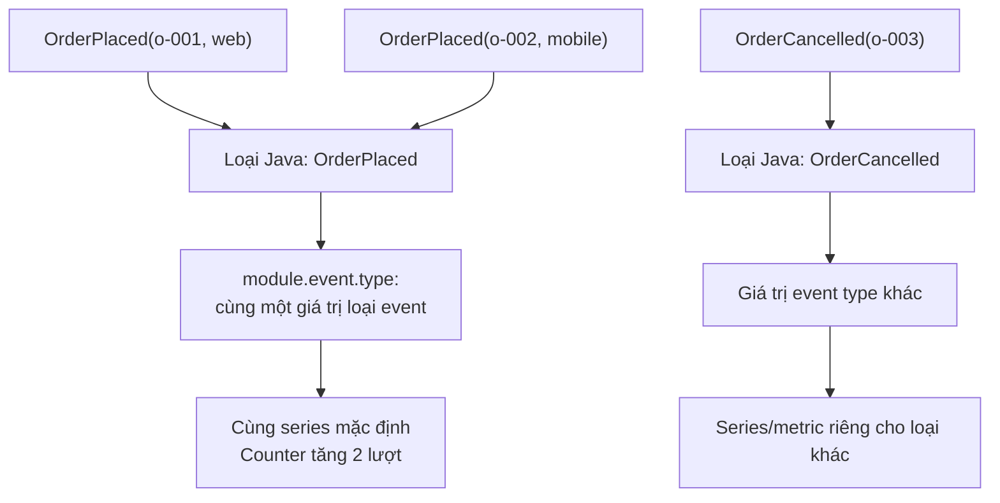

# Event type có thể tạo nhiều giá trị như thế nào?

## 1. Bối cảnh: một hệ thống có ít module nhưng rất nhiều event

Trong một ứng dụng **Spring Boot** dùng **Spring Modulith**, nhóm phát triển thường chia mã nguồn thành các application module, chẳng hạn `ordering`, `payment`, `inventory` và `notification`. Các module trao đổi thông tin qua Spring application events, đồng thời Spring Modulith hỗ trợ **event metrics** để theo dõi lượng event được công bố khi hệ thống vận hành.

Giả sử module `ordering` công bố:

- `OrderPlaced` khi một đơn được tiếp nhận.
- `OrderCancelled` khi người dùng hủy đơn.
- `OrderShipped` khi đơn được chuyển sang giao hàng.
- `OrderReturned` khi hàng được trả về.

Chỉ **bốn class event** đã tạo ra bốn giá trị phân loại khác nhau. Nếu ứng dụng có thêm 30 module, mỗi module có nhiều loại event và mỗi nhóm lại bổ sung tags khác nhau, số **time series** trên hệ thống monitoring có thể tăng đáng kể.

Chủ đề **“Event type có thể tạo nhiều giá trị như thế nào”** đặt ra ba câu hỏi chính:

1. `module.event.type` lấy các giá trị từ đâu?
2. **Nhiều event instances** có làm tăng số series không, hay chỉ làm tăng counter?
3. Kết hợp event type với module, tags tùy biến và nhiều replica sẽ làm **cardinality** tăng như thế nào?

> **Ý chính:** Event type thường là một tập tên class hữu hạn trong một bản build, nhưng số loại có thể lớn; khi kết hợp với các tag có nhiều giá trị, số series có thể tăng theo **tích của số giá trị khác nhau**, chứ không chỉ tăng theo số lần công bố event.

## 2. Cardinality trong metrics nghĩa là gì?

**Metric cardinality** là số tổ hợp nhận diện chuỗi thời gian khác nhau trong metric registry hoặc monitoring backend. Một chuỗi thường được phân biệt bởi:

- **Tên metric** (meter name).
- **Tập tag keys và tag values** (labels).
- Các nhãn do hạ tầng thêm khi lưu/truy vấn, chẳng hạn `instance`, `pod`, `job` hoặc `cluster`.

Ví dụ các series sau có **cùng tên metric** nhưng **khác giá trị tag**:

```text
module.events.published{module.identifier="ordering", module.event.type="OrderPlaced"}
module.events.published{module.identifier="ordering", module.event.type="OrderCancelled"}
module.events.published{module.identifier="payment",  module.event.type="PaymentAuthorized"}
```

Ba dòng này thể hiện ba **bộ nhãn khác nhau**, nên là ba time series logic riêng biệt. Đây là cách biểu diễn minh họa, không phải định dạng JSON của Actuator hay lời cam kết về tên/value exporter.

Khi publish thêm 1.000 lượt `OrderPlaced` của cùng module, cùng bộ labels, counter tương ứng **tăng giá trị**; nó **không tự tạo thêm 1.000 series**. Ngược lại, khi xuất hiện `OrderReturned` — một loại event mới — sẽ có thêm một giá trị phân loại event và có thể thêm series.

### 2.1. Một mô hình tính gần đúng

Nếu một metric có `k` nhãn độc lập, nhãn thứ `i` có tối đa `n_i` giá trị khác nhau thì số tổ hợp tiềm năng được ước lượng:

\[
S_{\text{max}} \approx \prod_{i=1}^{k} n_i
\]

Đây là **giới hạn trên theo tích Đề-các** khi mọi tổ hợp đều có thể xảy ra; số series **thực tế** phụ thuộc các tổ hợp đã được ghi nhận và chính sách tạo/lưu meter của registry.

Ví dụ cùng một metric có:

| Nhãn | Số giá trị phân biệt giả định |
| --- | ---: |
| `module.identifier` | 6 module |
| `module.event.type` | 12 event type cho mỗi module |
| `channel` | 3 giá trị (`web`, `mobile`, `other`) |
| `region` | 4 vùng |
| `instance` ở monitoring backend | 5 replica |

Giới hạn trên minh họa là `6 × 12 × 3 × 4 × 5 = 4.320` series cho một tên metric, **nếu** 12 loại event có thể xuất hiện ở mỗi module và mọi tổ hợp nhãn thực sự có mặt. Nếu mỗi event type chỉ tồn tại trong một module, số series sẽ nhỏ hơn một tích “6 module × 72 event types” bất cẩn vì các cặp module-type không độc lập.

**Lưu ý:** số series tính ở backend có thể khác số meter đang sống trong **một instance JVM** vì backend thêm nhãn hạ tầng, giữ dữ liệu lịch sử và nhận nhiều instance.

## 3. Spring Modulith gắn event type vào metric thế nào?

Theo tài liệu chính thức, Spring Modulith đăng ký **hai dạng counter** cho domain event được công bố:

| Meter Micrometer | Cách phân biệt loại event |
| --- | --- |
| `module.events.published` | Counter tổng hợp, dùng **low-cardinality key** `module.event.type` cùng `module.identifier` và `module.name` |
| `module.events.published.$moduleIdentifier.$simpleEventTypeName` | Counter **riêng cho từng loại event/module**, trong đó loại event nằm trong **tên meter**; low-cardinality keys mặc định gồm `module.identifier` và `module.name` |

Ví dụ sự kiện do module `ordering` sở hữu:

```java
package com.example.shop.ordering;

public record OrderPlaced(String orderId, String channel) {}
```

Java phân biệt:

```java
OrderPlaced.class.getName();        // com.example.shop.ordering.OrderPlaced
OrderPlaced.class.getSimpleName();  // OrderPlaced
```

Với module identifier `ordering`, tên logic của counter riêng được tài liệu mô tả là:

```text
module.events.published.ordering.OrderPlaced
```

Tên counter riêng cho một event khác là:

```text
module.events.published.ordering.OrderCancelled
```

**Quan trọng về tính chính xác:** tài liệu Spring Modulith mô tả `module.event.type` là **loại của event được công bố**, nhưng cách biểu diễn **giá trị tag** cần được xác minh trong `/actuator/metrics` của phiên bản đang chạy. Không nên tự khẳng định nó luôn là simple name, fully qualified name hay một chuỗi cố định khác khi chưa đọc metric thật.

Do đó có hai cơ chế tạo nhiều chuỗi cần phân biệt:

1. Với counter **tổng hợp**, nhiều giá trị `module.event.type` tạo nhiều **tổ hợp tags** dưới cùng tên `module.events.published`.
2. Với counter **riêng**, nhiều event types tạo nhiều **tên meter khác nhau**, ngay cả khi bộ tags đi kèm nhỏ.

Không cộng cả hai nhóm counter để tính tổng số event; hai dạng này có thể đo **cùng một lượt publish** theo hai cách nhận diện.

### 3.1. Event type không phải event instance

`OrderPlaced("o-001", "web")` và `OrderPlaced("o-002", "mobile")` là **hai instances của cùng class**. Nếu chỉ dùng tags mặc định theo loại event/module, chúng thường cùng rơi vào **một nhóm**.



Giá trị payload như `orderId`, `channel`, `amount` **không tự trở thành tag** chỉ vì chúng tồn tại trong event instance. Cardinality từ payload chỉ phát sinh khi code **chủ động đưa dữ liệu vào metric tags**, chẳng hạn qua `ModulithEventMetricsCustomizer`.

## 4. Những yếu tố làm số giá trị của event type tăng

Event type có tập giá trị liên quan đến **kiểu Java thực tế được instrument**. Những thay đổi sau có thể làm tập loại mở rộng hoặc biến động:

| Tình huống | Ảnh hưởng | Cách đánh giá |
| --- | --- | --- |
| Bổ sung class/record event mới | Tăng số loại có thể xuất hiện | Review danh mục domain events và dashboard |
| Một module định nghĩa quá nhiều event rất chi tiết | Có thể tăng nhiều giá trị event type trong cùng module | Xem có đang mô hình hóa business events hợp lý không; không gom bừa chỉ vì metrics |
| Các module đều có nhiều loại event | Số cặp `module–event type` tăng | Đếm trên graph/module model và metric registry |
| Đổi tên class hoặc chuyển package/module | Tên/nhãn metric có thể thay đổi giữa các phiên bản | Lập kế hoạch migration query và alert |
| Có nhiều application versions chạy song song | Backend thấy các tên/giá trị cũ và mới cùng lúc | Phân tích theo revision/instance |
| Event sinh động hoặc dùng proxy/kiểu wrapper khác dự kiến | Giá trị type có thể khác mong đợi | Xem runtime class và kết quả thực tế từ registry; không suy tên từ source một cách máy móc |
| Hai classes ở hai package có cùng simple name | Counter riêng theo mẫu simple name có thể khó phân biệt nếu cùng module | Tránh tên trùng trong module và xác minh collision/nhãn trên phiên bản đang dùng |

Một lưu ý: event class thường được xác định lúc **build**, nên riêng `module.event.type` trong một bản build hữu hạn **không nhất thiết** là nguồn cardinality cao nhất. Rủi ro nghiêm trọng hơn thường xuất hiện khi đưa **giá trị biến động theo request** vào tags, ví dụ `orderId` hoặc `customerId`.

### 4.1. Tránh nhầm với module spans

Trong **module invocation observation**, Spring Modulith dùng các keys như `module.identifier`, `module.name`, `module.invocation-type` và `module.method`; `module.method` được xếp vào **high-cardinality** metadata của observation. Nhưng `module.event.type` trong **all-events counter** được tài liệu gọi là **low-cardinality key**.

“Low cardinality” ở đây là **ý định thiết kế instrumentation**, không phải bảo đảm có đúng một vài loại event ở mọi ứng dụng. Nếu dự án có hàng trăm/hàng nghìn loại event, giá trị đó vẫn cần được quản lý và theo dõi.

## 5. Tính thử: event type khác payload tags ra sao?

Xét 1 module `ordering` có 4 loại event. Mỗi event được publish 10.000 lần:

| Thiết kế tags | Số series tiềm năng | Điều thay đổi khi publish lặp lại |
| --- | ---: | --- |
| Chỉ `module.identifier` + `module.event.type` | 4 | Counter của từng loại tăng; số series không tăng theo 40.000 lượt |
| Thêm `channel` với 3 giá trị | Tối đa 4 × 3 = 12 | Mỗi lần publish tăng series ứng với channel |
| Thêm `region` với 5 giá trị | Tối đa 4 × 3 × 5 = 60 | Tạo thêm tổ hợp chỉ khi dữ liệu mới xuất hiện |
| Thêm `orderId` với 40.000 giá trị riêng | Có thể tăng đến hàng chục nghìn tổ hợp | **Cardinality bùng nổ** theo ID của từng event |

Bảng minh họa cùng một kiểu đếm ở mức logic; khi triển khai `ModulithEventMetricsCustomizer` trong Spring Modulith, tags nghiệp vụ thường được bổ sung cho **counter riêng theo event type**, nên số series thực tế phải tính **theo từng tên meter**, không giả định customizer tự thêm tag vào counter tổng hợp.

Điều đáng tránh là “trộn hai tầng” khi tính: nếu có 4 **meter names riêng** cho 4 event types, mỗi meter có tối đa 3 giá trị channel và 5 giá trị region thì tổng series của nhóm meter riêng có giới hạn trên là `4 × 3 × 5 = 60`, **không** phải 60 series **cho mỗi meter**.

### 5.1. Ví dụ xấu: gắn một ID cho từng đơn hàng

```java
@Bean
ModulithEventMetricsCustomizer unsafeCustomizer() {
    return metrics -> metrics.customize(
            OrderPlaced.class,
            (event, builder) -> builder.tag("orderId", event.orderId()));
}
```

Với 100.000 đơn hàng khác nhau, giá trị `orderId` có thể tạo gần 100.000 chuỗi riêng **cho một metric type trên một instance** nếu không có giới hạn/chuẩn hóa khác. Tăng tải registry, exporter, backend lưu trữ và khiến dashboard truy vấn chậm.

Ngoài cardinality, order ID cũng có thể tiết lộ thông tin nghiệp vụ. **Không dùng transaction ID, user ID, email, số điện thoại, token, timestamp hoặc URL cụ thể làm tag metric.**

### 5.2. Ví dụ tốt: chuẩn hóa kênh thành tập hữu hạn

Có thể sử dụng customizer cho counter riêng theo event type:

```java
package com.example.shop.observability;

import com.example.shop.ordering.OrderPlaced;
import org.springframework.context.annotation.Bean;
import org.springframework.context.annotation.Configuration;
import org.springframework.modulith.observability.ModulithEventMetricsCustomizer;

@Configuration(proxyBeanMethods = false)
class OrderEventMetricConfiguration {

    @Bean
    ModulithEventMetricsCustomizer orderPlacedTags() {
        return metrics -> metrics.customize(
                OrderPlaced.class,
                (event, counter) ->
                        counter.tag("channel", normalizeChannel(event.channel()))
        );
    }

    private static String normalizeChannel(String value) {
        return "web".equals(value) || "mobile".equals(value)
                ? value
                : "other";
    }
}
```

Mọi event `OrderPlaced` được gắn đúng **một tag key `channel`** và giá trị luôn thuộc tập `{web, mobile, other}`. Điều này giúp giới hạn số series do `channel` tạo ra ở mức **tối đa 3 trên một tổ hợp những tags còn lại**.

Lưu ý: khi source code sử dụng `ModulithEventMetricsCustomizer`, cần thêm artifact `spring-modulith-observability-api` vào **compile classpath**. Còn runtime starter/observability core có vai trò cung cấp instrumentation khi ứng dụng chạy.

Ví dụ Gradle Kotlin DSL, giả định BOM Spring Modulith đã được cấu hình:

```kotlin
dependencies {
    implementation("org.springframework.modulith:spring-modulith-observability-api")
    runtimeOnly("org.springframework.modulith:spring-modulith-starter-insight")
}
```

Không cần cài đồng thời nhiều starter/chức năng trùng lặp chỉ để tăng số đo.

## 6. Cách kiểm tra số giá trị event type thực tế

### 6.1. Bật Actuator metrics

Ví dụ cấu hình môi trường học tập:

```yaml
management:
  endpoints:
    web:
      exposure:
        include: health, metrics, modulith
```

Sau khi ứng dụng chạy và đã thực sự publish event trong môi trường thử nghiệm:

```bash
# Liệt kê tên các meters đã đăng ký
curl -sS http://localhost:8080/actuator/metrics

# Đọc counter tổng hợp, xem measurements và availableTags
curl -sS http://localhost:8080/actuator/metrics/module.events.published

# Đọc counter riêng theo module/simple event type name
curl -sS \
  http://localhost:8080/actuator/metrics/module.events.published.ordering.OrderPlaced
```

`/actuator/metrics` không trả một bảng toàn bộ series theo kiểu time-series database; nó trả thông tin của **meter name** gồm measurements và các giá trị tags khả dụng để lọc. Nếu chưa có meter, endpoint có thể trả 404; điều đó **không đồng nghĩa** hoạt động publish đã xảy ra 0 lần.

### 6.2. Lấy các giá trị của `module.event.type`

Một response **minh họa** của Actuator:

```json
{
  "name": "module.events.published",
  "measurements": [
    {
      "statistic": "COUNT",
      "value": 42.0
    }
  ],
  "availableTags": [
    {
      "tag": "module.event.type",
      "values": ["type-A", "type-B", "type-C"]
    },
    {
      "tag": "module.identifier",
      "values": ["ordering", "payment"]
    }
  ]
}
```

Các chuỗi `type-A`, `type-B`, `type-C` ở đây là **placeholder đại diện ba giá trị khác nhau**, không phải tên thực mà Spring Modulith chắc chắn phát ra. Dữ liệu runtime thực tế có thể có thêm `module.name` hoặc các trường metadata tùy phiên bản Spring Boot/registry.

Khi có công cụ `jq`, liệt kê **giá trị event type hiện đang xuất hiện**:

```bash
curl -fsS http://localhost:8080/actuator/metrics/module.events.published |
  jq -r '.availableTags[]? |
    select(.tag == "module.event.type") |
    .values[]' | sort -u
```

Nếu muốn **đếm số giá trị khác nhau** trong cùng response:

```bash
curl -fsS http://localhost:8080/actuator/metrics/module.events.published |
  jq '[.availableTags[]? |
        select(.tag == "module.event.type") |
        .values[]] | unique | length'
```

Con số này đếm **giá trị của một tag trên meter đang có**, **không phải tổng số series thực tế**. Những tổ hợp `module.identifier × module.event.type` có thể không tạo đủ tích Đề-các, còn tags bổ sung/instance có thể làm số series lớn hơn.

### 6.3. Lọc counter theo đúng giá trị tag đã tìm thấy

Sau khi xác nhận một giá trị `module.event.type` thực tế từ `availableTags`:

```bash
curl -G \
  --data-urlencode "tag=module.event.type:<event-type-value-thuc-te>" \
  --data-urlencode "tag=module.identifier:ordering" \
  http://localhost:8080/actuator/metrics/module.events.published
```

Chuỗi `<event-type-value-thuc-te>` trong ví dụ **phải được thay bằng giá trị thật** của application, không cần sao chép nguyên dấu ngoặc nhọn. Nếu event type được biểu diễn khác so với dự đoán từ tên class, luôn dùng giá trị có trong response thay vì tự dựng.

### 6.4. Đếm trong hệ thống nhiều replica

Đọc `/actuator/metrics` của một pod cho bạn góc nhìn **registry của pod đó**. Để biết cardinality toàn hệ thống:

- Kiểm tra số **active series** tại monitoring backend, phân nhóm theo metric name, label key và ứng dụng.
- Phân biệt **series hoạt động hiện tại** với **series lịch sử** còn được backend giữ sau restart/rolling deployment.
- Đối chiếu các nhãn hạ tầng `instance`, `pod`, `namespace` để hiểu vì sao cùng event type có nhiều series.
- Xem giá trị đang có của `module.event.type` tại từng phiên bản; không suy số event types toàn cụm từ một instance duy nhất.

Với Prometheus, tên metric và label keys thường chịu **naming convention** chuyển dấu chấm thành gạch dưới và có thể bổ sung suffix `_total` cho counter. Không giả định tên PromQL bằng tên Micrometer nguyên văn; xác minh `/actuator/prometheus` hoặc metric name đã ingest trước khi truy vấn.

## 7. Quan sát số series và tốc độ event trong Prometheus

Hai câu hỏi dễ bị lẫn:

1. “Có **bao nhiêu loại/tổ hợp** event đang được đo?” → câu hỏi về **cardinality/series**.
2. “Có **bao nhiêu lượt** event được publish trong 5 phút?” → câu hỏi về **lưu lượng counter**.

Đối với một tên metric Prometheus đã xác nhận, ta có thể áp dụng các dạng truy vấn sau (thay `ACTUAL_EVENT_COUNTER` bằng tên thật):

```promql
# Lượt publish mỗi giây trong cửa sổ 5 phút, tổng qua các replica
sum(rate(ACTUAL_EVENT_COUNTER[5m]))

# Lượt publish ước lượng trong 1 giờ, có xử lý counter reset
sum(increase(ACTUAL_EVENT_COUNTER[1h]))

# Số series đang hiện diện cho meter đó tại thời điểm truy vấn
count(ACTUAL_EVENT_COUNTER)
```

Đây là **mẫu truy vấn**, không thể chạy nguyên văn trước khi thay placeholder. `rate`/`increase` xử lý giá trị counter theo thời gian; `count` tính số series có mặt ở thời điểm truy vấn theo selector, **không phải số lượt publish**.

Muốn xem tác động của event type đến cardinality, có thể dùng `count by (<actual_event_type_label>)(ACTUAL_EVENT_COUNTER)` với tên label thực tế sau exporter. Tên label chuẩn trên backend phải được xác nhận vì quy tắc chuyển đổi khác nhau giữa Micrometer và exporters.

Đừng diễn giải “count được 20 series” thành “20 event types” nếu mỗi type có thể có nhiều `instance`, `channel` hoặc `region`.

## 8. Thiết kế bộ nhãn để cardinality tăng có kiểm soát

### 8.1. Phân nhóm an toàn và không an toàn

| Tag/label | Ví dụ | Đánh giá |
| --- | --- | --- |
| `module.identifier` | `ordering`, `inventory` | Thường có số lượng giới hạn theo kiến trúc |
| `module.event.type` | Kiểu `OrderPlaced`, `OrderCancelled` | Hữu hạn theo model event, nhưng cần theo dõi khi số loại tăng |
| `channel` | `web`, `mobile`, `other` | Thường an toàn **nếu** được chuẩn hóa và có danh sách cho phép |
| `status` | `success`, `failed` | Có thể hữu ích nếu nghĩa đo được xác định rõ; không tự gắn “listener success” vào publish counter |
| `region` | Một tập vùng triển khai có giới hạn | Cần tính thêm số giá trị vùng và replicas |
| `orderId` | Một ID khác nhau cho mỗi đơn | **Không phù hợp làm metric tag** |
| `customerId`, email, token | Giá trị theo người dùng/bí mật | **Không phù hợp**, vừa cardinality cao vừa rủi ro bảo mật |
| `exception.message` | Nội dung lỗi thay đổi theo request | Không nên làm tag; dùng mã lỗi hữu hạn hoặc trace/log được kiểm soát |

Ngay cả các tag “có vẻ nhỏ” cũng có thể nhân nhau: 50 event types × 6 modules × 3 channels × 5 regions × 10 replicas có giới hạn trên `45.000` series nếu tất cả tổ hợp tồn tại. Điều cần giảm không phải **số event nghiệp vụ thực tế**, mà là **số biến phân loại không cần thiết trên mỗi meter**.

### 8.2. Dùng cách biểu diễn sự kiện ổn định

- Đặt tên event class rõ nghĩa và có kế hoạch migration khi rename; dashboard theo simple event type name có thể bị ảnh hưởng.
- Không tạo class event mới theo mỗi tenant, mỗi workflow instance hoặc mỗi request.
- Dùng payload của cùng event type cho các giá trị nghiệp vụ; **không** biến payload ID thành metric label.
- Dùng tags chuẩn hóa chỉ cho những chiều phân tích có giá trị vận hành thật.
- Khi có nhiều customizers cùng áp dụng cho một event, điều phối **một contract nhất quán** về tag keys, normalized values và event name.

Đây là quản trị mô hình observability, **không** phải yêu cầu gộp các domain events khác nhau nếu chúng đại diện những sự kiện nghiệp vụ có ý nghĩa khác nhau.

### 8.3. `MeterFilter`: hàng rào cuối cùng

Micrometer cung cấp `MeterFilter.maximumAllowableTags(...)` để đặt giới hạn số giá trị tag được chấp nhận cho một prefix metric. Ví dụ **phòng vệ bổ sung**:

```java
package com.example.shop.observability;

import io.micrometer.core.instrument.config.MeterFilter;
import org.springframework.context.annotation.Bean;
import org.springframework.context.annotation.Configuration;

@Configuration(proxyBeanMethods = false)
class MetricCardinalityLimits {

    @Bean
    MeterFilter limitEventChannels() {
        return MeterFilter.maximumAllowableTags(
                "module.events.published.",
                "channel",
                10,
                MeterFilter.deny()
        );
    }
}
```

Giới hạn này áp dụng trên meter names bắt đầu bằng prefix chỉ định và tag key `channel`. Nếu số **giá trị tag khác nhau** vượt ngưỡng, những meter vượt giới hạn sẽ bị **từ chối đăng ký**, **không** được tự chuyển vào một nhóm `other`. Kết quả là có thể **mất số liệu**, nên `MeterFilter` chỉ là **biện pháp chặn rủi ro** — không phải giải pháp thay cho chuẩn hóa dữ liệu trước khi gắn tag.

Ví dụ này cố ý dùng prefix có dấu chấm cuối để nhắm vào **counter riêng** theo tài liệu; hãy kiểm tra tên meter thực tế của phiên bản Spring Modulith trước khi áp dụng production. Nếu muốn giới hạn counter tổng hợp, cần thiết kế prefix/filter khác, không copy máy móc.

Micrometer còn có `maximumAllowableMetrics(...)` giới hạn tổng số meter identity trên registry. Ngưỡng và cách xử lý phù hợp phải được lựa chọn theo hệ thống; siết quá mức có thể làm mất metrics quan trọng.

## 9. Event metrics không trả lời mọi câu hỏi runtime

Counter publish đo **lượt công bố** được instrumentation ghi nhận:

| Câu hỏi | Nguồn phù hợp | Giới hạn |
| --- | --- | --- |
| Có bao nhiêu **giá trị event type** đang được dùng trong meter? | `availableTags` hoặc time-series backend | Không đồng nghĩa số Java classes tồn tại nhưng chưa publish |
| Có bao nhiêu lượt `OrderPlaced` được publish? | `module.events.published` được lọc theo tags hoặc counter riêng | Không tự loại event trùng ID |
| Listener của `OrderPlaced` đã xử lý xong chưa? | Event Publication Registry, logs/metrics listener | Publish count không chứng minh completion |
| Một request cụ thể đi qua module nào? | Module spans/traces với context propagation đúng | Không suy từ số series hoặc số event types |
| Có phụ thuộc bất hợp lệ giữa modules không? | `ApplicationModules.verify()`, module graph, tests | Event metric không thay thế kiểm thử kiến trúc |
| Vì sao hệ thống có nhiều time series? | Metrics backend, meter/tag audit, deployment labels | Không chỉ nhìn `module.event.type`; phải xem toàn bộ tổ hợp nhãn |

`GET /actuator/modulith` mô tả **cấu trúc module** ở runtime, còn event counters mô tả **hoạt động publish**. Nếu một event được publish bởi code trong module nhưng listener bất đồng bộ ở module khác bị lỗi, bộ đếm publish vẫn không phải chứng nhận xử lý thành công.

Khi cần xem đường đi request xuyên modules, hãy dùng traces/spans và kiểm tra `traceparent`/context propagation qua `@Async`, executor hoặc message broker. Số giá trị event type không nói lên trace có bị đứt hay không.

## 10. Quy trình thực hành kiểm tra cardinality

Với ứng dụng có module `ordering` và các event `OrderPlaced`/`OrderCancelled`:

1. **Xác minh instrumentation và tên meter.** Có Spring Modulith observability, Spring Boot Actuator, registry; gọi `/actuator/metrics` để biết meter thực sự đã đăng ký.
2. **Gửi một lượng nhỏ event thử nghiệm.** Publish nhiều `OrderPlaced` với order IDs khác nhau; xác nhận COUNT tăng nhưng số giá trị `module.event.type` không tăng vì ID thay đổi.
3. **Thêm một event type khác.** Publish `OrderCancelled` và kiểm tra có giá trị type/counter riêng mới tương ứng.
4. **Thử custom tag an toàn.** Thêm `channel` được chuẩn hóa thành `web`, `mobile`, `other`; kiểm tra số series trên counter riêng.
5. **Đếm các giá trị tags.** Dùng `availableTags` và backend để đo mức tăng thực tế; so với hạn mức kỳ vọng.
6. **Kiểm tra trên nhiều replicas.** Phân tách theo instance/pod và version, đặc biệt khi rolling deployment.
7. **Đặt cảnh báo cardinality.** Theo dõi series count, tốc độ xuất hiện nhãn mới và lỗi meter registration; review lại khi tăng nhanh.
8. **Kiểm tra tương tác khác.** Dùng module graph, traces và publication status để tránh kết luận nhầm chỉ dựa vào counter.

### 10.1. Bảng chẩn đoán

| Triệu chứng | Nguyên nhân có thể | Hành động |
| --- | --- | --- |
| Số series tăng sau khi thêm event class | Thêm giá trị `module.event.type` và/hoặc meter name riêng | Xác nhận đây là thay đổi nghiệp vụ được duyệt; cập nhật metric budget |
| Số series tăng đột biến dù loại event không đổi | Tag động như `orderId`, `tenantId`, `url` hoặc nhiều replicas | Kiểm kê tags mới và chuẩn hóa; bỏ nhãn high-cardinality |
| Không thấy giá trị type dự đoán trong Actuator | Chưa có event được publish/ghi nhận hoặc format type khác dự đoán | Xem `/actuator/metrics`, phát event thử, so runtime type |
| Count tăng nhưng không có thêm series | Các lượt publish có cùng tên metric + labels | Đây là hành vi bình thường của Counter |
| Prometheus có nhiều series hơn JVM Actuator | Backend thêm nhãn instance/pod/cluster hoặc giữ lịch sử | So theo instance và thời điểm, xem retention/staleness |
| Metrics biến mất khi áp `MeterFilter` | Đã vượt trần, meter mới bị từ chối | Bỏ tag động, tăng trần có kiểm soát, giám sát dữ liệu bị drop |
| Dashboard giảm số event sau khi refactor | Đổi tên class, module identifier hoặc metric series | Kiểm tra tên cũ/mới, so các versions trong deployment |
| Counter riêng có nhiều tags nhưng counter tổng không có | Customizer chỉ áp dụng cho meter riêng | Không suy tag custom được áp dụng đồng loạt cho cả hai counters |
| Có metrics nhưng không có trace | Trace bridge/exporter/sampling/context chưa phù hợp | Điều tra tracing riêng; metrics và spans là hai tín hiệu |

## 11. Bài tập tự kiểm tra

**Bài tập 1.** Module `ordering` có ba event types `OrderPlaced`, `OrderCancelled`, `OrderShipped`. Mỗi loại được publish 500 lần trong cùng một instance, không có tags động. Theo mô hình đơn giản hóa, có bao nhiêu **giá trị event type** và bao nhiêu **lượt publish**?

**Đáp án:** Có **3 loại/giá trị phân loại event** và **1.500 lượt publish**. Không được suy rằng có 1.500 series.

**Bài tập 2.** Counter riêng `module.events.published.ordering.OrderPlaced` có tag `channel` với ba giá trị và `region` với bốn giá trị. Giới hạn trên theo hai tags này là bao nhiêu?

**Đáp án:** Tối đa **3 × 4 = 12** tổ hợp tags trên cùng metric name/những tags khác cố định. Số thực tế có thể thấp hơn nếu không đủ các cặp channel-region.

**Bài tập 3.** Có ba replicas, mỗi replica có `OrderPlaced` counter với ba values `channel`. Chỉ xét những nhãn này và nhãn `instance`, tối đa có bao nhiêu series của **một metric name**?

**Đáp án:** Tối đa **3 × 3 = 9** series. Nếu backend còn region, environment, tenant... phải tính thêm; có thể không đạt tích nếu thiếu tổ hợp.

**Bài tập 4.** Developer thêm `builder.tag("orderId", event.orderId())` cho metric riêng. Dù event type chỉ có một loại, vì sao hệ thống có thể tạo hàng trăm nghìn series?

**Đáp án:** Vì `orderId` có rất nhiều giá trị phân biệt; mỗi giá trị có thể làm phát sinh một meter/series identity khác nhau. Đây là **cardinality theo payload**, không phải theo số loại class event.

**Bài tập 5.** Bộ lọc `maximumAllowableTags(..., 10, MeterFilter.deny())` có tự động chuyển giá trị thứ 11 của `channel` về `other` không?

**Đáp án:** **Không.** Bộ lọc có thể từ chối meter mới vượt ngưỡng và làm mất số liệu. Việc chuẩn hóa về `other` phải được lập trình trước khi tạo tag.

## 12. Kết luận

**Event type có thể tạo nhiều giá trị** vì mỗi class/domain event được Spring Modulith nhận diện để đo publication có thể trở thành một **giá trị `module.event.type`** ở counter tổng hợp và một phần tên **counter riêng theo event**. Khi hệ thống mở rộng module, thêm event classes hoặc chạy nhiều bản ứng dụng, số loại/tên meter có thể tăng.

Tuy nhiên, phải phân biệt ba đại lượng:

1. **Số lần publish**: số lượt event được công bố, làm tăng `Counter`.
2. **Số giá trị event type**: số kiểu event khác nhau đã xuất hiện trong metric.
3. **Số time series**: số tổ hợp **metric name + các labels**, có thể tăng rất nhanh khi ghép thêm tags động hoặc nhãn infrastructure.

Trong vận hành Spring Modulith, hãy ưu tiên **tập event types rõ nghĩa**, **tags có tập giá trị hữu hạn**, **kiểm chứng qua Actuator và monitoring backend**, cùng `MeterFilter` như hàng rào phụ trợ. Đừng gắn ID nghiệp vụ vào metric tags. Kết hợp event metrics với module graph, tracing và context propagation để có cái nhìn toàn diện nhưng không nhầm mục đích của từng tín hiệu.

### Tài liệu tham khảo

- [Spring Modulith — Production-ready Features, Observability Metrics](https://docs.spring.io/spring-modulith/reference/production-ready.html): hai counter publication, `module.event.type` và các default tag keys.
- [Spring Modulith — `ModulithEventMetricsCustomizer` API](https://docs.spring.io/spring-modulith/docs/current/api/org/springframework/modulith/observability/ModulithEventMetricsCustomizer.html): cơ chế tùy biến metrics theo event type.
- [Spring Modulith — `ModulithEventMetrics` API](https://docs.spring.io/spring-modulith/docs/current/api/org/springframework/modulith/observability/ModulithEventMetrics.html): tùy biến `Counter.Builder` cho một loại event.
- [Micrometer — High Cardinality Tags Detector](https://docs.micrometer.io/micrometer/reference/concepts/high-cardinality-tags-detector.html): tag cardinality, low/high cardinality và cách hạn chế.
- [Micrometer — Meter Filters](https://docs.micrometer.io/micrometer/reference/concepts/meter-filters.html): `maximumAllowableTags`, `maximumAllowableMetrics` và hành vi lọc.
- [Spring Boot — Metrics](https://docs.spring.io/spring-boot/reference/actuator/metrics.html): Actuator metrics endpoint, registry và tags.
