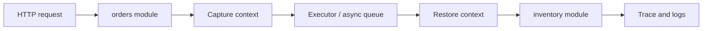
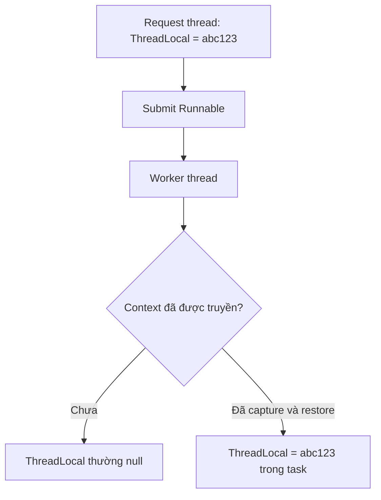
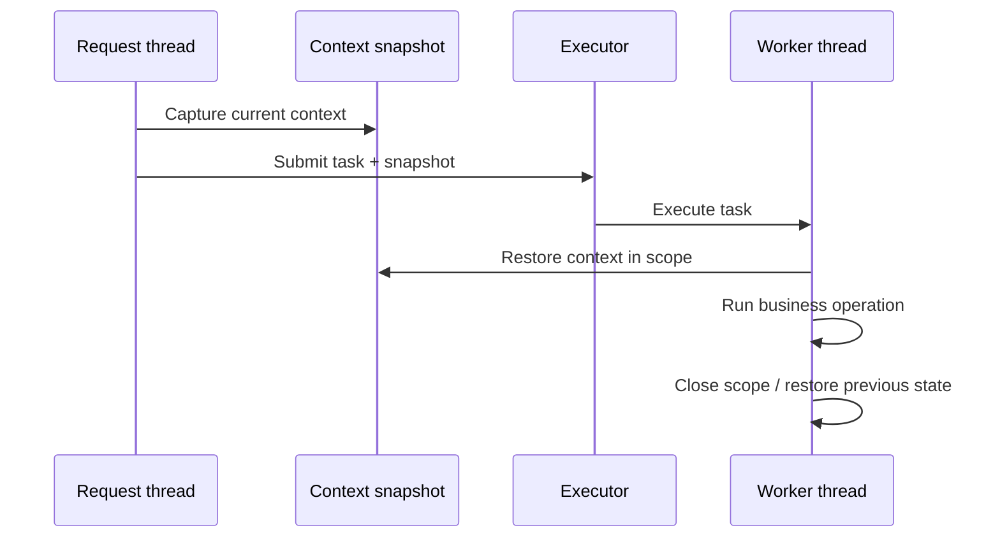
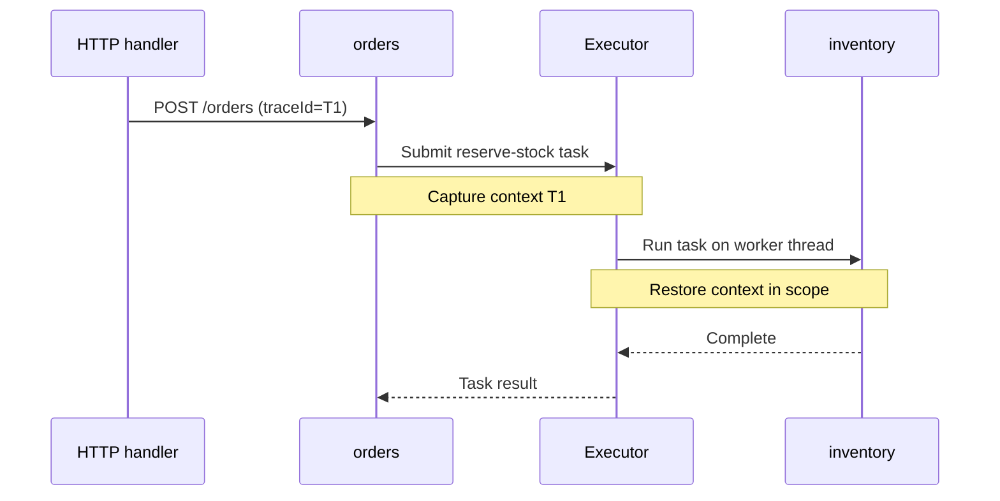

# Context propagation là gì?

## 1. Bối cảnh: một yêu cầu có thể đi qua nhiều thread và module

Trong ứng dụng Spring Boot được tổ chức theo **Spring Modulith**, một yêu cầu nghiệp vụ có thể bắt đầu ở module `orders`, gọi sang `inventory`, rồi phát event để `notifications` xử lý. Khi mọi bước chạy đồng bộ trên cùng thread, nhiều thông tin ngữ cảnh có thể được đọc từ môi trường thực thi hiện tại. Nhưng khi ứng dụng chuyển việc sang thread pool, `@Async`, reactive pipeline hoặc message listener, các thông tin đó có thể không còn xuất hiện ở bước tiếp theo.

Ví dụ, request HTTP có `traceId=abc123`, người dùng đã xác thực và locale `vi-VN`. `orders` gửi một tác vụ bất đồng bộ sang `inventory`. Nếu không truyền ngữ cảnh thích hợp, log ở `inventory` có thể không có `traceId`, tracing backend không nối được hai đoạn xử lý, hoặc tác vụ không còn biết locale cần dùng. Nếu dùng lại thread pool mà không khôi phục/xóa context đúng cách, một tác vụ khác còn có nguy cơ nhận nhầm thông tin từ tác vụ trước.

**Context propagation** là cơ chế mang những thông tin thực thi cần thiết từ điểm khởi tạo công việc sang nơi công việc được tiếp tục, rồi khôi phục chúng trong đúng phạm vi và dọn dẹp sau khi hoàn thành. Trong chủ đề `SPRING_MODULITH_DOCUMENTATION_OBSERVABILITY`, điều này giúp trace và log vẫn liên hệ được các tương tác giữa application module, kể cả khi luồng xử lý chuyển thread hoặc trở thành bất đồng bộ.



Context propagation không có nghĩa là sao chép mọi thứ của request sang mọi thread. Cần chọn đúng dữ liệu, đúng thời điểm, đúng ranh giới và đúng vòng đời. Một số context có thể truyền tiếp; một số khác, như transaction hoặc persistence context gắn với thread, cần được tạo mới tại nơi thực thi.

## 2. Execution context gồm những gì?

**Execution context** là tập thông tin giúp một đoạn code hiểu nó đang thực hiện công việc nào, trong hành trình nào và dưới điều kiện nào. Các loại thường gặp:

| Loại context | Ví dụ | Mục đích |
| --- | --- | --- |
| **Tracing context** | `traceId`, `spanId`, trace flags, baggage | Liên kết các thao tác trong một trace hoặc quan hệ giữa các trace |
| **Logging context** | MDC: `traceId`, `spanId`, correlation ID | Đưa thông tin liên hệ vào log của từng bước |
| **Security context** | Principal, authentication, authorities | Xác định danh tính và quyền của người thực thi |
| **Locale context** | `vi-VN`, `en-US`, timezone | Định dạng thông báo, ngày giờ và nội dung theo người dùng |
| **Tenant context** | Tenant ID đã được xác thực | Chọn phạm vi dữ liệu đúng tenant |
| **Request context** | Một số request-scoped metadata | Truy cập thông tin gắn với request khi còn trong vòng đời hợp lệ |
| **Deadline / cancellation** | Thời hạn xử lý, tín hiệu hủy | Tránh tiếp tục công việc đã quá hạn hoặc không còn cần thiết |

Không phải loại nào cũng có cùng cách truyền. Tracing context thường được tích hợp với Micrometer Tracing/OpenTelemetry; security context có cơ chế riêng trong Spring Security; Reactor có `Context`; tenant context có thể là abstraction do ứng dụng quản lý.

### 2.1. Context nghiệp vụ khác context kỹ thuật

Trong event `OrderPlaced`, `orderId`, tổng tiền và loại tiền tệ là **dữ liệu nghiệp vụ** cần thiết để consumer xử lý. `traceId`, correlation ID, locale hay thông tin xác thực là **ngữ cảnh kỹ thuật hoặc vận hành**. Hai nhóm có vòng đời và chính sách lưu trữ khác nhau.

Ví dụ:

```text
OrderPlaced event payload:
  orderId = 7b...
  currency = VND
  total = 1250000

Execution / correlation context:
  traceId = 4f...
  correlationId = checkout-...
  locale = vi-VN
```

Không nên nhét mọi thông tin kỹ thuật vào payload domain event. Với message broker, tracing context thường được truyền qua **message headers** theo chuẩn tracing; correlation ID nghiệp vụ có thể là metadata riêng. Nếu consumer cần locale để thực hiện đúng nghiệp vụ hoặc gửi thông báo, hãy xác định rõ đó là dữ liệu cần thiết của event hay metadata được truyền theo một hợp đồng có version.

## 3. Vì sao `ThreadLocal` không tự truyền qua thread?

Nhiều thư viện Java giữ context trong `ThreadLocal`. Một thread có vùng giá trị riêng; khi một tác vụ được chuyển sang thread khác, giá trị ở thread ban đầu không tự xuất hiện ở thread mới.

Ví dụ đơn giản:

```java
public final class RequestContext {

    private static final ThreadLocal<String> TRACE_ID = new ThreadLocal<>();

    private RequestContext() { }

    public static void setTraceId(String traceId) {
        TRACE_ID.set(traceId);
    }

    public static String getTraceId() {
        return TRACE_ID.get();
    }

    public static void clear() {
        TRACE_ID.remove();
    }
}
```

Nếu request thread gọi `RequestContext.setTraceId("abc123")` rồi submit một `Runnable` vào executor, `RequestContext.getTraceId()` trên worker thread thường trả `null`, vì đó là một thread khác.



### 3.1. Thread pool làm vấn đề khó hơn

Thread pool tái sử dụng một số lượng thread hữu hạn. Nếu task A gán context vào thread rồi kết thúc mà không xóa, task B sau đó có thể đọc được giá trị cũ khi chạy trên cùng worker thread. Đây là lỗi **context leakage**.

Một nguyên tắc an toàn:

1. Capture context tại thời điểm submit công việc.
2. Restore context trước hoặc trong lúc task chạy.
3. Chạy task trong scope được kiểm soát.
4. Khôi phục trạng thái trước đó hoặc xóa context khi scope đóng, kể cả khi task ném exception.

Không nên chỉ gọi `ThreadLocal.set()` ở đầu task rồi hy vọng thread pool tự dọn. Thread pool không biết dữ liệu nào thuộc ứng dụng và cũng không tự xóa tất cả ThreadLocal sau mỗi task.

## 4. Capture, propagate và restore

Một cơ chế context propagation thường có ba bước:

| Bước | Hành động | Ý nghĩa |
| --- | --- | --- |
| **Capture** | Đọc context hiện tại tại nơi khởi tạo tác vụ | Lưu snapshot của những giá trị được đăng ký |
| **Propagate** | Mang snapshot theo tác vụ tới executor/consumer | Bảo đảm thông tin đi cùng công việc thay vì phụ thuộc thread nguồn |
| **Restore** | Đặt context vào thread thực thi trong một scope | Code trong task đọc được đúng giá trị cần thiết |
| **Cleanup / restore previous** | Đóng scope sau task | Trả worker thread về trạng thái trước đó, tránh rò rỉ |



Snapshot thường là bản chụp các giá trị tại một thời điểm. Nếu context ở request thread thay đổi sau khi đã submit task, task không nhất thiết nhận giá trị mới. Đây là lý do cần capture đúng lúc và tránh dùng một mutable map chung cho nhiều task.

## 5. Micrometer Context Propagation giải quyết điều gì?

**Micrometer Context Propagation** cung cấp abstraction để mang context qua các ranh giới thực thi khác nhau, đặc biệt khi ứng dụng kết hợp `ThreadLocal` ở imperative code với Reactor `Context` hoặc executor bất đồng bộ.

Các khái niệm chính:

| Thành phần | Vai trò |
| --- | --- |
| `ThreadLocalAccessor` | Mô tả cách đọc, đặt và xóa một loại context được lưu trong ThreadLocal |
| `ContextRegistry` | Đăng ký các accessor để thư viện biết context nào cần capture/restore |
| `ContextSnapshot` | Snapshot các giá trị context hiện có tại thời điểm capture |
| `ContextSnapshotFactory` | Tạo snapshot theo registry và cấu hình được chọn |
| `ContextSnapshot.Scope` | Phạm vi restore; đóng scope để khôi phục trạng thái trước đó |
| `ContextSnapshot` capture/restore | Cầu nối giữa ThreadLocal và các context carrier được hỗ trợ |

Micrometer không tự biết mọi ThreadLocal trong ứng dụng. Muốn truyền một context tùy chỉnh, cần đăng ký `ThreadLocalAccessor` cho nó. Các thư viện tích hợp như tracing bridge có thể đăng ký accessor cho context của chúng; vì vậy hãy kiểm tra các dependency và cấu hình thực tế trước khi tự đăng ký trùng lặp.

Trong Maven, API này thuộc artifact `io.micrometer:context-propagation`:

```xml
<dependency>
    <groupId>io.micrometer</groupId>
    <artifactId>context-propagation</artifactId>
</dependency>
```

Nếu dùng Spring Boot dependency management, hãy để BOM quản lý phiên bản Micrometer tương thích thay vì tự chọn một version khác với các thư viện Micrometer còn lại.

## 6. Đăng ký ThreadLocal context tùy chỉnh

Giả sử ứng dụng có `TenantContext` dùng ThreadLocal để lưu tenant ID đã được xác thực:

```java
package com.example.shop.context;

public final class TenantContext {

    private static final ThreadLocal<String> TENANT_ID = new ThreadLocal<>();

    private TenantContext() { }

    public static String get() {
        return TENANT_ID.get();
    }

    public static void set(String tenantId) {
        TENANT_ID.set(tenantId);
    }

    public static void clear() {
        TENANT_ID.remove();
    }
}
```

Đăng ký accessor để Micrometer có thể capture và restore giá trị:

```java
package com.example.shop.context;

import io.micrometer.context.ContextRegistry;
import io.micrometer.context.ThreadLocalAccessor;

public final class TenantContextAccessor implements ThreadLocalAccessor<String> {

    public static final String KEY = "shop.tenantId";

    @Override
    public Object key() {
        return KEY;
    }

    @Override
    public String getValue() {
        return TenantContext.get();
    }

    @Override
    public void setValue(String value) {
        TenantContext.set(value);
    }

    @Override
    public void setValue() {
        TenantContext.clear();
    }
}
```

Đăng ký một lần trong cấu hình ứng dụng:

```java
package com.example.shop.config;

import com.example.shop.context.TenantContextAccessor;
import io.micrometer.context.ContextRegistry;
import org.springframework.context.annotation.Bean;
import org.springframework.context.annotation.Configuration;

@Configuration(proxyBeanMethods = false)
class ContextPropagationConfiguration {

    @Bean
    TenantContextAccessor tenantContextAccessor() {
        var accessor = new TenantContextAccessor();
        ContextRegistry.getInstance().registerThreadLocalAccessor(accessor);
        return accessor;
    }
}
```

API cụ thể của `ThreadLocalAccessor` và cách quản lý registry cần khớp phiên bản `io.micrometer:context-propagation` trong dependency management. Nếu ứng dụng có nhiều application context hoặc cần cô lập registry, có thể dùng một `ContextRegistry` riêng và truyền nó vào `ContextSnapshotFactory` thay vì thay đổi registry global. Tránh đăng ký accessor nhiều lần khi tạo nhiều context.

**Bảo mật:** tenant ID phải lấy từ danh tính/tenant đã được xác thực, không tin trực tiếp header tùy ý do client gửi. Context propagation chỉ chuyển giá trị; nó không xác thực, không cấp quyền và không thay thế kiểm tra tenant ở tầng truy cập dữ liệu.

## 7. Dùng ContextSnapshot thủ công

Khi cần capture/restore ở một ranh giới mà chưa có integration tự động, có thể tạo `ContextSnapshotFactory`, capture snapshot và mở scope trên worker thread:

```java
import io.micrometer.context.ContextRegistry;
import io.micrometer.context.ContextSnapshot;
import io.micrometer.context.ContextSnapshotFactory;

class SnapshotExample {

    private final ContextSnapshotFactory snapshotFactory =
        ContextSnapshotFactory.builder()
            .contextRegistry(ContextRegistry.getInstance())
            .build();

    Runnable wrap(Runnable task) {
        ContextSnapshot snapshot = snapshotFactory.captureAll();

        return () -> {
            try (ContextSnapshot.Scope scope = snapshot.setThreadLocals()) {
                task.run();
            }
        };
    }
}
```

`wrap(task)` phải được gọi trên thread đang có context cần truyền. Snapshot được capture tại thời điểm đó; khi `Runnable` chạy trên thread khác, `setThreadLocals()` mở scope để khôi phục các giá trị đã đăng ký. Đóng scope trong `try-with-resources` giúp khôi phục trạng thái trước đó cả khi task ném exception.

Đây là ví dụ imperative. Nếu task được submit nhiều lần, tạo snapshot phù hợp cho từng lần submit; không giữ một snapshot cũ để tái sử dụng giữa những request không liên quan. Cũng không capture mọi context một cách thiếu chọn lọc nếu có dữ liệu không cần thiết hoặc nhạy cảm.

## 8. Propagate qua Spring Executor bằng TaskDecorator

Với `ThreadPoolTaskExecutor`, Spring cung cấp `TaskDecorator` để bọc task trước khi thực thi. `ContextPropagatingTaskDecorator` được giới thiệu trong Spring Framework 6.1 và tích hợp Micrometer Context Propagation:

```java
package com.example.shop.config;

import org.springframework.context.annotation.Bean;
import org.springframework.context.annotation.Configuration;
import org.springframework.core.task.TaskDecorator;
import org.springframework.core.task.support.ContextPropagatingTaskDecorator;
import org.springframework.scheduling.concurrent.ThreadPoolTaskExecutor;

@Configuration
class AsyncExecutorConfiguration {

    @Bean(name = "applicationTaskExecutor")
    ThreadPoolTaskExecutor applicationTaskExecutor() {
        var executor = new ThreadPoolTaskExecutor();
        executor.setCorePoolSize(4);
        executor.setMaxPoolSize(12);
        executor.setQueueCapacity(200);
        executor.setThreadNamePrefix("shop-async-");
        TaskDecorator decorator = new ContextPropagatingTaskDecorator();
        executor.setTaskDecorator(decorator);
        executor.initialize();
        return executor;
    }
}
```

Khi task được submit, decorator dùng Micrometer Context Propagation để capture/restore các context đã được đăng ký. Ví dụ này giả định `applicationTaskExecutor` thực sự là executor được thành phần bất đồng bộ sử dụng. Với `@Async`, có thể chỉ định executor rõ ràng:

```java
import org.springframework.scheduling.annotation.Async;
import org.springframework.stereotype.Service;

@Service
class InventoryAsyncService {

    @Async("applicationTaskExecutor")
    public void refreshInventory() {
        // Trace/MDC/tenant context được truyền nếu accessor tương ứng đã đăng ký.
    }
}
```

Để bật `@Async`, ứng dụng cần cấu hình `@EnableAsync` ở một class cấu hình thích hợp. `ContextPropagatingTaskDecorator` không tự làm mọi method chạy bất đồng bộ; nó chỉ bọc task được executor đó xử lý.

### 8.1. Những context nào sẽ được truyền?

Decorator chỉ truyền context mà Micrometer có thể capture thông qua registry/accessor hiện có. Ví dụ:

- Tracing context có thể được tích hợp bởi Micrometer Tracing bridge.
- Một số logging context/MDC có thể được tích hợp tùy cấu hình logging/tracing.
- `TenantContext` ở phần 6 chỉ được truyền sau khi accessor đã đăng ký.
- `SecurityContext` cần xem cơ chế tích hợp của Spring Security; không giả định decorator thay thế các executor wrapper của Security.
- Context tự viết mà chưa đăng ký accessor sẽ không tự xuất hiện trên worker thread.

Nếu một tác vụ cần quyền của người dùng, hãy quyết định rõ **có cần truyền danh tính/authority hay không** và dùng cơ chế Spring Security phù hợp, chẳng hạn `DelegatingSecurityContextExecutor`/`DelegatingSecurityContextAsyncTaskExecutor` khi thích hợp. Không truyền security context sang tác vụ chạy nền lâu dài nếu quyền cần được đánh giá lại theo service identity hoặc chính sách nghiệp vụ.

## 9. Propagation trong reactive pipeline

Reactive code không nên phụ thuộc vào giả định “một request luôn chạy trên một thread”. Reactor có **`Context`** gắn với subscription, cho phép truyền metadata qua các toán tử mà không cần giữ tất cả thông tin trong ThreadLocal.

Ví dụ minh họa:

```java
import reactor.core.publisher.Mono;

Mono<String> result = Mono.deferContextual(contextView -> {
        String correlationId = contextView.get("correlationId");
        return Mono.just("processed: " + correlationId);
    })
    .contextWrite(context -> context.put("correlationId", "checkout-123"));
```

`contextWrite` thêm dữ liệu vào Reactor Context cho subscription; `deferContextual` đọc giá trị khi pipeline được subscribe. Trong ứng dụng thực, không hardcode correlation ID như ví dụ mà lấy từ context của request/message.

Micrometer Context Propagation cung cấp cầu nối giữa Reactor Context và ThreadLocal cho các thư viện imperative/reactive tích hợp. Có thể dùng chế độ propagation phù hợp của Reactor và Micrometer theo phiên bản. Cần nhớ:

- Reactor Context là context theo subscription, không phải một `ThreadLocal` toàn cục.
- ThreadLocal bridge chỉ hoạt động cho accessor đã đăng ký và các ranh giới được hỗ trợ.
- Bật automatic context propagation có thể có chi phí; đo và kiểm tra trên phiên bản Reactor đang sử dụng.
- Tránh đưa dữ liệu lớn hoặc object mutable vào Reactor Context; ưu tiên metadata nhỏ, bất biến.

## 10. Context propagation qua Spring Modulith events

Trong Spring Modulith, một module có thể phát domain event để module khác xử lý. Với `@ApplicationModuleListener`, listener được tích hợp theo mô hình event của Modulith; xử lý có thể diễn ra bất đồng bộ và/hoặc theo transaction tùy annotation, cấu hình và phiên bản.

Ví dụ:

```java
package com.example.shop.orders;

import java.util.UUID;

public record OrderPlaced(UUID orderId) { }
```

```java
package com.example.shop.orders;

import java.util.UUID;
import org.springframework.context.ApplicationEventPublisher;
import org.springframework.stereotype.Service;
import org.springframework.transaction.annotation.Transactional;

@Service
class OrderService {

    private final ApplicationEventPublisher events;

    OrderService(ApplicationEventPublisher events) {
        this.events = events;
    }

    @Transactional
    void placeOrder(UUID orderId) {
        // Lưu order trong transaction hiện tại.
        events.publishEvent(new OrderPlaced(orderId));
    }
}
```

```java
package com.example.shop.inventory;

import com.example.shop.orders.OrderPlaced;
import org.springframework.modulith.events.ApplicationModuleListener;
import org.springframework.stereotype.Component;

@Component
class ReserveStockListener {

    @ApplicationModuleListener
    void on(OrderPlaced event) {
        // Xử lý tồn kho; cần idempotent theo orderId.
    }
}
```

Đây là ví dụ rút gọn về producer và consumer. Không nên mặc định `traceId` hoặc MDC tự động được giữ trong mọi cấu hình listener. Cần xác minh executor mà listener sử dụng, Micrometer context accessor đã đăng ký và instrumentation tracing đang bật. Nếu listener chạy sau commit hoặc được xử lý lại, request thread ban đầu có thể đã kết thúc; khi đó cần correlation/trace link thích hợp, không cố tái sử dụng một span đã đóng.

### 10.1. Event nội bộ trong JVM và message qua broker

| Ranh giới | Cách truyền context | Lưu ý |
| --- | --- | --- |
| Đồng bộ giữa Spring beans | Thường dùng context hiện tại của thread | Module span có thể lồng trong cùng trace nếu instrument |
| Executor / async listener trong JVM | Capture/restore qua `TaskDecorator` hoặc cơ chế tương đương | Phải dùng đúng executor và accessor |
| Event được lưu rồi xử lý sau commit | Lưu metadata cần thiết hoặc tạo quan hệ correlation phù hợp | Không giữ request-scoped object trong hàng đợi |
| Message qua broker / tiến trình khác | Propagate trace context qua message headers theo chuẩn hỗ trợ | Kiểm tra producer/consumer instrumentation và trust boundary |
| Retry hoặc dead-letter | Giữ event/correlation identity; trace có thể là trace mới hoặc có span link | Không giả định retry luôn nằm trong trace ban đầu |

Với hệ thống qua broker, chuẩn W3C Trace Context thường dùng `traceparent` và có thể có `tracestate`; baggage chỉ nên mang những thuộc tính nhỏ, không nhạy cảm và có kiểm soát. Đừng truyền toàn bộ HTTP headers hoặc security token vào message metadata.

## 11. Context nào không nên truyền nguyên trạng?

Không phải mọi trạng thái đều an toàn hoặc có ý nghĩa khi chạy trên thread khác:

| Context | Có nên truyền? | Cách xử lý |
| --- | --- | --- |
| Trace/correlation context | Thường có, nếu các bước cùng hành trình | Dùng tracing integration hoặc message propagation chuẩn |
| MDC/logging fields | Có thể, trong phạm vi task | Capture/restore và xóa đúng scope |
| Locale/timezone | Có thể, nếu tác vụ cần định dạng theo người dùng | Truyền giá trị bất biến, tránh phụ thuộc request object |
| Tenant ID | Có thể, nếu được xác thực và task cần tenant | Kiểm tra quyền/tenant ở consumer; clear sau task |
| SecurityContext | Chỉ khi chính sách yêu cầu | Dùng cơ chế Spring Security; xem xét service identity cho background jobs |
| HTTP request/response object | Không nên giữ qua tác vụ nền dài hạn | Chuyển dữ liệu cần thiết thành command/event bất biến |
| Transaction đang mở | Không truyền sang thread khác | Tạo transaction mới tại worker theo ranh giới nghiệp vụ |
| JPA `EntityManager`/Hibernate Session | Không chia sẻ giữa các thread | Truyền ID/DTO; worker mở persistence context riêng |
| Mutable request DTO lớn | Tránh chia sẻ trực tiếp | Sao chép phần dữ liệu cần thiết sang immutable command |

**Transaction context và persistence context là trường hợp đặc biệt.** Spring transaction thường gắn với thread hiện tại. Chuyển `Runnable` sang executor không chuyển transaction đang mở một cách an toàn; worker nên bắt đầu transaction riêng bằng `@Transactional` tại bean được proxy hoặc transaction template. Tương tự, không chia sẻ `EntityManager`/Hibernate Session giữa các thread.

## 12. Context propagation và ranh giới bảo mật

Context có thể chứa dữ liệu nhạy cảm: user identity, tenant, quyền, token, thông tin khách hàng. Vì vậy:

- Chỉ capture những key cần cho tác vụ.
- Không đưa access token, cookie, password hoặc dữ liệu cá nhân vào MDC, baggage hay span attributes.
- Không tin tenant/user ID chỉ vì nó đã được truyền từ thread nguồn; consumer vẫn cần kiểm tra authorization theo ranh giới của nó.
- Khi message đi qua broker hoặc hệ thống bên ngoài, xác định header nào được phép tin và header nào phải được xác thực/chuẩn hóa.
- Đặt timeout/deadline cho tác vụ; context của request không phải giấy phép xử lý vô thời hạn.
- Dọn context sau khi hoàn thành hoặc khi task bị hủy, thất bại và retry.

Context propagation **chỉ mang dữ liệu**, không thay thế authentication, authorization, validation, transaction management hay kiểm soát truy cập tenant.

## 13. Kiểm chứng propagation bằng tracing và logs

Một kịch bản kiểm thử tốt có producer, executor và consumer:



Kiểm tra bằng các bước:

1. Tạo một request có thể lặp lại và ghi nhận `traceId` ở HTTP handler.
2. Log `traceId` trước khi submit task và trong worker thread.
3. Xác nhận span của `inventory` có quan hệ đúng với trace hoặc có correlation/span link theo thiết kế.
4. Chạy nhiều task liên tiếp trên cùng pool, với các trace ID khác nhau.
5. Xác nhận task thứ hai không đọc nhầm trace ID hoặc tenant của task thứ nhất.
6. Cho task ném exception và xác nhận scope vẫn đóng, worker thread không giữ context cũ.
7. Thử trường hợp timeout/cancel và retry nếu luồng nghiệp vụ có hỗ trợ.

### 13.1. Dấu hiệu propagation hoạt động đúng

| Kiểm tra | Kết quả mong đợi |
| --- | --- |
| Trace ID ở producer và worker | Liên hệ theo mô hình trace đã thiết kế |
| Module ID ở module entry span | Phản ánh module thực thi tại điểm vào, không sao chép nhầm module nguồn |
| MDC trong worker | Có trường cần thiết trong lúc task chạy và được khôi phục sau đó |
| Tenant context | Chỉ đúng tenant của task hiện tại, không rò rỉ giữa task |
| Task ném exception | Context scope vẫn được cleanup |
| Nhiều request đồng thời | Không trộn lẫn trace/user/tenant context |

Nếu trace ID được giữ nhưng `module.name` không xuất hiện, vấn đề có thể là module instrumentation chứ không phải context propagation. Nếu `module.name` đúng nhưng trace bị tách, vấn đề có thể là liên kết trace/context qua ranh giới async. Cần chẩn đoán từng lớp riêng.

## 14. Các lỗi thường gặp

| Triệu chứng | Nguyên nhân thường gặp | Cách xử lý |
| --- | --- | --- |
| `traceId` biến mất trong `@Async` | ThreadLocal không được capture/restore | Dùng context propagation và đúng executor |
| Worker thấy trace ID của request trước | Context không được cleanup trên pooled thread | Dùng scope, accessor có `setValue()` để clear/restore |
| `ContextPropagatingTaskDecorator` không có tác dụng | Task chạy trên executor khác hoặc chưa có accessor | Xác nhận bean/executor thực tế và `ContextRegistry` |
| MDC có giá trị nhưng trace backend không nối span | Log context không đồng nghĩa tracing context | Kiểm tra Micrometer Tracing bridge và span propagation |
| Có trace ID nhưng không có module tag | Span không phải module entry span hoặc Modulith instrumentation chưa bật | Kiểm tra API module, dependency và đúng span |
| SecurityContext bị mất | Chưa dùng cơ chế Spring Security phù hợp | Dùng security-aware executor nếu chính sách cần |
| Tenant của task A xuất hiện trong task B | ThreadLocal tenant không được khôi phục/xóa | Accessor + scope cleanup, kiểm thử nhiều task |
| Transaction không có ở worker | Transaction gắn với thread nguồn | Mở transaction mới ở worker |
| Reactor pipeline mất context | Dựa vào ThreadLocal thay vì Reactor Context/bridge | Dùng `Context`, `deferContextual` và integration phù hợp |
| Listener chạy lại nhưng trace mới tách rời | Retry sau thời gian dài hoặc không giữ message context | Dùng correlation ID/span link; thiết kế trace mới nếu phù hợp |
| Truyền quá nhiều thông tin | Capture toàn bộ request/security data thiếu chọn lọc | Whitelist context cần thiết và loại dữ liệu nhạy cảm |

## 15. Bài thực hành: giữ trace context khi gọi module bất đồng bộ

**Bối cảnh:** module `orders` nhận HTTP request và submit tác vụ dự trữ hàng cho `inventory` bằng `ThreadPoolTaskExecutor`. Bạn cần giữ trace/correlation context qua executor và bảo đảm không rò rỉ tenant context giữa các task.

| Bước | Thực hiện | Tiêu chí hoàn thành |
| --- | --- | --- |
| 1 | Bật Micrometer Observation/Tracing và exporter phù hợp | Trace của HTTP request xuất hiện trong backend |
| 2 | Tạo `TenantContext` và `ThreadLocalAccessor` | Context tenant được registry nhận diện |
| 3 | Cấu hình `ContextPropagatingTaskDecorator` cho executor | Task được submit qua executor đó nhận snapshot |
| 4 | Gọi module `orders`, submit task tới `inventory` | Worker đọc được trace/correlation context theo cấu hình |
| 5 | Kiểm tra module entry span | Module ID phản ánh `inventory` tại nơi xử lý |
| 6 | Submit hai task từ hai tenant khác nhau | Không có tenant của task trước xuất hiện ở task sau |
| 7 | Cho task ném exception | Context scope được cleanup dù task thất bại |
| 8 | Thử listener event hoặc retry | Correlation/tracing được xử lý theo chính sách async đã chọn |
| 9 | Kiểm tra transaction | Worker dùng transaction riêng khi cần, không chia sẻ EntityManager |

### 15.1. Câu hỏi tự kiểm tra

1. **Context propagation là gì?** Là capture, truyền và restore các thông tin thực thi cần thiết qua ranh giới thread/async/reactive/message.
2. **Tại sao ThreadLocal không tự truyền qua executor?** Vì mỗi thread có vùng giá trị ThreadLocal riêng; worker thread không tự đọc được giá trị của request thread.
3. **`ContextRegistry` và `ThreadLocalAccessor` có nhiệm vụ gì?** Registry lưu các accessor đã đăng ký; accessor định nghĩa cách đọc, đặt và xóa một loại ThreadLocal context.
4. **Tại sao cần đóng `ContextSnapshot.Scope`?** Để khôi phục trạng thái trước đó và tránh rò rỉ context trên worker thread được tái sử dụng.
5. **`ContextPropagatingTaskDecorator` có làm mọi task trong ứng dụng tự động truyền context không?** Không; chỉ task đi qua executor được cấu hình và context đã được đăng ký mới được xử lý.
6. **Có nên truyền transaction đang mở sang worker thread?** Không; transaction/persistence context thường gắn với thread. Worker cần ranh giới transaction riêng.
7. **Context của producer có luôn được giữ khi `@ApplicationModuleListener` retry không?** Không; retry có thể diễn ra sau khi request/trace gốc kết thúc. Cần correlation hoặc span link phù hợp.
8. **Giữ trace ID có nghĩa module attribution đúng không?** Không; module ID phải phản ánh module thực thi tại entry point của nó.

## 16. Ghi nhớ

**Context propagation giúp mang đúng execution context qua ranh giới thread, executor, reactive pipeline và event/message**, để logs, traces và các metadata cần thiết vẫn có thể liên hệ với công việc ban đầu. Cơ chế an toàn thường gồm capture tại nơi submit, restore trong scope, rồi cleanup/khôi phục trạng thái trước đó sau khi task kết thúc.

Micrometer Context Propagation cung cấp `ThreadLocalAccessor`, `ContextRegistry`, `ContextSnapshot` và `ContextSnapshotFactory`; Spring có `ContextPropagatingTaskDecorator` để tích hợp với executor. Reactor sử dụng `Context` theo subscription. Spring Security có cơ chế riêng cho security context. Với Spring Modulith, cần xác minh executor/listener và context bridge thực tế; event xử lý trễ hoặc qua broker có thể cần correlation ID hoặc span link thay vì giữ nguyên span của request cũ.

Không truyền nguyên trạng transaction, `EntityManager`, request object hay dữ liệu nhạy cảm sang thread khác. **Context propagation là cơ chế truyền thông tin, không phải cơ chế cấp quyền hoặc bảo đảm giao dịch.** Khi kết hợp với module graph, Actuator, event metrics và tracing, nó giúp nhìn rõ hơn cách một nghiệp vụ đi qua các application module trong lúc ứng dụng vận hành.

### Tài liệu tham khảo

- [Micrometer Context Propagation](https://docs.micrometer.io/context-propagation/reference/): `ThreadLocalAccessor`, `ContextRegistry`, `ContextSnapshot` và tích hợp Reactor.
- [Spring Framework — Context Propagation](https://docs.spring.io/spring-framework/reference/integration/observability.html): observation và context propagation trong Spring.
- [Spring Framework — `ContextPropagatingTaskDecorator` API](https://docs.spring.io/spring-framework/docs/current/javadoc-api/org/springframework/core/task/support/ContextPropagatingTaskDecorator.html): propagation cho task executor.
- [Spring Security — Concurrency Support](https://docs.spring.io/spring-security/reference/servlet/integrations/concurrency.html): truyền `SecurityContext` qua executor.
- [Spring Modulith — Application Events](https://docs.spring.io/spring-modulith/reference/events.html): event publication, listener và Event Publication Registry.
- [OpenTelemetry — Context Propagation](https://opentelemetry.io/docs/concepts/context-propagation/): trace context qua service/message boundary.
