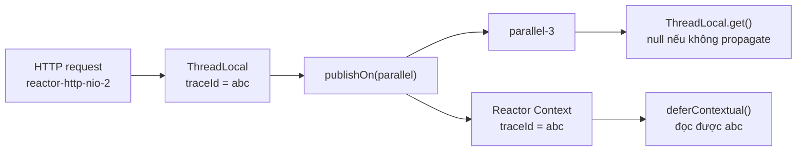
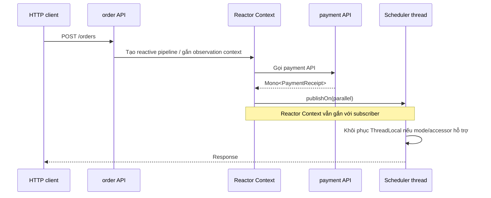

# Truyền observation qua Reactor pipeline

## 1. Vì sao cần context propagation trong Reactor?

Trong chương **Context propagation** của học phần **SPRING_MODULITH_DOCUMENTATION_OBSERVABILITY**, chúng ta tìm hiểu cách giữ ngữ cảnh quan sát khi một luồng nghiệp vụ đi qua nhiều application module trong ứng dụng Spring Boot. Một request có thể đi từ module `order` sang `payment`, chuyển qua nhiều Reactor operator, đổi thread bằng `publishOn` hoặc `subscribeOn` rồi gọi một thư viện imperative cần đọc `ThreadLocal`.

Vấn đề xuất hiện vì **Reactor không bảo đảm một pipeline luôn chạy trên cùng một thread**. Một giá trị lưu trong `ThreadLocal` ở thread nhận request có thể không còn ở thread chạy bước kế tiếp. Nếu thông tin observation hoặc tracing context bị mất, log có thể thiếu trace ID, span có thể không nối đúng parent, và các module spans khó ghép thành một luồng nghiệp vụ.

Reactor giải quyết phần context bằng **Reactor Context** gắn với subscriber. Micrometer Context Propagation cung cấp cầu nối giữa Reactor Context và các context dạng khác, đặc biệt là `ThreadLocal`. Nhờ vậy, observation và trace context có thể được truyền qua reactive pipeline và được khôi phục khi code imperative cần đọc chúng.

**Mục tiêu học tập**

1. Phân biệt Reactor Context, `ThreadLocal`, `Observation.Context` và `ObservationRegistry`.
2. Dùng `contextWrite` và `deferContextual` để ghi/đọc dữ liệu trực tiếp trong Reactor Context.
3. Hiểu `ThreadLocalAccessor`, `ContextRegistry`, `ContextSnapshot` và `contextCapture`.
4. Phân biệt chế độ `limited` mặc định với `auto` của Reactor/Spring Boot.
5. Cấu hình truyền observation/tracing context qua scheduler switch.
6. Kiểm chứng context propagation trong luồng có Spring Modulith module spans và xử lý bất đồng bộ.

## 2. Bốn khái niệm cần phân biệt

| Khái niệm | Phạm vi | Đặc điểm |
| --- | --- | --- |
| **Reactor Context** | Một subscription reactive | Context bất biến (immutable), gắn với subscriber; operator có thể đọc qua `deferContextual` hoặc `transformDeferredContextual` |
| **`ThreadLocal`** | Một thread tại một thời điểm | Giá trị gắn với thread; không tự di chuyển khi pipeline đổi scheduler/thread |
| **`Observation.Context`** | Một Micrometer Observation | Giữ tên, key-value, lỗi và state của một observation; được các ObservationHandler sử dụng |
| **`ObservationRegistry`** | Hạ tầng quan sát của ứng dụng | Quản lý predicate, convention, filter và handler; không phải nơi lưu context riêng của từng request |

Reactor Context và Observation Context **không phải cùng một object**. Một integration có thể đưa ngữ cảnh quan sát vào Reactor Context để truyền qua pipeline. Micrometer Context Propagation giúp khôi phục các giá trị tương ứng vào ThreadLocal khi một operator hoặc thư viện imperative cần truy cập.

### Vì sao ThreadLocal không đủ?

Giả sử HTTP request được xử lý trên thread `reactor-http-nio-2`. Một giá trị `traceId` được đặt vào ThreadLocal ở thread này. Sau `publishOn(Schedulers.parallel())`, một callback có thể chạy trên thread `parallel-3`. Thread mới có ThreadLocal riêng, vì vậy `TRACE_ID.get()` có thể trả `null`.



**Reactor Context là nguồn ngữ cảnh phù hợp cho code reactive.** ThreadLocal là cơ chế tương thích với thư viện imperative và các API dựa trên thread hiện hành. Context Propagation kết nối hai thế giới đó, thay vì biến ThreadLocal thành nơi lưu dữ liệu chính của reactive flow.

## 3. Reactor Context: ghi và đọc trong pipeline

### 3.1. Ghi context bằng contextWrite

`contextWrite` tạo một Context mới cho phần pipeline ở **phía upstream** của operator đó. Cần nhớ rằng subscription truyền từ downstream về upstream, nên vị trí `contextWrite` có thể khiến cách đọc context khác với thứ tự nhìn từ trái sang phải trong code.

```java
import reactor.core.publisher.Mono;
import reactor.core.scheduler.Schedulers;

Mono<String> pipeline =
        Mono.deferContextual(context ->
                Mono.just("correlationId=" + context.get("correlationId")))
            .publishOn(Schedulers.parallel())
            .contextWrite(context ->
                    context.put("correlationId", "req-2026-001"));

String result = pipeline.block();
// correlationId=req-2026-001
```

`deferContextual` đọc Context của subscription khi publisher thực thi. `publishOn` có thể đổi thread thực thi phần downstream, nhưng Reactor Context vẫn được truyền cùng subscriber. Vì vậy code reactive vẫn đọc được `correlationId` mà không cần dựa vào ThreadLocal.

### 3.2. Đọc context bằng deferContextual

```java
Mono<String> currentRequest =
        Mono.deferContextual(context -> {
            String requestId = context.getOrDefault(
                    "correlationId", "unknown");
            return Mono.just("Handling " + requestId);
        });

String value = currentRequest
        .contextWrite(context ->
                context.put("correlationId", "req-42"))
        .block();
```

Kết quả là `Handling req-42`. `deferContextual` thích hợp khi cần đọc context tại thời điểm subscription, đặc biệt khi pipeline được tạo trước nhưng chạy sau.

### 3.3. Context là immutable và có phạm vi theo subscriber

`contextWrite(context -> context.put(...))` không sửa một map toàn cục dùng chung. Nó tạo một phiên bản Context chứa cặp key-value mới cho phần pipeline upstream. Các subscription khác nhau có thể có context khác nhau dù dùng cùng một publisher đã được khai báo.

**Không dùng Reactor Context làm nơi lưu một object mutable dùng chung cho nhiều request.** Nên truyền các giá trị nhỏ, bất biến, có ý nghĩa như correlation ID, tenant key đã chuẩn hóa, security context hoặc thông tin quan sát do framework quản lý.

## 4. Micrometer Context Propagation kết nối Context và ThreadLocal

Thư viện `io.micrometer:context-propagation` cung cấp các abstraction:

| Thành phần | Vai trò |
| --- | --- |
| `ThreadLocalAccessor` | Đọc, đặt và reset một giá trị ThreadLocal theo key |
| `ContextAccessor` | Đọc/ghi vào một context dạng map |
| `ContextRegistry` | Đăng ký accessor để biết những context/key nào có thể được truyền |
| `ContextSnapshot` | Chụp các giá trị context tại một thời điểm và khôi phục chúng trong một phạm vi thực thi |

Từ Reactor Core 3.5.0, Reactor tích hợp SPI Context Propagation. `ReactorContextAccessor` được nạp qua `ServiceLoader` khi có cả `reactor-core` và `io.micrometer:context-propagation` trên runtime classpath. Thông thường không cần tự tạo hoặc gọi `ReactorContextAccessor`.

### 4.1. Đăng ký một ThreadLocalAccessor

Ví dụ một thư viện cũ cần đọc mã tương quan qua ThreadLocal:

```java
import io.micrometer.context.ContextRegistry;

public final class CorrelationContext {

    private CorrelationContext() {}

    private static final ThreadLocal<String> CORRELATION_ID =
            new ThreadLocal<>();

    public static String get() {
        return CORRELATION_ID.get();
    }

    public static void set(String value) {
        CORRELATION_ID.set(value);
    }

    public static void clear() {
        CORRELATION_ID.remove();
    }

    public static void registerAccessor() {
        ContextRegistry.getInstance().registerThreadLocalAccessor(
                "correlationId",
                CORRELATION_ID::get,
                CORRELATION_ID::set,
                CORRELATION_ID::remove);
    }
}
```

Gọi `registerAccessor()` một lần trong quá trình khởi tạo ứng dụng, trước khi pipeline cần propagation được subscribe. Trong ứng dụng thực, nên đăng ký accessor ở cấu hình tập trung và tránh đăng ký lặp cùng key. Nếu viết test dùng singleton `ContextRegistry`, cần dọn accessor sau test để không ảnh hưởng test khác.

**Lưu ý:** ThreadLocal chỉ là ví dụ minh họa cho thư viện imperative. Với code reactive thuần, ưu tiên truyền dữ liệu qua Reactor Context thay vì đọc/ghi ThreadLocal.

### 4.2. contextCapture: chụp ThreadLocal tại thời điểm subscribe

`contextCapture()` lấy snapshot của những ThreadLocal đã đăng ký accessor và đưa giá trị của chúng vào Reactor Context khi subscription bắt đầu. Các operator upstream có thể đọc các giá trị đó.

```java
import reactor.core.publisher.Mono;
import java.time.Duration;

CorrelationContext.set("req-100");

Mono<String> pipeline =
        Mono.delay(Duration.ofMillis(10))
            .map(ignored -> "event created for " +
                    CorrelationContext.get())
            .contextCapture();

String result = pipeline.block();

CorrelationContext.clear();
```

Đoạn code trên nhằm minh họa việc chụp context lúc subscribe. Tuy nhiên, trong **limited mode** mặc định, ThreadLocal không được khôi phục trong mọi operator; `map` không thuộc nhóm operator tự động khôi phục trong chế độ này. Vì vậy ví dụ trên không nên được dùng để khẳng định `map` sẽ luôn đọc được `req-100`. Phần tiếp theo trình bày cách dùng đúng theo từng chế độ.

### 4.3. contextWrite: ghi trực tiếp thay vì chụp ThreadLocal

Nếu giá trị đã có sẵn trong code reactive, hãy ghi thẳng vào Reactor Context:

```java
Mono<String> pipeline =
        Mono.deferContextual(context ->
                Mono.just(context.get("correlationId")))
            .contextWrite(context ->
                    context.put("correlationId", "req-200"));
```

`contextWrite` không cần ThreadLocal hoặc `contextCapture`. Đây thường là cách rõ ràng nhất khi thông tin được tạo từ reactive flow.

## 5. Hai chế độ context propagation của Reactor

Reactor hỗ trợ hai chế độ làm việc với Micrometer Context Propagation:

| Chế độ | Mặc định | Hành vi khôi phục ThreadLocal |
| --- | --- | --- |
| **Limited** | Có | Chỉ những operator được chọn, điển hình `handle` và `tap`, khôi phục ThreadLocal từ Reactor Context trong callback; cần context đã được capture hoặc ghi vào Reactor Context |
| **Automatic** | Không | Khôi phục ThreadLocal cho callback của tất cả operator trong reactive chain, dựa trên Reactor Context |

Hai chế độ đều dựa trên Reactor Context làm nguồn dữ liệu truyền qua subscriber. Khác biệt nằm ở **phạm vi operator được bọc để khôi phục ThreadLocal**.

### 5.1. Limited mode: mặc định của Reactor

Trong limited mode:

- `contextCapture()` có thể chụp các ThreadLocal đã đăng ký tại thời điểm subscription.
- `contextWrite()` có thể đưa giá trị vào Reactor Context một cách tường minh.
- Các operator `handle` và `tap` khôi phục ThreadLocal cho callback tương ứng khi có context phù hợp.
- Một callback trong `map` hoặc `doOnNext` không tự động nhận ThreadLocal chỉ vì Context có giá trị.

Ví dụ:

```java
CorrelationContext.set("req-limited");

Mono<String> pipeline = Mono.delay(Duration.ofMillis(10))
        .handle((ignored, sink) ->
                sink.next("correlationId=" + CorrelationContext.get()))
        .contextCapture();

String result = pipeline.block();
// Trong limited mode: handle callback được khôi phục ThreadLocal.

CorrelationContext.clear();
```

`handle` là một trong các operator được hỗ trợ trong limited mode. `contextCapture` chụp giá trị tại subscription, sau đó Reactor Context được dùng để khôi phục ThreadLocal trong callback của `handle`.

### 5.2. Automatic mode: khôi phục trong mọi operator

Automatic mode cho phép các operator trong reactive chain truy cập ThreadLocal đã đăng ký theo Reactor Context, kể cả `map`, `doOnNext` và các callback khác. Chế độ này được bật bằng:

```java
import reactor.core.publisher.Hooks;

// Gọi một lần khi ứng dụng khởi động, trước các subscription cần áp dụng.
Hooks.enableAutomaticContextPropagation();
```

Hook có phạm vi toàn cục của Reactor và **chỉ áp dụng cho các subscription mới** sau khi được bật. Vì vậy, nếu tự bật thủ công, hãy gọi lúc khởi động ứng dụng, không bật muộn trong một request.

Ví dụ với `map`:

```java
CorrelationContext.set("req-auto");

Mono<String> pipeline = Mono.delay(Duration.ofMillis(10))
        .map(ignored ->
                "correlationId=" + CorrelationContext.get())
        .contextCapture();

String result = pipeline.block();
// Trong automatic mode: map callback có thể đọc req-auto.

CorrelationContext.clear();
```

Phương thức thứ hai chỉ thể hiện hành vi khi automatic mode đã được bật **trước subscription**. Trong Spring Boot, cấu hình `spring.reactor.context-propagation=auto` từ lúc khởi động. Nếu dùng blocking operator trong automatic mode, Reactor có thể capture ThreadLocal tự động; `contextCapture()` trong ví dụ giúp nêu rõ ý định và vẫn tương thích với cách chụp tường minh.

### 5.3. Automatic mode có chi phí

Automatic mode khôi phục và dọn ThreadLocal quanh callback của các operator. Nó thuận tiện khi nhiều thư viện imperative dựa trên ThreadLocal, nhưng có thể thêm chi phí trên đường reactive. Hiệu năng phụ thuộc số operator, số accessor, tần suất chuyển thread và tải thực tế.

Reactor cũng cần **xóa giá trị ThreadLocal khi key không có trong Context** để tránh dữ liệu từ subscription trước rò sang công việc mới dùng lại cùng thread. Vì vậy không tự ý bỏ qua quy tắc cleanup hoặc giữ ThreadLocal sau khi request hoàn tất.

Không có lựa chọn tốt nhất cho mọi hệ thống. Hãy đo latency, throughput và tài nguyên với tải đại diện trước khi quyết định dùng automatic mode toàn ứng dụng.

## 6. Cấu hình Spring Boot cho Reactor

Spring Boot dùng thuộc tính `spring.reactor.context-propagation` để chọn chế độ cho Reactor operator. Giá trị mặc định là `limited`.

### 6.1. Bật automatic mode bằng application.yml

```yaml
# src/main/resources/application.yml
spring:
  reactor:
    context-propagation: auto
```

Với cấu hình này, Spring Boot kích hoạt automatic context propagation của Reactor khi ứng dụng khởi động. Đây là cách cấu hình nên ưu tiên trong ứng dụng Spring Boot thay vì tự gọi global hook ở nhiều nơi.

Nếu muốn giữ mặc định limited mode, có thể ghi rõ:

```yaml
spring:
  reactor:
    context-propagation: limited
```

### 6.2. Bật thủ công khi không dùng auto-configuration

Trong ứng dụng Reactor không được Spring Boot quản lý:

```java
import reactor.core.publisher.Hooks;

public class ReactorApplication {

    public static void main(String[] args) {
        Hooks.enableAutomaticContextPropagation();
        // Khởi tạo và chạy ứng dụng sau khi hook đã bật.
    }
}
```

Không cần vừa cấu hình `spring.reactor.context-propagation: auto` vừa gọi `Hooks.enableAutomaticContextPropagation()` ở nhiều nơi. Chọn một cơ chế khởi tạo duy nhất, dễ kiểm soát.

### 6.3. Dependency

Reactor Core có tích hợp SPI Context Propagation từ phiên bản **3.5.0**. Để dùng cầu nối ThreadLocal, runtime cần cả:

```groovy
dependencies {
    implementation 'io.projectreactor:reactor-core'
    implementation 'io.micrometer:context-propagation'
}
```

Trong dự án Spring Boot, các dependency này thường đã được quản lý bởi BOM hoặc starter phù hợp; không nên tự pin version riêng nếu không cần. Kiểm tra dependency tree/runtime classpath để chắc chắn `io.micrometer:context-propagation` có mặt. Reactor tự nạp `ReactorContextAccessor` qua `ServiceLoader` khi SPI sẵn sàng.

## 7. Truyền observation và trace context qua Reactor pipeline

### 7.1. Observation được giữ trong Reactor Context

Micrometer Observation tạo một ngữ cảnh quan sát cho thao tác hiện tại. Trong ứng dụng imperative, một số thành phần quan sát có thể tra cứu current observation qua ThreadLocal. Trong ứng dụng reactive, context gắn với subscriber là cách giữ ngữ cảnh ổn định khi pipeline chuyển thread.

Micrometer/Spring Boot tích hợp Context Propagation để chuyển các giá trị observation/tracing cần thiết giữa Reactor Context và ThreadLocal. Khi code reactive dùng `deferContextual`, nó có thể đọc dữ liệu trực tiếp từ Context; khi một thư viện imperative gọi `ObservationRegistry` hoặc tracing API dựa trên current context, automatic/limited restoration giúp khôi phục các ThreadLocal accessor đã đăng ký trong phạm vi operator hỗ trợ.

**Không tự lưu toàn bộ `Observation.Context` vào một ThreadLocal tùy ý** nếu Micrometer/Spring đã có integration. Hãy dùng `ObservationRegistry` được inject và cơ chế context propagation do framework cấu hình.

### 7.2. Một luồng nghiệp vụ qua các module

Giả sử request đặt hàng gọi module `order`, sau đó gọi `payment` và tiếp tục qua Reactor pipeline:

```java
package com.acme.shop.order;

import com.acme.shop.payment.PaymentOperations;
import java.util.UUID;
import org.springframework.stereotype.Service;
import reactor.core.publisher.Mono;
import reactor.core.scheduler.Schedulers;

@Service
public class OrderFacade {

    private final PaymentOperations payment;

    public OrderFacade(PaymentOperations payment) {
        this.payment = payment;
    }

    public Mono<String> place(UUID orderId) {
        return payment.authorize(orderId)
                .publishOn(Schedulers.parallel())
                .map(receipt -> "order=" + orderId
                        + ", paid=" + receipt.accepted());
    }
}
```

Ví dụ này giả định `PaymentOperations.authorize` trả về `Mono<PaymentReceipt>`. Khi `order` gọi `payment` và chuỗi tiếp tục qua `publishOn`, Reactor Context vẫn đi cùng subscription. Nếu observation/tracing context đã được đặt đúng vào Reactor Context, các module observations và trace context có thể giữ quan hệ trong pipeline, ngay cả khi operator chạy ở thread khác.

**Điều cần kiểm chứng:** Một module span được tạo quanh lời gọi method trả `Mono` có thể bao quanh thời điểm tạo publisher hoặc bao quanh subscription/execution tùy integration và phiên bản. Không mặc nhiên cho rằng thời gian chạy async luôn nằm trong span của method trả publisher. Hãy kiểm tra span start/end và trace tree thực tế của Spring Modulith version đang dùng; nếu cần đo toàn bộ reactive execution, dùng instrumentation reactive-aware.

### 7.3. Sơ đồ trace khi context được truyền đúng



Nếu thiếu context propagation, code reactive vẫn có thể hoàn thành bình thường, nhưng current span/observation trong một thư viện imperative chạy ở scheduler thread có thể bị thiếu. Vì thế phải kiểm tra **cả giá trị trong Reactor Context lẫn giá trị ThreadLocal** nếu đang tích hợp code cũ.

## 8. Kiểm chứng bằng một ví dụ Reactor có ThreadLocal

Ví dụ sau đăng ký accessor, capture ThreadLocal và đọc nó trong operator. Dùng `handle` để kiểm chứng limited mode:

```java
import io.micrometer.context.ContextRegistry;
import java.time.Duration;
import reactor.core.publisher.Mono;

public class ContextPropagationExample {

    private static final ThreadLocal<String> REQUEST_ID =
            new ThreadLocal<>();

    static {
        ContextRegistry.getInstance().registerThreadLocalAccessor(
                "requestId",
                REQUEST_ID::get,
                REQUEST_ID::set,
                REQUEST_ID::remove);
    }

    public static String runLimitedMode() {
        REQUEST_ID.set("req-limited-001");
        try {
            return Mono.delay(Duration.ofMillis(10))
                    .handle((ignored, sink) ->
                            sink.next(REQUEST_ID.get()))
                    .contextCapture()
                    .block();
        } finally {
            REQUEST_ID.remove();
        }
    }
}
```

Trong limited mode, `contextCapture()` chụp `req-limited-001` vào Reactor Context; `handle` khôi phục ThreadLocal trong callback nên kết quả là giá trị đã capture. Nếu thay `handle` bằng `map`, ThreadLocal có thể là `null` trong limited mode vì `map` không nằm trong nhóm operator được tự động khôi phục.

Trong automatic mode, có thể dùng `map`:

```java
public static String runAutomaticMode() {
    REQUEST_ID.set("req-auto-001");
    try {
        return Mono.delay(Duration.ofMillis(10))
                .map(ignored -> REQUEST_ID.get())
                .contextCapture()
                .block();
    } finally {
        REQUEST_ID.remove();
    }
}
```

Phương thức thứ hai chỉ thể hiện hành vi khi automatic mode đã được bật **trước subscription**. Trong Spring Boot, cấu hình `spring.reactor.context-propagation=auto` từ lúc khởi động. Nếu dùng blocking operator trong automatic mode, Reactor có thể capture ThreadLocal tự động; `contextCapture()` trong ví dụ giúp nêu rõ ý định và vẫn tương thích với cách chụp tường minh.

### Kiểm tra Reactor Context mà không đọc ThreadLocal

```java
Mono<String> readContext =
        Mono.delay(Duration.ofMillis(10))
            .publishOn(Schedulers.parallel())
            .flatMap(ignored ->
                    Mono.deferContextual(context ->
                            Mono.just(context.get("requestId"))))
            .contextWrite(context ->
                    context.put("requestId", "req-reactive-001"));
```

Đoạn này không cần `ContextRegistry` hoặc ThreadLocal accessor. `requestId` luôn được đọc từ Reactor Context. Đây là cách nên ưu tiên nếu mọi thành phần tham gia đều là reactive và có thể nhận context tường minh.

## 9. Kiểm thử context propagation

Không chỉ kiểm tra giá trị trả về, nên kiểm tra context qua scheduler boundary và đảm bảo test không phụ thuộc trạng thái global còn sót lại.

Ví dụ với Reactor Test:

```java
import static org.assertj.core.api.Assertions.assertThat;
import org.junit.jupiter.api.Test;
import reactor.core.publisher.Mono;
import reactor.core.scheduler.Schedulers;
import reactor.test.StepVerifier;

class ReactorContextTests {

    @Test
    void contextSurvivesSchedulerSwitch() {
        Mono<String> pipeline =
                Mono.deferContextual(context ->
                        Mono.just(context.get("correlationId")))
                    .publishOn(Schedulers.parallel())
                    .contextWrite(context ->
                            context.put("correlationId", "req-test-1"));

        StepVerifier.create(pipeline)
                .expectNext("req-test-1")
                .verifyComplete();
    }
}
```

Test này kiểm tra **Reactor Context**, không kiểm tra ThreadLocal restoration. Để kiểm tra ThreadLocal, hãy đăng ký accessor và xác nhận giá trị bên trong `handle` (limited) hoặc `map` (automatic), sau khi bật đúng mode trước khi subscribe.

**Các lưu ý khi test:**

- Automatic mode là global hook; nên bật trong test setup hoặc cấu hình ứng dụng trước khi tạo subscription, không bật/tắt tùy tiện giữa các test chạy song song.
- Dọn ThreadLocal trong `finally` và deregister accessor tùy test setup nếu dùng global `ContextRegistry`.
- Dùng scheduler thật trong test integration khi cần kiểm tra thread switch; test chỉ chạy trên một thread không phát hiện được lỗi propagation.
- Không so sánh tên thread cố định; Reactor có thể dùng thread khác tùy scheduler và tải.

## 10. Context propagation và Spring Modulith module spans

Spring Modulith có thể instrument các Spring component thuộc **API của application module**, tạo module entry observations/spans khi một module khác gọi vào API. Các thuộc tính tiêu biểu gồm:

| Key | Ý nghĩa |
| --- | --- |
| `module.identifier` | Định danh module |
| `module.name` | Tên hiển thị |
| `module.method` | Phương thức ở điểm vào module |
| `module.invocation-type` | Kiểu gọi, ví dụ bean hoặc event listener |

Khi pipeline reactive đi qua `order` → `payment` → `inventory`, Reactor Context và Micrometer Context Propagation giúp duy trì trace/observation context khi đổi scheduler. Điều này hỗ trợ giữ các module spans trong đúng trace nếu instrumentation tương ứng tạo observation và propagation được cấu hình.

### Không nhầm module graph với trace

- Module graph thể hiện **dependency tĩnh** giữa các module.
- Module span thể hiện **một lần invocation được instrument**.
- Context propagation giúp truyền ngữ cảnh qua pipeline; nó không tự tạo dependency hay tự khiến code chưa chạy xuất hiện trên trace.

Nếu trace không có span `payment`, hãy kiểm tra bean có thuộc API module, lời gọi có thực sự xảy ra và instrumentation có hoạt động không trước khi nghi ngờ Reactor Context. Nếu span tồn tại nhưng không cùng trace, kiểm tra context propagation, subscription boundary, scheduler switch và async handoff.

### Reactive method trả Mono/Flux

Một method Java trả `Mono` hoặc `Flux` thường chỉ mô tả pipeline; công việc thực tế xảy ra khi publisher được subscribe. Vì vậy cần phân biệt:

1. **Method invocation**: thời điểm bean API được gọi và publisher được tạo.
2. **Subscription/execution**: thời điểm pipeline chạy và có thể đổi thread.
3. **Terminal signal**: `complete`, `error` hoặc `cancel` kết thúc subscription.

Nếu module entry observation chỉ bao quanh lời gọi method, nó có thể kết thúc trước khi publisher hoàn tất. Context propagation giữ observation/trace context khi đã được đưa vào Reactor Context, nhưng **không tự kéo dài lifecycle observation**. Khi cần đo trọn thời gian reactive operation, dùng reactive-aware observation/instrumentation và xác minh span kết thúc theo terminal signal.

## 11. Những tình huống không tự động được giải quyết

| Tình huống | Vì sao context có thể mất | Hướng xử lý |
| --- | --- | --- |
| `publishOn` sang scheduler khác | ThreadLocal không tự theo thread | Dùng Reactor Context và Micrometer Context Propagation |
| Imperative code đọc ThreadLocal trong `map` ở limited mode | `map` không tự restore ThreadLocal trong limited mode | Dùng `handle`/`tap` phù hợp hoặc chuyển sang auto sau khi đánh giá |
| ThreadLocal được đặt sau khi pipeline đã subscribe | `contextCapture` đã chụp trước thời điểm set | Đặt context trước subscription hoặc dùng `contextWrite` |
| Dùng custom ThreadLocal chưa đăng ký accessor | Library không biết cách capture/restore key đó | Đăng ký `ThreadLocalAccessor` |
| Tạo một `ObservationRegistry` mới bằng `create()` trong service | Registry mới không có handler/propagation config của Boot | Inject registry auto-configured |
| Gọi một thư viện callback trên executor riêng | Executor không dùng cơ chế propagation của Reactor | Dùng executor/task decorator hoặc snapshot tương ứng |
| Event được replay sau restart | Subscription/ThreadLocal/trace context ban đầu đã kết thúc | Dùng correlation ID bền vững và trace mới cho lần xử lý lại |
| Context có dữ liệu nhạy cảm | Propagation có thể đưa dữ liệu tới log/trace handler | Chỉ truyền dữ liệu cần thiết, đặt chính sách access/retention |
| Một operator tự thay Context không đúng cách | Có thể làm mất Context của subscriber | Ưu tiên operator Reactor chuẩn, kiểm tra `contextWrite`/transform boundary |

### Phân biệt với @Async

`spring.reactor.context-propagation` áp dụng cho Reactor pipeline. Với `@Async` dùng `AsyncTaskExecutor`, Spring Boot có cấu hình riêng:

```yaml
spring:
  task:
    execution:
      propagate-context: true
```

Nếu tự cấu hình `AsyncTaskExecutor`, cần gắn `ContextPropagatingTaskDecorator` vào executor thực sự chạy task. Đây là **một đường truyền context khác**; bật Reactor auto mode không tự động bảo đảm mọi executor tùy biến đều được bọc.

## 12. Hiệu năng và an toàn dữ liệu

Context propagation giúp trace/log có ngữ cảnh nhưng cũng có chi phí:

- **Mỗi operator** được tự động bọc trong automatic mode có thể cần thao tác snapshot/restore ThreadLocal.
- Một số accessor có thể gọi logic tốn kém khi capture hoặc reset; chỉ đăng ký accessor cần thiết.
- Không đưa object lớn, payload request, entity graph hoặc dữ liệu nhạy cảm vào Context.
- Không dùng Reactor Context như cache toàn cục hoặc nơi chia sẻ mutable state giữa request.
- Context không phải kho lưu trữ bền vững; nếu cần tiếp tục correlation sau retry/restart, ghi một mã tương quan vào event/record bền vững theo chính sách bảo mật.

Đo hiệu năng với pipeline và scheduler thực tế, so sánh limited với auto dưới tải dự kiến. Đừng chọn mode chỉ dựa vào sự tiện lợi của một ví dụ đơn giản.

## 13. Quy trình chẩn đoán context bị mất

Giả sử request `POST /orders` có module span `order` nhưng khi sang `payment` trên scheduler khác thì log không có trace ID.

| Bước | Kiểm tra | Kết quả mong đợi |
| --- | --- | --- |
| 1 | Xác nhận ứng dụng có `reactor-core` và `micrometer-context-propagation` | Reactor có Context Propagation SPI |
| 2 | Kiểm tra `spring.reactor.context-propagation` | Biết đang chạy limited hay auto; mặc định là limited |
| 3 | Xác định context đã vào Reactor Context chưa | Dùng `contextWrite` hoặc `contextCapture` với accessor đã đăng ký |
| 4 | Kiểm tra operator đọc ThreadLocal | Limited chỉ tự restore ở `handle`/`tap`; auto restore trong các operator |
| 5 | Kiểm tra subscription timing | Auto hook phải bật trước subscription; contextCapture chụp ở thời điểm subscribe |
| 6 | Kiểm tra custom executor/callback | Dùng cơ chế propagation phù hợp ngoài Reactor |
| 7 | Kiểm tra span backend | Tracer, exporter, sampling và trace tree có hoạt động |
| 8 | Kiểm tra cleanup | ThreadLocal được reset để không rò dữ liệu sang request khác |

### Bảng triệu chứng

| Triệu chứng | Nguyên nhân thường gặp | Hành động |
| --- | --- | --- |
| `deferContextual` không thấy key | `contextWrite` đặt sai vị trí hoặc thiếu key | Kiểm tra context direction và subscription |
| `ThreadLocal.get()` là `null` trong `map` | Đang ở limited mode | Dùng `handle`/`tap` hoặc bật auto có chủ đích |
| `contextCapture()` không thấy giá trị | ThreadLocal chưa được set trước subscribe hoặc thiếu accessor | Đặt giá trị trước subscription và đăng ký accessor |
| Auto bật nhưng pipeline cũ không đổi | Hook chỉ áp dụng subscription mới | Khởi động hook trước khi tạo subscription |
| Log có trace ID cũ từ request khác | ThreadLocal không được reset đúng | Kiểm tra accessor resetter và cleanup |
| Module span không bao trùm pipeline | Observation kết thúc lúc method trả publisher | Dùng reactive-aware instrumentation |
| Trace bị tách sau event replay | Event chạy ở subscription/trace mới | Dùng correlation ID và trace mới cho lần replay |

## 14. Bài tập thực hành

Một service WebFlux có pipeline:

```java
Mono<String> pipeline =
        Mono.deferContextual(ctx ->
                Mono.delay(Duration.ofMillis(5))
                    .map(ignored -> "context=" + ctx.get("requestId")
                            + ", threadLocal=" + REQUEST_ID.get()))
            .publishOn(Schedulers.parallel())
            .contextWrite(ctx -> ctx.put("requestId", "req-77"));
```

Giả sử `REQUEST_ID` đã đăng ký `ThreadLocalAccessor`, nhưng ThreadLocal chưa được capture.

**Câu hỏi**

1. `deferContextual` có đọc được `requestId` không? Vì sao?
2. Ở limited mode, có thể mặc nhiên kỳ vọng `map` đọc được `REQUEST_ID` không?
3. Nếu thay `map` bằng `handle` và thêm `contextCapture()` đúng thời điểm, điều gì thay đổi?
4. Nếu cấu hình `spring.reactor.context-propagation=auto`, ThreadLocal được khôi phục ra sao?
5. Vì sao không nên dùng một ThreadLocal tự tạo làm nguồn context chính cho toàn bộ reactive pipeline?
6. Nếu `OrderFacade.place()` trả `Mono<Receipt>`, module span tạo quanh lời gọi method có chắc kéo dài tới khi publisher complete không?

**Gợi ý đáp án**

1. Có; `contextWrite` đưa key vào Reactor Context và `deferContextual` đọc context theo subscriber, không phụ thuộc ThreadLocal.
2. Không; limited mode không tự restore ThreadLocal trong `map`.
3. `contextCapture` đưa giá trị ThreadLocal đã đăng ký tại subscription vào Reactor Context; `handle` là operator có hỗ trợ restore trong limited mode.
4. Automatic mode restore các ThreadLocal đã đăng ký theo Reactor Context quanh callback của các operator.
5. ThreadLocal gắn với thread, trong khi Reactor pipeline có thể đổi thread; dùng Reactor Context làm nguồn dữ liệu reactive.
6. Không chắc; thời gian method tạo publisher khác thời gian subscription/execution. Cần reactive-aware instrumentation và kiểm tra trace thực tế.

## 15. Ghi nhớ

**Reactor Context là nơi giữ dữ liệu theo subscription; Micrometer Context Propagation là cầu nối để capture/restore giá trị khi phải tương tác với ThreadLocal hoặc context mechanism khác.** `contextWrite` ghi giá trị tường minh, `deferContextual` đọc giá trị trong pipeline, `contextCapture` chụp ThreadLocal đã đăng ký tại thời điểm subscription.

Reactor mặc định dùng **limited mode**, chỉ khôi phục ThreadLocal trong các operator được chọn như `handle` và `tap`. **Automatic mode** khôi phục trên mọi operator và có thể bật qua `spring.reactor.context-propagation=auto` trong Spring Boot; hook thủ công chỉ áp dụng subscription mới và cần được bật lúc khởi động. Hãy đo hiệu năng, kiểm tra cleanup và không đưa dữ liệu nhạy cảm vào context.

Với Spring Modulith, context propagation hỗ trợ giữ liên hệ giữa module observations/spans khi pipeline reactive chuyển scheduler. Tuy nhiên, nó không tạo dependency, không bảo đảm event listener thành công và không tự kéo dài observation bao trùm publisher. Muốn kiểm chứng kiến trúc khi vận hành, kết hợp **module graph**, **module entry spans**, **event metrics**, **Reactor Context** và **trace context** theo đúng vai trò.

## Tài liệu tham khảo

1. [Spring Boot – Observability: Context Propagation](https://docs.spring.io/spring-boot/reference/actuator/observability.html): thuộc tính `spring.reactor.context-propagation`, chế độ auto và propagation cho `@Async`.
2. [Spring Boot – Application Properties](https://docs.spring.io/spring-boot/appendix/application-properties/): giá trị mặc định `spring.reactor.context-propagation=limited`.
3. [Reactor – Context-Propagation Support](https://projectreactor.io/docs/core/release/reference/advanced-contextPropagation.html): `contextWrite`, `contextCapture`, limited/automatic mode và ThreadLocal restoration.
4. [Reactor – Hooks API](https://projectreactor.io/docs/core/release/api/reactor/core/publisher/Hooks.html): `Hooks.enableAutomaticContextPropagation()`.
5. [Micrometer Context Propagation – Purpose](https://docs.micrometer.io/context-propagation/reference/purpose.html): `ThreadLocalAccessor`, `ContextRegistry`, `ContextSnapshot` và các trường hợp chuyển context.
6. [Micrometer Context Propagation – Usage](https://docs.micrometer.io/context-propagation/reference/usage.html): cách capture, restore và tích hợp các context mechanism.
7. [Spring Modulith – Production-ready Features](https://docs.spring.io/spring-modulith/reference/production-ready.html): module entry observations/spans và observability của application module.
