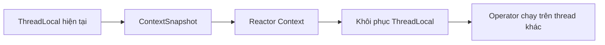
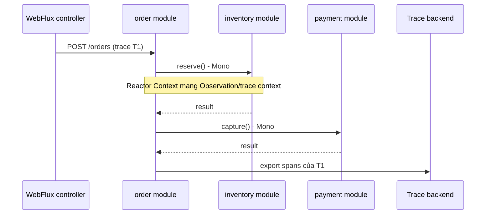
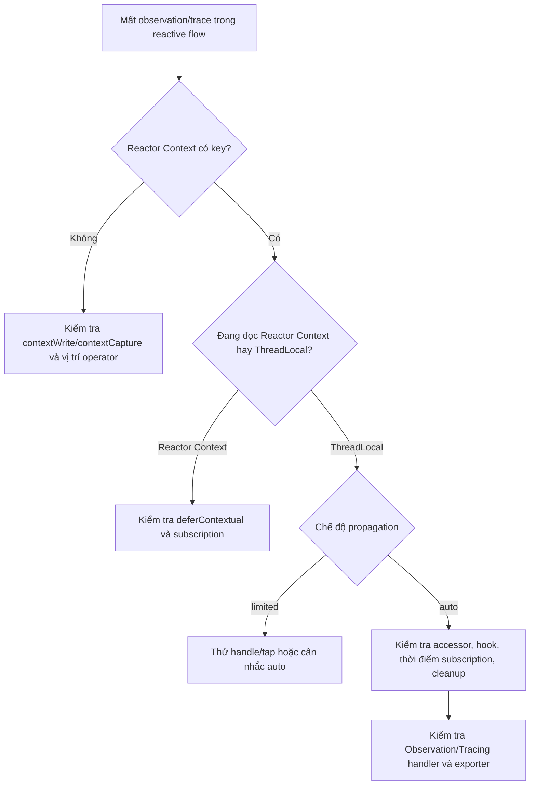

# spring.reactor.context-propagation

Trong ứng dụng Spring Boot dùng WebFlux hoặc Project Reactor, một request có thể đi qua nhiều operator và nhiều thread trước khi hoàn thành. Micrometer Observation và Micrometer Tracing thường dựa vào `ThreadLocal` để cung cấp thông tin “đang xử lý request/trace nào” cho mã imperative. Nhưng Reactor không bảo đảm một chuỗi reactive luôn chạy trên cùng thread. Khi scheduler chuyển việc sang thread khác, giá trị `ThreadLocal` không tự đi theo.

Spring Boot cung cấp property **`spring.reactor.context-propagation`** để chọn cách Reactor khôi phục các giá trị ngữ cảnh từ Reactor Context vào ThreadLocal khi chạy operator. Property này đặc biệt hữu ích khi muốn giữ observation, trace/span và các context đã đăng ký trong một reactive pipeline.

Bài thuộc chương **Context propagation** của học phần `SPRING_MODULITH_DOCUMENTATION_OBSERVABILITY`. Học phần dùng Spring Modulith để sinh tài liệu ranh giới application module và quan sát tương tác giữa các phần trong ứng dụng Spring Boot thông qua module graph, Actuator, event metrics, tracing và context propagation. Trọng tâm bài này là property `spring.reactor.context-propagation`, hai chế độ `limited` và `auto`, cách Reactor Context liên hệ với ThreadLocal, và giới hạn của property khi đi qua executor hoặc message broker.

Sau bài học, bạn có thể:

- Giải thích vì sao reactive pipeline không thể dựa vào thread hiện tại để giữ observation/tracing context.
- Phân biệt Reactor Context với ThreadLocal.
- Cấu hình `spring.reactor.context-propagation=limited` hoặc `auto`.
- Biết operator nào khôi phục ThreadLocal trong chế độ mặc định và phạm vi của chế độ tự động.
- Sử dụng `contextWrite`, `contextCapture` và `deferContextual` đúng mục đích.
- Phân biệt propagation trong Reactor với propagation cho `@Async`, executor tự cấu hình và messaging.
- Kiểm tra trace/log có giữ được ngữ cảnh qua các module và các lần chuyển thread hay không.

> **Phạm vi phiên bản:** ví dụ dùng Spring Boot 3.5.x và Reactor 3.7.x. Property này có từ Spring Boot 3.2. Reactor hỗ trợ Context Propagation từ dòng 3.5; chế độ automatic có từ Reactor 3.5.3. Hãy đối chiếu tài liệu đúng với Spring Boot/Reactor BOM của dự án.

## 1. Vì sao cần context propagation trong reactive pipeline?

Trong mô hình imperative, một request thường được xử lý trên một thread trong một đoạn mã đồng bộ. Thư viện logging/tracing có thể lưu thông tin hiện tại trong ThreadLocal:

```text
HTTP request
   |
   v
Thread http-nio-8080-exec-1
   |
   +-- Observation hiện tại
   +-- traceId = 8f19...
   +-- spanId  = a21c...
   |
   +-- gọi order service
   +-- gọi inventory service
```

Khi thread tiếp tục xử lý, mã có thể lấy thông tin hiện tại từ ThreadLocal mà không cần truyền tham số qua từng phương thức.

Với Reactor, một pipeline có thể đổi thread do các operator như `publishOn` hoặc `subscribeOn`. Reactive Streams cũng không yêu cầu một publisher luôn phát tín hiệu trên cùng thread. Ví dụ:

```java
Mono<String> result = Mono.just("order-42")
    .publishOn(Schedulers.boundedElastic())
    .map(this::loadOrder);
```

Operator `map` có thể chạy trên thread thuộc scheduler khác. Thread mới không tự có ThreadLocal đã được thiết lập ở thread nhận HTTP ban đầu. Nếu logging/tracing chỉ đọc ThreadLocal, kết quả có thể là:

- Log trong một đoạn có trace ID, đoạn khác lại không có.
- Span con không còn quan hệ cha–con như mong muốn.
- MDC không chứa correlation ID ở operator chạy trên thread khác.
- Observation được tạo trong một bước reactive không được gắn với observation đang bao quanh request.

**Context propagation** giải quyết việc chuyển các giá trị context giữa những cơ chế lưu trữ khác nhau, ví dụ từ ThreadLocal sang Reactor Context và ngược lại. Nó không tự tạo trace, không tự instrument mọi phương thức và không thay thế việc cấu hình exporter.

## 2. Reactor Context khác ThreadLocal như thế nào?

Hai cơ chế này có phạm vi và vòng đời khác nhau:

| Đặc điểm | Reactor Context | ThreadLocal |
| --- | --- | --- |
| Gắn với | Subscriber/reactive sequence | Thread hiện tại |
| Phạm vi | Theo subscription và chuỗi reactive | Theo thread đang thực thi |
| Đọc trong code | `deferContextual`, `ContextView` | `ThreadLocal.get()` |
| Chuyển scheduler | Context đi theo subscriber | Giá trị không tự chuyển sang thread mới |
| Cập nhật | Context bất biến; operator tạo context mới | Ghi/đọc giá trị trên thread |
| Dùng phù hợp | Ngữ cảnh của reactive pipeline | Thư viện imperative cần context gắn với thread |

Reactor Context là nguồn context gắn với subscriber, không phải một map toàn cục và cũng không phải ThreadLocal. Trong một pipeline, ta có thể đọc giá trị bằng `Mono.deferContextual` hoặc `Flux.deferContextual`:

```java
Mono<String> orderId = Mono.deferContextual(context ->
    Mono.just(context.get("orderId"))
).contextWrite(context -> context.put("orderId", "ORD-42"));
```

Trong ví dụ, `contextWrite(...)` bổ sung giá trị vào context mà các operator ở phía upstream có thể đọc. Vị trí của operator quan trọng: Reactor Context truyền theo subscription từ downstream về upstream, vì vậy không nên đặt `contextWrite` rồi kỳ vọng mọi operator nằm sau nó trong cách đọc source đều thấy cùng giá trị.

### Context Propagation library làm cầu nối

Micrometer Context Propagation cung cấp các abstraction chính:

- **`ThreadLocalAccessor`:** đọc, ghi và khôi phục một giá trị ThreadLocal.
- **`ContextAccessor`:** cho phép thư viện hiểu một dạng context dạng map, ví dụ Reactor Context.
- **`ContextRegistry`:** đăng ký các accessor để biết key nào cần được chuyển đổi.
- **`ContextSnapshot`:** ảnh chụp các giá trị context, có thể dùng để khôi phục ở một execution khác.

Reactor Core tích hợp SPI này từ Reactor 3.5 và cung cấp accessor cho Reactor Context. Khi `io.micrometer:context-propagation` có trên classpath cùng Reactor Core, không cần tự gọi accessor nội bộ của Reactor.



Thư viện không thay thế ThreadLocal hay Reactor Context. Nó giúp chuyển context khi code đi qua ranh giới giữa hai cơ chế này.

### Accessor dành cho Micrometer Tracing

Với observation do Spring Boot quản lý, hệ sinh thái Micrometer có cơ chế tích hợp context tương ứng. Tuy nhiên, nếu ứng dụng tự tạo **Span trực tiếp** hoặc dùng **Baggage do code tự quản lý**, Micrometer Tracing yêu cầu đăng ký các accessor tương ứng để Context Propagation biết cách đọc và khôi phục chúng:

```java
ContextRegistry.getInstance().registerThreadLocalAccessor(
    new ObservationAwareSpanThreadLocalAccessor(tracer));
ContextRegistry.getInstance().registerThreadLocalAccessor(
    new ObservationAwareBaggageThreadLocalAccessor(observationRegistry, tracer));
```

Đây là ví dụ cho trường hợp có span/baggage tự quản lý; cần import đúng package và dùng constructor phù hợp với version Micrometer Tracing của dự án. Không đăng ký trùng accessor mà framework đã tự cấu hình. Trong Reactor pipeline, giá trị span/baggage cần được đặt vào Reactor Context theo key/accessor tương ứng nếu ứng dụng tự điều khiển context.

## 3. Property spring.reactor.context-propagation điều khiển điều gì?

Trong Spring Boot, cấu hình đặt dưới prefix `spring.reactor`:

```yaml
spring:
  reactor:
    context-propagation: limited
```

Hai giá trị quan trọng:

- `limited`: chế độ mặc định. Reactor khôi phục ThreadLocal từ Reactor Context trong phạm vi một số operator được chọn, chủ yếu là `handle` và `tap`.
- `auto`: bật automatic context propagation. Reactor khôi phục ThreadLocal từ Reactor Context trên toàn bộ các operator trong reactive chain.

Ví dụ bật chế độ tự động:

```yaml
spring:
  reactor:
    context-propagation: auto
```

Property này cấu hình hành vi **khôi phục ThreadLocal trong Reactor operators**. Nó không bật/tắt Reactor Context. Bạn vẫn có thể dùng `contextWrite` và `deferContextual` trong cả hai chế độ.

| Câu hỏi | `limited` | `auto` |
| --- | --- | --- |
| Là chế độ mặc định của Spring Boot? | Có | Không |
| Khôi phục ThreadLocal quanh `handle`/`tap`? | Có, nếu context propagation có trên classpath và context phù hợp | Có |
| Khôi phục ThreadLocal trong mọi operator? | Không | Có |
| Phải bật hook bằng tay khi dùng Spring Boot property? | Không | Không, Boot cấu hình theo property |
| Tác động hiệu năng | Ít vùng khôi phục hơn | Có thể tốn thêm chi phí do phạm vi khôi phục rộng |
| Phù hợp khi | Muốn hành vi giới hạn, chủ động dùng Reactor Context | Ứng dụng cần ThreadLocal hiện diện xuyên reactive chain |

Chỉ có hai chế độ này trong property của Spring Boot ở phạm vi ví dụ. Không tự đặt giá trị như `off`, `disabled` hoặc `manual` nếu enum cấu hình của phiên bản không hỗ trợ.

### Chế độ limited: khôi phục trong operator được chọn

Trong chế độ mặc định, khi Context Propagation có trên classpath và subscriber Context có dữ liệu phù hợp, Reactor tích hợp việc khôi phục ThreadLocal xung quanh phần code người dùng truyền vào `handle` và `tap`. Các ThreadLocal có accessor đã đăng ký được khôi phục trong callback. Ví dụ:

```java
Mono<String> result = Mono.just("hello")
    .handle((value, sink) -> {
        // ThreadLocal được khôi phục trong callback handle
        sink.next("trace=" + TRACE_ID.get());
    });
```

Điều đó **không có nghĩa** mọi callback như `map`, `filter` hay `doOnNext` đều thấy ThreadLocal. Nếu code imperative trong các operator này phụ thuộc ThreadLocal, cần chọn cách truy cập context rõ ràng hoặc dùng chế độ automatic sau khi đánh giá.

### Chế độ auto: khôi phục trên mọi operator

Trong chế độ automatic, Reactor khôi phục ThreadLocal từ context của subscriber khi chạy các operator, kể cả khi pipeline đổi thread. Chế độ này giúp những thư viện vốn đọc ThreadLocal (ví dụ logging/tracing) nhìn thấy context hiện tại ở nhiều vị trí hơn.

Automatic mode chỉ áp dụng cho **subscription mới** sau khi hook được bật. Vì vậy, nên cấu hình property lúc ứng dụng khởi động, trước khi reactive pipelines bắt đầu subscribe. Không bật hook muộn sau khi ứng dụng đã chạy nhiều subscription rồi mong các subscription cũ được thay đổi hành vi.

Nếu dùng Reactor trực tiếp mà không có Spring Boot quản lý property, API tương ứng là `Hooks.enableAutomaticContextPropagation()`. Gọi API này một lần trong giai đoạn khởi động ứng dụng. Trong Spring Boot, nên chọn property `spring.reactor.context-propagation=auto` làm nguồn cấu hình; không cần tự gọi hook thêm lần nữa chỉ để lặp lại cùng thiết lập.

## 4. Ví dụ cấu hình Spring Boot

### Cấu hình trong application.yml

Đặt property trong file cấu hình chung nếu ứng dụng muốn dùng cùng một chế độ ở mọi môi trường:

```yaml
spring:
  application:
    name: shop-modulith
  reactor:
    context-propagation: auto
```

Hoặc dùng `limited`:

```yaml
spring:
  reactor:
    context-propagation: limited
```

Vì `limited` là mặc định, có thể không cần khai báo nếu nhóm chấp nhận hành vi mặc định. Khai báo tường minh đôi khi hữu ích để người đọc hiểu lựa chọn của dự án.

### Tách theo profile

Có thể dùng profile để thử nghiệm và đo hiệu năng:

```yaml
# application-local.yml
spring:
  reactor:
    context-propagation: auto
```

```yaml
# application-production.yml
spring:
  reactor:
    context-propagation: limited
```

Đây chỉ là ví dụ quyết định theo môi trường, **không phải khuyến cáo rằng production luôn phải dùng limited**. Chế độ production phải dựa trên cách ứng dụng truy cập ThreadLocal, yêu cầu quan sát và benchmark tải thực tế. Nếu code cần ThreadLocal xuyên các operator, chọn limited mà không sửa code có thể làm mất context ở một số vị trí.

### Property không thay thế dependency

Để Reactor và Micrometer trao đổi context, ứng dụng cần các thư viện tương thích, đặc biệt:

- `reactor-core` ở dòng hỗ trợ Context Propagation.
- `io.micrometer:context-propagation`.
- Spring Boot/Micrometer Observation và Tracing phù hợp nếu muốn truyền observation hoặc trace context.

Spring Boot starter quản lý dependency thường cung cấp phiên bản tương thích. Tránh tự thêm version khác dòng vào classpath, vì có thể gây xung đột SPI/API. Nếu chỉ dùng Reactor Context nội bộ và không cần chuyển ThreadLocal, bạn vẫn có thể dùng Reactor Context mà không cần bật automatic ThreadLocal restoration.

## 5. Dùng contextWrite và deferContextual

Cách tự nhiên nhất trong code reactive là **ghi và đọc context trực tiếp**, thay vì phụ thuộc ThreadLocal.

```java
import reactor.core.publisher.Mono;

class OrderReactiveService {

    Mono<String> describeOrder() {
        return Mono.deferContextual(context -> {
            String correlationId = context.get("correlationId");
            return Mono.just("processing order, correlation=" + correlationId);
        });
    }

    Mono<String> process(String correlationId) {
        return describeOrder()
            .contextWrite(context -> context.put("correlationId", correlationId));
    }
}
```

`contextWrite` gắn giá trị vào Reactor Context của subscription. `deferContextual` đọc context tại thời điểm subscription, không phải ngay khi tạo publisher.

Có thể kết hợp nhiều context values:

```java
Mono<String> result = Mono.deferContextual(context ->
    Mono.just(
        "module=" + context.get("module") +
        ", correlation=" + context.get("correlationId")
    )
).contextWrite(context -> context
    .put("module", "order")
    .put("correlationId", "REQ-2026-42")
);
```

Trong reactive code, đây thường là cách rõ ràng nhất vì dữ liệu context đi theo subscription mà không phụ thuộc thread nào đang chạy operator.

### Không gọi subscribe lồng nhau trong service

Một lỗi phổ biến là gọi `subscribe()` bên trong một service rồi tạo một pipeline tách rời:

```java
// Không nên: tạo subscription độc lập, khó giữ quan hệ với pipeline gọi.
Mono<Order> placeOrder() {
    inventory.reserve().subscribe();
    return payment.capture().thenReturn(new Order());
}
```

Hãy composition các publisher để Reactor quản lý cùng subscription:

```java
Mono<Order> placeOrder() {
    return inventory.reserve()
        .then(payment.capture())
        .thenReturn(new Order());
}
```

Cách composition giúp Reactor Context gắn với chuỗi xử lý. Nó cũng làm rõ error handling, cancellation và thứ tự hoàn thành. Tuy nhiên, context propagation không thay thế thiết kế giao dịch hoặc tính idempotent của nghiệp vụ.

## 6. Dùng contextCapture khi nguồn context là ThreadLocal

Đôi khi một thư viện imperative đã đặt giá trị vào ThreadLocal trước khi reactive pipeline được subscribe. `contextCapture()` dùng Micrometer Context Propagation để chụp các ThreadLocal đã đăng ký accessor tại **thời điểm subscription**, rồi đưa giá trị vào Reactor Context.

Ví dụ minh họa:

```java
import io.micrometer.context.ContextRegistry;
import reactor.core.publisher.Mono;

class CorrelationContext {

    static final String KEY = "correlationId";
    static final ThreadLocal<String> CORRELATION_ID = new ThreadLocal<>();

    static {
        ContextRegistry.getInstance().registerThreadLocalAccessor(
            KEY,
            CORRELATION_ID::get,
            CORRELATION_ID::set,
            CORRELATION_ID::remove
        );
    }

    Mono<String> readCapturedValue() {
        return Mono.deferContextual(context ->
            Mono.just(context.getOrDefault(KEY, "missing"))
        ).contextCapture();
    }
}
```

Trình tự:

1. Một đoạn imperative thiết lập `CORRELATION_ID.set("REQ-42")`.
2. Publisher được subscribe trong khi giá trị ThreadLocal còn tồn tại.
3. `contextCapture()` chụp giá trị qua accessor đã đăng ký.
4. Giá trị được đặt vào Reactor Context.
5. Các operator upstream có thể đọc giá trị đó bằng `deferContextual`.

**Quan trọng:** accessor cần được đăng ký một lần ở thời điểm khởi tạo phù hợp, không đăng ký lặp lại cho mỗi request. Trong ứng dụng thực tế, hãy ưu tiên accessor được Spring/Micrometer cung cấp cho observation/tracing thay vì tự đăng ký lại accessor đã tồn tại.

Trong automatic mode, các blocking operators như `Mono.block()` và một số API chuyển về imperative có thể thực hiện capture một cách trong suốt theo cơ chế Reactor. Dù vậy, không nên dùng `block()` trong WebFlux request pipeline chỉ để lấy context; hãy composition reactive publisher.

## 7. Ví dụ quan sát ThreadLocal qua scheduler

Để hiểu rõ khác biệt giữa hai chế độ, giả sử một ThreadLocal được đăng ký với ContextRegistry:

```java
import io.micrometer.context.ContextRegistry;
import reactor.core.publisher.Mono;
import reactor.core.scheduler.Schedulers;

class ContextPropagationDemo {

    static final String KEY = "correlationId";
    static final ThreadLocal<String> CORRELATION_ID = new ThreadLocal<>();

    static {
        ContextRegistry.getInstance().registerThreadLocalAccessor(
            KEY,
            CORRELATION_ID::get,
            CORRELATION_ID::set,
            CORRELATION_ID::remove
        );
    }

    Mono<String> run() {
        return Mono.deferContextual(context ->
            Mono.delay(java.time.Duration.ofMillis(10))
                .map(ignored -> "reactor=" + context.get(KEY)
                    + ", threadLocal=" + CORRELATION_ID.get())
        )
        .subscribeOn(Schedulers.parallel())
        .contextWrite(context -> context.put(KEY, "REQ-42"));
    }
}
```

Kết quả mong đợi theo ý nghĩa:

| Chế độ | `context.get(KEY)` | `CORRELATION_ID.get()` trong callback `map` |
| --- | --- | --- |
| `limited` | `REQ-42` | Thường là `null` vì `map` không thuộc nhóm operator restore mặc định |
| `auto` | `REQ-42` | `REQ-42` khi accessor đã đăng ký và subscription mới |

Đây là minh họa cơ chế, không nên dùng làm benchmark. Reactor Context vẫn đọc được trong cả hai chế độ; khác biệt là ThreadLocal có được khôi phục tại callback đó hay không.

Nếu chuyển callback sang `handle` trong limited mode, Reactor có thể khôi phục ThreadLocal trong phạm vi callback khi context có dữ liệu phù hợp. Đó là lý do limited mode vẫn hữu ích với những pipeline được thiết kế để truy cập ThreadLocal ở một số điểm có chủ đích.

### Cảnh báo về ThreadLocal rò rỉ

Thread pool tái sử dụng thread cho nhiều request. Nếu giá trị ThreadLocal của request trước không được dọn dẹp, request tiếp theo có thể nhìn thấy dữ liệu cũ. Context Propagation quản lý việc set/restore/clear cho accessor đã đăng ký; khi tự viết accessor, cần tuân thủ hợp đồng khôi phục và xóa giá trị.

Reactor automatic mode coi Reactor Context là nguồn dữ liệu chuẩn. Nếu key không có trong Context, giá trị ThreadLocal tương ứng cần được reset để không rò rỉ sang subscriber khác. Không tự giữ một ThreadLocal tùy chỉnh bên ngoài accessor rồi mong Reactor tự biết cách dọn dẹp.

## 8. Phân biệt Reactor propagation với @Async và executor

Property `spring.reactor.context-propagation` chỉ điều khiển **Reactor operators**. Nó không tự cấu hình tất cả thread pool trong ứng dụng.

Với Spring Boot, `@Async` hoặc `AsyncTaskExecutor` là một đường thực thi riêng:

| Loại thực thi | Cấu hình phù hợp |
| --- | --- |
| Reactor `Mono/Flux` | `spring.reactor.context-propagation=limited/auto` |
| `@Async` dùng AsyncTaskExecutor auto-configured | `spring.task.execution.propagate-context=true` khi cần propagation |
| AsyncTaskExecutor do ứng dụng tự tạo | Gắn `ContextPropagatingTaskDecorator` vào executor |
| ExecutorService thuần | Dùng Context Propagation wrapper/snapshot phù hợp |
| Message broker qua process khác | Truyền trace context qua message headers, ví dụ W3C Trace Context |

Ví dụ cấu hình cho `@Async` khi dùng executor auto-configured của Spring Boot:

```yaml
spring:
  task:
    execution:
      propagate-context: true
```

Nếu tự cấu hình `ThreadPoolTaskExecutor`, phải gắn decorator vào chính executor:

```java
import org.springframework.context.annotation.Bean;
import org.springframework.context.annotation.Configuration;
import org.springframework.core.task.TaskDecorator;
import org.springframework.core.task.support.ContextPropagatingTaskDecorator;
import org.springframework.scheduling.concurrent.ThreadPoolTaskExecutor;

@Configuration(proxyBeanMethods = false)
class AsyncExecutorConfiguration {

    @Bean
    TaskDecorator contextPropagatingTaskDecorator() {
        return new ContextPropagatingTaskDecorator();
    }

    @Bean
    ThreadPoolTaskExecutor applicationTaskExecutor(TaskDecorator decorator) {
        ThreadPoolTaskExecutor executor = new ThreadPoolTaskExecutor();
        executor.setCorePoolSize(4);
        executor.setMaxPoolSize(16);
        executor.setQueueCapacity(100);
        executor.setThreadNamePrefix("application-");
        executor.setTaskDecorator(decorator);
        return executor;
    }
}
```

Đoạn code cho thấy decorator được gắn vào executor cụ thể. Chỉ đăng ký bean `ContextPropagatingTaskDecorator` không đảm bảo mọi executor do ứng dụng tự tạo đều tự động dùng nó.

Với message broker, property Reactor không truyền context qua mạng. Producer/consumer phải có instrumentation và propagation headers phù hợp. Trace ID có thể tiếp tục qua message nếu producer và consumer cùng hỗ trợ; nếu xử lý lại muộn, hệ thống cũng có thể tạo trace mới và liên kết bằng event ID/mã nghiệp vụ.

## 9. Kết hợp với Spring Modulith và tracing

Spring Modulith giúp quan sát tương tác qua ranh giới application module. Giả sử module `order` gọi API reactive của `inventory` rồi `payment`:



Khi các module trả về publisher và được composition trong cùng reactive chain, Reactor Context có thể đi theo subscription. Spring Boot/Micrometer có thể khôi phục observation/tracing ThreadLocal khi cần dựa trên chế độ propagation.

Tuy nhiên, cần phân biệt:

- Property không tạo span mới. Nó giúp **duy trì context hiện có** khi Reactor chạy operator.
- Property không tự instrument mọi method hoặc mọi module. Cần Modulith observability và các handler/tracing bridge tương ứng.
- Property không thay thế module graph hoặc `ApplicationModules.verify()`. Graph kiểm tra cấu trúc, trace phản ánh một lần thực thi.
- Property không tự truyền context qua broker hoặc một process khác.
- Nếu code tự gọi `subscribe()` lồng nhau, tạo publisher tách biệt hoặc chuyển sang API imperative không có bridge, quan hệ context có thể không như mong muốn.

Một trace có các span `order → inventory → payment` cho thấy một hành trình đã được ghi nhận. Để kết luận phụ thuộc kiến trúc hợp lệ, vẫn phải xem module graph và quy tắc phụ thuộc công khai.

## 10. Kiểm thử context propagation

Không nên chỉ bật `auto` rồi nhìn một trace bất kỳ để kết luận cấu hình đúng. Hãy kiểm tra hành vi tại các điểm đổi thread.

### Kiểm tra Reactor Context

Dùng Reactor Test/StepVerifier để xác nhận context được đọc trong pipeline:

```java
import org.junit.jupiter.api.Test;
import reactor.core.publisher.Mono;
import reactor.test.StepVerifier;

class ReactorContextTest {

    @Test
    void contextIsAvailableAcrossScheduler() {
        Mono<String> publisher = Mono.deferContextual(context ->
            Mono.delay(java.time.Duration.ofMillis(10))
                .map(ignored -> context.get("correlationId"))
        )
        .contextWrite(context -> context.put("correlationId", "REQ-42"));

        StepVerifier.create(publisher)
            .expectNext("REQ-42")
            .verifyComplete();
    }
}
```

Test này kiểm tra Reactor Context; nó không kiểm tra ThreadLocal restoration. Context vốn gắn với subscription và không cần `spring.reactor.context-propagation=auto` để đọc theo cách này.

### Kiểm tra ThreadLocal restoration

Tạo một accessor test-only cho một ThreadLocal, sau đó chạy cùng pipeline dưới hai profile hoặc hai cấu hình:

- Với `limited`, kiểm tra trong `handle`/`tap` và trong `map` để thấy phạm vi khôi phục.
- Với `auto`, kiểm tra trong `map` sau khi scheduler đổi thread.
- Chạy nhiều subscription liên tiếp với giá trị context khác nhau để xác nhận giá trị của request trước không rò rỉ sang request sau.
- Dùng `StepVerifier.withVirtualTime` nếu bài test cần thời gian ảo, nhưng nhớ khởi tạo scheduler và subscription theo cách tương thích với virtual time.

Một bài test tự viết có thể kiểm tra:

```text
Subscription 1:
  Reactor Context correlationId = REQ-1
  operator đọc ThreadLocal = REQ-1

Subscription 2:
  Reactor Context correlationId = REQ-2
  operator đọc ThreadLocal = REQ-2

Sau khi kết thúc:
  ThreadLocal trên worker thread không còn giữ REQ-1/REQ-2 ngoài scope
```

Giá trị cuối cùng tùy cách accessor được khôi phục và thread pool được quản lý. Không kiểm tra bằng cách đọc ThreadLocal từ một thread tùy ý sau khi pipeline kết thúc; hãy assert trong callback nơi propagation được kỳ vọng.

### Kiểm tra observation và trace

Trong môi trường tích hợp:

1. Gửi một request qua WebFlux endpoint.
2. Tạo observation nghiệp vụ trong module `order`.
3. Composition lời gọi reactive tới `inventory` và `payment`.
4. Chèn `publishOn(Schedulers.parallel())` hoặc một operator async để kiểm tra đổi thread.
5. Xem log có trace ID nhất quán trong callback được instrument.
6. Xem trace backend có quan hệ cha–con đúng, không có span mồ côi ngoài dự kiến.
7. Lặp lại khi sampling phù hợp; không kết luận mất context chỉ vì trace không được lấy mẫu.

## 11. Ảnh hưởng hiệu năng và lựa chọn chế độ

Automatic propagation tiện lợi vì nhiều thư viện imperative vẫn đọc ThreadLocal. Nhưng việc khôi phục ThreadLocal quanh mọi operator có chi phí. Mức tác động phụ thuộc:

- Số operator trong pipeline.
- Số accessor đã đăng ký và số giá trị cần capture/restore.
- Tần suất đổi thread/scheduler.
- Loại workload và số request đồng thời.
- Các handlers logging, metrics và tracing đang hoạt động.

Không có kết luận rằng `auto` luôn chậm hơn một tỷ lệ cố định hoặc luôn nhanh hơn cách tự truyền tham số. Reactor khuyến nghị đo hành vi của ứng dụng dưới tải dự kiến. Nếu hiệu năng là ưu tiên cao, có thể thiết kế code dùng Reactor Context trực tiếp hoặc truyền tham số tường minh tại những nơi phù hợp, thay vì đọc ThreadLocal ở mọi operator.

| Tình huống | Hướng lựa chọn |
| --- | --- |
| Code reactive đọc context bằng `deferContextual` | Có thể giữ `limited` vì không cần khôi phục ThreadLocal ở mọi operator |
| Thư viện imperative cần trace/MDC ở nhiều operator | Thử `auto`, đo hiệu năng và xác minh cleanup |
| Chỉ một số callback cần ThreadLocal | `limited` với `handle`/`tap` hoặc bridge có chủ đích |
| Pipeline nhiều operator, tải cao | Benchmark `limited` và `auto`; xem xét truyền context tường minh |
| `@Async` hoặc custom executor | Cấu hình propagation riêng cho executor; không dựa vào property Reactor |

**Khuyến nghị thực hành:** bắt đầu với mặc định `limited` nếu ứng dụng không có yêu cầu khác; chọn `auto` khi có nhu cầu rõ ràng và test chứng minh ThreadLocal phải hiện diện ở các operator khác. Không thay đổi chế độ chỉ để “thử cho hết lỗi” mà không xác định nguồn context và nơi context bị mất.

## 12. Sự cố thường gặp

| Triệu chứng | Nguyên nhân có thể | Cách kiểm tra |
| --- | --- | --- |
| Trace ID có ở controller nhưng mất trong `map` | Đang dùng limited mode; `map` không phải operator restore mặc định | Kiểm tra property, thử `auto` hoặc dùng Reactor Context trực tiếp |
| `deferContextual` không tìm thấy key | `contextWrite` đặt sai vị trí hoặc key khác nhau | Kiểm tra hướng propagation và tên key |
| `contextCapture()` không mang giá trị vào Context | Không có ThreadLocal tại thời điểm subscribe hoặc thiếu accessor | Kiểm tra thời điểm subscribe và ContextRegistry |
| `auto` bật nhưng vẫn không có trace | Thiếu tracing bridge/handler/exporter, sampling hoặc context chưa được tạo | Kiểm tra ObservationRegistry, Micrometer Tracing, exporter và backend |
| Request sau nhìn thấy ID của request trước | Accessor không reset đúng hoặc code tự quản lý ThreadLocal sai | Kiểm tra reset/restore và chạy nhiều subscription |
| `@Async` không có trace liên tục | Nhầm property Reactor với executor propagation | Dùng `spring.task.execution.propagate-context` hoặc decorator |
| Executor tùy chỉnh không propagate | Decorator chưa gắn vào executor thực tế | Kiểm tra cấu hình `setTaskDecorator(...)` |
| Listener qua broker có trace mới | Context không được truyền qua message header hoặc consumer instrumentation | Kiểm tra W3C Trace Context và cấu hình producer/consumer |
| Bật `auto` gây giảm throughput | Chi phí khôi phục ThreadLocal trên nhiều operator | Benchmark, xem số accessor và chọn phạm vi phù hợp |
| Có span nhưng không thấy trong backend | Sampling/exporter/collector/backend gặp vấn đề | Kiểm tra sampling, OTLP, network và trạng thái collector |

### Quy trình chẩn đoán



## 13. Bài thực hành

**Bối cảnh:** ứng dụng Spring Boot WebFlux dùng Spring Modulith với các module `order`, `inventory` và `payment`. Một request tạo đơn hàng gọi hai module theo reactive pipeline. Bạn muốn trace ID và correlation ID được giữ qua scheduler.

1. Xây dựng endpoint WebFlux trả về `Mono<OrderResult>`.
2. Đặt `correlationId` vào Reactor Context bằng `contextWrite` và đọc bằng `deferContextual`.
3. Chạy pipeline có `publishOn(Schedulers.parallel())`; xác nhận Reactor Context vẫn đọc được.
4. Tạo một ThreadLocal test-only, đăng ký `ThreadLocalAccessor` qua `ContextRegistry`.
5. Với `spring.reactor.context-propagation=limited`, kiểm tra giá trị trong `handle` và `map`. Giải thích khác biệt.
6. Chuyển sang `auto`, chạy subscription mới và xác nhận ThreadLocal được khôi phục trong operator khác.
7. Gửi nhiều request song song với correlation ID khác nhau; kiểm tra không có giá trị bị lẫn giữa các request.
8. Tạo một observation nghiệp vụ `shop.order.place` và bật tracing. Xem trace có giữ quan hệ khi gọi module `inventory`/`payment` qua reactive composition không.
9. Thử chuyển một phần việc sang `@Async`. Cấu hình propagation của AsyncTaskExecutor và giải thích vì sao property Reactor không đủ.
10. Viết một kết luận ngắn: profile nào dùng `limited`, profile nào dùng `auto`, bằng chứng benchmark/test nào hỗ trợ quyết định đó.

**Tiêu chí hoàn thành:** phân biệt được Reactor Context và ThreadLocal; cấu hình đúng property; giải thích chính xác giới hạn của limited/auto; chứng minh được context đi qua scheduler; và không nhầm propagation trong Reactor với executor hoặc message broker.

## Tài liệu tham khảo

- [Spring Boot 3.5 — Observability / Context Propagation](https://docs.spring.io/spring-boot/3.5/reference/actuator/observability.html): property `spring.reactor.context-propagation` và cấu hình cho `@Async`/AsyncTaskExecutor.
- [Spring Boot 3.5 — Common Application Properties](https://docs.spring.io/spring-boot/3.5/appendix/application-properties/index.html): kiểu property và giá trị mặc định `limited`; cấu hình `spring.task.execution.propagate-context`.
- [Spring Boot 3.5 — Task Execution and Scheduling](https://docs.spring.io/spring-boot/3.5/reference/features/task-execution-and-scheduling.html): cách Spring Boot chọn AsyncTaskExecutor và tích hợp executor.
- [Project Reactor — Context-Propagation Support](https://projectreactor.io/docs/core/release/reference/advanced-contextPropagation.html): limited mode, automatic mode, `contextWrite` và `contextCapture`.
- [Micrometer Context Propagation — Purpose](https://docs.micrometer.io/context-propagation/reference/purpose.html): ThreadLocalAccessor, ContextAccessor, ContextRegistry và ContextSnapshot.
- [Micrometer — Instrumenting](https://docs.micrometer.io/micrometer/reference/observation/instrumenting.html): truyền observation context trong reactive và imperative code.
- [Micrometer Tracing — Configuring with Observation](https://docs.micrometer.io/tracing/reference/configuring.html): context propagation cho span và baggage.

**Ghi nhớ:** `spring.reactor.context-propagation` điều khiển việc khôi phục ThreadLocal bên trong Reactor operators. Reactor Context vẫn là ngữ cảnh gắn với subscriber; `@Async`, executor tự tạo và message broker có cơ chế propagation riêng. Hãy kiểm tra đúng ranh giới thực thi nơi context bị mất trước khi chọn `auto`.
