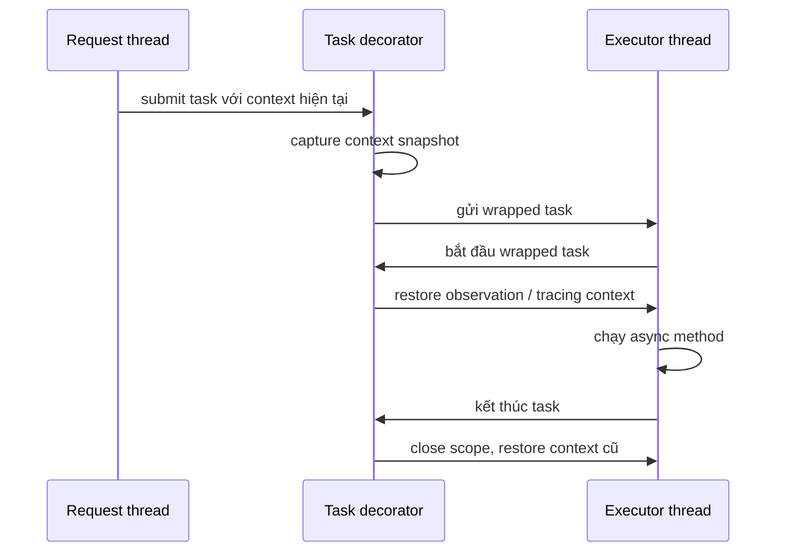

# @Async và propagate-context

> **Chương:** Context propagation  
> **Bối cảnh:** Spring Modulith giúp quan sát ranh giới application module và tương tác trong ứng dụng Spring Boot. Bài học tập trung vào cách giữ **observation/tracing context** khi một lời gọi được chuyển từ request thread sang executor bằng `@Async`, cách cấu hình `ContextPropagatingTaskDecorator` hoặc `spring.task.execution.propagate-context`, và các giới hạn của việc truyền context.

## Mục tiêu học tập

Sau bài này, bạn có thể:

1. Giải thích `@Async` chuyển công việc sang `TaskExecutor` như thế nào và vì sao proxy/self-invocation ảnh hưởng đến việc chạy bất đồng bộ.
2. Phân biệt `ThreadLocal`, Micrometer Observation Context, trace context, MDC, transaction context và security context.
3. Cấu hình `ContextPropagatingTaskDecorator` cho executor tự tạo, hoặc bật `spring.task.execution.propagate-context` cho executor được Spring Boot tự cấu hình ở các phiên bản hỗ trợ.
4. Tạo một async worker có thể ghi log cùng trace ID và tạo child observation/span phù hợp.
5. Kiểm chứng parent-child trace, xử lý exception và phát hiện lỗi do chọn nhầm executor hoặc thiếu context propagation.

## 1. Vấn đề xuất hiện khi chuyển thread

Một request HTTP đi vào ứng dụng. Spring Boot/Micrometer có thể đặt observation hoặc tracing context hiện tại trong `ThreadLocal` của request thread. Các lời gọi đồng bộ tiếp tục trên thread này nên có thể nhìn thấy context đang active.

Khi code gọi một method `@Async`, Spring gửi tác vụ đến một `TaskExecutor`. Tác vụ có thể chạy trên **thread khác**, được tái sử dụng cho nhiều request. `ThreadLocal` của thread gửi không tự động xuất hiện trên thread nhận.

Ví dụ:

```text
Thread: http-nio-8080-exec-3
  traceId = T1
  spanId  = S1
  |
  +-- gọi invoiceWorker.sendAsync()
         |
         +-- submit task vào executor

Thread: async-2
  traceId = ?       <- ThreadLocal ban đầu có thể rỗng
  spanId  = ?
  |
  +-- chạy sendAsync()
```

Nếu context không được truyền, log của tác vụ async có thể thiếu `traceId`/`spanId`; các span phát sinh trong tác vụ có thể thành trace mới hoặc không liên kết được với request gốc. Điều này làm khó việc điều tra một luồng nghiệp vụ xuyên module.

**Context propagation** giải quyết việc capture context ở nơi submit task và restore context đó trong thời gian task chạy, sau đó khôi phục trạng thái thread trước khi trả thread về pool.

## 2. `@Async` hoạt động như thế nào?

`@Async` đánh dấu một method để Spring thực thi lời gọi thông qua `TaskExecutor`. Caller thường không phải chờ phần thân method chạy xong; việc nhận kết quả phụ thuộc kiểu trả về.

### 2.1. Bật async processing

Trong ứng dụng Spring:

```java
import org.springframework.context.annotation.Configuration;
import org.springframework.scheduling.annotation.EnableAsync;

@Configuration(proxyBeanMethods = false)
@EnableAsync
class AsyncConfiguration {
}
```

`@EnableAsync` kích hoạt việc xử lý annotation `@Async`. Nếu ứng dụng dùng Spring Boot, hãy kiểm tra cấu hình auto-configuration và executor thực tế trước khi khai báo thêm một pool khác.

### 2.2. Gắn `@Async` lên Spring bean

```java
import java.util.UUID;
import java.util.concurrent.CompletableFuture;
import org.springframework.scheduling.annotation.Async;
import org.springframework.stereotype.Service;

@Service
class ReceiptSender {

    @Async
    public CompletableFuture<Void> send(UUID orderId) {
        // Gửi receipt bất đồng bộ.
        return CompletableFuture.completedFuture(null);
    }
}
```

Các dạng trả về thường dùng:

| Kiểu trả về | Ý nghĩa |
| --- | --- |
| `void` | Caller không nhận kết quả; exception cần được xử lý bằng `AsyncUncaughtExceptionHandler` hoặc cơ chế log/monitor riêng. |
| `Future<T>` | Caller có thể lấy kết quả sau bằng `get()`. |
| `CompletableFuture<T>` | Hỗ trợ composition, callback và xử lý lỗi bất đồng bộ. |

Nếu method trả `Future`/`CompletableFuture`, exception trong task được chuyển tới kết quả bất đồng bộ và thường được quan sát khi caller gọi `get()` hoặc gắn callback. Với `void`, exception không thể trả về caller theo cách đó; Spring mặc định ghi log nếu không cấu hình handler phù hợp.

### 2.3. `@Async` dựa vào proxy

Ở chế độ proxy mặc định, lời gọi phải đi **qua Spring proxy** thì interceptor mới chuyển method sang executor.

Ví dụ không chạy async như mong đợi:

```java
@Service
class OrderService {

    public void checkout() {
        sendReceipt(); // self-invocation: gọi trực tiếp trên this
    }

    @Async
    public void sendReceipt() {
        // Không được proxy intercept trong đường gọi nội bộ này.
    }
}
```

Tách worker thành một bean riêng:

```java
@Service
class OrderService {

    private final ReceiptSender receiptSender;

    OrderService(ReceiptSender receiptSender) {
        this.receiptSender = receiptSender;
    }

    public void checkout(UUID orderId) {
        receiptSender.send(orderId); // gọi qua Spring proxy
    }
}
```

Không chỉ self-invocation, một object tự tạo bằng `new` cũng không được Spring proxy quản lý. Khi kiểm tra `@Async`, cần xác nhận method được gọi trên bean do Spring quản lý và đường gọi thực sự đi qua proxy.

### 2.4. Executor được chọn

`@Async` có thể chỉ định executor:

```java
@Async("contextAwareExecutor")
public CompletableFuture<Void> send(UUID orderId) {
    // ...
    return CompletableFuture.completedFuture(null);
}
```

Nếu không chỉ định qualifier, Spring dùng executor được cấu hình cho async support; với Spring Boot, executor được auto-configure có thể được dùng nếu không có cấu hình `Executor`/`AsyncConfigurer` tùy biến làm thay đổi lựa chọn. Đừng chỉ cấu hình một executor rồi giả định mọi method `@Async` đều chạy trên executor đó: hãy kiểm tra qualifier và cấu hình thực tế.

## 3. Các loại context cần phân biệt

Từ “context” thường được dùng cho nhiều loại dữ liệu. Chúng có vòng đời và cơ chế truyền khác nhau.

| Context | Ví dụ | Có tự đi theo thread khi `@Async` chạy? | Vai trò |
| --- | --- | --- | --- |
| Observation context | Current Micrometer observation | Không mặc định | Gắn metadata và scope của hoạt động được quan sát |
| Tracing context | `traceId`, `spanId`, current span | Không mặc định nếu không có propagation | Liên kết span thành trace |
| Logging MDC | `traceId`, `spanId`, request correlation field | Không mặc định | Làm log trên thread nhận có cùng thông tin tương quan |
| Security context | Principal, authorities | Không nên giả định | Kiểm soát danh tính/quyền của thao tác |
| Transaction context | Transaction đang gắn với thread, JDBC connection | Không được chuyển sang thread async như một transaction chung | Quản lý commit/rollback |
| Business context | `orderId`, tenant key, locale | Chỉ khi ứng dụng truyền/cấu hình rõ | Thông tin nghiệp vụ của task |

`ContextPropagatingTaskDecorator` tích hợp với Micrometer Context Propagation để capture/restore các context có accessor được đăng ký. Nó không biến mọi `ThreadLocal` trong ứng dụng thành dữ liệu tự động được truyền.

**Đặc biệt:** truyền trace context không đồng nghĩa truyền transaction hoặc security context. Một task async thường chạy trong transaction riêng nếu tự mở transaction; nó không tiếp tục transaction JDBC đang chạy ở request thread. Nếu cần truyền SecurityContext, dùng cơ chế chuyên biệt của Spring Security, chẳng hạn `DelegatingSecurityContextAsyncTaskExecutor`, theo chính sách của ứng dụng.

## 4. Micrometer Context Propagation và `ContextPropagatingTaskDecorator`

### 4.1. Cơ chế capture/restore

Micrometer Context Propagation cung cấp cơ chế chụp context từ thread hiện tại, sau đó khôi phục context tương ứng khi chạy task ở thread khác. Spring Framework cung cấp:

```java
org.springframework.core.task.support.ContextPropagatingTaskDecorator
```

Decorator này bọc `Runnable`/task để context được capture ở thời điểm submit và restore trong lúc task thực thi. Khi task kết thúc, scope được đóng để tránh context của request trước rò sang task tiếp theo trên thread pool.

Luồng logic:



Decorator không làm task trở thành đồng bộ. Nó chỉ giúp context phù hợp hiện diện trong khoảng thực thi task.

### 4.2. Những gì được truyền phụ thuộc accessor

Context Propagation hoạt động qua các `ThreadLocalAccessor` hoặc accessor tương ứng đã được đăng ký. Micrometer/Spring có tích hợp cho các context quan sát phổ biến, nhưng một `ThreadLocal` tự tạo trong ứng dụng không tự nhiên được biết cách capture/restore.

Nếu ứng dụng có context riêng:

1. Xác định dữ liệu có thực sự cần truyền qua ranh giới thread không.
2. Chọn accessor hoặc truyền dữ liệu rõ ràng qua tham số task.
3. Xác định vòng đời, cách dọn dẹp và quyền truy cập.
4. Kiểm tra không giữ lại context cũ khi executor tái sử dụng thread.

Không nên sao chép toàn bộ `ThreadLocal` tùy tiện. Một số dữ liệu gắn với tài nguyên thread-bound, ví dụ transaction resource, không thể an toàn khi chuyển sang thread khác.

## 5. Cấu hình theo phiên bản Spring Boot

Đây là phần dễ cấu hình nhầm. Cần phân biệt **executor do Boot auto-configure** với **executor do ứng dụng tự tạo**, đồng thời kiểm tra minor version đang chạy.

### 5.1. Spring Boot 3.5: dùng `ContextPropagatingTaskDecorator`

Tài liệu observability của Spring Boot 3.5 hướng dẫn đăng ký decorator:

```java
import org.springframework.context.annotation.Bean;
import org.springframework.context.annotation.Configuration;
import org.springframework.core.task.support.ContextPropagatingTaskDecorator;

@Configuration(proxyBeanMethods = false)
class ContextPropagationConfiguration {

    @Bean
    ContextPropagatingTaskDecorator contextPropagatingTaskDecorator() {
        return new ContextPropagatingTaskDecorator();
    }
}
```

Với executor auto-configured theo cơ chế của Boot, bean `TaskDecorator` có thể được sử dụng trong cấu hình executor tự động. Nếu ứng dụng tự khai báo executor, phải gắn decorator vào **executor thực sự chạy task**; chỉ có một bean decorator chưa đủ nếu executor tùy biến không sử dụng nó.

Ví dụ executor tự tạo:

```java
import org.springframework.context.annotation.Bean;
import org.springframework.context.annotation.Configuration;
import org.springframework.core.task.support.ContextPropagatingTaskDecorator;
import org.springframework.scheduling.concurrent.ThreadPoolTaskExecutor;

@Configuration(proxyBeanMethods = false)
class CustomAsyncExecutorConfiguration {

    @Bean("contextAwareExecutor")
    ThreadPoolTaskExecutor contextAwareExecutor() {
        ThreadPoolTaskExecutor executor = new ThreadPoolTaskExecutor();
        executor.setCorePoolSize(4);
        executor.setMaxPoolSize(8);
        executor.setQueueCapacity(100);
        executor.setThreadNamePrefix("context-aware-");
        executor.setTaskDecorator(new ContextPropagatingTaskDecorator());
        return executor;
    }
}
```

Method `@Bean` trả về executor để Spring quản lý lifecycle. `@Async("contextAwareExecutor")` sẽ chọn đúng executor này. Nếu cấu hình executor qua `AsyncConfigurer` hoặc tên mặc định khác, hãy đảm bảo method async thực sự sử dụng executor đã gắn decorator.

### 5.2. Spring Boot 4.x: opt-in cho executor auto-configured ở phiên bản hỗ trợ

Tài liệu Spring Boot mới có thuộc tính:

```yaml
spring:
  task:
    execution:
      propagate-context: true
```

Thuộc tính này bật context propagation cho `AsyncTaskExecutor` do Spring Boot auto-configure ở các phiên bản hỗ trợ. Mặc định của thuộc tính là `false`.

Nếu ứng dụng tự định nghĩa `AsyncTaskExecutor`/`ThreadPoolTaskExecutor`, vẫn cần gắn `ContextPropagatingTaskDecorator` vào executor tùy biến:

```java
executor.setTaskDecorator(new ContextPropagatingTaskDecorator());
```

Không áp dụng thuộc tính cho mọi executor trong context một cách máy móc. Executor được tạo từ thư viện khác, executor có qualifier riêng hoặc task scheduler tùy biến có thể cần cấu hình riêng.

### 5.3. Chọn cách cấu hình theo tình huống

| Executor đang dùng | Cách cấu hình |
| --- | --- |
| Boot auto-configured `AsyncTaskExecutor`, phiên bản có hỗ trợ `spring.task.execution.propagate-context` | Đặt property thành `true` |
| Boot auto-configured executor trên nhánh tài liệu hướng dẫn dùng bean `ContextPropagatingTaskDecorator` | Đăng ký bean decorator theo hướng dẫn đúng phiên bản |
| `ThreadPoolTaskExecutor` do ứng dụng tự tạo | Gọi `setTaskDecorator(new ContextPropagatingTaskDecorator())` trên executor đó |
| Executor có tên/qualifier riêng cho `@Async("...")` | Gắn decorator trực tiếp vào executor được qualifier chọn |
| Reactor pipeline | Xem `spring.reactor.context-propagation`; đây là cấu hình riêng với `@Async` |
| Executor của thư viện hoặc messaging binder | Theo cơ chế cấu hình executor của integration đó; không giả định Boot property tự áp dụng |

**Lưu ý minor version:** tài liệu Boot 3.5 mô tả đăng ký `ContextPropagatingTaskDecorator`; tài liệu Boot mới hơn mô tả property opt-in cho auto-configured `AsyncTaskExecutor`. Hãy tra tài liệu đúng minor version và kiểm tra executor thực tế trước khi triển khai.

## 6. Ví dụ hoàn chỉnh: async worker vẫn ghi cùng trace

Ta có một request đặt hàng. Module `orders` cần gửi receipt bất đồng bộ sau khi đã lưu đơn.

### 6.1. Executor có context propagation

Giả sử dùng executor tự tạo:

```java
@Bean("contextAwareExecutor")
ThreadPoolTaskExecutor contextAwareExecutor() {
    ThreadPoolTaskExecutor executor = new ThreadPoolTaskExecutor();
    executor.setCorePoolSize(4);
    executor.setMaxPoolSize(8);
    executor.setQueueCapacity(100);
    executor.setThreadNamePrefix("receipt-");
    executor.setTaskDecorator(new ContextPropagatingTaskDecorator());
    return executor;
}
```

### 6.2. Async worker

```java
package com.example.shop.notifications;

import io.micrometer.observation.Observation;
import io.micrometer.observation.ObservationRegistry;
import java.util.UUID;
import java.util.concurrent.CompletableFuture;
import org.springframework.scheduling.annotation.Async;
import org.springframework.stereotype.Service;

@Service
public class ReceiptWorker {

    private final ObservationRegistry observationRegistry;

    public ReceiptWorker(ObservationRegistry observationRegistry) {
        this.observationRegistry = observationRegistry;
    }

    @Async("contextAwareExecutor")
    public CompletableFuture<Void> send(UUID orderId) {
        Observation.createNotStarted("notifications.receipt.send", observationRegistry)
                .lowCardinalityKeyValue("notification.type", "receipt")
                .observe(() -> {
                    // Gửi receipt hoặc gọi gateway thông báo.
                    // Không ghi token/email thô vào span attributes.
                });

        return CompletableFuture.completedFuture(null);
    }
}
```

`ContextPropagatingTaskDecorator` giúp current observation/tracing context được capture từ caller và restore trong async thread. Observation `notifications.receipt.send` được tạo **bên trong** context đó, nên khi tracing handler hoạt động, span mới có thể trở thành child của span đã capture.

Không phải chỉ cần `@Async` là tự sinh một span con cho toàn bộ method. `@Async` chuyển task sang executor; decorator truyền context; còn span riêng cho công việc chỉ xuất hiện khi có instrumentation/observation phù hợp, ví dụ `Observation` được tạo trong ví dụ này.

### 6.3. Caller ở một bean khác

```java
package com.example.shop.orders;

import com.example.shop.notifications.ReceiptWorker;
import java.util.UUID;
import org.springframework.stereotype.Service;

@Service
public class CheckoutService {

    private final ReceiptWorker receiptWorker;

    public CheckoutService(ReceiptWorker receiptWorker) {
        this.receiptWorker = receiptWorker;
    }

    public UUID checkout() {
        UUID orderId = UUID.randomUUID();
        // Lưu đơn hàng ở đây.
        receiptWorker.send(orderId);
        return orderId;
    }
}
```

Vì `ReceiptWorker` là Spring bean riêng, lời gọi đi qua proxy `@Async`. Ví dụ lược bỏ repository và phần xử lý kết quả `CompletableFuture`; ứng dụng thật cần quyết định rõ khi nào chờ task, khi nào xử lý lỗi và task có được retry hay không.

### 6.4. Cây trace minh họa

```text
HTTP POST /orders
└── orders.CheckoutService.checkout
    └── notifications.receipt.send
        notification.type = receipt
        thread = receipt-1
```

Nếu context propagation hoạt động, các span có thể cùng `traceId`; span receipt có parent theo context được capture. Thread name khác không làm trace trở thành trace mới.

Nếu không truyền context:

```text
Trace T1
└── HTTP POST /orders
    └── orders.CheckoutService.checkout

Trace T2
└── notifications.receipt.send
```

Đây là hai cách hiển thị minh họa. Tracing backend, parent-based sampling, span links và thời điểm capture có thể làm cây hiển thị chi tiết khác đi. Dùng `traceId`, `spanId`, `parentSpanId` để xác nhận, không chỉ dựa vào vị trí trên waterfall.

## 7. Context propagation không phải truyền transaction

Giả sử:

```java
@Transactional
public UUID checkout() {
    Order order = repository.save(new Order());
    receiptWorker.send(order.getId());
    return order.getId();
}
```

`checkout()` chạy trong transaction của request thread. `receiptWorker.send()` chạy trên executor thread khác. Context propagation có thể giúp giữ tracing/observation context, nhưng **không chuyển transaction JDBC đang hoạt động sang thread async**.

Các hệ quả:

- Async worker có thể chạy trước hoặc sau khi transaction của caller commit, tùy thời điểm submit và executor.
- Nếu worker đọc dữ liệu vừa được ghi nhưng transaction chưa commit, nó có thể chưa nhìn thấy bản ghi đó.
- Nếu cần chỉ gửi receipt sau khi đơn hàng commit, dùng event listener theo transaction hoặc cơ chế after-commit phù hợp.
- Nếu worker cần ghi DB, hãy mở transaction riêng cho worker khi cần.
- Lỗi worker không tự rollback transaction của caller đã commit.

### 7.1. Phối hợp với Spring Modulith event listener

Spring Modulith cung cấp `@ApplicationModuleListener` cho event listener theo transaction, chạy bất đồng bộ và trong transaction mới theo ngữ nghĩa annotation. Ví dụ:

```java
@Component
class OnOrderPlaced {

    @ApplicationModuleListener
    void on(OrderPlaced event) {
        // Giữ tồn kho hoặc gửi yêu cầu thông báo.
    }
}
```

Đây là cơ chế khác với việc tự đặt `@Async` lên một method tùy ý:

| Cơ chế | Khi nào chạy | Transaction |
| --- | --- | --- |
| `@Async` thông thường | Khi caller submit method qua proxy/executor | Không tự chuyển transaction của caller |
| `@TransactionalEventListener` | Theo phase transaction đã cấu hình, thường là `AFTER_COMMIT` | Listener được gọi theo transaction phase |
| `@ApplicationModuleListener` | Event listener bất đồng bộ theo transaction của Spring Modulith | Chạy trong transaction mới theo ngữ nghĩa của annotation |

Context propagation là một trục riêng. Nếu muốn listener span tiếp tục trace context của event publisher, executor thực thi listener cũng cần được cấu hình propagation phù hợp. Không suy ra từ việc listener chạy sau commit rằng trace context chắc chắn đã được truyền.

## 8. Tracing context, MDC và correlation ID

Khi tracing được bật, log có thể mang `traceId` và `spanId` thông qua MDC. Nếu task async được chạy với context propagation, các giá trị correlation tương ứng có thể xuất hiện trong log ở executor thread.

Tách ba loại ID:

| Giá trị | Phạm vi |
| --- | --- |
| `traceId` | Liên kết các span thuộc cùng một trace |
| `spanId` | Định danh một span cụ thể |
| `orderId` | Định danh đơn hàng, có thể liên quan nhiều request/task/retry |

Một đơn hàng có thể đi qua nhiều trace, ví dụ request tạo đơn, job retry, callback từ cổng thanh toán. Do đó, `orderId` là **business correlation ID**, không thay thế `traceId`.

Nếu cần baggage hoặc business correlation field:

- Chọn một trường không nhạy cảm, có độ dài giới hạn.
- Cấu hình propagation qua các transport cần thiết.
- Chỉ đưa vào MDC/span attributes ở nơi cần tra cứu.
- Không dùng ID biến thiên lớn làm metric tag.
- Kiểm tra trường được xóa/khôi phục đúng scope sau khi task kết thúc.

`ContextPropagatingTaskDecorator` chỉ xử lý context có accessor tương ứng. Nếu một MDC key do ứng dụng tự đặt mà không được đăng ký trong cơ chế propagation, nó có thể không được truyền như mong đợi.

## 9. Phân biệt `@Async` với Reactive context propagation

Spring Boot hỗ trợ context propagation ở nhiều kiểu thực thi:

| Kiểu thực thi | Nơi context được quản lý | Cách cấu hình thường gặp |
| --- | --- | --- |
| `@Async`/`AsyncTaskExecutor` | Task chuyển qua executor/thread | `ContextPropagatingTaskDecorator` hoặc property dành cho auto-configured executor ở phiên bản hỗ trợ |
| Reactor | Reactor `Context` qua các operator; đôi lúc cần nối với `ThreadLocal` | `spring.reactor.context-propagation=auto` khi phù hợp |
| HTTP client sang service khác | Trace context qua HTTP headers | Dùng builder `RestClient`, `WebClient` hoặc client auto-configured để inject/extract context |
| Executor tự tạo | Context trên thread chạy task | Gắn decorator vào đúng executor |

Property:

```yaml
spring:
  reactor:
    context-propagation: auto
```

chủ yếu điều khiển context propagation cho Reactor operators. Nó **không thay thế** cấu hình `TaskDecorator` cho một `ThreadPoolTaskExecutor` tùy biến.

## 10. Kiểm chứng propagation bằng log và trace

### Bước 1: Xác nhận `@Async` thực sự được áp dụng

- Đã bật `@EnableAsync` hoặc cơ chế tương ứng.
- Caller gọi bean qua Spring proxy.
- Method dùng executor đúng qualifier.
- Task thực sự chạy trên thread executor, không chạy trực tiếp do self-invocation.

### Bước 2: Xác nhận decorator gắn đúng executor

Nếu executor do ứng dụng tạo, kiểm tra `setTaskDecorator(...)` trên chính executor được `@Async` sử dụng. Nếu dùng executor auto-configured, kiểm tra property/bean customization đúng với version Boot.

### Bước 3: Tạo một request có tracing

Bật tracing bridge/exporter, dùng sampling phù hợp cho lab và gửi request đi qua đường gọi async. Ghi nhận `traceId` trên request thread.

### Bước 4: Ghi `traceId` trong worker

Ghi log trong async method và kiểm tra MDC/trace context. Không dùng `Thread.currentThread().getName()` làm bằng chứng duy nhất; thread khác là điều bình thường.

### Bước 5: Tạo observation trong async worker

Nếu muốn nhìn thấy một span riêng cho công việc async, tạo observation hoặc dùng instrumentation phù hợp trong method. Sau đó kiểm tra:

1. Worker span có xuất hiện không?
2. `traceId` có khớp request không?
3. `parentSpanId` có trỏ tới span cha theo context đã capture không?
4. Span có status/error phù hợp không?

### Bước 6: Kiểm tra context được dọn dẹp

Gửi nhiều request liên tiếp qua cùng executor. Xác nhận task của request sau không mang `traceId`, tenant hoặc MDC của request trước. Context phải được restore trong scope và dọn sau khi task hoàn tất.

### Bước 7: Kiểm tra kết quả nghiệp vụ

Trace có liên kết đúng vẫn không chứng minh receipt đã gửi thành công. Kiểm tra trạng thái task, log lỗi, kết quả gateway và dữ liệu nghiệp vụ.

## 11. Xử lý exception trong async task

### 11.1. Với `CompletableFuture`

```java
CompletableFuture<Void> future = receiptWorker.send(orderId);

future.whenComplete((ignored, error) -> {
    if (error != null) {
        // Ghi nhận thất bại hoặc chuyển sang cơ chế retry.
    }
});
```

Exception của task được thể hiện qua future. Nếu caller cần kết quả, phải xử lý completion, timeout và cancellation theo chính sách.

### 11.2. Với `void`

```java
@Async("contextAwareExecutor")
public void send(UUID orderId) {
    // ...
}
```

Caller không nhận được future. Để xử lý exception không được bắt trong method, cấu hình `AsyncUncaughtExceptionHandler` qua `AsyncConfigurer` hoặc cơ chế async tương ứng. Đừng giả định lỗi sẽ tự động quay về HTTP request đã submit task.

### 11.3. Decorator không thay thế xử lý lỗi

`ContextPropagatingTaskDecorator` chỉ quản lý context quanh việc chạy task. Nó không:

- Retry task khi lỗi.
- Bảo đảm task được giao bền vững sau khi process chết.
- Ghi nhận publication trong Event Publication Registry.
- Tự rollback transaction của caller.
- Chuyển exception `void` về request thread.

Nếu công việc phải được giao tin cậy sau commit, cân nhắc Spring Modulith Event Publication Registry, transactional outbox hoặc hàng đợi bền vững phù hợp.

## 12. Các lỗi thường gặp

| Triệu chứng | Nguyên nhân có thể | Cách xử lý |
| --- | --- | --- |
| `@Async` vẫn chạy trên request thread | Chưa bật async, self-invocation, gọi object không do Spring quản lý | Kiểm tra `@EnableAsync`, proxy và bean boundary |
| Worker chạy thread khác nhưng log mất `traceId` | Executor chưa được gắn context decorator/property | Kiểm tra executor thực tế, `TaskDecorator` và Boot version |
| Chỉ một số `@Async` method có context | Các method dùng executor qualifier khác nhau | Gắn decorator vào mọi executor có yêu cầu propagation |
| Có bean decorator nhưng không thấy context | Executor tùy biến không sử dụng bean đó | Gọi `setTaskDecorator` trực tiếp hoặc cấu hình builder/executor |
| `spring.task.execution.propagate-context=true` không có tác dụng | Boot version không hỗ trợ hoặc executor không phải auto-configured | Đối chiếu tài liệu đúng minor version; custom executor dùng decorator |
| Worker có trace mới thay vì trace request | Không capture/restore tracing context hoặc worker chạy từ nguồn khác | Kiểm tra task submit point, decorator và parent context |
| Worker có trace ID nhưng không có span riêng | Context được truyền nhưng method chưa được instrument | Tạo observation/span cho công việc cần đo |
| MDC có dữ liệu request cũ | Context không được restore/clear đúng scope hoặc custom ThreadLocal accessor lỗi | Kiểm tra decorator/accessor và chạy nhiều task trên cùng pool |
| Async listener không chạy sau rollback | Listener theo `AFTER_COMMIT` không được gọi khi transaction rollback | Kiểm tra transaction outcome và event publication |
| Worker không thấy dữ liệu vừa lưu | Chạy trước commit hoặc dùng transaction riêng | Chờ after-commit/event listener hoặc thiết kế transaction phù hợp |
| Exception của `void @Async` không tới caller | Không có Future để chuyển lỗi | Dùng `AsyncUncaughtExceptionHandler`, log/monitor hoặc đổi return type |
| Trace cùng ID nhưng task xử lý sai dữ liệu tenant | Trace context propagation không tự bảo đảm custom tenant context được truyền đúng | Truyền tenant ID rõ ràng và cấu hình accessor riêng nếu cần |

## 13. Những giới hạn và lưu ý vận hành

1. **Context propagation có chi phí.** Capture/restore thêm công việc cho mỗi task; chỉ bật trên executor cần quan sát hoặc cần context.
2. **Không truyền tài nguyên thread-bound tùy tiện.** JDBC connection và transaction synchronization không nên được sao chép sang thread async.
3. **Không coi context là dữ liệu bền vững.** Process chết hoặc task được đưa qua broker không giữ nguyên ThreadLocal; với messaging phải dùng header/metadata và cơ chế propagation của transport.
4. **Không phụ thuộc vào thread name.** Pool tái sử dụng thread; tên thread giúp chẩn đoán nhưng không chứng minh quan hệ trace.
5. **Không log secrets/PII.** Trace, MDC và baggage thường được gửi tới backend tập trung.
6. **Sampling có thể làm trace vắng mặt.** Trong lab có thể tăng sampling; production cần chọn tỷ lệ theo lưu lượng/chi phí.
7. **Context không tạo span tự động cho mọi method.** Decorator truyền context; muốn quan sát riêng một hoạt động cần instrumentation phù hợp.
8. **Không nhầm trace với transaction.** Parent-child span là quan hệ tracing; transaction boundary vẫn do transaction manager và cách thực thi quyết định.

## 14. Bài tập tự kiểm tra

### Câu 1 — Vì sao mất trace ID?

Một request có trace ID `T1`, gọi `receiptWorker.send()` với `@Async`. Worker chạy trên thread `receipt-2` nhưng log không có trace ID. Hãy nêu ba điều cần kiểm tra trước.

### Câu 2 — Boot auto-configured hay custom executor?

Ứng dụng có `spring.task.execution.propagate-context=true`, nhưng method `@Async("mailExecutor")` vẫn mất context. Nguyên nhân có thể là gì và sửa ở đâu?

### Câu 3 — Self-invocation

Method `checkout()` và `sendReceipt()` nằm trong cùng một class. `checkout()` gọi trực tiếp `sendReceipt()` có `@Async`. Vì sao method có thể không chạy async? Hãy đề xuất cách tổ chức bean.

### Câu 4 — Transaction

`@Transactional checkout()` lưu đơn rồi gọi async worker đọc đơn ngay lập tức. Worker đôi lúc không thấy bản ghi. Context propagation có sửa được vấn đề này không?

### Câu 5 — Span và context

Sau khi thêm `ContextPropagatingTaskDecorator`, worker log đã có đúng trace ID nhưng trace UI không có span riêng cho `sendReceipt()`. Có thể kết luận decorator hỏng không?

### Câu 6 — Security context

Ứng dụng dùng `SecurityContextHolder` trong request thread và muốn async worker đọc cùng principal. Có thể mặc định rằng `ContextPropagatingTaskDecorator` truyền được mọi security context không?

### Gợi ý đáp án

1. Xác nhận `@EnableAsync`/proxy, executor thực tế và decorator/property đúng phiên bản; sau đó kiểm tra tracing handler/exporter.
2. `mailExecutor` có thể là executor tự tạo nên Boot property cho auto-configured executor không áp dụng. Gắn `ContextPropagatingTaskDecorator` trực tiếp vào `mailExecutor`.
3. Proxy mode không intercept self-invocation. Tách worker thành Spring bean riêng và inject vào `OrderService`.
4. **Không.** Context propagation không chờ transaction commit và không chuyển transaction JDBC sang thread khác. Dùng after-commit/event listener hoặc cơ chế đồng bộ dữ liệu phù hợp.
5. **Không.** Decorator truyền context; nó không tự tạo span cho mọi method. Thêm observation/instrumentation cho công việc cần đo.
6. **Không.** Security context có cơ chế riêng. Dùng executor tích hợp Spring Security như `DelegatingSecurityContextAsyncTaskExecutor` khi phù hợp và kiểm tra chính sách bảo mật.

## 15. Checklist triển khai

- [ ] Đã bật async processing và xác nhận lời gọi đi qua Spring proxy.
- [ ] Đã xác định executor thực sự được dùng bởi từng `@Async` method.
- [ ] Đã chọn property hoặc `ContextPropagatingTaskDecorator` theo đúng Spring Boot version.
- [ ] Với executor tự tạo, decorator được gắn trực tiếp vào executor đó.
- [ ] Đã kiểm tra log `traceId`/`spanId` ở request và worker.
- [ ] Đã xác nhận span con bằng `traceId`, `spanId`, `parentSpanId` khi có observation.
- [ ] Đã kiểm tra context được restore/clear giữa hai task chạy trên cùng pool.
- [ ] Đã tách transaction context và security context khỏi tracing context.
- [ ] Đã định nghĩa cách xử lý exception, timeout, retry và task bền vững.
- [ ] Đã loại secrets/PII khỏi logs, span attributes và baggage.

## 16. Ghi nhớ

`@Async` chuyển method sang `TaskExecutor`; việc chuyển thread khiến `ThreadLocal` observation/tracing context không tự được khôi phục. `ContextPropagatingTaskDecorator` capture context khi submit và restore trong lúc task chạy. Với executor auto-configured, các phiên bản Spring Boot mới có thể cung cấp `spring.task.execution.propagate-context`; với executor tùy biến, phải cấu hình decorator trên **đúng executor**.

Context propagation giúp log và spans của tác vụ async liên hệ với request khởi phát, nhưng không tự tạo span cho mọi method, không chuyển transaction JDBC và không thay thế cơ chế bảo mật. Hãy kiểm tra proxy, executor, parent trace, transaction boundary và kết quả nghiệp vụ như những phần riêng biệt.

### Tài liệu tham khảo

- [Spring Boot 3.5 — Observability / Context Propagation](https://docs.spring.io/spring-boot/3.5/reference/actuator/observability.html): `ContextPropagatingTaskDecorator` cho `@Async` và `AsyncTaskExecutor`.
- [Spring Boot — Observability / Context Propagation](https://docs.spring.io/spring-boot/reference/actuator/observability.html): property `spring.task.execution.propagate-context` cho auto-configured executor ở tài liệu hiện hành và decorator cho executor tùy biến.
- [Spring Boot 3.5 — Task Execution and Scheduling](https://docs.spring.io/spring-boot/3.5/reference/features/task-execution-and-scheduling.html): auto-configured `AsyncTaskExecutor` và cách Spring Boot sử dụng executor.
- [Spring Framework — Task Execution and Scheduling](https://docs.spring.io/spring-framework/reference/integration/scheduling.html): `@Async`, executor qualifier, return type và exception handling.
- [Spring Framework — Observability Support](https://docs.spring.io/spring-framework/reference/integration/observability.html): `ContextPropagatingTaskDecorator` và async event listener.
- [Micrometer — Context Propagation](https://docs.micrometer.io/context-propagation/reference/): capture/restore context qua thread và accessor.
- [Spring Modulith — Working with Application Events](https://docs.spring.io/spring-modulith/reference/events.html): `@ApplicationModuleListener`, transaction phase và event publication.
