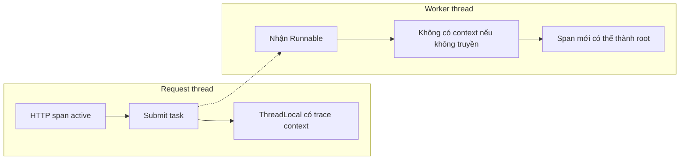
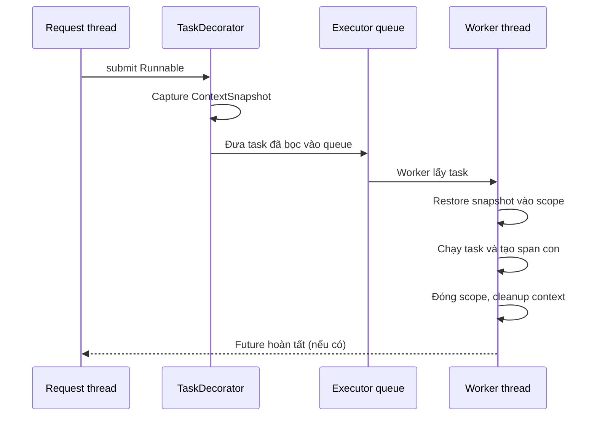

# Truyền trace context qua executor tùy chỉnh

## 1. Vấn đề: trace bị đứt khi công việc đổi thread

Trong ứng dụng Spring Boot dùng **Spring Modulith**, một request có thể đi qua module `order` rồi gửi một công việc sang executor để module `payment` xử lý ở thread khác. Trên request thread, Micrometer Tracing đang có một span hiện hành; khi công việc chạy trên worker thread, ngữ cảnh đó thường được lưu ở `ThreadLocal` của thread ban đầu và **không tự chuyển sang thread mới**.

Kết quả có thể là:

- Span của request và span module `payment` có hai trace ID khác nhau.
- Span mới trở thành root span, không có quan hệ cha–con như mong đợi.
- Log trên worker thread không có trace/span ID để liên kết với request.
- Nếu dùng thread pool, dữ liệu context cũ có nguy cơ rò sang tác vụ tiếp theo nếu khôi phục/cleanup không đúng.

**Context propagation** giải quyết việc mang ngữ cảnh đang hoạt động qua ranh giới thực thi. Bài này tập trung vào executor do ứng dụng tự cấu hình, với **Micrometer Context Propagation** và `ContextPropagatingTaskDecorator` của Spring Framework. Đây là kỹ năng quan trọng trong chương **Context propagation** của **SPRING_MODULITH_DOCUMENTATION_OBSERVABILITY**: kết hợp module graph, Actuator, event metrics, tracing và context propagation để kiểm chứng tương tác giữa các application module khi hệ thống chạy.

Sau bài học, bạn có thể:

1. Giải thích vì sao trace context dạng ThreadLocal không tự theo một task sang thread pool.
2. Cấu hình `ThreadPoolTaskExecutor` có `ContextPropagatingTaskDecorator`.
3. Dùng executor đó với `CompletableFuture` hoặc `@Async` để giữ trace context.
4. Hiểu cơ chế capture, restore và cleanup của `ContextSnapshot`.
5. Kiểm tra quan hệ span cha–con và chẩn đoán khi custom executor vẫn làm trace bị tách.

## 2. Trace context chứa những gì?

Một trace thường chứa:

| Thành phần | Ý nghĩa |
| --- | --- |
| `traceId` | Định danh trace xuyên suốt một hành trình xử lý |
| `spanId` | Định danh một đoạn công việc |
| `parentSpanId` | Xác định span cha, nếu có |
| Baggage | Dữ liệu ngữ cảnh được truyền cùng trace theo chính sách cấu hình |
| Observation scope | Ngữ cảnh observation/span hiện hành trong đoạn code đang thực thi |

Micrometer Tracing tích hợp với Micrometer Observation. Khi một span được mở trong thread, bridge tracing giữ thông tin span hiện hành trong context phù hợp (thường có cơ chế ThreadLocal accessor). Các lời gọi đồng bộ tiếp theo có thể tạo span con từ context đó.

Nhưng ThreadLocal thuộc **từng thread**:



Một thread pool tái sử dụng worker thread cho nhiều task. Chỉ copy một vài giá trị ID vào biến toàn cục hoặc ThreadLocal tùy tiện không đủ: cần khôi phục context đúng lúc chạy và dọn context sau khi task kết thúc.

## 3. Micrometer Context Propagation hoạt động ra sao?

Thư viện **Micrometer Context Propagation** cung cấp các thành phần:

| Thành phần | Vai trò |
| --- | --- |
| `ThreadLocalAccessor` | Mô tả cách đọc, đặt và xóa một loại ThreadLocal context |
| `ContextRegistry` | Đăng ký các accessor để thư viện biết context nào có thể capture/restore |
| `ContextSnapshotFactory` | Tạo snapshot từ các context đã đăng ký |
| `ContextSnapshot` | Lưu snapshot của context tại thời điểm capture và có thể áp dụng vào thread khác |
| `ContextPropagatingTaskDecorator` | Spring decorator dùng cơ chế context propagation để bọc task được submit |

Quy trình:

1. **Capture:** tại thread submit, snapshot đọc context hiện hành thông qua các accessor đã đăng ký.
2. **Schedule:** task được đưa vào executor.
3. **Restore:** trước khi task chạy trên worker, snapshot đặt các context đã capture vào worker thread.
4. **Execute:** code chạy với trace/observation context đã được khôi phục.
5. **Cleanup:** khi task kết thúc, scope được đóng và trạng thái context trước đó của worker được phục hồi/xóa theo accessor.



**Không phải mọi ThreadLocal đều tự được truyền.** Chỉ những context có `ThreadLocalAccessor` đăng ký trong `ContextRegistry` (hoặc context được truyền qua cơ chế tương ứng) mới nằm trong snapshot. Tracing integration thường đăng ký accessor cần thiết cho trace context; context tự định nghĩa của ứng dụng phải được đăng ký rõ ràng. Việc truyền SecurityContext, locale hoặc MDC còn phụ thuộc integration/accessor tương ứng.

## 4. Cấu hình executor tùy chỉnh với Spring Framework

`ContextPropagatingTaskDecorator` có trong **Spring Framework 6.1 trở lên**. Với Spring Boot 3.2+ (dùng Framework 6.1+) có thể cấu hình một `ThreadPoolTaskExecutor` riêng:

```java
package com.example.shop.config;

import org.springframework.context.annotation.Bean;
import org.springframework.context.annotation.Configuration;
import org.springframework.core.task.support.ContextPropagatingTaskDecorator;
import org.springframework.scheduling.concurrent.ThreadPoolTaskExecutor;

@Configuration(proxyBeanMethods = false)
class AsyncExecutorConfiguration {

    @Bean("traceAwareExecutor")
    ThreadPoolTaskExecutor traceAwareExecutor() {
        var executor = new ThreadPoolTaskExecutor();
        executor.setCorePoolSize(4);
        executor.setMaxPoolSize(8);
        executor.setQueueCapacity(200);
        executor.setThreadNamePrefix("trace-aware-");
        executor.setTaskDecorator(new ContextPropagatingTaskDecorator());
        return executor;
    }
}
```

Spring quản lý lifecycle của bean và khởi tạo `ThreadPoolTaskExecutor` sau khi cấu hình. Không cần gọi `initialize()` thủ công trong phương thức tạo bean.

Giải thích:

- `traceAwareExecutor` là tên bean để service có thể chọn đúng executor.
- `corePoolSize`, `maxPoolSize` và `queueCapacity` là tham số vận hành của pool; cần chọn theo tải và khả năng của dependency.
- `threadNamePrefix` giúp nhận diện worker thread trong log.
- `ContextPropagatingTaskDecorator` bọc task để capture context khi submit và khôi phục nó khi thực thi.

**Chỉ những task thực sự đi qua executor này mới được decorator áp dụng.** Nếu ứng dụng còn dùng một executor khác, `ForkJoinPool.commonPool()`, `new Thread(...)` hoặc thư viện tự tạo thread, chúng không tự động được bao phủ bởi bean trên.

### 4.1. Dùng với CompletableFuture

Giả sử module `order` cần thực thi một thao tác ở module `payment` bằng worker thread:

```java
package com.example.shop.order;

import com.example.shop.payment.PaymentService;
import java.util.UUID;
import java.util.concurrent.CompletableFuture;
import java.util.concurrent.Executor;
import org.springframework.beans.factory.annotation.Qualifier;
import org.springframework.stereotype.Service;

@Service
public class OrderWorkflow {

    private final PaymentService payment;
    private final Executor traceAwareExecutor;

    public OrderWorkflow(
            PaymentService payment,
            @Qualifier("traceAwareExecutor") Executor traceAwareExecutor) {
        this.payment = payment;
        this.traceAwareExecutor = traceAwareExecutor;
    }

    public CompletableFuture<Void> authorizeAsync(UUID orderId) {
        return CompletableFuture.runAsync(
            () -> payment.authorize(orderId),
            traceAwareExecutor
        );
    }
}
```

Vì `CompletableFuture.runAsync(..., traceAwareExecutor)` gọi executor đã cấu hình decorator, context được capture ở lúc submit và khôi phục trước khi lambda chạy. Lời gọi `payment.authorize(...)` vẫn đi qua Spring bean được inject, nên instrumentation module của Spring Modulith có thể tạo span tương ứng dưới context được truyền.

Không bỏ đối số executor:

```java
// Không dùng executor trace-aware: task mặc định chạy trên common pool.
CompletableFuture.runAsync(() -> payment.authorize(orderId));
```

Nếu chuỗi có bước async tiếp theo, cũng truyền executor tường minh:

```java
return CompletableFuture
    .runAsync(() -> payment.authorize(orderId), traceAwareExecutor)
    .thenRunAsync(() -> inventory.reserve(orderId), traceAwareExecutor);
```

Ở đây hai task có thể chạy trên hai worker khác nhau. Task thứ hai cần được capture/restore context từ nơi nó được schedule theo cách CompletableFuture thực thi continuation và executor được chỉ định; kiểm chứng trace thực tế thay vì giả định mọi continuation tự mang context.

### 4.2. Dùng với @Async

Nếu muốn Spring proxy điều phối phương thức bất đồng bộ:

```java
package com.example.shop.config;

import org.springframework.context.annotation.Configuration;
import org.springframework.scheduling.annotation.EnableAsync;

@Configuration(proxyBeanMethods = false)
@EnableAsync
class AsyncConfiguration {
}
```

Phương thức async:

```java
package com.example.shop.payment;

import java.util.UUID;
import java.util.concurrent.CompletableFuture;
import org.springframework.scheduling.annotation.Async;
import org.springframework.stereotype.Service;

@Service
public class PaymentAsyncService {

    @Async("traceAwareExecutor")
    public CompletableFuture<Void> authorize(UUID orderId) {
        // Xử lý thanh toán trên executor traceAwareExecutor.
        return CompletableFuture.completedFuture(null);
    }
}
```

Các điều kiện quan trọng:

- Phương thức phải được gọi qua Spring proxy (thường là public method trên bean khác).
- Executor được chỉ định bằng `@Async("traceAwareExecutor")` phải là executor đã có decorator.
- Không tự gọi `this.authorize(...)` trong cùng bean rồi mong @Async/proxy được áp dụng.
- Nếu dùng `@Async` mà không chỉ định tên executor, Spring sẽ chọn executor theo quy tắc cấu hình; phải xác minh nó có phải executor được trang bị decorator hay không.

## 5. Cách truyền context tường minh bằng ContextSnapshot

Khi không sử dụng `ThreadPoolTaskExecutor` hoặc cần bọc một task cụ thể, có thể dùng trực tiếp API Micrometer Context Propagation:

```java
import io.micrometer.context.ContextSnapshot;
import io.micrometer.context.ContextSnapshotFactory;
import java.util.concurrent.Executor;

public void submitWithContext(Executor executor, Runnable task) {
    ContextSnapshotFactory snapshotFactory =
        ContextSnapshotFactory.builder().build();

    ContextSnapshot snapshot = snapshotFactory.captureAll();
    executor.execute(snapshot.wrap(task));
}
```

Đoạn code:

1. Tạo factory dùng các accessor đã đăng ký.
2. Capture context **trên thread hiện tại**, trước khi submit.
3. `snapshot.wrap(task)` trả về task đã bọc; khi chạy sẽ áp dụng context vào thread thực thi và đóng scope sau khi hoàn thành.

Factory có thể được tạo một lần và tái sử dụng thay vì tạo cho từng task. Trong Spring Boot, ưu tiên registry/context infrastructure do framework quản lý và chỉ tạo factory theo cấu hình tương thích với ứng dụng. Không tạo một `ContextRegistry` riêng trống rồi kỳ vọng nó biết trace context của Micrometer Tracing.

### 5.1. ContextSnapshot không tự khám phá mọi ThreadLocal

Nếu ứng dụng có context riêng:

```java
private static final ThreadLocal<String> TENANT =
    new ThreadLocal<>();
```

chỉ gọi `captureAll()` không bảo đảm `TENANT` được ghi nhận. Cần định nghĩa và đăng ký một `ThreadLocalAccessor<String>` với `ContextRegistry` mà snapshot factory sử dụng. Accessor phải mô tả chính xác cách lấy, đặt và **xóa** giá trị; cleanup đặc biệt quan trọng khi worker thread được tái sử dụng.

Đừng đăng ký ThreadLocal chứa token bí mật, dữ liệu cá nhân hoặc toàn bộ request object nếu không thực sự cần truyền chúng. Context propagation có thể làm dữ liệu tồn tại lâu hơn và đi xa hơn dự kiến.

## 6. Kiểm tra trace context đã được truyền

### 6.1. Cấu hình tracing để quan sát

Context propagation chỉ chuyển ngữ cảnh; để xem trace cần tracer, exporter và backend. Ví dụ cấu hình phát triển với Spring Boot 3.2+ dùng Micrometer Tracing và OTLP:

```groovy
dependencies {
    implementation "org.springframework.boot:spring-boot-starter-actuator"
    implementation "io.micrometer:micrometer-tracing-bridge-otel"
    runtimeOnly "io.opentelemetry:opentelemetry-exporter-otlp"
}
```

Ví dụ `application.yml`:

```yaml
spring:
  application:
    name: shop-modulith

management:
  tracing:
    sampling:
      probability: 1.0
  otlp:
    tracing:
      endpoint: http://localhost:4318/v1/traces
```

Đây là cấu hình mẫu cho môi trường local với OTLP/HTTP và backend tương thích đang lắng nghe cổng 4318. Cấu hình endpoint/transport phụ thuộc exporter và backend; nếu dùng Zipkin hoặc cấu hình Boot khác, thay dependency/property theo tài liệu phiên bản đó. Sampling `1.0` chỉ nên dùng khi thử nghiệm; production cần sampling phù hợp lưu lượng và chi phí.

Nếu ứng dụng đã có tracing qua starter/observability stack của tổ chức, không thêm một bridge/exporter thứ hai trùng lặp. Spring Modulith Insight có thể bổ sung module instrumentation, còn Micrometer Tracing exporter vẫn là phần cấu hình riêng.

### 6.2. Trace trước và sau khi có decorator

Một kết quả **minh họa** khi không truyền context:

```text
Trace A: HTTP POST /orders
└── module order: OrderWorkflow.authorizeAsync

Trace B: (root mới trên worker)
└── module payment: PaymentService.authorize
```

Sau khi dùng executor có `ContextPropagatingTaskDecorator`:

```text
Trace A: HTTP POST /orders
└── module order: OrderWorkflow.authorizeAsync
    └── module payment: PaymentService.authorize
```

Trong kết quả mong đợi:

- Span của module `payment` có cùng `traceId` với trace ban đầu.
- `parentSpanId` trỏ tới span hiện hành được capture khi task được submit (hoặc span task trung gian nếu ứng dụng chủ động tạo một observation riêng).
- `spanId` của payment là ID riêng.
- Worker thread có tên như `trace-aware-1`, nhưng thread name không phải bằng chứng propagation thành công.

Nếu task bắt đầu sau khi request/parent span đã kết thúc, child span có thể **bắt đầu sau thời điểm span cha đóng**. Trace ID và quan hệ cha vẫn có thể được giữ, nhưng thời gian parent không bao trùm task; không diễn giải parent duration là tổng thời gian xử lý async. Với công việc dài hạn, độc lập về thời gian, cân nhắc mô hình trace riêng và span link thay vì ép quan hệ cha–con không phản ánh đúng vòng đời nghiệp vụ.

### 6.3. Một cách kiểm chứng có hệ thống

1. Gọi một API tạo span gốc, sau đó submit task sang `traceAwareExecutor`.
2. Từ worker, gọi một Spring bean API module đã được Modulith instrument.
3. Tìm trace trong backend theo service và thời gian.
4. Kiểm tra trace ID có giống giữa request và module span hay không.
5. Kiểm tra span ID/parent span ID, thời gian bắt đầu/kết thúc và trạng thái lỗi.
6. Gửi một task **không** qua executor decorated để đối chiếu kết quả.
7. Chạy nhiều task liên tiếp trên cùng pool để chắc chắn context của task trước không rò sang task sau.

Một kiểm thử log có thể in thông tin trace hiện hành ở đầu task để hỗ trợ điều tra, nhưng log không thay thế kiểm tra cây span tại backend.

## 7. Thread pool, context cleanup và các lỗi thường gặp

| Triệu chứng | Nguyên nhân khả dĩ | Cách kiểm tra |
| --- | --- | --- |
| Worker span thành trace mới | Task chạy trên executor không được decorate | Kiểm tra qualifier, tên executor, overload CompletableFuture |
| Có traceId nhưng thiếu parent như mong đợi | Capture sai thời điểm hoặc context bị thay trong lúc schedule | Capture trên thread submit, xem span hiện hành khi submit |
| Task đầu có trace, task kế thừa trace cũ | Accessor/decorator không restore hoặc cleanup đúng | Kiểm tra accessor, scope close và tái sử dụng cùng worker |
| `@Async` không truyền context | Spring chọn executor khác hoặc self-invocation bỏ qua proxy | Kiểm tra executor resolution và lời gọi qua bean |
| Một continuation mất trace | Dùng `thenApplyAsync`/`thenRunAsync` với common pool hoặc executor khác | Truyền decorated executor cho từng async continuation |
| Custom ThreadLocal không được truyền | Chưa đăng ký `ThreadLocalAccessor` | Đăng ký accessor với đúng ContextRegistry |
| Trace vẫn không thấy trên backend | Sampling, exporter endpoint, backend hoặc instrumentation lỗi | Kiểm tra log exporter và cấu hình tracing |
| Async span kéo dài sau span cha | Task hoàn thành sau khi request đã kết thúc | Phân tích thời gian thực và cân nhắc span link/mô hình trace riêng |

### 7.1. Không dùng ThreadLocal thủ công để chép trace ID

Một cách làm sai thường gặp:

```java
// KHÔNG NÊN: chỉ sao chép chuỗi ID, không khôi phục toàn bộ tracing scope.
String traceId = currentTraceId();
executor.execute(() -> {
    TRACE_ID.set(traceId);
    payment.authorize();
});
```

Cách này không đảm bảo span hiện hành, parent span, baggage, sampling state hoặc cleanup được duy trì. Nó còn có thể để lại giá trị trên worker sau khi task kết thúc. Dùng Micrometer Context Propagation để truyền **context có cấu trúc**, không tự tạo một cơ chế trace riêng dựa trên một chuỗi ID.

### 7.2. Context propagation không đồng nghĩa với transaction propagation

Truyền trace context không mang transaction database sang worker thread. Một transaction Spring thường gắn với thread/transaction manager; task bất đồng bộ cần transaction riêng nếu cần. Với `@ApplicationModuleListener` của Spring Modulith, listener được thực thi theo ngữ nghĩa transaction riêng sau khi transaction phát event commit. Không giả định việc có cùng trace ID nghĩa là cùng transaction, cùng EntityManager hoặc cùng security context.

Tương tự, truyền trace context không tự truyền toàn bộ request scope, MDC, security principal hay locale. Mỗi loại context cần accessor/integration và chính sách riêng.

## 8. Kết hợp với Spring Modulith và event listener

Spring Modulith instrument lời gọi vào các Spring component thuộc API module. Nếu một module gửi công việc qua executor tùy chỉnh, decorator giúp trace context tiếp tục hiện diện khi worker gọi API module khác.

Với listener bất đồng bộ, ví dụ `@ApplicationModuleListener`:

```java
package com.example.shop.inventory;

import com.example.shop.order.OrderPlaced;
import org.springframework.modulith.events.ApplicationModuleListener;
import org.springframework.stereotype.Component;

@Component
class InventoryOnOrderPlaced {

    @ApplicationModuleListener
    void on(OrderPlaced event) {
        // Xử lý giữ hàng sau khi transaction phát event commit.
    }
}
```

Để giữ trace context cho listener, cần xác định **executor thực tế** mà cơ chế async của listener sử dụng và bảo đảm executor đó được cấu hình propagation tương ứng. Việc chỉ khai báo `traceAwareExecutor` không có nghĩa mọi listener của Spring Modulith tự động chuyển sang dùng nó. Cách chọn executor và hook cấu hình phụ thuộc phiên bản Spring Modulith/Spring Framework; kiểm tra cấu hình event publication/async hiện tại trước khi thay đổi.

Nếu publisher và listener cách nhau một khoảng thời gian, publication được resubmit sau restart hoặc xử lý trên instance khác, context có thể được khôi phục theo trace propagation của transport/registry hoặc một trace mới. Không mặc định một lần retry nhiều phút sau luôn là child span đồng bộ của HTTP request ban đầu. Có thể dùng event ID trong log/trace có kiểm soát để tương quan các attempt.

### 8.1. Executor nào được decorate?

| Nơi chạy task | Có được bảo vệ bởi bean `traceAwareExecutor` ở ví dụ? | Cần làm gì |
| --- | --- | --- |
| `CompletableFuture.runAsync(task, traceAwareExecutor)` | Có | Xác nhận task thật sự dùng bean đó |
| `@Async("traceAwareExecutor")` | Có | Bật async và gọi qua Spring proxy |
| `CompletableFuture.runAsync(task)` | Không | Truyền executor decorated |
| `@Async` không chỉ định executor | Chưa chắc | Xác minh executor được Spring chọn |
| `new Thread(task).start()` | Không | Tránh tự tạo thread; dùng executor được quản lý |
| `ForkJoinPool.commonPool()` | Không | Cung cấp executor decorated cho async continuation |
| Spring Modulith async event listener | Phụ thuộc cấu hình thực tế | Cấu hình executor mà listener thực sự sử dụng |

## 9. Bảo mật, hiệu năng và vận hành

- **Sampling:** propagation có thể đúng nhưng trace vẫn không được lưu nếu trace bị sampling loại. Sampling không phải là dấu hiệu propagation lỗi.
- **Chi phí:** context snapshot và restore có chi phí nhỏ trên mỗi task; tránh tạo executor/snapshot factory mới không cần thiết cho từng request.
- **Thread pool:** chọn queue và kích thước pool theo thời gian xử lý, độ trễ dependency và khả năng shutdown; queue quá lớn có thể giữ task/context lâu.
- **Context tối thiểu:** chỉ truyền dữ liệu cần cho việc tracing/diagnostics; không truyền nguyên request, payload lớn hoặc credential.
- **Cleanup:** luôn dùng cơ chế scope/wrapper có đóng tự động; không tự set ThreadLocal rồi quên remove.
- **Log correlation:** trace ID/span ID hữu ích để nối log và trace, nhưng không nên đưa chúng vào Prometheus tag.
- **Transaction:** quản lý riêng; propagation không tự chuyển transaction sang worker.

## 10. Checklist thực hành

- [ ] Xác định đúng thread/executor nơi task được submit và nơi task thực thi.
- [ ] Dùng Spring Framework 6.1+ có `ContextPropagatingTaskDecorator`.
- [ ] Cấu hình `ThreadPoolTaskExecutor` và đặt decorator trước khi executor khởi tạo.
- [ ] Dùng đúng bean executor qua `@Qualifier`, `@Async` hoặc tham số executor của `CompletableFuture`.
- [ ] Hiểu capture xảy ra khi submit và restore/cleanup diễn ra quanh task trên worker.
- [ ] Không giả định mọi ThreadLocal tự được truyền; custom context cần `ThreadLocalAccessor`.
- [ ] Có tracing bridge, exporter và backend; sampling phù hợp khi thử nghiệm.
- [ ] Kiểm tra cùng traceId, spanId riêng và parentSpanId hợp lý trên trace.
- [ ] Chạy nhiều task trên cùng worker pool để kiểm tra context không rò sang task tiếp theo.
- [ ] Phân biệt trace propagation với transaction, security context và event publication lifecycle.
- [ ] Xác minh executor thật sự được Spring Modulith async listener sử dụng trước khi kết luận propagation đã áp dụng.

## Tài liệu tham khảo

- [Micrometer Context Propagation — Reference](https://docs.micrometer.io/context-propagation/reference/): `ContextRegistry`, `ThreadLocalAccessor`, `ContextSnapshot` và cách capture/restore.
- [Spring Framework — ContextPropagatingTaskDecorator Javadoc](https://docs.spring.io/spring-framework/docs/current/javadoc-api/org/springframework/core/task/support/ContextPropagatingTaskDecorator.html): decorator cho task execution.
- [Spring Framework — Task Execution and Scheduling](https://docs.spring.io/spring-framework/reference/integration/scheduling.html): `TaskExecutor`, `TaskDecorator`, `@Async` và executor configuration.
- [Spring Boot — Tracing](https://docs.spring.io/spring-boot/reference/actuator/tracing.html): Micrometer Tracing, sampling, propagation và exporter.
- [Spring Modulith — Production-ready Features](https://docs.spring.io/spring-modulith/reference/production-ready.html): module invocation spans và observability.
- [Spring Modulith — Working with Application Events](https://docs.spring.io/spring-modulith/reference/events.html): `@ApplicationModuleListener`, xử lý bất đồng bộ và publication registry.
