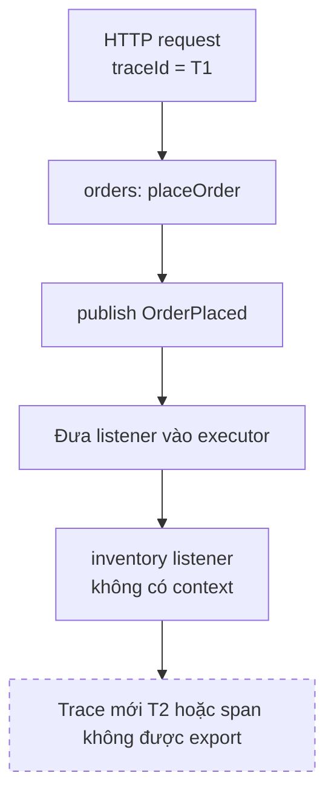
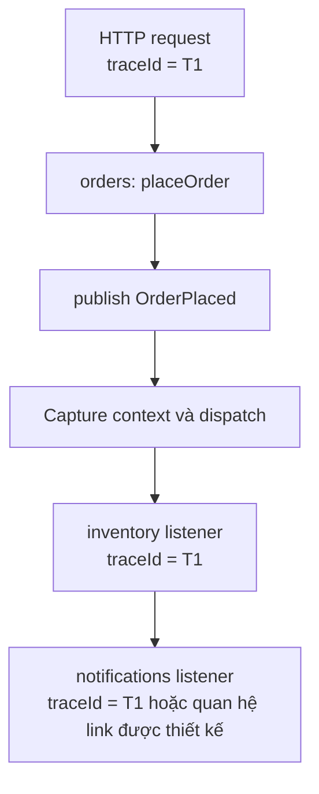
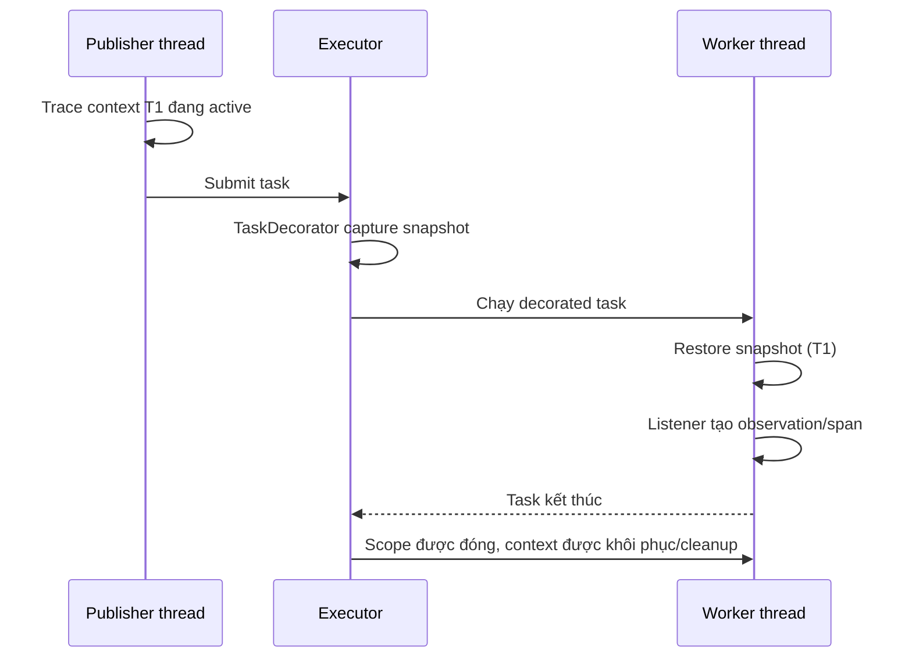
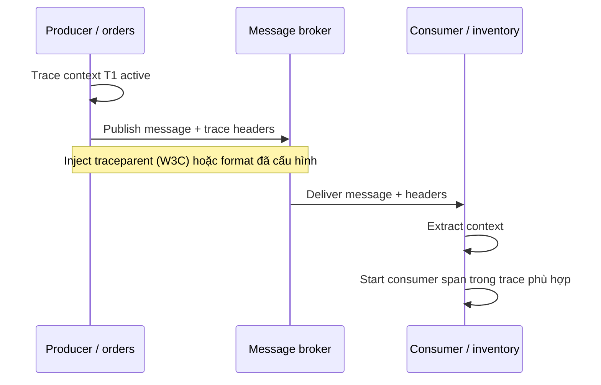

# Mất context và trace bị tách rời

## 1. Vấn đề trong ứng dụng Spring Modulith

Trong ứng dụng Spring Boot sử dụng **Spring Modulith**, một yêu cầu nghiệp vụ có thể đi qua nhiều application module. Ví dụ, request tạo đơn hàng vào module `orders`, phát domain event `OrderPlaced`, rồi module `inventory` giữ hàng và module `notifications` gửi thông báo. Khi tất cả thao tác chạy đồng bộ trên cùng thread, tracing thường có thể liên kết các span trong một trace. Nhưng nếu listener chuyển sang executor khác, chạy bằng `@Async`, Reactor hoặc message broker, **context có thể không đi theo công việc**.

Triệu chứng thường thấy:

- Log ở publisher có `traceId` nhưng log ở listener không có.
- Trace HTTP kết thúc sau khi phát event; listener xuất hiện như một trace mới hoặc không có span liên quan.
- Các span của module `inventory`/`notifications` không có quan hệ cha-con hoặc link như mong đợi.
- Không thể lần theo một request từ module phát event đến module nhận event dù nghiệp vụ vẫn hoàn thành.

Đây là vấn đề **context propagation**. Context chứa dữ liệu gắn với quá trình xử lý hiện tại, chẳng hạn trace/span đang hoạt động, baggage và MDC. Khi luồng thực thi đổi thread hoặc vượt qua ranh giới tiến trình, cần một cơ chế chuyển context có chủ đích.

Bài học thuộc chương **Context propagation** của module **SPRING_MODULITH_DOCUMENTATION_OBSERVABILITY**. Mục tiêu là hiểu vì sao mất context làm trace bị tách rời, cách truyền context qua executor và các phương tiện bất đồng bộ, cách kiểm tra bằng module spans, logging và tracing backend, đồng thời phân biệt context observability với transaction/security context.

Sau bài học, bạn có thể:

- Giải thích sự khác nhau giữa trace context, MDC, Reactor Context và ThreadLocal.
- Nhận diện những ranh giới dễ làm mất context: `@Async`, executor, event multicaster, CompletableFuture, Reactor và message broker.
- Cấu hình `ContextPropagatingTaskDecorator` cho đúng executor và kiểm tra lời gọi thực sự dùng executor đó.
- Hiểu inject/extract trace context qua message headers và giới hạn của việc truyền context giữa các tiến trình.
- Chẩn đoán trace bị tách, span thiếu `traceId` và log không có correlation.
- Đối chiếu trace với module graph và event metrics để tránh kết luận sai về hành vi nghiệp vụ.

## 2. Context và trace context gồm những gì?

**Context** là tập thông tin đi kèm với một đơn vị thực thi. Trong observability, context có thể chứa:

| Thành phần | Ý nghĩa | Ví dụ |
| --- | --- | --- |
| `traceId` | Định danh toàn bộ hành trình được tracing liên kết. | Một request đặt hàng cùng các thao tác con được liên kết. |
| `spanId` | Định danh một span cụ thể trong trace. | Span xử lý `inventory.reserve(...)`. |
| Parent/span relationship | Thể hiện quan hệ giữa thao tác hiện tại và thao tác gọi nó. | Span listener là child hoặc được liên kết với span publisher theo mô hình tracing. |
| Baggage | Các giá trị ngữ cảnh được truyền qua các ranh giới theo cấu hình propagator. | Một mã vùng hoặc tenant đã được cho phép sử dụng. |
| MDC | Các key-value gắn với logging framework để chèn vào log. | `traceId`, `spanId` trong log pattern. |
| Observation context | Context của Micrometer Observation, chứa metadata cho observation handler. | Module identifier, operation name. |

Các thành phần này liên quan nhưng không đồng nhất. `traceId`/`spanId` thuộc tracing; MDC là cơ chế hỗ trợ logging; Micrometer Observation có context và handlers riêng. Một hệ thống tích hợp có thể ánh xạ trace context vào MDC, nhưng việc MDC còn hay mất không phải bằng chứng duy nhất cho việc trace context đã được truyền đúng.

### 2.1. Vì sao ThreadLocal gây khó khăn khi đổi thread?

Nhiều thư viện lưu ngữ cảnh hiện tại trong **ThreadLocal**. ThreadLocal gắn giá trị với một thread cụ thể:

```text
Thread A:
  current trace = traceId 7ab...
  MDC:
    traceId = 7ab...

Thread B:
  current trace = (không có context được truyền)
  MDC:
    (trống hoặc chứa giá trị khác)
```

Khi công việc được chuyển từ Thread A sang Thread B, ThreadLocal của A không tự xuất hiện ở B. Thread B có thể là một worker được tái sử dụng từ thread pool; nếu ứng dụng tự ghi ThreadLocal mà không dọn dẹp đúng cách, dữ liệu của tác vụ trước thậm chí có thể rò sang tác vụ sau.

**Không nên tự sao chép một vài key MDC bằng tay rồi xem đó là truyền trace context đầy đủ.** Trace context còn có sampling state, parent/span relationship, baggage và các thành phần do tracer quản lý. Hãy dùng integration của Micrometer Tracing/Context Propagation để capture, restore và cleanup context.

### 2.2. Trace bị tách rời trông như thế nào?



Nếu context được truyền đúng, listener có thể tiếp tục trace gốc:



Đây là sơ đồ khái niệm. Với xử lý bất đồng bộ, việc mô hình hóa quan hệ bằng child span hay span link tùy semantics, instrumentation và transport; không phải mọi listener đều phải là child span trực tiếp của HTTP span. Mục tiêu là bảo toàn **mối liên hệ trace có ý nghĩa**, không ép tất cả công việc bất đồng bộ thành một cây span giả tạo.

## 3. Những ranh giới thường làm mất context

| Ranh giới | Vì sao dễ mất context? | Dấu hiệu |
| --- | --- | --- |
| `@Async` | Method được thực thi trên executor thread khác. | Listener log thiếu correlation ID hoặc span có trace ID mới. |
| `ExecutorService.submit(...)` | Runnable/Callable được đưa vào thread pool không tự capture ThreadLocal. | Task con không nối được với trace của request. |
| `CompletableFuture.*Async(...)` | Overload mặc định có thể dùng common pool; không nhất thiết là executor được cấu hình. | Trace đứt khi qua stage async. |
| `SimpleApplicationEventMulticaster` với executor | Listener được dispatch sang executor thay vì chạy trên publisher thread. | Publisher có trace, listener không có. |
| Reactor scheduler/operator | Reactor dùng Reactor Context; việc đổi thread không giống cơ chế ThreadLocal thuần. | Context có ở một operator nhưng mất khi tích hợp imperative/reactive. |
| Message broker / HTTP sang service khác | ThreadLocal không thể tự đi qua network/process boundary. | Consumer tạo trace mới hoặc không có parent/link tới producer. |
| Scheduled/background job | Không có request context ban đầu hoặc job chạy độc lập. | Không có trace ID request để kế thừa; cần root trace cho job hoặc correlation riêng. |

**Không phải mọi bất đồng bộ đều là lỗi.** Một background job độc lập có thể cần trace root riêng. Một message xử lý sau nhiều phút có thể được mô hình hóa bằng span link thay vì giữ một trace request mở quá lâu. Quan trọng là thiết kế correlation rõ ràng và quan sát được quan hệ giữa các công việc.

## 4. Micrometer Context Propagation giải quyết điều gì?

**Micrometer Context Propagation** cung cấp cơ chế capture, lưu trữ và khôi phục context giữa các vùng thực thi. Thư viện có thể làm việc với:

- **ThreadLocal values** thông qua `ThreadLocalAccessor`.
- **Reactor Context** thông qua tích hợp Reactor tương ứng.
- **ContextSnapshot** để capture context hiện hành và khôi phục trong lúc chạy một tác vụ khác.
- **ContextRegistry** để đăng ký các accessor được phép truyền.

Spring Framework cung cấp `ContextPropagatingTaskDecorator` để kết hợp cơ chế này với task execution. Decorator chụp context khi task được submit và khôi phục context trong lúc task chạy, sau đó trả trạng thái thread về đúng phạm vi của nó.



Decorator **không tự tạo tracing backend** và không tự instrument mọi thư viện. Nó chỉ giúp truyền context mà Micrometer đã đăng ký accessor. Để có trace, ứng dụng vẫn cần Micrometer Tracing, tracer bridge, exporter và cấu hình sampling phù hợp.

## 5. Truyền context qua @Async và executor

### 5.1. Cấu hình một executor có ContextPropagatingTaskDecorator

Ví dụ Spring Boot servlet application dùng Spring Framework có `ContextPropagatingTaskDecorator`:

```java
import org.springframework.context.annotation.Bean;
import org.springframework.context.annotation.Configuration;
import org.springframework.core.task.TaskDecorator;
import org.springframework.core.task.support.ContextPropagatingTaskDecorator;
import org.springframework.scheduling.annotation.EnableAsync;
import org.springframework.scheduling.concurrent.ThreadPoolTaskExecutor;

@Configuration(proxyBeanMethods = false)
@EnableAsync
class AsyncExecutionConfiguration {

    @Bean("contextAwareExecutor")
    ThreadPoolTaskExecutor contextAwareExecutor() {
        var executor = new ThreadPoolTaskExecutor();
        executor.setCorePoolSize(4);
        executor.setMaxPoolSize(8);
        executor.setQueueCapacity(100);
        executor.setThreadNamePrefix("module-async-");
        executor.setTaskDecorator(new ContextPropagatingTaskDecorator());
        return executor;
    }
}
```

Bean được Spring quản lý vòng đời; `ThreadPoolTaskExecutor` sẽ được khởi tạo và shutdown theo lifecycle của context. `ContextPropagatingTaskDecorator` capture/restore context khi executor chạy task.

### 5.2. Dùng đúng executor trong listener

Ví dụ listener Spring:

```java
import org.springframework.scheduling.annotation.Async;
import org.springframework.context.event.EventListener;
import org.springframework.stereotype.Component;

@Component
class InventoryListener {

    @Async("contextAwareExecutor")
    @EventListener
    public void on(OrderPlaced event) {
        // Giữ hàng bất đồng bộ.
        // Trace/log context được decorator truyền nếu có context lúc submit.
    }
}
```

Điểm cần xác nhận:

1. Method được gọi qua Spring proxy; self-invocation trong cùng bean không kích hoạt `@Async` theo proxy mode thông thường.
2. Tên executor trong `@Async("contextAwareExecutor")` khớp với bean đã khai báo.
3. Executor thực sự được dùng bởi listener; chỉ khai báo một bean decorator nhưng listener lại dùng executor khác sẽ không giúp ích.
4. Ứng dụng có Micrometer Tracing/context accessors đã được đăng ký; decorator không thể truyền một context mà không có accessor tương ứng.
5. Kiểm tra cleanup khi task kết thúc để không rò context sang tác vụ tiếp theo trong pool.

Với Spring Modulith, listener có thể dùng `@ApplicationModuleListener` để thể hiện một application module listener có transaction/async semantics theo phiên bản. Nếu dùng annotation này, hãy cấu hình decorator trên **executor thực sự được chọn bởi cơ chế @Async của listener** (thường là executor mặc định hoặc executor do ứng dụng cung cấp). Không giả định bean `contextAwareExecutor` ở ví dụ được tự động chọn nếu annotation không chỉ định tên executor.

### 5.3. Dùng executor cho event multicaster

Một ứng dụng có thể cấu hình `SimpleApplicationEventMulticaster` để dispatch listener bằng executor. Trong trường hợp đó, task decorator phải gắn vào chính executor của multicaster:

```java
import org.springframework.context.annotation.Bean;
import org.springframework.context.annotation.Configuration;
import org.springframework.context.event.SimpleApplicationEventMulticaster;
import org.springframework.context.support.AbstractApplicationContext;
import org.springframework.core.task.support.ContextPropagatingTaskDecorator;
import org.springframework.scheduling.concurrent.ThreadPoolTaskExecutor;

@Configuration(proxyBeanMethods = false)
class EventMulticasterConfiguration {

    @Bean(name = AbstractApplicationContext.APPLICATION_EVENT_MULTICASTER_BEAN_NAME)
    SimpleApplicationEventMulticaster applicationEventMulticaster(
            ThreadPoolTaskExecutor contextAwareExecutor) {
        var multicaster = new SimpleApplicationEventMulticaster();
        multicaster.setTaskExecutor(contextAwareExecutor);
        return multicaster;
    }
}
```

Đây là một cấu hình thay thế cho trường hợp muốn dispatch application events qua executor; không cần thêm multicaster tùy chỉnh nếu ứng dụng không có nhu cầu đó. Khi thay multicaster mặc định, cần kiểm tra cả error handling, transaction event listener semantics, thứ tự thực thi và việc shutdown. Task decorator không làm cho event trở thành durable hoặc bảo đảm listener xử lý thành công.

## 6. CompletableFuture và các tác vụ nền

`CompletableFuture.supplyAsync(...)` không có executor chỉ định có thể dùng common ForkJoinPool. Nếu context propagation chỉ được cấu hình cho một `ThreadPoolTaskExecutor` của ứng dụng, task chạy trên common pool **không được hưởng decorator đó**.

Nên truyền executor đã cấu hình:

```java
CompletableFuture.supplyAsync(
    () -> inventoryService.reserve(orderId),
    contextAwareExecutor
);
```

Ở đây `contextAwareExecutor` là executor đã gắn `ContextPropagatingTaskDecorator`. Nếu dùng API khác để tự tạo task, có thể dùng `ContextSnapshotFactory`/cơ chế snapshot phù hợp của Micrometer Context Propagation để capture và wrap Runnable/Callable, nhưng phải đảm bảo scope được đóng đúng cách.

Đừng tự lưu một `traceId` dạng String rồi gán vào ThreadLocal tùy tiện. Việc đó có thể làm log trông giống có correlation nhưng tracer không biết parent span, sampling state hay baggage; đồng thời dễ để lại giá trị trên pooled thread. Hãy truyền **context của tracer** bằng integration đã hỗ trợ.

## 7. Reactor: context không chỉ là ThreadLocal

Reactor sử dụng **Reactor Context** để mang dữ liệu xuyên qua reactive chain. Một pipeline có thể chạy trên nhiều thread do `publishOn` hoặc `subscribeOn`, nhưng Reactor Context đi theo subscription thay vì phụ thuộc trực tiếp vào một thread duy nhất.

Vì thế:

- `ContextPropagatingTaskDecorator` dành cho task executor, không phải giải pháp duy nhất cho mọi Reactor operator.
- Tích hợp Micrometer Context Propagation có thể bridge giữa Reactor Context và ThreadLocal khi cấu hình chế độ phù hợp.
- Spring Boot có hỗ trợ cấu hình Reactor context propagation theo phiên bản; hãy kiểm tra property và default của dòng Boot đang dùng.
- Không nên dựa vào việc một log ở operator này có MDC để kết luận tất cả operator và callback ngoài Reactor đều giữ context.

Ví dụ khái niệm:

```java
Mono.deferContextual(contextView ->
    Mono.just("trace context is available through Reactor Context")
);
```

Đây là minh họa cách đọc Reactor Context, không tự tạo hoặc propagate trace headers. Với ứng dụng reactive, hãy dùng instrumentation Micrometer/Boot và cấu hình Reactor Context Propagation theo tài liệu đúng phiên bản.

## 8. Message broker và ranh giới giữa các tiến trình

ThreadLocal hoặc executor decorator chỉ hoạt động trong **cùng tiến trình**. Khi event được gửi qua Kafka, RabbitMQ hoặc broker khác, producer và consumer có thể chạy trên hai JVM khác nhau. Không thể truyền Java ThreadLocal qua network.

Cơ chế đúng là **inject/extract** trace context vào message headers:



Các nguyên tắc:

1. Chọn một propagator tương thích giữa producer, broker instrumentation và consumer, ví dụ **W3C Trace Context** với header `traceparent` và có thể `tracestate`.
2. Producer phải inject context đang active vào message headers.
3. Consumer phải extract headers trước khi tạo observation/span xử lý.
4. Kiểm tra thư viện messaging/instrumentation đã tự động làm việc này chưa; tránh inject thủ công trùng với auto-instrumentation.
5. Không đặt `userId`, token, email hoặc payload nhạy cảm vào baggage chỉ để thuận tiện debug.

Với message xử lý rất lâu sau khi producer hoàn tất, trace backend có thể phù hợp hơn khi biểu diễn quan hệ bằng **span link** thay vì giữ trace request mở và tạo một cây parent-child kéo dài không hợp lý. Cách mô hình hóa phụ thuộc semantics của hệ thống và instrumentation.

## 9. Vì sao log và trace có thể không khớp?

Khi điều tra, cần phân biệt các tình huống:

| Triệu chứng | Khả năng | Cách hiểu |
| --- | --- | --- |
| Log listener thiếu `traceId`, không có span listener | Context không được truyền, tracer chưa cấu hình hoặc listener không được instrument. | Chưa đủ bằng chứng listener không chạy. |
| Log có `traceId` giống publisher nhưng trace backend không có span | Chỉ MDC được copy thủ công, sampling/exporter lỗi hoặc span không được tạo. | Log correlation không thay thế trace context. |
| Listener có trace ID mới | Consumer không extract parent context, hoặc thiết kế job chủ động tạo root trace. | Kiểm tra headers và mô hình tracing mong muốn. |
| Trace ID giống nhau nhưng span không có quan hệ cha-con rõ | Parent context/span không được truyền đúng, hoặc backend hiển thị link/async relationship khác. | Xem span IDs, parent IDs, links và propagation state. |
| Thread pool xử lý tác vụ sau mang trace ID của request trước | ThreadLocal/MDC được đặt thủ công nhưng không cleanup. | Có nguy cơ context leakage giữa các request. |
| Publisher metric tăng nhưng không thấy listener trace | Metric đo publication; listener có thể chạy async, sampling hoặc thiếu propagation. | Dùng consumer metrics/logs và kiểm tra transport. |

### 9.1. Kiểm tra bằng chứng theo thứ tự

1. Xác nhận request đầu vào có trace/span và log correlation.
2. Kiểm tra publisher span và thời điểm dispatch task/message.
3. Xác định executor hoặc transport **thực tế** mà listener dùng.
4. Kiểm tra decorator/accessor hoặc inject/extract instrumentation có được áp dụng ở đúng ranh giới không.
5. Kiểm tra consumer span có trace ID, span ID, parent ID hoặc span link đúng mong đợi không.
6. Xem sampling/exporter/backend trước khi kết luận span bị mất.
7. Đối chiếu log, metric xử lý listener và trạng thái nghiệp vụ.

## 10. Thực hành với Spring Modulith: publisher và listener

Giả sử module `orders` phát `OrderPlaced` và module `inventory` tiếp nhận. Một cách triển khai thử nghiệm:

```java
// Event do module orders công bố.
public record OrderPlaced(UUID orderId) {}
```

```java
// Listener trong module inventory.
@Component
class InventoryListener {

    @Async("contextAwareExecutor")
    @EventListener
    public void on(OrderPlaced event) {
        // Gọi nghiệp vụ giữ hàng.
    }
}
```

Thực hiện kiểm chứng:

1. Cấu hình `spring-modulith-observability-core` hoặc Insight starter và tracing pipeline của Spring Boot.
2. Tạo executor có `ContextPropagatingTaskDecorator`; bảo đảm listener dùng executor này.
3. Gọi request tạo đơn và ghi lại trace ID ở publisher.
4. Tìm module entry span của listener `inventory`; kiểm tra `module.identifier=inventory`, `module.invocation-type` và `module.method` nếu instrumentation phiên bản đang dùng phát các tag này.
5. So sánh trace ID/parent relationship ở publisher và listener theo thiết kế; xem log listener có correlation tương ứng.
6. Tạm bỏ decorator trong môi trường thử nghiệm để so sánh hiện tượng, rồi bật lại và kiểm tra sự khác biệt. Không tắt context propagation trên môi trường production để thử.
7. Thử trường hợp listener lỗi; kiểm tra exception, metric kết quả xử lý và event publication counter. Không kết luận event được xử lý thành công chỉ vì publication counter tăng.

**Lưu ý:** Ví dụ `@Async("contextAwareExecutor")` + `@EventListener` là Spring async listener thông thường. Nếu dự án dùng `@ApplicationModuleListener` của Spring Modulith, annotation đó có async/transaction semantics theo phiên bản; hãy gắn decorator vào executor mà listener thực sự sử dụng. Không mặc định hai cách cấu hình chọn cùng executor.

## 11. Những điều ContextPropagatingTaskDecorator không làm

Context propagation thường bị hiểu quá rộng. Decorator:

- **Không tạo tracer hoặc exporter.** Cần Micrometer Tracing, bridge, exporter và backend riêng.
- **Không tự gửi context qua message broker hoặc HTTP.** Cần inject/extract headers và instrumentation cho transport.
- **Không bảo đảm mọi ThreadLocal được truyền.** Chỉ những context/accessor đã đăng ký mới được capture/restore theo integration.
- **Không mặc định truyền transaction, JPA EntityManager hoặc security context.** Các context đó có vòng đời và quy tắc an toàn riêng; cần cơ chế hỗ trợ rõ ràng, không sao chép tùy tiện.
- **Không bảo đảm listener thành công hoặc event được giao đúng một lần.** Đây là vấn đề event delivery, transaction, retry và idempotency.
- **Không biến mọi span async thành child span của request.** Cần mô hình quan hệ trace phù hợp với vòng đời công việc.

Việc propagate toàn bộ dữ liệu không chọn lọc có thể làm lộ thông tin hoặc tạo liên kết sai. Chỉ truyền context thực sự cần thiết, giữ thời gian sống hợp lý và cleanup sau khi task kết thúc.

## 12. Checklist trước khi triển khai

| Kiểm tra | Tiêu chí đạt |
| --- | --- |
| Tracing pipeline | Có Micrometer Tracing, tracer/exporter và backend được cấu hình. |
| Executor | Listener dùng đúng executor có TaskDecorator. |
| Proxy | Method async được gọi qua Spring proxy, không self-invocation. |
| Accessor | Context cần truyền đã được đăng ký và được integration hỗ trợ. |
| Thread cleanup | Context được khôi phục/cleanup sau mỗi task; không rò sang worker kế tiếp. |
| Event multicaster | Nếu dispatch async, decorator gắn đúng executor của multicaster. |
| Reactor | Sử dụng Reactor Context propagation phù hợp, không chỉ dựa vào ThreadLocal. |
| Broker/HTTP | Trace context được inject/extract qua headers theo propagator đã thống nhất. |
| Async relationship | Parent/child hoặc span links phản ánh đúng semantics công việc. |
| Bảo mật | Không propagate token/PII/baggage không cần thiết. |
| Kiểm chứng | Trace, logs và listener metrics được kiểm tra trên môi trường gần production. |

## 13. Ghi nhớ

Trace bị tách rời thường xuất hiện khi **context đang hoạt động ở publisher thread không được chuyển sang executor, Reactor pipeline hoặc tiến trình nhận message**. Vì tracing thường dựa vào context hiện hành, listener có thể mất correlation, sinh trace mới hoặc không xuất span. Việc này không tự chứng minh nghiệp vụ thất bại.

Trong Spring Boot/Spring Modulith, hãy chọn giải pháp theo đúng ranh giới: dùng `ContextPropagatingTaskDecorator` cho executor trong cùng JVM; dùng Reactor Context Propagation cho reactive chain; dùng inject/extract trace headers cho broker hoặc HTTP liên tiến trình. Sau đó kiểm tra module entry spans, logs, event metrics và module graph để hiểu cả **cấu trúc** lẫn **hành trình runtime**. Truyền context có chủ đích và cleanup đúng cách giúp trace liền mạch mà không tạo rò rỉ dữ liệu giữa các tác vụ.

## Tài liệu tham khảo

- [Spring Boot — Observability](https://docs.spring.io/spring-boot/reference/actuator/observability.html): Micrometer Observation, context propagation và các điểm tích hợp.
- [Spring Boot — Tracing](https://docs.spring.io/spring-boot/reference/actuator/tracing.html): trace context, sampling, propagation và exporter.
- [Spring Framework — Task Execution and Scheduling](https://docs.spring.io/spring-framework/reference/integration/scheduling.html): executor, `@Async` và task decoration.
- [Spring Framework — ContextPropagatingTaskDecorator API](https://docs.spring.io/spring-framework/docs/current/javadoc-api/org/springframework/core/task/support/ContextPropagatingTaskDecorator.html): capture/restore context khi chạy task.
- [Micrometer Context Propagation — Purpose](https://docs.micrometer.io/context-propagation/reference/purpose.html): chuyển context giữa ThreadLocal và Reactor Context.
- [Micrometer Context Propagation — Usage](https://docs.micrometer.io/context-propagation/reference/usage.html): ContextRegistry, ContextSnapshot và accessor.
- [Spring Modulith — Events](https://docs.spring.io/spring-modulith/reference/events.html): domain event, module listener và event handling.
- [W3C Trace Context](https://www.w3.org/TR/trace-context/): định dạng truyền trace context qua HTTP/message headers.

> **Giới hạn phiên bản:** Ví dụ dùng API Spring Framework 6.1+ có `ContextPropagatingTaskDecorator` và Micrometer Context Propagation tương ứng. Cách Spring Boot cấu hình executor, Reactor và Spring Modulith listener có thể khác theo phiên bản; hãy xác nhận executor/transport thực tế của ứng dụng trước khi kết luận propagation đã hoạt động.
