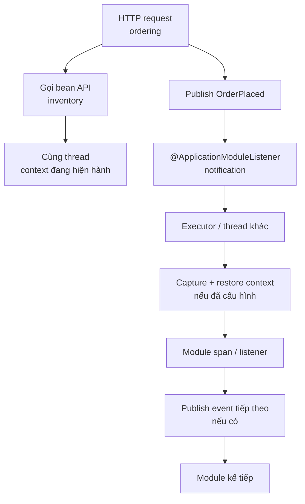
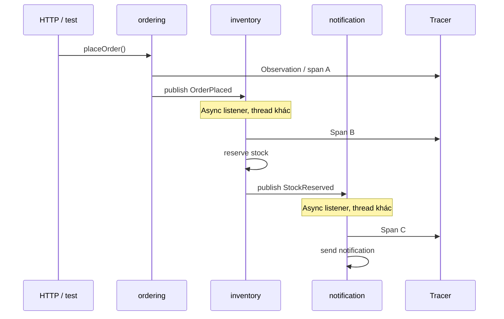
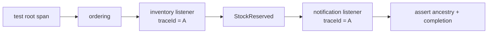

# Kiểm thử propagation giữa nhiều module trong Spring Modulith

## 1. Vì sao phải kiểm thử context propagation?

Một ứng dụng Spring Boot dùng **Spring Modulith** có thể chia thành các application module như `ordering`, `inventory` và `notification`. Một yêu cầu đặt hàng bắt đầu trong `ordering`, gọi API của `inventory` hoặc publish event để module khác xử lý. Khi bật Micrometer Observation và tracing, mỗi bước có thể tạo observation/span để nhóm phát triển theo dõi cùng một hành trình.

Ở luồng đồng bộ, các module thường chạy trên cùng thread nên observation/tracing context hiện hành vẫn được nhìn thấy. Nhưng khi công việc chuyển sang thread khác — ví dụ `@Async`, `@ApplicationModuleListener`, executor hoặc reactive pipeline — context có thể bị mất nếu không được truyền và khôi phục đúng cách.

Hậu quả thường thấy:

- Log ở module đầu có trace ID, log trong module xử lý async lại không có.
- Trace viewer cho thấy request gốc và event listener thành hai trace rời rạc.
- Span của module sau không có quan hệ parent/child mong đợi.
- Dữ liệu tương quan như baggage hoặc MDC không còn ở bước xử lý tiếp theo.

**Kiểm thử propagation giữa nhiều module** là kiểm tra xem context cần thiết có còn hiện diện và liên kết đúng khi luồng đi qua các ranh giới module, thread hoặc tiến trình hay không.

> **Điểm cốt lõi:** module boundary tự nó không chuyển context. Propagation phụ thuộc cơ chế thực thi và context accessor/executor/instrumentation đang dùng. Một bài test cần xác nhận trace context tại từng bước, không chỉ xác nhận event đã được xử lý.

## 2. Phân biệt module call, event và thread boundary

Trước khi viết test, hãy xác định luồng đang đi theo cách nào:

| Kiểu tương tác | Cách thực thi thường gặp | Điều cần kiểm tra |
| --- | --- | --- |
| Gọi Spring bean qua API module | Đồng bộ trên thread hiện hành | Observation/span hiện hành có tiếp tục qua lời gọi không |
| Publish Spring application event với listener đồng bộ | Mặc định listener xử lý đồng bộ trên thread publish | Context của publisher có hiện diện trong listener không |
| Listener có `@Async` | Listener được chạy trên executor/thread khác | Context có được capture khi submit và restore khi chạy không |
| `@ApplicationModuleListener` | Async transactional event listener, chạy transaction riêng | Executor thực tế có propagation decorator và listener có trace context đúng không |
| Reactor/WebFlux pipeline | Context thường nằm trong Reactor Context; có thể chuyển thread | Context có được nối giữa Reactor Context và ThreadLocal ở operator cần thiết không |
| Gửi message sang broker/service khác | Qua header/message metadata và tiến trình khác | Producer inject, consumer extract trace context đúng chuẩn không |

Spring Framework xử lý application event **đồng bộ trên cùng thread theo mặc định**. Nếu cấu hình `ApplicationEventMulticaster` dùng executor hoặc listener dùng `@Async`, việc xử lý chuyển thread và cần propagation phù hợp.

Spring Modulith `@ApplicationModuleListener` là shortcut cho một async transactional event listener: annotation này bao gồm `@Async`, `@TransactionalEventListener` và transaction `REQUIRES_NEW`. Vì vậy, khi kiểm thử listener này, cần xem nó như một **ranh giới bất đồng bộ**.



Sơ đồ cho thấy hai đường đi: lời gọi bean đồng bộ và listener bất đồng bộ. Chỉ đường chuyển thread mới cần cơ chế truyền context qua executor; với message broker, cần thêm inject/extract ở biên giao tiếp.

## 3. Context nào được propagation?

### 3.1. Micrometer Context Propagation

Micrometer Context Propagation hỗ trợ chuyển dữ liệu giữa các kiểu context khác nhau, ví dụ:

- `ThreadLocal` trong imperative code (Spring MVC).
- `Reactor Context` trong reactive code (Spring WebFlux).
- Các context khác nếu đã đăng ký accessor tương ứng.

Các abstraction chính:

| Thành phần | Vai trò |
| --- | --- |
| `ThreadLocalAccessor` | Đọc/ghi một giá trị `ThreadLocal` |
| `ContextAccessor` | Đọc/ghi một kiểu context dạng map như Reactor Context |
| `ContextRegistry` | Đăng ký các accessor được sử dụng |
| `ContextSnapshot` | Chụp các giá trị context và khôi phục chúng khi thực thi |
| `ContextSnapshotFactory` | Tạo snapshot theo registry và cấu hình tương ứng |

Thư viện không tự động chuyển **mọi biến ThreadLocal tùy ý**. Chỉ những context được accessor hỗ trợ/đăng ký mới được capture và restore. Spring Boot, Micrometer Tracing và logging integration cung cấp các phần tích hợp cho observation, tracing và MDC theo cấu hình tương ứng.

### 3.2. Trace context không đồng nghĩa transaction context

Khi nói “propagate context”, cần xác định rõ dữ liệu nào phải được giữ:

| Loại context | Có thể propagation qua cơ chế Micrometer? | Lưu ý |
| --- | --- | --- |
| Observation/tracing context | Có, khi có accessor/handler tương ứng | Dùng để tiếp tục trace và liên kết spans |
| MDC/log correlation | Có, khi logging context accessor được tích hợp | Hữu ích để log có trace ID nhất quán |
| Baggage | Có thể, nếu baggage được cấu hình và accessor hỗ trợ | Không đưa dữ liệu bí mật hoặc dữ liệu cardinality lớn vào metric tags |
| ThreadLocal tùy biến | Chỉ khi đăng ký accessor tương ứng | Không mặc định được chuyển |
| Transaction/resource đang gắn với thread | **Không nên coi là được chuyển** | Transaction Spring thường gắn với thread; listener async nên mở transaction riêng theo thiết kế |
| Security context | Phụ thuộc Spring Security strategy/wrapper riêng | Không giả định TaskDecorator của Micrometer thay thế cấu hình bảo mật |

Đặc biệt, `@ApplicationModuleListener` chạy trong transaction riêng. Context propagation có thể tiếp tục trace ID nhưng **không chuyển transaction gốc** sang thread listener. Hai yêu cầu này có mục tiêu khác nhau và phải được kiểm tra riêng.

## 4. Thiết lập executor có context propagation

### 4.1. Dùng executor do ứng dụng tự cấu hình

Với Spring Framework 6.1 trở lên, có thể dùng `ContextPropagatingTaskDecorator` để capture context lúc task được submit và khôi phục context trong lúc task chạy.

Ví dụ cấu hình executor:

```java
package com.example.shop.config;

import org.springframework.context.annotation.Bean;
import org.springframework.context.annotation.Configuration;
import org.springframework.core.task.TaskExecutor;
import org.springframework.core.task.support.ContextPropagatingTaskDecorator;
import org.springframework.scheduling.annotation.EnableAsync;
import org.springframework.scheduling.concurrent.ThreadPoolTaskExecutor;

@Configuration(proxyBeanMethods = false)
@EnableAsync
class AsyncConfiguration {

    @Bean(name = "taskExecutor")
    TaskExecutor taskExecutor() {
        ThreadPoolTaskExecutor executor = new ThreadPoolTaskExecutor();
        executor.setCorePoolSize(2);
        executor.setMaxPoolSize(8);
        executor.setQueueCapacity(100);
        executor.setThreadNamePrefix("module-async-");
        executor.setTaskDecorator(new ContextPropagatingTaskDecorator());
        return executor;
    }
}
```

Điểm cần chú ý:

- `ContextPropagatingTaskDecorator` phải được gắn vào **executor thực sự được `@Async` sử dụng**.
- Bean `taskExecutor` là tên thường được Spring dùng để phân giải executor mặc định; nếu ứng dụng dùng qualifier/executor riêng, hãy gắn decorator vào executor tương ứng.
- Không chỉ tạo bean decorator rồi cho rằng mọi executor trong ứng dụng tự được bao bọc. Với executor tự cấu hình, cấu hình trực tiếp `setTaskDecorator(...)` giúp thấy rõ điểm áp dụng.
- Decorator có chi phí capture/restore. Spring Framework khuyến cáo cân nhắc overhead khi chạy số lượng rất lớn task cực nhỏ.

### 4.2. Dùng AsyncTaskExecutor auto-configured của Spring Boot

Ở các phiên bản Spring Boot có hỗ trợ property này, có thể bật propagation cho executor auto-configured:

```yaml
spring:
  task:
    execution:
      propagate-context: true
```

Property và hành vi auto-configuration thay đổi theo phiên bản Spring Boot. Hãy kiểm tra reference documentation đúng phiên bản của dự án. Nếu ứng dụng tự tạo executor, cấu hình `ContextPropagatingTaskDecorator` trực tiếp trên executor là cách rõ ràng hơn.

### 4.3. Reactor/WebFlux

Với reactive pipeline, context thường nằm trong `Reactor Context` chứ không gắn cố định vào thread. Spring Boot cung cấp property:

```yaml
spring:
  reactor:
    context-propagation: auto
```

Ở chế độ `auto`, Spring Boot bật cơ chế khôi phục ThreadLocal values trong các reactive operators theo tích hợp context propagation. Test nên có operator chuyển scheduler (ví dụ `publishOn`) rồi xác nhận observation/tracing context vẫn được nhìn thấy ở bước sau.

## 5. Mô hình nhiều module dùng để kiểm thử

Giả sử ứng dụng bán hàng có ba module:

```text
com.example.shop
├── ordering
│   ├── OrderManagement
│   └── OrderPlaced
├── inventory
│   └── InventoryManagement
└── notification
    └── OrderNotificationListener
```

Luồng nghiệp vụ:

1. `ordering` xử lý yêu cầu và publish `OrderPlaced`.
2. `inventory` nhận event, giữ hàng rồi publish `StockReserved`.
3. `notification` nhận `StockReserved` và gửi thông báo.
4. Các listener được khai báo bằng `@ApplicationModuleListener` nên xử lý bất đồng bộ, mỗi listener có transaction riêng.



Khi propagation đúng, các span A, B, C có thể cùng `traceId` và liên hệ theo parent/child phù hợp. Nếu mỗi async boundary làm mất context, B hoặc C có thể không còn thuộc trace ban đầu.

## 6. Thiết kế bài test propagation

Một bài test đáng tin cậy nên xác minh các thuộc tính sau:

| Điều cần kiểm tra | Assertion nên có |
| --- | --- |
| Có context ở điểm bắt đầu | Tracer có current span và trace ID khác rỗng |
| Context qua lời gọi bean đồng bộ | Module đích nhìn thấy cùng trace ID |
| Context qua listener async | Listener nhận được cùng trace ID sau khi executor đổi thread |
| Quan hệ span | Trace backend/exporter thể hiện span con thuộc đúng trace và có parent/ancestor phù hợp |
| Chuyển tiếp qua module kế tiếp | Module thứ ba tiếp tục cùng trace ID sau lần async thứ hai |
| Dọn context sau task | Thread pool tái sử dụng không mang trace ID cũ sang task mới |
| Transaction semantics | Listener async chạy transaction riêng; không nhầm trace propagation với transaction propagation |

**Không chỉ so thread name.** Task có thể chạy ở thread khác nhưng propagation vẫn đúng; cũng có thể cùng thread nhưng context đã bị đóng trước khi task chạy. Trace ID, span ancestry và context ở điểm đích là bằng chứng phù hợp hơn.

### 6.1. Đo current trace trong module đích

Trong mã nghiệp vụ hoặc test probe, có thể đọc span hiện hành qua Micrometer Tracing:

```java
package com.example.shop.inventory;

import io.micrometer.tracing.Span;
import io.micrometer.tracing.Tracer;
import org.springframework.stereotype.Component;

@Component
final class TraceContextReader {

    private final Tracer tracer;

    TraceContextReader(Tracer tracer) {
        this.tracer = tracer;
    }

    String currentTraceId() {
        Span current = tracer.currentSpan();
        return current == null ? null : current.context().traceId();
    }
}
```

`Tracer.currentSpan()` trả về span hiện hành trong scope của thread. Nếu không có span đang hoạt động, kết quả là `null`. Test cần có Micrometer Tracing bridge/test tracer được cấu hình; chỉ có `ObservationRegistry` nhưng không có tracing handler thì chưa đủ để mong đợi trace ID.

### 6.2. Probe để nhận kết quả từ listener async

Một probe trong test có thể dùng `BlockingQueue` hoặc `CountDownLatch` để nhận kết quả mà không cần `Thread.sleep`:

```java
package com.example.shop.notification;

import java.time.Duration;
import java.util.concurrent.BlockingQueue;
import java.util.concurrent.LinkedBlockingQueue;
import java.util.concurrent.TimeUnit;

import io.micrometer.tracing.Span;
import io.micrometer.tracing.Tracer;

public class TraceProbe {

    public record SeenTrace(String traceId, String spanId) {}

    private final Tracer tracer;
    private final BlockingQueue<SeenTrace> seen = new LinkedBlockingQueue<>();

    public TraceProbe(Tracer tracer) {
        this.tracer = tracer;
    }

    public void record() {
        Span current = tracer.currentSpan();
        seen.add(current == null
                ? new SeenTrace(null, null)
                : new SeenTrace(
                        current.context().traceId(),
                        current.context().spanId()));
    }

    public SeenTrace await(Duration timeout) throws InterruptedException {
        SeenTrace result = seen.poll(timeout.toMillis(), TimeUnit.MILLISECONDS);
        if (result == null) {
            throw new AssertionError("Timed out waiting for listener trace");
        }
        return result;
    }
}
```

Probe này là **test fixture**, không nhất thiết là bean production. Listener gọi `probe.record()` khi bắt đầu xử lý để test đọc trace context tại chính thread listener.

## 7. Kiểm thử lời gọi bean đồng bộ giữa modules

Đường gọi đồng bộ là baseline: nó giúp xác nhận tracing đã được khởi tạo và module instrumentation hoạt động trước khi kiểm thử async.

Ví dụ:

```java
package com.example.shop.inventory;

import org.springframework.stereotype.Service;

@Service
public class InventoryManagement {

    private final TraceContextReader traceContext;

    public InventoryManagement(TraceContextReader traceContext) {
        this.traceContext = traceContext;
    }

    public String reserve(String sku) {
        return traceContext.currentTraceId();
    }
}
```

Module `ordering` gọi bean API `inventory` và trả trace ID mà module đích quan sát được:

```java
package com.example.shop.ordering;

import com.example.shop.inventory.InventoryManagement;
import org.springframework.stereotype.Service;

@Service
public class OrderManagement {

    private final InventoryManagement inventory;

    public OrderManagement(InventoryManagement inventory) {
        this.inventory = inventory;
    }

    public String placeOrder(String sku) {
        return inventory.reserve(sku);
    }
}
```

Bài test tạo một observation gốc, rồi so sánh trace ID đọc được trong module đích:

```java
package com.example.shop;

import java.util.concurrent.atomic.AtomicReference;

import io.micrometer.observation.Observation;
import io.micrometer.observation.ObservationRegistry;
import io.micrometer.tracing.Span;
import io.micrometer.tracing.Tracer;

import com.example.shop.ordering.OrderManagement;
import org.springframework.beans.factory.annotation.Autowired;
import org.junit.jupiter.api.Test;
import org.springframework.boot.test.context.SpringBootTest;
import static org.assertj.core.api.Assertions.assertThat;

@SpringBootTest
class SynchronousModulePropagationTest {

    // Các dependency được inject từ Spring test context.
    @Autowired ObservationRegistry registry;
    @Autowired Tracer tracer;
    @Autowired OrderManagement orders;

    @Test
    void keepsTraceAcrossSynchronousModuleCall() {
        AtomicReference<String> sourceTraceId = new AtomicReference<>();
        AtomicReference<String> targetTraceId = new AtomicReference<>();

        Observation.createNotStarted("test.order-flow", registry).observe(() -> {
            Span source = tracer.currentSpan();
            assertThat(source).isNotNull();
            sourceTraceId.set(source.context().traceId());

            targetTraceId.set(orders.placeOrder("SKU-42"));
        });

        assertThat(targetTraceId.get())
                .isEqualTo(sourceTraceId.get());
    }
}
```

Đây là **khung test minh họa**; có thể dùng field injection như trên hoặc constructor injection theo quy ước của dự án. Điều kiện tiên quyết là tracing handler được gắn vào `ObservationRegistry` để observation `test.order-flow` tạo span hiện hành.

Nếu synchronous test không có trace ID, hãy sửa hạ tầng tracing trước; chưa nên chuyển sang chẩn đoán executor.

## 8. Kiểm thử propagation qua `@ApplicationModuleListener`

### 8.1. Listener của module notification

`@ApplicationModuleListener` được thiết kế cho integration listener bất đồng bộ và transactional. Ví dụ:

```java
package com.example.shop.notification;

import com.example.shop.ordering.OrderPlaced;
import org.springframework.modulith.events.ApplicationModuleListener;
import org.springframework.stereotype.Component;

@Component
public class OrderNotificationListener {

    private final TraceProbe probe;

    public OrderNotificationListener(TraceProbe probe) {
        this.probe = probe;
    }

    @ApplicationModuleListener
    public void on(OrderPlaced event) {
        probe.record();
        // Gửi thông báo hoặc thực hiện công việc của module notification.
    }
}
```

Trong ví dụ này, `OrderNotificationListener` là fixture chỉ dùng trong test source và được import vào test context; listener production thật có thể được kiểm tra bằng spy hoặc một test recorder phù hợp.

Event được publish:

```java
package com.example.shop.ordering;

public record OrderPlaced(String orderId) {}
```

Annotation này khiến listener chạy bất đồng bộ trong transaction riêng. Nếu context propagation không được bật cho executor được dùng, trace context có thể không còn khi method `on` thực thi.

### 8.2. Cấu trúc bài test

Test cần tạo parent observation, publish event **bên trong transaction**, chờ listener chạy và so sánh trace ID:

Test context phải nạp executor có `ContextPropagatingTaskDecorator` ở mục 4.1, hoặc bật property propagation cho `AsyncTaskExecutor` auto-configured nếu phiên bản Spring Boot hỗ trợ. Nếu test dùng executor khác với executor của ứng dụng, assertion sẽ không kiểm tra đúng cấu hình production.

```java
package com.example.shop;

import java.time.Duration;
import java.util.concurrent.atomic.AtomicReference;

import io.micrometer.observation.Observation;
import io.micrometer.observation.ObservationRegistry;
import io.micrometer.tracing.Span;
import io.micrometer.tracing.Tracer;

import org.springframework.beans.factory.annotation.Autowired;
import org.junit.jupiter.api.Test;
import org.springframework.context.annotation.Bean;
import org.springframework.boot.test.context.TestConfiguration;
import org.springframework.context.annotation.Import;
import org.springframework.boot.test.context.SpringBootTest;
import org.springframework.context.ApplicationEventPublisher;
import org.springframework.transaction.support.TransactionTemplate;
import com.example.shop.notification.OrderNotificationListener;
import com.example.shop.notification.TraceProbe;
import com.example.shop.ordering.OrderPlaced;

import static org.assertj.core.api.Assertions.assertThat;

@SpringBootTest
@Import(OrderNotificationListener.class)
class AsyncModulePropagationTest {

    @Autowired ObservationRegistry observationRegistry;
    @Autowired Tracer tracer;
    @Autowired ApplicationEventPublisher events;
    @Autowired TransactionTemplate transactionTemplate;
    @Autowired TraceProbe traceProbe;

    @TestConfiguration
    static class ProbeConfiguration {

        @Bean
        TraceProbe traceProbe(Tracer tracer) {
            return new TraceProbe(tracer);
        }
    }

    @Test
    void keepsTraceAcrossAsyncModuleListener() throws Exception {
        AtomicReference<String> sourceTraceId = new AtomicReference<>();

        Observation.createNotStarted("test.order-flow", observationRegistry)
                .observe(() -> {
                    Span source = tracer.currentSpan();
                    assertThat(source).isNotNull();
                    sourceTraceId.set(source.context().traceId());

                    transactionTemplate.executeWithoutResult(status ->
                            events.publishEvent(new OrderPlaced("order-1001")));
                });

        TraceProbe.SeenTrace listenerTrace = traceProbe.await(Duration.ofSeconds(5));

        assertThat(listenerTrace.traceId()).isEqualTo(sourceTraceId.get());
    }
}
```

Các field trong ví dụ được chú thích là dependency cần inject, không phải biến static. Test phải dùng database/transaction manager phù hợp với cấu hình ứng dụng.

**Vì sao cần transaction commit?** `@ApplicationModuleListener` là transactional event listener. Nếu test method tự gắn `@Transactional` và framework test rollback transaction khi kết thúc, listener có thể không được kích hoạt như kỳ vọng. Dùng `TransactionTemplate` để commit transaction trong test, hoặc dùng `Scenario` của Spring Modulith để tạo stimulus event và chờ kết quả.

**Vì sao phải chờ bằng timeout?** Listener async có thể chạy sau khi publisher trả về. `CountDownLatch`, `BlockingQueue` hoặc Awaitility cho phép chờ có giới hạn và báo lỗi rõ ràng; `Thread.sleep` chỉ làm test chậm và không chứng minh listener đã hoàn thành.

### 8.3. Kiểm tra parent-child, không chỉ trace ID

Assertion cùng `traceId` xác nhận listener vẫn ở trong cùng trace. Để xác minh quan hệ cha-con:

1. Dùng tracing test reporter/exporter trong test để thu các spans đã kết thúc.
2. Tìm span gốc `test.order-flow` và span module/listener tương ứng.
3. Xác nhận chúng có cùng trace ID.
4. Kiểm tra `parentSpanId` của span listener hoặc chuỗi ancestor phù hợp với thiết kế.
5. Nếu có span trung gian do HTTP/module instrumentation, kiểm tra **đường ancestry** thay vì giả định listener luôn có parent trực tiếp là root span.

Một trace ID giống nhau nhưng parent sai vẫn có thể làm trace tree không như mong muốn. Ngược lại, span có parent phù hợp nhưng bị exporter sampling/drop có thể không xuất hiện trong backend; test nên dùng exporter không sampling hoặc cấu hình test phù hợp để kết quả xác định.

## 9. Kiểm thử chuỗi propagation qua ba module

Để kiểm tra propagation qua **nhiều ranh giới liên tiếp**, hãy tạo chuỗi:

```text
test observation
    └── ordering: publish OrderPlaced
          └── inventory: @ApplicationModuleListener
                └── publish StockReserved
                      └── notification: @ApplicationModuleListener
```

Trong test fixture:

- Listener của `inventory` ghi trace ID vào probe thứ nhất rồi publish `StockReserved`.
- Listener của `notification` ghi trace ID vào probe thứ hai.
- Test tạo observation gốc, publish `OrderPlaced` trong transaction đã commit và chờ cả hai probe.

Các assertion tối thiểu:

```java
assertThat(inventoryTrace.traceId()).isEqualTo(sourceTraceId);
assertThat(notificationTrace.traceId()).isEqualTo(sourceTraceId);
assertThat(inventoryTrace.spanId()).isNotBlank();
assertThat(notificationTrace.spanId()).isNotBlank();
```

Nếu muốn kiểm tra từng ranh giới, có thể thu thập các spans qua exporter và xác minh cây trace. Đừng chỉ kiểm tra probe cuối: nếu module trung gian không tạo span nhưng trace context vẫn còn, test cuối có thể pass mà chưa chứng minh module instrumentation ở giữa đã hoạt động.



Đối với test module slice, `@ApplicationModuleTest` mặc định chỉ boot module đang kiểm thử. Để kiểm thử luồng liên module, chọn bootstrap mode có direct/all dependencies hoặc dùng `@SpringBootTest` cho toàn bộ application context. Spring Modulith `Scenario` có thể giúp phát event trong transaction và chờ event/state change của listener async.

## 10. Negative control: chứng minh test thực sự bắt được mất context

Một bài test propagation tốt nên có một **negative control** để xác nhận assertion không luôn pass.

Trong môi trường test riêng:

1. Dùng một executor không có `ContextPropagatingTaskDecorator` hoặc tạm tắt property propagation.
2. Chạy cùng kịch bản async.
3. Xác nhận listener không nhận được trace ID gốc hoặc span không còn cùng trace ancestry.
4. Bật lại propagation và xác nhận test pass.

Không dùng negative control này trong cấu hình production. Mục tiêu là chứng minh test có thể phát hiện regression khi decorator bị bỏ hoặc executor được thay bằng một bean không được cấu hình.

Một test bổ sung quan trọng là **thread reuse isolation**:

- Gửi task A trong trace A, đợi listener hoàn thành.
- Gửi task B trong trace B trên cùng executor.
- Xác nhận listener B nhìn thấy trace B, không thấy trace A.

Task decorator phải đóng scope/khôi phục giá trị trước đó sau khi task kết thúc. Nếu context bị giữ lại trên thread pool, request tiếp theo có thể bị gắn nhầm trace hoặc log correlation.

## 11. Reactor và message broker

### 11.1. Reactor/WebFlux

Với reactive flow, không nên giả định một thread cố định sẽ xử lý toàn bộ pipeline. Reactor Context là nơi lưu context phù hợp với reactive chain; Context Propagation hỗ trợ chuyển qua lại với ThreadLocal khi cần.

Một test nên:

1. Tạo observation/trace ở điểm vào.
2. Xây dựng pipeline có ít nhất một bước chuyển scheduler, ví dụ `publishOn`.
3. Đọc trace context tại operator gọi module API.
4. Xác nhận trace ID và span ancestry vẫn đúng.
5. Chạy test với `spring.reactor.context-propagation=auto` nếu đó là cấu hình ứng dụng sử dụng.

Đừng viết assertion chỉ dựa trên tên thread; scheduler có thể đổi thread trong khi Reactor Context vẫn giữ nguyên.

### 11.2. Message broker hoặc service khác tiến trình

`ContextPropagatingTaskDecorator` chỉ xử lý propagation trong cùng tiến trình qua task executor. Khi gửi message sang Kafka, RabbitMQ, JMS hoặc gọi HTTP sang một service khác, context cần được **inject vào carrier** ở producer và **extract** ở consumer.

Với W3C Trace Context, header thường gặp:

```text
traceparent
tracestate
```

Test producer:

- Bắt đầu một trace.
- Publish message.
- Xác nhận header trace context được thêm vào message metadata.

Test consumer:

- Nhận message có header.
- Extract context và tạo span tiếp nối.
- Xác nhận trace ID được giữ và span có parent/link phù hợp.

Không tự copy một chuỗi `traceId` vào payload rồi coi đó là propagation hoàn chỉnh. Cần inject/extract đúng định dạng để tracing backend dựng được quan hệ spans. Với message được xử lý nhiều lần hoặc fan-out, quan hệ span link/parent có thể tùy semantics và instrumentation của broker.

## 12. Phân biệt propagation với Event Publication Registry

Hai cơ chế này giải quyết hai vấn đề khác nhau:

| Cơ chế | Trả lời câu hỏi | Không chứng minh |
| --- | --- | --- |
| **Context propagation** | Listener có tiếp tục trace/log context của luồng gọi không? | Event đã được lưu bền vững hoặc listener đã thành công |
| **Event Publication Registry** | Publication nào đang chờ, đang xử lý, hoàn tất hoặc lỗi? | Trace context đã được truyền đúng giữa các thread |
| **Tracing spans** | Một lần xử lý đi qua module nào, có parent/child ra sao? | Mọi event publication đều được xử lý thành công |
| **Metrics** | Lưu lượng, độ trễ và lỗi thay đổi theo thời gian thế nào? | Một event cụ thể đã được xử lý xong |

Spring Modulith Event Publication Registry theo dõi vòng đời của transactional listener publication. Trạng thái như `PUBLISHED`, `PROCESSING`, `COMPLETED` hoặc `FAILED` là dữ liệu về **event processing**, không phải giá trị trace context.

Một listener có thể:

- Nhận event và xử lý thành công nhưng trace context bị mất.
- Nhận đúng trace context nhưng ném exception khiến publication thành `FAILED`.
- Chưa được gọi do transaction chưa commit, dù publisher đã tạo event trong bộ nhớ.

Vì vậy, test propagation nên đi cùng test event lifecycle khi yêu cầu nghiệp vụ cần cả hai.

## 13. Lỗi thường gặp khi kiểm thử

| Triệu chứng | Nguyên nhân có thể | Cách kiểm tra |
| --- | --- | --- |
| Synchronous module test không có trace ID | Chưa có tracing bridge/handler hoặc root observation chưa tạo span | Kiểm tra `Tracer.currentSpan()` ngay tại điểm bắt đầu |
| Bean call có trace nhưng listener async không có | Executor thiếu context decorator/property | Xác định executor thật sự được `@Async` sử dụng |
| `@ApplicationModuleListener` không chạy trong test | Event chưa được publish trong transaction đã commit hoặc test rollback | Dùng `TransactionTemplate`/`Scenario` và chờ listener |
| Listener có trace ID khác root | Context không được capture/restore hoặc tạo root span mới | Kiểm tra task decorator, parent span và tracing instrumentation |
| Cùng trace ID nhưng parent span sai | Context được đặt nhưng span scope/ancestry không như thiết kế | Kiểm tra spans đã export và `parentSpanId` |
| Test đôi khi pass, đôi khi timeout | Đồng bộ hóa bất ổn, listener async hoặc test kết thúc quá sớm | Dùng latch/Awaitility có timeout, tránh `Thread.sleep` |
| Test chỉ pass khi chạy riêng | Executor/shared probe hoặc context bị rò giữa tests | Dọn probe, tách test context và kiểm tra thread reuse |
| Trace ID cũ xuất hiện ở request mới | ThreadLocal không được restore/clear đúng | Test hai task liên tiếp trên cùng executor |
| Reactor pipeline mất context sau `publishOn` | Chưa bật/cấu hình Reactor context propagation | Kiểm tra Reactor Context và property phù hợp phiên bản |
| Consumer message tạo trace mới | Producer không inject hoặc consumer không extract header | Kiểm tra `traceparent` ở message headers |
| Publication `COMPLETED` nhưng không có trace | Event processing hoàn tất nhưng tracing exporter/sampling không ghi span | Kiểm tra tracing độc lập với publication registry |
| Có trace nhưng publication `FAILED` | Context propagation hoạt động, nghiệp vụ listener thất bại | Kiểm tra exception, transaction và publication status |

## 14. Quy trình kiểm thử đề xuất cho CI

Một bộ kiểm thử thực tế có thể chia thành các lớp:

1. **Unit test context reader:** kiểm tra helper đọc current span trả đúng/null khi scope có hoặc không có span.
2. **Integration test đồng bộ:** tạo observation gốc, gọi bean API ở module khác, xác nhận trace ID cùng nhau.
3. **Integration test async listener:** publish event trong transaction commit, đợi listener và xác nhận trace ID cùng root.
4. **Multi-hop test:** đi qua ít nhất hai async module boundaries, kiểm tra trace ID ở từng module.
5. **Negative control:** bỏ decorator trong test context để chứng minh assertion bắt được regression.
6. **Thread reuse test:** chạy hai trace liên tiếp trên cùng executor, xác nhận không rò context.
7. **Broker contract test:** nếu có giao tiếp ngoài tiến trình, xác minh inject/extract trace headers.

Với Spring Modulith, `@ApplicationModuleTest` giúp kiểm thử module trong phạm vi cô lập hoặc cùng dependencies; `Scenario` hỗ trợ kích hoạt event và chờ listener async. Với propagation xuyên nhiều module, cần chọn bootstrap mode chứa các module liên quan hoặc dùng `@SpringBootTest` để kiểm tra toàn application context.

Chỉ chạy các test tích hợp nặng ở mức cần thiết. Không nên dùng một test đơn lẻ để vừa chứng minh module graph, event durability, transaction semantics, tracing exporter và mọi executor. Chia assertion theo từng cơ chế giúp lỗi dễ định vị.

## 15. Bài tập tự kiểm tra

**Bài tập 1.** `ordering` gọi bean `inventory` đồng bộ và trace ID giữ nguyên. Sau đó `inventory` publish event cho listener `notification` có `@ApplicationModuleListener` nhưng listener không có current span. Nên kiểm tra gì trước?

**Gợi ý:** Kiểm tra executor được `@Async` dùng và context propagation trên executor đó. Đồng thời xác nhận event được publish trong transaction đã commit và listener thực sự được gọi.

**Bài tập 2.** Test chỉ assert hai module có cùng thread name. Vì sao chưa chứng minh propagation?

**Gợi ý:** Thread name không xác nhận observation/tracing context. Cần kiểm tra trace ID, span ID và parent/ancestor trong trace.

**Bài tập 3.** Listener async có cùng trace ID với publisher nhưng Event Publication Registry báo `FAILED`. Có mâu thuẫn không?

**Gợi ý:** Không. Propagation chỉ chứng minh context được truyền; publication status phản ánh kết quả listener. Listener có thể giữ đúng trace nhưng vẫn ném exception.

**Bài tập 4.** Hai task chạy lần lượt trên cùng pool thread. Task B nhận trace ID của task A. Đây là dấu hiệu gì?

**Gợi ý:** Context scope không được restore/clear đúng hoặc executor/task wrapper bị cấu hình sai. Thêm thread reuse isolation test và kiểm tra decorator.

**Bài tập 5.** Ứng dụng gửi message sang service khác. Chỉ cấu hình `ContextPropagatingTaskDecorator` trong service gửi đã đủ chưa?

**Gợi ý:** Chưa. Decorator chỉ giúp qua thread trong một tiến trình; producer/consumer còn cần inject/extract trace context qua message headers.

## 16. Tổng kết

Để **kiểm thử propagation giữa nhiều module**, hãy đi theo trình tự từ đơn giản đến phức tạp:

- Xác nhận tracing context hoạt động trong một observation gốc.
- Kiểm tra lời gọi bean đồng bộ giữa hai module.
- Kiểm tra `@Async` và `@ApplicationModuleListener` qua executor có `ContextPropagatingTaskDecorator` hoặc cấu hình Boot tương ứng.
- Dùng transaction commit và cơ chế chờ có timeout cho listener async.
- So sánh trace ID ở từng module, sau đó kiểm tra span ancestry bằng test exporter/backend.
- Kiểm tra nhiều async boundaries, Reactor pipeline và message headers nếu ứng dụng sử dụng chúng.
- Chạy negative control và thread reuse test để phát hiện context bị mất hoặc rò sang task tiếp theo.

Micrometer Context Propagation giúp chuyển những context đã được đăng ký giữa ThreadLocal, Reactor Context và task execution. Spring Modulith cung cấp event/module integration; Spring Boot và Micrometer cung cấp observation/tracing infrastructure. Khi kiểm thử riêng từng lớp đúng cách, nhóm phát triển có thể xác định **trace có thực sự tiếp tục qua các module hay không**, đồng thời giữ riêng việc kiểm tra transaction và event publication lifecycle.

### Tài liệu tham khảo

- [Spring Boot — Observability, Context Propagation](https://docs.spring.io/spring-boot/reference/actuator/observability.html): propagation qua thread/reactive pipelines, property cho executor auto-configured và TaskDecorator.
- [Micrometer Context Propagation — Purpose](https://docs.micrometer.io/context-propagation/reference/purpose.html): ThreadLocalAccessor, ContextAccessor, ContextRegistry và ContextSnapshot.
- [Spring Framework — Observability Support, Application Events](https://docs.spring.io/spring/reference/7.0/integration/observability.html): event listeners đồng bộ mặc định và context propagation khi dùng executor/async.
- [Spring Modulith — Working with Application Events](https://docs.spring.io/spring-modulith/reference/events.html): async listener, `@ApplicationModuleListener` và Event Publication Registry.
- [Spring Modulith — Integration Testing Application Modules](https://docs.spring.io/spring-modulith/reference/testing.html): `@ApplicationModuleTest`, bootstrap modes và `Scenario` để kiểm thử event async.
- [Micrometer Tracing — Span and Baggage Scopes](https://docs.micrometer.io/tracing/reference/context-contracts.html): current span, scope và baggage.
- [Spring Framework — ContextPropagatingTaskDecorator API](https://docs.spring.io/spring-framework/docs/current/javadoc-api/org/springframework/core/task/support/ContextPropagatingTaskDecorator.html): cơ chế wrap task và giới hạn chi phí khi dùng với task rất nhỏ.
