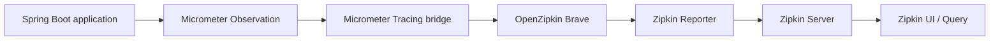
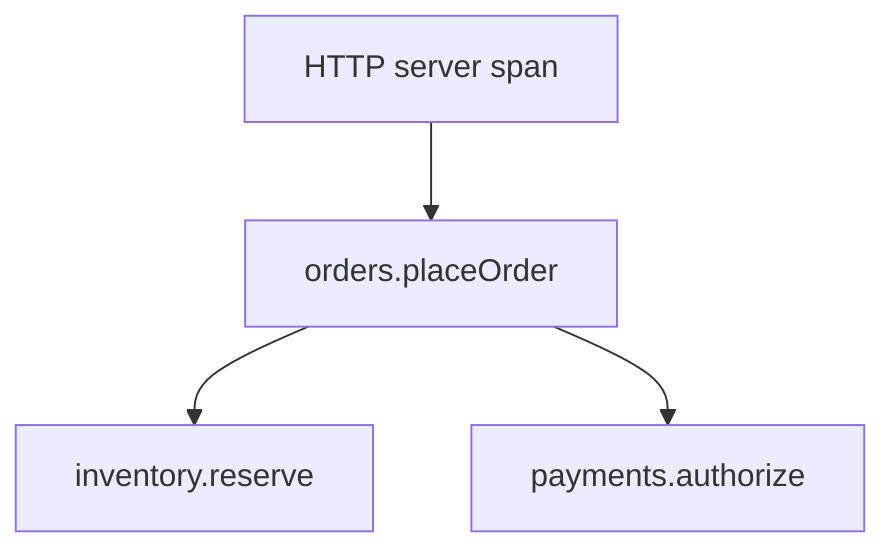
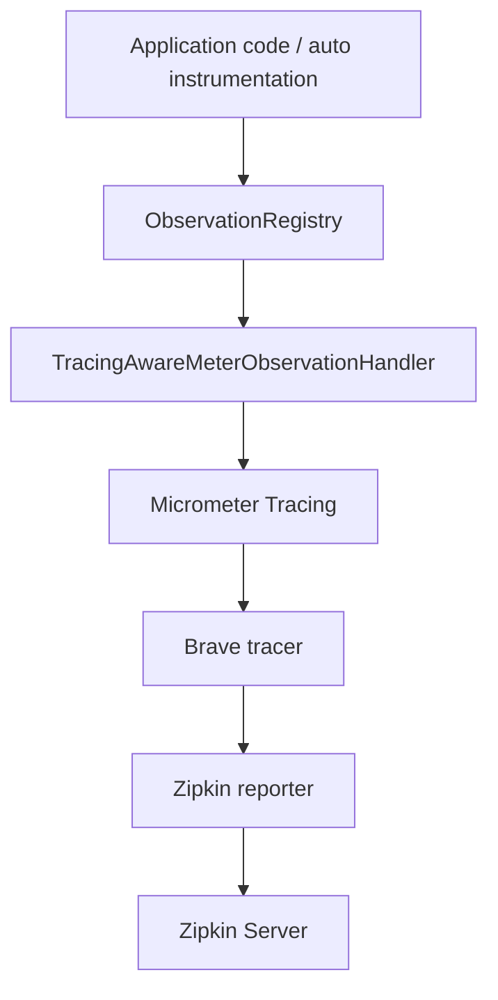

# OpenZipkin Brave và Zipkin

## 1. Bối cảnh: từ Observation đến trace có thể xem được

Một ứng dụng Spring Boot theo kiến trúc modular monolith có thể gồm các **application module** như `orders`, `inventory` và `payments`. Khi một yêu cầu đặt hàng đi qua nhiều module, logs cho biết từng dòng xử lý, metrics cho biết tần suất và thời lượng tổng hợp, còn **distributed tracing** giúp xem một lần xử lý cụ thể đã đi qua những bước nào.

Trong hệ sinh thái Spring, Micrometer Observation cung cấp mô hình quan sát chung. Để biến những observation đó thành trace và gửi tới giao diện truy vấn, có thể dùng **OpenZipkin Brave** làm tracer implementation và **Zipkin** làm trace backend.

Bài **“OpenZipkin Brave và Zipkin”** thuộc chương **Micrometer tracing** trong học phần **SPRING_MODULITH_DOCUMENTATION_OBSERVABILITY**. Học phần sử dụng Spring Modulith để sinh tài liệu ranh giới application module và quan sát tương tác giữa các phần trong ứng dụng Spring Boot thông qua module graph, Actuator, event metrics, tracing và context propagation.

Sau bài học, bạn sẽ có thể:

1. Phân biệt Micrometer Tracing, Brave, Zipkin Reporter và Zipkin Server.
2. Chọn dependency phù hợp với dòng Spring Boot đang sử dụng.
3. Khởi chạy Zipkin cục bộ và cấu hình ứng dụng gửi spans tới backend.
4. Hiểu trace, span, trace ID, parent span và propagation headers.
5. Dùng observation của Spring Boot và Spring Modulith để tạo spans.
6. Truyền trace context qua HTTP client và các module trong ứng dụng.
7. Đọc trace, đối chiếu với logs và module graph, xử lý lỗi khi không thấy dữ liệu.
8. Kiểm thử tracing mà không vô tình gửi dữ liệu từ test tới backend bên ngoài.

> **Phạm vi:** Ví dụ dùng các API và cấu hình Spring Boot 4.2 hiện hành, đồng thời nêu riêng dependency/property của Spring Boot 3.5 khi có khác biệt. Hãy dùng BOM tương thích với phiên bản dự án; các ví dụ output là minh họa, chưa phải dữ liệu từ ứng dụng đang chạy.

## 2. Bốn thành phần cần phân biệt

### 2.1. Micrometer Tracing: API chung của ứng dụng

Micrometer Tracing cung cấp một facade để ứng dụng Spring làm việc với trace/span mà không phải viết logic nghiệp vụ phụ thuộc trực tiếp vào một tracer cụ thể.

Trong Spring Boot, Micrometer Tracing kết nối với Micrometer Observation. Một observation có thể được xử lý bởi nhiều handler; tracing handler tạo span và metrics handler có thể ghi timer/counter tương ứng.

Nhờ lớp facade này, mã nghiệp vụ có thể dùng các khái niệm chung như `ObservationRegistry`, `Observation` và `Tracer`, trong khi phần triển khai tracer được chọn qua dependency và auto-configuration.

### 2.2. OpenZipkin Brave: tracer implementation

**Brave** là thư viện tracing thuộc dự án OpenZipkin. Nó quản lý các khái niệm như trace, span, sampling, propagation và các thao tác tạo span.

Trong ứng dụng Spring Boot sử dụng Micrometer Tracing, `micrometer-tracing-bridge-brave` là cầu nối giữa Micrometer Observation/Tracing API và Brave. Cầu nối này cho phép các observation được chuyển thành hoạt động tracing của Brave.

Brave là **bộ máy tạo và quản lý trace trong tiến trình ứng dụng**. Brave không phải giao diện web để xem trace.

### 2.3. Zipkin Reporter: vận chuyển spans

Sau khi một span kết thúc và được chọn để xuất, ứng dụng cần một thành phần gửi dữ liệu tới backend. Với Brave, `zipkin-reporter-brave` cung cấp tích hợp reporter để chuyển spans sang định dạng Zipkin và gửi chúng qua HTTP tới Zipkin Server.

Reporter chịu trách nhiệm xuất dữ liệu; nó không phải nơi lưu trữ và tìm kiếm trace.

### 2.4. Zipkin Server: nhận, lưu và hiển thị traces

**Zipkin** là hệ thống thu thập và truy vấn distributed traces. Server nhận spans từ các ứng dụng, lưu chúng theo storage backend được cấu hình và cung cấp giao diện để tìm trace.

Khi chạy quickstart cục bộ, các địa chỉ mặc định thường dùng là:

| Thành phần | Địa chỉ |
| --- | --- |
| Zipkin Web UI | `http://localhost:9411` |
| Zipkin v2 span ingestion API | `http://localhost:9411/api/v2/spans` |
| Ứng dụng Spring Boot mẫu | `http://localhost:8080` |

Đây là các địa chỉ mặc định cho môi trường local. Trong staging/production, địa chỉ phụ thuộc mạng, DNS, TLS, proxy và cấu hình triển khai.

### 2.5. Luồng dữ liệu tổng thể



Mỗi thành phần có trách nhiệm riêng:

- Ứng dụng hoặc instrumentation tạo observation.
- Micrometer Tracing bridge chuyển observation sang Brave.
- Brave quản lý trace/span và sampling.
- Reporter gửi spans đã chọn.
- Zipkin Server nhận và lưu dữ liệu.
- Zipkin UI cho phép tìm và phân tích trace.

Nếu thiếu một mắt xích, ứng dụng vẫn có thể chạy bình thường nhưng trace không xuất hiện ở giao diện.

## 3. Trace, span và propagation

### 3.1. Trace là toàn bộ một lần xử lý

Một **trace** đại diện cho một hành trình xử lý có liên quan. Trace thường có một trace ID chung và gồm nhiều spans.

Ví dụ một yêu cầu đặt hàng:

```text
Trace: POST /orders
traceId = 4bf92f3577b34da6a3ce929d0e0e4736

└── Span: HTTP POST /orders
    └── Span: orders.placeOrder
        ├── Span: inventory.reserve
        └── Span: payments.authorize
```

Các span có thể bắt đầu/kết thúc ở những thời điểm khác nhau nhưng liên kết bằng quan hệ parent-child. Một trace có thể đi qua nhiều tiến trình hoặc dịch vụ nếu context được truyền qua ranh giới giao tiếp.

### 3.2. Span mô tả một thao tác

Một **span** là một đoạn công việc có thời điểm bắt đầu, thời điểm kết thúc và metadata. Một span thường có:

| Thành phần | Ý nghĩa |
| --- | --- |
| `traceId` | ID chung để nhóm spans trong cùng trace |
| `spanId` | ID duy nhất của span |
| `parentId` | ID span cha, nếu có |
| `name` | Tên thao tác, ví dụ `inventory.reserve` |
| `kind` | Vai trò của span như server/client/internal |
| `timestamp` | Thời điểm bắt đầu |
| `duration` | Thời lượng thực thi |
| `tags/attributes` | Metadata như module, method, status |
| `events` | Sự kiện gắn với vòng đời span, nếu có |

Trong modular monolith, một span có thể đại diện cho thao tác đi vào module `inventory` dù các module cùng chạy trong một JVM. Span module-entry là tín hiệu logic về ranh giới ứng dụng; nó không có nghĩa module đã trở thành một microservice riêng.

### 3.3. Parent-child thể hiện quan hệ xử lý

Một span con thường được tạo khi một thao tác đang nằm trong scope của span cha. Khi đó:

- Trace ID của span con thường trùng trace ID span cha.
- Parent ID của span con tham chiếu span cha.
- Thời gian của span con thường nằm trong khoảng thời gian của span cha.
- Có thể có nhiều span con song song nếu xử lý bất đồng bộ.

Ví dụ:



Sơ đồ chỉ minh họa cấu trúc. Thực tế thứ tự và parent-child phụ thuộc cách ứng dụng gọi service, executor, transaction và cơ chế propagation.

### 3.4. Propagation là cách truyền ngữ cảnh qua mạng

Khi ứng dụng gọi một dịch vụ khác, trace context phải được truyền trong request headers. Dịch vụ nhận đọc context để tạo span con thuộc trace ban đầu.

Hai định dạng phổ biến:

- **W3C Trace Context:** thường dùng header `traceparent` và có thể có `tracestate`.
- **B3:** định dạng do hệ sinh thái Zipkin phổ biến; có thể truyền bằng một header `b3` hoặc các header riêng như `X-B3-TraceId`, `X-B3-SpanId`, `X-B3-Sampled`.

Một request không có context hợp lệ có thể bắt đầu trace mới. Nếu hai dịch vụ không thống nhất định dạng consume/produce, trace có thể bị tách thành nhiều trace riêng.

### 3.5. Baggage khác span tags

**Baggage** là các cặp key-value có thể truyền qua ranh giới dịch vụ để mang ngữ cảnh như tenant hoặc một mã phân loại phù hợp. Baggage không đồng nghĩa với trace ID hay span ID.

Không nên đưa dữ liệu nhạy cảm như access token, email, số thẻ hoặc payload cá nhân vào baggage. Nếu baggage được đưa thành span tags hoặc log MDC, dữ liệu sẽ xuất hiện rộng hơn trong hệ thống observability.

## 4. Chọn dependency theo phiên bản Spring Boot

Cách khai báo Brave + Zipkin thay đổi theo dòng Spring Boot. Không trộn hai phương án bên dưới trong cùng một ứng dụng.

### 4.1. Spring Boot 4.2: dùng starter Zipkin

Tài liệu Spring Boot 4.2 hiện hành cung cấp starter tích hợp OpenZipkin Brave với Zipkin:

```groovy
dependencies {
    implementation 'org.springframework.boot:spring-boot-starter-zipkin'
}
```

Starter giúp đưa các thành phần tracing Brave/Zipkin và auto-configuration tương ứng vào classpath. Dự án vẫn cần dependency management của Spring Boot để quản lý phiên bản đồng bộ.

### 4.2. Spring Boot 3.5: khai báo bridge và reporter

Với Spring Boot 3.5, tài liệu chính thức hướng dẫn khai báo các dependency:

```groovy
dependencies {
    implementation 'org.springframework.boot:spring-boot-starter-actuator'

    implementation 'io.micrometer:micrometer-tracing-bridge-brave'
    implementation 'io.zipkin.reporter2:zipkin-reporter-brave'
}
```

- `spring-boot-starter-actuator` cung cấp nền tảng Actuator/Observation và auto-configuration cần thiết.
- `micrometer-tracing-bridge-brave` kết nối Micrometer với Brave.
- `zipkin-reporter-brave` gửi spans tới Zipkin.

Nếu ứng dụng không sử dụng Spring MVC hoặc Spring WebFlux, tài liệu Spring Boot 3.5 còn lưu ý cần bổ sung sender thích hợp, ví dụ `io.zipkin.reporter2:zipkin-sender-urlconnection`, theo cấu hình transport của dự án.

### 4.3. Bảng lựa chọn

| Spring Boot | Dependency chính | Ghi chú |
| --- | --- | --- |
| 4.2 | `org.springframework.boot:spring-boot-starter-zipkin` | Starter Brave + Zipkin theo cách tổ chức Boot 4 |
| 3.5 | `spring-boot-starter-actuator` + `micrometer-tracing-bridge-brave` + `zipkin-reporter-brave` | Khai báo rõ bridge và reporter |
| 3.4 trở xuống | Theo tài liệu đúng minor version | Không sao chép dependency hoặc property từ Boot 4 một cách máy móc |

**Chỉ chọn một tracer implementation** cho cấu hình này. Không đồng thời thêm bridge Brave và bridge OpenTelemetry nếu ứng dụng không có kiến trúc chủ ý hỗ trợ nhiều tracer; các auto-configuration có thể cạnh tranh hoặc tạo cấu hình khó chẩn đoán.

Nếu ứng dụng đã dùng `spring-modulith-starter-insight`, starter này cung cấp phần quan sát module của Spring Modulith; nó không thay thế việc chọn tracer bridge và Zipkin exporter tương thích với Spring Boot.

## 5. Chạy Zipkin Server cục bộ

### 5.1. Dùng Docker

Cách nhanh để chạy Zipkin phục vụ học tập là dùng image chính thức:

```bash
docker run -d --name zipkin -p 9411:9411 openzipkin/zipkin
```

Sau khi container chạy, mở:

```text
http://localhost:9411
```

Trang UI cho phép truy vấn traces đã nhận.

### 5.2. Kiểm tra server sẵn sàng

Trước khi khởi động ứng dụng, kiểm tra UI hoặc endpoint health/diagnostic theo bản Zipkin đang dùng. Nếu cổng 9411 đã được một tiến trình khác sử dụng, cần đổi port mapping và cập nhật endpoint trong Spring Boot.

Không nhầm **UI URL** với **ingestion API URL**. Ứng dụng gửi spans tới `/api/v2/spans`, còn người dùng mở UI ở root path.

### 5.3. Dừng môi trường học tập

```bash
docker stop zipkin
docker rm zipkin
```

Các lệnh trên chỉ dành cho container có tên `zipkin` được tạo từ ví dụ. Không dùng tên container đang thuộc môi trường khác.

### 5.4. Quickstart không phải cấu hình lưu trữ production

Zipkin quickstart phù hợp để học và thử nghiệm. Production cần quyết định storage backend, retention, khả năng mở rộng, xác thực, TLS, backup và giám sát chính Zipkin. Không coi container quickstart với cấu hình mặc định là một nền tảng lưu trace lâu dài đã sẵn sàng.

## 6. Cấu hình Spring Boot gửi trace tới Zipkin

### 6.1. Cấu hình cơ bản cho Spring Boot 4.2

Ví dụ `application.yml`:

```yaml
spring:
  application:
    name: shop-service

management:
  tracing:
    sampling:
      probability: 1.0
    export:
      zipkin:
        endpoint: http://localhost:9411/api/v2/spans
        connect-timeout: 1s
        read-timeout: 10s
```

Ý nghĩa:

- `spring.application.name` giúp nhận diện service trong trace backend.
- `management.tracing.sampling.probability` quyết định xác suất một trace được chọn để xuất.
- `management.tracing.export.zipkin.endpoint` là endpoint nhận spans của Zipkin.
- Timeout kiểm soát thời gian kết nối và chờ phản hồi từ backend.

Theo tài liệu Spring Boot 4.2, xác suất sampling mặc định là `0.1` (10%). Đặt `1.0` trong ví dụ giúp dễ quan sát mọi request trong môi trường học tập; không nên mặc định xuất 100% traces ở hệ thống production có lưu lượng lớn.

### 6.2. Property namespace của Spring Boot 3.5

Với Spring Boot 3.5, cấu hình Zipkin dùng namespace `management.zipkin.tracing.*`:

```yaml
spring:
  application:
    name: shop-service

management:
  tracing:
    sampling:
      probability: 1.0
  zipkin:
    tracing:
      endpoint: http://localhost:9411/api/v2/spans
```

**Đừng trộn** `management.tracing.export.zipkin.endpoint` của Boot 4.2 với `management.zipkin.tracing.endpoint` của Boot 3.5 trong cùng một cấu hình mà không xác minh phiên bản. Nếu property không được bind, ứng dụng có thể khởi động bình thường nhưng reporter vẫn gửi đến endpoint mặc định hoặc không gửi theo ý muốn.

### 6.3. Sampling trong môi trường phát triển và production

Sampling kiểm soát tỷ lệ trace được lưu/xuất. Ví dụ:

| Probability | Ý nghĩa | Trường hợp phù hợp |
| ---: | --- | --- |
| `0.0` | Không chọn trace nào | Tắt export trong môi trường không cần tracing |
| `0.1` | Chọn khoảng 10% trace | Mặc định Spring Boot |
| `0.25` | Chọn khoảng 25% trace | Kiểm tra tải vừa phải |
| `1.0` | Chọn mọi trace | Local/staging có lưu lượng nhỏ hoặc điều tra ngắn hạn |

Sampling không làm thay đổi logic nghiệp vụ. Tuy nhiên, khi xác suất nhỏ hơn 1.0, **không thấy một trace không có nghĩa request chưa chạy**. Dùng metrics và logs để đối chiếu với traces được lấy mẫu.

### 6.4. Tên service và phân biệt môi trường

Dùng service name có ý nghĩa và ổn định, ví dụ:

```yaml
spring:
  application:
    name: shop-order-service
```

Nếu nhiều môi trường dùng cùng Zipkin backend, cần phân biệt môi trường qua metadata/resource hoặc cách tổ chức backend phù hợp. Tránh đưa ID người dùng hoặc ID request vào service name vì nó không phải nhãn phân loại cho từng giao dịch.

## 7. Tích hợp Micrometer Observation với Brave

### 7.1. Observation handler tạo span

Spring Boot tự động đăng ký `TracingAwareMeterObservationHandler` trên `ObservationRegistry` khi tracing được cấu hình. Handler này chuyển các observation đã hoàn tất thành spans thông qua tracer đang được chọn.

Luồng xử lý:



Không cần tự tạo Brave span cho mọi method nếu Spring Boot hoặc Spring Modulith đã instrument điểm đó. Việc instrument thủ công trùng với auto instrumentation có thể tạo spans lồng nhau không cần thiết.

### 7.2. Tạo custom observation

Nếu cần quan sát một thao tác nghiệp vụ riêng, inject `ObservationRegistry`:

```java
package com.example.shop.orders;

import io.micrometer.observation.Observation;
import io.micrometer.observation.ObservationRegistry;
import org.springframework.stereotype.Service;

@Service
public class OrderConfirmationService {

    private final ObservationRegistry observationRegistry;

    public OrderConfirmationService(ObservationRegistry observationRegistry) {
        this.observationRegistry = observationRegistry;
    }

    public void confirmOrder() {
        Observation.createNotStarted(
                "orders.confirm",
                observationRegistry
            )
            .lowCardinalityKeyValue("module", "orders")
            .lowCardinalityKeyValue("operation", "confirm")
            .observe(this::performConfirmation);
    }

    private void performConfirmation() {
        // Logic nghiệp vụ xác nhận đơn hàng.
    }
}
```

Tên observation `orders.confirm` và các low-cardinality values được định nghĩa bởi ứng dụng. Khi tracing handler hoạt động, observation có thể trở thành span và được xuất sang Zipkin.

Một observation cũng có thể tạo metric thông qua metrics handler. Nếu mục tiêu là **chỉ tạo span mà không tạo metric**, tài liệu Spring Boot hướng dẫn sử dụng API cấp thấp `Tracer` của Micrometer Tracing thay vì Observation.

### 7.3. Tránh high-cardinality values

Không gắn các giá trị thay đổi theo từng request vào low-cardinality tags:

```java
// Tốt: tập giá trị hữu hạn
.lowCardinalityKeyValue("module", "orders")
.lowCardinalityKeyValue("operation", "confirm")

// Không nên đưa các ID duy nhất vào metric tags
// .lowCardinalityKeyValue("orderId", orderId.toString())
```

Nếu cần tra một đơn cụ thể, dùng trace ID/log correlation hoặc metadata phù hợp trong trace theo chính sách dữ liệu. Không biến order ID, email, token hay thông tin thanh toán thành metric tags.

## 8. Brave và Zipkin trong ứng dụng Spring Modulith

### 8.1. Module-entry spans

Spring Modulith Observability có thể instrument các Spring component thuộc **API được công bố của application module**. Khi lời gọi đi qua điểm được hỗ trợ, một module-entry observation/span có thể được tạo.

Ví dụ ứng dụng có ba module:

```text
com.example.shop
├── ShopApplication.java
├── orders
│   └── OrderManagement.java
├── inventory
│   └── InventoryManagement.java
└── payments
    └── PaymentManagement.java
```

Khi `orders` gọi API của `inventory`, trace có thể có span cho bước đi vào module inventory. Nếu `payments` lắng nghe event của `orders`, span listener có thể được ghi nhận tùy cơ chế event listener và điểm instrumentation được hỗ trợ.

### 8.2. Metadata module trên span

Module-entry spans của Spring Modulith có thể mang các metadata như:

| Key | Ý nghĩa |
| --- | --- |
| `module.identifier` | Technical identifier của application module |
| `module.name` | Tên hiển thị module |
| `module.invocation-type` | Loại tương tác, ví dụ bean hoặc event listener |
| `module.method` | Phương thức được gọi |

Những tags này giúp đối chiếu trace với module graph được tạo từ mã nguồn hoặc endpoint `/actuator/modulith`.

### 8.3. Module graph không phải trace

Hai nguồn trả lời hai câu hỏi khác nhau:

- **Module graph:** Module nào phụ thuộc module nào theo cấu trúc mã nguồn?
- **Trace:** Một lần xử lý cụ thể đã đi qua những thao tác nào, thứ tự và thời lượng ra sao?

Ví dụ `payments → orders` có thể là dependency do listener của payments tham chiếu event type từ orders. Trong luồng runtime, event được phát từ orders rồi listener payments xử lý. Chiều dependency trong module graph không phải là sơ đồ thời gian của trace.

### 8.4. Event metrics không phải spans

Spring Modulith còn có event publication counters như `module.events.published` và counter riêng cho từng event type. Counter ghi nhận số lần công bố event; spans ghi nhận hoạt động được instrument và thời lượng của thao tác.

Một counter tăng không chứng minh listener đã xử lý thành công. Muốn biết listener chạy ra sao, xem trace, logs, trạng thái event publication hoặc kết quả nghiệp vụ phù hợp.

## 9. Truyền trace qua HTTP

### 9.1. Dùng HTTP client builder do Spring Boot cấu hình

Để tự động thêm propagation headers, hãy dùng builder được Spring Boot auto-configure.

Ví dụ với `RestClient`:

```java
package com.example.shop.orders;

import org.springframework.context.annotation.Bean;
import org.springframework.context.annotation.Configuration;
import org.springframework.web.client.RestClient;

@Configuration(proxyBeanMethods = false)
class InventoryClientConfiguration {

    @Bean
    RestClient inventoryClient(RestClient.Builder builder) {
        return builder
            .baseUrl("http://inventory-service")
            .build();
    }
}
```

Khi builder được Spring Boot cấu hình tracing, client observation có thể tạo client span và chèn trace context vào request headers. Service nhận có thể tiếp tục trace nếu nó hỗ trợ propagation format tương ứng.

Với `WebClient`, cũng dùng `WebClient.Builder` được inject từ Spring:

```java
@Bean
WebClient inventoryWebClient(WebClient.Builder builder) {
    return builder
        .baseUrl("http://inventory-service")
        .build();
}
```

### 9.2. Vì sao tự tạo client có thể làm trace bị đứt?

Nếu dùng `RestClient.create(...)`, `new RestClient` theo cách tự khởi tạo hoặc `WebClient.create(...)` thay vì builder do Boot cấu hình, automatic trace propagation có thể không hoạt động.

Khi đó:

- Service gọi vẫn chạy bình thường.
- Zipkin có thể hiển thị một trace riêng ở dịch vụ đích hoặc không có client span như mong đợi.
- Trace ID không tiếp tục qua HTTP request.
- Logs hai bên không có cùng correlation ID.

Khi cần tùy biến HTTP client, hãy tùy biến builder do Boot cung cấp để giữ instrumentation.

### 9.3. Kiểm tra propagation headers

Với W3C Trace Context, request thường mang header:

```text
traceparent: 00-<trace-id>-<parent-span-id>-01
```

Với B3, có thể dùng header đơn `b3` hoặc các header nhiều trường `X-B3-TraceId`, `X-B3-SpanId`, `X-B3-Sampled`.

Không nên log toàn bộ request headers trong production chỉ để kiểm tra trace. Có thể dùng test client, log chẩn đoán có giới hạn hoặc trace backend để xác nhận.

## 10. Chọn propagation format và dùng baggage

### 10.1. W3C và B3

Spring Boot hỗ trợ các kiểu propagation như W3C, B3 và B3_MULTI. Trong Spring Boot 4.2, các property chi tiết gồm:

- `management.tracing.propagation.produce`: định dạng được ứng dụng tạo ra.
- `management.tracing.propagation.consume`: định dạng được ứng dụng chấp nhận khi nhận request.

Mặc định của Spring Boot 4.2 là produce W3C, consume W3C, B3 và B3_MULTI. Đây là cấu hình giúp một ứng dụng nhận được trace context từ nhiều hệ thống khác nhau trong khi phát ra định dạng chuẩn.

Nếu tổ chức cần B3 làm định dạng gửi ra:

```yaml
management:
  tracing:
    propagation:
      produce:
        - B3
      consume:
        - B3
        - B3_MULTI
        - W3C
```

Cấu hình phải thống nhất với các dịch vụ lân cận và phiên bản Spring Boot. Không thay đổi propagation type chỉ để làm trace hiển thị đẹp hơn; thay đổi này ảnh hưởng khả năng liên kết trace giữa các dịch vụ.

### 10.2. Baggage với B3

Theo tài liệu Spring Boot, baggage không tự động được truyền qua mạng với B3 như cách W3C xử lý baggage. Nếu cần truyền các trường baggage từ xa, cấu hình `management.tracing.baggage.remote-fields`.

Ví dụ:

```yaml
management:
  tracing:
    baggage:
      remote-fields:
        - tenant-id
      correlation:
        fields:
          - tenant-id
```

Cấu hình trên minh họa một field có thể được truyền qua mạng và đưa vào logging context. Chỉ chọn các field thật sự cần thiết, có giá trị giới hạn và không chứa bí mật/PII.

### 10.3. Baggage tags và cardinality

Có thể cấu hình baggage fields thành span tags bằng `management.tracing.baggage.tag-fields`. Tuy nhiên, một field được thêm vào span không có nghĩa nó nên được dùng làm metric tag.

Không đưa `orderId`, `userEmail`, access token hoặc dữ liệu nhạy cảm vào baggage. Baggage có thể lan qua nhiều dịch vụ và xuất hiện trong log/span; cần kiểm soát danh sách allowlist và quyền truy cập backend.

## 11. Correlation ID trong logs

### 11.1. Liên kết logs với trace

Khi dùng Micrometer Tracing, Spring Boot tích hợp trace ID và span ID vào MDC. Log có thể hiển thị một correlation ID dạng:

```text
[traceId-spanId] INFO ... OrderManagement - Order confirmed
```

Nhờ đó, từ một dòng log có thể tìm trace tương ứng trong Zipkin. Một trace gồm nhiều spans nên span ID có thể thay đổi theo từng bước, trong khi trace ID giữ vai trò liên kết chung.

### 11.2. Cấu hình correlation pattern

Có thể cấu hình Logback correlation pattern:

```yaml
logging:
  pattern:
    correlation: "[%X{traceId:-},%X{spanId:-}] "
```

Ví dụ hiển thị trace ID và span ID. Tên MDC mặc định là `traceId` và `spanId`; nếu tùy chỉnh MDC keys thì correlation pattern phải tham chiếu đúng key.

### 11.3. Lưu ý riêng với Brave

Tài liệu Spring Boot hiện hành lưu ý với Brave, MDC key names được áp dụng khi baggage được bật. Nếu đặt `management.tracing.baggage.enabled=false`, Brave không ghi trace/span IDs vào MDC theo cách mặc định đó; correlation ID trong log có thể không còn hoạt động.

Khi logs không có ID, kiểm tra MDC configuration và baggage setting trước khi kết luận tracing bridge không tạo span.

## 12. Sampling và giới hạn dữ liệu trace

### 12.1. Sampling mặc định 10%

Spring Boot mặc định chỉ sample khoảng 10% request để tránh làm backend bị quá tải. Vì vậy, khi gửi 10 request trong môi trường mặc định, không đảm bảo Zipkin hiển thị đủ 10 traces.

Trong local hoặc một bài kiểm thử ngắn, có thể đặt probability là 1.0 để mọi trace được chọn. Trong production, chọn sampling phù hợp lưu lượng, chi phí và yêu cầu điều tra.

### 12.2. Trace không phải log đầy đủ

Tracing giúp quan sát cấu trúc và thời lượng của một luồng, nhưng không nên ghi mọi dữ liệu nghiệp vụ vào span. Giữ metadata gọn và có ý nghĩa:

- Dùng tên span phản ánh operation ổn định.
- Dùng low-cardinality attributes cho phân loại module/operation.
- Chỉ thêm high-cardinality attributes khi thực sự cần điều tra và được phép.
- Không ghi password, token, payment data, email hoặc payload nhạy cảm.
- Giới hạn số attributes và độ dài chuỗi nếu nền tảng hỗ trợ.

### 12.3. Sampling không giống context propagation

Sampling quyết định trace có được ghi/xuất hay không. Propagation quyết định context có được truyền giữa các tiến trình hay không.

Nếu trace ID bị đứt khi đi qua HTTP, cần kiểm tra client builder, headers và propagation formats. Nếu request chạy nhưng Zipkin không lưu trace, kiểm tra sampling, exporter và backend. Hai nhóm nguyên nhân khác nhau.

## 13. Kiểm thử tracing

### 13.1. Kiểm tra unit và integration

Unit test có thể kiểm tra logic tạo custom observation, tên operation hoặc tags. Nhưng để xác minh spans được tạo và gửi đi, cần integration test với tracing configuration phù hợp.

Spring Boot 4.2 có test module `spring-boot-micrometer-tracing-test` và annotation `@AutoConfigureTracing`.

Ví dụ Gradle:

```groovy
dependencies {
    testImplementation 'org.springframework.boot:spring-boot-micrometer-tracing-test'
}
```

Ví dụ test:

```java
import org.junit.jupiter.api.Test;
import org.springframework.boot.test.context.SpringBootTest;
import org.springframework.boot.micrometer.tracing.test.autoconfigure.AutoConfigureTracing;

@SpringBootTest
@AutoConfigureTracing
class OrderTracingIntegrationTests {

    @Test
    void applicationContextStartsWithTracingSupport() {
        // Gọi một use case hoặc endpoint đã được instrument.
        // Kiểm tra span qua test handler/exporter phù hợp.
    }
}
```

Trong test slice, `@AutoConfigureTracing` cung cấp tracer no-op; không dùng test slice để khẳng định dữ liệu đã được gửi ra Zipkin. Với `@SpringBootTest`, các tracing components thực hiện export không được auto-configure mặc định; cần `@AutoConfigureTracing` nếu test phải dùng reporting components.

Nếu test không được phép gửi dữ liệu ra backend bên ngoài, dùng cấu hình test phù hợp để tắt export hoặc thay exporter bằng test handler.

### 13.2. Không nhầm request của test harness với request ứng dụng

Các `RestTestClient` hoặc `WebTestClient` được auto-configure trong test harness không được instrument như HTTP client nghiệp vụ. Chúng không tạo client metrics hoặc trở thành root trace của ứng dụng.

Nếu cần kiểm tra ứng dụng xử lý một incoming trace context, gửi request với header đã biết, ví dụ W3C `traceparent`, rồi xác minh trace ID được tiếp nhận đúng.

### 13.3. Những điều cần xác minh

| Hạng mục | Bằng chứng |
| --- | --- |
| Observation được tạo | Handler/test probe nhận callback |
| Tracing bridge hoạt động | Có span tương ứng từ Micrometer/Brave |
| Parent-child đúng | Trace ID, span ID và parent ID |
| Export hoạt động | Zipkin nhận span hoặc test exporter nhận dữ liệu |
| Sampling phù hợp | Trace xuất hiện theo xác suất cấu hình |
| Propagation hoạt động | Trace ID tiếp tục qua HTTP request |
| Logs liên kết được | MDC có traceId/spanId và correlation pattern hiển thị |
| Module instrumentation hoạt động | Span có module attributes từ Spring Modulith |

## 14. Bài thực hành: Spring Modulith + Brave + Zipkin

### 14.1. Bối cảnh

Một ứng dụng cửa hàng có ba module:

```text
com.example.shop
├── ShopApplication.java
├── orders
│   └── OrderManagement.java
├── inventory
│   └── InventoryManagement.java
└── payments
    └── PaymentListener.java
```

Luồng nghiệp vụ:

1. HTTP request gọi `orders` để đặt hàng.
2. `orders` gọi API của `inventory` để giữ hàng.
3. `orders` phát `OrderPlaced`.
4. `payments` nhận event và xử lý thanh toán.
5. Tracing cần cho thấy các bước được instrument và Zipkin lưu được trace.

### 14.2. Chuẩn bị

- Chọn đúng bộ dependency theo Spring Boot version.
- Bật Spring Modulith Insight/Observability nếu muốn module-entry spans.
- Chạy Zipkin bằng Docker.
- Cấu hình endpoint Zipkin và sampling phù hợp môi trường thử nghiệm.
- Bảo đảm các HTTP client dùng builder do Spring Boot auto-configure.
- Xác nhận module API và module graph đúng trước khi phân tích trace.

### 14.3. Tạo một request thử nghiệm

Gửi một request hợp lệ đến endpoint đặt hàng do ứng dụng cung cấp. Ví dụ lệnh minh họa nếu controller expose `POST /orders`:

```bash
curl -i -X POST http://localhost:8080/orders \
  -H "Content-Type: application/json" \
  -d '{"sku":"SKU-100","quantity":1}'
```

Đường dẫn và JSON body cần thay theo controller thực tế. Spring Modulith không tự tạo endpoint `POST /orders`; endpoint này là trách nhiệm của ứng dụng.

### 14.4. Tìm trace trong Zipkin

Mở `http://localhost:9411`, chọn service name `shop-service` và chạy truy vấn. Mở trace tương ứng để xem:

- Span HTTP server.
- Span module-entry của `orders` nếu instrumentation hỗ trợ.
- Span của `inventory` khi gọi API module.
- Span event listener `payments` nếu listener được instrument và context được truyền đúng.
- Tags/attributes của module và thời lượng từng bước.

Không mặc định tất cả các bước phải nằm trong một trace nếu event listener được xử lý bất đồng bộ mà chưa có context propagation. Nếu trace bị tách, kiểm tra cơ chế async/executor và cấu hình propagation.

### 14.5. Đối chiếu với module graph

So sánh trace với cấu trúc ứng dụng:

| Nguồn | Câu hỏi |
| --- | --- |
| `/actuator/modulith` | Module nào tồn tại và phụ thuộc module nào? |
| Module-entry spans | Những điểm vào module nào đã được instrument trong request này? |
| HTTP/client spans | Request có đi qua dịch vụ ngoài nào không? |
| Event publication metrics | Event đã được công bố bao nhiêu lần? |
| Zipkin trace | Một lần xử lý đã diễn ra theo thứ tự và thời lượng nào? |

Module graph mô tả **cấu trúc phụ thuộc**; trace mô tả **một lần thực thi**. Không dùng một nguồn để thay thế nguồn còn lại.

## 15. Xử lý sự cố thường gặp

| Triệu chứng | Nguyên nhân có thể | Hướng kiểm tra |
| --- | --- | --- |
| Zipkin UI mở được nhưng không có trace | Ứng dụng chưa export, sampling loại trace hoặc chưa có observation | Dependency, sampling, exporter endpoint, code path |
| Chỉ có HTTP span, không có module spans | Modulith observability chưa bật hoặc method không qua điểm instrument | Insight starter, API module, Spring bean/proxy |
| Trace không hiển thị sau request | Mặc định chỉ sample 10% | Tăng sampling tạm thời trên local/staging |
| Ứng dụng log lỗi gửi spans | Zipkin Server không chạy, endpoint sai, network/TLS lỗi | URL API, port 9411, logs reporter |
| Span xuất hiện thành trace riêng | Propagation header không được gửi/đọc hoặc format không khớp | Client builder, B3/W3C consume/produce |
| Chỉ thiếu client span | HTTP client tự tạo, không dùng builder auto-configure | Dùng `RestClient.Builder`/`WebClient.Builder` của Boot |
| Không có correlation ID trong log | MDC/pattern/baggage cấu hình không phù hợp | `traceId`, `spanId`, `logging.pattern.correlation` |
| Test không gửi trace | `@SpringBootTest` không auto-configure reporting components | `@AutoConfigureTracing` hoặc test exporter |
| Span con không có parent trong async listener | Context propagation chưa được chuyển qua executor | TaskDecorator, async executor, event listener |
| Trace có nhưng thiếu một số request | Sampling hoặc lỗi export | Sampling probability, exporter queue, backend health |
| Nhiều spans lặp tên | Instrumentation tự động và custom observation chồng lấn | Kiểm tra observation sources và scope |
| Baggage không tới dịch vụ đích khi dùng B3 | B3 baggage không tự truyền như W3C | `management.tracing.baggage.remote-fields` |
| Zipkin không phân biệt được môi trường | Service/resource metadata chưa đủ rõ | Service name và cách tổ chức backend |
| Trace quá nhiều và tốn tài nguyên | Sampling quá cao, span/attributes quá chi tiết | Giảm sampling, giới hạn spans và metadata |

### 15.1. Kiểm tra theo thứ tự

Khi không thấy trace, hãy lần theo từng lớp:

1. **Ứng dụng có tạo observation không?** Kiểm tra HTTP instrumentation, custom observation hoặc module-entry instrumentation.
2. **Observation có được chuyển thành span không?** Kiểm tra Micrometer Tracing bridge Brave và tracing handler.
3. **Span có được sample không?** Kiểm tra `management.tracing.sampling.probability`.
4. **Reporter có gửi được không?** Kiểm tra endpoint, timeout, logs và network.
5. **Zipkin có nhận dữ liệu không?** Mở UI và kiểm tra service name/time range.
6. **Query có đúng không?** Kiểm tra khoảng thời gian, service, operation và tags.

Không sửa code nghiệp vụ nếu nguyên nhân thực tế chỉ là sampling hoặc endpoint Zipkin sai.

## 16. Checklist triển khai

### 16.1. Dependency và cấu hình

- [ ] Chọn dependency Brave/Zipkin đúng dòng Spring Boot.
- [ ] Chỉ bật một tracer bridge chủ đạo.
- [ ] Cấu hình Zipkin endpoint đúng API path.
- [ ] Xác nhận Zipkin Server nhận được request.
- [ ] Chọn sampling probability phù hợp.
- [ ] Kiểm tra service name có ý nghĩa.
- [ ] Kiểm tra propagation formats với dịch vụ lân cận.

### 16.2. Application instrumentation

- [ ] Observation được tạo tại các điểm cần theo dõi.
- [ ] Spring Modulith Insight được cấu hình nếu cần module-entry spans.
- [ ] Custom spans không trùng với instrumentation tự động.
- [ ] HTTP clients dùng builder auto-configured.
- [ ] Async listeners có context propagation phù hợp.
- [ ] Low-cardinality attributes được dùng cho phân nhóm.
- [ ] Không ghi bí mật/PII vào spans hoặc baggage.

### 16.3. Backend và vận hành

- [ ] Zipkin UI và ingestion endpoint hoạt động.
- [ ] Trace có đủ spans cần thiết.
- [ ] Logs liên kết được với trace ID/span ID.
- [ ] Sampling và chi phí lưu trace được theo dõi.
- [ ] Storage/retention phù hợp production.
- [ ] Quyền truy cập Zipkin UI/API được kiểm soát.
- [ ] Có hướng dẫn xử lý khi exporter hoặc backend gián đoạn.

## 17. Những hiểu lầm cần tránh

1. **Brave và Zipkin là cùng một thư viện.** Brave là tracer; Zipkin là backend nhận/lưu/truy vấn trace.
2. **Chỉ thêm dependency là mọi method đều có span.** Chỉ các hoạt động được instrument hoặc observation được tạo mới sinh span.
3. **Không thấy trace nghĩa là request không chạy.** Sampling mặc định có thể loại phần lớn request.
4. **Observation name và span name luôn giống nhau.** Contextual name và convention có thể làm span name khác tên kỹ thuật của observation.
5. **Có trace ID nghĩa là propagation chắc chắn hoạt động xuyên mọi service.** Phải xác nhận headers được tạo, truyền và đọc đúng định dạng.
6. **Dùng HTTP client nào cũng tự propagation.** Cần dùng builder được Spring Boot auto-configure.
7. **Event publication counter tăng nghĩa listener thành công.** Counter chỉ đo việc công bố; listener outcome cần bằng chứng riêng.
8. **Baggage có thể chứa mọi dữ liệu nghiệp vụ.** Baggage được truyền rộng, có thể xuất trong logs/traces và phải kiểm soát dữ liệu.
9. **Sampling 100% luôn tốt hơn.** Nó hữu ích khi học/điều tra ngắn hạn, nhưng có thể làm backend quá tải trong production.
10. **Test Spring Boot tự động gửi trace như production.** Reporting components không được auto-configure mặc định trong `@SpringBootTest`.

## 18. Câu hỏi tự đánh giá

1. Micrometer Tracing, Brave, Zipkin Reporter và Zipkin Server khác nhau ở trách nhiệm nào?
2. Tại sao Spring Boot dùng bridge giữa Observation API và Brave?
3. Trace ID, span ID và parent ID liên kết các bước xử lý như thế nào?
4. Zipkin UI và Zipkin v2 ingestion API khác nhau ở URL nào?
5. Vì sao dependency của Spring Boot 3.5 khác Spring Boot 4.2?
6. Sampling probability mặc định của Spring Boot là bao nhiêu? Khi nào nên dùng 1.0?
7. Vì sao HTTP client phải được tạo từ builder auto-configured để tự propagation?
8. W3C Trace Context và B3 khác nhau ở định dạng header nào?
9. Baggage khác span tags và metric tags ra sao?
10. Vì sao module graph và Zipkin trace không thể thay thế nhau?
11. Khi nào một observation do Spring Modulith tạo có thể trở thành span?
12. Nếu có HTTP span nhưng thiếu module-entry span, nên kiểm tra điều gì?
13. Tại sao `@SpringBootTest` cần `@AutoConfigureTracing` khi muốn kiểm thử reporting?
14. Làm thế nào để liên kết log với trace trong Spring Boot?
15. Vì sao không nên đưa order ID, email hoặc access token vào baggage/metric tags?
16. Khi listener chạy async và trace bị tách, cần kiểm tra executor/context propagation nào?

## 19. Tài liệu tham khảo chính thức

- [Spring Boot — Tracing (current)](https://docs.spring.io/spring-boot/reference/actuator/tracing.html): Brave, Zipkin starter, sampling, propagation, logging correlation và custom observations.
- [Spring Boot 3.5 — Tracing](https://docs.spring.io/spring-boot/3.5/reference/actuator/tracing.html): dependency bridge-brave/reporter và property namespace của Boot 3.5.
- [Spring Boot — Common Application Properties](https://docs.spring.io/spring-boot/appendix/application-properties/): Zipkin endpoint, sampling, baggage và propagation properties.
- [Spring Boot — Testing Spring Boot Applications](https://docs.spring.io/spring-boot/reference/testing/spring-boot-applications.html): `@AutoConfigureTracing` và tracing export trong tests.
- [Spring Boot — AutoConfigureTracing API](https://docs.spring.io/spring-boot/api/java/org/springframework/boot/micrometer/tracing/test/autoconfigure/AutoConfigureTracing.html): annotation test support cho tracing.
- [OpenZipkin — Zipkin Quickstart](https://zipkin.io/pages/quickstart): chạy Zipkin bằng Docker, Java hoặc từ source.
- [Micrometer Tracing Reference](https://docs.micrometer.io/tracing/reference/): API tracer, propagation, bridge và reporting.
- [Micrometer Observation Reference](https://docs.micrometer.io/micrometer/reference/observation.html): Observation API và handler.
- [Spring Modulith — Production-ready Features](https://docs.spring.io/spring-modulith/reference/production-ready.html): module observability, module spans và event metrics.

> **Ghi nhớ:** Micrometer Tracing là lớp API chung, **Brave** tạo và quản lý trace/span, **Zipkin Reporter** gửi spans, còn **Zipkin Server** nhận và hiển thị dữ liệu. Khi kết hợp với Spring Modulith, module-entry observations có thể trở thành spans để đối chiếu hành vi runtime với module graph. Hãy kiểm tra đúng dependency/property theo Spring Boot version, dùng sampling phù hợp, truyền context qua HTTP/async đúng cách và bảo vệ metadata trước khi đưa tracing vào production.
