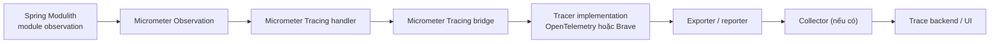
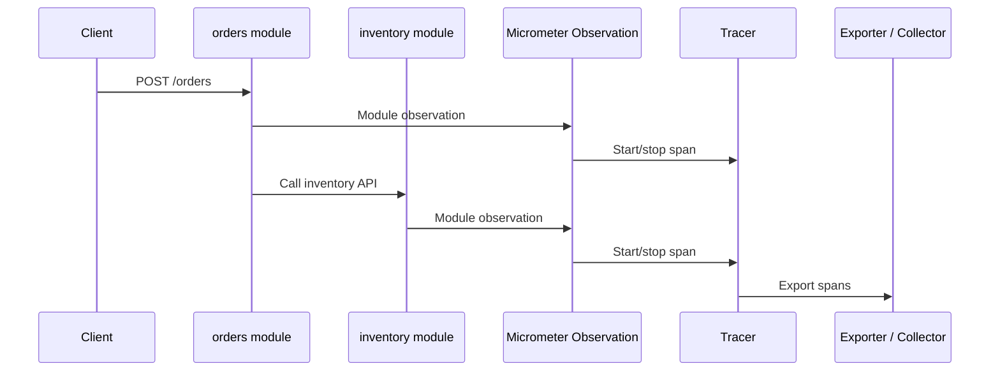

# Chọn tracer theo hạ tầng quan sát

## 1. Bài toán chọn tracer trong ứng dụng Spring Modulith

Một ứng dụng Spring Boot dùng **Spring Modulith** có thể gồm các application module như `orders`, `inventory`, `payments` và `notifications`. Khi một request đi qua nhiều module, nhóm phát triển muốn theo dõi đường đi của request, thời gian ở từng module, lỗi tại listener và mối liên hệ giữa logs với traces.

Spring Modulith có thể tạo **observation tại ranh giới application module**. Micrometer Observation là lớp instrumentation trung lập; để biến các observation thành distributed traces và gửi chúng tới hệ thống giám sát, ứng dụng cần một triển khai tracer cùng exporter/reporter tương thích.

Trong chương **Micrometer tracing** của module **SPRING_MODULITH_DOCUMENTATION_OBSERVABILITY**, bài này trả lời câu hỏi **“Chọn tracer theo hạ tầng quan sát”**. Trọng tâm không phải chọn thư viện theo mức độ phổ biến, mà là ghép đúng các lớp: Spring Boot/Micrometer, tracer bridge, exporter và trace backend đang có trong hệ thống.

Sau bài học, bạn có thể:

- Phân biệt Micrometer Tracing, tracer implementation, bridge, exporter và backend.
- Chọn OpenTelemetry hoặc OpenZipkin Brave theo collector/backend và yêu cầu vận hành.
- Chọn dependency đúng cho Spring Boot 3.5 và Spring Boot 4.2.
- Tránh đưa hai tracer bridge vào cùng classpath và tránh exporter đã bị ngừng hỗ trợ.
- Cấu hình sampling, endpoint, resource/service name và trace propagation.
- Kiểm chứng module spans, logs correlation và trace trên backend.

## 2. Trước hết, phân biệt các lớp trong tracing pipeline

Các thuật ngữ “tracer”, “exporter” và “backend” thường bị dùng thay thế cho nhau, nhưng chúng là những thành phần khác nhau:

| Thành phần | Vai trò | Ví dụ |
| --- | --- | --- |
| **Micrometer Observation** | API tạo observation một lần, có thể được xử lý bởi meter handler và tracing handler. | Observation cho lời gọi vào module `inventory`. |
| **Micrometer Tracing** | Facade/API thống nhất để ứng dụng làm việc với tracing. | `Tracer`, `Span`, `BaggageInScope`. |
| **Tracer implementation** | Quản lý vòng đời span, context, sampling và propagation. | OpenTelemetry SDK hoặc Brave. |
| **Bridge** | Kết nối Micrometer Tracing với tracer implementation. | `micrometer-tracing-bridge-otel` hoặc `micrometer-tracing-bridge-brave`. |
| **Exporter/reporter** | Đóng gói và gửi span ra ngoài qua giao thức/đích cụ thể. | OTLP exporter hoặc Zipkin reporter. |
| **Collector/agent** | Nhận telemetry, có thể xử lý, lọc, enrich hoặc chuyển tiếp dữ liệu. | OpenTelemetry Collector. |
| **Trace backend** | Lưu trữ, truy vấn và hiển thị traces. | Zipkin, Grafana Tempo, Jaeger hoặc nền tảng quan sát của nhà cung cấp. |

Luồng tổng quát:



Spring Boot Actuator cung cấp dependency management và auto-configuration cho Micrometer Tracing. Khi tracing được cấu hình, `TracingAwareMeterObservationHandler` được đăng ký vào `ObservationRegistry` để chuyển các observation thành spans. Spring Modulith cung cấp observation mang metadata module; tracer chịu trách nhiệm tạo và báo cáo span.

**Micrometer Tracing không phải một backend lưu trữ.** Cài bridge nhưng không có exporter/reporter và nơi nhận trace thì không thể mở dashboard để xem dữ liệu. Ngược lại, có Zipkin hoặc Tempo đang chạy cũng không đủ nếu ứng dụng không tạo và gửi spans.

## 3. Hai tracer được Micrometer Tracing hỗ trợ

Micrometer Tracing hiện hỗ trợ hai tracer implementation chính:

| Tracer | Đặc điểm | Hạ tầng thường ghép |
| --- | --- | --- |
| **OpenTelemetry** | Chuẩn mở, hệ sinh thái rộng; có SDK, API, propagators và nhiều exporter. | OTLP Collector, Tempo, Jaeger và các nền tảng nhận OTLP. |
| **OpenZipkin Brave** | Tracer gọn, gắn với hệ sinh thái Zipkin; tích hợp tốt khi tổ chức đã dùng Brave/Zipkin. | Zipkin reporter và Zipkin backend. |

### 3.1. OpenTelemetry

Chọn OpenTelemetry khi:

- Tổ chức đã có **OpenTelemetry Collector** hoặc muốn chuẩn hóa đường gửi telemetry qua **OTLP**.
- Nhiều dịch vụ hoặc nhóm phát triển dùng các ngôn ngữ/framework khác nhau và cần một giao thức chung.
- Muốn giảm phụ thuộc vào một backend cụ thể; collector có thể định tuyến dữ liệu tới backend phù hợp.
- Hạ tầng quan sát đang xây dựng trên semantic conventions, resource attributes và hệ sinh thái OpenTelemetry.

Với Spring Boot 4.2, lựa chọn được tài liệu Spring Boot hỗ trợ trực tiếp là **OpenTelemetry với OTLP** qua starter `spring-boot-starter-opentelemetry`. Traces được gửi tới collector có endpoint OTLP, sau đó collector/backend quyết định lưu trữ và hiển thị.

### 3.2. OpenZipkin Brave

Chọn Brave khi:

- Hệ thống hiện tại đã sử dụng **Zipkin** và muốn một cấu hình đơn giản, ít thành phần trung gian.
- Các dịch vụ Java đang sử dụng Brave hoặc có yêu cầu tương thích với hạ tầng Zipkin hiện hữu.
- Nhóm vận hành đã quen với Zipkin reporter, endpoint và cách truy vấn trace của Zipkin.

Với Spring Boot 4.2, tài liệu Spring Boot cung cấp starter `spring-boot-starter-zipkin` cho Brave + Zipkin. Đây là lựa chọn phù hợp khi Zipkin là đích chính.

### 3.3. Chỉ chọn một bridge

Nếu tự khai báo dependency Micrometer Tracing, chỉ đưa **một** bridge vào runtime classpath:

```groovy
// OpenTelemetry bridge
runtimeOnly 'io.micrometer:micrometer-tracing-bridge-otel'

// Hoặc Brave bridge
runtimeOnly 'io.micrometer:micrometer-tracing-bridge-brave'
```

Không thêm cả hai bridge vào cùng một ứng dụng chỉ để “dự phòng”. Chúng là hai implementation khác nhau của cùng abstraction; để cả hai cùng có mặt có thể làm auto-configuration trở nên mơ hồ, xung đột bean hoặc tạo hành vi khó dự đoán. Chọn tracer phù hợp rồi cấu hình exporter tương ứng.

## 4. Chọn theo trace backend và giao thức

Một quyết định thực tế bắt đầu từ câu hỏi **hạ tầng đang nhận trace bằng giao thức nào?**

| Hạ tầng hiện có | Lựa chọn thường phù hợp | Lý do |
| --- | --- | --- |
| OpenTelemetry Collector nhận OTLP | OpenTelemetry + OTLP | Đi thẳng theo giao thức chuẩn của collector. |
| Grafana Tempo nhận OTLP | OpenTelemetry + OTLP | Không cần buộc ứng dụng dùng exporter riêng cho UI của Tempo. |
| Jaeger nhận OTLP | OpenTelemetry + OTLP | Có thể gửi qua collector hoặc endpoint OTLP của hạ tầng. |
| Zipkin là backend duy nhất, cần setup gọn | Brave + Zipkin | Spring Boot có starter tích hợp trực tiếp. |
| Zipkin nhưng muốn giữ OpenTelemetry | OpenTelemetry + OTLP tới collector/Zipkin OTel module | Tránh phụ thuộc exporter Zipkin của OpenTelemetry đã bị deprecated. |
| Nền tảng observability của nhà cung cấp nhận OTLP | OpenTelemetry + OTLP | Dùng collector hoặc endpoint OTLP theo hướng dẫn nhà cung cấp. |
| Ứng dụng cũ đã dùng Brave | Brave + reporter phù hợp | Giảm thay đổi tracer khi chưa có nhu cầu chuyển đổi. |

**Không chọn tracer chỉ dựa trên giao diện dashboard.** Cần xác nhận backend nhận được giao thức nào, exporter nào còn được hỗ trợ, có cần collector để thêm authentication/transform/batching không, và các dịch vụ liên quan đang propagate trace context theo chuẩn nào.

### 4.1. Lưu ý quan trọng với Zipkin và OpenTelemetry

Trong các phiên bản Spring Boot trước 4.2, OpenTelemetry có thể dùng `opentelemetry-exporter-zipkin` để gửi trực tiếp tới Zipkin. Tuy nhiên, exporter Zipkin của OpenTelemetry đã bị deprecated do dự án OpenTelemetry ngừng duy trì thành phần đó; Spring Boot 4.2 đã loại auto-configuration tương ứng.

Nếu hạ tầng đang dùng Zipkin:

- **Đường đơn giản:** dùng Brave + Zipkin.
- **Muốn giữ OpenTelemetry:** dùng OpenTelemetry + OTLP, rồi để collector hoặc Zipkin OTel module tiếp nhận OTLP.

Không nên bắt đầu dự án mới bằng cách ghép OpenTelemetry với exporter Zipkin đã bị ngừng hỗ trợ chỉ vì một ví dụ cũ vẫn còn trên Internet.

## 5. Chọn dependency theo phiên bản Spring Boot

Dependency thay đổi theo dòng Spring Boot. Đây là phần cần kiểm tra kỹ nhất khi copy cấu hình giữa các dự án.

### 5.1. Spring Boot 4.2: dùng starter chuyên biệt

Theo tài liệu Spring Boot 4.2, hai tổ hợp phổ biến có starter riêng:

| Lựa chọn | Dependency tracing |
| --- | --- |
| OpenTelemetry + OTLP | `org.springframework.boot:spring-boot-starter-opentelemetry` |
| Brave + Zipkin | `org.springframework.boot:spring-boot-starter-zipkin` |

Ví dụ Gradle khi chọn **OpenTelemetry + OTLP**:

```groovy
dependencies {
    implementation 'org.springframework.boot:spring-boot-starter-actuator'

    // Spring Modulith tạo module observations ở runtime.
    runtimeOnly 'org.springframework.modulith:spring-modulith-observability-core'

    // Spring Boot 4.2: Micrometer Tracing + OpenTelemetry + OTLP.
    runtimeOnly 'org.springframework.boot:spring-boot-starter-opentelemetry'
}
```

Nếu chọn **Brave + Zipkin**, thay starter OpenTelemetry bằng:

```groovy
runtimeOnly 'org.springframework.boot:spring-boot-starter-zipkin'
```

Hai đoạn starter tracing là **hai lựa chọn thay thế nhau**, không khai báo cả hai. Ví dụ giả định dự án đã dùng Spring Boot dependency management và Spring Modulith BOM tương thích; không cần tự gắn version riêng cho từng dependency nếu BOM đã quản lý.

Ví dụ cấu hình OpenTelemetry + OTLP:

```yaml
spring:
  application:
    name: shop-backend

management:
  tracing:
    sampling:
      probability: 0.1
  opentelemetry:
    tracing:
      export:
        otlp:
          endpoint: "http://otel-collector:4318/v1/traces"
```

Ví dụ cấu hình Brave + Zipkin:

```yaml
spring:
  application:
    name: shop-backend

management:
  tracing:
    sampling:
      probability: 0.1
    export:
      zipkin:
        endpoint: "http://zipkin:9411/api/v2/spans"
```

Đây là hai cấu hình **riêng cho hai lựa chọn**. Endpoint phải khớp HTTP/gRPC transport, URL và authentication của hạ tầng đang chạy. Nếu collector dùng TLS hoặc token, cấu hình SSL/headers theo property và secret management của dự án; không ghi credential vào file cấu hình được commit.

### 5.2. Spring Boot 3.5: khai báo bridge và exporter

Trong Spring Boot 3.5, cách ghép phổ biến là thêm Actuator, một bridge và exporter/reporter tương ứng.

OpenTelemetry + OTLP:

```groovy
dependencies {
    implementation 'org.springframework.boot:spring-boot-starter-actuator'
    runtimeOnly 'org.springframework.modulith:spring-modulith-observability-core'

    runtimeOnly 'io.micrometer:micrometer-tracing-bridge-otel'
    runtimeOnly 'io.opentelemetry:opentelemetry-exporter-otlp'
}
```

Brave + Zipkin:

```groovy
dependencies {
    implementation 'org.springframework.boot:spring-boot-starter-actuator'
    runtimeOnly 'org.springframework.modulith:spring-modulith-observability-core'

    runtimeOnly 'io.micrometer:micrometer-tracing-bridge-brave'
    runtimeOnly 'io.zipkin.reporter2:zipkin-reporter-brave'
}
```

Cấu hình OTLP trong Spring Boot 3.5:

```yaml
management:
  tracing:
    sampling:
      probability: 0.1
  otlp:
    tracing:
      endpoint: "http://otel-collector:4318/v1/traces"
```

Cấu hình Zipkin trong Spring Boot 3.5:

```yaml
management:
  tracing:
    sampling:
      probability: 0.1
  zipkin:
    tracing:
      endpoint: "http://zipkin:9411/api/v2/spans"
```

Trong cả hai ví dụ, Spring Boot BOM quản lý phiên bản Micrometer/Spring Boot và các dependency tương thích. Không tự nâng riêng bridge hoặc exporter lên phiên bản mới không tương thích với BOM.

### 5.3. Bảng ghi nhớ property

| Hạng mục | Spring Boot 3.5 | Spring Boot 4.2 |
| --- | --- | --- |
| OpenTelemetry + OTLP | `management.otlp.tracing.*` | `management.opentelemetry.tracing.export.otlp.*` |
| Brave + Zipkin | `management.zipkin.tracing.*` | `management.tracing.export.zipkin.*` |
| Sampling probability | `management.tracing.sampling.probability` | `management.tracing.sampling.probability` |
| OpenTelemetry bridge | `micrometer-tracing-bridge-otel` | Starter `spring-boot-starter-opentelemetry` |
| Brave bridge | `micrometer-tracing-bridge-brave` | Starter `spring-boot-starter-zipkin` |

Không trộn property namespace của Boot 3.5 và 4.2. Nếu property không được bind, ứng dụng có thể vẫn khởi động nhưng exporter không gửi đến endpoint mà bạn nghĩ.

## 6. Micrometer Tracing và Spring Modulith phối hợp thế nào?

Spring Modulith Observability Core instrument các điểm vào application module và tạo **Micrometer Observation** với metadata module. Khi Spring Boot có Micrometer Tracing và tracing handler phù hợp, observation có thể trở thành span.

Một luồng điển hình:



Trong trace backend, span ở ranh giới module có thể mang các tag như:

| Tag | Ý nghĩa |
| --- | --- |
| `module.identifier` | Định danh module được gọi. |
| `module.name` | Tên hiển thị của module. |
| `module.invocation-type` | Kiểu invocation, ví dụ bean hoặc event listener. |
| `module.method` | Method ở điểm vào module. |

**Tracer được chọn không thay đổi ý nghĩa các tag module.** Nó quyết định cách span được tạo, context được quản lý và dữ liệu được export. Vì vậy có thể đổi backend/tracer theo kiến trúc vận hành mà vẫn giữ cách instrument module dựa trên Micrometer Observation, miễn là cấu hình và semantics được hỗ trợ.

### 6.1. Module graph khác trace backend

- **Module graph** từ Spring Modulith Documenter hoặc Modulith Actuator cho biết các module và dependency trong mô hình cấu trúc.
- **Event metrics** cho biết số lần domain event được công bố theo module và event type.
- **Module spans** cho thấy những điểm vào module được instrument trong các trace được ghi nhận.
- **Trace backend** lưu trữ và cho phép tìm kiếm hành trình/span.

Zipkin/Tempo/Jaeger không tự sinh module graph; Module Actuator cũng không thay thế tracer. Cần kết hợp các công cụ theo đúng câu hỏi cần trả lời.

## 7. Sampling, propagation và chi phí vận hành

### 7.1. Sampling không phải tỷ lệ lỗi

Spring Boot mặc định sample **10%** request để tránh tạo quá nhiều trace. Có thể điều chỉnh bằng:

```yaml
management:
  tracing:
    sampling:
      probability: 1.0
```

Giá trị `1.0` tương đương sample 100%, thích hợp cho môi trường local hoặc một bài thực hành có lưu lượng nhỏ. Production thường cần cân nhắc lưu lượng, chi phí lưu trữ, yêu cầu điều tra và chiến lược sampling ở collector/backend. Sample 10% **không có nghĩa 10% request bị lỗi**; đó là tỷ lệ trace được chọn để thu thập.

Khi dùng OpenTelemetry ở Spring Boot 4.2, có thể cấu hình sampler qua `management.opentelemetry.tracing.sampler`, ví dụ sampler parent-based. Cần giữ nhất quán quyết định sampling theo trace để các service liên quan không tùy ý giữ/bỏ các đoạn khác nhau.

### 7.2. Propagation phải tương thích giữa các dịch vụ

Để trace đi qua HTTP, hãy dùng các builder do Spring Boot cấu hình như `RestClient.Builder` hoặc `WebClient.Builder` (và `RestTemplateBuilder` ở các phiên bản hỗ trợ). Tạo client thủ công mà không có instrumentation có thể khiến trace header không được inject tự động.

Nếu một dịch vụ phát W3C Trace Context nhưng dịch vụ nhận chỉ đọc B3, trace có thể bị tách. Cần thống nhất propagator hoặc cấu hình consume/produce phù hợp với các dịch vụ liên quan. Với Spring Boot, xem các property `management.tracing.propagation.*` và tài liệu phiên bản đang dùng.

Với event bất đồng bộ hoặc message broker, cần đảm bảo trace context được inject/extract qua message headers. ContextPropagatingTaskDecorator hỗ trợ chuyển context giữa thread trong cùng JVM; nó **không tự truyền context qua network**.

### 7.3. Resource attributes và tên service

Nên đặt `spring.application.name` rõ ràng để trace backend phân biệt dịch vụ:

```yaml
spring:
  application:
    name: shop-backend
```

Một tiến trình `shop-backend` có thể chứa nhiều module như `orders`, `inventory` và `payments`. **Service name** nhận diện dịch vụ/tiến trình; `module.identifier` nhận diện module trong dịch vụ. Không đặt mỗi module thành service riêng nếu chúng vẫn chạy trong cùng một ứng dụng và không có ranh giới deploy độc lập, trừ khi mô hình observability của tổ chức chủ động yêu cầu như vậy.

## 8. Quy trình chọn tracer trong một dự án thật

Thực hiện theo thứ tự để tránh thêm dependency theo cảm tính:

1. **Xác định phiên bản Spring Boot:** xem BOM/plugin và dòng đang chạy (ví dụ 3.5 hoặc 4.2). Từ đây mới chọn artifact và property namespace.
2. **Xác định backend/collector:** backend nhận OTLP hay Zipkin API? Có collector/agent ở giữa không? Endpoint, transport, TLS và auth là gì?
3. **Chọn tracer:** OTLP/multi-backend thường ưu tiên OpenTelemetry; Zipkin thuần có thể dùng Brave + Zipkin.
4. **Chọn đúng một bridge/starter:** tránh đồng thời đưa OTel bridge và Brave bridge vào classpath.
5. **Bổ sung Spring Modulith instrumentation:** có `spring-modulith-observability-core` hoặc Insight starter nếu muốn module observations.
6. **Cấu hình endpoint và sampling:** kiểm tra endpoint có thể truy cập từ runtime, xác thực và tỷ lệ sample.
7. **Kiểm tra propagation:** dùng builder HTTP auto-configured; kiểm tra executor hoặc broker với async flow.
8. **Phát một request thử:** tìm trace theo service name, xem span HTTP và module entry span.
9. **Kiểm tra metadata:** xác nhận `module.identifier`, `module.invocation-type` và `module.method` xuất hiện như mong đợi.
10. **Đánh giá vận hành:** kiểm tra queue/export errors, dropped spans, latency export, retention, sampling và quyền truy cập backend.

### 8.1. Ma trận quyết định ngắn

| Câu hỏi | Nếu câu trả lời là “có” |
| --- | --- |
| Tổ chức đã chuẩn hóa OpenTelemetry/OTLP? | Chọn OpenTelemetry + OTLP. |
| Backend/collector nhận OTLP? | Chọn OpenTelemetry + OTLP. |
| Chỉ có Zipkin và muốn cấu hình đơn giản? | Chọn Brave + Zipkin. |
| Dùng Spring Boot 4.2 và muốn gửi OTel tới Zipkin? | Dùng OTLP tới Zipkin OTel module/collector hoặc chọn Brave + Zipkin; không dùng OTel Zipkin exporter đã bị loại. |
| Có nhiều ngôn ngữ và nhiều backend? | Ưu tiên chuẩn hóa OTLP/collector. |
| Đang chạy hệ thống Brave ổn định? | Giữ Brave nếu chưa có lý do chuyển đổi; lên kế hoạch migration riêng khi cần. |

## 9. Kiểm chứng trace đã được gửi thành công

### 9.1. Kiểm tra ở phía ứng dụng

- Dependency runtime có đúng starter/bridge và exporter không?
- Có hai tracer bridge cùng lúc không?
- Spring Modulith observability core có mặt ở runtime không?
- Log khởi động có lỗi auto-configuration, endpoint, TLS hoặc authentication không?
- Sampling có đang loại trace thử nghiệm không?
- HTTP client có được tạo bằng builder đã instrument không?

### 9.2. Kiểm tra ở collector/backend

1. Xác nhận collector/backend đang chạy và lắng nghe đúng endpoint/port.
2. Xem log collector để biết có nhận OTLP/Zipkin spans hay bị reject.
3. Tìm theo `service.name`/service name và khoảng thời gian request thử.
4. Mở trace, kiểm tra `traceId`, span cha/con hoặc links.
5. Mở module entry span, kiểm tra các tag module và thời lượng.
6. Nếu trace chỉ có HTTP span, kiểm tra Spring Modulith instrumentation và điểm gọi bean API.
7. Nếu không có trace, kiểm tra sampling, exporter endpoint, network/TLS/auth và lỗi queue/export.

### 9.3. Đọc correlation ID trong log

Spring Boot có thể đưa `traceId` và `spanId` vào MDC để correlation ID xuất hiện trong log. Khi trace được gửi thành công, có thể tìm log cùng trace ID để đọc exception và sự kiện nghiệp vụ. Nhưng log correlation phụ thuộc context propagation; log thiếu ID chưa đủ kết luận request không có trace.

## 10. Các lỗi chọn sai tracer thường gặp

| Triệu chứng | Nguyên nhân có thể | Cách xử lý |
| --- | --- | --- |
| Ứng dụng không khởi động hoặc có nhiều bean tracer | Hai bridge (OTel và Brave) cùng nằm trong classpath | Chọn một bridge/starter; kiểm tra dependency tree. |
| Có observation nhưng backend không có trace | Thiếu tracer bridge hoặc exporter/reporter | Kiểm tra đủ pipeline từ Micrometer tới backend. |
| Dùng Boot 4.2 nhưng OTel Zipkin exporter không hoạt động | Hỗ trợ exporter Zipkin của OTel đã bị loại khỏi Boot 4.2 | Dùng OTLP tới collector/Zipkin OTel module hoặc Brave + Zipkin. |
| Dùng Boot 3.5 nhưng cấu hình endpoint theo Boot 4.2 | Sai namespace property | Dùng `management.otlp.tracing.*` hoặc `management.zipkin.tracing.*` theo lựa chọn. |
| Backend nhận trace nhưng không có module span | Chưa có Modulith observability core, lời gọi không đi qua điểm vào được instrument hoặc sampling | Kiểm tra dependency, module API, instrumentation và sampling. |
| Trace chỉ có một phần service | Propagation không tương thích, HTTP client không instrument hoặc broker thiếu inject/extract | Chuẩn hóa W3C/B3, dùng auto-configured builder và instrumentation transport. |
| Không tìm thấy trace trong UI | Sample bị loại, sai service name/time range hoặc collector không nhận | Kiểm tra sampling, resource attributes, exporter logs và collector. |
| Backend bị quá tải | Sampling quá cao, nhiều span không cần thiết, retention/export không phù hợp | Giảm sampling, giới hạn span attributes và điều chỉnh collector/backend. |
| Log có trace ID nhưng backend không có trace | MDC bị copy độc lập, exporter lỗi hoặc trace không được sample | Kiểm tra tracer context và export; không dựa vào MDC đơn lẻ. |

## 11. Bảo mật và dữ liệu trong trace

Trace có thể chứa URL, tên method, module identifier, exception, attributes và baggage. Trước khi chọn backend, cần xem:

- Ai có quyền truy cập trace UI và API?
- Dữ liệu được lưu ở khu vực nào, thời gian retention bao lâu?
- Có TLS, authentication và secret management cho exporter không?
- Span attributes/baggage có thể chứa user ID, token, email hoặc payload không?
- Có giới hạn số lượng và độ dài attribute để tránh chi phí ngoài dự kiến không?

Không đưa password, access token, dữ liệu thanh toán hoặc toàn bộ payload nghiệp vụ vào span. Nếu cần correlation với một giao dịch, dùng ID kỹ thuật được phép và chính sách truy cập phù hợp; không sử dụng baggage như kho dữ liệu tùy ý.

## 12. Ghi nhớ

Micrometer Tracing là **lớp facade**; OpenTelemetry và Brave là **tracer implementation**; bridge kết nối Micrometer với tracer; exporter/reporter chuyển span tới collector hoặc backend. Chọn tracer theo **giao thức và hạ tầng quan sát thực tế**:

- **OpenTelemetry + OTLP** phù hợp khi tổ chức có collector hoặc muốn chuẩn hóa giao thức mở, đa backend.
- **Brave + Zipkin** phù hợp khi hệ thống tập trung vào Zipkin và muốn tích hợp trực tiếp.
- **Spring Boot 3.5** thường khai báo bridge và exporter riêng; **Spring Boot 4.2** có starter chuyên biệt cho OpenTelemetry + OTLP và Brave + Zipkin.
- Chỉ dùng **một tracer bridge** trong một ứng dụng; kiểm tra sampling, propagation, exporter và backend trước khi kết luận tracing hoạt động.

Với Spring Modulith, giữ instrumentation ở Micrometer Observation giúp module entry spans có thể được ghi nhận bởi tracer đã chọn. Kết hợp traces với module graph, event metrics, logs và context propagation sẽ giúp nhóm kiểm chứng tương tác giữa các application module trong lúc hệ thống vận hành.

## Tài liệu tham khảo

- [Spring Boot 4.2 — Tracing](https://docs.spring.io/spring-boot/reference/actuator/tracing.html): các tracer được hỗ trợ, starter OTLP/Zipkin, sampling, propagation và exporter.
- [Spring Boot 3.5 — Tracing](https://docs.spring.io/spring-boot/3.5/reference/actuator/tracing.html): bridge và exporter cho OpenTelemetry/Brave, namespace property của Boot 3.5.
- [Micrometer Tracing — Supported Tracers](https://docs.micrometer.io/tracing/reference/tracers.html): OpenZipkin Brave và OpenTelemetry; chỉ chọn một bridge.
- [Micrometer Tracing — Supported Reporters](https://docs.micrometer.io/tracing/reference/reporters.html): reporter/exporter và trạng thái deprecated của OTel Zipkin exporter.
- [Micrometer Tracing — Glossary](https://docs.micrometer.io/tracing/reference/glossary.html): tracer, span, trace, context propagation và log correlation.
- [Spring Modulith — Production-ready Features](https://docs.spring.io/spring-modulith/reference/production-ready.html): module entry observations/spans và event metrics.
- [Spring Boot — Observability](https://docs.spring.io/spring-boot/reference/actuator/observability.html): Micrometer Observation và tích hợp observability.

> **Giới hạn phiên bản:** Các dependency và property trong bài đối chiếu Spring Boot 3.5 và 4.2. Khi dự án dùng phiên bản khác, cần mở tài liệu đúng phiên bản và BOM đang quản lý. Các endpoint, URL collector và authentication chỉ là ví dụ; cần thay bằng cấu hình hạ tầng thực tế trước khi triển khai.
