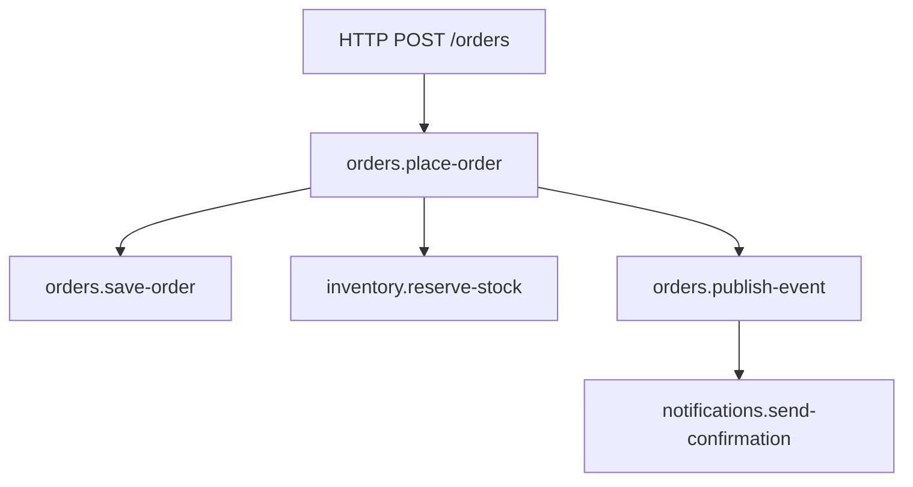
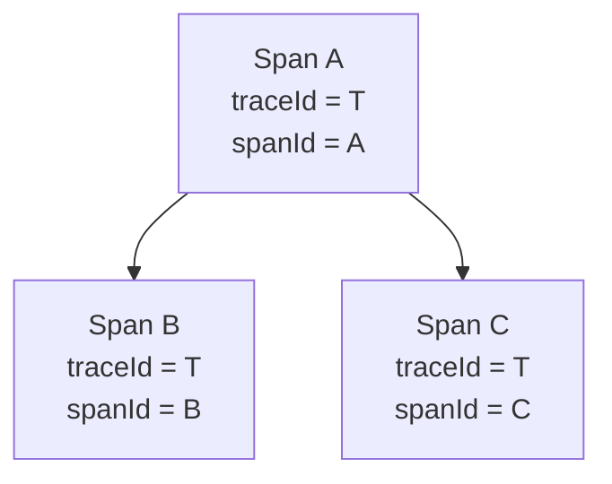
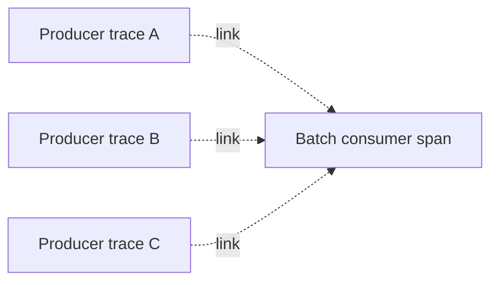
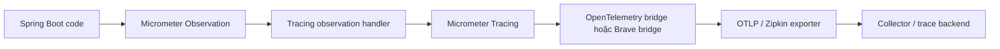

# Span name, trace id và span id

## 1. Vì sao cần hiểu ba thành phần này?

Trong ứng dụng Spring Boot sử dụng **Micrometer Tracing**, một thao tác có thể được ghi nhận thành một *span*. Nhiều span có quan hệ nhân quả được ghép lại thành một *trace*, giúp nhóm phát triển theo dõi hành trình của yêu cầu qua controller, service, database, HTTP client và các application module.

Ba thông tin xuất hiện thường xuyên khi đọc trace là:

- **Span name**: tên mô tả thao tác đang được đo, ví dụ `orders.place-order`.
- **Trace ID (`traceId`)**: định danh hành trình logic; các span thuộc cùng trace chia sẻ cùng trace ID.
- **Span ID (`spanId`)**: định danh một span cụ thể trong trace; mỗi span có ID riêng.

Chúng trả lời ba câu hỏi khác nhau: **đang làm việc gì, thuộc hành trình nào, và chính xác là đoạn thực thi nào?** Nếu nhầm lẫn ba khái niệm, việc tìm trace, nối log, phân tích độ trễ và xác định module gây lỗi sẽ khó chính xác.

Trong module `SPRING_MODULITH_DOCUMENTATION_OBSERVABILITY`, Micrometer Tracing kết hợp với Spring Modulith giúp quan sát tương tác giữa các application module trong ứng dụng Spring Boot. Module graph cho biết cấu trúc và dependency tĩnh; span/trace ghi nhận những thao tác runtime đã được instrument. Các thuộc tính như `module.identifier` và `module.name` giúp nhận diện module trên module entry span, còn span name, trace ID và span ID giúp xác định thao tác và hành trình xử lý.

## 2. Trace và span là gì?

**Trace** biểu diễn đường đi của một hoạt động logic qua một hoặc nhiều thành phần. **Span** biểu diễn một thao tác đơn lẻ trong đường đi đó, chẳng hạn xử lý HTTP request, gọi service, truy vấn database hoặc gửi request tới service khác.

Ví dụ một yêu cầu đặt hàng:



Mỗi node có thể tương ứng với một span nếu điểm đó được instrumentation hỗ trợ. Những span thuộc cùng một trace có chung `traceId`; mỗi span có `spanId` riêng và ghi lại span cha trực tiếp nếu có.

| Khái niệm | Phạm vi | Câu hỏi trả lời |
| --- | --- | --- |
| **Trace** | Toàn bộ hành trình logic | Yêu cầu này đã đi qua những bước nào? |
| **Span** | Một thao tác trong hành trình | Bước này bắt đầu/kết thúc khi nào, mất bao lâu? |
| **Span name** | Loại thao tác được ghi nhận | Span này đang làm việc gì? |
| **Trace ID** | Nhóm các span thuộc cùng trace | Các span nào thuộc cùng hành trình? |
| **Span ID** | Một span cụ thể | Đang xem chính xác đoạn thực thi nào? |
| **Parent span ID** | Quan hệ cha trực tiếp | Thao tác nào đã khởi tạo span này? |

Trace không nhất thiết là một object duy nhất được ứng dụng gửi đi. Backend thường thu thập nhiều span độc lập rồi nhóm theo trace ID và quan hệ parent-child hoặc links để dựng giao diện trace. Do đó, trace có thể hiển thị thiếu một số span nếu sampling, exporter, collector hoặc backend làm rơi dữ liệu.

## 3. Span name: tên của thao tác

**Span name** là chuỗi mô tả ngắn gọn loại thao tác mà span đại diện. Tên nên ổn định và có ý nghĩa khi nhóm nhiều lần thực thi cùng một loại công việc.

Ví dụ:

| Tên span | Đánh giá | Lý do |
| --- | --- | --- |
| `GET /orders/{orderId}` | Tốt | Thể hiện route, không đưa ID cụ thể vào tên |
| `orders.place-order` | Tốt | Tên nghiệp vụ rõ ràng và ổn định |
| `inventory.reserve-stock` | Tốt | Phân biệt thao tác ở module tồn kho |
| `GET /orders/ORD-2026-001` | Không nên | Mỗi order có thể tạo một tên khác nhau |
| `place-order-8f32a9` | Không nên | Tên chứa ID động làm tăng cardinality |
| `request` | Quá chung | Khó phân biệt các loại thao tác |

Nguyên tắc quan trọng: **span name mô tả lớp thao tác, còn dữ liệu của một lần thực thi cụ thể nằm ở attributes**. Ví dụ `orders.get-order` có thể giữ nguyên tên; `order.id` là attribute nếu cần truy vết một đơn cụ thể và chính sách dữ liệu cho phép.

Không nên đưa email, access token, số thẻ, thông tin cá nhân hoặc payload nhạy cảm vào span name hay attributes. Dữ liệu trong trace có thể được gửi đến hệ thống quan sát tập trung và được nhiều nhóm vận hành truy cập.

### 3.1. Span name khác module name

Trong Spring Modulith, module entry span có thể mang các tag như `module.identifier`, `module.name`, `module.method` và `module.invocation-type`.

Ví dụ:

```text
service.name             = shop-app
span.name                = orders.place-order
module.identifier        = orders
module.name              = Orders
module.method            = placeOrder
module.invocation-type   = bean
```

`span.name` mô tả thao tác; `module.name` nhận diện module. Một ứng dụng modular monolith có thể có nhiều module span nhưng cùng `service.name=shop-app`. Không cần đổi `service.name` thành tên từng module để phân biệt chúng.

## 4. Trace ID và span ID khác nhau thế nào?

Theo mô hình dữ liệu trace của OpenTelemetry:

- **Trace ID** là 16 byte, thường hiển thị dưới dạng chuỗi hexadecimal 32 ký tự.
- **Span ID** là 8 byte, thường hiển thị dưới dạng chuỗi hexadecimal 16 ký tự.
- Các giá trị ID hợp lệ không được toàn số 0.
- Mọi span thuộc cùng trace chia sẻ trace ID.
- Mỗi span có span ID riêng; một span được tham chiếu bằng cặp `(traceId, spanId)`.

Ví dụ:

```text
Trace ID:  4bf92f3577b34da6a3ce929d0e0e4736

Span A:
  Span ID:        00f067aa0ba902b7
  Parent Span ID: (none - root span)

Span B:
  Span ID:        7c9e4f21a6b8d301
  Parent Span ID: 00f067aa0ba902b7

Span C:
  Span ID:        92bd3a4e8f107c65
  Parent Span ID: 00f067aa0ba902b7
```

Trong ví dụ, A là root span; B và C là hai span con. Cả ba có cùng trace ID, nhưng mỗi span có span ID khác nhau.



**Trace ID không phải ID của đơn hàng, người dùng hay request nghiệp vụ.** Nó là định danh kỹ thuật cho một trace. Một giao dịch nghiệp vụ có thể tạo nhiều trace nếu công việc được tách thành những hành trình riêng, retry hoặc bắt đầu ở ranh giới xử lý mới. Ngược lại, một trace có thể chứa nhiều module và nhiều service.

Span ID cũng không phải ID toàn cục để tìm một hoạt động mà không cần trace ID. Cặp `(traceId, spanId)` mới xác định span trong mô hình trace. Không dùng các ID này làm metric labels vì gần như mỗi lần thực thi có thể sinh giá trị mới.

## 5. Parent span, child span và root span

Một span có thể có **không quá một parent span trực tiếp**. Nếu không có parent, span đó là **root span** và mở đầu một trace mới. Khi tạo child span:

1. Child giữ nguyên trace ID của parent.
2. Child tạo một span ID mới.
3. Parent span ID của child bằng span ID của parent trực tiếp.

Ví dụ một luồng qua hai application module:

```text
Trace ID = T1

HTTP server span
  spanId = S1
  parent = none
  name = POST /orders

  orders module span
    spanId = S2
    parentSpanId = S1
    name = orders.place-order

    inventory module span
      spanId = S3
      parentSpanId = S2
      name = inventory.reserve-stock
```

Quan hệ cha-con mô tả **quan hệ nhân quả trực tiếp**, không chỉ là thứ tự thời gian. Hai span cùng trace ID không nhất thiết là cha-con của nhau; chúng có thể là anh em nếu cùng parent.

Span con có thể chạy lâu hơn span cha hoặc hai span anh em có thể chạy song song. Khi phân tích waterfall, không nên cộng tất cả thời lượng span con rồi so trực tiếp với thời lượng span cha vì các đoạn có thể chồng lấp.

### 5.1. Span links khi không có một parent duy nhất

Parent-child phù hợp khi một thao tác có một nguyên nhân trực tiếp. Với xử lý batch, fan-in hoặc tác vụ tổng hợp từ nhiều message, một span có thể liên hệ nhân quả với nhiều span khác. **Span link** biểu diễn những quan hệ đó mà không biến mọi nguồn thành parent.

Ví dụ một consumer xử lý batch gồm ba message đến từ ba trace:



Link không nhập ba trace thành một trace duy nhất. Nó chỉ thêm quan hệ nhân quả giữa các span. Với event xử lý trễ hoặc retry sau khi request gốc đã kết thúc, có thể cân nhắc trace mới kèm link thay vì ép một span con vào parent đã đóng.

## 6. W3C `traceparent`: truyền trace ID và parent span ID qua HTTP

Khi một service gọi service khác, tracing context phải được truyền theo giao thức để service nhận có thể tiếp tục trace. Với **W3C Trace Context**, header phổ biến là `traceparent`.

Ví dụ:

```http
traceparent: 00-4bf92f3577b34da6a3ce929d0e0e4736-00f067aa0ba902b7-01
```

Cấu trúc:

```text
version - trace-id                         - parent-id       - trace-flags
00      - 4bf92f3577b34da6a3ce929d0e0e4736 - 00f067aa0ba902b7 - 01
```

| Thành phần | Độ dài trong dạng hexadecimal | Ý nghĩa |
| --- | ---: | --- |
| `version` | 2 ký tự | Phiên bản header |
| `trace-id` | 32 ký tự | Trace ID đang được tiếp tục |
| `parent-id` | 16 ký tự | Span ID của phía gửi, trở thành parent ở phía nhận |
| `trace-flags` | 2 ký tự | Các cờ, trong đó bit sampled cho biết quyết định lấy mẫu |

Khi service B nhận header hợp lệ, nó giữ trace ID, coi parent ID trong header là span cha từ xa và tạo span ID mới cho hoạt động xử lý ở B. Khi B gọi tiếp service C, B truyền context của span hiện tại; trace ID vẫn giữ nguyên nhưng parent ID trong header mới sẽ là span ID của B.

Việc **truyền context** khác với việc **xuất span**. Một service có thể truyền trace context hợp lệ nhưng không ghi hoặc không xuất span do sampling hay cấu hình. Khi đó service phía sau vẫn có thể tạo span cùng trace ID, nhưng trace hiển thị trong backend sẽ thiếu một đoạn.

## 7. Micrometer Tracing nằm ở đâu trong Spring Boot?

**Micrometer Tracing** cung cấp facade thống nhất để Spring Boot và ứng dụng thao tác với tracer backend. Các implementation phổ biến gồm:

- **OpenTelemetry**: thường xuất dữ liệu qua OTLP tới OpenTelemetry Collector hoặc backend tương thích.
- **Brave**: thường kết hợp Zipkin hoặc reporter tương ứng.

Spring Boot Actuator cung cấp dependency management và auto-configuration cho Micrometer Tracing. Spring Boot cũng tích hợp Micrometer Observation: khi observation được hoàn tất, `TracingAwareMeterObservationHandler` có thể tạo span tương ứng nếu tracing được cấu hình.



Spring Modulith Observability có thể bổ sung module entry spans cho các điểm vào API của application module được hỗ trợ. Các instrumentation HTTP, database và custom observation có thể tạo thêm spans. Tất cả có thể cùng xuất hiện trong trace nếu context được truyền đúng.

## 8. Cấu hình tracing trong Spring Boot

Ví dụ dưới đây dựa trên **Spring Boot 3.5** với OpenTelemetry và OTLP. Quản lý phiên bản bằng Spring Boot dependency management/BOM; không tự chọn các version Micrometer và OpenTelemetry không tương thích.

```xml
<dependencies>
    <dependency>
        <groupId>org.springframework.boot</groupId>
        <artifactId>spring-boot-starter-actuator</artifactId>
    </dependency>

    <dependency>
        <groupId>io.micrometer</groupId>
        <artifactId>micrometer-tracing-bridge-otel</artifactId>
    </dependency>

    <dependency>
        <groupId>io.opentelemetry</groupId>
        <artifactId>opentelemetry-exporter-otlp</artifactId>
    </dependency>
</dependencies>
```

Ví dụ cấu hình lấy mẫu và endpoint OTLP HTTP:

```yaml
management:
  tracing:
    sampling:
      probability: 1.0
  otlp:
    tracing:
      endpoint: http://localhost:4318/v1/traces
```

`probability: 1.0` hữu ích trong môi trường phát triển để dễ quan sát mọi trace. Spring Boot mặc định lấy mẫu khoảng **10% request** nhằm hạn chế tải lên trace backend; production cần chọn sampling policy phù hợp với lưu lượng và ngân sách. Với OpenTelemetry, Spring Boot còn hỗ trợ các sampler parent-based và trace-ID-ratio.

Ở các phiên bản Spring Boot mới hơn, dependency starter và namespace cấu hình OTLP có thể thay đổi. Tài liệu Spring Boot 4.2 dùng `spring-boot-starter-opentelemetry` và các thuộc tính `management.opentelemetry.tracing.export.otlp.*`. Hãy đối chiếu đúng phiên bản của dự án trước khi sao chép cấu hình.

**Có exporter chưa có nghĩa đã nhìn thấy trace.** Cần có collector/backend đang chạy, endpoint đúng, quyền truy cập mạng và sampling cho phép ghi nhận trace. Ví dụ với OTLP HTTP, collector thường nhận dữ liệu ở cổng 4318; với OTLP gRPC thường dùng cổng 4317, tùy cấu hình collector.

## 9. Đặt tên và tạo span bằng Micrometer Tracing API

Spring Boot tự instrument nhiều thao tác phổ biến. Khi cần đo một thao tác nghiệp vụ chưa có instrumentation, có thể tạo span thủ công bằng `Tracer`.

```java
package com.example.shop.orders;

import io.micrometer.tracing.Span;
import io.micrometer.tracing.TraceContext;
import io.micrometer.tracing.Tracer;
import org.slf4j.Logger;
import org.slf4j.LoggerFactory;
import org.springframework.stereotype.Service;

@Service
class OrderPricingService {

    private static final Logger log = LoggerFactory.getLogger(OrderPricingService.class);

    private final Tracer tracer;

    OrderPricingService(Tracer tracer) {
        this.tracer = tracer;
    }

    void calculateTotal() {
        Span span = tracer.nextSpan()
            .name("orders.calculate-total")
            .start();

        try (Tracer.SpanInScope scope = tracer.withSpan(span)) {
            TraceContext context = span.context();

            log.info("traceId={}, spanId={}, parentSpanId={}",
                context.traceId(), context.spanId(), context.parentId());

            span.tag("currency", "VND");
            span.event("pricing-calculation-started");

            // Thực hiện logic tính tổng tiền.
        }
        finally {
            span.end();
        }
    }
}
```

Giải thích:

1. `tracer.nextSpan()` tạo một span mới; nếu có span hiện tại trong scope, span hiện tại sẽ là parent.
2. `.name("orders.calculate-total")` đặt tên thao tác ổn định.
3. `.start()` bắt đầu đo thời gian.
4. `tracer.withSpan(span)` đặt span làm current span trong scope, giúp các thao tác được instrument bên trong có thể tạo span con.
5. `span.context()` cung cấp `TraceContext`; có thể đọc `traceId()`, `spanId()` và `parentId()`.
6. `span.end()` kết thúc span. Cần gọi kể cả khi logic ném exception.

Không cần tự sinh trace ID hoặc span ID. Tracer chịu trách nhiệm tạo và quản lý chúng. Nếu code đang nằm trong một HTTP request đã được instrument, span thủ công thường trở thành child của span hiện tại; nếu không có context cha, nó có thể mở một trace mới.

### 9.1. Tạo span con

Khi span cha đang ở trong scope, có thể tạo span con cho một bước cần phân tích riêng:

```java
Span child = tracer.nextSpan()
    .name("orders.load-pricing-rules")
    .start();

try (Tracer.SpanInScope scope = tracer.withSpan(child)) {
    // Đọc quy tắc giá.
}
finally {
    child.end();
}
```

Child giữ trace ID của parent, có span ID mới và parent ID trỏ tới span cha trực tiếp. Không tạo span cho từng câu lệnh nhỏ; chỉ instrument các bước có ý nghĩa chẩn đoán, độ trễ hoặc ranh giới giao tiếp.

## 10. Dùng Micrometer Observation khi cần cả metric và span

Nếu một thao tác cần vừa đo metrics vừa tạo span, thường nên dùng **Micrometer Observation** thay vì chỉ tạo span ở tầng thấp.

```java
package com.example.shop.inventory;

import io.micrometer.observation.Observation;
import io.micrometer.observation.ObservationRegistry;
import org.springframework.stereotype.Service;

@Service
class InventoryService {

    private final ObservationRegistry observationRegistry;

    InventoryService(ObservationRegistry observationRegistry) {
        this.observationRegistry = observationRegistry;
    }

    void reserveStock() {
        Observation.createNotStarted("inventory.reserve-stock", observationRegistry)
            .contextualName("reserve stock")
            .lowCardinalityKeyValue("module.identifier", "inventory")
            .observe(() -> {
                // Logic dự trữ tồn kho.
            });
    }
}
```

Với tracing handler được cấu hình, observation có thể trở thành span. Low-cardinality key values có thể đi vào cả metric tags và span attributes; high-cardinality key values chỉ phù hợp cho span và vẫn cần kiểm soát dữ liệu/chi phí. Dùng `Observation` giúp thống nhất tên và tag giữa metrics và traces.

Nếu chỉ cần span và không cần metric observation tương ứng, Spring Boot cho phép dùng lower-level `Tracer` API như phần trước. Tránh tạo cả một Observation lẫn một span thủ công bọc cùng một đoạn logic nếu không có chủ đích, vì có thể tạo hai span chồng lấp và làm dashboard khó đọc.

## 11. Trace ID và span ID trong log

Spring Boot tích hợp Micrometer Tracing có thể tự đưa `traceId` và `spanId` vào **MDC**. Mặc định, correlation ID trong log được tạo từ hai giá trị đó, giúp tìm log liên quan tới span/trace.

Ví dụ log:

```text
[4bf92f3577b34da6a3ce929d0e0e4736-00f067aa0ba902b7] INFO  OrderService - Order accepted
```

Phần đầu là trace ID, phần sau là span ID hiện tại. Khi chuyển sang span con, trace ID thường giữ nguyên còn span ID thay đổi; do đó log của các bước khác nhau trong cùng trace có thể có cùng trace ID nhưng span ID khác nhau.

Có thể tùy chỉnh format correlation ID của Logback:

```yaml
logging:
  pattern:
    correlation: "[${spring.application.name:},%X{traceId:-},%X{spanId:-}] "
  include-application-name: false
```

Nếu tự cấu hình `logging.pattern.correlation`, giá trị này sẽ thay thế format mặc định; cần giữ đúng tên MDC key nếu đã đổi chúng. Việc correlation ID xuất hiện trong log còn phụ thuộc **context propagation**: khi task chuyển sang thread khác mà trace context không được truyền, MDC có thể không chứa ID mong đợi.

Không nên coi correlation ID là một định danh nghiệp vụ ổn định để lưu trong database. Nó phục vụ điều tra telemetry. Nếu cần liên kết đơn hàng giữa các lần retry hoặc qua nhiều trace, hãy dùng business ID/correlation ID riêng theo thiết kế nghiệp vụ.

## 12. Spring Modulith: đặt trace ID cạnh module span

Trong modular monolith, nhiều module cùng nằm trong một service triển khai. Spring Modulith Observability có thể tạo module entry span cho các component thuộc API module được hỗ trợ. Các tag như:

- `module.identifier`: định danh kỹ thuật của application module.
- `module.name`: tên module để đọc trên trace.
- `module.method`: phương thức được thực thi.
- `module.invocation-type`: kiểu gọi như `bean` hoặc `event listener`.

Ví dụ trace rút gọn:

```text
service.name = shop-app
traceId = T1

HTTP POST /orders
  spanId = S1

  orders.place-order
    spanId = S2
    parentSpanId = S1
    module.identifier = orders

    inventory.reserve-stock
      spanId = S3
      parentSpanId = S2
      module.identifier = inventory

    notifications.on-order-placed
      spanId = S4
      parentSpanId = S2
      module.identifier = notifications
```

Đây là sơ đồ minh họa quan hệ span. Với event listener bất đồng bộ, parent/trace relationship phụ thuộc cách event được dispatch và context propagation; listener có thể có trace riêng hoặc span link theo thiết kế. Không mặc định mọi listener đều là child span trực tiếp của producer.

Module graph và tracing trả lời hai câu hỏi khác nhau:

| Nguồn | Thông tin |
| --- | --- |
| `ApplicationModules` / `Documenter` | Module nào tồn tại, dependency tĩnh đi theo hướng nào? |
| `GET /actuator/modulith` | Bản ứng dụng đang chạy nhận diện module và dependency ra sao? |
| Span có `module.identifier` | Hoạt động runtime được instrument đang thực thi ở module nào? |
| Trace ID / span ID | Hoạt động thuộc hành trình nào và span cụ thể nào? |

Một span mang đúng module ID không chứng minh mọi dependency hợp lệ; dùng `ApplicationModules.verify()` để kiểm tra các quy tắc kiến trúc tĩnh. Ngược lại, graph có một module không có nghĩa module đó phải xuất hiện trong mọi trace: request có thể không đi qua module ấy.

## 13. Sampling, export và vì sao trace có thể bị thiếu

**Sampling** quyết định trace/span nào được ghi nhận và gửi tới backend. Spring Boot mặc định lấy mẫu khoảng 10% request. Nếu đặt `management.tracing.sampling.probability=1.0` trong môi trường dev, tỷ lệ lấy mẫu được nâng lên 100% theo cấu hình tương ứng.

Không thấy trace trong backend có thể do:

1. Request không được chọn bởi sampling.
2. Span chưa được instrument hoặc observation handler chưa được cấu hình.
3. Exporter chưa có endpoint hoặc không kết nối được collector.
4. Backend từ chối, lọc hoặc chưa xử lý xong batch span.
5. Trace được chia thành hành trình khác do mất context propagation hoặc chủ ý bắt đầu trace mới.
6. Một số span đã bị giới hạn bởi cấu hình span limits hoặc bị loại trong quá trình xử lý.

Sampling không đồng nghĩa với việc ID không tồn tại. Một `traceId` có thể được truyền qua request/message dù một số span không được xuất. Vì vậy, trace trong backend có thể là **mảnh dữ liệu không đầy đủ**.

Với OpenTelemetry, Spring Boot cho phép cấu hình giới hạn số attributes, events, links và độ dài giá trị chuỗi của span qua `management.opentelemetry.tracing.limits.*`. Những giới hạn này giúp bảo vệ bộ nhớ và kích thước dữ liệu, nhưng cũng có thể khiến một số thuộc tính không xuất hiện nếu vượt giới hạn.

## 14. Các lỗi thường gặp khi đọc span name và IDs

| Triệu chứng / nhận định | Nguyên nhân có thể | Cách kiểm tra |
| --- | --- | --- |
| Nhiều span có cùng `traceId` | Bình thường: chúng thuộc cùng hành trình | So sánh `spanId` và `parentSpanId` |
| Hai span khác nhau có cùng `spanId` | Có thể đọc nhầm trace hoặc dữ liệu bị biến đổi | Dùng cặp `(traceId, spanId)` và kiểm tra dữ liệu gốc |
| `traceId` khác nhau giữa hai service | Context không được truyền, header không được inject/extract hoặc có trace boundary mới | Kiểm tra `traceparent`, HTTP client builder và propagation config |
| Không thấy span con dù có log ở service đích | Sampling, exporter, instrumentation hoặc trace context bị mất | Kiểm tra sampling, export và trace ID trong log |
| Span name chứa order ID | Tên span bị động hóa, gây nhiều tên khác nhau | Đưa ID vào attribute phù hợp, giữ tên thao tác ổn định |
| Span name quá chung như `process` | Khó phân biệt thao tác | Dùng tên nghiệp vụ/route cụ thể, ổn định |
| Log có trace ID nhưng backend không thấy trace | Log correlation và export là hai đường xử lý khác nhau; có thể sampling hoặc export lỗi | Kiểm tra sampled flag, exporter, collector và backend |
| Span child xuất hiện trước parent trong backend | Batch export/arrival không theo thứ tự hoặc dữ liệu chưa đầy đủ | Dựa vào parent ID, không chỉ dựa vào thứ tự nhận |
| Tên module khác với span name | Hai trường mô tả hai khái niệm khác nhau | Xem `module.identifier`/`module.name` cạnh span name |
| Thời gian child dài hơn parent | Có thể do async hoặc khoảng đo chồng lấp; cũng cần xem clock skew ở hệ thống phân tán | Kiểm tra parent-child, timestamps và context boundary |

Khi dùng `RestClient` hoặc `WebClient`, hãy tạo client từ builder auto-configured của Spring Boot để tracing context được truyền tự động. Tự tạo client không qua builder phù hợp có thể khiến header trace không được inject.

## 15. Bài thực hành: đọc một trace qua ba module

**Bối cảnh:** ứng dụng `shop-app` có module `orders`, `inventory`, `notifications`. Một request `POST /orders` tạo đơn hàng, gọi tồn kho và phát event cho module thông báo.

| Bước | Thực hiện | Tiêu chí hoàn thành |
| --- | --- | --- |
| 1 | Bật Actuator và Micrometer Tracing với exporter/backend | Có trace cho request thử nghiệm |
| 2 | Đặt sampling 100% ở môi trường dev | Dễ quan sát các lần chạy lặp lại |
| 3 | Gửi `POST /orders` | Backend tìm thấy trace theo request |
| 4 | Mở HTTP root span | Ghi nhận span name, trace ID và span ID |
| 5 | Mở module entry span của `orders` | Xác định `module.identifier=orders` và parent ID |
| 6 | Mở span của `inventory` | Xác nhận trace ID giữ nguyên, span ID khác và parent đúng theo luồng đồng bộ |
| 7 | Mở span của `notifications` listener | Xem `module.identifier`, invocation type và quan hệ async thực tế |
| 8 | Đối chiếu log | Dùng trace ID tìm các dòng log, dùng span ID xác định đoạn log tương ứng |
| 9 | Đối chiếu module graph | Xác nhận các module và dependency tĩnh hợp lệ |
| 10 | Thử bỏ context propagation ở một client thử nghiệm | Quan sát trace bị tách hoặc span cha không còn đúng |

### 15.1. Câu hỏi tự kiểm tra

1. **Một trace có nhiều span thì các span có chung span ID không?** Không. Chúng chia sẻ trace ID, mỗi span có span ID riêng.
2. **Root span có parent span ID không?** Không; root span không có parent.
3. **Khi tạo child span, trace ID thay đổi hay giữ nguyên?** Giữ nguyên; child có span ID mới và parent span ID trỏ tới span cha.
4. **Tên `GET /orders/ORD-123` có phù hợp làm span name không?** Không nên; dùng `GET /orders/{orderId}` hoặc tên route ổn định và đặt ID cụ thể vào attribute khi phù hợp.
5. **Có thể dùng span ID để tìm span mà không cần trace ID không?** Không nên; cặp `(traceId, spanId)` mới xác định span.
6. **Tại sao log có trace ID nhưng trace backend có thể thiếu span?** Vì propagation và export là hai hoạt động riêng; sampling, lỗi export hoặc giới hạn dữ liệu có thể làm span không xuất hiện.
7. **Một trace có thể chứa nhiều module nhưng cùng service name không?** Có; đây là trường hợp thường gặp của modular monolith.
8. **Nếu consumer xử lý một batch từ nhiều trace, có nhất thiết chọn một parent duy nhất không?** Không; span links có thể thể hiện quan hệ với nhiều producer spans.

## 16. Ghi nhớ

**Span name mô tả thao tác; trace ID nhóm các span trong một hành trình; span ID nhận diện một span cụ thể.** Các span cùng trace chia sẻ trace ID, nhưng có span ID khác nhau và quan hệ cha-con được thể hiện qua parent span ID. Root span không có parent; child span giữ trace ID của parent và tạo ID riêng.

Đặt span name ổn định, không đưa ID động vào tên. Dùng attributes để mô tả từng lần thực thi, kiểm soát dữ liệu nhạy cảm và tránh cardinality không cần thiết. Với Spring Boot, Micrometer Tracing kết hợp Observation handler, tracer bridge và exporter để tạo, truyền và xuất spans. Spring Modulith bổ sung module identity để đối chiếu trace với application module.

Khi điều tra sự cố, dùng trace ID để tìm toàn bộ hành trình, span ID để chọn đúng thao tác, parent ID/links để hiểu quan hệ nhân quả và log correlation để tìm chi tiết. Luôn kiểm tra sampling, export và context propagation trước khi kết luận rằng một module hoặc span không hề được thực thi.

### Tài liệu tham khảo

- [Spring Boot 3.5 — Tracing](https://docs.spring.io/spring-boot/3.5/reference/actuator/tracing.html): Micrometer Tracing, dependency, sampling, log correlation, propagation và custom spans.
- [Micrometer Tracing — Using Micrometer Tracing Directly](https://docs.micrometer.io/tracing/reference/api.html): tạo span, đặt tên, scope, tag và kết thúc span.
- [Micrometer Tracing — Span and Baggage Scopes](https://docs.micrometer.io/tracing/reference/context-contracts.html): current span và scope.
- [OpenTelemetry — Traces Data Model](https://opentelemetry.io/docs/specs/otel/trace/data-model/): Trace ID, Span ID, parent, links, span name và trace assembly.
- [OpenTelemetry — Tracing API](https://opentelemetry.io/docs/specs/otel/trace/api/): vòng đời span và quy tắc tạo span.
- [W3C — Trace Context](https://www.w3.org/TR/trace-context/): định dạng `traceparent` và propagation giữa các hệ thống.
