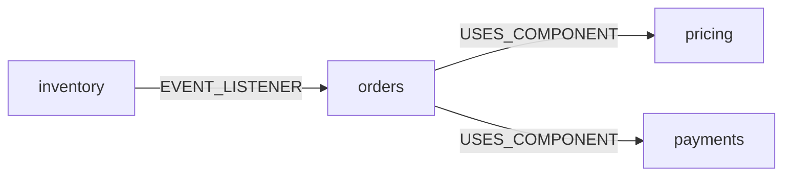
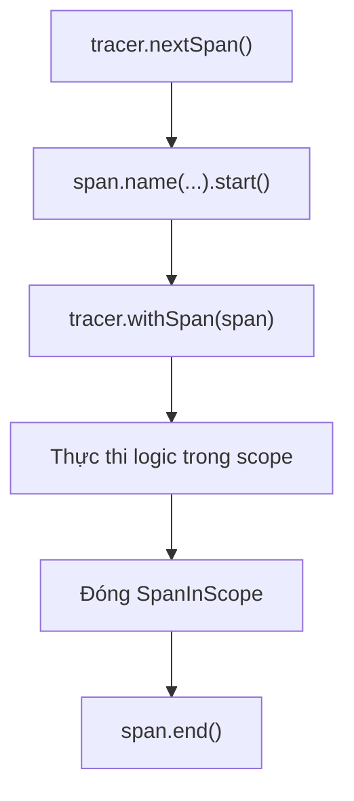

# Parent span và child span

> **Chương:** Micrometer tracing  
> **Bối cảnh:** Spring Modulith mô tả ranh giới application module và bổ sung thông tin quan sát cho các điểm tương tác giữa module trong ứng dụng Spring Boot. Bài này giải thích cách Micrometer Tracing tạo **parent span** và **child span**, cách span lồng nhau theo scope hiện hành, và cách liên kết các module spans trong một trace.

## Mục tiêu học tập

Sau bài này, bạn có thể:

1. Giải thích `traceId`, `spanId`, `parentSpanId` và cách xác định quan hệ cha–con trực tiếp.
2. Dùng `Tracer.nextSpan()`, `Tracer.withSpan(...)` và `Span.end()` đúng vòng đời.
3. Tạo span con từ context hiện hành hoặc từ một parent span được truyền tường minh.
4. Chọn giữa Micrometer Observation API và Tracer API cấp thấp khi bổ sung instrumentation.
5. Đọc quan hệ parent-child khi Spring Modulith tạo module entry spans, khi có HTTP client span và khi công việc chuyển sang luồng bất đồng bộ.
6. Chẩn đoán span bị tách trace, thiếu parent, bị kết thúc sai thời điểm hoặc bị lồng sai scope.

## 1. Span, trace và quan hệ parent-child

Một **span** biểu diễn một khoảng hoạt động có tên, thời điểm bắt đầu/kết thúc, trạng thái và metadata. Một **trace** liên kết các span có liên quan trong một lần thực thi. Quan hệ cha–con cho biết span nào là ngữ cảnh tạo ra span khác.

Ba định danh thường dùng:

| Trường | Ý nghĩa |
| --- | --- |
| `traceId` | Định danh toàn bộ trace; các span thuộc cùng trace chia sẻ giá trị này. |
| `spanId` | Định danh duy nhất của một span trong trace. |
| `parentSpanId` | ID của span cha trực tiếp; span root không có parent trong trace đó. |

Hai span là cha–con trực tiếp khi:

1. Chúng có cùng `traceId`.
2. `child.parentSpanId` bằng `parent.spanId`.

Chỉ có cùng `traceId` chưa đủ để kết luận cha–con. Hai span cùng trỏ tới một parent là **anh em**; span có parent là một span con có thể là cháu của span ở tầng cao hơn.

Ví dụ:

```text
Trace T1
└── HTTP POST /orders              spanId=S1, parent=none
    └── orders.Checkout.place      spanId=S2, parent=S1
        ├── pricing.Quote.calculate spanId=S3, parent=S2
        └── payments.Authorize      spanId=S4, parent=S2
```

Trong ví dụ, `S3` và `S4` là anh em; cả hai là con trực tiếp của `S2`. `S1` là ông của `S3` và `S4`, không phải parent trực tiếp của chúng.

### 1.1. Trace tree không phải module dependency graph

Module graph mô tả **phụ thuộc kiến trúc** được phát hiện từ mã nguồn. Trace tree mô tả **đường thực thi đã được instrument** trong một lần chạy.



Một trace của request có thể chỉ đi qua `orders` và `pricing`, không gọi `payments`. Cùng một module có thể xuất hiện nhiều span trong một trace nếu API được gọi nhiều lần. Vì vậy:

- Một cạnh trong module graph không bảo đảm luôn có một cạnh parent-child tương ứng trong mọi trace.
- Một parent-child span không nhất thiết biểu diễn dependency trực tiếp giữa hai module; span trung gian có thể là HTTP, database hoặc observation thủ công.
- Không thấy span có thể do code path không đi qua điểm được instrument, sampling hoặc lỗi exporter.

## 2. Micrometer Tracing quản lý current span

Micrometer Tracing cung cấp API thống nhất cho tracer như OpenTelemetry hoặc Brave. Trong code ứng dụng, thường inject `io.micrometer.tracing.Tracer`:

```java
import io.micrometer.tracing.Tracer;
import org.springframework.stereotype.Component;

@Component
class CheckoutTracing {

    private final Tracer tracer;

    CheckoutTracing(Tracer tracer) {
        this.tracer = tracer;
    }
}
```

Tracer cung cấp một số thao tác quan trọng:

| API | Vai trò |
| --- | --- |
| `tracer.currentSpan()` | Lấy span hiện đang active trong scope hiện tại; có thể trả `null` nếu chưa có. |
| `tracer.nextSpan()` | Tạo span mới; nếu có current span thì span mới là child, nếu không có thì bắt đầu trace mới. |
| `tracer.nextSpan(parent)` | Tạo child từ parent được truyền tường minh; không cần parent đó đang là current span. |
| `tracer.withSpan(span)` | Đặt span vào scope để nó trở thành current span; trả `SpanInScope` cần đóng. |
| `tracer.startScopedSpan(name)` | Tạo span và đặt nó vào scope ngay, phù hợp cho thao tác đơn luồng đơn giản. |

**Điểm cần nhớ:** tạo span, đặt span vào scope và kết thúc span là ba việc liên quan nhưng khác nhau.

## 3. Parent span và child span bằng `Tracer`

### 3.1. Tạo parent span

Khi chưa có span hiện hành, `tracer.nextSpan()` tạo một span root của trace mới. Khi một HTTP server span hoặc module entry span đang active, lời gọi `nextSpan()` tạo span con của span hiện tại.

```java
Span parent = tracer.nextSpan()
        .name("orders.checkout")
        .start();
```

Đoạn code trên tạo và bắt đầu span, nhưng **chưa làm span trở thành current**. Để các lời gọi tiếp theo tự nhận parent là span này, phải mở scope:

```java
try (Tracer.SpanInScope scope = tracer.withSpan(parent)) {
    // tracer.currentSpan() trả về parent trong scope này.
}
```

Khi `scope.close()` chạy, current span trước đó được khôi phục. Đóng scope **không kết thúc span**; vẫn phải gọi `parent.end()` riêng.

### 3.2. Tạo child từ current span

Ví dụ một thao tác checkout cần gọi bộ tính giá:

```java
Span parent = tracer.nextSpan()
        .name("orders.checkout")
        .start();

try (Tracer.SpanInScope parentScope = tracer.withSpan(parent)) {
    Span child = tracer.nextSpan()
            .name("pricing.calculate")
            .start();

    try (Tracer.SpanInScope childScope = tracer.withSpan(child)) {
        priceCalculator.calculate();
    }
    catch (RuntimeException | Error ex) {
        child.error(ex);
        throw ex;
    }
    finally {
        child.end();
    }
}
catch (RuntimeException | Error ex) {
    parent.error(ex);
    throw ex;
}
finally {
    parent.end();
}
```

Tại thời điểm `tracer.nextSpan()` chạy, `parent` đang là current span. Vì vậy `child` có `parentSpanId` trỏ tới `parent.spanId`. Khi `childScope` đóng, current span trở về `parent`; các lời gọi tiếp theo trong khối cha không vô tình trở thành con của `child`.

Ví dụ trên cố ý viết rõ hai vòng đời. Trong code sản phẩm, nên đóng gói thành helper hoặc ưu tiên Observation API khi cần tạo observation cho một thao tác nghiệp vụ.

### 3.3. Dùng parent tường minh

Nếu đang ở một thread khác nhưng có tham chiếu tới parent span đã capture, Micrometer hỗ trợ:

```java
Span child = tracer.nextSpan(parent)
        .name("pricing.calculate")
        .start();

try (Tracer.SpanInScope childScope = tracer.withSpan(child)) {
    priceCalculator.calculate();
}
finally {
    child.end();
}
```

`nextSpan(parent)` dùng context của parent được truyền. Đây là cách tạo quan hệ parent-child tường minh, nhưng **không tự truyền mọi context khác** như security context, transaction hay business data. Cũng cần đảm bảo tham chiếu parent còn phù hợp với vòng đời tracing và task không dùng chung mutable state không an toàn.

### 3.4. Cách ngắn hơn: `startScopedSpan`

Khi cần một span đơn giản trong code đồng bộ:

```java
ScopedSpan span = tracer.startScopedSpan("inventory.reserve");
try {
    inventoryService.reserve();
}
catch (RuntimeException | Error ex) {
    span.error(ex);
    throw ex;
}
finally {
    span.end();
}
```

`startScopedSpan()` tạo child từ current span (hoặc root nếu không có current span) và đưa nó vào scope. Khi `end()` được gọi, span kết thúc và scope được đóng theo API này. Dùng cách này khi không cần thao tác riêng với đối tượng `Span`.

## 4. Scope và vòng đời: ba thao tác không được nhầm

Với API mức thấp, trình tự thông thường là:



| Thao tác | Tác dụng | Nếu quên |
| --- | --- | --- |
| `start()` | Bắt đầu ghi nhận thời gian span | Span chưa được bắt đầu đúng cách. |
| `withSpan(...)` | Đặt span thành current trong một scope | Các span con có thể không nhận đúng parent; log có thể thiếu current trace context. |
| `SpanInScope.close()` | Khôi phục current context trước đó | Context có thể rò sang phần code khác hoặc thread được tái sử dụng. |
| `end()` | Kết thúc span và cho phép tracer báo cáo nó | Span có thể không được hoàn tất/xuất như mong đợi. |

`SpanInScope` độc lập với vòng đời span. Đóng scope không gọi `end()`. Ngược lại, gọi `end()` không thay thế việc đóng scope đang mở. Dùng try-with-resources để scope luôn được đóng khi code ném exception.

### 4.1. Không đặt scope ngoài thời gian cần thiết

```java
try (Tracer.SpanInScope scope = tracer.withSpan(parent)) {
    // Chỉ đặt current span trong phần thực thi thuộc parent.
    doCheckout();
}
```

Không giữ scope qua callback tùy ý hoặc qua một thread khác. Scope phải được đóng trên chính thread đã mở nó. Với công việc async, cần capture/propagate context hoặc dùng API tiếp tục span phù hợp; không chuyển đối tượng `SpanInScope` đang mở giữa các thread.

## 5. Khi nào nên dùng Observation API thay vì Tracer?

Spring Boot tích hợp Micrometer Observation với Micrometer Tracing. Khi một tracing observation handler được cấu hình, observation có thể tạo span; đồng thời low-cardinality key values có thể được dùng cho metrics.

Spring Boot khuyến nghị **Observation API** khi muốn đo một thao tác nghiệp vụ theo mô hình chung:

```java
import io.micrometer.observation.Observation;
import io.micrometer.observation.ObservationRegistry;
import org.springframework.stereotype.Component;

@Component
class PriceObservation {

    private final ObservationRegistry registry;

    PriceObservation(ObservationRegistry registry) {
        this.registry = registry;
    }

    void calculate() {
        Observation.createNotStarted("pricing.calculate", registry)
                .lowCardinalityKeyValue("operation", "price-calculation")
                .observe(() -> {
                    // Business logic.
                });
    }
}
```

Nếu observation được nối với tracing handler, khi đang có parent span active, span sinh ra từ observation có thể trở thành child của current span. Observation có thể phục vụ cả metrics và tracing tùy các handler đã đăng ký.

### 5.1. Dùng Tracer khi chỉ muốn span

Nếu cần một span mà không muốn tạo metric observation tương ứng, dùng API mức thấp:

```java
Span span = tracer.nextSpan()
        .name("pricing.external-calculation")
        .start();

try (Tracer.SpanInScope scope = tracer.withSpan(span)) {
    // Chỉ thao tác tracing/span.
}
finally {
    span.end();
}
```

### 5.2. So sánh lựa chọn

| Tiêu chí | Observation API | Tracer API |
| --- | --- | --- |
| Mục đích | Quan sát một hoạt động theo abstraction chung | Tạo/điều khiển span trực tiếp |
| Metrics | Có thể tạo metrics qua handler phù hợp | Không tự tạo meter chỉ vì tạo span |
| Tracing | Có thể sinh span khi tracing handler hoạt động | Tạo span trực tiếp |
| Parent-child | Dựa vào current observation/tracing scope | Dựa vào current span hoặc parent truyền tường minh |
| Mức kiểm soát | Convention/handler quản lý nhiều chi tiết | Kiểm soát tên, scope, tag, event và vòng đời span |
| Khi nên chọn | Instrument nghiệp vụ, method hoặc component thông thường | Span thuần tracing, cần parent cụ thể hoặc điều khiển cấp thấp |

Không tạo cả một Observation và một Span thủ công cho cùng một đoạn logic nếu không có lý do rõ ràng; việc này có thể tạo hai span lồng nhau hoặc dữ liệu bị đếm trùng.

## 6. Parent-child trong ứng dụng Spring Modulith

Spring Modulith có thể tạo module entry observations cho những điểm tương tác module được hỗ trợ, chẳng hạn lời gọi Spring bean ở API module và event listener. Khi tracing được tích hợp, những observations này xuất hiện dưới dạng **module entry spans**.

Ví dụ:

```text
com.example.shop
├── orders
│   └── CheckoutService
├── pricing
│   └── QuoteService
└── payments
    └── PaymentService
```

`CheckoutService` gọi `QuoteService` rồi `PaymentService` theo cách đồng bộ. Nếu cả ba điểm vào được instrument và span scope được duy trì:

```text
HTTP POST /orders
└── orders.CheckoutService.checkout
    ├── pricing.QuoteService.quote
    └── payments.PaymentService.authorize
```

Hai span `pricing` và `payments` thường là anh em vì mỗi lời gọi xảy ra khi scope của `orders` đang active. Nếu `pricing` gọi tiếp `tax.TaxService.calculate()`, span `tax` có thể là con của span `pricing`.

### 6.1. Module span và span tự tạo

Giả sử module `payments` có một bước kiểm tra rủi ro nội bộ:

```java
@Service
class PaymentService {

    private final Tracer tracer;
    private final RiskEvaluator riskEvaluator;

    PaymentService(Tracer tracer, RiskEvaluator riskEvaluator) {
        this.tracer = tracer;
        this.riskEvaluator = riskEvaluator;
    }

    void authorize() {
        Span span = tracer.nextSpan()
                .name("payments.risk-check")
                .start();

        try (Tracer.SpanInScope scope = tracer.withSpan(span)) {
            riskEvaluator.evaluate();
        }
        catch (RuntimeException | Error ex) {
            span.error(ex);
            throw ex;
        }
        finally {
            span.end();
        }
    }
}
```

Nếu `PaymentService.authorize()` đang chạy trong module entry span, `payments.risk-check` được tạo khi span module đang active nên có thể là **child** của module entry span đó.

Module entry span vẫn mô tả việc đi vào module; span tự tạo mô tả chi tiết bước rủi ro. Không cần công khai `RiskEvaluator` thành API module chỉ để có một span cho nó.

### 6.2. Cây span không phải call stack đầy đủ

Spring Modulith tập trung vào các điểm vào module được hỗ trợ. Một helper nội bộ, `this.method()`, object tự tạo bằng `new`, method không đi qua Spring proxy hoặc một thư viện không có instrumentation có thể không tạo span riêng.

Do đó:

- Có module entry span không có nghĩa mọi method bên trong đều có span.
- Không có child span không có nghĩa code con không được thực thi.
- Nếu cần đo một bước nội bộ có ý nghĩa, hãy thêm Observation hoặc Tracer span có chủ đích.

## 7. Parent-child qua HTTP và service khác

Trong hệ thống nhiều service, parent-child có thể tiếp tục qua mạng bằng cách truyền trace context trong HTTP headers. Với W3C Trace Context, header thường gặp là `traceparent`:

```http
traceparent: 00-4bf92f3577b34da6a3ce929d0e0e4736-00f067aa0ba902b7-01
```

Header mang trace ID, span ID của phía gửi và trace flags. Service nhận extract context, tạo server span có parent từ context được truyền.

Trong Spring Boot, dùng builder HTTP client được auto-configure để propagation tự động hoạt động:

```java
RestClient client = restClientBuilder
        .baseUrl("https://pricing.example")
        .build();
```

Hoặc:

```java
WebClient client = webClientBuilder
        .baseUrl("https://pricing.example")
        .build();
```

`RestClient.Builder`/`WebClient.Builder` ở đây là builder do Spring Boot cung cấp. Tạo client hoàn toàn độc lập bằng constructor/factory không dùng builder auto-configured có thể khiến trace context không được inject.

Nếu hai phía dùng propagation format khác nhau, chẳng hạn W3C và B3, cần cấu hình tương thích. Mất header hoặc proxy loại bỏ header có thể làm trace bị tách.

### 7.1. Remote parent và local child

Ví dụ:

```text
Service orders
Trace T1
└── HTTP POST /orders             span O1
    └── HTTP client -> pricing    span O2

Service pricing
Trace T1
└── HTTP server /quote            span P1, parent=O2
```

Trong UI tổng hợp cả hai service, `P1` là child của client span `O2`. Nếu chỉ xem dữ liệu phía service `pricing`, `O2` có thể không hiển thị vì nó thuộc service khác hoặc pipeline khác; parent không hiện trong UI không nhất thiết có nghĩa context không được truyền.

## 8. Parent-child với async và executor

Khi code chuyển sang thread khác bằng `@Async`, executor hoặc event listener bất đồng bộ, current span thường được lưu theo scope/thread context. Thread mới không tự nhận `ThreadLocal` của thread gửi.

Nếu không có context propagation:

```text
Trace T1
└── HTTP POST /orders
    └── orders.CheckoutService.checkout

Trace T2
└── notifications.ReceiptWorker.send
```

Nếu context được capture và restore đúng:

```text
Trace T1
└── HTTP POST /orders
    └── orders.CheckoutService.checkout
        └── notifications.ReceiptWorker.send
```

Đây là hình minh họa. Với tác vụ async, parent span có thể đã kết thúc trước khi child bắt đầu; tracing context đã capture vẫn có thể tạo quan hệ parent-child hợp lệ. Nếu hệ thống dùng span links thay vì parent-child cho một workflow bất đồng bộ, link là một quan hệ riêng, không phải `parentSpanId`.

### 8.1. Dùng Context Propagation

Với Spring Boot 3.5, có thể dùng `ContextPropagatingTaskDecorator` cho executor:

```java
import org.springframework.context.annotation.Bean;
import org.springframework.context.annotation.Configuration;
import org.springframework.core.task.support.ContextPropagatingTaskDecorator;

@Configuration(proxyBeanMethods = false)
class AsyncContextConfiguration {

    @Bean
    ContextPropagatingTaskDecorator contextPropagatingTaskDecorator() {
        return new ContextPropagatingTaskDecorator();
    }
}
```

Nếu tự tạo `ThreadPoolTaskExecutor`, gắn decorator trực tiếp vào executor thực sự được dùng:

```java
executor.setTaskDecorator(new ContextPropagatingTaskDecorator());
```

Ở các phiên bản Spring Boot mới có hỗ trợ, `spring.task.execution.propagate-context=true` bật propagation cho `AsyncTaskExecutor` auto-configured. Executor tùy biến vẫn cần được cấu hình riêng.

Context propagation chỉ khôi phục các context có accessor phù hợp. Nó không chuyển transaction JDBC đang hoạt động sang thread mới, và không thay thế cấu hình SecurityContext chuyên biệt.

### 8.2. Event listener của Spring Modulith

`@ApplicationModuleListener` chạy listener bất đồng bộ theo transaction và trong transaction mới theo ngữ nghĩa của Spring Modulith. Nếu muốn span listener liên kết với trace của event publisher, executor/dispatcher phải duy trì tracing context phù hợp.

Không suy luận:

- Listener chạy sau commit nên chắc chắn có cùng trace ID với request.
- Listener có cùng trace ID nên đang chia sẻ transaction của publisher.
- Không thấy listener span nên event chắc chắn không được nhận.

Hãy kiểm tra trace IDs, log, event publication registry (nếu bật), transaction phase và trạng thái nghiệp vụ.

## 9. Bắt exception và kết thúc span đúng cách

Span nên được kết thúc trong `finally` để không bị bỏ quên khi code ném lỗi:

```java
Span span = tracer.nextSpan()
        .name("payments.authorize")
        .start();

try (Tracer.SpanInScope scope = tracer.withSpan(span)) {
    paymentGateway.authorize();
}
catch (RuntimeException | Error ex) {
    span.error(ex);
    throw ex;
}
finally {
    span.end();
}
```

Các điểm cần nhớ:

1. `span.error(ex)` ghi nhận exception trên span; ứng dụng vẫn cần xử lý hoặc ném lại exception theo chính sách nghiệp vụ.
2. `span.end()` phải chạy đúng một lần sau khi công việc của span kết thúc.
3. `SpanInScope` tự đóng nhờ try-with-resources, kể cả khi có exception.
4. Đừng kết thúc parent span trước khi đoạn công việc đồng bộ thuộc parent hoàn tất.
5. Không giữ scope đang mở qua thread khác.

Nếu dùng Observation API, `observe(...)` hoặc `start()/openScope()/stop()` giúp quản lý vòng đời observation; vẫn cần bảo đảm các scope được đóng đúng thứ tự.

## 10. Sampling và khả năng nhìn thấy parent-child

Span có thể được tạo trong ứng dụng nhưng không được gửi đến backend do sampling. Spring Boot mặc định lấy mẫu một phần request (mặc định thường là 10% ở cấu hình chuẩn hiện hành); có thể cấu hình:

```yaml
management:
  tracing:
    sampling:
      probability: 1.0
```

`1.0` phù hợp cho lab hoặc điều tra ngắn hạn có kiểm soát; không nên tự động áp dụng cho production có lưu lượng lớn. Với OpenTelemetry có các sampler parent-based; child thường tuân theo quyết định lấy mẫu của parent.

Nếu parent được lấy mẫu nhưng child không hiển thị, kiểm tra:

- Child span có thực sự được tạo và kết thúc không?
- Exporter có báo lỗi hoặc batch chưa flush không?
- Collector có filter hoặc giới hạn attribute/span không?
- Backend có lọc theo service/time range không?
- Parent/child có được gửi đến cùng backend và cùng tenant không?

Không thấy một span trên UI không phải lúc nào cũng là bằng chứng code không chạy.

## 11. Đọc cây span trong trace backend

Quy trình điều tra:

1. Tìm trace theo `traceId`, request path hoặc correlation ID đã được kiểm soát.
2. Xác định span đầu vào HTTP hoặc remote parent.
3. Lọc module entry spans theo `module.identifier`, `module.method` và `module.invocation-type`.
4. So sánh `spanId` và `parentSpanId` để xác nhận parent trực tiếp.
5. Nhận diện span trung gian như HTTP client, database hoặc custom observation.
6. Xem waterfall và duration; parent thường bao gồm thời gian của child đồng bộ nên không cộng duration parent và child như hai khoảng độc lập.
7. Nếu có async, kiểm tra context propagation và khả năng child bắt đầu sau khi parent đã kết thúc.
8. Đối chiếu với `/actuator/modulith`, event metrics và kết quả nghiệp vụ.

### 11.1. Ví dụ metadata

Một span child minh họa:

```json
{
  "traceId": "aaaaaaaaaaaaaaaaaaaaaaaaaaaaaaaa",
  "spanId": "2222222222222222",
  "parentSpanId": "1111111111111111",
  "name": "pricing.calculate",
  "attributes": {
    "module.identifier": "pricing",
    "module.invocation-type": "bean"
  }
}
```

Đây là mẫu khái niệm, không phải định dạng JSON bắt buộc của mọi backend. Span cha cần có `spanId=1111111111111111` trong cùng trace. Nếu UI không thấy parent, có thể parent nằm ở upstream service, bị sampling/retention loại hoặc không được truy vấn trong phạm vi hiện tại.

### 11.2. Duration của parent và child

Giả sử:

| Span | Duration |
| --- | ---: |
| `orders.checkout` | 120 ms |
| `pricing.calculate` | 35 ms |
| `payments.authorize` | 50 ms |

Nếu hai child chạy nối tiếp bên trong parent, 120 ms của parent đã bao gồm phần lớn hoặc toàn bộ thời gian hai child. Không cộng thành 205 ms để kết luận request mất 205 ms. Khi backend hỗ trợ, xem self time/exclusive time để hiểu phần thời gian riêng của parent.

Nếu child chạy async hoặc song song, thời gian của child có thể chồng lấp hoặc kết thúc sau parent. Parent-child là quan hệ tracing, không phải ràng buộc rằng mọi khoảng thời gian child phải nằm trọn trong parent.

## 12. Những lỗi thường gặp

| Triệu chứng | Nguyên nhân có thể | Cách kiểm tra |
| --- | --- | --- |
| `tracer.currentSpan()` trả `null` | Chưa có span active hoặc code chạy ngoài tracing scope | Kiểm tra request instrumentation và thời điểm gọi |
| Child trở thành root span | `nextSpan()` chạy khi không có current span | Mở parent scope trước khi tạo child hoặc truyền parent tường minh |
| Span xuất hiện nhưng thiếu child | Chưa instrument đoạn con hoặc không tạo observation/span | Thêm instrumentation phù hợp; không kỳ vọng mọi method tự có span |
| Child bị gắn nhầm vào span trước đó | Scope cũ chưa đóng hoặc span mới được tạo ngoài scope dự kiến | Kiểm tra try-with-resources và thứ tự đóng scope |
| Parent không xuất hiện trên UI | Parent remote, sampling, retention, exporter/filter hoặc phạm vi truy vấn | Tìm theo trace ID trên các service và pipeline |
| Span không được xuất | Quên `end()`, exporter lỗi hoặc span chưa được sampled | Đảm bảo `end()` trong `finally`; xem log exporter và sampling |
| Trace bị tách khi gọi `@Async` | Không truyền context qua executor | Cấu hình `ContextPropagatingTaskDecorator` hoặc property đúng phiên bản |
| Listener ở trace khác | Async event dispatcher không giữ trace context | Kiểm tra executor, context propagation và event lifecycle |
| Parent đã end nhưng child async bắt đầu sau | Parent scope đã kết thúc trước task | Capture context đúng lúc submit hoặc dùng span link/parent context theo thiết kế |
| Span error nhưng HTTP vẫn 200 | Exception được xử lý hoặc bị chuyển thành kết quả nghiệp vụ | Đọc status/error của span và response logic |
| Nhiều span trùng tên | Instrumentation tự động và custom observation cùng đo một thao tác | Rà soát handler, `@Observed`, Tracer API và agent |
| Duration parent/child bị cộng trùng | Đọc waterfall như các khoảng độc lập | Dùng exclusive/self time và hiểu quan hệ lồng nhau |

## 13. Thực hành: tạo parent-child span cho ba module

### Bước 1 — Cấu trúc module

```text
com.example.shop
├── orders
│   └── CheckoutService
├── pricing
│   └── QuoteService
└── payments
    └── PaymentService
```

### Bước 2 — Kích hoạt tracing

Với Spring Boot 4.x, có thể dùng starter OpenTelemetry:

```groovy
dependencies {
    runtimeOnly 'org.springframework.boot:spring-boot-starter-opentelemetry'
    runtimeOnly 'org.springframework.modulith:spring-modulith-starter-insight'
}
```

```yaml
management:
  tracing:
    sampling:
      probability: 1.0
  opentelemetry:
    tracing:
      export:
        otlp:
          endpoint: http://localhost:4318/v1/traces
```

Đây là ví dụ theo nhóm cấu hình Boot 4.x; Boot 3.5 sử dụng bridge/exporter và property OTLP khác. Luôn theo BOM tương thích và tài liệu của đúng phiên bản. Trong production, sampling và quyền truy cập Actuator/backend cần được cấu hình theo tải và chính sách bảo mật.

### Bước 3 — Tạo một span thủ công trong module

Tạo một observation hoặc span quanh thao tác nghiệp vụ cụ thể. Nếu dùng `Tracer`, bảo đảm:

- `nextSpan()` được gọi khi parent mong muốn đang active.
- `withSpan(...)` bao bọc đúng đoạn code cần tạo child.
- `SpanInScope` đóng trước khi parent scope đóng.
- Mỗi span được `end()` đúng một lần.

### Bước 4 — Gọi API qua ranh giới module

Gọi `CheckoutService` để nó lần lượt gọi `QuoteService` và `PaymentService`. Trong trace UI, tìm module spans và custom span; đọc parent IDs thay vì dựa vào thứ tự hiển thị.

### Bước 5 — Kiểm tra async

Đưa một tác vụ receipt sang executor. Bật context propagation cho đúng executor, sau đó xác nhận worker span có trace ID và parent context mong muốn. Nếu listener/event chạy theo transaction, xác minh commit và trạng thái nghiệp vụ riêng.

### Bước 6 — Ghi nhận kết quả

Lưu trace ID thử nghiệm, ảnh chụp hoặc link trace nội bộ theo chính sách tổ chức, ghi nhận span nào là parent/child/sibling và lý do. Không đưa token, email hay dữ liệu cá nhân vào tài liệu thực hành.

## 14. Bài tập tự kiểm tra

**Câu 1.** Khi `tracer.nextSpan()` được gọi trong scope của span `orders.checkout`, span mới sẽ có quan hệ nào với `orders.checkout`?

**Câu 2.** `tracer.withSpan(span)` đã kết thúc span chưa? Bạn cần gọi API nào để kết thúc?

**Câu 3.** Hai span `pricing.quote` và `payments.authorize` có cùng `traceId`, cùng `parentSpanId=S2`. Quan hệ của chúng là gì?

**Câu 4.** Một child span có `parentSpanId` khác rỗng nhưng UI không thấy parent. Hãy nêu ba nguyên nhân có thể.

**Câu 5.** Khi nào nên chọn Observation API thay vì Tracer API?

**Câu 6.** Một async task có trace ID mới dù được gọi từ request đang chạy. Hãy nêu điều cần kiểm tra trước khi kết luận logic nghiệp vụ không được thực thi.

**Câu 7.** Parent span đã kết thúc trước khi child async bắt đầu. Quan hệ parent-child có nhất thiết sai không?

### Gợi ý đáp án

1. Span mới là child của `orders.checkout` vì span đó đang active khi `nextSpan()` được gọi.
2. Chưa. `withSpan()` mở scope và cần đóng `SpanInScope`; gọi `span.end()` riêng để kết thúc span.
3. Hai span là **anh em**, cùng parent trực tiếp có `spanId=S2`.
4. Parent ở remote service, bị sampling/retention loại, exporter/filter lỗi hoặc UI đang giới hạn phạm vi truy vấn.
5. Dùng Observation khi muốn quan sát hoạt động theo abstraction chung, có thể kết hợp metrics và tracing; dùng Tracer khi cần span thuần tracing hoặc điều khiển cấp thấp.
6. Kiểm tra `@Async` proxy, executor thực tế, context propagation, tracing instrumentation và log của worker.
7. Không nhất thiết. Nếu parent context được capture hợp lệ, child có thể bắt đầu sau thời điểm parent kết thúc; cần xem semantics và trace backend.

## 15. Ghi nhớ

- `tracer.nextSpan()` tạo child từ current span; nếu không có current span thì tạo một trace mới. `nextSpan(parent)` cho phép chỉ định parent tường minh.
- `withSpan(...)` mở scope để span trở thành current; `SpanInScope.close()` khôi phục context trước đó; `span.end()` kết thúc span. **Ba thao tác không thay thế nhau.**
- Parent-child được xác định bằng `traceId`, `spanId` và `parentSpanId`, không phải chỉ bằng tên module hoặc thứ tự thời gian.
- Observation API phù hợp cho instrumentation nghiệp vụ theo abstraction chung; Tracer API phù hợp khi cần span thuần tracing và điều khiển thấp hơn.
- Spring Modulith bổ sung module entry spans, nhưng không tự tạo span cho mọi method. Custom span có thể lồng dưới module span nếu được tạo trong current scope.
- Khi có async, HTTP hoặc event listener, cần xem propagation và executor; trace context không phải transaction context.

### Tài liệu tham khảo

- [Micrometer Tracing — Using Micrometer Tracing Directly](https://docs.micrometer.io/tracing/reference/api.html): `Tracer.nextSpan()`, `nextSpan(parent)`, `withSpan(...)`, `Span.end()` và child spans.
- [Micrometer Tracing — Span and Baggage Scopes](https://docs.micrometer.io/tracing/reference/context-contracts.html): scope, current span và quy tắc đóng scope.
- [Micrometer Tracing — Configuring with Micrometer Observation](https://docs.micrometer.io/tracing/reference/configuring.html): mapping Observation sang spans.
- [Spring Boot — Tracing](https://docs.spring.io/spring-boot/reference/actuator/tracing.html): tracer implementations, sampling, custom spans và propagation.
- [Spring Modulith — Production-ready Features](https://docs.spring.io/spring-modulith/reference/production-ready.html): module entry spans, tags và event metrics.
- [Spring Modulith — Working with Application Events](https://docs.spring.io/spring-modulith/reference/events.html): listener theo transaction và event publication registry.
