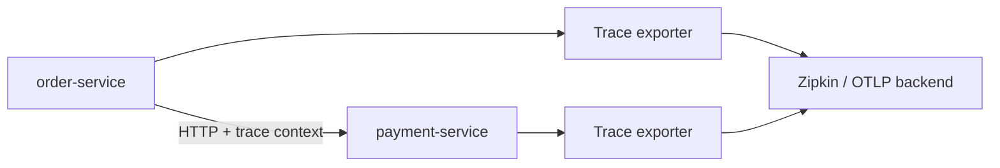
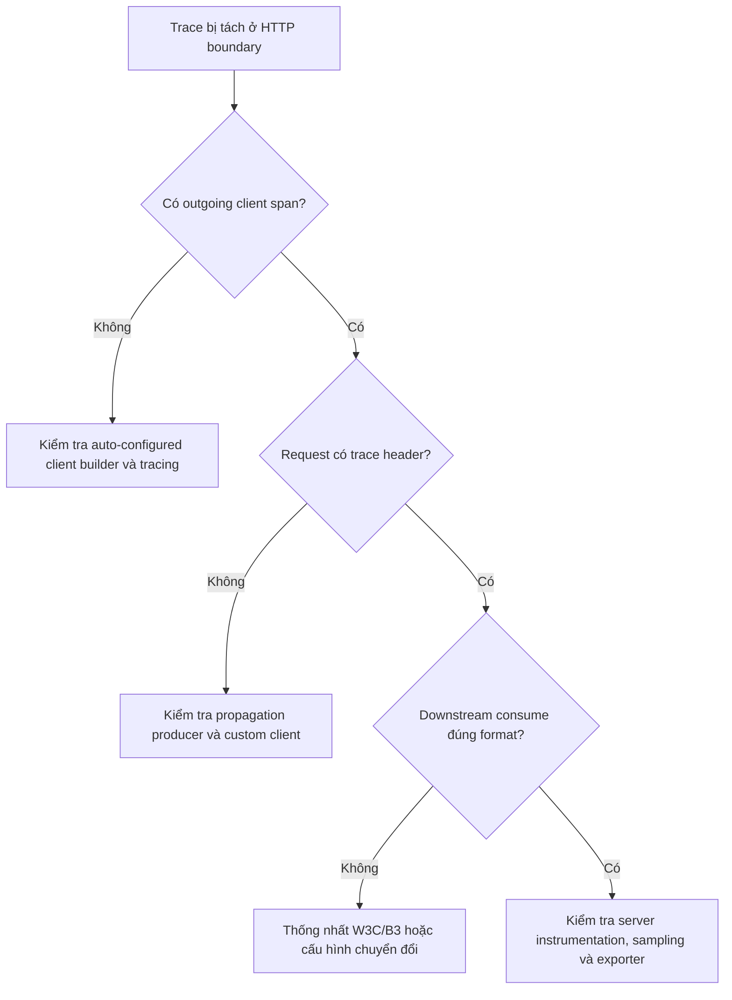

# Propagation qua HTTP client

## 1. Bài toán: một trace đi qua nhiều service

Trong hệ thống Spring Boot tổ chức bằng **Spring Modulith**, module `order` có thể gọi API của module `payment` trong cùng ứng dụng. Khi `payment` được tách thành một service riêng, lời gọi trở thành HTTP request qua mạng. Ta muốn trace vẫn mô tả một hành trình liên tục:

```text
Browser
  └─ order-service: HTTP POST /orders
      └─ module order: OrderService.place(...)
          └─ HTTP client: POST payment-service/payments
              └─ payment-service: HTTP POST /payments
                  └─ module payment: PaymentService.authorize(...)
```

Nếu trace context không được gửi qua HTTP, mỗi service có thể tạo một trace độc lập. Khi đó, đội vận hành khó trả lời một request đã đi qua service nào, độ trễ nằm ở đâu và lỗi bắt đầu từ bước nào.

**Propagation qua HTTP client** là việc đưa trace context hiện tại vào request gửi đi, để service nhận có thể tiếp tục cùng trace. Với Micrometer Tracing và Spring Boot, phần lớn công việc này được tích hợp sẵn nếu dùng đúng HTTP client builder do Spring Boot quản lý.

Bài thuộc chương **Micrometer tracing** của **SPRING_MODULITH_DOCUMENTATION_OBSERVABILITY**. Mục tiêu chung của module là dùng Spring Modulith tạo tài liệu ranh giới application module và quan sát tương tác trong ứng dụng Spring Boot; bài này mở rộng góc nhìn tracing từ một ứng dụng sang các service giao tiếp qua HTTP.

Sau bài học, bạn có thể:

1. Phân biệt trace context propagation với việc export span tới backend.
2. Hiểu các header W3C Trace Context như `traceparent`, `tracestate` và `baggage`.
3. Cấu hình `RestClient`, `WebClient` hoặc `RestTemplate` để tự động truyền trace context.
4. Thiết lập định dạng consume/produce khi các service dùng W3C hoặc B3.
5. Truyền baggage có kiểm soát và xác minh trace xuyên suốt các service.
6. Chẩn đoán trace bị tách do client tự tạo, gateway xóa header, sampling hoặc cấu hình không tương thích.

## 2. Hai việc khác nhau: propagate và export

Distributed tracing có hai đường dữ liệu cần hoạt động:

| Hoạt động | Mục đích | Ví dụ |
| --- | --- | --- |
| **Propagation** | Truyền định danh và quan hệ trace qua ranh giới HTTP | Service A gửi `traceparent` cho service B |
| **Export** | Gửi span đã thu thập đến nơi lưu trữ/hiển thị | Micrometer Tracing gửi span đến Zipkin hoặc OTLP Collector |

Propagation giúp các service hiểu request hiện tại thuộc trace nào và span cha là gì. Export giúp backend nhận được các span để dựng timeline. Có propagation nhưng không export, các service vẫn có thể tạo span liên kết nhưng bạn không nhìn thấy chúng trong backend. Có export nhưng không propagate, mỗi service có thể báo cáo trace riêng rời rạc.



Trong cùng một ứng dụng, Spring Modulith có thể tạo module entry span khi gọi Spring component thuộc API module. Khi đi qua HTTP, HTTP client instrumentation tạo client span; service nhận tạo server span nếu nó cũng được instrument. Trace context kết nối các span qua mạng.

## 3. W3C Trace Context qua HTTP

### 3.1. Header traceparent

**W3C Trace Context** định nghĩa header chuẩn `traceparent` để truyền thông tin cha của request. Với version `00`, giá trị có dạng:

```text
traceparent: 00-{trace-id}-{parent-id}-{trace-flags}
```

| Thành phần | Độ dài | Ý nghĩa |
| --- | ---: | --- |
| Version | 2 ký tự hex | Phiên bản định dạng; `00` là phiên bản đầu tiên |
| Trace ID | 32 ký tự hex | Định danh trace xuyên suốt các service |
| Parent ID | 16 ký tự hex | Span ID được xem là cha của server span kế tiếp |
| Trace flags | 2 ký tự hex | Các cờ, trong đó bit sampled cho biết quyết định lấy mẫu |

Ví dụ minh họa:

```http
traceparent: 00-4bf92f3577b34da6a3ce929d0e0e4736-00f067aa0ba902b7-01
```

Trong ví dụ:

- `4bf92f3577b34da6a3ce929d0e0e4736` là trace ID.
- `00f067aa0ba902b7` là span ID của phía gửi, sẽ là parent ID của server span tiếp theo.
- `01` có bit sampled được bật.

Khi service B nhận request, tracing instrumentation đọc header, tạo server span với **cùng trace ID** nhưng **span ID mới** và parent ID trỏ về span phía A. Khi B gọi service C, B tạo client span mới và gửi context mới của span đó đi tiếp. Vì vậy các span thường có ID khác nhau nhưng cùng trace ID.

### 3.2. tracestate và baggage

- `tracestate` là header tùy chọn cho thông tin vendor-specific được truyền cùng trace context. Ứng dụng nên để propagator quản lý thay vì tự tạo hoặc ghi đè.
- `baggage` là header chuẩn để mang các cặp key-value theo trace, ví dụ một vùng nghiệp vụ hoặc tenant đã được phép truyền. Baggage không thay thế trace ID và cũng không phải nơi lưu credential.

Ví dụ header minh họa:

```http
traceparent: 00-4bf92f3577b34da6a3ce929d0e0e4736-00f067aa0ba902b7-01
tracestate: vendor=value
baggage: tenant-zone=ap-southeast,channel=partner
```

Không cần tự nối chuỗi các header trên trong code ứng dụng. Micrometer Tracing dùng propagator tương ứng để inject/extract context theo định dạng đã cấu hình.

## 4. Cấu hình tracing trong Spring Boot

### 4.1. Chọn tracer và exporter

Spring Boot hỗ trợ Micrometer Tracing với các lựa chọn phổ biến:

| Tracer | Backend/export | Dependency thường dùng |
| --- | --- | --- |
| OpenZipkin Brave | Zipkin | `org.springframework.boot:spring-boot-starter-zipkin` |
| OpenTelemetry | OTLP Collector hoặc backend tương thích | Starter OpenTelemetry của dòng Spring Boot tương ứng |

Ví dụ với Spring Boot 4.x và Brave/Zipkin:

```groovy
dependencies {
    implementation "org.springframework.boot:spring-boot-starter-actuator"
    implementation "org.springframework.boot:spring-boot-starter-zipkin"

    // Nếu ứng dụng cần span cho ranh giới application module:
    runtimeOnly "org.springframework.modulith:spring-modulith-starter-insight"
}
```

Ví dụ với Spring Boot 4.x và OpenTelemetry/OTLP:

```groovy
dependencies {
    implementation "org.springframework.boot:spring-boot-starter-actuator"
    implementation "org.springframework.boot:spring-boot-starter-opentelemetry"

    runtimeOnly "org.springframework.modulith:spring-modulith-starter-insight"
}
```

Với Spring Boot 3.5 hoặc các dòng 3.x, dependency cho OpenTelemetry thường gồm `micrometer-tracing-bridge-otel` và `opentelemetry-exporter-otlp` cùng Actuator; cấu hình exporter cũng khác giữa các dòng. Dùng BOM và tài liệu đúng phiên bản Boot của dự án, không ghép các starter của Boot 4 với ứng dụng Boot 3.

Spring Modulith Insight bổ sung instrumentation/Actuator cho module. Nó không thay thế tracer, exporter và backend dùng để xuất trace qua mạng.

### 4.2. Cấu hình sampling và propagation format

Ví dụ cấu hình trong `application.yml` cho môi trường phát triển:

```yaml
spring:
  application:
    name: order-service

management:
  tracing:
    sampling:
      probability: 1.0
    propagation:
      consume:
        - W3C
        - B3
        - B3_MULTI
      produce:
        - W3C
```

Ý nghĩa:

- `spring.application.name` giúp nhận diện service trong backend.
- `sampling.probability: 1.0` yêu cầu lấy mẫu toàn bộ request trong môi trường thử nghiệm. Spring Boot mặc định thường lấy mẫu một phần request (10%) để tránh làm quá tải backend.
- `propagation.consume` liệt kê các định dạng service **chấp nhận** từ request đi vào.
- `propagation.produce` liệt kê định dạng service **gửi ra** khi gọi service khác.

Tài liệu Spring Boot hiện hành mặc định consume W3C, B3 và B3 multi-header; produce W3C. Nếu không có yêu cầu tương thích đặc biệt, có thể giữ mặc định. Khi cần đặt một định dạng chung cho cả hai chiều, thuộc tính `management.tracing.propagation.type` có thể được dùng để ghi đè hai danh sách chi tiết; không cấu hình đồng thời theo cách gây mâu thuẫn.

Trong production, chọn sampling theo lưu lượng và mục tiêu điều tra. Việc propagation header vẫn có thể diễn ra dù một trace không được lưu/export; **không có trace trong backend không tự chứng minh header đã không được gửi**.

## 5. Dùng HTTP client builder do Spring Boot quản lý

Đây là quy tắc quan trọng nhất của bài:

> Để tự động truyền trace qua network, hãy inject builder đã được Spring Boot auto-configure: `RestTemplateBuilder`, `RestClient.Builder` hoặc `WebClient.Builder`. Nếu tự tạo client bằng `RestTemplate`, `RestClient.create()` hoặc `WebClient.create()`, automatic trace propagation sẽ không hoạt động theo cấu hình mặc định.

Các builder auto-configured được áp dụng instrumentation và customizer cần thiết. Đừng bỏ qua builder này chỉ để tiện tạo một client tĩnh.

### 5.1. RestClient — lựa chọn imperative

Với ứng dụng Spring MVC hoặc code xử lý đồng bộ, có thể dùng `RestClient`:

```java
package com.example.shop.order;

import org.springframework.stereotype.Component;
import org.springframework.web.client.RestClient;

@Component
public class PaymentHttpClient {

    private final RestClient client;

    public PaymentHttpClient(RestClient.Builder builder) {
        this.client = builder
            .baseUrl("http://payment-service")
            .build();
    }

    public PaymentResponse authorize(PaymentRequest request) {
        return client.post()
            .uri("/payments/authorize")
            .body(request)
            .retrieve()
            .body(PaymentResponse.class);
    }
}
```

`RestClient.Builder` được inject từ Spring Boot. Khi tracing/HTTP client observation được cấu hình, request gửi tới `payment-service` có client observation và trace context được inject tự động. Không cần tự gọi `tracer.currentSpan()` để ghép header.

### 5.2. WebClient — lựa chọn reactive

Với ứng dụng Spring WebFlux:

```java
package com.example.shop.order;

import org.springframework.stereotype.Component;
import org.springframework.web.reactive.function.client.WebClient;
import reactor.core.publisher.Mono;

@Component
public class PaymentWebClient {

    private final WebClient client;

    public PaymentWebClient(WebClient.Builder builder) {
        this.client = builder
            .baseUrl("http://payment-service")
            .build();
    }

    public Mono<PaymentResponse> authorize(PaymentRequest request) {
        return client.post()
            .uri("/payments/authorize")
            .bodyValue(request)
            .retrieve()
            .bodyToMono(PaymentResponse.class);
    }
}
```

`WebClient.Builder` được Boot cấu hình và dùng observation phù hợp với reactive execution. Không thay nó bằng `WebClient.create()` nếu muốn tận dụng tự động instrumentation/propagation.

### 5.3. RestTemplate — ứng dụng legacy

Nếu dự án còn sử dụng `RestTemplate`:

```java
package com.example.shop.order;

import org.springframework.boot.web.client.RestTemplateBuilder;
import org.springframework.stereotype.Component;
import org.springframework.web.client.RestTemplate;

@Component
public class LegacyPaymentClient {

    private final RestTemplate client;

    public LegacyPaymentClient(RestTemplateBuilder builder) {
        this.client = builder
            .rootUri("http://payment-service")
            .build();
    }

    public PaymentResponse authorize(PaymentRequest request) {
        return client.postForObject(
            "/payments/authorize",
            request,
            PaymentResponse.class
        );
    }
}
```

`RestTemplateBuilder` auto-configured là điểm cần dùng. Với dự án mới, Spring Boot hiện khuyến nghị `RestClient` cho API imperative; `RestTemplate` vẫn hữu ích khi duy trì code cũ.

## 6. Luồng trace từ order-service sang payment-service

Giả sử có hai service:

- `order-service` nhận `POST /orders`, xử lý module `order` và gọi HTTP sang payment.
- `payment-service` nhận `POST /payments/authorize`, xử lý module `payment`.

Nếu cả hai service đều bật tracing và client dùng builder auto-configured, trace có thể hiển thị:

```text
Trace ID: T

order-service
└── HTTP server: POST /orders
    └── module order: OrderService.place()
        └── HTTP client: POST payment-service/payments/authorize
            └── payment-service
                └── HTTP server: POST /payments/authorize
                    └── module payment: PaymentService.authorize()
```

Đây là sơ đồ minh họa. Tên span thực tế phụ thuộc framework, HTTP route template và instrumentation.

Điều cần xác nhận:

1. Các span ở hai service có **cùng trace ID**.
2. Client span của order-service có parent phù hợp với module span hoặc server span đang hoạt động.
3. Server span của payment-service có parent trỏ tới client span gửi request.
4. Module span `payment` nằm dưới server span của payment-service.
5. Span có thời lượng và status hợp lý; lỗi HTTP hoặc exception được ghi nhận ở đúng tầng.

Client span và server span có span ID khác nhau. W3C Trace Context truyền parent span ID của bên gửi, không yêu cầu hai bên chia sẻ cùng một span ID.

## 7. Baggage: truyền dữ liệu ngữ cảnh nghiệp vụ

Ngoài trace ID/span ID, một số dữ liệu ngữ cảnh nhỏ có thể cần đi cùng request, ví dụ vùng xử lý hoặc kênh bán. Micrometer Tracing hỗ trợ **baggage**.

### 7.1. Tạo baggage bằng Tracer

Ví dụ trong một service:

```java
package com.example.shop.order;

import io.micrometer.tracing.BaggageInScope;
import io.micrometer.tracing.Tracer;
import org.springframework.stereotype.Component;

@Component
public class OrderWorkflow {

    private final Tracer tracer;
    private final PaymentHttpClient payment;

    public OrderWorkflow(Tracer tracer, PaymentHttpClient payment) {
        this.tracer = tracer;
        this.payment = payment;
    }

    public PaymentResponse authorize(PaymentRequest request) {
        try (BaggageInScope scope =
                tracer.createBaggageInScope("sales-channel", "partner")) {
            return payment.authorize(request);
        }
    }
}
```

Baggage nằm trong scope của đoạn xử lý. Khi HTTP client instrumentation inject context, baggage có thể được gửi tiếp tùy propagation format và cấu hình.

### 7.2. W3C và B3 có khác biệt

Spring Boot mô tả:

- Khi dùng **W3C propagation**, baggage được tự động truyền qua network.
- Khi dùng **B3 propagation**, baggage không tự động được truyền theo cách đó. Có thể cấu hình `management.tracing.baggage.remote-fields` để khai báo các field cần gửi như HTTP header.

Ví dụ:

```yaml
management:
  tracing:
    baggage:
      remote-fields:
        - sales-channel
      correlation:
        fields:
          - sales-channel
```

`remote-fields` khai báo baggage cần truyền ra ngoài; `correlation.fields` yêu cầu đưa baggage vào logging MDC để hỗ trợ log correlation. Nếu cần baggage thành span tag, có thể cấu hình `management.tracing.baggage.tag-fields`.

Không đưa thông tin nhạy cảm như access token, mật khẩu, email, số thẻ hoặc payload nghiệp vụ vào baggage. Baggage đi qua nhiều service và có thể được ghi vào log/trace; chỉ truyền các trường nhỏ, có mục đích rõ ràng, đã được kiểm soát.

## 8. W3C và B3: đảm bảo hai service hiểu cùng định dạng

Các service phải có cấu hình tương thích. Ví dụ:

| Service | Consume | Produce | Kết quả |
| --- | --- | --- | --- |
| order-service | W3C, B3, B3_MULTI | W3C | Nhận nhiều định dạng, gửi W3C |
| payment-service | W3C, B3, B3_MULTI | W3C | Nhận được W3C từ order |
| legacy-service | B3 | B3 | Chỉ hiểu B3; cần chuyển đổi ở gateway hoặc cấu hình tương thích |

Nếu order-service gửi W3C nhưng payment-service chỉ consume B3, payment có thể không nối vào trace hiện tại và tạo trace mới. Khi kết nối hệ thống legacy:

1. Xác định định dạng service nguồn produce.
2. Xác định danh sách định dạng service đích consume.
3. Chọn định dạng chung hoặc dùng gateway/bridge có hỗ trợ chuyển đổi.
4. Kiểm tra header thật sự đi qua load balancer, ingress và service mesh.
5. Kiểm tra baggage riêng vì việc hỗ trợ B3 trace context không đồng nghĩa baggage được gửi tự động.

Không tự gửi đồng thời nhiều bộ header W3C/B3 chỉ để “cho chắc” nếu chưa hiểu cấu hình và chính sách tương thích của các service. Chọn một hợp đồng propagation rõ ràng để tránh trace bị ghép sai hoặc tạo hai context cạnh tranh.

## 9. Khi client được tạo thủ công hoặc dùng thư viện khác

### 9.1. Tại sao client tự tạo không tự propagate?

Ví dụ không nên dùng nếu mong đợi auto instrumentation:

```java
// Không dùng builder do Spring Boot auto-configure.
RestClient client = RestClient.create("http://payment-service");
```

Hoặc:

```java
WebClient client = WebClient.create("http://payment-service");
```

Các cách tạo trực tiếp không nhận những customizer/instrumentation mà Spring Boot gắn vào builder. Kết quả có thể là request không có client observation và không inject trace context.

### 9.2. Khi bắt buộc phải dùng client tùy chỉnh

Nếu thư viện HTTP không dùng builder Spring Boot, cần tích hợp observation/tracing theo API mà thư viện hỗ trợ:

- Tạo client observation quanh request bằng `ObservationRegistry` hoặc dùng instrumentation/customizer tương ứng nếu framework cung cấp.
- Dùng Micrometer Tracing propagator để inject/extract context theo định dạng đã chọn.
- Bảo đảm span hiện hành được mở đúng lúc gửi request và đóng sau khi nhận response/lỗi.
- Kiểm tra cancel, timeout, retry và exception để vòng đời observation không bị rò.
- Không hard-code `traceparent` hoặc copy trace ID vào một header tùy biến rồi coi đó là distributed tracing chuẩn.

Với các HTTP client do Spring Boot hỗ trợ, hãy ưu tiên builder auto-configured; chỉ triển khai thủ công khi có lý do kỹ thuật rõ ràng và có test xác minh.

## 10. Gateway, proxy và biên bảo mật

Trace context chỉ có thể đi tới service đích nếu các thành phần trung gian không làm mất hoặc thay đổi header không đúng cách. Kiểm tra:

- Reverse proxy, ingress, API gateway có cho phép header `traceparent` và `tracestate` đi qua không.
- Nếu dùng B3, các header `b3` hoặc `X-B3-TraceId`, `X-B3-SpanId`, `X-B3-Sampled` có được giữ đúng không.
- Header `baggage` hoặc các remote baggage header có được giới hạn theo chính sách không.
- Gateway có tạo span riêng và truyền context mới cho upstream hay không.

Không sử dụng trace ID/baggage như thông tin xác thực hoặc căn cứ phân quyền. Request từ bên ngoài có thể mang trace context do client tự tạo; hệ thống phải xem nó là metadata quan sát, không phải danh tính tin cậy. Với public ingress, cân nhắc chính sách sanitize/accept context và giới hạn kích thước baggage để tránh header quá lớn.

## 11. Kiểm chứng propagation end-to-end

### 11.1. Gửi request thử nghiệm

Gọi order-service:

```powershell
curl.exe -X POST http://localhost:8080/orders
```

Order-service gọi payment-service bằng client đã inject builder. Mở backend tracing, lọc theo service `order-service` và thời điểm request.

Để kiểm tra cách service nhận một context đã biết, có thể gửi header W3C trong môi trường test:

```powershell
curl.exe -X POST http://localhost:8080/orders -H "traceparent: 00-4bf92f3577b34da6a3ce929d0e0e4736-00f067aa0ba902b7-01"
```

Đây là trace context giả lập dành cho kiểm thử. Không dùng lại trace ID cố định trong production.

### 11.2. Những gì cần thấy

| Điểm kiểm tra | Kết quả mong đợi |
| --- | --- |
| Incoming request của order-service | Có server span và trace ID hợp lệ |
| Outgoing request tới payment-service | Có client span; HTTP request mang trace context tương ứng |
| Incoming request của payment-service | Server span dùng cùng trace ID, parent là client span |
| Module span tại payment-service | Span của API module nằm trong trace của request nhận |
| Log hai service | Có thể tương quan qua trace ID/span ID nếu logging correlation bật |

Không yêu cầu các span có cùng span ID. Mỗi thao tác có span ID riêng; quan hệ parent-child mới là điều cần kiểm tra.

### 11.3. Kiểm thử trong Spring Boot test

Spring Boot lưu ý các thành phần tracing có nhiệm vụ **report/export** không tự động được cấu hình trong mọi `@SpringBootTest`. Nếu integration test cần exporter/tracing reporting thực sự, dùng cấu hình test tracing phù hợp (ví dụ `@AutoConfigureTracing` ở các phiên bản hỗ trợ) hoặc cung cấp test exporter/recorder riêng.

Một test chỉ mock `RestClient` có thể xác nhận code gọi endpoint, nhưng chưa chứng minh propagation header được inject. Để kiểm chứng header, dùng HTTP test server hoặc client request interceptor/recorder ở đúng tầng instrumentation, rồi xác nhận:

1. Header có mặt khi gửi request.
2. Trace ID khớp context đang hoạt động.
3. Parent span ID là span client vừa được tạo.
4. Khi response/error hoàn tất, span client được đóng và không còn context rò sang request kế tiếp.

## 12. Chẩn đoán lỗi thường gặp

| Triệu chứng | Nguyên nhân khả dĩ | Hướng xử lý |
| --- | --- | --- |
| Mỗi service hiển thị một trace riêng | Không gửi header, format không tương thích, client không được instrument | Dùng auto-configured builder; kiểm tra produce/consume |
| Không có client span | HTTP client observation chưa được bật hoặc client tự tạo | Kiểm tra Actuator/tracing và cách tạo client |
| Client span có nhưng server span không có | Downstream chưa bật tracing, header bị gateway xóa, request không đến service mong muốn | Kiểm tra server instrumentation, ingress và request header |
| Server span là trace mới | Downstream không extract được định dạng gửi tới hoặc header không hợp lệ | Kiểm tra W3C/B3 consume và giá trị header |
| Trace không xuất hiện dù propagation đúng | Sampling loại trace, exporter/backend không hoạt động | Kiểm tra sampling, exporter endpoint và backend |
| Baggage không đến downstream | Dùng B3 mà chưa cấu hình remote fields, field không được đăng ký | Kiểm tra W3C/B3 và `management.tracing.baggage.remote-fields` |
| Trace ID có nhưng log thiếu correlation ID | Logging pattern/MDC correlation hoặc context propagation chưa phù hợp | Kiểm tra MDC và cấu hình logging |
| Retry HTTP sinh nhiều span | Mỗi lần gửi là một attempt riêng | Đọc retry span và phân biệt attempt với logical operation |
| Header bị mất sau gateway | Proxy không forward hoặc sanitize header | Cấu hình gateway cho đúng propagation headers |

Một quy trình ngắn:



## 13. Bài thực hành

Thực hiện với hai ứng dụng Spring Boot riêng biệt:

1. Tạo `order-service` có endpoint `POST /orders` và client gọi `payment-service`.
2. Tạo `payment-service` có endpoint `POST /payments/authorize`.
3. Thêm Actuator và một tracer/exporter tương thích cho cả hai ứng dụng.
4. Trong order-service, inject `RestClient.Builder` (hoặc `WebClient.Builder`) do Boot auto-configure và tạo client.
5. Đặt sampling `1.0` trong local, khởi chạy backend Zipkin/OTLP.
6. Gửi một request đến order-service; kiểm tra cùng trace ID xuyên qua client span và server span của payment-service.
7. Thử tạo client bằng `RestClient.create()` trong một nhánh test; so sánh để nhận biết sự khác nhau khi không dùng builder auto-configured.
8. Thử cấu hình order produce W3C nhưng payment chỉ consume B3; xác nhận trace bị tách, rồi sửa lại consume/produce cho tương thích.
9. Tạo baggage `sales-channel=partner` trong scope và kiểm tra downstream khi dùng W3C. Thử B3 với `remote-fields` để hiểu khác biệt.
10. Kiểm tra gateway/proxy và log correlation nếu trace chỉ mất khi đi qua môi trường triển khai.

Checklist hoàn thành:

- [ ] Phân biệt propagation và export.
- [ ] Giải thích được `traceparent`, `tracestate` và `baggage`.
- [ ] Dùng đúng auto-configured builder của HTTP client.
- [ ] Cấu hình được produce/consume cho W3C và B3.
- [ ] Kiểm tra trace ID chung và span ID/parent span ID đúng quan hệ.
- [ ] Hiểu cách baggage khác nhau giữa W3C và B3 trong Spring Boot.
- [ ] Không hard-code trace header hoặc dùng baggage làm credential.
- [ ] Kiểm tra sampling, gateway, exporter và server instrumentation khi trace bị tách.
- [ ] Biết rằng mỗi lần retry HTTP có thể tạo một client attempt/span riêng.

## 14. Tài liệu tham khảo

- [Spring Boot — Tracing](https://docs.spring.io/spring-boot/reference/actuator/tracing.html): tracer, sampling, tự động propagate qua `RestTemplateBuilder`, `RestClient.Builder`, `WebClient.Builder`, baggage và exporter.
- [Spring Boot 4.0 — Tracing](https://docs.spring.io/spring-boot/4.0/reference/actuator/tracing.html): cấu hình propagation produce/consume, OTLP và Zipkin.
- [Spring Boot — Calling REST Services](https://docs.spring.io/spring-boot/reference/io/rest-client.html): cách inject và sử dụng builder auto-configured cho `RestClient` và `WebClient`.
- [Spring Boot — Application Properties](https://docs.spring.io/spring-boot/appendix/application-properties/): `management.tracing.propagation.*`, sampling và baggage properties.
- [Micrometer Tracing — Reference](https://docs.micrometer.io/tracing/reference/): tracer API, propagation và baggage.
- [W3C — Trace Context](https://www.w3.org/TR/trace-context/): chuẩn header `traceparent` và `tracestate`.
- [W3C — Baggage](https://www.w3.org/TR/baggage/): định dạng truyền baggage qua các service.
