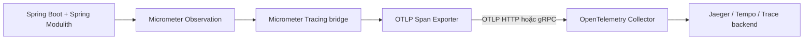
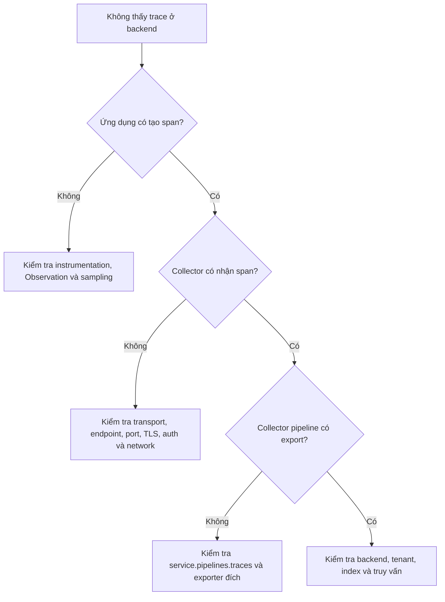

# Endpoint OTLP HTTP và gRPC

Trong ứng dụng Spring Boot dùng **Spring Modulith**, các module như `order`, `inventory` và `payment` có thể tạo observations/spans để mô tả một luồng nghiệp vụ. Để xem trace trên Jaeger, Grafana Tempo hoặc tracing backend khác, ứng dụng phải **export spans tới OpenTelemetry Collector hoặc một OTLP receiver**.

OTLP (OpenTelemetry Protocol) có hai kiểu truyền thường gặp: **OTLP/HTTP** và **OTLP/gRPC**. Cả hai truyền cùng mô hình dữ liệu telemetry của OpenTelemetry, nhưng khác cách gửi, endpoint, cổng mặc định và yêu cầu mạng. Chọn nhầm transport hoặc ghép sai endpoint là nguyên nhân phổ biến khiến ứng dụng tạo được span nhưng backend không nhận trace.

Bài thuộc chương **Export traces** của học phần `SPRING_MODULITH_DOCUMENTATION_OBSERVABILITY`. Học phần dùng Spring Modulith để sinh tài liệu ranh giới application module và quan sát tương tác giữa các phần trong ứng dụng Spring Boot qua module graph, Actuator, event metrics, tracing và context propagation. Trọng tâm bài này là cấu hình đúng **endpoint OTLP HTTP và gRPC**, kiểm tra đầu nhận và xác minh dữ liệu đi hết đường từ ứng dụng tới backend.

Sau bài học, bạn có thể:

- Phân biệt OTLP/HTTP và OTLP/gRPC ở cấp giao thức.
- Nhận diện cổng mặc định `4318` cho HTTP và `4317` cho gRPC.
- Cấu hình Spring Boot 3.5 bằng `management.otlp.tracing.transport` và `management.otlp.tracing.endpoint`.
- Biết endpoint HTTP cho traces phải có đường dẫn `/v1/traces`, trong khi endpoint gRPC là địa chỉ dịch vụ host/port.
- Cấu hình OpenTelemetry Collector nhận cả hai giao thức.
- Kiểm tra sampling, kết nối, TLS, xác thực, pipeline và backend khi trace không xuất hiện.
- Hiểu rằng export protocol không quyết định cách tạo span, module graph hay context propagation.

> **Phạm vi phiên bản:** ví dụ dùng Spring Boot **3.5.x** với Micrometer Tracing bridge OpenTelemetry và OpenTelemetry OTLP exporter. Spring Boot hỗ trợ cấu hình transport OTLP bằng property từ dòng **3.4**; Boot 3.5 mặc định dùng HTTP/protobuf và cho phép chọn gRPC bằng `management.otlp.tracing.transport=grpc`. Nếu dùng Boot 3.3 hoặc cũ hơn, không mặc định property transport này có sẵn; hãy đối chiếu tài liệu và API của dòng đang dùng.

## 1. OTLP là gì và trace đi qua đâu?

**OTLP** là giao thức chuẩn để truyền telemetry giữa SDK/exporter và một OTLP receiver, thường là OpenTelemetry Collector. Với trace, payload mang các span, resource attributes, instrumentation scope và các thuộc tính liên quan.

Một luồng tổng quát:



Các lớp có trách nhiệm khác nhau:

| Lớp | Nhiệm vụ | Ví dụ thành phần |
| --- | --- | --- |
| Instrumentation | Tạo observation/span khi có thao tác được theo dõi | Spring Boot, Spring Modulith, Micrometer Observation |
| Tracing bridge | Chuyển Observation thành span của tracer | `micrometer-tracing-bridge-otel` |
| Exporter | Đóng gói và gửi spans theo OTLP | `opentelemetry-exporter-otlp` |
| Receiver | Nhận dữ liệu OTLP từ ứng dụng | OpenTelemetry Collector |
| Processor | Batch, lọc, thêm resource attributes hoặc xử lý telemetry | Collector `batch`, processors khác |
| Backend/exporter đích | Lưu trữ và cho phép tìm kiếm trace | Jaeger, Tempo, vendor backend |

**HTTP và gRPC chỉ khác nhau ở chặng truyền từ exporter đến receiver.** Nếu span không được tạo do thiếu instrumentation hoặc không được chọn bởi sampling, thay cổng 4318 sang 4317 không giải quyết được vấn đề. Tương tự, nếu Collector nhận được spans nhưng không có pipeline/exporter đẩy tiếp, backend vẫn không hiển thị trace.

## 2. So sánh OTLP/HTTP và OTLP/gRPC

| Đặc điểm | OTLP/HTTP | OTLP/gRPC |
| --- | --- | --- |
| Kiểu truyền | HTTP POST với payload Protobuf | RPC gRPC với Protobuf |
| HTTP version | Có thể dùng HTTP/1.1 hoặc HTTP/2 | Dùng HTTP/2 |
| Cổng mặc định | `4318` | `4317` |
| Đường dẫn trace | `/v1/traces` | Không thêm `/v1/traces` vào endpoint |
| Endpoint ví dụ | `http://otel-collector:4318/v1/traces` | `http://otel-collector:4317` |
| Transport property Spring Boot | `http` | `grpc` |
| Qua HTTP reverse proxy | Thường dễ tích hợp với proxy HTTP thông thường | Proxy phải hỗ trợ gRPC/HTTP2 đúng cách |
| Payload mặc định trong Boot 3.5 | HTTP/protobuf | Protobuf qua gRPC |

Hai giao thức sử dụng chung mô hình dữ liệu OpenTelemetry, nhưng **không hoán đổi endpoint**. Gửi HTTP POST tới cổng gRPC hoặc gửi gRPC tới cổng HTTP thường dẫn tới lỗi protocol, connection reset hoặc HTTP status không như mong đợi.

### Đường dẫn theo signal trong OTLP/HTTP

OTLP/HTTP dùng các đường dẫn riêng theo loại tín hiệu:

| Signal | Đường dẫn mặc định |
| --- | --- |
| Traces | `/v1/traces` |
| Metrics | `/v1/metrics` |
| Logs | `/v1/logs` |

Bài này chỉ cấu hình **trace export**. Đừng dùng `/v1/metrics` hoặc `/v1/logs` cho property `management.otlp.tracing.endpoint`.

### HTTP/protobuf không đồng nghĩa HTTP/JSON

OTLP specification định nghĩa HTTP payload có thể dùng Protobuf nhị phân hoặc JSON mapping. Tuy nhiên Spring Boot 3.5 sử dụng OpenTelemetry Java SDK exporter và auto-configuration hỗ trợ **HTTP/protobuf** hoặc **gRPC/protobuf**; không nên giả định có thể đổi sang HTTP/JSON chỉ bằng cách thay Content-Type hay URL. Nếu backend/proxy yêu cầu HTTP/JSON, phải kiểm tra khả năng tương thích của exporter cụ thể hoặc dùng một thành phần chuyển đổi phù hợp.

## 3. Cấu hình dependency cho Spring Boot

Để Spring Boot ghi nhận observations và gửi traces qua OpenTelemetry OTLP, cần các dependency chính:

```xml
<dependencies>
    <!-- Actuator và auto-configuration tracing của Spring Boot. -->
    <dependency>
        <groupId>org.springframework.boot</groupId>
        <artifactId>spring-boot-starter-actuator</artifactId>
    </dependency>

    <!-- Bridge Observation API sang OpenTelemetry. -->
    <dependency>
        <groupId>io.micrometer</groupId>
        <artifactId>micrometer-tracing-bridge-otel</artifactId>
    </dependency>

    <!-- OTLP exporter hỗ trợ HTTP/protobuf và gRPC/protobuf. -->
    <dependency>
        <groupId>io.opentelemetry</groupId>
        <artifactId>opentelemetry-exporter-otlp</artifactId>
    </dependency>
</dependencies>
```

Các version nên được quản lý bởi Spring Boot dependency management/BOM. Tránh tự ép một version OpenTelemetry exporter không tương thích với Micrometer Tracing mà Spring Boot đang quản lý.

Với ứng dụng muốn có instrumentation ở ranh giới application module của Spring Modulith, bổ sung starter/observability artifact phù hợp với dòng Spring Modulith đang dùng, ví dụ `spring-modulith-starter-insight` khi phiên bản đó cung cấp tích hợp tương ứng. **Dependency tạo module observations là một phần khác với dependency export OTLP**: exporter không tự instrument mọi lời gọi giữa module.

Nếu chỉ có Actuator và bridge nhưng thiếu exporter OTLP, ứng dụng có thể tạo spans nhưng không có exporter phù hợp để gửi chúng đến Collector. Ngược lại, chỉ có exporter mà không có tracer/bridge cũng không tự sinh span nghiệp vụ.

## 4. Endpoint OTLP/HTTP: host, port và path

OTLP/HTTP gửi dữ liệu traces bằng HTTP POST. Đường dẫn chuẩn mặc định cho trace là `/v1/traces`, và cổng mặc định là `4318`.

Ví dụ ứng dụng chạy cùng mạng Docker Compose với Collector:

```text
http://otel-collector:4318/v1/traces
```

Ví dụ chạy Collector trên máy phát triển và ứng dụng chạy trực tiếp trên máy:

```text
http://localhost:4318/v1/traces
```

Cấu hình Spring Boot 3.5:

```yaml
spring:
  application:
    name: shop-modulith

management:
  tracing:
    sampling:
      probability: 1.0 # Chỉ phù hợp local/test có lưu lượng thấp
  otlp:
    tracing:
      transport: http
      endpoint: "http://localhost:4318/v1/traces"
      connect-timeout: 10s
      timeout: 10s
```

Giải thích:

- `transport: http` chọn OTLP/HTTP; đây cũng là transport mặc định trong Spring Boot 3.5.
- `endpoint` là URL HTTP API của Collector cho traces, vì vậy cần path `/v1/traces`.
- `connect-timeout` giới hạn thời gian thiết lập kết nối.
- `timeout` giới hạn thời gian cho một lần export theo cấu hình exporter.
- `sampling.probability: 1.0` lấy mẫu 100% để dễ thử nghiệm; không mặc định dùng mức này trong production.

Với transport HTTP, Spring Boot có thể cấu hình HTTP headers qua nhóm property `management.otlp.tracing.headers.*` khi Collector yêu cầu thông tin xác thực. Giá trị header cần lấy từ secret/config runtime và phải kiểm tra cách backend xác thực. Với gRPC metadata, mTLS hoặc custom trust material, hãy dùng exporter builder customizer phù hợp với transport. Không ghi token thật vào file YAML được commit.

### Endpoint HTTP có prefix tùy chỉnh

Nếu reverse proxy hoặc gateway đặt Collector sau một prefix, URL signal-specific phải trỏ tới **đường dẫn thực tế mà receiver/gateway nhận**. Ví dụ:

```text
https://telemetry.example.internal/otel/v1/traces
```

Điều này chỉ hoạt động khi proxy đã được cấu hình route prefix đó tới OTLP HTTP receiver. Không tự thêm `/otel` hoặc `/api` nếu hạ tầng không có route tương ứng.

## 5. Endpoint OTLP/gRPC: host và port, không có path HTTP trace

OTLP/gRPC gọi RPC trên dịch vụ Collector bằng HTTP/2. Cổng mặc định của OTLP/gRPC là `4317`. Endpoint là địa chỉ dịch vụ, ví dụ:

```text
http://otel-collector:4317
```

Cấu hình Spring Boot 3.5:

```yaml
spring:
  application:
    name: shop-modulith

management:
  tracing:
    sampling:
      probability: 1.0 # Chỉ dùng cho local/test
  otlp:
    tracing:
      transport: grpc
      endpoint: "http://localhost:4317"
      connect-timeout: 10s
      timeout: 10s
```

Trong cấu hình gRPC:

- `transport: grpc` chọn exporter gRPC.
- `endpoint` chỉ định địa chỉ server gRPC, thường gồm scheme, host và port.
- **Không** nối `/v1/traces` vào endpoint gRPC.
- Kết nối gRPC cần HTTP/2; proxy/load balancer ở giữa phải hỗ trợ gRPC end-to-end.

Nếu dùng TLS, endpoint thường dùng scheme `https` và Collector phải có cấu hình TLS/certificate phù hợp. Không dùng `http` hoặc cấu hình bỏ xác thực TLS cho môi trường production nếu hạ tầng yêu cầu mã hóa.

### Vì sao cùng một dependency có thể dùng cả hai transport?

Artifact `opentelemetry-exporter-otlp` của OpenTelemetry Java cung cấp exporter cho OTLP HTTP và gRPC. Spring Boot 3.5 auto-config chọn exporter theo property `management.otlp.tracing.transport`. Vì vậy, trong cấu hình thông thường, bạn không phải đổi dependency chỉ để đổi giữa HTTP và gRPC.

Nếu ứng dụng tự khai báo bean `OtlpHttpSpanExporter` hoặc `OtlpGrpcSpanExporter`, auto-configuration của Spring Boot có thể **back off**. Khi đó bạn chịu trách nhiệm cấu hình exporter, SDK và vòng đời bean tương ứng. Chỉ nên tự tạo exporter khi cần tùy chỉnh nâng cao và đã hiểu tác động tới auto-configuration.

## 6. Cấu hình OpenTelemetry Collector nhận cả HTTP và gRPC

Collector có thể mở đồng thời receiver OTLP HTTP và gRPC. Điều này giúp nhiều ứng dụng hoặc nhiều nhóm chọn transport khác nhau nhưng vẫn gửi về cùng một Collector.

Ví dụ cấu hình tối giản để học tập, với receiver lắng nghe trên tất cả interface trong container và exporter debug ghi dữ liệu ra log Collector:

```yaml
receivers:
  otlp:
    protocols:
      grpc:
        endpoint: 0.0.0.0:4317
      http:
        endpoint: 0.0.0.0:4318

processors:
  batch:

exporters:
  debug:
    verbosity: basic

service:
  pipelines:
    traces:
      receivers: [otlp]
      processors: [batch]
      exporters: [debug]
```

Giải thích:

- `receivers.otlp.protocols.grpc` mở cổng gRPC `4317`.
- `receivers.otlp.protocols.http` mở cổng HTTP `4318`.
- `processors.batch` gom spans thành batch trước khi chuyển tiếp.
- `exporters.debug` in thông tin telemetry ra log để kiểm tra Collector có nhận spans.
- `service.pipelines.traces` nối receiver, processor và exporter thành pipeline cho trace signal.

Đây là cấu hình **phục vụ local/test**. Exporter debug không phải nơi lưu trữ trace lâu dài. Khi chạy production, thay exporter debug bằng exporter phù hợp với backend/Collector distribution đang sử dụng, cấu hình TLS/xác thực và giới hạn quyền truy cập receiver. Tên và cấu hình exporter đích có thể thay đổi giữa các bản OpenTelemetry Collector core/contrib; hãy dùng component có trong distribution của bạn.

### Địa chỉ bind và địa chỉ client không giống nhau

Trong container, receiver thường cần bind vào interface mà các container khác có thể truy cập, ví dụ `0.0.0.0:4318`. Client lại dùng hostname dịch vụ trên network, ví dụ `otel-collector:4318`. Không cấu hình client gọi `0.0.0.0`; đó là địa chỉ bind phía server, không phải địa chỉ đích để client kết nối.

Nếu ứng dụng chạy trong container, `localhost` là chính container ứng dụng. Khi Collector ở container khác, dùng tên service/DNS nội bộ của Collector. Nếu ứng dụng chạy trực tiếp trên máy host, dùng hostname/port đã được publish ra host.

## 7. Chọn HTTP hay gRPC?

Không có giao thức nào luôn tốt hơn trong mọi hạ tầng. Hãy chọn theo khả năng tương thích, yêu cầu mạng và cách vận hành.

| Tiêu chí lựa chọn | Nên cân nhắc HTTP khi | Nên cân nhắc gRPC khi |
| --- | --- | --- |
| Proxy/ingress | Hạ tầng đã hỗ trợ HTTP route và POST | Proxy hỗ trợ gRPC/HTTP2 rõ ràng |
| Kết nối qua gateway | Muốn route theo path `/v1/traces` | Muốn route theo service/port gRPC |
| Firewall/network policy | Chỉ mở HTTP receiver port 4318 | Có thể mở cổng gRPC 4317 và HTTP/2 |
| Debug network | Công cụ HTTP thông dụng giúp quan sát request/response | Đội vận hành quen kiểm tra gRPC/HTTP2 |
| Hạ tầng telemetry hiện có | Collector đã bật OTLP HTTP | Collector và backend đã chuẩn hóa gRPC |

HTTP thường dễ tích hợp qua HTTP ingress, nhưng không có nghĩa mọi proxy sẽ tự động chuyển đúng payload OTLP. gRPC có lợi khi hạ tầng đã hỗ trợ HTTP/2 và các dịch vụ RPC, nhưng cần cấu hình proxy/load balancer đúng chuẩn.

**Không chọn giao thức dựa trên suy đoán hiệu năng.** Hãy đo lưu lượng, kích thước batch, retry, latency, queue và tải Collector trong môi trường gần production. Ứng dụng có thể dùng HTTP trong local và gRPC trong production, nhưng cần test lại cấu hình thật trước khi phát hành.

## 8. Những điểm không thay đổi khi đổi transport

Chuyển từ HTTP sang gRPC **không đổi**:

- Cách Spring Boot tạo Observation hoặc cách Spring Modulith instrument module calls.
- Trace ID, span ID, parent-child relationship đã được tạo trong ứng dụng.
- Cách context propagation hoạt động giữa thread/reactive pipeline.
- Sampling policy, trừ khi bạn thay đổi cấu hình sampling riêng.
- Semantics của resource attributes, span attributes và events.

Thay đổi transport chỉ đổi cách exporter chuyển dữ liệu ra ngoài. Nếu trace bị mất context giữa `order` và `inventory`, đổi HTTP sang gRPC không tự sửa được. Nếu không có span vì thiếu instrumentation ở ranh giới module, exporter cũng không thể tự tạo span đó.

Một trace có thể đi qua các module trong cùng JVM:

```text
Trace T1
└── HTTP POST /orders
    └── order.place
        ├── inventory.reserve
        └── payment.capture
```

Khi spans được tạo và được chọn bởi sampling, exporter gửi chúng theo giao thức đã chọn. Collector nhận dữ liệu rồi chuyển tới backend. Để kiểm chứng kiến trúc, kết hợp trace runtime với module graph và kiểm tra cấu trúc của Spring Modulith.

## 9. Kiểm tra end-to-end từ ứng dụng tới Collector

Một endpoint OTLP không phải REST API thông thường để gọi bằng `curl` với JSON tùy ý. OTLP/HTTP dùng payload Protobuf theo schema; OTLP/gRPC dùng RPC. Vì vậy, kiểm tra hợp lệ nhất là **tạo trace thật từ ứng dụng** rồi xác nhận Collector nhận được.

### Bước 1 — Khởi động Collector

Dùng cấu hình Collector ở phần 6. Xác nhận process khởi động và receiver HTTP/gRPC lắng nghe đúng port. Kiểm tra log Collector có báo lỗi cấu hình hoặc port đã được sử dụng không.

### Bước 2 — Chọn đúng transport

Với HTTP, ứng dụng trỏ tới `http://localhost:4318/v1/traces` và `transport: http`. Với gRPC, ứng dụng trỏ tới `http://localhost:4317` và `transport: grpc`. Không đổi một phía mà quên đổi phía còn lại.

### Bước 3 — Tạo request nghiệp vụ

Khởi động ứng dụng với `spring.application.name=shop-modulith`. Gửi một request HTTP đi qua luồng đặt hàng hoặc gọi một operation đã được instrument. Ở local có thể đặt sampling probability bằng `1.0` để tránh trace thử nghiệm bị loại bởi head sampling.

### Bước 4 — Xác nhận Collector nhận spans

Với exporter debug, log Collector phải thể hiện ResourceSpans/ScopeSpans/Spans hoặc dữ liệu tương đương. Kiểm tra:

- Resource có `service.name` đúng như tên ứng dụng.
- Span có tên operation dự kiến.
- Trace ID và Span ID có giá trị hợp lệ.
- Span cha/con thể hiện luồng đã instrument.
- Timestamp và duration hợp lý.

### Bước 5 — Xác nhận backend nhận trace

Khi Collector đã chuyển tiếp tới backend, tìm theo `service.name`, operation name hoặc trace ID. Nếu Collector nhận được nhưng backend không có trace, kiểm tra pipeline/exporter đích, quyền xác thực, TLS, network và log lỗi phía Collector.

### Bước 6 — Kiểm tra cả hai giao thức

Thử lần lượt HTTP và gRPC trên local/staging. Mỗi lần chỉ dùng đúng cấu hình endpoint/transport tương ứng, ghi lại kết quả và log Collector. Khi cả hai đều hoạt động, quyết định giao thức sẽ dựa trên yêu cầu hạ tầng chứ không dựa trên một lần thử ngẫu nhiên.

## 10. Bảo mật endpoint OTLP

Trace có thể chứa URL, tên phương thức, lỗi, resource attributes, correlation data hoặc các thuộc tính nghiệp vụ do ứng dụng thêm vào. Endpoint Collector cần được bảo vệ như một cổng nhận dữ liệu nội bộ.

Các nguyên tắc:

1. Không mở cổng `4317` hoặc `4318` trực tiếp ra Internet nếu không có thiết kế bảo mật phù hợp.
2. Dùng TLS khi dữ liệu đi qua mạng không tin cậy; với gRPC, proxy phải hỗ trợ HTTP/2 và TLS đúng cách.
3. Dùng authentication phù hợp với Collector/gateway; chỉ cấp quyền gửi telemetry cho workload cần thiết.
4. Cấp token qua secret manager hoặc biến môi trường được quản lý, không commit vào repository.
5. Hạn chế attributes chứa email, token, dữ liệu thanh toán hoặc mã định danh nhạy cảm.
6. Giới hạn network access bằng firewall, security group hoặc Kubernetes NetworkPolicy.
7. Theo dõi tỷ lệ request bị từ chối, lỗi TLS, lỗi xác thực và lượng telemetry nhận vào.

Spring Boot 3.5 cung cấp nhóm property `management.otlp.tracing.headers.*` cho headers theo cấu hình exporter. Với yêu cầu mTLS, custom trust material hoặc advanced gRPC credentials, có thể cần các exporter builder customizer `OtlpHttpSpanExporterBuilderCustomizer` hoặc `OtlpGrpcSpanExporterBuilderCustomizer`. Hãy đối chiếu API đúng version và cấu hình chứng thư/secret tại runtime; không tắt xác thực certificate chỉ để làm cho kết nối thử nghiệm chạy được.

## 11. Lỗi thường gặp khi chọn sai endpoint

| Triệu chứng | Nguyên nhân có thể | Cách kiểm tra |
| --- | --- | --- |
| HTTP trả 404 | Thiếu path `/v1/traces` hoặc proxy route sai | Kiểm tra endpoint signal-specific và route |
| HTTP trả 415 | Content-Type/payload không đúng OTLP | Dùng exporter OTLP chính thức; không gửi JSON tùy ý |
| Kết nối tới 4317 bị reset | Đang gửi HTTP tới gRPC receiver hoặc receiver chưa bật | Kiểm tra `transport` và Collector protocols |
| Kết nối tới 4318 bị reset | Đang dùng gRPC tới HTTP receiver hoặc sai port | Kiểm tra `transport` và endpoint |
| gRPC báo lỗi HTTP/2 | Proxy/load balancer không hỗ trợ gRPC đúng cách | Kiểm tra HTTP/2 end-to-end và cấu hình proxy |
| Ứng dụng báo connection refused | Collector chưa chạy, port chưa publish hoặc sai hostname | Kiểm tra listener, container network và port mapping |
| Trong container gọi localhost nhưng không được | `localhost` trỏ vào container ứng dụng | Dùng DNS/service name của Collector |
| Collector nhận trace nhưng backend không có | Pipeline không có exporter đích hoặc exporter lỗi | Kiểm tra `service.pipelines.traces` và Collector logs |
| Có span ở Collector nhưng trace thiếu một phần | Instrumentation/sampling/context propagation chưa đủ hoặc batch chưa flush | Kiểm tra sampling, module instrumentation, context và shutdown |
| Không có trace dù cấu hình đúng | Boot mặc định lấy mẫu khoảng 10%, hoặc observation chưa được tạo | Thử sampling 1.0 ở local, tạo request có instrument |
| Đổi sang gRPC nhưng property không có hiệu lực | Spring Boot cũ hơn dòng hỗ trợ `management.otlp.tracing.transport` hoặc config bị override | Kiểm tra Boot version, effective config và auto-configuration |
| Tự khai báo exporter bean khiến property không tác dụng | Auto-configuration đã back off | Kiểm tra bean exporter và cấu hình thủ công |

### Chẩn đoán theo thứ tự



Quy trình này giúp tách lỗi ở **ứng dụng**, **kết nối OTLP**, **Collector pipeline** và **backend**. Không nên đổi qua lại cổng/transport khi chưa biết dữ liệu dừng ở tầng nào.

## 12. Bài thực hành: so sánh OTLP HTTP và gRPC

**Bối cảnh:** ứng dụng Spring Boot có Spring Modulith gồm các module `order`, `inventory` và `payment`. Bạn muốn gửi trace của luồng đặt hàng đến OpenTelemetry Collector đang chạy local.

1. Thêm Actuator, Micrometer Tracing bridge OpenTelemetry và OTLP exporter; kiểm tra dependency được quản lý bởi Spring Boot BOM.
2. Cấu hình Collector mở đồng thời receiver HTTP ở `4318` và gRPC ở `4317`, tạo traces pipeline dùng exporter debug.
3. Cấu hình ứng dụng `transport: http` với endpoint `http://localhost:4318/v1/traces`.
4. Đặt sampling `1.0` trong local, chạy ứng dụng và gửi một request tạo đơn hàng.
5. Kiểm tra log Collector có nhận span của HTTP request và các module calls đã được instrument không.
6. Đổi sang `transport: grpc` và endpoint `http://localhost:4317`. Chạy lại ứng dụng và xác nhận Collector nhận trace.
7. Cố ý cấu hình sai bằng cách dùng HTTP transport với port gRPC hoặc thêm `/v1/traces` vào endpoint gRPC. Ghi lại triệu chứng và giải thích lỗi giao thức.
8. Thay debug exporter bằng exporter phù hợp với backend thử nghiệm; xác nhận trace có thể tìm được ở backend.
9. Kiểm tra resource attribute `service.name`, trace ID, span ID, quan hệ cha-con và sampling.
10. Viết hướng dẫn ngắn cho đội vận hành: transport nào được dùng, endpoint/port, nơi quản lý secret, cách xem Collector logs và quy trình rollback.

**Kết quả mong đợi:** cấu hình được cả OTLP HTTP và gRPC; giải thích được vì sao HTTP dùng path `/v1/traces` còn gRPC dùng host/port; biết cách kiểm tra receiver/pipeline/backend; và không nhầm lỗi export với lỗi instrumentation hoặc context propagation.

## Tài liệu tham khảo

- [Spring Boot 3.5 — Tracing](https://docs.spring.io/spring-boot/3.5/reference/actuator/tracing.html): dependency Micrometer Tracing/OpenTelemetry, OTLP exporter và cấu hình `management.otlp.tracing.*`.
- [Spring Boot 3.5 — Common Application Properties](https://docs.spring.io/spring-boot/3.5/appendix/application-properties/index.html): `management.otlp.tracing.endpoint`, `transport`, `headers`, `timeout` và `connect-timeout`.
- [Spring Boot 3.5 — OtlpTracingAutoConfiguration API](https://docs.spring.io/spring-boot/3.5/api/java/org/springframework/boot/actuate/autoconfigure/tracing/otlp/OtlpTracingAutoConfiguration.html): mặc định HTTP/protobuf và cách chọn gRPC bằng property transport.
- [OpenTelemetry — OTLP Specification](https://opentelemetry.io/docs/specs/otlp/): cấu trúc OTLP/gRPC, OTLP/HTTP, path và cổng mặc định.
- [OpenTelemetry Collector — Configuration](https://opentelemetry.io/docs/collector/configuration/): receivers, processors, exporters và service pipelines.
- [OpenTelemetry Collector — OTLP Receiver](https://github.com/open-telemetry/opentelemetry-collector/tree/main/receiver/otlpreceiver): cấu hình receiver OTLP cho HTTP/gRPC.

**Ghi nhớ:** OTLP/HTTP gửi trace qua HTTP POST tới đường dẫn `/v1/traces` (mặc định port 4318); OTLP/gRPC gửi RPC qua gRPC/HTTP2 tới endpoint host/port (mặc định port 4317). Spring Boot 3.5 chọn transport bằng `management.otlp.tracing.transport`. Luôn kiểm tra đúng cả **transport, endpoint, receiver và pipeline** trước khi kết luận trace export đã hoạt động.
