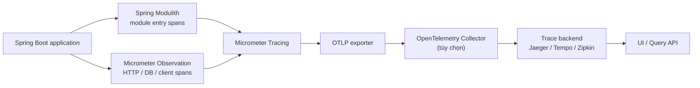
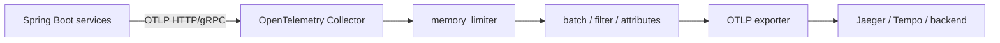

# Chọn backend lưu trữ và hiển thị trace
## 1. Từ module span đến trace có thể điều tra

Trong chương **Export traces** của học phần **SPRING_MODULITH_DOCUMENTATION_OBSERVABILITY**, chúng ta tìm hiểu cách đưa dữ liệu tracing từ ứng dụng Spring Boot tới một hệ thống có thể lưu trữ, tìm kiếm và hiển thị. Spring Modulith giúp tài liệu hóa ranh giới application module, công bố module graph qua Actuator, ghi nhận event metrics và tạo module entry spans. Tuy nhiên, tạo span trong ứng dụng mới là bước đầu: muốn điều tra một request chậm, một event listener lỗi hoặc một lời gọi giữa module bất thường, ta còn cần nơi nhận và giữ trace.

Một pipeline trace hoàn chỉnh thường có bốn thành phần:

1. **Instrumentation:** Spring Modulith và Micrometer Observation tạo module spans; Spring Boot bổ sung HTTP, database, messaging hoặc client spans khi có instrumentation tương ứng.
2. **Exporter:** chuyển spans từ ứng dụng sang định dạng và giao thức như OpenTelemetry Protocol (OTLP).
3. **Pipeline trung gian (tùy chọn):** OpenTelemetry Collector nhận, xử lý, batch, lọc hoặc chuyển tiếp trace.
4. **Backend và giao diện truy vấn:** lưu trace, tìm theo service/trace ID/attributes và hiển thị cây span.

Sau bài này, bạn có thể so sánh Jaeger, Grafana Tempo và Zipkin; cấu hình Spring Boot xuất OTLP; hiểu vai trò Collector; lựa chọn sampling, retention và bảo mật; kiểm tra trace đã tới backend; chẩn đoán khi không tìm thấy span.

## 2. Kiến trúc tổng thể của trace export



**Exporter không phải backend.** Exporter chỉ gửi dữ liệu ra ngoài. Collector là lớp tiếp nhận và chuyển tiếp, nhưng bản thân Collector không phải kho lưu trữ trace dài hạn. Backend mới chịu trách nhiệm lưu, truy vấn và phục vụ giao diện điều tra.

| Thành phần | Trách nhiệm | Ví dụ |
| --- | --- | --- |
| Instrumentation | Tạo span cho thao tác được quan sát | Spring Modulith module spans, Micrometer Observation |
| Exporter | Gửi dữ liệu theo giao thức | OTLP HTTP, OTLP gRPC |
| Collector | Gom, xử lý và định tuyến telemetry | OpenTelemetry Collector, Grafana Alloy |
| Backend | Lưu trace và cung cấp API truy vấn | Jaeger, Grafana Tempo, Zipkin |
| UI | Tìm trace, xem timeline và attributes | Jaeger UI, Grafana Explore, Zipkin UI |

Một request có thể đi từ module `order` sang API của `payment`. Khi trace được xuất và lưu thành công, UI có thể hiển thị cây span để so sánh thời gian ở từng module. Nếu backend không nhận dữ liệu, instrumentation trong ứng dụng vẫn có thể chạy nhưng người vận hành không tìm thấy trace.

## 3. Tiêu chí chọn backend

Không nên chọn backend chỉ dựa vào giao diện hoặc việc chạy thử local dễ dàng. Hãy đánh giá:

| Tiêu chí | Câu hỏi khi lựa chọn |
| --- | --- |
| Giao thức ingest | Backend có nhận OTLP trực tiếp không? Có cần Collector chuyển đổi giao thức không? |
| Quy mô ingest | Lưu lượng span mỗi giây và kích thước trace tối đa là bao nhiêu? |
| Lưu trữ | Dữ liệu nằm trong bộ nhớ, database hay object storage? |
| Retention | Cần giữ trace trong bao lâu? Có cần archive trace điều tra sự cố không? |
| Tìm kiếm | Có thể tìm theo service, thời gian, duration, status, span name và attributes không? |
| Tích hợp | Có thể liên kết trace với log, metrics, dashboard và alert hiện có không? |
| Vận hành | Cần quản lý bao nhiêu thành phần, replica, storage và cơ chế backup? |
| Bảo mật | Có authentication, authorization, TLS, tenant isolation và chính sách dữ liệu không? |
| Chi phí | Chi phí ingest, index, lưu trữ, query và vận hành có phù hợp ngân sách không? |

Trước khi quyết định, hãy trả lời bốn câu hỏi:

- Ai sẽ đọc trace: nhóm phát triển, SRE, vận hành hay nhiều nhóm có quyền khác nhau?
- Trace cần được giữ bao lâu và có yêu cầu kiểm toán/điều tra sự cố không?
- Tổ chức đã dùng Grafana, Prometheus, Loki hoặc một nền tảng tracing nào chưa?
- Có cần Collector để tập trung xử lý, định tuyến và bảo vệ dữ liệu trước khi xuất không?

## 4. So sánh Jaeger, Grafana Tempo và Zipkin

| Tiêu chí | Jaeger v2 | Grafana Tempo | Zipkin |
| --- | --- | --- | --- |
| Định hướng | Nền tảng distributed tracing chuyên biệt | Backend tracing quy mô lớn, tích hợp Grafana | Hệ thống tracing gọn, dễ bắt đầu |
| Giao thức | Nhận OTLP; hỗ trợ một số định dạng legacy | Nhận OTLP, Jaeger và Zipkin formats | API ingest Zipkin; có thể nhận OTLP qua Collector chuyển tiếp |
| Lưu trữ | OpenSearch/Elasticsearch/Cassandra là backend phân tán chính; ClickHouse còn experimental theo tài liệu phiên bản | Object storage như S3-compatible, GCS, Azure; local chủ yếu cho dev/test | Storage pluggable như MySQL, Elasticsearch, Cassandra |
| Truy vấn | Tìm trace và xem cây span qua Jaeger UI/API | TraceQL, tìm theo trace ID/attributes qua Grafana | Tìm theo service, thời gian, annotation và xem trace qua UI |
| Hệ sinh thái | Tập trung vào tracing | Tích hợp Grafana, Loki và Prometheus | Đơn giản, phù hợp hệ thống tracing nhỏ |
| Phù hợp khi | Cần tracing chuyên biệt và quyền kiểm soát storage/query | Đã dùng Grafana stack, cần scale và lưu object storage | Cần lựa chọn nhẹ hoặc đang có Zipkin |
| Điểm cần cân nhắc | Cần vận hành storage backend cho production | Cần quản lý object storage và kiến trúc Tempo | Cần đánh giá khả năng mở rộng, truy vấn và bảo mật UI |

### 4.1. Jaeger

**Jaeger** là nền tảng distributed tracing mã nguồn mở. Jaeger v2 được xây dựng trên framework OpenTelemetry Collector và nhận OTLP trực tiếp. Nó có thể triển khai theo vai trò all-in-one, collector, query hoặc ingester; Jaeger UI cho phép tìm service, xem trace tree và điều tra bottleneck.

Điểm mạnh:

- Nhận OTLP qua gRPC hoặc HTTP, nên ứng dụng Spring Boot có thể xuất trực tiếp bằng OpenTelemetry.
- UI tập trung vào điều tra trace và timeline span.
- Có thể mở rộng storage bằng OpenSearch, Elasticsearch hoặc Cassandra; ClickHouse được tài liệu hiện tại đánh dấu experimental.
- Các thành phần collector/query stateless có thể mở rộng theo tải.

Điểm cần lưu ý:

- All-in-one mặc định dùng **in-memory storage**, phù hợp demo/local; dữ liệu mất khi tiến trình dừng.
- Production cần storage bền vững, retention, backup và phân tách vai trò phù hợp.
- Jaeger là backend cho traces; metrics/logs vẫn cần hệ thống tương ứng.

### 4.2. Grafana Tempo

**Grafana Tempo** là backend tracing được thiết kế để ingest trace quy mô lớn và lưu trữ hiệu quả trên object storage. Tempo nhận OTLP, Jaeger và Zipkin formats; Grafana cung cấp datasource để tìm kiếm và hiển thị trace.

Điểm mạnh:

- Lưu trace dài hạn trên S3-compatible storage, Google Cloud Storage hoặc Azure Blob Storage.
- Hỗ trợ **TraceQL** để truy vấn trace theo span và attributes.
- Kết nối với Grafana, Loki và Prometheus; có thể đi từ metric sang trace hoặc từ trace sang log.
- Có thể sinh metrics/service graph từ span thông qua metrics-generator tùy cấu hình.

Điểm cần lưu ý:

- Cần vận hành object storage và thiết lập retention/compaction phù hợp.
- Local filesystem backend dành cho phát triển và thử nghiệm; production nên dùng object storage.
- UI truy vấn nằm trong Grafana, vì vậy cần cấu hình datasource và quyền truy cập.

### 4.3. Zipkin

**Zipkin** là lựa chọn tracing gọn, có collector, storage, query service và web UI. Nó hỗ trợ các storage backend như Cassandra, Elasticsearch và MySQL. Spring Boot có thể kết hợp Brave với Zipkin qua starter tương ứng; hoặc ứng dụng xuất OTLP tới Collector rồi Collector chuyển tiếp sang Zipkin.

Điểm mạnh:

- Dễ bắt đầu cho hệ thống nhỏ hoặc nhu cầu tracing cơ bản.
- Có giao diện và API truy vấn rõ ràng.
- Có thể tận dụng storage backend quen thuộc nếu hệ thống đã vận hành MySQL, Elasticsearch hoặc Cassandra.

Điểm cần lưu ý:

- Cần đánh giá khả năng tìm kiếm, mở rộng và retention theo nhu cầu thực tế.
- Tài liệu kiến trúc Zipkin lưu ý web UI không có authentication tích hợp; cần đặt sau reverse proxy/gateway có xác thực hoặc chỉ mở trong mạng quản trị.
- Với Spring Boot 4, nếu muốn chuẩn hóa theo OpenTelemetry nên ưu tiên OTLP với Collector. Hỗ trợ OpenTelemetry Zipkin exporter đã có thay đổi/deprecation; lựa chọn Brave + Zipkin có starter riêng.

## 5. Chọn nhanh theo bối cảnh

| Bối cảnh | Lựa chọn nên cân nhắc | Lý do |
| --- | --- | --- |
| Học tracing, chạy local và xem một request | Jaeger all-in-one | Chạy nhanh, có OTLP receiver và UI |
| Đội đang dùng Grafana, Prometheus, Loki | Tempo | Tích hợp trace-to-logs/metrics và lưu object storage |
| Hệ thống nhỏ, muốn UI tracing cơ bản | Zipkin | Thành phần đơn giản, dễ làm quen |
| Production nhiều ứng dụng và nhiều backend | OpenTelemetry Collector + backend phù hợp | Tách ứng dụng khỏi backend, tập trung xử lý và định tuyến |
| Cần giữ trace dài hạn trên object storage | Tempo | Thiết kế phù hợp object storage và TraceQL |

**Gợi ý cho ứng dụng Spring Modulith:** bắt đầu bằng Jaeger để xác minh module spans trong local. Khi chuyển production, đánh giá lưu lượng và retention; nếu tổ chức đã có Grafana stack thì cân nhắc Tempo. Dù chọn backend nào, giữ instrumentation dựa trên Micrometer/OTLP sẽ giảm phụ thuộc vendor.
## 6. Bật trace instrumentation trong Spring Boot và Spring Modulith

### 6.1. Dependency

Ví dụ dưới đây dành cho **Spring Boot 4.x** và một phiên bản Spring Modulith tương thích. Dùng BOM để quản lý version thay vì pin từng artifact:

```groovy
dependencies {
    implementation platform(
        "org.springframework.modulith:spring-modulith-bom:" + springModulithVersion
    )
    runtimeOnly "org.springframework.modulith:spring-modulith-starter-insight"
    implementation "org.springframework.boot:spring-boot-starter-opentelemetry"
}
```

`springModulithVersion` là biến build cần được khai báo bằng **phiên bản stable tương thích với Spring Boot đang dùng**. Không sao chép version preview hoặc milestone vào production. `spring-modulith-starter-insight` cung cấp hỗ trợ Actuator và observability của Modulith; nó instrument Spring component thuộc API application module để tạo module entry spans. `spring-boot-starter-opentelemetry` bổ sung tracer/exporter OpenTelemetry của Spring Boot để xuất trace qua OTLP.

Nếu chỉ cần module instrumentation mà không cần Modulith Actuator, có thể dùng artifact observability core phù hợp thay cho starter Insight.

### 6.2. Cấu hình tên service, endpoint và sampling

Ví dụ cấu hình OTLP/HTTP để gửi tới OpenTelemetry Collector đang lắng nghe cổng 4318:

```yaml
spring:
  application:
    name: shop-application

management:
  tracing:
    sampling:
      probability: 1.0
  opentelemetry:
    tracing:
      export:
        otlp:
          endpoint: "http://localhost:4318/v1/traces"
```

Ý nghĩa:

- `spring.application.name` đặt tên service ổn định để tìm trace trong backend.
- `management.opentelemetry.tracing.export.otlp.endpoint` là URL OTLP/HTTP nhận trace. Với Collector hoặc backend ở máy/container khác, thay `localhost` bằng hostname có thể truy cập từ ứng dụng.
- `management.tracing.sampling.probability: 1.0` lấy mẫu 100% trong môi trường học/thử nghiệm. **Không nên mặc định dùng 100% ở production** nếu lưu lượng lớn.

Spring Boot hiện lấy mẫu 10% request theo mặc định để tránh làm quá tải backend. Hãy chọn tỷ lệ dựa trên volume, chi phí và mục tiêu điều tra. Với OpenTelemetry, Spring Boot còn hỗ trợ sampler parent-based trace ID ratio; cần bảo đảm các span trong cùng trace tuân theo quyết định sampling của parent.

**Lưu ý phiên bản:** Ví dụ dùng cấu hình Spring Boot 4.x. Các dòng Spring Boot 3.x có dependency và tên property OTLP khác nhau; kiểm tra reference documentation đúng dòng Boot trước khi sao chép. Không trộn starter Zipkin/Brave với starter OpenTelemetry trong cùng một pipeline nếu chưa có chủ đích cấu hình.

## 7. Chạy Jaeger local để xác minh trace

Jaeger all-in-one là cách nhanh để kiểm tra một ứng dụng đã export OTLP hay chưa. Ví dụ dùng image Jaeger 2.23.0:

```bash
docker run --rm --name jaeger -p 16686:16686 -p 4317:4317 -p 4318:4318 cr.jaegertracing.io/jaegertracing/jaeger:2.23.0
```

Sau khi container chạy:

| Cổng | Vai trò |
| --- | --- |
| `4317` | OTLP/gRPC receiver |
| `4318` | OTLP/HTTP receiver |
| `16686` | Jaeger UI |

Nếu ứng dụng chạy trên cùng máy host, cấu hình endpoint:

```yaml
management:
  opentelemetry:
    tracing:
      export:
        otlp:
          endpoint: "http://localhost:4318/v1/traces"
```

Mở `http://localhost:16686`, chọn service `shop-application`, khoảng thời gian gần nhất và tìm trace sau khi gửi request thử nghiệm.

**Giới hạn:** all-in-one mặc định dùng in-memory storage. Trace chỉ tồn tại khi tiến trình Jaeger còn chạy và không phù hợp để lưu dữ liệu production. Không expose cổng UI/OTLP của container ra mạng công cộng.

## 8. Dùng OpenTelemetry Collector làm pipeline trung gian

Trong production, một Collector ở gần ứng dụng giúp tách vòng đời ứng dụng khỏi backend. Collector có thể nhận OTLP, áp dụng processor, batch dữ liệu và chuyển tiếp tới một hoặc nhiều backend. Nó cũng có thể lọc hoặc loại bỏ attributes nhạy cảm trước khi xuất.



### 8.1. Ví dụ cấu hình Collector tối giản

Ví dụ dưới đây minh họa Collector nhận OTLP ở cả HTTP và gRPC, giới hạn bộ nhớ, gom batch rồi gửi OTLP/gRPC tới Tempo trong cùng mạng nội bộ:

```yaml
receivers:
  otlp:
    protocols:
      grpc:
        endpoint: 0.0.0.0:4317
      http:
        endpoint: 0.0.0.0:4318

processors:
  memory_limiter:
    check_interval: 1s
    limit_mib: 512
  batch:
    timeout: 5s

exporters:
  otlp/tempo:
    endpoint: tempo:4317
    tls:
      insecure: true

service:
  pipelines:
    traces:
      receivers: [otlp]
      processors: [memory_limiter, batch]
      exporters: [otlp/tempo]
```

Trong ví dụ:

- `tempo:4317` là DNS/service name và cổng OTLP/gRPC của Tempo trong mạng triển khai. Nếu backend khác, thay exporter và endpoint theo giao thức backend hỗ trợ.
- `memory_limiter` giúp hạn chế áp lực bộ nhớ; `batch` giảm số lần gửi và overhead kết nối.
- `0.0.0.0` chỉ dùng để lắng nghe trong môi trường mạng container đã được bảo vệ. Trong môi trường khác, giới hạn bind address và firewall theo thiết kế mạng.
- Cấu hình Collector cần khai báo component trong `service.pipelines`; chỉ định nghĩa receiver/exporter mà không gắn vào pipeline thì component chưa được bật.

Đây là cấu hình mẫu tối giản để hiểu luồng. Production cần bổ sung TLS/mTLS, authentication, queue/retry phù hợp, resource limits, health check và telemetry của chính Collector.

### 8.2. Đổi ứng dụng gửi tới Collector

Khi Collector cùng mạng với ứng dụng, thay endpoint trong Spring Boot:

```yaml
management:
  opentelemetry:
    tracing:
      export:
        otlp:
          endpoint: "http://otel-collector:4318/v1/traces"
```

Ứng dụng chỉ cần biết địa chỉ Collector; Collector chịu trách nhiệm định tuyến tới Tempo/Jaeger. Điều này cho phép thay backend hoặc gửi tới nhiều đích mà không phải sửa cấu hình từng service.

### 8.3. Khi nào nên gửi trực tiếp?

| Gửi trực tiếp tới backend | Gửi qua Collector |
| --- | --- |
| Local demo, một ứng dụng, một backend | Nhiều ứng dụng và nhiều backend |
| Ít yêu cầu xử lý dữ liệu | Cần batch, filter, redact, routing hoặc tail sampling |
| Ít thành phần vận hành | Cần tập trung quản lý TLS, authentication và exporter |
| Phù hợp để kiểm chứng ban đầu | Phù hợp làm pipeline dùng chung trong production |

Collector không tự động bảo đảm không mất dữ liệu. Cần cấu hình sending queue, retry, persistent queue nếu phù hợp và giám sát các span bị từ chối hoặc loại bỏ.
## 9. Cấu hình backend khác

### 9.1. Jaeger qua OTLP

Jaeger v2 nhận OTLP/gRPC ở cổng 4317 và OTLP/HTTP ở cổng 4318. Vì vậy ứng dụng Spring Boot có thể gửi trực tiếp:

```yaml
management:
  opentelemetry:
    tracing:
      export:
        otlp:
          endpoint: "http://jaeger:4318/v1/traces"
```

Hoặc gửi tới Collector rồi dùng exporter OTLP/gRPC trỏ đến `jaeger:4317`. Giao diện Jaeger UI thường được expose qua cổng 16686 trong cấu hình all-in-one. Production cần cấu hình storage bền vững thay cho memory.

### 9.2. Grafana Tempo qua OTLP

Tempo nhận OTLP. Với Collector ở cùng mạng, exporter có thể gửi tới receiver của Tempo. Grafana cần được cấu hình Tempo datasource để truy vấn và hiển thị trace.

Các điểm cần thiết lập:

- Endpoint ingest OTLP của Tempo chỉ mở trong mạng dịch vụ.
- Object storage (S3-compatible, GCS hoặc Azure Blob Storage) cho lưu trữ production.
- Retention, compaction và giới hạn ingest/query theo tải.
- Grafana datasource trỏ đúng Tempo query endpoint; bật quyền truy cập theo nhóm.
- TraceQL hoặc bộ lọc tìm theo service, span name, duration và attributes.

Tempo hỗ trợ tìm theo trace ID và tìm kiếm trên trace data. Khi dùng object storage, chi phí và tốc độ truy vấn phụ thuộc volume dữ liệu, retention, compaction và cách truy vấn attributes.

### 9.3. Zipkin với Spring Boot

Nếu dự án đã chọn **Brave + Zipkin**, Spring Boot cung cấp starter riêng và endpoint Zipkin:

```groovy
dependencies {
    runtimeOnly "org.springframework.boot:spring-boot-starter-zipkin"
}
```

```yaml
management:
  tracing:
    export:
      zipkin:
        endpoint: "http://zipkin:9411/api/v2/spans"
```

Đây là phương án Brave/Zipkin, không phải cấu hình OTLP. Nếu muốn chuẩn hóa ứng dụng theo OpenTelemetry, có thể gửi OTLP tới Collector rồi Collector chuyển sang Zipkin bằng exporter phù hợp với distribution đang dùng. Kiểm tra version Spring Boot vì hỗ trợ OpenTelemetry Zipkin exporter đã có thay đổi; không coi hai cấu hình này là có thể bật đồng thời tùy ý.

## 10. Sampling: kiểm soát lượng trace xuất ra

Nếu ghi mọi request ở hệ thống tải lớn, lượng span có thể tăng nhanh. Sampling quyết định trace nào được lưu và gửi tới backend.

### Head sampling

Spring Boot cấu hình sampling probability ở đầu luồng:

```yaml
management:
  tracing:
    sampling:
      probability: 0.1
```

Với `0.1`, mục tiêu là lấy mẫu khoảng 10% trace theo cơ chế sampler đã cấu hình. Sampling mặc định của Spring Boot hiện là 10%. Hãy chọn tỷ lệ dựa trên volume, chi phí và mục tiêu điều tra. Với OpenTelemetry, Spring Boot còn hỗ trợ sampler parent-based trace ID ratio; cần bảo đảm các span trong cùng trace tuân theo quyết định sampling của parent.

### Tail sampling

Tail sampling quyết định giữ trace sau khi Collector đã nhận đủ dữ liệu, có thể ưu tiên trace lỗi, trace chậm hoặc trace có attributes nhất định. Nó hữu ích khi cần giữ các trace bất thường mà không phải lưu toàn bộ lưu lượng.

Tuy nhiên, tail sampling cần quản lý trace state và bộ nhớ tại Collector; các span của cùng trace phải được định tuyến tới cùng sampler instance/trace-aware pipeline. Cần kiểm soát timeout, decision wait và giới hạn số trace đang chờ. Không thêm tail sampling chỉ vì muốn tăng tỷ lệ trace lỗi nếu chưa thiết kế năng lực Collector.

### Chiến lược gợi ý

| Môi trường | Chiến lược |
| --- | --- |
| Local/dev | Lấy mẫu 100% trong lúc học và kiểm thử |
| Test/staging | Lấy mẫu đủ cao để bao phủ luồng chính, lỗi và async |
| Production tải thấp | Có thể dùng tỷ lệ cao hơn sau khi đo chi phí |
| Production tải lớn | Head sampling theo tỷ lệ; cân nhắc tail sampling để ưu tiên trace lỗi/chậm |

Sampling phải nhất quán trong distributed trace. Không nên để từng module tự quyết định tỷ lệ độc lập theo cách khiến một trace chỉ còn vài span rời rạc.

## 11. Truy vấn và xác minh trace đã được lưu

Sau khi backend hoạt động, cần xác minh theo từng lớp thay vì chỉ mở UI rồi kết luận.

### Checklist xác minh

1. **Ứng dụng tạo span:** gửi một request thực sự đi qua API module, ví dụ `order` gọi `payment`.
2. **Sampling cho phép:** request nằm trong tỷ lệ được lấy mẫu.
3. **Exporter gửi được:** endpoint, giao thức HTTP/gRPC, port, TLS và authentication đúng.
4. **Collector nhận được:** không có lỗi receiver, processor hoặc exporter; pipeline đã enable.
5. **Backend lưu được:** không vượt giới hạn ingest/storage và trace không bị drop.
6. **UI truy vấn đúng:** chọn đúng service, time range và backend datasource.
7. **Module spans có metadata:** kiểm tra `module.identifier`, `module.name`, `module.method` và `module.invocation-type`.

### Ví dụ cây trace mong đợi

```text
HTTP POST /orders
└── order / OrderFacade.place
    ├── payment / PaymentOperations.authorize
    │   └── HTTP client / payment-gateway
    └── inventory / InventoryListener.on
```

Đây là cấu trúc minh họa. Listener `inventory` có thể chạy bất đồng bộ và xuất hiện trong trace riêng nếu context không được truyền hoặc event được xử lý lại sau transaction/restart. Khi đọc trace, hãy phân biệt **module dependency tĩnh** với **span đã thực thi**.

### Tìm theo trace ID và attributes

Một quy trình điều tra thường bắt đầu từ:

- Tên service: `shop-application`.
- Khoảng thời gian xảy ra request.
- Span name hoặc module method cần tìm.
- Trace ID lấy từ log có correlation/tracing context.
- Attributes như `module.identifier=payment` hoặc `module.invocation-type=bean`.
- Duration và trạng thái lỗi của span.

Không đưa `orderId`, email, token hoặc payload nhạy cảm vào attributes chỉ để dễ tìm. Nếu cần liên hệ một đơn hàng, dùng correlation ID được phép và chính sách bảo vệ phù hợp.

## 12. Bảo mật, retention và chi phí vận hành

Trace có thể chứa URL, SQL metadata, exception, user/tenant attributes và thông tin tương quan nghiệp vụ. Trước khi export ra khỏi ứng dụng, hãy xác định dữ liệu nào được phép lưu và ai có thể truy cập.

### Bảo vệ pipeline

- Dùng TLS hoặc mTLS giữa ứng dụng, Collector và backend khi đi qua mạng.
- Bật authentication cho OTLP receiver/exporter hoặc đặt Collector sau gateway được bảo vệ.
- Giới hạn port ingest/query trong private network; không mở Jaeger UI, Grafana hoặc Zipkin UI ra Internet nếu chưa có lớp xác thực phù hợp.
- Dùng Collector processors để xóa/redact attributes nhạy cảm trước khi export khi chính sách yêu cầu.
- Phân quyền datasource và tenant theo nhóm người dùng; ghi nhận hoạt động truy cập khi cần.

### Retention và sampling

Trace thường có volume lớn và giá trị giảm theo thời gian. Chọn retention dựa trên mục đích điều tra, tỷ lệ sampling, số span mỗi trace, kích thước attributes, chi phí index/query/storage và yêu cầu archive. Không nên lưu mọi trace vô thời hạn.

## 13. Chẩn đoán khi không tìm thấy trace

| Triệu chứng | Nguyên nhân có thể | Cách kiểm tra |
| --- | --- | --- |
| Không có service trong UI | Chưa có span được export; sampling loại request; service name khác | Kiểm tra app logs, sampling, resource attributes và service name |
| Collector không nhận trace | Sai host/port/path hoặc protocol; receiver chưa bật | Kiểm tra endpoint OTLP HTTP, cổng 4317/4318 và pipeline |
| HTTP 404 khi export | Sai path hoặc gửi OTLP vào query/UI port | Kiểm tra đúng receiver endpoint; UI port không phải ingest port |
| HTTP 401/403 | Thiếu hoặc sai authentication | Kiểm tra headers/token, gateway policy và quyền receiver |
| TLS handshake lỗi | CA/certificate/hostname không khớp | Kiểm tra TLS trust chain và hostname |
| Collector nhận nhưng backend không có trace | Exporter sai endpoint, queue lỗi, backend reject hoặc drop | Xem Collector logs/metrics và backend ingestion metrics |
| Chỉ thấy một phần span | Sampling không nhất quán, propagation mất, span bị drop | Kiểm tra parent-based sampling, trace context và collector pipeline |
| Trace không có module spans | Thiếu Modulith observability hoặc bean không thuộc module API | Kiểm tra Insight starter, API package và lời gọi qua Spring bean |
| Listener async nằm trong trace khác | Context propagation không có hoặc event được retry | Kiểm tra Reactor/Executor context propagation và correlation ID |
| Trace biến mất sau khi Jaeger local restart | All-in-one dùng memory storage | Dùng persistent storage trong môi trường cần giữ dữ liệu |
| Query chậm hoặc không tìm được trace cũ | Retention/index/object storage/query range | Kiểm tra retention, backend health, thời gian và attributes được index |

### Thứ tự debug thực tế

1. Kiểm tra ứng dụng có tạo module span trong trace/debug output hay chưa.
2. Kiểm tra log exporter và endpoint OTLP.
3. Gửi một trace mẫu tới Collector; xác minh Collector receiver nhận được.
4. Kiểm tra processor có lọc/drop trace hay không.
5. Kiểm tra exporter và backend ingestion status.
6. Tìm trong UI bằng service name và time range rộng hơn; sau đó lọc theo module attributes.
7. Nếu vẫn không có, xác minh sampling và trace context propagation.

## 14. Bài tập thực hành

Một ứng dụng Spring Boot có các module `order`, `payment` và `inventory`. Ứng dụng đã có module spans nhưng đội phát triển chưa thể xem trace trên dashboard.

**Yêu cầu:**

1. Giải thích vì sao có `spring-modulith-starter-insight` chưa đủ để trace xuất hiện trên UI.
2. Chọn một backend trong ba lựa chọn Jaeger, Tempo và Zipkin cho môi trường local; nêu lý do.
3. Cấu hình Spring Boot 4 gửi OTLP/HTTP tới Collector trên cổng 4318.
4. Viết cấu hình Collector nhận OTLP, áp dụng `memory_limiter` và `batch` rồi gửi tới backend.
5. Nêu cách xác minh module span `payment` có mặt trong trace.
6. Giải thích vì sao Jaeger all-in-one không phù hợp để lưu trace production mặc định.
7. Đề xuất sampling và retention phù hợp cho staging và production.

**Gợi ý đáp án:**

- Starter Insight bật Modulith Actuator/observability; cần thêm tracer/exporter và backend nhận/lưu trace.
- Jaeger all-in-one thuận tiện cho local vì có OTLP receiver và UI; storage mặc định là in-memory.
- Endpoint Boot 4 có dạng `http://otel-collector:4318/v1/traces` khi Collector dùng OTLP/HTTP.
- Collector cần khai báo receiver, processor, exporter và gắn chúng vào `service.pipelines.traces`.
- Tìm service name và kiểm tra attributes `module.identifier=payment`, `module.method` và parent/child spans.
- Production cần storage bền vững, authentication, TLS, retention và sampling theo tải.

## 15. Ghi nhớ

**Chọn backend lưu trữ và hiển thị trace là quyết định về giao thức, storage, khả năng query, retention và năng lực vận hành.** Jaeger phù hợp với tracing chuyên biệt và OTLP; Tempo phù hợp với Grafana stack và object storage; Zipkin là lựa chọn gọn cho nhu cầu cơ bản. OpenTelemetry Collector có thể đứng giữa ứng dụng và backend để tập trung nhận, xử lý và định tuyến dữ liệu.

Trong Spring Modulith, hãy bật module observability, cấu hình Micrometer Tracing/OTLP exporter của Spring Boot, chọn sampling phù hợp và xác minh từng bước từ ứng dụng đến backend. Khi trace đã được lưu, đọc module spans cùng trace tree để xác định module nào thực sự được gọi, thời gian ở đâu và listener bất đồng bộ có còn cùng trace hay không. Bảo vệ dữ liệu, giới hạn retention và theo dõi các span bị drop để hệ thống quan sát có ích trong vận hành thực tế.

## Tài liệu tham khảo

1. [Spring Modulith – Production-ready Features, Observing Application Modules](https://docs.spring.io/spring-modulith/reference/production-ready.html): starter Insight, module entry spans và observability.
2. [Spring Boot 4 – Tracing](https://docs.spring.io/spring-boot/4.0/reference/actuator/tracing.html): OpenTelemetry OTLP starter, Zipkin/Brave, endpoint exporter và sampling.
3. [Spring Boot – Observability](https://docs.spring.io/spring-boot/reference/actuator/observability.html): OTLP common configuration, endpoint và headers.
4. [OpenTelemetry Collector – Configuration](https://opentelemetry.io/docs/collector/configuration/): receivers, processors, exporters và pipelines.
5. [Jaeger 2.23 – APIs](https://www.jaegertracing.io/docs/2.23/architecture/apis/): OTLP ingest ports, read APIs và formats.
6. [Jaeger 2.23 – Storage Backends](https://www.jaegertracing.io/docs/2.23/storage/): storage phân tán và archive storage.
7. [Jaeger 2.23 – Getting Started](https://www.jaegertracing.io/docs/2.23/getting-started/): all-in-one và UI local.
8. [Grafana Tempo – Overview](https://grafana.com/docs/tempo/latest/): backend tracing, TraceQL và tích hợp Grafana.
9. [Grafana Tempo – Object Storage](https://grafana.com/docs/tempo/latest/reference-tempo-architecture/object-storage/): S3, GCS, Azure và local storage.
10. [Grafana Tempo – Set up for Tracing](https://grafana.com/docs/tempo/latest/set-up-for-tracing/): instrumentation, Collector/pipeline và backend.
11. [OpenZipkin – Architecture](https://zipkin.io/pages/architecture.html): collector, storage, query service và UI.