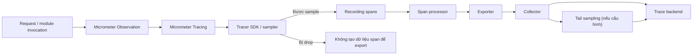
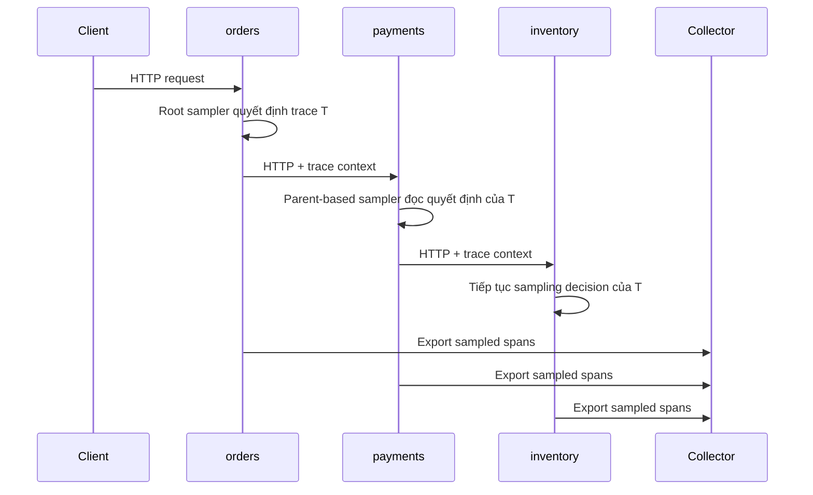

# Sampling trước khi export

## 1. Vì sao cần sampling trong tracing?

Trong ứng dụng Spring Boot dùng **Spring Modulith**, một request có thể đi qua nhiều application module như `orders`, `payments`, `inventory` và `notifications`. Spring Modulith tạo observation tại các điểm vào module; Micrometer Tracing có thể chuyển những observation này thành spans để theo dõi thời gian, lỗi và quan hệ giữa các bước xử lý.

Nếu export mọi trace của mọi request, dữ liệu có thể tăng rất nhanh: mỗi request sinh nhiều span, các service downstream tiếp tục thêm span, và backend phải nhận, lập chỉ mục, lưu trữ cũng như phục vụ truy vấn. **Sampling** giúp chọn một phần trace đại diện hoặc ưu tiên những trace có giá trị chẩn đoán cao.

Bài **“Sampling trước khi export”** thuộc chương **Export traces** của module **SPRING_MODULITH_DOCUMENTATION_OBSERVABILITY**. Nội dung tập trung vào thời điểm đưa ra quyết định sampling, đặc biệt là phân biệt **head sampling ở ứng dụng/SDK** với **tail sampling ở Collector**, cách cấu hình Spring Boot và những giới hạn khi muốn giữ trace lỗi hoặc trace chậm.

Sau bài học, bạn có thể:

- Giải thích sampling là quyết định chọn trace/span để ghi nhận và export, không phải tỷ lệ request lỗi.
- Phân biệt head sampling, tail sampling và hybrid sampling.
- Cấu hình xác suất sampling bằng Spring Boot, hiểu sampler mặc định của OpenTelemetry và ảnh hưởng của parent context.
- Nhận diện trường hợp trace bị loại trước exporter nên Collector không thể khôi phục.
- Thiết kế đường gửi OTLP phù hợp nếu cần tail sampling ở OpenTelemetry Collector.
- Kiểm chứng sampling qua logs, metrics, trace backend và module spans của Spring Modulith.

## 2. Sampling xảy ra ở đâu trong tracing pipeline?

Một pipeline phổ biến:



Có hai vị trí sampling quan trọng:

1. **Head sampling:** quyết định rất sớm, thường khi root span/trace được tạo trong SDK. Span không được chọn có thể không được ghi nhận và không đi tới exporter.
2. **Tail sampling:** quyết định ở phía sau, thường tại Collector, sau khi đã nhận đủ hoặc phần lớn spans của một trace. Collector có thể xem trạng thái lỗi, thời lượng và thuộc tính của toàn trace trước khi giữ hoặc loại nó.

Vì vậy cụm từ **“sampling trước khi export”** thường nói đến head sampling trong ứng dụng: quyết định được đưa ra trước khi span tới exporter. Tail sampling lại xảy ra **sau khi dữ liệu đã rời ứng dụng và được Collector nhận** nhưng trước khi Collector export tới backend lưu trữ cuối.

### 2.1. Không nhầm sampling với export

| Giai đoạn | Câu hỏi | Ví dụ |
| --- | --- | --- |
| Instrumentation | Có observation/span nào được tạo? | Module `inventory` có module entry observation. |
| Sampling | Trace/span có được ghi nhận để export không? | Root trace được chọn với xác suất 10%. |
| Span processing | Span đã kết thúc được xử lý thế nào? | Batch processor gom spans trước khi gửi. |
| Export | Span được chuyển tới đâu? | OTLP exporter gửi tới Collector. |
| Backend | Dữ liệu được lưu và truy vấn ra sao? | Tempo/Jaeger hiển thị trace. |

Nếu trace bị sampler ở SDK loại bỏ, exporter thường không nhận span đó. Không thể sửa lỗi này chỉ bằng cách tăng retry hoặc tăng queue của exporter. Ngược lại, trace được sample nhưng không thấy ở backend có thể do lỗi exporter, mạng, collector, authentication hoặc backend.

## 3. Head sampling: quyết định ngay khi trace bắt đầu

**Head sampling** đưa ra quyết định dựa trên thông tin sẵn có ở thời điểm span/trace được tạo. Với sampling theo xác suất dựa trên trace ID, sampler chọn một tỷ lệ trace nhất định; các child spans thường tuân theo sampling decision của parent khi sử dụng parent-based sampler.

Ưu điểm:

- Ít tốn tài nguyên hơn vì trace bị loại sớm không cần ghi nhận và export đầy đủ.
- Dễ cấu hình tại SDK bằng xác suất.
- Phù hợp khi lưu lượng lớn và cần một mẫu đại diện của traffic.
- Quyết định có thể được truyền qua dịch vụ bằng trace context và sampling flag.

Giới hạn:

- Khi bắt đầu request, sampler chưa biết request sẽ kết thúc thành công hay lỗi.
- Không thể bảo đảm giữ lại tất cả trace có lỗi hoặc vượt ngưỡng latency nếu chỉ dựa vào head sampling ngẫu nhiên.
- Nếu trace không được ghi nhận ở SDK đầu tiên, Collector phía sau không thể xem nội dung đầy đủ của trace đó để quyết định giữ lại.

Ví dụ: với xác suất 10%, khoảng một phần mười trace mới có thể được chọn trong một quần thể đủ lớn. Đây là **xác suất**, không phải bảo đảm cứ mỗi mười request sẽ có đúng một trace được export.

## 4. Cấu hình sampling trong Spring Boot

Spring Boot cung cấp property:

```yaml
management:
  tracing:
    sampling:
      probability: 0.1
```

Giá trị nằm trong khoảng từ `0.0` đến `1.0`:

| Giá trị | Ý nghĩa |
| --- | --- |
| `0.0` | Không chọn trace mới theo sampler xác suất. |
| `0.01` | Xác suất 1%. |
| `0.1` | Xác suất 10%; mặc định Spring Boot hiện hành. |
| `0.5` | Xác suất 50%. |
| `1.0` | Chọn 100% trace mới theo sampler xác suất. |

Mặc định Spring Boot sample khoảng **10% request** để tránh làm quá tải trace backend. Property trên điều chỉnh xác suất. Sampling 100% thường hữu ích trong local hoặc test có tải thấp, nhưng không nên áp dụng mặc định cho production có traffic lớn.

### 4.1. Spring Boot với Brave

Với OpenZipkin Brave, cấu hình xác suất sampling bằng property chung:

```yaml
management:
  tracing:
    sampling:
      probability: 0.05
```

Ví dụ này đặt xác suất 5%. Brave sampler quyết định khi trace mới được tạo; child spans trong cùng trace tuân theo context sampling đã được truyền. Không nên diễn giải `0.05` thành “chỉ giữ 5% lỗi” hay “5% request chậm”.

### 4.2. Spring Boot với OpenTelemetry

Spring Boot hỗ trợ cấu hình loại sampler OpenTelemetry bằng:

```yaml
management:
  tracing:
    sampling:
      probability: 0.05
  opentelemetry:
    tracing:
      sampler: parent-based-trace-id-ratio
```

Các sampler được Spring Boot hiện hành hỗ trợ:

| Sampler | Hành vi |
| --- | --- |
| `always-on` | Chọn mọi trace. |
| `always-off` | Loại mọi trace. |
| `trace-id-ratio` | Chọn một tỷ lệ trace theo `management.tracing.sampling.probability`. |
| `parent-based-always-on` | Child tuân theo parent nếu có; trace mới không có parent được chọn. |
| `parent-based-always-off` | Child tuân theo parent nếu có; trace mới không có parent bị loại. |
| `parent-based-trace-id-ratio` | Nếu có parent, tuân theo sampling decision của parent; nếu không, chọn theo xác suất. |

`parent-based-trace-id-ratio` là sampler mặc định được tài liệu Spring Boot hiện hành mô tả cho OpenTelemetry. Khi một request đã có remote parent context, child service không nên tự đưa ra quyết định ngẫu nhiên mâu thuẫn với parent; parent-based sampler giúp giữ tính nhất quán của toàn trace.

### 4.3. Chọn cấu hình theo môi trường

Ví dụ dùng profile:

```yaml
# application-local.yml
management:
  tracing:
    sampling:
      probability: 1.0
```

```yaml
# application-staging.yml
management:
  tracing:
    sampling:
      probability: 0.25
```

```yaml
# application-prod.yml
management:
  tracing:
    sampling:
      probability: 0.05
```

Các tỷ lệ trên chỉ là **ví dụ khởi điểm**, không phải khuyến nghị chung. Tỷ lệ thực tế cần dựa trên throughput, số spans mỗi trace, retention, ngân sách backend và yêu cầu điều tra. Nếu tổ chức dùng Collector tail sampling, chính sách ở SDK cần được thiết kế khác với hệ thống chỉ dùng head sampling.

## 5. Parent-based sampling và propagation giữa các service

Một trace phân tán có thể bắt đầu tại `orders` rồi đi qua `payments` và `inventory`. Khi trace context được truyền qua HTTP/message headers, các service nhận được thông tin về trace cha và sampling decision.



Nếu root trace được chọn, các child spans thường tiếp tục được ghi nhận theo parent-based sampling. Nếu root bị loại, child services có thể không ghi nhận spans tương ứng. Đây là lý do quan trọng để cấu hình propagation đúng và thống nhất giữa các dịch vụ.

Spring Boot có thể tự động propagate trace context khi dùng các builder được auto-configure như `RestClient.Builder` hoặc `WebClient.Builder`. Nếu tự tạo HTTP client không có instrumentation, trace headers có thể không được inject. Với message broker, cần inject/extract context qua headers bằng integration tương ứng.

**Lưu ý:** Sampling decision được truyền trong trace context không thay thế việc kiểm tra executor/transport. Nếu listener đổi thread nhưng mất context, trace có thể bị tách hoặc sampler không nhận được parent như mong đợi.

## 6. Tail sampling: quyết định sau khi thấy dữ liệu trace

**Tail sampling** trì hoãn quyết định đến khi Collector đã nhận đủ dữ liệu cần thiết của trace. Khi đó có thể áp dụng chính sách dựa trên:

- Trace có span mang status lỗi.
- Tổng thời lượng trace vượt ngưỡng.
- Trace đi qua module hoặc dịch vụ cụ thể.
- Có thuộc tính cần điều tra, ví dụ phiên bản mới hoặc loại giao dịch quan trọng.
- Một phần traffic được chọn ngẫu nhiên để đại diện.

Ví dụ: luôn giữ trace có lỗi hoặc tổng latency trên 2 giây, còn trace thành công nhanh chỉ giữ 5%.

### 6.1. Vì sao tail sampling hữu ích?

Head sampler không biết tương lai của request. Tail sampler có thể nhìn kết quả cuối:

| Tình huống | Head sampling xác suất | Tail sampling theo lỗi/latency |
| --- | --- | --- |
| Request thành công, nhanh | Có thể giữ hoặc loại theo xác suất | Thường có thể loại hoặc lấy mẫu thấp |
| Request thất bại ở listener cuối | Có thể đã bị loại từ lúc root bắt đầu | Có thể giữ nếu Collector nhận đủ spans |
| Request chậm do module downstream | Không biết trước thời lượng cuối | Có thể giữ nếu tổng thời gian vượt ngưỡng |
| Request cần điều tra theo attribute | Chỉ dựa trên dữ liệu lúc bắt đầu | Có thể quyết định theo thuộc tính ở các span đã nhận |

Tail sampling có **chi phí vận hành cao hơn**: Collector cần giữ dữ liệu trong bộ nhớ trong khoảng chờ để tập hợp spans của cùng trace, sau đó mới đưa ra quyết định. Phải tính capacity, decision wait, số trace đồng thời và xử lý khi Collector quá tải.

### 6.2. Điều kiện bắt buộc: Collector phải thấy đủ spans của một trace

Để quyết định tail sampling chính xác, các spans của cùng trace cần đến **cùng một Collector instance**. Nếu một load balancer phân phối từng batch ngẫu nhiên sang nhiều Collector, mỗi instance chỉ thấy một phần trace và có thể đưa ra quyết định sai.

Khi scale nhiều gateway Collector, OpenTelemetry hướng dẫn dùng **load balancing exporter theo trace ID** để route các spans cùng trace tới cùng gateway. Đây là kiến trúc nâng cao; cần thử nghiệm việc scale, thay đổi số gateway, cache và tính nhất quán quyết định.

### 6.3. Cấu hình tail sampling ở Collector

Ví dụ cấu hình khái niệm cho OpenTelemetry Collector Contrib:

```yaml
receivers:
  otlp:
    protocols:
      grpc:
        endpoint: 0.0.0.0:4317
      http:
        endpoint: 0.0.0.0:4318

processors:
  memory_limiter:
    check_interval: 1s
    limit_mib: 1024
  tail_sampling:
    decision_wait: 10s
    num_traces: 50000
    expected_new_traces_per_sec: 1000
    policies:
      - name: keep-errors
        type: status_code
        status_code:
          status_codes: [ERROR]
      - name: keep-slow
        type: latency
        latency:
          threshold_ms: 2000
      - name: sample-healthy
        type: probabilistic
        probabilistic:
          sampling_percentage: 5

exporters:
  otlp:
    endpoint: trace-backend:4317
    tls:
      insecure: true

service:
  pipelines:
    traces:
      receivers: [otlp]
      processors: [memory_limiter, tail_sampling]
      exporters: [otlp]
```

Đây là **ví dụ cấu hình minh họa**, cần điều chỉnh theo phiên bản Collector và exporter/backend thực tế. Không đưa `insecure: true` vào môi trường production nếu không có lý do và mạng bảo vệ phù hợp; cấu hình TLS/auth theo hạ tầng. Processor chỉ hoạt động khi được khai báo trong pipeline như ví dụ.

Đối với tail sampling, ứng dụng phải gửi đủ spans cần thiết đến Collector. Nếu SDK head sampler chỉ export 5% trace, Collector chỉ có thể tail-sample trong tập 5% đã nhận; nó **không thể khôi phục 95% trace bị drop tại SDK**. Để giữ tất cả lỗi bằng tail policy, thường cần SDK/agent gửi đủ dữ liệu tới tầng tail sampler, rồi Collector quyết định export tiếp.

Với Spring Boot 4.2 và OpenTelemetry, có thể cấu hình sampler phía SDK theo hướng gửi mọi trace mới tới Collector:

```yaml
management:
  opentelemetry:
    tracing:
      sampler: always-on
```

Với cấu hình dùng sampler xác suất, đặt `management.tracing.sampling.probability: 1.0` cũng khiến mọi trace mới được chọn theo tỷ lệ. Nếu dùng Spring Boot 3.5, property xác suất chung là cách cấu hình thường dùng. Các service tham gia cùng trace phải có chính sách tương thích; một service upstream đã loại trace thì service downstream không thể bổ sung lại các spans upstream đã mất. Gửi 100% spans từ ứng dụng sang Collector làm tăng tải mạng và Collector, vì vậy cần giới hạn bằng chính sách tail sampling sau đó, theo dõi memory/queue và định cỡ hạ tầng.

## 7. Hybrid sampling: kết hợp head và tail

Trong hệ thống có lưu lượng rất lớn, có thể dùng cả hai tầng:

1. Head sampling ở ứng dụng để giảm một phần tải đầu vào, nhưng phải giữ tỷ lệ đủ lớn cho mục tiêu downstream.
2. Collector tail sampling để ưu tiên lỗi, latency cao hoặc trace thuộc nhóm cần quan sát.
3. Export các trace được giữ tới backend.

Tuy nhiên, nếu head sampling quá thấp, tail sampler không thể nhìn thấy những trace đã bị loại. Hybrid sampling cần xác định rõ **trace nào có cơ hội tới Collector** và **trace nào có thể bị mất ngay ở SDK**.

| Mô hình | Quyết định ở đâu? | Có thể chọn trace lỗi sau khi kết thúc? | Chi phí/độ phức tạp |
| --- | --- | --- | --- |
| Head only | SDK/tracer khi bắt đầu | Không bảo đảm | Thấp, dễ cấu hình |
| Tail only | Collector sau khi nhận trace | Có, nếu đủ spans tới Collector | Cao hơn, cần bộ nhớ và routing |
| Hybrid | SDK rồi Collector | Chỉ với trace vượt qua head sampling | Có thể cân bằng chi phí nhưng cần thiết kế cẩn thận |

## 8. Sampling ảnh hưởng thế nào đến Spring Modulith?

Spring Modulith Observability Core có thể tạo observation cho các điểm vào application module và event listener. Khi Micrometer Tracing handler được cấu hình, những observation này có thể trở thành module spans.

Sampling quyết định **trace nào được ghi nhận và export**, không quyết định module có được gọi hay không:

- Event vẫn có thể được phát và listener vẫn chạy dù trace của request bị head sampler loại.
- Counter `module.events.published` là metrics riêng; sampling trace không tự giảm counter event.
- Nếu không thấy span `module.identifier=inventory`, có thể trace bị sampling, instrumentation không bao phủ điểm gọi, context bị mất hoặc exporter gặp lỗi.
- Module graph/Actuator mô tả cấu trúc module, không bị sampling trace làm thay đổi.

Ví dụ:

```text
orders publishes OrderPlaced
  module.events.published{module.identifier="orders"} increases

Trace T1: sampled -> module spans for orders/inventory exported
Trace T2: not sampled -> no spans exported

Both T1 and T2 may still have executed the business flow.
```

Đây là khác biệt quan trọng khi điều tra: **không tìm thấy trace không đồng nghĩa nghiệp vụ không xảy ra**. Hãy đối chiếu event metrics, logs, trạng thái nghiệp vụ và tỷ lệ sampling.

## 9. Chọn sampling policy theo mục tiêu

| Mục tiêu | Cách tiếp cận phù hợp | Lưu ý |
| --- | --- | --- |
| Local development | Sampling 100% | Chỉ với tải nhỏ; dễ quan sát đầy đủ spans. |
| Staging | Sampling cao hơn production hoặc 100% trong test | Theo dõi chi phí và dữ liệu nhạy cảm. |
| Production lưu lượng vừa | Head sampling xác suất | Chọn tỷ lệ dựa trên số trace, spans/trace và ngân sách. |
| Production cần giữ lỗi/chậm | Tail sampling tại Collector | SDK phải gửi đủ spans; giám sát Collector. |
| Nhiều dịch vụ/đa ngôn ngữ | Parent-based sampling và propagator thống nhất | Tránh các service tự quyết định sampling mâu thuẫn. |
| Cần kiểm toán mọi giao dịch | Không dựa vào sampled traces làm nguồn duy nhất | Dùng audit/event store nghiệp vụ có bảo đảm lưu trữ. |

Sampling không nên thay thế **metrics** cho thống kê tổng hợp. Nếu chỉ cần biết số lần event được phát hoặc tỷ lệ lỗi theo module, metrics thường phù hợp và ít tốn hơn việc lưu toàn bộ traces.

## 10. Kiểm chứng sampling trong ứng dụng

### 10.1. Kiểm tra cấu hình

- Xác nhận dependency tracer/bridge/exporter đúng với Spring Boot version.
- Đọc giá trị `management.tracing.sampling.probability` của profile đang chạy.
- Nếu dùng OpenTelemetry Boot 4.x, kiểm tra `management.opentelemetry.tracing.sampler` và parent-based behavior.
- Kiểm tra propagation type giữa các service (W3C/B3) và các client builder được instrument.
- Xác nhận exporter đang gửi đến đúng Collector/backend.

### 10.2. Thử nghiệm với tập request đủ lớn

Với xác suất 10%, gửi một lượng request thử nghiệm đủ lớn (ví dụ 1.000 request) và đếm số trace tìm được ở backend. Kỳ vọng trung bình khoảng 100 trace, nhưng số thực tế có thể cao hoặc thấp hơn vì sampling là xác suất; không yêu cầu đúng tuyệt đối 100.

Thử tiếp:

1. Chạy cùng request nhiều lần với head sampling 100% trong local; kiểm tra module spans xuất hiện đầy đủ.
2. Đặt sampling 10%; chạy nhiều request; quan sát số trace giảm trong khi business metrics vẫn phản ánh các event được phát.
3. Nếu có Collector tail sampling, cấu hình giữ trace lỗi; gửi một request cố tình lỗi trong môi trường test và kiểm tra trace có được giữ nếu mọi spans tới Collector.
4. Gửi request đi qua `orders` và `inventory`; kiểm tra parent-based sampling và propagation để các spans trong trace nhất quán.
5. Quan sát Collector memory, queue, dropped spans, decision wait và exporter errors.

### 10.3. Chẩn đoán khi không thấy trace

| Triệu chứng | Khả năng | Cách kiểm tra |
| --- | --- | --- |
| Chỉ thấy khoảng 10% trace | Mặc định sampling 10% đang hoạt động | Kiểm tra property và sampler. |
| Không thấy trace nào | `always-off`/probability 0, sai exporter endpoint hoặc backend không nhận | Kiểm tra sampler, exporter logs, network và Collector. |
| Trace root có nhưng thiếu spans downstream | Propagation header không được gửi/đọc hoặc child instrumentation bị sampling khác | Kiểm tra W3C/B3, auto-configured client builder và parent-based sampler. |
| Tail sampler không giữ trace lỗi | SDK đã drop trace trước Collector, thiếu spans hoặc policy không match | Kiểm tra SDK sampler, status code, latency và Collector pipeline. |
| Trace bị chia giữa nhiều Collector | Routing không theo trace ID | Dùng load balancing exporter/consistent routing theo trace ID. |
| Có event metric nhưng không có trace | Event đã chạy nhưng trace không được sample hoặc export | Đối chiếu event counter, sampling và exporter. |
| Trace có module span nhưng thiếu thuộc tính module | Instrumentation/version/convention khác mong đợi | Kiểm tra Spring Modulith core, module API và span attributes. |
| Collector dùng nhiều bộ nhớ hoặc drop spans | Tail sampling giữ quá nhiều trace đồng thời, decision wait/limit chưa phù hợp | Tuning capacity, memory limiter, trace routing và sampling policies. |

## 11. Những nhầm lẫn cần tránh

- **Sampling 10% không có nghĩa 10% request bị lỗi.** Đó là tỷ lệ trace được chọn để ghi nhận.
- **Sampling 100% không phải cấu hình production mặc định.** Nó có thể làm tăng mạnh lưu lượng spans và chi phí backend.
- **Exporter retry không khôi phục trace bị sampler drop.** Hai giai đoạn có mục đích khác nhau.
- **Tail sampling không thể giữ trace chưa từng tới Collector.** Nếu SDK đã drop, Collector không có dữ liệu để đánh giá lỗi/latency.
- **Tail sampling cần đủ spans của cùng trace.** Routing sai có thể làm Collector ra quyết định dựa trên trace không đầy đủ.
- **Không thấy trace không có nghĩa module không chạy.** Metrics/logs/dữ liệu nghiệp vụ là bằng chứng bổ sung.
- **Không dùng trace làm sổ kiểm toán.** Sampling chủ động loại một phần dữ liệu; audit cần cơ chế lưu bền vững riêng.

## 12. Ghi nhớ

**Sampling là quyết định chọn trace để ghi nhận và export nhằm kiểm soát khối lượng dữ liệu quan sát.** Trong Spring Boot, `management.tracing.sampling.probability` cấu hình xác suất sampling và mặc định hiện hành là 10%. Với OpenTelemetry, parent-based sampler giúp các service tuân theo quyết định của trace cha.

**Head sampling** quyết định sớm ở SDK, hiệu quả và dễ cấu hình nhưng không biết request sẽ lỗi hay chậm. **Tail sampling** quyết định ở Collector sau khi thấy các spans, có thể giữ trace lỗi/chậm nhưng cần đủ dữ liệu, bộ nhớ và routing tất cả spans cùng trace tới một Collector instance. Nếu SDK drop trace trước export, Collector không thể phục hồi nó.

Với Spring Modulith, sampling chỉ ảnh hưởng việc ghi nhận/export module spans; event metrics và module graph vẫn có vai trò riêng. Hãy chọn policy theo tải, chi phí và mục tiêu điều tra, rồi kiểm chứng bằng traces, logs, metrics và trạng thái nghiệp vụ thay vì suy luận từ một tín hiệu duy nhất.

## Tài liệu tham khảo

- [Spring Boot — Tracing](https://docs.spring.io/spring-boot/reference/actuator/tracing.html): mặc định sampling 10%, `management.tracing.sampling.probability`, OpenTelemetry samplers và parent-based behavior.
- [Spring Boot 3.5 — Tracing](https://docs.spring.io/spring-boot/3.5/reference/actuator/tracing.html): cấu hình sampling và tracer trong Boot 3.5.
- [OpenTelemetry — Sampling](https://opentelemetry.io/docs/concepts/sampling/): lý do sampling, head sampling, tail sampling và cách lựa chọn.
- [OpenTelemetry — Trace SDK specification](https://opentelemetry.io/docs/specs/otel/trace/sdk/): sampler decisions, recording spans và exporter behavior.
- [OpenTelemetry Collector — Agent to Gateway](https://opentelemetry.io/docs/collector/deploy/other/agent-to-gateway/): routing theo trace ID để tail sampling thấy đủ spans của trace.
- [OpenTelemetry — Tail Sampling](https://opentelemetry.io/blog/2022/tail-sampling/): cấu hình tail sampling processor và yêu cầu gửi đủ spans.
- [Spring Modulith — Production-ready Features](https://docs.spring.io/spring-modulith/reference/production-ready.html): module entry observations/spans và event metrics.
- [Micrometer Tracing — Sampling and Propagation](https://docs.micrometer.io/tracing/reference/): tracer abstraction, sampling và propagation trong Micrometer Tracing.

> **Giới hạn phiên bản:** Các property sampler và auto-configuration có thể thay đổi giữa Spring Boot 3.5 và 4.x; ví dụ Collector phụ thuộc distribution/version và backend. Hãy đối chiếu tài liệu đúng phiên bản, thử nghiệm trên môi trường tải thấp và theo dõi Collector trước khi triển khai sampling policy production.
