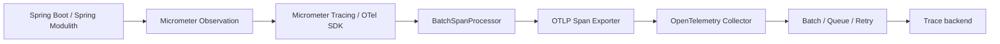
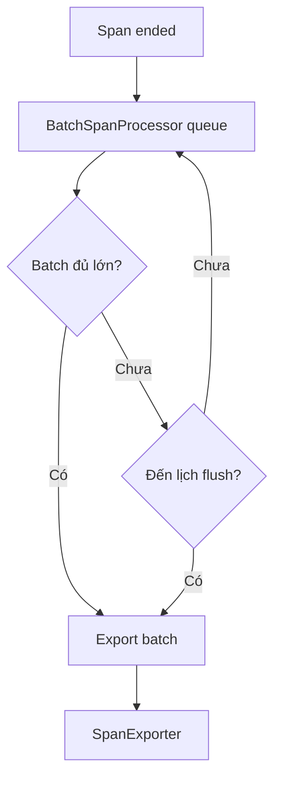
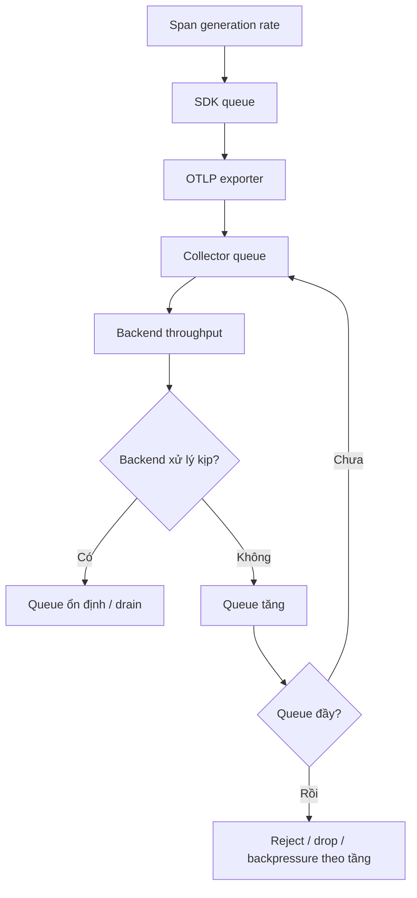

# Batching và retry khi gửi telemetry

## 1. Vì sao phải batching và retry?

Trong ứng dụng Spring Boot sử dụng Micrometer Tracing và Spring Modulith, mỗi request hoặc lần tương tác giữa application module có thể tạo ra nhiều **span**. Các span cần được xuất tới hệ thống quan sát như OpenTelemetry Collector, Tempo, Jaeger hoặc một backend tương thích để nhóm phát triển xem trace.

Nếu gửi từng span thành một request riêng, ứng dụng phải tạo rất nhiều lần gửi nhỏ, làm tăng overhead mạng, TLS, serialization và xử lý ở backend. Nếu backend hoặc mạng tạm thời không sẵn sàng, dữ liệu telemetry còn có nguy cơ thất lạc. Hai kỹ thuật thường được kết hợp:

- **Batching** gom nhiều span thành một lô rồi gửi cùng nhau, giúp tăng hiệu quả truyền và giảm số request.
- **Retry** thử gửi lại khi gặp lỗi tạm thời, giúp chịu được một số gián đoạn ngắn của mạng hoặc hệ thống nhận dữ liệu.

Trong module `SPRING_MODULITH_DOCUMENTATION_OBSERVABILITY`, việc xuất trace giúp theo dõi tương tác giữa các application module, đối chiếu module graph và hiểu hành vi runtime. Tuy nhiên, trace chỉ hữu ích khi pipeline thu thập và xuất dữ liệu hoạt động ổn định. Bài này tập trung vào batching, queue, retry, backpressure và graceful shutdown trong pipeline tracing.

## 2. Pipeline xuất trace từ ứng dụng tới backend

Một pipeline phổ biến có các thành phần:



Mỗi thành phần có trách nhiệm riêng:

| Thành phần | Trách nhiệm | Câu hỏi vận hành |
| --- | --- | --- |
| Instrumentation | Tạo span từ HTTP, database, Spring bean hoặc module entry | Hoạt động cần đo có được instrument không? |
| Sampling | Quyết định trace/span nào được ghi nhận | Trace có bị bỏ qua theo chính sách sampling không? |
| `BatchSpanProcessor` | Gom span trong ứng dụng, xếp hàng và chuyển lô cho exporter | Queue có đầy hoặc export có chậm không? |
| OTLP exporter | Serialize và gửi lô span theo OTLP | Endpoint, kết nối và phản hồi có hợp lệ không? |
| Collector receiver | Nhận dữ liệu từ ứng dụng | Collector có nhận đủ span không? |
| Collector processors/exporters | Xử lý, gom lô, xếp hàng và gửi tới backend | Queue, retry và backend có ổn định không? |
| Trace backend | Lưu trữ, lập chỉ mục và hiển thị trace | Dữ liệu có được nhận, giữ và truy vấn được không? |

Không phải ứng dụng nào cũng cần Collector; exporter có thể gửi thẳng tới backend hỗ trợ OTLP. Collector hữu ích khi cần một điểm trung gian để định tuyến, lọc, batch, retry hoặc xuất sang nhiều hệ thống. Dù gửi trực tiếp hay qua Collector, cần phân biệt **batch ở SDK** và **batch ở Collector**: chúng nằm ở hai tầng khác nhau và có queue, timeout, retry riêng.

## 3. Batching trong ứng dụng: `BatchSpanProcessor`

Với OpenTelemetry SDK, `BatchSpanProcessor` là một `SpanProcessor` gom các span đã kết thúc vào một queue có giới hạn. Một worker nền lấy span từ queue và gửi chúng tới `SpanExporter` theo lô.

Các điều kiện thường kích hoạt một lần export:

1. Đã tích lũy đủ số span để đạt kích thước batch tối đa.
2. Đã hết khoảng thời gian chờ export định kỳ.
3. Ứng dụng gọi `forceFlush()` hoặc bắt đầu shutdown SDK.



Một số tham số quan trọng của `BatchSpanProcessor`:

| Tham số | Ý nghĩa | Khi tăng giá trị |
| --- | --- | --- |
| `maxQueueSize` | Số span tối đa có thể chờ trong queue | Chịu được burst lâu hơn nhưng tốn bộ nhớ hơn |
| `maxExportBatchSize` | Số span tối đa trong một batch | Giảm số lần export nhưng tăng kích thước lô |
| `scheduleDelay` | Khoảng thời gian tối đa chờ trước lần export định kỳ | Có thể giảm request nhỏ, nhưng tăng độ trễ xuất |
| `exporterTimeout` | Thời gian tối đa dành cho một lần export | Giới hạn thời gian worker chờ exporter |

Tên API ở đây theo OpenTelemetry Java SDK. Giá trị mặc định phụ thuộc phiên bản SDK; không nên chép một bộ số cố định vào production mà chưa đo traffic, bộ nhớ và latency. `maxExportBatchSize` không nên lớn hơn `maxQueueSize`.

### 3.1. Queue đầy thì điều gì xảy ra?

Queue của `BatchSpanProcessor` có giới hạn. Nếu tốc độ tạo span cao hơn tốc độ export trong thời gian đủ dài, queue sẽ đầy. Khi đó các span mới có thể bị **drop** thay vì làm chậm luồng nghiệp vụ chính vô hạn.

Ví dụ:

```text
Tốc độ tạo span:      4.000 span/giây
Tốc độ export:        2.500 span/giây
Chênh lệch:           +1.500 span/giây vào queue
Queue còn trống:      30.000 span
Thời gian đầy gần đúng: 30.000 / 1.500 = 20 giây
```

Đây là mô hình minh họa giả định tốc độ không đổi. Thực tế còn phụ thuộc batch, exporter latency, số worker và thời gian backend phục hồi. Nếu queue đầy, tăng queue chỉ kéo dài thời gian trước khi drop; nó không giải quyết tình trạng throughput export thấp hơn throughput tạo span.

### 3.2. Cân bằng batch size và độ trễ

- Batch lớn giảm overhead trên mỗi span nhưng có thể làm tăng latency trước khi gửi và tăng kích thước request.
- Batch nhỏ gửi dữ liệu sớm hơn nhưng có thể tạo nhiều request hơn.
- Schedule delay ngắn giúp trace xuất hiện nhanh hơn trên backend, đổi lại số batch nhỏ tăng.
- Queue lớn giúp hấp thụ burst ngắn nhưng làm tăng bộ nhớ tiềm năng và thời gian drain khi shutdown.

Chọn tham số theo yêu cầu vận hành: dashboard realtime cần độ trễ thấp hơn; hệ thống tải cao có thể ưu tiên hiệu quả truyền. Đừng tối ưu riêng số request mà bỏ qua thời gian trace xuất hiện hoặc tỷ lệ span bị drop.

## 4. Ví dụ cấu hình `BatchSpanProcessor` ở OpenTelemetry SDK

Nếu ứng dụng **tự quản lý OpenTelemetry SDK**, có thể cấu hình batch processor bằng builder API:

```java
import java.time.Duration;

import io.opentelemetry.api.OpenTelemetry;
import io.opentelemetry.exporter.otlp.trace.OtlpGrpcSpanExporter;
import io.opentelemetry.sdk.OpenTelemetrySdk;
import io.opentelemetry.sdk.trace.SdkTracerProvider;
import io.opentelemetry.sdk.trace.export.BatchSpanProcessor;

class OpenTelemetrySetup {

    OpenTelemetry create() {
        var exporter = OtlpGrpcSpanExporter.builder()
            .setEndpoint("http://localhost:4317")
            .setTimeout(Duration.ofSeconds(10))
            .build();

        var processor = BatchSpanProcessor.builder(exporter)
            .setMaxQueueSize(4096)
            .setMaxExportBatchSize(512)
            .setScheduleDelay(Duration.ofSeconds(2))
            .setExporterTimeout(Duration.ofSeconds(15))
            .build();

        var tracerProvider = SdkTracerProvider.builder()
            .addSpanProcessor(processor)
            .build();

        return OpenTelemetrySdk.builder()
            .setTracerProvider(tracerProvider)
            .build();
    }
}
```

Đây là ví dụ độc lập để minh họa API SDK, không phải cấu hình nên chép nguyên vào một ứng dụng Spring Boot đã bật auto-configuration. Khi Spring Boot/Micrometer đã tạo `OpenTelemetry` và exporter tự động, việc tự tạo thêm một SDK có thể dẫn đến hai tracer provider hoặc hai pipeline xuất song song. Trong ứng dụng Spring Boot, hãy ưu tiên cấu hình theo cơ chế auto-configuration của phiên bản; chỉ tự quản lý SDK khi đã chủ động thay thế cấu hình mặc định và hiểu rõ vòng đời bean.

Ví dụ dùng OTLP gRPC tại `localhost:4317`. Nếu dùng OTLP HTTP/protobuf, endpoint thường có dạng `http://localhost:4318/v1/traces`. Không nhầm endpoint HTTP với endpoint gRPC.

## 5. Retry: gửi lại khi lỗi tạm thời

**Retry** là hành động thử lại một lần export sau khi gặp lỗi. Trong pipeline trace, có thể có nhiều tầng retry:

| Tầng | Nơi retry | Phạm vi |
| --- | --- | --- |
| OTLP exporter trong ứng dụng | Khi gửi request OTLP từ process | Lô span đang export theo chính sách exporter |
| OpenTelemetry Collector exporter | Khi gửi dữ liệu từ Collector tới backend | Batch/queue của Collector |
| Hạ tầng mạng/proxy | Có thể retry kết nối theo cấu hình | Phụ thuộc proxy/load balancer |

Đối với OTLP exporter, các lỗi tạm thời như throttling hoặc backend tạm không khả dụng có thể được retry theo quy tắc của exporter, thường dùng backoff tăng dần và có jitter. Các mã phản hồi HTTP thường được xem là có thể retry gồm `429`, `502`, `503`, `504`; với OTLP/gRPC, việc retry dựa trên status code và quy tắc của giao thức/implementation. Cần xem tài liệu exporter của phiên bản đang dùng thay vì tự giả định mọi lỗi đều được retry.

Các lỗi cấu hình hoặc dữ liệu không hợp lệ thường không được giải quyết bằng retry vô hạn:

- Sai endpoint, DNS hoặc chứng thư TLS không hợp lệ.
- Thiếu xác thực hoặc token hết hạn.
- Backend từ chối dữ liệu vì schema/giới hạn không tương thích.
- Collector không hỗ trợ protocol hoặc encoding mà exporter đang dùng.

### 5.1. Exponential backoff và jitter

Một chính sách retry phổ biến là exponential backoff:

\[
delay_n = \min(delay_{max}, delay_{initial} \times 2^n)
\]

Sau đó thêm **jitter** để các client không đồng loạt retry đúng cùng thời điểm. Ví dụ minh họa:

| Lần thử lại | Backoff trước jitter |
| ---: | ---: |
| 1 | 1 giây |
| 2 | 2 giây |
| 3 | 4 giây |
| 4 | 8 giây |
| 5 | 16 giây |

Giá trị thực tế phụ thuộc exporter và cấu hình. Retry cần có **giới hạn thời gian hoặc số lần thử** để không giữ batch vô thời hạn. Khi đã vượt giới hạn, exporter có thể báo lỗi và dữ liệu của batch đó có thể bị mất ở tầng này.

### 5.2. Không retry mọi lỗi

| Nhóm lỗi | Ví dụ | Hành động phù hợp |
| --- | --- | --- |
| Tạm thời | `503 Service Unavailable`, `UNAVAILABLE` | Retry có backoff nếu exporter hỗ trợ |
| Bị giới hạn tải | `429 Too Many Requests`, resource exhausted | Tuân thủ retry policy/`Retry-After` nếu được hỗ trợ, giảm tải nếu cần |
| Mạng chập chờn | Connection reset, timeout tạm thời | Retry có giới hạn và theo dõi queue |
| Cấu hình cố định sai | Endpoint sai, TLS trust sai | Sửa cấu hình; retry liên tục chỉ tăng tải và log lỗi |
| Không có quyền | `401`, `403` | Sửa credentials/authorization; không retry vô hạn |
| Dữ liệu bị từ chối | Invalid payload hoặc giới hạn backend | Điều tra schema/limit; retry không sửa được dữ liệu |

Một số phản hồi OTLP có thể là **partial success**, tức backend nhận một phần và báo số span bị từ chối. Đây không giống lỗi mạng toàn phần; exporter cần tuân thủ semantics của OTLP và không nên tự gửi lại toàn bộ batch một cách mù quáng, vì có thể lặp lại phần đã được nhận. Hãy kiểm tra rejected spans và thông điệp lỗi từ exporter/backend.

## 6. Cấu hình gửi trace từ Spring Boot tới OTLP Collector

Ví dụ Maven cho Spring Boot 3.x dùng Micrometer Tracing với OpenTelemetry:

```xml
<dependencies>
    <dependency>
        <groupId>org.springframework.boot</groupId>
        <artifactId>spring-boot-starter-actuator</artifactId>
    </dependency>

    <dependency>
        <groupId>io.micrometer</groupId>
        <artifactId>micrometer-tracing-bridge-otel</artifactId>
    </dependency>

    <dependency>
        <groupId>io.opentelemetry</groupId>
        <artifactId>opentelemetry-exporter-otlp</artifactId>
    </dependency>
</dependencies>
```

Spring Boot dependency management/BOM nên quản lý các phiên bản Spring Boot, Micrometer và OpenTelemetry tương thích.

Ví dụ `application.yml` dùng OTLP HTTP:

```yaml
spring:
  application:
    name: shop-app

management:
  tracing:
    sampling:
      probability: 1.0
  otlp:
    tracing:
      endpoint: http://otel-collector:4318/v1/traces
```

`probability: 1.0` phù hợp để thử nghiệm trong dev/staging có kiểm soát, không phải khuyến nghị mặc định cho production tải lớn. Spring Boot auto-configuration tạo tracing pipeline và exporter theo dependency/configuration; batching/retry cụ thể phụ thuộc OpenTelemetry SDK/exporter và phiên bản Spring Boot. Không nên giả định mọi tham số của `BatchSpanProcessor` đều có property Spring Boot tương ứng.

Nếu dùng OTLP gRPC, endpoint thường là `http://otel-collector:4317` và cần cấu hình transport phù hợp với phiên bản Boot. Không thêm `/v1/traces` vào endpoint gRPC.

## 7. Batching và retry ở OpenTelemetry Collector

Collector có thể nhận OTLP từ nhiều ứng dụng, gom batch và gửi tiếp tới backend. Một cấu hình minh họa:

```yaml
receivers:
  otlp:
    protocols:
      grpc:
        endpoint: 0.0.0.0:4317
      http:
        endpoint: 0.0.0.0:4318

processors:
  memory_limiter:
    check_interval: 1s
    limit_mib: 512
    spike_limit_mib: 128
  batch:
    timeout: 5s
    send_batch_size: 512
    send_batch_max_size: 1024

exporters:
  otlp/tempo:
    endpoint: tempo:4317
    tls:
      insecure: true # Chỉ dùng cho môi trường thử nghiệm nội bộ.
    sending_queue:
      enabled: true
      num_consumers: 4
      queue_size: 1000
    retry_on_failure:
      enabled: true
      initial_interval: 5s
      max_interval: 30s
      max_elapsed_time: 300s

service:
  pipelines:
    traces:
      receivers: [otlp]
      processors: [memory_limiter, batch]
      exporters: [otlp/tempo]
```

Đây là cấu hình **minh họa cho Collector distribution có các component tương ứng**. Tên exporter, trường cấu hình queue/retry và khả năng của từng component có thể thay đổi theo phiên bản hoặc bản phân phối Collector. Cần kiểm tra schema config và validate bằng đúng binary/container image đang chạy.

Ý nghĩa:

- Receiver nhận OTLP qua gRPC hoặc HTTP.
- `memory_limiter` giúp bảo vệ Collector khi bộ nhớ tăng cao; thường đặt trước batch processor.
- `batch` gom span theo thời gian và kích thước. `send_batch_size` là ngưỡng kích hoạt gửi batch; `send_batch_max_size` đặt giới hạn tối đa nếu được cấu hình.
- `sending_queue` hấp thụ một phần gián đoạn của backend.
- `retry_on_failure` cho exporter thử gửi lại khi gặp lỗi có thể retry, trong giới hạn đã cấu hình.

`queue_size` của Collector exporter thường được tính theo **số request/batch trong queue**, không đồng nghĩa với số span. Hãy xem tài liệu đúng phiên bản để quy đổi bộ nhớ dự kiến. Queue trong ví dụ là in-memory; nếu Collector restart hoặc bị kill, dữ liệu đang nằm trong queue có thể mất. Muốn queue bền vững qua restart, cần cấu hình storage extension phù hợp và hiểu rõ giới hạn của nó.

`tls.insecure: true` chỉ là cấu hình đơn giản cho mạng thử nghiệm. Production nên xác thực TLS, quản lý CA/certificate và thông tin xác thực qua secret/configuration an toàn.

## 8. Batch ở SDK khác batch ở Collector

Hai tầng batching có thể cùng được bật:

| Thuộc tính | SDK `BatchSpanProcessor` | Collector `batch` processor |
| --- | --- | --- |
| Vị trí | Trong ứng dụng | Trong tiến trình Collector |
| Đầu vào | Span kết thúc trong ứng dụng | Telemetry nhận từ receiver |
| Queue | Queue span trong process | Có thể có exporter sending queue riêng |
| Mục tiêu | Giảm export request từ từng ứng dụng | Tối ưu batch trước khi gửi tới backend |
| Mất dữ liệu khi process chết | Span chưa export trong queue có thể mất | Batch/queue in-memory có thể mất khi Collector chết |
| Điều chỉnh | SDK/processor/exporter | Collector pipeline/exporter |

Nếu cả hai tầng đều chờ batch lớn hoặc timeout dài, trace có thể xuất hiện trên backend chậm hơn đáng kể. Tổng độ trễ từ lúc span kết thúc tới khi backend nhận được dữ liệu có thể gồm thời gian chờ ở SDK, thời gian truyền, thời gian chờ batch tại Collector và thời gian xử lý/export.

Không nên tăng tất cả batch size cùng lúc mà không đo. Hãy bắt đầu với cấu hình phù hợp tải, đo latency và queue ở từng tầng, rồi thay đổi một nhóm tham số mỗi lần.

## 9. Backpressure và giới hạn queue

Batching làm giảm overhead nhưng không tạo ra năng lực xử lý vô hạn. Khi backend chậm hơn tốc độ nhận telemetry, queue tăng. Nếu queue có giới hạn, hệ thống cần có hành vi rõ khi đầy: block, reject hoặc drop tùy tầng/cấu hình.



Các biện pháp xử lý:

1. Kiểm tra backend có đủ CPU, memory, ingestion capacity và storage throughput không.
2. Tăng consumer/parallelism của Collector khi backend có thể tiếp nhận song song.
3. Điều chỉnh batch size và timeout để cân bằng throughput với latency.
4. Giảm lượng trace bằng sampling policy hợp lý nếu lưu lượng vượt ngân sách.
5. Tăng queue có giới hạn để hấp thụ burst ngắn, nhưng tính cả bộ nhớ và thời gian drain.
6. Phát cảnh báo trước khi queue chạm ngưỡng đầy.

Không dùng retry như cách giải quyết backend thiếu năng lực kéo dài. Retry làm tăng số lần gửi và có thể khiến backend đang quá tải càng khó phục hồi. Backoff, queue giới hạn và kiểm soát lưu lượng cần phối hợp.

## 10. Graceful shutdown và flush dữ liệu còn trong queue

Khi ứng dụng dừng, có thể vẫn còn span nằm trong queue của `BatchSpanProcessor`. Nếu process bị kill ngay, những span chưa export có thể mất. Vì vậy cần cho SDK và ứng dụng thời gian **flush** dữ liệu trước khi thoát.

OpenTelemetry SDK hỗ trợ `forceFlush()` và `shutdown()` trên các thành phần liên quan. Trong ứng dụng tự quản lý SDK, vòng đời nên bảo đảm:

1. Ngừng nhận công việc mới hoặc bắt đầu giai đoạn shutdown.
2. Cho các request/task đang chạy hoàn tất trong giới hạn thời gian.
3. Gọi flush/shutdown qua SDK hoặc `TracerProvider` theo API đang dùng.
4. Chờ export hoàn tất trong timeout hữu hạn.
5. Đóng exporter và các tài nguyên liên quan.

Với Spring Boot auto-configuration, để Spring quản lý vòng đời bean tracing thay vì tự đóng một SDK khác do ứng dụng tạo ra. Cần cấu hình **graceful shutdown**, thời gian termination của container và timeout exporter đủ để flush trong ngân sách dừng tiến trình.

Ví dụ Kubernetes:

```yaml
spec:
  terminationGracePeriodSeconds: 45
```

Con số 45 giây chỉ là ví dụ. Phải phối hợp với `spring.lifecycle.timeout-per-shutdown-phase`, thời gian hoàn tất request, exporter timeout và thời gian flush thực tế. Nếu termination grace period ngắn hơn thời gian flush cần thiết, orchestrator vẫn có thể kill process trước khi queue được drain.

Collector cũng cần shutdown/drain có kiểm soát. Nếu dùng persistent queue, storage phải có quyền ghi, dung lượng và lifecycle phù hợp; persistent queue vẫn không biến telemetry thành dữ liệu giao dịch có bảo đảm exactly-once.

## 11. Sampling khác batching và retry

Ba cơ chế này xử lý ba vấn đề khác nhau:

| Cơ chế | Quyết định gì? | Khi nào tác động? | Có khôi phục span đã bỏ qua không? |
| --- | --- | --- | --- |
| **Sampling** | Có ghi nhận trace/span hay không | Trước hoặc trong quá trình ghi span | Không |
| **Batching** | Gom span đã ghi nhận thành lô nào | Sau khi span kết thúc | Không tạo thêm span |
| **Retry** | Thử gửi lại batch khi export lỗi tạm thời | Trong quá trình export | Không khôi phục span đã bị sampling/drop trước đó |

Ví dụ, nếu sampling chỉ giữ 10% trace, batching chỉ gom những span thuộc 10% đã được chọn. Retry không thể khôi phục 90% trace chưa được ghi nhận. Nếu queue overflow làm drop span, retry ở tầng sau cũng không thể lấy lại span đã mất trước khi tới exporter.

Với Spring Boot, `management.tracing.sampling.probability` có thể dùng để cấu hình tỷ lệ sampling trong các phiên bản hỗ trợ. Chọn sampling dựa trên lưu lượng, ngân sách và mục tiêu điều tra; có thể cân nhắc tail sampling tại Collector nếu cần quyết định dựa trên toàn bộ trace, nhưng phải đảm bảo các span cùng trace được định tuyến phù hợp tới cùng tail-sampling decision point.

## 12. Quan sát tình trạng batching và retry

Để biết pipeline có đang làm mất dữ liệu hay không, theo dõi ít nhất các nhóm chỉ số sau:

| Nhóm | Chỉ số nên quan sát | Dấu hiệu cần điều tra |
| --- | --- | --- |
| SDK processor | Queue utilization, dropped spans, export duration | Queue gần đầy hoặc số span drop tăng |
| SDK exporter | Export request count, failure, timeout, retry | Lỗi export kéo dài hoặc retry tăng liên tục |
| Collector receiver | Accepted/refused spans | Receiver từ chối hoặc không nhận đủ dữ liệu |
| Collector exporter | Queue size/capacity, enqueue failed, send failed, sent spans | Queue tăng liên tục hoặc export fail |
| Collector processor | Batch size, processor latency, memory | Batch bị giữ lâu hoặc memory limiter kích hoạt |
| Backend | Ingestion rate, rejected spans, storage/query health | Backend throttling, reject hoặc không index dữ liệu |
| Ứng dụng | Span generation rate, request latency, heap/GC | Tăng instrumentation gây áp lực lên ứng dụng |

Tên metric của Collector và SDK có thể thay đổi theo phiên bản, exporter và distribution. Hãy khám phá metric endpoint thực tế và tài liệu tương ứng trước khi viết PromQL. Các tên như `otelcol_exporter_queue_size`, `otelcol_exporter_send_failed_spans`, `otelcol_receiver_accepted_spans` thường gặp ở một số phiên bản Collector, nhưng không nên hardcode mà chưa xác minh.

### 12.1. Một số truy vấn PromQL minh họa

Nếu Collector expose metric `otelcol_exporter_queue_size` và `otelcol_exporter_queue_capacity`:

```promql
100 *
otelcol_exporter_queue_size
/
otelcol_exporter_queue_capacity
```

Truy vấn ước tính phần trăm queue đang sử dụng. Cần lọc theo exporter/instance thích hợp nếu có nhiều pipeline.

Nếu có counter `otelcol_exporter_send_failed_spans`:

```promql
sum by (exporter) (
  rate(otelcol_exporter_send_failed_spans[5m])
)
```

Truy vấn theo dõi tốc độ span gửi thất bại. Tên label thực tế có thể không phải `exporter`; hãy xem series thật trước.

Nếu có counter accepted và refused spans ở receiver:

```promql
sum(rate(otelcol_receiver_refused_spans[5m]))
```

Một giá trị tăng liên tục là dấu hiệu cần điều tra receiver, memory limiter hoặc downstream pipeline. Những truy vấn này chỉ là ví dụ; không phải mọi bản Collector đều expose đúng metric name/label trên.

### 12.2. Cảnh báo nên tập trung vào xu hướng

- Queue utilization cao liên tục, không chỉ một spike ngắn.
- Queue size tăng đều và không drain sau khi backend phục hồi.
- Send failures/retries tăng trong nhiều cửa sổ liên tiếp.
- Receiver refused spans hoặc dropped spans khác 0 kéo dài.
- Export latency tăng đồng thời với backend ingestion latency.
- Số trace/span xuất ra backend giảm bất thường so với request traffic và sampling dự kiến.

Không cảnh báo chỉ vì có một lần retry: retry là cơ chế phục hồi bình thường. Cần cảnh báo khi retry kéo dài, queue tích tụ hoặc dữ liệu bị drop.

## 13. Kiểm thử retry và khả năng phục hồi

Một bài kiểm thử nên xác nhận cả **khả năng retry** và **giới hạn mất dữ liệu**:

1. Gửi request tạo trace với Collector/backend đang hoạt động; xác nhận trace xuất hiện.
2. Tạm thời làm backend không khả dụng trong một khoảng thời gian ngắn.
3. Quan sát queue và retry ở đúng tầng: SDK exporter hoặc Collector exporter.
4. Khôi phục backend trước khi retry timeout hết hạn; xác nhận queue drain và các trace mới xuất hiện.
5. Tạo lỗi xác thực hoặc endpoint sai; xác nhận hệ thống báo lỗi rõ và không retry vô hạn.
6. Tăng lưu lượng span có kiểm soát để thử queue gần đầy; theo dõi drop/reject và tác động bộ nhớ.
7. Dừng ứng dụng bình thường; xác nhận flush hoàn tất trong thời gian shutdown cho phép.
8. Thử kill đột ngột ở môi trường thử nghiệm để hiểu dữ liệu nào mất trong queue in-memory.

Không chạy thử nghiệm gây quá tải hoặc tắt Collector trên production chỉ để kiểm tra retry. Dùng môi trường staging, traffic giả lập và một backend có thể điều khiển.

### 13.1. Ma trận kiểm thử

| Tình huống | Kết quả mong đợi | Điều cần ghi nhận |
| --- | --- | --- |
| Backend bình thường | Batch được gửi và trace xuất hiện | Export latency, queue ổn định |
| Backend trả `503` tạm thời | Exporter/Collector retry theo policy | Số lần retry, backoff, thời gian phục hồi |
| Backend trả `401` | Ghi nhận lỗi xác thực; sửa credential | Không retry vô hạn |
| Collector queue đầy | Có dấu hiệu enqueue fail/drop/refuse | Ngưỡng queue và số span bị mất |
| Batch chứa dữ liệu bị từ chối một phần | Ghi nhận partial success/rejected spans | Không gửi lại mù quáng toàn batch |
| Ứng dụng shutdown bình thường | Queue được flush trong timeout | Thời gian shutdown và số span còn lại |
| Process bị kill đột ngột | Queue in-memory có thể mất | Xác định giới hạn phục hồi và nhu cầu persistent queue |

## 14. Các lỗi thường gặp và cách xử lý

| Triệu chứng | Nguyên nhân có thể | Cách xử lý |
| --- | --- | --- |
| Trace xuất hiện chậm | Batch schedule delay dài hoặc Collector chờ đủ batch/timeout | Giảm timeout/batch threshold có đo lường |
| Queue SDK tăng liên tục | Exporter/backend chậm hơn tốc độ tạo span | Kiểm tra exporter latency, backend và sampling |
| Queue đầy, span bị drop | Burst kéo dài hoặc downstream không drain kịp | Tối ưu throughput, queue có giới hạn, giảm traffic hoặc điều chỉnh sampling |
| Retry liên tục | Backend unavailable, throttling hoặc cấu hình endpoint sai | Phân loại transient/permanent error; kiểm tra health và credentials |
| CPU/network tăng sau tăng batch | Batch quá lớn hoặc lượng span tăng | Đo kích thước request, serialization và throughput |
| Trace thiếu một phần span | Sampling, queue overflow, partial rejection hoặc export failure | Đối chiếu dropped/rejected spans và pipeline từng tầng |
| Dữ liệu mất khi deploy | Process bị dừng trước flush hoặc queue chỉ nằm trong memory | Graceful shutdown, termination grace period, persistent queue khi cần |
| Collector nhận span nhưng backend không có trace | Exporter downstream lỗi hoặc backend reject | Theo dõi exporter queue/retry, receiver/exporter accepted/rejected |
| App và Collector cùng retry gây tải tăng | Nhiều tầng retry độc lập tạo hiệu ứng cộng dồn | Phân định retry ownership, giới hạn thời gian và backoff |
| Dùng sai endpoint OTLP | Trộn HTTP 4318 với gRPC 4317 | Xác định transport và endpoint đúng protocol |

Khi trace thiếu span, không nên lập tức kết luận instrumentation Spring Modulith sai. Hãy kiểm tra theo thứ tự: span có được tạo không, sampling có giữ không, SDK queue có drop không, exporter có gửi không, Collector có nhận không và backend có chấp nhận/index không.

## 15. Kết nối với Spring Modulith: trace export có bảo toàn module identity không?

Spring Modulith Observability có thể tạo module entry spans với các thuộc tính như `module.identifier`, `module.name`, `module.method` và `module.invocation-type` tại những điểm vào module được instrument. Batching và retry **không nên làm thay đổi nội dung các span này**; chúng chỉ ảnh hưởng thời điểm và khả năng chuyển span tới backend.

Ví dụ một trace có các module:

```text
service.name = shop-app
traceId = T1

orders.place-order
  module.identifier = orders
  spanId = S1

inventory.reserve-stock
  module.identifier = inventory
  spanId = S2
  parentSpanId = S1

notifications.on-order-placed
  module.identifier = notifications
  spanId = S3
  parentSpanId = S1 (nếu quan hệ trace được thiết lập như vậy)
```

Đây là ví dụ minh họa; listener bất đồng bộ có thể có trace riêng hoặc span link nếu event được xử lý trễ và context không còn trong scope ban đầu. Khi xuất trace, cần bảo đảm exporter không loại bỏ resource/span attributes quan trọng theo cấu hình transform/filter. Nếu backend nhận trace nhưng không còn `module.identifier`, hãy kiểm tra processor/filter ở Collector và giới hạn attributes.

Module graph và `ApplicationModules.verify()` vẫn là nguồn để kiểm tra dependency tĩnh. Tracing chỉ thể hiện các thao tác đã được instrument và export thành công. Nếu batch bị drop, trace có thể thiếu span dù code đã chạy và module graph không thay đổi.

## 16. Ghi nhớ

**Batching** gom span để giảm overhead và cải thiện hiệu quả truyền; **retry** phục hồi một số lỗi export tạm thời; **queue** hấp thụ burst nhưng luôn cần giới hạn. Ở ứng dụng, `BatchSpanProcessor` quản lý queue và batch trước khi gọi exporter. Ở Collector, batch processor, sending queue và retry policy là một tầng riêng.

Không nhầm sampling với batching: sampling quyết định span nào được ghi nhận, batching chỉ gom span đã có, còn retry chỉ thử gửi lại dữ liệu chưa được nhận thành công theo chính sách của exporter. Queue đầy, timeout, permanent errors, partial success và shutdown đột ngột đều có thể làm trace thiếu dữ liệu. Cần đo queue, export failure, refused/dropped spans, backend ingestion và thời gian flush; thiết lập graceful shutdown và retry có giới hạn.

Với Spring Modulith, batching/retry giúp module entry spans có cơ hội tới backend ổn định hơn, để nhóm có thể đối chiếu `module.identifier` và các span runtime với module graph. Chúng không thay thế instrumentation, context propagation hay verification kiến trúc.

### Tài liệu tham khảo

- [OpenTelemetry — Batch Span Processor](https://opentelemetry.io/docs/specs/otel/trace/sdk/#batching-processor): queue, batch, schedule delay và export.
- [OpenTelemetry Protocol — OTLP Specification](https://opentelemetry.io/docs/specs/otlp/): export request, retry, status và partial success.
- [OpenTelemetry Collector — Resiliency](https://opentelemetry.io/docs/collector/resiliency/): sending queue, retry và xử lý lỗi downstream.
- [OpenTelemetry Collector — Batch Processor](https://github.com/open-telemetry/opentelemetry-collector/tree/main/processor/batchprocessor): gom batch tại Collector.
- [Spring Boot — Tracing](https://docs.spring.io/spring-boot/reference/actuator/tracing.html): Micrometer Tracing, OTLP export và sampling.
- [Spring Modulith — Production-ready Features](https://docs.spring.io/spring-modulith/reference/production-ready.html): module observability và module entry spans.
