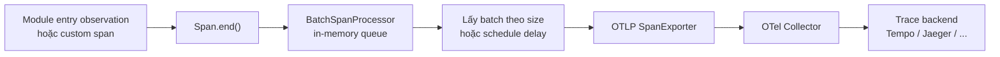

# Timeout và giới hạn exporter

> **Chương:** Export traces  
> **Bối cảnh:** Spring Modulith bổ sung thông tin quan sát cho các điểm tương tác giữa application module trong ứng dụng Spring Boot. Để xem được module spans trên hệ thống tập trung, ứng dụng phải đưa trace qua Micrometer Tracing, span processor, exporter và Collector/backend. Bài này giải thích timeout, queue, batch và giới hạn của exporter, cùng cách cấu hình để giảm mất span khi hệ thống tải cao hoặc backend tạm thời chậm.

## Mục tiêu học tập

Sau bài này, bạn có thể:

1. Mô tả đường đi từ lúc span kết thúc đến lúc dữ liệu được gửi tới trace backend.
2. Phân biệt **connect timeout**, **HTTP/request timeout** và **batch processor export timeout**.
3. Giải thích ý nghĩa của `schedule-delay`, `max-queue-size`, `max-batch-size` và lý do queue đầy có thể làm mất span.
4. Cấu hình đúng các property của OpenTelemetry/OTLP trên Spring Boot 3.5 và Spring Boot 4.x.
5. Chọn timeout, batch size và queue capacity dựa trên lưu lượng, thời gian gián đoạn dự kiến và năng lực Collector.
6. Theo dõi queue pressure, lỗi export, retry và graceful shutdown; xác định giới hạn của exporter khi cần độ tin cậy giao nhận cao.

## 1. Đường đi của một span tới trace backend

Trong một ứng dụng Spring Modulith, một module entry observation có thể tạo module span khi có lời gọi vào API bean hoặc event listener được hỗ trợ. Khi span kết thúc, dữ liệu cần được chuyển qua pipeline tracing để có thể xem trong Zipkin, Jaeger, Tempo hoặc nền tảng nhận OTLP.

Với pipeline OpenTelemetry dùng **BatchSpanProcessor**, đường đi thường là:



Mỗi thành phần có một giới hạn khác nhau:

| Thành phần | Việc thực hiện | Giới hạn quan trọng |
| --- | --- | --- |
| Instrumentation/Tracer | Tạo và kết thúc span | Sampling, số span và kích thước metadata |
| BatchSpanProcessor | Giữ span trong queue và gom batch | Queue capacity, batch size, schedule delay, export timeout |
| OTLP exporter | Gửi batch qua HTTP hoặc gRPC | Connect timeout, request timeout, retry và giới hạn payload |
| Collector | Nhận, xử lý và chuyển tiếp telemetry | Receiver capacity, memory, batch processor, retry queue, backend exporter |
| Trace backend | Lưu trữ và truy vấn trace | Ingestion rate, quota, retention, kích thước trace và giới hạn tài khoản |

**Không có một timeout duy nhất điều khiển toàn bộ pipeline.** Một lần gửi có thể bị giới hạn bởi deadline của span processor, timeout của exporter và timeout của kết nối mạng. Collector/backend cũng có chính sách riêng.

### 1.1. Export thường chạy bất đồng bộ

Với BatchSpanProcessor, `Span.end()` thường đưa span vào queue trong bộ nhớ. Một worker riêng lấy các span thành batch và gọi exporter. Vì vậy, request nghiệp vụ không nhất thiết phải đợi Collector phản hồi cho từng span.

Điều này có hai hệ quả:

- Exporter chậm có thể **không làm request hiện tại chậm tương ứng**, nhưng queue có thể tăng dần.
- Nếu queue đầy hoặc process bị dừng đột ngột, span chưa được export có thể bị mất.

Một `SimpleSpanProcessor` có cách hoạt động khác: nó gọi exporter cho từng span khi span kết thúc. Cách này hữu ích cho thử nghiệm hoặc debug đơn giản nhưng có thể làm tăng chi phí/độ trễ của đường thực thi. Khi vận hành, cần biết ứng dụng đang dùng processor nào; không áp dụng các thông số queue/batch của BatchSpanProcessor cho SimpleSpanProcessor.

## 2. Ba loại timeout cần phân biệt

### 2.1. Connect timeout

Connect timeout giới hạn thời gian thiết lập kết nối tới Collector hoặc Zipkin. Nó liên quan đến các bước như mở socket/TLS handshake tùy transport và HTTP client.

Nếu DNS, định tuyến, firewall, TLS hoặc dịch vụ đích có vấn đề, kết nối có thể không được thiết lập trước khi hết thời gian này.

### 2.2. Request/call timeout của exporter

Với OTLP/HTTP, call timeout giới hạn toàn bộ một lần gọi export. Theo property của Spring Boot, thời gian này có thể bao gồm:

- Resolve DNS.
- Kết nối tới server.
- Gửi request body.
- Thời gian server xử lý.
- Đọc response.
- Các lần redirect/retry và thời gian chờ giữa retry, trong phạm vi deadline của exporter.

Do đó, `connect-timeout` và `timeout` không phải hai tên cho cùng một thuộc tính. Connect timeout giới hạn giai đoạn kết nối; call timeout bao trùm toàn bộ lời gọi.

### 2.3. Batch processor export timeout

BatchSpanProcessor có export timeout riêng: thời gian tối đa cho một thao tác export batch trước khi processor hủy thao tác đó. Timeout này giới hạn thời gian processor chờ exporter hoàn tất.

Nếu call timeout của exporter ngắn hơn processor timeout, request exporter có thể dừng trước. Nếu processor deadline ngắn hơn, processor có thể hủy batch operation trước khi exporter dùng hết timeout riêng.

Với OTLP, các retry và thời gian backoff phải nằm trong thời gian còn lại của deadline export. Vì vậy, tăng riêng một timeout không đảm bảo batch có thêm thời gian hữu ích nếu timeout khác vẫn ngắn hơn.

### 2.4. Bảng phân biệt

| Timeout | Phạm vi | Câu hỏi trả lời |
| --- | --- | --- |
| Connect timeout | Thiết lập kết nối tới đích | Mất tối đa bao lâu để kết nối được? |
| OTLP call/request timeout | Một lần gọi exporter tới Collector | Mất tối đa bao lâu cho cả request/response và retry được phép? |
| Batch processor export timeout | Toàn bộ thao tác export batch theo góc nhìn processor | Processor chờ batch được export tối đa bao lâu trước khi hủy? |
| Shutdown/termination grace period | Quá trình đóng ứng dụng/container | Ứng dụng có đủ thời gian flush queue và kết thúc exporter không? |

**Ví dụ:** ứng dụng có connect timeout 2 giây, OTLP call timeout 8 giây và BatchSpanProcessor export timeout 20 giây. Kết nối có thể thất bại sau 2 giây; một lần gọi export có thể bị dừng sau 8 giây; processor vẫn có deadline 20 giây nhưng không thể kéo dài request đã bị exporter timeout.

## 3. Queue, batch và schedule delay

OpenTelemetry BatchSpanProcessor thường dùng bốn thông số:

| Thông số | Ý nghĩa | Giá trị mặc định thường gặp |
| --- | --- | ---: |
| `max-queue-size` | Số span tối đa được giữ trong queue trước khi span mới bị drop | `2048` |
| `max-batch-size` | Số span tối đa trong một lần export | `512` |
| `schedule-delay` | Khoảng chờ tối đa giữa các lần export định kỳ khi batch chưa đầy | `5s` |
| `timeout` | Thời gian tối đa cho một lần export batch theo góc nhìn processor | `30s` |

Các giá trị mặc định này tương ứng với cấu hình BatchSpanProcessor phổ biến của OpenTelemetry Java SDK và các property Spring Boot được trình bày bên dưới. Hãy kiểm tra metadata đúng phiên bản nếu dự án dùng custom SDK configuration.

### 3.1. `max-queue-size`: sức chứa bộ đệm trong bộ nhớ

Queue lưu những span đã kết thúc nhưng chưa được chuyển vào batch export. Nếu exporter/Collector chậm hơn tốc độ tạo span, queue tăng dần.

Khi queue đạt giới hạn, BatchSpanProcessor có thể **drop span mới** thay vì giữ vô hạn. Queue là bộ đệm trong RAM, không phải hàng đợi bền vững:

- Process restart/crash có thể làm mất span còn nằm trong queue.
- Tăng queue chỉ giúp hấp thụ đợt tăng tải hoặc gián đoạn ngắn hơn.
- Queue quá lớn làm tăng mức dùng heap và có thể khiến ứng dụng giữ nhiều telemetry cũ khi backend đang lỗi.

### 3.2. `max-batch-size`: số span trong một lần gửi

Batch size giới hạn số span gom vào một request export. Batch lớn có thể giảm số request và tăng hiệu quả khi Collector nhận dữ liệu nhanh, nhưng cũng:

- Tạo payload lớn hơn.
- Tăng bộ nhớ cần dùng cho mỗi batch.
- Làm một lần export mất nhiều thời gian hơn.
- Có nguy cơ chạm giới hạn payload hoặc giới hạn request của Collector/proxy.

`max-batch-size` phải **nhỏ hơn hoặc bằng** `max-queue-size`. Nếu đặt batch size lớn hơn queue size, cấu hình không hợp lệ theo ràng buộc của BatchSpanProcessor.

### 3.3. `schedule-delay`: độ trễ trước khi gửi batch chưa đầy

Batch có thể được export khi đủ `max-batch-size` hoặc khi hết `schedule-delay`, tùy điều kiện nào đến trước.

- Delay ngắn: span đến backend nhanh hơn khi lưu lượng thấp, đổi lại có thể gửi nhiều batch nhỏ.
- Delay dài: dễ gom batch lớn hơn, nhưng người vận hành phải đợi lâu hơn mới thấy trace ở backend và queue giữ span lâu hơn.

Delay không phải timeout của request và cũng không phải thời gian giữ trace trong backend.

### 3.4. `timeout`: giới hạn export batch

Batch processor export timeout đặt giới hạn thời gian cho một lần export. Nếu backend liên tục chậm, timeout quá lớn có thể khiến worker bị giữ lâu và làm queue khó thoát áp lực. Timeout quá ngắn có thể hủy những batch vẫn có thể gửi thành công khi mạng hơi chậm.

Hãy đặt timeout dựa trên thời gian phản hồi thực tế của Collector, độ lớn batch và yêu cầu độ trễ; sau đó quan sát queue/export error để điều chỉnh.

## 4. Ước lượng queue theo lưu lượng

Một cách ước lượng ban đầu là:

```text
queue cần thiết ≈ số span tạo ra mỗi giây × thời gian cần hấp thụ gián đoạn
```

Ví dụ ứng dụng tạo trung bình 100 span/giây và muốn hấp thụ một đợt gián đoạn exporter kéo dài 30 giây:

```text
100 spans/s × 30 s = 3000 spans
```

Queue mặc định 2048 không đủ để giữ toàn bộ số span trong tình huống này; nếu tốc độ không giảm và export hoàn toàn dừng, queue có thể đầy sau khoảng 20,48 giây.

Đây chỉ là **ước lượng số lượng span**, chưa tính burst traffic, kích thước attribute, heap, GC và thời gian phục hồi của backend. Khi thiết kế production:

1. Đo số span/giây sau sampling, không dùng số request/giây thay thế.
2. Ước lượng thời gian gián đoạn cần hấp thụ.
3. Kiểm tra dung lượng heap và kích thước span thực tế.
4. Đo throughput export khi Collector hoạt động bình thường.
5. Kiểm tra tốc độ queue giảm sau khi backend phục hồi.

Queue lớn hơn không sửa được tình trạng backend có throughput thấp hơn lâu dài so với tốc độ tạo span.

## 5. Cấu hình OpenTelemetry/OTLP trên Spring Boot 3.5

Spring Boot 3.5 dùng hai nhóm property khác nhau cho hai lớp timeout:

- `management.otlp.tracing.*`: cấu hình OTLP exporter, endpoint và thời gian của lời gọi tới Collector.
- `management.tracing.opentelemetry.export.*`: cấu hình BatchSpanProcessor, gồm schedule delay, queue, batch và export timeout.

Ví dụ `application.yml` cho môi trường thử nghiệm:

```yaml
management:
  otlp:
    tracing:
      endpoint: http://otel-collector:4318/v1/traces
      connect-timeout: 2s
      timeout: 8s

  tracing:
    opentelemetry:
      export:
        schedule-delay: 5s
        max-queue-size: 4096
        max-batch-size: 512
        timeout: 20s
```

Giải thích:

- `endpoint` là OTLP/HTTP traces endpoint trong ví dụ.
- `connect-timeout: 2s` giới hạn giai đoạn thiết lập kết nối.
- `management.otlp.tracing.timeout: 8s` giới hạn toàn bộ lời gọi OTLP.
- `management.tracing.opentelemetry.export.timeout: 20s` giới hạn thời gian BatchSpanProcessor cho phép một lần export.
- `max-queue-size: 4096` tăng sức chứa bộ đệm lên 4096 span.
- `max-batch-size: 512` vẫn giữ batch size 512, nhỏ hơn queue.

Đây là cấu hình minh họa, không phải khuyến nghị cố định cho production. Tên property và giá trị mặc định phải được kiểm tra theo đúng minor version Spring Boot 3.5 đang dùng.

### 5.1. Các property và mặc định của Boot 3.5

| Property | Mặc định theo tài liệu Boot 3.5 | Chức năng |
| --- | ---: | --- |
| `management.otlp.tracing.connect-timeout` | `10s` | Connect timeout tới Collector |
| `management.otlp.tracing.timeout` | `10s` | Call timeout của OTLP exporter |
| `management.tracing.opentelemetry.export.schedule-delay` | `5s` | Chu kỳ export batch |
| `management.tracing.opentelemetry.export.max-queue-size` | `2048` | Sức chứa queue |
| `management.tracing.opentelemetry.export.max-batch-size` | `512` | Số span tối đa mỗi batch |
| `management.tracing.opentelemetry.export.timeout` | `30s` | Thời gian tối đa của batch export |

Không nhầm `management.otlp.tracing.timeout` với `management.tracing.opentelemetry.export.timeout`: một cái giới hạn lời gọi exporter, một cái giới hạn processor chờ thao tác export.

## 6. Cấu hình OpenTelemetry/OTLP trên Spring Boot 4.x

Trong Spring Boot 4.x, các property tracing được tổ chức lại dưới `management.opentelemetry.tracing.export`. Ví dụ:

```yaml
management:
  opentelemetry:
    tracing:
      export:
        schedule-delay: 5s
        max-queue-size: 4096
        max-batch-size: 512
        timeout: 20s
        otlp:
          endpoint: http://otel-collector:4318/v1/traces
          connect-timeout: 2s
          timeout: 8s
```

Các nhóm:

- `management.opentelemetry.tracing.export.schedule-delay`
- `management.opentelemetry.tracing.export.max-queue-size`
- `management.opentelemetry.tracing.export.max-batch-size`
- `management.opentelemetry.tracing.export.timeout`
- `management.opentelemetry.tracing.export.otlp.connect-timeout`
- `management.opentelemetry.tracing.export.otlp.timeout`

Trong tài liệu Spring Boot 4.x hiện hành, các giá trị mặc định tương ứng vẫn thường là 5 giây, 2048 span, 512 span/batch, 30 giây cho processor export, 10 giây cho connect timeout và 10 giây cho OTLP call timeout. Hãy dùng application properties của **đúng phiên bản** để xác nhận.

### 6.1. Bảng so sánh property

| Mục đích | Spring Boot 3.5 | Spring Boot 4.x |
| --- | --- | --- |
| OTLP endpoint | `management.otlp.tracing.endpoint` | `management.opentelemetry.tracing.export.otlp.endpoint` |
| OTLP connect timeout | `management.otlp.tracing.connect-timeout` | `management.opentelemetry.tracing.export.otlp.connect-timeout` |
| OTLP call timeout | `management.otlp.tracing.timeout` | `management.opentelemetry.tracing.export.otlp.timeout` |
| Batch schedule delay | `management.tracing.opentelemetry.export.schedule-delay` | `management.opentelemetry.tracing.export.schedule-delay` |
| Queue size | `management.tracing.opentelemetry.export.max-queue-size` | `management.opentelemetry.tracing.export.max-queue-size` |
| Batch size | `management.tracing.opentelemetry.export.max-batch-size` | `management.opentelemetry.tracing.export.max-batch-size` |
| Batch processor timeout | `management.tracing.opentelemetry.export.timeout` | `management.opentelemetry.tracing.export.timeout` |

Không trộn hai nhóm property trong cùng một ứng dụng. Nếu nâng cấp Boot 3.5 lên Boot 4.x, hãy rà lại `application.yml`, biến môi trường, Helm values và cấu hình triển khai để đổi tên key tương ứng.

## 7. Nếu dùng Brave và Zipkin

Các thông số BatchSpanProcessor ở trên là cấu hình cho pipeline OpenTelemetry. Nếu ứng dụng dùng Micrometer Tracing bridge Brave và gửi span qua Zipkin reporter, nhóm property có tên khác và không nên giả định có cùng các tùy chọn queue/batch của OTel.

### 7.1. Spring Boot 3.5

```yaml
management:
  zipkin:
    tracing:
      endpoint: http://zipkin:9411/api/v2/spans
      connect-timeout: 1s
      read-timeout: 10s
```

### 7.2. Spring Boot 4.x

```yaml
management:
  tracing:
    export:
      zipkin:
        endpoint: http://zipkin:9411/api/v2/spans
        connect-timeout: 1s
        read-timeout: 10s
```

`connect-timeout` giới hạn kết nối tới Zipkin; `read-timeout` giới hạn thời gian chờ đọc response. Endpoint mẫu là Zipkin v2 API.

| Mục đích | Spring Boot 3.5 | Spring Boot 4.x |
| --- | --- | --- |
| Zipkin connect timeout | `management.zipkin.tracing.connect-timeout` | `management.tracing.export.zipkin.connect-timeout` |
| Zipkin read timeout | `management.zipkin.tracing.read-timeout` | `management.tracing.export.zipkin.read-timeout` |
| Zipkin endpoint | `management.zipkin.tracing.endpoint` | `management.tracing.export.zipkin.endpoint` |

Các property Zipkin không tương đương hoàn toàn với `max-queue-size`, `max-batch-size` và `schedule-delay` của BatchSpanProcessor. Nếu dùng Brave, hãy đọc tài liệu của đúng Zipkin reporter/bridge và không sao chép cấu hình OTel sang.

## 8. OTLP retry và deadline

OTLP exporter có thể gặp lỗi tạm thời như network interruption, server unavailable hoặc throttling. Theo OTLP exporter specification:

- Lỗi transient cần được xử lý bằng chiến lược retry.
- Backoff nên theo cấp số nhân và có jitter để tránh nhiều client cùng retry đồng thời.
- Mỗi lần thử và thời gian chờ retry đều phải nằm trong thời gian còn lại của exporter timeout.
- Deadline sớm hơn từ span processor phải được tôn trọng.

Điều này có nghĩa retry không thể kéo dài vô hạn. Nếu batch export deadline hết hạn, exporter phải dừng thử lại và báo thất bại.

Không nên giả định mọi lỗi đều được retry. Lỗi cấu hình endpoint, authentication, payload không hợp lệ hoặc lỗi không được phân loại là transient có thể không được xử lý như lỗi mạng tạm thời. Hãy xem mã HTTP/gRPC và log exporter.

**Retry không tạo ra một cơ chế giao nhận nghiệp vụ exactly-once.** Tracing là telemetry để quan sát, không phải hàng đợi bền vững hoặc outbox để bảo đảm một sự kiện nghiệp vụ được xử lý đúng một lần.

## 9. Kích thước payload và giới hạn dữ liệu

Queue và batch chỉ là giới hạn theo **số span**. Một batch 512 span có thể có kích thước byte rất khác nhau tùy:

- Số lượng span attributes.
- Độ dài string values.
- Số event/link gắn trên span.
- Stack trace hoặc exception message.
- Resource attributes được lặp/đính kèm trong payload.

Collector, reverse proxy, load balancer và backend có thể áp dụng giới hạn request body, message size, attribute count, attribute value length hoặc quota riêng.

### 9.1. Giới hạn attribute của Spring Boot 4.x

Spring Boot 4.x cung cấp các property giới hạn số lượng/độ dài metadata tracing, ví dụ:

```yaml
management:
  opentelemetry:
    tracing:
      limits:
        max-attributes: 128
        max-attributes-per-event: 128
        max-attributes-per-link: 128
        max-events: 128
        max-links: 128
```

Đây là ví dụ về **giới hạn metadata trên span**, không phải queue/exporter batch limits. Property cụ thể và giá trị mặc định phải được xác nhận trong application properties của Boot 4.x đang dùng.

Khi có lỗi payload quá lớn:

1. Xác định span nào chứa nhiều attributes/events/links.
2. Loại bỏ request body, SQL text hoặc dữ liệu không cần thiết.
3. Rút ngắn string values và chỉ giữ trường phục vụ điều tra.
4. Xem giới hạn request của proxy/Collector/backend.
5. Chỉ tăng giới hạn sau khi đánh giá heap, băng thông và chi phí lưu trữ.

Đừng dùng batch size để xử lý attribute quá lớn; giảm kích thước span hoặc cấu hình giới hạn metadata phù hợp mới là hướng đúng.

## 10. Theo dõi tình trạng exporter

Khi queue hoặc exporter gặp vấn đề, trace UI có thể chỉ cho thấy thiếu span. Cần quan sát **chính pipeline telemetry** để phân biệt sampling với export failure.

OpenTelemetry Java SDK có hỗ trợ self-monitoring metrics cho exporter và span processor. Các tên metric phụ thuộc schema/version telemetry được bật:

| Metric schema mới | Ý nghĩa |
| --- | --- |
| `otel.sdk.processor.span.queue.size` | Số span đang nằm trong queue |
| `otel.sdk.processor.span.queue.capacity` | Sức chứa queue |
| `otel.sdk.processor.span.processed` | Số span processor đã chuyển sang bước export hoặc xử lý lỗi theo định nghĩa metric |
| `otel.sdk.exporter.span.inflight` | Số span đang chờ hoàn tất export |
| `otel.sdk.exporter.span.exported` | Số span export thành công/thất bại |
| `otel.sdk.exporter.operation.duration` | Thời lượng thao tác exporter |

Ở schema legacy, có thể gặp các tên như `queueSize`, `processedSpans`, `otlp.exporter.seen` và `otlp.exporter.exported`. Không giả định mọi ứng dụng đều bật hoặc export sẵn các internal telemetry metrics này; cần cấu hình SDK self-monitoring theo đúng phiên bản.

### 10.1. Đọc các chỉ số đúng cách

- `queue.size` tăng liên tục và tiến sát `queue.capacity`: tốc độ tạo span đang vượt tốc độ xử lý/export hoặc backend bị gián đoạn.
- `queue_full` xuất hiện trong lỗi processor: span bị drop vì queue đầy.
- `exporter.span.inflight` tăng nhưng không giảm: export đang chậm hoặc request bị treo.
- `exporter.span.exported` có lỗi: xem `error.type`, status HTTP/gRPC, timeout và endpoint.
- `processor.span.processed` tăng **không đồng nghĩa** backend đã lưu thành công mọi span. Theo semantic convention, processor ghi nhận span khi chuyển batch sang exporter; kết quả export được theo dõi riêng.

Ngoài metrics, cần đọc log của exporter/Collector và dashboard ingestion của backend. Một queue thấp không chứng minh backend đã lưu dữ liệu; span có thể đã được chuyển khỏi queue nhưng exporter trả lỗi.

## 11. Graceful shutdown và span còn trong queue

BatchSpanProcessor hỗ trợ flush/shutdown để cố gắng export các span còn chờ khi SDK đóng. Tuy nhiên, điều này chỉ có thể diễn ra nếu ứng dụng được đóng một cách có kiểm soát và có đủ thời gian.

Trong môi trường container:

1. Orchestrator gửi tín hiệu dừng (thường là `SIGTERM`).
2. Ứng dụng dừng nhận request mới và hoàn tất lifecycle shutdown.
3. SDK/processor thực hiện flush/shutdown theo cơ chế được cấu hình.
4. Container chỉ bị kill sau khi hết termination grace period.

Nếu container bị `SIGKILL`, máy chủ mất điện hoặc grace period ngắn hơn thời gian flush/export, spans còn trong queue có thể mất.

### 11.1. Checklist shutdown

- Bảo đảm ứng dụng nhận và xử lý tín hiệu shutdown.
- Cấu hình termination grace period đủ cho công việc đang chạy và flush telemetry.
- Không giữ exporter request quá lâu so với thời gian orchestrator cho phép.
- Theo dõi log shutdown để biết flush/export có thất bại không.
- Không xem graceful shutdown là bảo đảm lưu bền vững; queue vẫn nằm trong RAM.

Nếu cần bảo đảm giao nhận dữ liệu qua crash/restart, dùng pipeline/agent/Collector có cơ chế buffer bền vững phù hợp. Tăng `max-queue-size` trong JVM không biến queue thành persistent storage.

## 12. Chiến lược điều chỉnh cấu hình

Không nên tăng mọi thông số cùng lúc. Điều chỉnh theo triệu chứng:

| Triệu chứng | Hướng kiểm tra trước | Điều chỉnh có thể cân nhắc |
| --- | --- | --- |
| Queue tăng trong giờ cao điểm nhưng backend khỏe | So tốc độ span, batch size và thời gian export | Tăng batch size hoặc điều chỉnh schedule delay; đo lại CPU/memory |
| Queue đầy trong một đợt gián đoạn ngắn | Ước lượng spans/s và thời gian backend mất kết nối | Tăng queue có tính toán nếu còn đủ heap; xem retry và recovery |
| Export timeout thường xuyên | Kiểm tra Collector/backend, network và payload | Sửa nguyên nhân chậm; điều chỉnh request/processor timeout có kiểm soát |
| Connect timeout | DNS, firewall, service discovery, TLS và network | Sửa kết nối; tăng connect timeout chỉ khi có độ trễ kết nối hợp lý |
| Collector trả 429/503 | Quá tải hoặc throttling | Điều chỉnh throughput/batch, scale Collector, xem retry/backoff |
| Payload bị từ chối | Batch/payload hoặc attribute quá lớn | Giảm batch hoặc metadata; xem request-size limit |
| Mất span khi rollout/restart | Queue chưa flush hoặc container bị kill | Cải thiện shutdown grace, theo dõi flush và cân nhắc Collector agent |
| Request nghiệp vụ bị chậm do tracing | Có thể dùng SimpleSpanProcessor hoặc export đồng bộ | Kiểm tra processor; dùng batch processor cho đường production phù hợp |

### 12.1. Ví dụ cấu hình theo mục tiêu

**Môi trường học tập:** ưu tiên nhìn thấy trace nhanh, lưu lượng thấp:

```yaml
management:
  tracing:
    sampling:
      probability: 1.0
```

Kết hợp cấu hình exporter mặc định hoặc batch nhỏ vừa đủ. Không giữ sampling 100% cho production có lưu lượng lớn nếu chưa đánh giá chi phí.

**Môi trường cần hấp thụ burst ngắn:** có thể tăng queue, nhưng phải tính theo span/giây, thời gian gián đoạn và heap. Ví dụ queue 8192 không có nghĩa exporter có thể xử lý 8192 span ngay lập tức; batch size và throughput Collector vẫn giới hạn tốc độ thoát queue.

**Môi trường có backend phản hồi chậm:** đo p95/p99 thời gian export trước khi tăng timeout. Nếu tăng timeout nhưng backend vẫn không xử lý kịp, queue sẽ chỉ tích lũy lâu hơn và cuối cùng có thể đầy.

## 13. Quy trình kiểm tra exporter khi không thấy module spans

1. **Xác nhận span được tạo:** kiểm tra instrumentation Spring Modulith, sampling và module entry span trong log/SDK.
2. **Kiểm tra queue:** xem queue size/capacity nếu self-monitoring được bật; tìm dấu hiệu queue full.
3. **Kiểm tra endpoint:** host, port, path `/v1/traces`, transport HTTP/gRPC, TLS và DNS.
4. **Kiểm tra timeout:** phân biệt connect timeout, OTLP call timeout và processor export timeout.
5. **Kiểm tra lỗi response:** 401/403 thường liên quan auth; 404 có thể sai path; 413 có thể payload quá lớn; 429/503 có thể backend throttling/quá tải.
6. **Kiểm tra retry/deadline:** xác định lỗi transient có được retry và tổng retry có nằm trong export timeout.
7. **Kiểm tra Collector:** receiver có nhận batch không, processor có drop không, exporter tới backend có lỗi không.
8. **Kiểm tra backend:** quota, ingestion delay, retention, tenant và filter truy vấn.
9. **Kiểm tra shutdown:** có batch còn chờ khi ứng dụng/container bị dừng không.
10. **Đối chiếu trace:** dùng trace ID hoặc một request thử đã biết để xác nhận dữ liệu đã tới đúng backend.

Không kết luận Spring Modulith không tạo span chỉ vì trace UI trống. Sampling, queue overflow, exporter timeout, Collector và backend đều có thể làm mất dấu vết ở những bước sau instrumentation.

## 14. Bảng xử lý sự cố

| Triệu chứng | Nguyên nhân có thể | Cách xử lý |
| --- | --- | --- |
| Log báo queue full | BatchSpanProcessor không đẩy batch đi nhanh bằng tốc độ tạo span | Kiểm tra queue size, batch size, schedule delay, export duration và Collector throughput |
| Queue size tăng liên tục | Exporter/backend chậm hoặc retry kéo dài | Xem exporter duration/error, network và năng lực backend |
| `SocketTimeoutException` hoặc call timeout | Kết nối/response chậm hơn giới hạn exporter | Phân biệt connect timeout với request timeout; kiểm tra Collector trước khi tăng giá trị |
| Connect timeout dù endpoint đúng | DNS, firewall, route, TLS hoặc Collector không nhận kết nối | Kiểm tra network và service discovery |
| HTTP 401/403 | Thiếu/sai auth header hoặc quyền | Kiểm tra cấu hình header/credential qua secret manager; không ghi token vào log |
| HTTP 404 | Sai endpoint/path hoặc proxy route | Xác nhận OTLP traces endpoint và transport |
| HTTP 413 | Request batch vượt giới hạn payload của proxy/Collector | Giảm batch size hoặc kích thước span; tăng giới hạn đích chỉ khi phù hợp |
| HTTP 429/503 | Backend/Collector throttling hoặc quá tải | Scale đích, điều chỉnh tốc độ, retry/backoff và queue |
| Exporter báo lỗi nhưng queue không cao | Batch đã rời queue nhưng gửi thất bại | Xem exporter error metrics/log và trạng thái response |
| Trace chỉ thiếu một số span | Sampling, queue drop hoặc span chưa export kịp | Kiểm tra sampling, `queue_full`, exporter errors và batch timing |
| Span xuất hiện trễ vài giây | Batch chờ schedule delay hoặc exporter/backend ingest delay | Đọc schedule delay, batch fill rate và backend latency |
| Trace biến mất sau restart | Queue trong RAM chưa flush hoặc process bị kill | Kiểm tra graceful shutdown và termination grace period |
| Tăng queue nhưng vẫn mất span | Backend throughput thấp hơn tốc độ tạo span trong thời gian dài | Tăng năng lực Collector/backend hoặc giảm lượng span bằng sampling/instrumentation hợp lý |
| Boot nâng cấp nhưng cấu hình timeout không còn tác dụng | Property đổi namespace giữa Boot 3.5 và Boot 4.x | Đối chiếu application properties đúng version và cập nhật YAML/manifest |

## 15. Bài tập tự kiểm tra

### Câu 1 — Phân biệt timeout

Ứng dụng có:

```text
connect-timeout          = 2s
OTLP call timeout        = 8s
Batch processor timeout = 20s
```

Nếu kết nối tới Collector không thiết lập được trong 2 giây, giới hạn nào kết thúc trước? Nếu kết nối thành công nhưng server không trả response, giới hạn nào có thể kết thúc lời gọi?

### Câu 2 — Queue sizing

Ứng dụng tạo 150 span/giây. Collector ngừng nhận trong 20 giây. Ước lượng số span cần buffer để giữ toàn bộ span trong khoảng đó, chưa tính burst.

### Câu 3 — Batch size

`max-queue-size=2048`, `max-batch-size=4096`. Cấu hình có hợp lệ không? Vì sao?

### Câu 4 — Không thấy trace

Request vẫn trả HTTP 200, nhưng trace UI thiếu module spans. Queue size đạt capacity và log có `queue_full`. Nên điều tra phần nào trước?

### Câu 5 — Tăng timeout

Collector liên tục mất 25 giây để xử lý một batch, trong khi OTLP call timeout là 10 giây. Nếu chỉ tăng BatchSpanProcessor timeout lên 60 giây, export có tự thành công không?

### Câu 6 — Event metrics và exporter

Counter `module.events.published` vẫn tăng, nhưng trace backend thiếu listener spans. Điều đó có chứng minh event metrics bị lỗi không?

### Câu 7 — Shutdown

Pod có termination grace period 10 giây, trong khi exporter request timeout 30 giây. Nếu ứng dụng cần flush queue trước khi pod bị kill, cấu hình hiện tại có rủi ro gì?

### Gợi ý đáp án

1. Connect timeout 2 giây kết thúc giai đoạn thiết lập kết nối. Nếu kết nối được nhưng request/response kéo dài, OTLP call timeout 8 giây có thể kết thúc lời gọi trước processor timeout 20 giây.
2. `150 spans/s × 20 s = 3000 spans`. Cần ít nhất khoảng 3000 slot, cộng thêm headroom cho burst và thời gian phục hồi; queue vẫn chỉ là RAM.
3. Không. Batch size phải nhỏ hơn hoặc bằng queue size.
4. Kiểm tra queue pressure, tốc độ export và Collector/backend; queue full là bằng chứng processor đang drop span trước khi export.
5. Không. Request timeout 10 giây vẫn chặn lời gọi; phải xử lý cả timeout exporter, năng lực Collector và deadline processor.
6. Không. Event metric đo publish; trace export là pipeline riêng. Có thể metric hoạt động nhưng exporter đang drop/timeout hoặc sampling không thu span.
7. Có. Grace period 10 giây ngắn hơn exporter timeout 30 giây; quá trình shutdown có thể bị kill trước khi flush hoàn tất. Cần đồng bộ grace period, shutdown behavior và timeout phù hợp.

## 16. Checklist vận hành

- [ ] Đã xác định exporter/processor đang dùng: OTLP + BatchSpanProcessor hay Zipkin/Brave.
- [ ] Đã phân biệt connect timeout, request timeout và processor export timeout.
- [ ] Property được đặt theo đúng Spring Boot minor version.
- [ ] `max-batch-size` không vượt `max-queue-size`.
- [ ] Queue size được ước lượng theo spans/giây và thời gian gián đoạn cần hấp thụ.
- [ ] Đã theo dõi queue size/capacity và exporter error nếu SDK hỗ trợ internal telemetry.
- [ ] Đã kiểm tra Collector receiver, processor, exporter và giới hạn backend.
- [ ] Đã đánh giá sampling, số lượng span và kích thước attributes.
- [ ] Đã kiểm tra retry/deadline và không giả định export thành công exactly-once.
- [ ] Graceful shutdown và termination grace period đủ cho flush trong điều kiện thực tế.
- [ ] Không coi queue trong JVM là persistent queue hoặc thay thế Event Publication Registry/outbox.

## 17. Ghi nhớ

Exporter có nhiều lớp giới hạn. **Connect timeout** giới hạn việc thiết lập kết nối; **OTLP call timeout** giới hạn cả request/response và retry; **BatchSpanProcessor export timeout** giới hạn thời gian processor chờ một batch. Queue và batch size điều khiển lượng span chờ gửi và số span trong mỗi lần gửi; khi queue đầy, span có thể bị drop.

Spring Boot 3.5 và 4.x dùng các namespace property khác nhau. Hãy kiểm tra đúng phiên bản, đo throughput và thời gian export thực tế, theo dõi queue/export errors, đồng thời cho ứng dụng đủ thời gian graceful shutdown. Trace exporter phục vụ quan sát runtime; nó không phải cơ chế lưu bền vững hay bảo đảm giao nhận nghiệp vụ.

### Tài liệu tham khảo

- [Spring Boot 3.5 — Common Application Properties](https://docs.spring.io/spring-boot/3.5/appendix/application-properties/): `management.otlp.tracing.*` và `management.tracing.opentelemetry.export.*`.
- [Spring Boot 4.x — Common Application Properties](https://docs.spring.io/spring-boot/appendix/application-properties/): `management.opentelemetry.tracing.export.*`, OTLP timeout, batch size và queue.
- [Spring Boot — Observability](https://docs.spring.io/spring-boot/reference/actuator/observability.html): tích hợp Micrometer Observation và tracing.
- [OpenTelemetry Java — Configure the SDK](https://opentelemetry.io/docs/languages/java/configuration/): BatchSpanProcessor schedule delay, queue size, batch size và export timeout.
- [OpenTelemetry Java — Manage Telemetry with SDK](https://opentelemetry.io/docs/languages/java/sdk/): BatchSpanProcessor, SimpleSpanProcessor và SDK self-monitoring metrics.
- [OpenTelemetry — Configuration Types: BatchSpanProcessor](https://opentelemetry.io/docs/specs/otel/configuration/types/): giới hạn và giá trị mặc định của queue/batch/timeout.
- [OpenTelemetry — OTLP Exporter Specification](https://opentelemetry.io/docs/specs/otel/protocol/exporter/): exporter timeout, retry và exponential backoff.
- [OpenTelemetry — SDK Metrics Semantic Conventions](https://opentelemetry.io/docs/specs/semconv/otel/sdk-metrics/): queue, processor và exporter self-monitoring metrics.
