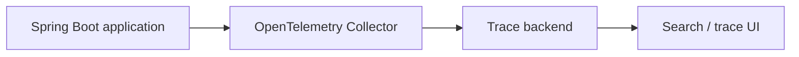
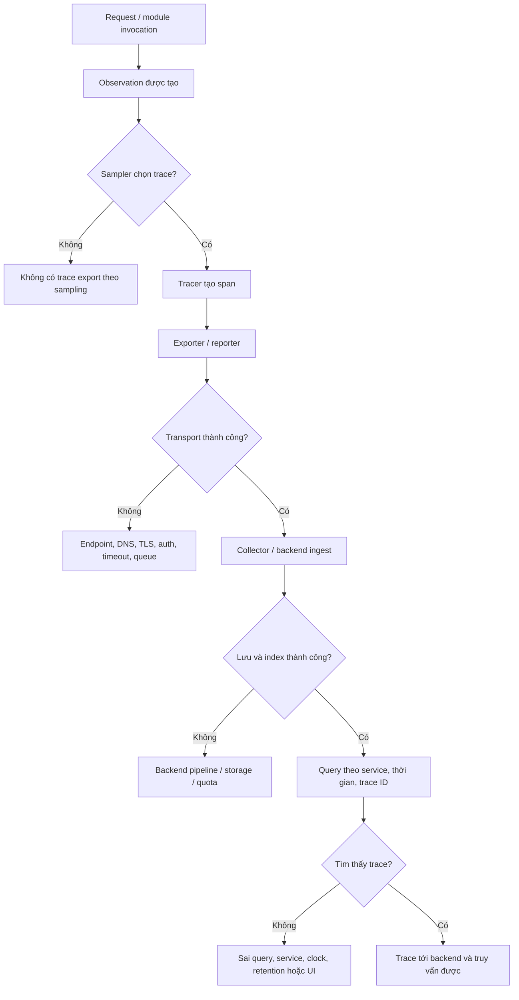

# Kiểm tra trace tới backend

## 1. Mục tiêu: chứng minh trace đã đến nơi có thể truy vấn

Trong ứng dụng Spring Boot có các application module như `orders`, `inventory` và `payments`, Spring Modulith có thể instrument những điểm vào module API để tạo observation. Micrometer Tracing chuyển observation thành spans; tracer/exporter gửi spans tới backend như Zipkin hoặc OpenTelemetry Collector. Nhóm phát triển cần xác nhận toàn bộ đường đi đó hoạt động sau khi cấu hình, triển khai hoặc thay đổi phiên bản.

Một request trả về HTTP 200 **không chứng minh** trace đã được export. Ứng dụng có thể xử lý nghiệp vụ thành công nhưng không tạo observation, không sample trace, không khởi tạo exporter, không kết nối được backend hoặc backend nhận dữ liệu nhưng chưa lập chỉ mục để truy vấn.

Bài **“Kiểm tra trace tới backend”** thuộc chương **Export traces** của học phần **SPRING_MODULITH_DOCUMENTATION_OBSERVABILITY**. Học phần dùng Spring Modulith để sinh tài liệu ranh giới application module và quan sát tương tác giữa các phần trong Spring Boot thông qua module graph, Actuator, event metrics, tracing và context propagation.

Sau bài này, bạn sẽ có thể:

1. Phân biệt các trạng thái **observation được tạo**, **span được sample**, **span được export**, **backend nhận span** và **trace truy vấn được**.
2. Kiểm tra từng chặng từ Spring Observation/Micrometer Tracing đến reporter/exporter, transport, collector, storage và UI.
3. Tạo một thao tác kiểm chứng có marker ổn định để tìm đúng trace.
4. Xác minh export tới Zipkin và OTLP backend theo cấu hình tương ứng.
5. Phân tích sampling, endpoint, DNS, port, TLS, authentication, queue, retry và thời gian chờ.
6. Phân biệt lỗi export với lỗi query, retention, service name hoặc bộ lọc trên backend.
7. Kiểm thử Spring Modulith module-entry spans và context propagation qua HTTP/async.
8. Xây dựng checklist nghiệm thu sau deploy và quy trình xử lý khi trace không tới backend.

> **Phạm vi:** Ví dụ cấu hình chính dùng Spring Boot 4.2 và các property hiện hành. Những khác biệt của Spring Boot 3.5 được ghi riêng. Các trace IDs, responses và số liệu là dữ liệu minh họa; chúng không phải kết quả thu được từ một ứng dụng thực tế.

## 2. Phân biệt năm trạng thái trong đường đi của trace

### 2.1. Observation được tạo

Một observation có thể được tạo bởi:

- Instrumentation tự động của Spring MVC/WebFlux hoặc HTTP client.
- Spring Modulith module-entry instrumentation.
- Observation do ứng dụng chủ động tạo qua `ObservationRegistry`.
- Annotation như `@Observed` khi annotation support được bật.
- Instrumentation của thư viện tích hợp.

Ở bước này, code đã khởi tạo một hoạt động có tên, context và vòng đời. Nhưng việc có observation trong code **chưa đồng nghĩa** đã có trace ở backend.

### 2.2. Span được tạo và được sample

Tracing handler chuyển observation thành span thông qua tracer đang được cấu hình. Sampler quyết định trace có được chọn để ghi nhận/export hay không.

Spring Boot mặc định sample khoảng **10% request** để tránh làm quá tải backend. Nếu xác suất sampling là `0.1`, một request cụ thể có thể không được export dù observation được tạo bình thường. Trong môi trường local/staging có lưu lượng nhỏ, có thể tạm đặt `1.0` để kiểm chứng từng request.

### 2.3. Span được exporter gửi đi

Span đã được chọn phải đi qua cơ chế export:

- Brave + Zipkin: Brave tracer, Zipkin reporter và HTTP sender.
- OpenTelemetry + OTLP: OpenTelemetry SDK, span processor và OTLP exporter.
- Các backend khác: collector hoặc exporter tương ứng.

Export có thể diễn ra bất đồng bộ theo batch. Vì vậy, thời điểm request hoàn tất và thời điểm backend có thể truy vấn trace không nhất thiết trùng nhau.

### 2.4. Backend nhận dữ liệu

Collector hoặc backend có thể nhận request ở tầng HTTP/gRPC. HTTP response thành công là bằng chứng transport đã được chấp nhận ở chặng đó, nhưng chưa chắc trace đã được lưu, lập chỉ mục và xuất hiện trong UI.

Với kiến trúc có collector ở giữa:



Collector nhận OTLP thành công nhưng exporter từ collector tới backend lỗi vẫn khiến trace không xuất hiện ở backend cuối.

### 2.5. Trace truy vấn được

Bước cuối là tìm được trace bằng service name, thời gian, trace ID hoặc điều kiện tìm kiếm tương ứng. Một trace có thể đã được ingest nhưng không xuất hiện do:

- Chọn sai service/environment.
- Khoảng thời gian truy vấn không đúng.
- Dùng trace ID sai hoặc chỉ giữ span ID.
- Backend đang xử lý batch/index.
- Storage/retention đã loại dữ liệu.
- UI hoặc query API đang kết nối nhầm cluster.

### 2.6. Mô hình kiểm chứng đầu-cuối



Quy trình điều tra nên xác định **chặng đầu tiên chưa có bằng chứng PASS**. Điều này giúp tránh sửa code instrumentation khi nguyên nhân thực sự nằm ở URL exporter hoặc query trên backend.

## 3. Chuẩn bị một trace kiểm chứng có thể nhận diện

### 3.1. Chọn một thao tác ổn định

Chọn một endpoint hoặc use case có thể gọi lặp lại mà không gây tác động ngoài ý muốn. Ví dụ:

```text
HTTP POST /internal/trace-probe
  -> orders.TraceProbeService.run()
  -> inventory.InventoryOperations.check()
```

Nếu không có endpoint probe trong ứng dụng, có thể gọi một use case đọc dữ liệu hoặc một integration test. Không tự giả định Spring Modulith cung cấp endpoint HTTP kiểm thử.

### 3.2. Dùng marker ít cardinality

Đặt một marker cố định trên observation:

```java
package com.example.shop.orders;

import io.micrometer.observation.Observation;
import io.micrometer.observation.ObservationRegistry;
import org.springframework.stereotype.Service;

@Service
public class TraceProbeService {

    private final ObservationRegistry observationRegistry;

    public TraceProbeService(ObservationRegistry observationRegistry) {
        this.observationRegistry = observationRegistry;
    }

    public void run() {
        Observation.createNotStarted(
                "trace.export.probe",
                observationRegistry
            )
            .lowCardinalityKeyValue("probe.kind", "backend-check")
            .lowCardinalityKeyValue("module", "orders")
            .observe(this::performProbe);
    }

    private void performProbe() {
        // Thao tác kiểm chứng ngắn, an toàn và có thể lặp lại.
    }
}
```

Marker `probe.kind=backend-check` giúp phân biệt trace thử nghiệm trong UI. Vì giá trị cố định, nó không tạo một tag mới cho mỗi request. Không dùng UUID, email hoặc timestamp làm metric tag để tìm một trace.

Nếu muốn nhận diện **một lần gọi duy nhất**, hãy ghi trace ID vào log correlation sau khi span đã được tạo, hoặc dùng trace ID được trả về từ test instrumentation; đừng đưa ID duy nhất vào low-cardinality tag.

### 3.3. Ghi lại bộ thông tin trước khi chạy

| Thông tin | Ví dụ |
| --- | --- |
| Build/version | Commit SHA hoặc image tag |
| Service name | `shop-service` |
| Environment | `staging` |
| Thời điểm | UTC timestamp khi gửi request |
| Marker | `probe.kind=backend-check` |
| Trace ID | Đọc từ log hoặc test probe nếu có |
| Backend | Zipkin local hoặc OTLP collector staging |
| Sampling | `1.0` trong phép thử ngắn |
| Kết quả nghiệp vụ | HTTP status và outcome |

Bộ thông tin này cho phép nhóm ứng dụng và nhóm nền tảng cùng tìm một sự kiện mà không phải đoán khoảng thời gian hoặc tên service.

## 4. Kiểm tra cấu hình export trong Spring Boot

### 4.1. Xác nhận tracer và exporter đúng loại

Spring Boot hỗ trợ hai hướng phổ biến:

| Tracer/export path | Dependency Spring Boot 4.2 | Backend thường dùng |
| --- | --- | --- |
| OpenZipkin Brave + Zipkin | `org.springframework.boot:spring-boot-starter-zipkin` | Zipkin hoặc backend tương thích Zipkin API |
| OpenTelemetry + OTLP | `org.springframework.boot:spring-boot-starter-opentelemetry` | OpenTelemetry Collector hoặc OTLP backend |

Không trộn hai cấu hình exporter chỉ vì backend đích hỗ trợ nhiều giao thức. Chọn một tracer implementation chủ đạo, xác nhận dependency được đưa vào runtime classpath và kiểm tra không có property vô tình tắt export.

### 4.2. Cấu hình Zipkin với Spring Boot 4.2

Ví dụ `application.yml`:

```yaml
spring:
  application:
    name: shop-service

management:
  tracing:
    sampling:
      probability: 1.0
    export:
      enabled: true
      zipkin:
        enabled: true
        endpoint: http://zipkin:9411/api/v2/spans
        connect-timeout: 1s
        read-timeout: 10s
```

Các điểm cần xác nhận:

- `spring.application.name` xác định service name được gắn vào trace.
- `management.tracing.sampling.probability` phải đủ cao cho phép kiểm chứng.
- `management.tracing.export.enabled` không bị đặt thành `false`.
- `management.tracing.export.zipkin.enabled` không bị tắt.
- `endpoint` phải là URL ingestion API, không phải URL giao diện UI.
- Timeout cần phù hợp với network và độ trễ backend.

Trong môi trường Docker Compose/Kubernetes, `zipkin` phải là hostname có thể phân giải từ **container/pod của ứng dụng**. `localhost` bên trong container thường trỏ về chính container đó, không phải máy host hoặc một container Zipkin khác.

### 4.3. Property khác nhau giữa Spring Boot 3.5 và 4.2

Với Spring Boot 4.2, Zipkin exporter dùng namespace `management.tracing.export.zipkin.*` như ví dụ trên. Với Spring Boot 3.5, cấu hình Zipkin dùng namespace `management.zipkin.tracing.*`.

Không copy một property từ tài liệu Boot 4 sang ứng dụng Boot 3.5 rồi kết luận exporter hoạt động chỉ vì application context khởi động thành công. Hãy xác nhận property được bind theo đúng dòng version và xem endpoint exporter thực tế.

### 4.4. Cấu hình OpenTelemetry với OTLP/HTTP

Với Spring Boot 4.2 và `spring-boot-starter-opentelemetry`, có thể dùng common OTLP endpoint:

```yaml
spring:
  application:
    name: shop-service

management:
  tracing:
    sampling:
      probability: 1.0
  opentelemetry:
    otlp:
      endpoint: http://otel-collector:4318
      compression: gzip
```

Khi dùng common endpoint qua HTTP, Spring Boot thêm signal path `v1/traces` cho trace export. Có thể cấu hình endpoint riêng cho traces nếu cần; property riêng có độ ưu tiên cao hơn common endpoint:

```yaml
management:
  opentelemetry:
    tracing:
      export:
        otlp:
          endpoint: http://otel-collector:4318/v1/traces
```

Đảm bảo endpoint nhận đúng **OTLP/HTTP**. Nếu collector chỉ mở OTLP/gRPC, dùng transport/port tương ứng và cấu hình exporter cho đúng giao thức. Không gửi HTTP OTLP tới port gRPC hoặc ngược lại.

### 4.5. Cấu hình header xác thực qua secret

Nếu OTLP gateway yêu cầu bearer token, có thể cấu hình header exporter. Ví dụ cấu trúc property:

```yaml
management:
  opentelemetry:
    otlp:
      headers:
        Authorization: "Bearer ${OTLP_AUTH_TOKEN}"
```

Giá trị `OTLP_AUTH_TOKEN` nên được cấp từ secret manager hoặc biến môi trường trong runtime. Không commit token thật vào repository, không đưa token vào baggage/span attributes/logs và không chia sẻ giá trị bí mật trong ảnh chụp cấu hình.

Nếu endpoint Zipkin có proxy/auth riêng, xác minh cơ chế xác thực mà reporter và hạ tầng triển khai hỗ trợ; đừng mặc định mọi backend Zipkin đều dùng cùng một cách truyền header.

### 4.6. Kiểm tra các cờ có thể tắt export

| Cấu hình | Tác động cần hiểu |
| --- | --- |
| `management.tracing.export.enabled=false` | Tắt auto-configuration export/propagation tracing |
| `management.tracing.export.zipkin.enabled=false` | Tắt Zipkin exporter |
| `management.tracing.export.otlp.enabled=false` | Tắt OTLP tracing exporter |
| `management.opentelemetry.enabled=false` | Tắt OpenTelemetry SDK support; trace có thể trở thành no-op |
| `management.tracing.sampling.probability=0.0` | Không chọn trace mới theo ratio sampler |
| Observation predicate loại observation | Observation tương ứng không được báo cáo qua registry |

Cần kiểm tra cả YAML, environment variables, command-line arguments, config server và profile đang active. Property trong file local có thể bị override khi triển khai.

## 5. Xác minh Zipkin nhận trace

### 5.1. Khởi chạy Zipkin local

Dùng quickstart Docker của OpenZipkin:

```bash
docker run -d --name zipkin -p 9411:9411 openzipkin/zipkin
```

Zipkin UI mặc định ở:

```text
http://localhost:9411
```

Nếu ứng dụng cũng chạy trong container, không dùng `localhost:9411` làm endpoint từ ứng dụng trừ khi Zipkin ở cùng network namespace. Hãy dùng service DNS trong Docker Compose hoặc hostname nội bộ phù hợp.

### 5.2. Phân biệt UI và ingestion API

| URL | Vai trò |
| --- | --- |
| `http://localhost:9411` | Giao diện Zipkin UI |
| `http://localhost:9411/api/v2/spans` | API nhận danh sách spans qua HTTP POST |
| `http://localhost:9411/api/v2/services` | API liệt kê service names đã nhận |
| `http://localhost:9411/api/v2/traces` | API truy vấn traces theo tham số |

Ứng dụng gửi span tới **ingestion API**. Mở được UI chỉ chứng minh UI server truy cập được; nó không chứng minh reporter gửi đúng dữ liệu.

### 5.3. Gửi một request thực tế

Sau khi bật sampling 100% trong local, gọi một request thực sự kích hoạt observation:

```bash
curl -i http://localhost:8080/internal/trace-probe
```

Đường dẫn này chỉ là ví dụ. Dự án cần có controller/endpoint tương ứng hoặc gọi use case bằng integration test. Nếu request trả về 2xx, mới chỉ xác nhận thao tác nghiệp vụ hoàn tất.

### 5.4. Tìm service name mà Zipkin đã nhận

Gọi API services:

```bash
curl -s http://localhost:9411/api/v2/services
```

Kết quả minh họa:

```json
[
  "inventory-service",
  "shop-service"
]
```

Nếu `shop-service` không có trong danh sách, hãy kiểm tra lần lượt:

1. Ứng dụng có tạo span được sample không?
2. Reporter có được cấu hình và bật không?
3. Endpoint có đúng API path không?
4. Ứng dụng có phân giải và kết nối được hostname/port không?
5. Zipkin có nhận request nhưng từ chối payload không?
6. UI/API đang truy vấn đúng Zipkin instance không?

### 5.5. Tìm trace bằng service và thời gian

Trong Zipkin UI:

1. Chọn service `shop-service`.
2. Chọn khoảng thời gian bao trùm lúc gửi request.
3. Có thể lọc theo operation hoặc tag marker nếu UI/backend hỗ trợ.
4. Chạy query và mở trace phù hợp.
5. So sánh trace ID với correlation ID trong log.
6. Kiểm tra các spans con, timestamp, duration và module tags.

Nếu biết trace ID, có thể truy vấn trực tiếp:

```bash
curl -s http://localhost:9411/api/v2/trace/<TRACE_ID>
```

Thay `<TRACE_ID>` bằng trace ID thực tế. API v2 có endpoint lấy trace theo ID; nếu response rỗng, xác nhận trace ID đúng định dạng, service/backend đúng và trace chưa hết retention.

### 5.6. Một lần publish không nhất thiết tạo đúng một trace

Một trace có thể chứa nhiều spans; nhiều event có thể nằm trong cùng một trace hoặc được xử lý trong trace khác nếu async/context propagation không liên kết. Đừng so sánh số event publication counter với số trace như hai đại lượng tương đương.

## 6. Xác minh OTLP qua OpenTelemetry Collector

### 6.1. Kiểm tra receiver trước, backend sau

Với OTLP, kiến trúc thường có Collector ở giữa. Cần kiểm tra hai chặng độc lập:

- **Ứng dụng → Collector:** Collector có nhận OTLP spans không?
- **Collector → backend:** Exporter của Collector có chuyển dữ liệu tới backend cuối thành công không?

Nếu Collector có log nhận spans nhưng backend UI không thấy trace, hãy tập trung vào pipeline/exporter/storage/query ở phía sau Collector.

### 6.2. Ví dụ Collector chỉ để kiểm chứng ingestion

Một cấu hình tối giản cho bài thực hành có thể dùng OTLP/HTTP receiver và debug exporter:

```yaml
receivers:
  otlp:
    protocols:
      http:
        endpoint: 0.0.0.0:4318

exporters:
  debug:
    verbosity: detailed

service:
  pipelines:
    traces:
      receivers: [otlp]
      exporters: [debug]
```

Đây là cấu hình minh họa cho OpenTelemetry Collector distribution có các components tương ứng. Bản phân phối Collector cần chứa OTLP receiver và debug exporter. Log debug chứng minh Collector nhận và xử lý spans trong pipeline; nó **không chứng minh** backend production đã lưu trace.

Khi kết nối backend thật, thay hoặc bổ sung exporter phù hợp và kiểm tra pipeline traces của Collector có tham chiếu đúng receiver/exporter.

### 6.3. Kiểm tra Collector logs và health

Tùy cách triển khai, quan sát:

- Log khởi động cho biết receiver có bind port 4318 không.
- Log nhận request/exporter cho biết có spans đi vào pipeline không.
- Lỗi export tới backend như timeout, authentication failure, TLS handshake hoặc queue full.
- Metrics vận hành của Collector: accepted/refused spans, sent/failed spans, queue size, exporter send failures (tên metric phụ thuộc version/distribution).

Không suy đoán tên metric Collector giữa các bản phát hành. Xem endpoint metrics của chính Collector và tài liệu distribution đang dùng.

### 6.4. OTLP/HTTP và OTLP/gRPC

| Giao thức | Cổng thường dùng trong cấu hình local | Điểm cần xác nhận |
| --- | ---: | --- |
| OTLP/HTTP | 4318 | HTTP endpoint/path, TLS, headers |
| OTLP/gRPC | 4317 | gRPC service, TLS, authority và protocol |

Port có thể được thay đổi trong cấu hình Collector hoặc môi trường managed backend. Một cổng mở chưa đủ chứng minh protocol đúng; thử bằng exporter thực tế và xem receiver logs.

## 7. Kiểm tra source span trước khi đổ lỗi cho exporter

### 7.1. Có observation nào được tạo?

Dùng một handler/probe trong test hoặc môi trường staging để xác nhận observation bắt đầu/kết thúc. Có thể thêm log có giới hạn hoặc một test handler chỉ ghi tên và low-cardinality tags.

Nếu không có observation:

- Endpoint có thật sự được gọi?
- Method có nằm trong đường instrument?
- `ObservationPredicate` có loại observation?
- `management.observations.enable.*` có tắt prefix tương ứng?
- Code có dùng một `ObservationRegistry` khác với registry của Spring Boot không?
- Module component có được Spring quản lý và lời gọi có đi qua proxy/interceptor không?

Không có observation thì exporter không có span tương ứng để gửi.

### 7.2. Có span được tạo không?

Nếu observation có nhưng không thấy span trong probe, kiểm tra:

- Tracing bridge/tracer có trên runtime classpath?
- `TracingAwareMeterObservationHandler` hoặc handler tracing tương ứng có được đăng ký?
- Tracing support có bị tắt?
- Sampler có chọn trace không?
- Observation có kết thúc bình thường để handler hoàn tất không?

Spring Boot đăng ký tracing-aware observation handler khi tracing được cấu hình. Nếu muốn tạo span mà không tạo metric, API cấp thấp `Tracer` là lựa chọn khác; nhưng bài này kiểm tra đường export từ các spans đã được tạo.

### 7.3. Phân biệt sampling với exporter failure

| Dấu hiệu | Khả năng | Cách xác minh |
| --- | --- | --- |
| Observation có, trace không có, không thấy export attempt | Sampling loại trace hoặc tracing handler thiếu | Đặt sampling 1.0 trên staging, kiểm tra handler |
| Trace có trong log/test probe, exporter báo connection refused | Backend chưa nhận | Kiểm tra host/port/service network |
| Export attempt thành công nhưng UI rỗng | Backend query/index/retention/service mismatch | Dùng API services/traces, kiểm tra time range |
| Chỉ một phần request có trace | Sampling dưới 1.0 hoặc lỗi ngẫu nhiên | So sánh số request, sample probability và exporter failures |
| Span con thiếu parent nhưng root trace vẫn tới | Propagation/context issue | Kiểm tra headers, executor và async context |

### 7.4. Tạo test với một marker ổn định

Có thể dùng `ObservationRegistry` và test handler để khẳng định tên observation/marker được tạo. Khi cần kiểm tra exporter thực, chạy integration test với cấu hình tracing test phù hợp và một exporter/collector cô lập; không để test vô tình gửi spans đến backend production.

Một test xác nhận **source span** và một smoke test xác nhận **backend ingestion** là hai phép kiểm tra bổ trợ. Đừng gộp chúng thành một assertion chỉ nhìn HTTP response của nghiệp vụ.

## 8. Xác minh module-entry spans của Spring Modulith

### 8.1. Module API và instrumentation

Spring Modulith có thể instrument Spring components thuộc API được công bố của application module. Khi lời gọi đi qua điểm hỗ trợ, module-entry observation có thể tạo span với metadata như:

| Attribute | Ý nghĩa |
| --- | --- |
| `module.identifier` | Technical identifier của module |
| `module.name` | Tên hiển thị |
| `module.invocation-type` | Kiểu invocation, ví dụ bean hoặc event listener |
| `module.method` | Method được instrument |

Để kiểm tra module spans, hãy chọn một lời gọi qua Spring bean API module, ví dụ `orders` gọi `InventoryOperations.reserve()` ở module `inventory`. Không giả định mọi private method, object tự tạo bằng `new` hoặc self-invocation đều có span module-entry.

### 8.2. Đối chiếu module graph với trace

Module graph trả lời **module nào phụ thuộc module nào theo cấu trúc mã nguồn**; trace trả lời **một lần thực thi đi qua đâu**.

Ví dụ module graph có cạnh `orders → inventory`. Trong trace của request đặt hàng, kỳ vọng có thể thấy span `orders` và span `inventory` nếu cả hai điểm được instrument và trace context được giữ. Nếu module graph có cạnh nhưng trace không có span, chưa đủ kết luận dependency không được dùng: điểm gọi có thể không được instrument hoặc trace bị sampling.

### 8.3. Event listener và hướng dependency

Nếu `payments` lắng nghe event type do `orders` công bố, module graph có thể thể hiện dependency `payments → orders` vì listener tham chiếu hợp đồng event của orders. Trong runtime, event lại được publish từ orders và listener payments xử lý.

Trace của listener có thể nằm cùng trace hoặc trace riêng tùy execution model, transaction/event mechanism và context propagation. Kiểm tra cả trace ID, parent ID, listener invocation type và logs; không suy ra chiều dependency từ parent-child của một trace.

### 8.4. Event publication metrics không xác nhận export trace

Counter `module.events.published` theo dõi event publication được instrument. Nó không phải exporter metric, không xác nhận span đã gửi đến Zipkin/OTLP và không chứng minh listener hoàn tất.

Dùng metrics để biết xu hướng publish; dùng tracing backend để tìm đường đi một lần xử lý; dùng event publication state hoặc business state để xác nhận outcome nghiệp vụ.

## 9. Kiểm tra HTTP và async propagation

### 9.1. HTTP client phải dùng builder đã auto-configure

Để trace context tự truyền qua HTTP, dùng builder do Spring Boot cấu hình:

```java
@Bean
RestClient inventoryClient(RestClient.Builder builder) {
    return builder
        .baseUrl("http://inventory-service")
        .build();
}
```

Hoặc:

```java
@Bean
WebClient inventoryWebClient(WebClient.Builder builder) {
    return builder
        .baseUrl("http://inventory-service")
        .build();
}
```

Tự tạo client không dùng builder auto-configured có thể làm mất automatic trace propagation. Khi đó dịch vụ đích có thể tạo trace mới thay vì tiếp tục trace cha.

### 9.2. Kiểm tra header tại ranh giới HTTP

Với W3C Trace Context, header chính là `traceparent`. Với B3, có thể là `b3` hoặc các header `X-B3-TraceId`, `X-B3-SpanId`, `X-B3-Sampled`.

Trong môi trường test, dùng mock server hoặc request recorder để xác nhận header được gửi. Tránh log toàn bộ headers trong production vì chúng có thể chứa authorization, cookies hoặc dữ liệu nhạy cảm.

### 9.3. Async listener và context propagation

Khi listener dùng `@Async` hoặc executor riêng, thread mới không tự động kế thừa mọi context nếu chưa cấu hình propagation.

Với Spring Boot 4.2:

- Auto-configured `AsyncTaskExecutor` có thể bật propagation bằng `spring.task.execution.propagate-context=true`.
- Executor tự cấu hình có thể cần `ContextPropagatingTaskDecorator`.
- Reactive pipeline có thể cần `spring.reactor.context-propagation=auto` tùy cách sử dụng.

Nếu trace listener bị tách, kiểm tra executor thật sự được dùng, không chỉ kiểm tra bean decorator có tồn tại. Tên span đúng nhưng trace ID khác có thể là vấn đề propagation, không phải lỗi exporter.

## 10. Backend đã nhận nhưng UI không tìm thấy

### 10.1. Kiểm tra service name

Spring Boot thường dùng `spring.application.name` làm service name. OpenTelemetry Resource cũng có thể lấy service name từ `OTEL_SERVICE_NAME` hoặc resource attributes. Nếu UI tìm `shop-service` trong khi trace mang service name khác, query sẽ rỗng.

Ghi lại service name thực tế trong span/resource, không chỉ giá trị bạn nghĩ đã cấu hình.

### 10.2. Kiểm tra thời gian và clock

- Ghi timestamp request theo UTC.
- Xác nhận máy ứng dụng, collector và backend đồng bộ thời gian.
- Chọn khoảng tìm kiếm rộng hơn thời điểm gửi một chút.
- Lưu ý exporter có thể batch/flush sau khi request kết thúc.
- Kiểm tra retention nếu trace cũ không còn.

Clock skew lớn có thể làm spans xuất hiện ngoài khoảng query hoặc có thứ tự thời gian bất thường.

### 10.3. Kiểm tra trace ID chính xác

Trace ID thường có độ dài/định dạng theo tracing implementation. Đừng nhầm trace ID với span ID. Dùng log correlation của cùng request hoặc API response từ test probe để đối chiếu.

Nếu log chỉ có span ID, cần lấy trace ID từ cùng MDC/context hoặc từ trace backend. Không tìm bằng một chuỗi ID bị cắt bớt.

### 10.4. Backend có nhiều tenant/cluster

Một số backend yêu cầu tenant header, organization ID, project hoặc namespace. HTTP 2xx ở gateway có thể chỉ xác nhận gateway nhận request; dữ liệu có thể được chuyển tới tenant khác hoặc bị loại ở pipeline.

Kiểm tra:

- Tenant/project header đúng.
- Endpoint đang trỏ đúng region/cluster.
- Backend query UI đang chọn đúng project.
- Token có quyền ingest và quyền query tương ứng.
- Retention và quota của workspace.

Không ghi token hoặc tenant secrets vào log chẩn đoán.

## 11. Ma trận lỗi và hướng xử lý

| Triệu chứng | Chặng có thể lỗi | Kiểm tra đầu tiên |
| --- | --- | --- |
| Không có observation | Source instrumentation | Endpoint/code path, registry, predicate, module API |
| Có observation nhưng không có span | Tracing handler/tracer/sampler | Bridge, handler, sampling, lifecycle |
| Span được tạo nhưng không có export | Exporter wiring | Dependency, exporter enabled, property binding |
| Connection refused | Transport/network | Host, port, DNS, container network, firewall |
| Connection timeout | Network/backend overload | Route, latency, connect/read timeout, queue |
| HTTP 401/403 | Authentication/authorization | Token, header, expiry, role, tenant |
| HTTP 404 | Sai ingestion path | Zipkin `/api/v2/spans` hoặc OTLP signal endpoint |
| HTTP 400/415 | Payload/protocol mismatch | Content-Type, OTLP HTTP/gRPC, encoding, receiver |
| TLS handshake failure | TLS trust/config | CA bundle, hostname, certificate expiry, protocol |
| Collector nhận nhưng backend không có | Collector exporter/storage | Pipeline traces, exporter logs, queue, backend credentials |
| Chỉ một phần trace xuất hiện | Sampling hoặc drop | Probability, exporter queue, batch failure, quota |
| Backend nhận nhưng UI rỗng | Query/index | Service name, time range, tenant, retention |
| Trace thiếu module spans | Modulith instrumentation | Insight dependency, API boundary, Spring bean/proxy |
| Trace bị chia thành nhiều trace | Propagation | W3C/B3 formats, HTTP client builder, async executor |
| Có span nhưng logs không correlation | MDC/context | traceId/spanId keys, baggage, context propagation |
| Test không xuất trace | Test configuration | Tracing test support, exporter/collector cô lập |

### 11.1. Thứ tự điều tra khuyến nghị

1. Gọi một use case có thể lặp lại và ghi thời điểm.
2. Xác nhận observation được tạo.
3. Đặt sampling 100% trong local/staging nếu cần loại trừ sampling.
4. Xác nhận span được tạo và có trace ID.
5. Kiểm tra exporter endpoint, protocol và cờ enabled.
6. Kiểm tra log exporter/collector và phản hồi transport.
7. Xác nhận backend ingestion.
8. Truy vấn theo service, thời gian, marker hoặc trace ID.
9. Nếu trace tới nhưng thiếu spans con, kiểm tra propagation và instrumentation.
10. Ghi kết luận ở **chặng đầu tiên không có bằng chứng PASS**.

## 12. Smoke test có kiểm soát

### 12.1. Kiểm tra exporter bằng một trace probe

Trên môi trường local/staging:

- Khởi động backend/collector.
- Bật exporter tương ứng.
- Đặt sampling `1.0` trong khoảng thử nghiệm.
- Gửi đúng một request probe.
- Ghi timestamp, service name và marker.
- Chờ trong giới hạn export/batch hợp lý.
- Tìm trace bằng service/time range/marker.
- So sánh trace ID với log correlation.
- Xác nhận có ít nhất span mong đợi.

Không dùng thao tác có side effect như tạo đơn hàng thật hoặc thanh toán thật chỉ để kiểm tra export. Dùng use case probe an toàn, fixture test hoặc môi trường staging có dữ liệu giả lập.

### 12.2. Zipkin smoke test

Checklist:

```text
[ ] Zipkin UI truy cập được.
[ ] Ứng dụng phân giải được hostname Zipkin từ runtime network.
[ ] Dependency Brave + Zipkin phù hợp Spring Boot version.
[ ] Endpoint là /api/v2/spans.
[ ] Sampling đủ cao cho phép thử.
[ ] Request tạo observation và span.
[ ] Zipkin API liệt kê service name.
[ ] UI tìm thấy trace trong khoảng thời gian thử.
[ ] Trace ID khớp log/test probe.
```

### 12.3. OTLP smoke test

Checklist:

```text
[ ] OTLP receiver đang listen đúng protocol/port.
[ ] Ứng dụng dùng OpenTelemetry tracing starter/bridge phù hợp.
[ ] Endpoint đúng HTTP /v1/traces hoặc gRPC endpoint.
[ ] Header/authentication/TLS đúng.
[ ] Collector logs cho thấy spans được nhận.
[ ] Exporter pipeline không báo failed/refused spans.
[ ] Backend cuối có service/resource đúng.
[ ] UI/API truy vấn được trace theo thời gian và ID.
```

### 12.4. Kiểm thử âm tính

Thử từng lỗi trong sandbox, mỗi lần chỉ thay một yếu tố:

- Đặt sampling 0.0 để xác nhận trace không được chọn.
- Đổi endpoint sang hostname không phân giải được.
- Dùng sai path ingestion.
- Tạm dùng token hết hạn trong môi trường mock.
- Dừng collector trong lúc gửi trace.
- Truy vấn sai service name hoặc thời gian.

Mục tiêu là nhận diện **dấu hiệu ở từng lớp**, không tạo sự cố trên production. Sau thử nghiệm, khôi phục cấu hình đúng và chạy lại smoke test dương tính.

## 13. Kiểm thử tự động và test exporter

### 13.1. Tách test source khỏi test transport

Có hai nhóm test:

| Test | Xác minh | Không xác minh |
| --- | --- | --- |
| Unit test convention/observation | Tên, tags, logic tạo observation | Exporter gửi tới backend |
| Integration test với test handler | Observation được tạo, span được tạo | Network production |
| Export test với mock HTTP server | Exporter gọi đúng URL/protocol và gửi payload | Backend storage/index thật |
| Staging smoke test | Đường export và backend end-to-end | Mọi điều kiện production trong tương lai |

Không nên chỉ test mock HTTP server rồi kết luận backend thật đã lưu trace. Ngược lại, test backend thật có thể tốn kém và dễ bị nhiễu bởi sampling/network; cần giữ unit/integration tests nhanh và ổn định.

### 13.2. Spring Boot tracing tests

Spring Boot cung cấp hỗ trợ test tracing. Lưu ý các tracing components thực hiện reporting không được tự động cấu hình trong mọi trường hợp khi dùng `@SpringBootTest`. Nếu test cần kiểm tra reporter/export, cấu hình test tracing support theo tài liệu đúng version và dùng backend/mock server cô lập.

Không để test CI gửi spans tới Zipkin hoặc OTLP production. Cấu hình test phải có endpoint local, mock exporter hoặc cơ chế tắt export rõ ràng.

### 13.3. Test bằng mock server

Một mock HTTP server có thể kiểm tra:

- Đúng HTTP method và endpoint.
- Content-Type/encoding phù hợp.
- Payload chứa trace ID, span ID, service/resource metadata.
- Exporter có gửi batch khi span kết thúc.
- Hành vi khi server trả 4xx/5xx hoặc timeout.

Với Zipkin, ingestion API nhận POST tới `/api/v2/spans`. Với OTLP/HTTP, endpoint traces thường là `/v1/traces` khi dùng HTTP receiver. Không dùng mock response 200 để chứng minh backend đã index dữ liệu; nó chỉ xác minh client transport nhận phản hồi thành công.

### 13.4. Tránh sleep tùy ý

Export theo batch có thể bất đồng bộ. Thay vì `Thread.sleep(5000)` trong mọi test, ưu tiên:

- Test handler/exporter có cơ chế đồng bộ hoặc latch.
- Mock server chờ request với timeout hữu hạn.
- Cấu hình batch delay nhỏ chỉ trong test nếu exporter hỗ trợ.
- Đợi đúng điều kiện cần kiểm chứng, không đợi một khoảng cố định dài.

Nếu cần test end-to-end qua backend thật, đặt timeout có chủ đích và thông báo rõ khi hết hạn.

## 14. Kiểm tra logs, metrics và exporter health

### 14.1. Correlation ID trong logs

Spring Boot/Micrometer Tracing có thể đưa trace ID và span ID vào MDC để logs có correlation ID. Dùng cùng một request để đối chiếu:

```text
[traceId-spanId] INFO ... TraceProbeService - probe completed
```

Nếu log có trace ID nhưng Zipkin/OTLP UI không có trace, có thể span được tạo nhưng bị sampling hoặc export lỗi. Log correlation là bằng chứng **context tracing tồn tại ở thời điểm ghi log**, chưa phải bằng chứng backend nhận trace.

### 14.2. Metrics không thay thế exporter status

Actuator metrics có thể giúp xem metrics instrumentation, nhưng `/actuator/metrics` không phải endpoint liệt kê traces đã export. Event counter `module.events.published` chỉ phản ánh event publication được ghi nhận.

Nếu cần quan sát exporter, kiểm tra logs, metrics của Collector/exporter và backend ingestion. Tên metric exporter cụ thể tùy tracer, exporter và version; đọc danh sách metric thực tế thay vì đoán.

### 14.3. Theo dõi hàng đợi và dropped spans

Một số exporter dùng batch processor/queue. Khi backend chậm hoặc ngắt kết nối:

- Queue có thể tăng.
- Batch gửi thất bại hoặc retry.
- Queue có thể đầy và spans mới bị drop.
- Shutdown không graceful có thể kết thúc trước khi batch được flush.

OpenTelemetry exporter của Spring Boot có các property điều chỉnh schedule delay, export timeout, queue size và batch size. Chỉ thay đổi sau khi có bằng chứng queue/throughput là nút thắt; tăng queue không sửa endpoint sai hoặc auth lỗi.

### 14.4. Shutdown và flush

Trong quá trình deploy/restart, ứng dụng nên được dừng theo cơ chế graceful shutdown để exporter có thời gian hoàn tất công việc pending. Nếu pod bị kill ngay sau khi tạo span, batch chưa flush có thể chưa đến backend.

Kiểm tra termination grace period, lifecycle shutdown và log exporter quanh thời điểm rollout. Không kết luận exporter mất trace nếu chỉ thấy request cuối cùng trước khi process bị kill.

## 15. Bảo mật và dữ liệu trước khi export

### 15.1. Bảo vệ endpoint

- Dùng TLS khi gửi trace qua mạng không tin cậy.
- Bảo vệ ingestion endpoint bằng cơ chế auth của backend/gateway.
- Giới hạn quyền truy cập UI và query API.
- Không expose endpoint quản trị công khai nếu không cần.
- Quản lý token/headers bằng secret manager.
- Theo dõi quota, retention và giới hạn ingest.

### 15.2. Kiểm soát span attributes

Trace có thể chứa tên module, method, route, exception và baggage. Không đưa password, token, email, số thẻ, payload cá nhân hoặc bí mật vào attributes.

Dùng low-cardinality attributes cho phân nhóm. Dùng high-cardinality attributes có chọn lọc khi thực sự cần và chính sách cho phép. Backend trace thường được nhiều nhóm vận hành truy cập, nên dữ liệu cần được giảm thiểu ngay từ nguồn.

### 15.3. Endpoint và cấu hình không chứa secrets

Không commit bearer token, API key, private key hoặc certificate password vào `application.yml`. Dùng environment/secret store và kiểm tra logs không in giá trị cấu hình bí mật khi exporter lỗi.

## 16. Bài thực hành: xác nhận trace của một module tới backend

### 16.1. Bối cảnh

Ứng dụng có các module:

```text
com.example.shop
├── ShopApplication.java
├── orders
│   └── OrderManagement.java
├── inventory
│   └── InventoryOperations.java
└── payments
    └── OrderPaymentListener.java
```

Yêu cầu: một request probe đi vào `orders`, gọi API `inventory`, phát `OrderPlaced` và để `payments` nhận event. Nhóm muốn thấy trace trong backend với service name `shop-service`.

### 16.2. Chuẩn bị bằng chứng

Ghi:

- Phiên bản Spring Boot và Spring Modulith.
- Tracer/exporter đã chọn: Brave + Zipkin hoặc OpenTelemetry + OTLP.
- Endpoint và protocol.
- Sampling probability.
- Service name/resource attributes.
- Thời điểm gửi request.
- Trace ID/correlation ID nếu có.
- Host/namespace/cluster của ứng dụng và backend.

### 16.3. Chạy phép thử

1. Khởi động Zipkin hoặc OTLP Collector/backend.
2. Xác nhận receiver/backend sẵn sàng.
3. Khởi động ứng dụng với cấu hình export đã chọn.
4. Gọi một request probe an toàn.
5. Xác nhận HTTP response và log correlation.
6. Kiểm tra exporter/collector logs.
7. Tìm trace trên backend theo service và thời gian.
8. Đối chiếu trace ID và các spans module.
9. Nếu listener bị tách trace, kiểm tra async context propagation.
10. Ghi kết luận PASS/FAIL theo từng chặng.

### 16.4. Bảng kết quả giả định

| Chặng | Bằng chứng | Kết quả ví dụ |
| --- | --- | --- |
| Observation | Probe handler nhận `trace.export.probe` | PASS |
| Sampling | Sampling 1.0 trên staging | PASS |
| Span | Trace ID và span ID có mặt | PASS |
| Exporter | Không có lỗi connection/serialization | PASS |
| Collector | OTLP receiver nhận batch | PASS |
| Backend | Query theo service/time trả trace | PASS |
| Module spans | Có `orders` và `inventory` attributes | PASS |
| Event listener | Có span listener và parent relation phù hợp | **Cần kiểm tra riêng** |

Đây là bảng minh họa. Nếu listener chạy async và không có propagation, phần listener có thể nằm ở trace riêng; không nên ép nó thành PASS chỉ vì trace chính đã tới backend.

### 16.5. Kết luận nghiệm thu

Một lần kiểm tra được xem là đạt khi:

- Trace marker được tạo và được sample.
- Exporter gửi thành công tới endpoint đã cấu hình.
- Collector/backend nhận và truy vấn được trace.
- Trace ID đối chiếu được với log/test probe.
- Service name, environment và khoảng thời gian đúng.
- Những spans module mong đợi có mặt hoặc thiếu hụt được giải thích bằng instrumentation/propagation.
- Không có dữ liệu nhạy cảm ngoài chính sách trong spans.

Nếu chỉ có HTTP 200 hoặc collector nhận batch nhưng backend cuối không truy vấn được trace, trạng thái là **chưa hoàn tất end-to-end**.

## 17. Những hiểu lầm thường gặp

1. **Request trả 200 nghĩa trace đã export.** HTTP response nghiệp vụ và export trace là hai đường xử lý khác nhau.
2. **Observation được tạo nghĩa backend chắc chắn có trace.** Sampling, tracing handler, exporter, transport và storage vẫn có thể loại dữ liệu.
3. **Không tìm thấy trace nghĩa exporter hỏng.** Sai service name, time range, tenant hoặc retention cũng có thể làm query rỗng.
4. **Mở được Zipkin UI nghĩa ingestion hoạt động.** UI và API POST nhận spans là hai endpoint khác nhau.
5. **HTTP 2xx từ Collector chứng minh backend cuối lưu dữ liệu.** Collector có thể nhận nhưng exporter phía sau vẫn thất bại.
6. **Sampling 10% nghĩa 10 request sẽ luôn có đúng một trace.** Sampling xác suất không bảo đảm tỷ lệ chính xác trong mẫu nhỏ.
7. **`localhost` luôn là máy chạy ứng dụng.** Trong container, nó thường trỏ về chính container hiện tại.
8. **Actuator Metrics liệt kê trace đã export.** Endpoint metrics không thay thế trace backend query.
9. **Event publication counter tăng nghĩa listener đã xử lý.** Counter chỉ đo publication, không xác nhận listener outcome.
10. **Span name hoặc service name động giúp tìm trace dễ hơn.** Giá trị động làm query và cardinality khó kiểm soát.
11. **Tăng exporter queue giải quyết mọi lỗi mất trace.** Queue không sửa sai protocol, endpoint, auth hoặc sampling.
12. **Test Spring Boot luôn cấu hình reporter thật.** Reporting components cần được cấu hình riêng theo hướng dẫn test tracing của phiên bản.
13. **Có trace ID trong log chứng minh backend nhận trace.** Nó chỉ chứng minh context có mặt trong tiến trình lúc ghi log.
14. **Module graph và trace phải có cùng chiều cạnh.** Graph mô tả dependency; trace mô tả luồng thực thi tại runtime.

## 18. Checklist trước và sau deploy

### Trước deploy

- [ ] Đã chọn đúng tracer/exporter và dependency theo Spring Boot version.
- [ ] Đã xác nhận exporter enabled và property được bind đúng.
- [ ] Endpoint, protocol, port và path đúng.
- [ ] DNS/network từ pod/container ứng dụng tới collector/backend hoạt động.
- [ ] TLS/auth/header/tenant đã được cấu hình qua secret.
- [ ] Sampling phù hợp phép thử và tải dự kiến.
- [ ] Service name/resource attributes đúng.
- [ ] Test marker không chứa ID/PII và có thể truy vấn.
- [ ] Có smoke test exporter và test backend riêng.
- [ ] Có kế hoạch xử lý exporter queue, retries và graceful shutdown.

### Sau deploy

- [ ] Gửi một request kiểm chứng có thể lặp lại.
- [ ] Có observation/span với trace ID.
- [ ] Exporter không báo lỗi.
- [ ] Collector/backend nhận dữ liệu.
- [ ] Trace truy vấn được theo service/time/trace ID.
- [ ] Trace có các spans module dự kiến.
- [ ] HTTP và async propagation được kiểm tra.
- [ ] Log correlation khớp trace.
- [ ] Không có span attributes/baggage chứa dữ liệu nhạy cảm.
- [ ] Lưu kết quả và thời điểm kiểm tra vào runbook.

## 19. Tài liệu tham khảo chính thức

- [Spring Boot — Tracing](https://docs.spring.io/spring-boot/reference/actuator/tracing.html): tracer Brave/Zipkin và OpenTelemetry/OTLP, sampling, endpoint, propagation, custom spans.
- [Spring Boot — Observability](https://docs.spring.io/spring-boot/reference/actuator/observability.html): ObservationRegistry, context propagation, OTLP common endpoint, headers và exporter configuration.
- [Spring Boot — Common Application Properties](https://docs.spring.io/spring-boot/appendix/application-properties/): các property tracing/exporter, timeout, sampling và propagation.
- [Spring Boot — Testing Spring Boot Applications](https://docs.spring.io/spring-boot/reference/testing/spring-boot-applications.html): lưu ý tracing reporter/export trong test context.
- [OpenZipkin — Quickstart](https://zipkin.io/pages/quickstart): khởi chạy Zipkin local bằng Docker hoặc Java.
- [OpenZipkin — Zipkin API](https://zipkin.io/zipkin-api/): API nhận spans và truy vấn service/traces.
- [Micrometer Tracing — Supported Reporters](https://docs.micrometer.io/tracing/reference/reporters.html): reporter Zipkin cho Brave và OpenTelemetry.
- [OpenTelemetry Collector — Configuration](https://opentelemetry.io/docs/collector/configuration/): receivers, processors, exporters và pipelines.
- [Spring Modulith — Production-ready Features](https://docs.spring.io/spring-modulith/reference/production-ready.html): module-entry observability và event publication metrics.

> **Ghi nhớ:** Kiểm tra trace tới backend là quy trình xác minh từng chặng: **observation → sampled span → exporter → transport → collector/backend ingest → storage/index → query/UI**. Hãy dùng một trace probe có marker ổn định, ghi lại service name và thời điểm, kiểm tra log/exporter ở chặng đầu tiên bị lỗi rồi đối chiếu trace ID trên backend. Chỉ kết luận end-to-end thành công khi trace thực sự truy vấn được và các spans mong đợi có mặt.
