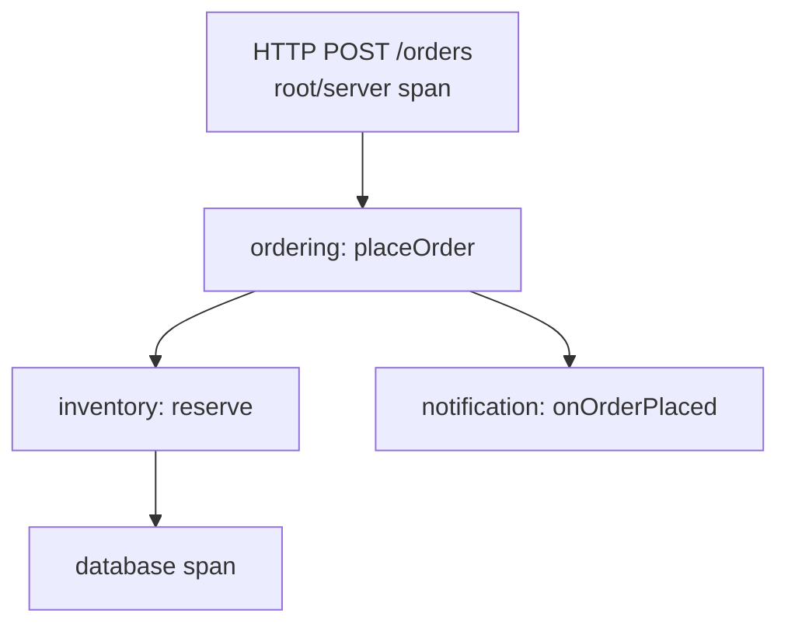
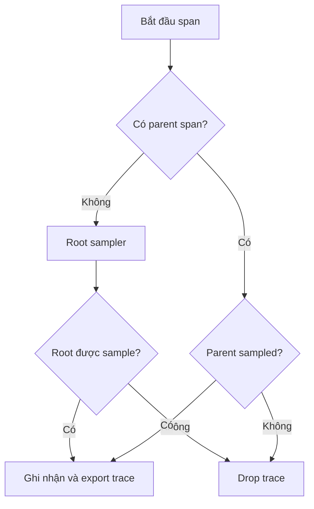

# Always-on, always-off và ratio sampler

## 1. Vì sao cần sampling khi quan sát Spring Modulith?

Một ứng dụng Spring Boot dùng **Spring Modulith** có thể có nhiều application module như `ordering`, `inventory`, `payment` và `notification`. Khi bật module observability, một lần gọi API module hoặc xử lý event có thể tạo observation/span. Nếu mọi request đều được export, hệ thống tracing sẽ nhận một lượng dữ liệu lớn, làm tăng băng thông, chi phí lưu trữ và tải xử lý của backend.

**Sampling** là cơ chế chọn những trace/span được ghi nhận và gửi đi. Thay vì thu thập tất cả, ứng dụng có thể:

- **Always-on:** thu thập mọi trace.
- **Always-off:** loại bỏ mọi trace.
- **Ratio sampler:** thu thập một tỷ lệ trace, ví dụ 10%.

Sampling đặc biệt hữu ích khi Spring Modulith tạo nhiều module entry spans và event listener spans trong cùng một luồng nghiệp vụ. Một trace đặt hàng có thể chứa các bước ở `ordering`, `inventory` và `notification`; quyết định sampling nên được áp dụng nhất quán để người vận hành xem được một hành trình đầy đủ.

> **Phạm vi bài học:** giải thích ba kiểu sampler trong tracing, cách cấu hình Spring Boot/OpenTelemetry, vai trò của parent-based sampling và ảnh hưởng đến module spans. Sampling ở đây là **sampling trace**, không phải giới hạn số event nghiệp vụ hoặc thay thế metrics.

## 2. Phân biệt trace, span và sampling decision

Một **trace** biểu diễn hành trình của một request hoặc một đơn vị công việc qua nhiều thành phần. Trace gồm các **span** có cùng trace ID và quan hệ cha-con hoặc liên kết phù hợp.

Ví dụ:



Sampling thường được quyết định khi span bắt đầu, đặc biệt với **head sampling** tại SDK của ứng dụng. Với sampler parent-based, quyết định ở root trace được truyền theo trace context để các span con và dịch vụ tiếp theo tuân theo cùng lựa chọn.

| Khái niệm | Ý nghĩa |
| --- | --- |
| Trace | Tập spans mô tả một luồng thực thi |
| Span | Một đơn vị công việc được instrument, có thời gian bắt đầu/kết thúc và attributes |
| Sampler | Thành phần quyết định span/trace có được ghi nhận và sample hay không |
| Sampling probability/ratio | Tỷ lệ mục tiêu, ví dụ `0.10` tương đương khoảng 10% |
| Sampled flag | Cờ trong trace context cho biết trace đã được chọn để sampling |
| Exporter | Gửi spans đã được ghi nhận đến backend qua OTLP, Zipkin hoặc giao thức tương ứng |

**Không có trace trong backend không đồng nghĩa request không chạy.** Request vẫn có thể xử lý bình thường, metrics vẫn có thể tăng và logs vẫn có thể được ghi; sampler chỉ điều khiển dữ liệu tracing theo cấu hình.

## 3. Always-on sampler

### 3.1. Cách hoạt động

**Always-on** luôn đưa trace vào diện ghi nhận và sampling. Với OpenTelemetry, sampler `AlwaysOn` trả quyết định `RECORD_AND_SAMPLE`.

Điều này hữu ích khi:

- Phát triển local và cần xem đầy đủ các bước qua module.
- Kiểm thử tích hợp muốn thu đủ spans để xác minh parent/child.
- Điều tra sự cố trong môi trường kiểm soát có lưu lượng thấp.
- Một service nhỏ cần thu đầy đủ trace để có dữ liệu chẩn đoán.

Nhưng nếu lưu lượng cao, always-on có thể tạo nhiều spans, tăng tải CPU, network, collector và trace backend. Dữ liệu nhạy cảm trong span attributes cũng có thể được lưu với tần suất lớn hơn.

### 3.2. Cấu hình OpenTelemetry trong Spring Boot

Trong các phiên bản Spring Boot hiện hành có hỗ trợ thuộc tính chọn sampler OpenTelemetry, cấu hình:

```yaml
management:
  opentelemetry:
    tracing:
      sampler: always-on
```

`always-on` là sampler dành cho **OpenTelemetry**. Nếu ứng dụng dùng OpenZipkin Brave, không được giả định thuộc tính `management.opentelemetry.tracing.sampler` sẽ tác động đến Brave; Brave sử dụng cấu hình xác suất chung `management.tracing.sampling.probability` và các cơ chế tương ứng của tracer.

### 3.3. Khi nào không nên bật always-on?

Không nên dùng always-on một cách vô điều kiện trong production lưu lượng lớn. Trước khi bật, cần ước lượng:

- Số request mỗi giây và số spans trung bình trên một trace.
- Tỷ lệ lỗi và thời gian lưu trữ của backend.
- Chi phí exporter, collector và storage.
- Chính sách dữ liệu nhạy cảm trong attributes, events và baggage.

Nếu chỉ cần kiểm tra một nhóm luồng quan trọng, có thể cân nhắc parent-based ratio hoặc cơ chế sampling nâng cao phù hợp thay vì thu mọi trace.

## 4. Always-off sampler

### 4.1. Cách hoạt động

**Always-off** loại bỏ mọi trace ở quyết định sampling. OpenTelemetry `AlwaysOff` trả quyết định `DROP`.

Khi root trace bị loại bỏ:

- Spans không được ghi nhận/export như các spans được sample.
- Trace backend không nhận trace đó từ SDK theo đường export thông thường.
- Ứng dụng vẫn xử lý request và business logic.
- Trace context có thể vẫn tồn tại để truyền ID/cờ sampling, nhưng span có thể là non-recording và không có dữ liệu chi tiết.

Do đó, always-off có thể hữu ích khi:

- Tạm tắt xuất tracing trong một môi trường không cần trace.
- Kiểm tra ứng dụng có phụ thuộc sai vào việc trace luôn hiện diện hay không.
- Giảm dữ liệu tracing trong một môi trường thử nghiệm riêng.

Always-off không phải cách tắt toàn bộ observability. Metrics, logs và event publication state là các tín hiệu khác, có cấu hình và vòng đời riêng.

### 4.2. Cấu hình OpenTelemetry

```yaml
management:
  opentelemetry:
    tracing:
      sampler: always-off
```

Nếu cấu hình này đang được áp dụng, không nên kỳ vọng trace của module `ordering`, `inventory` hoặc `notification` xuất hiện trong backend. Khi cần bật lại, đổi sampler và kiểm tra cấu hình export.

### 4.3. Không nhầm always-off với exporter bị lỗi

Hai tình huống có thể nhìn giống nhau ở giao diện backend:

| Tình huống | Sampling decision | Exporter/backend |
| --- | --- | --- |
| Always-off | Loại trace ngay tại SDK | Có thể vẫn hoạt động bình thường |
| Exporter lỗi/kết nối thất bại | Trace được sample | Dữ liệu không đến backend như mong đợi |

Muốn phân biệt, kiểm tra cấu hình sampler, log exporter, collector health và metrics self-observability của tracing pipeline. Không kết luận rằng ứng dụng không phát sinh span chỉ vì backend không tìm thấy trace.

## 5. Ratio sampler

### 5.1. Cách hoạt động

**Ratio sampler** chọn một phần trace theo xác suất cấu hình. Ví dụ:

| Ratio | Tỷ lệ mục tiêu | Ý nghĩa |
| ---: | ---: | --- |
| `1.0` | 100% | Tương đương thu mọi trace |
| `0.5` | 50% | Trung bình khoảng một nửa trace |
| `0.1` | 10% | Trung bình khoảng một phần mười trace |
| `0.01` | 1% | Trung bình khoảng một phần trăm trace |
| `0.0` | 0% | Không chọn trace nào |

Đây là **xác suất trên số lượng lớn**, không phải cam kết cứ 10 request thì chính xác có 1 request được sample. Với một khoảng thời gian ngắn hoặc lưu lượng nhỏ, tỷ lệ quan sát có thể lệch đáng kể.

Với OpenTelemetry `TraceIdRatioBased`, quyết định dựa trên trace ID theo thuật toán xác định. Cùng một trace ID sẽ nhận cùng quyết định ở các lần đánh giá tương ứng, giúp giữ tính nhất quán giữa các span. Sampler ratio độc lập không tự tôn trọng sampled flag của parent; vì vậy cần hiểu rõ parent-based wrapper khi trace đi qua nhiều module hoặc dịch vụ.

**Lưu ý về phiên bản OpenTelemetry:** đặc tả SDK hiện hành đánh dấu `TraceIdRatioBased` là deprecated để chuyển dần sang `ProbabilitySampler` và cơ chế probability sampling nhất quán. Tên cấu hình `trace-id-ratio` trong Spring Boot vẫn là tên property được tài liệu Boot công bố; hãy đối chiếu phiên bản SDK đi kèm trước khi tự tạo sampler hoặc nâng cấp cấu hình.

### 5.2. Cấu hình Spring Boot

Spring Boot dùng thuộc tính chung sau để cấu hình sampling probability:

```yaml
management:
  tracing:
    sampling:
      probability: 0.10
```

Theo tài liệu Spring Boot, mặc định Spring Boot sample khoảng **10% request** để tránh làm quá tải trace backend. Đặt `1.0` để lấy mọi request; đặt `0.0` để không lấy trace theo xác suất.

Với OpenTelemetry trên các phiên bản Spring Boot hỗ trợ lựa chọn sampler, có thể chỉ định rõ:

```yaml
management:
  opentelemetry:
    tracing:
      sampler: trace-id-ratio
  tracing:
    sampling:
      probability: 0.10
```

`trace-id-ratio` sử dụng giá trị `management.tracing.sampling.probability`. Nếu dùng OpenTelemetry, Spring Boot hiện hành còn cung cấp các lựa chọn parent-based; xem mục tiếp theo để hiểu lựa chọn phù hợp khi trace đi qua nhiều dịch vụ.

### 5.3. Ratio không phải bộ lọc theo endpoint

Ratio sampler không có nghĩa “chỉ sample endpoint `/orders`”. Nó chọn trace theo tỷ lệ chung, trừ khi dùng một sampler có luật/điều kiện theo route hoặc cấu hình chuyên biệt.

Nếu mục tiêu là luôn lấy trace của luồng thanh toán nhưng chỉ lấy 5% health checks, cần sampler theo rule hoặc chính sách tail sampling tại collector; một tỷ lệ chung không biểu diễn được ưu tiên nghiệp vụ đó.

## 6. Parent-based sampler: giữ quyết định nhất quán qua modules

### 6.1. Vì sao cần parent-based?

Giả sử request bắt đầu ở service gateway, được sample, rồi gọi service đặt hàng. Nếu mỗi service tự quyết định ratio độc lập, có thể xảy ra:

- Gateway gửi trace đã sample nhưng service con lại loại span.
- Gateway loại trace nhưng service con tự tạo trace mới và xuất một phần cây.
- Trace viewer thiếu spans ở giữa, gây khó hiểu khi điều tra.

**Parent-based sampler** giải quyết việc này bằng cách chọn sampler cho root trace, rồi dựa vào quyết định của parent cho các spans con. Với cấu hình `parent-based-trace-id-ratio`, root span dùng ratio; spans con theo sampled decision đã có.

### 6.2. Các lựa chọn parent-based của Spring Boot

Trong cấu hình OpenTelemetry của Spring Boot hiện hành:

| Sampler | Root trace (không có parent) | Child span |
| --- | --- | --- |
| `parent-based-always-on` | Luôn sample | Theo quyết định sampled của parent |
| `parent-based-always-off` | Không sample | Theo quyết định sampled của parent |
| `parent-based-trace-id-ratio` | Sample theo ratio | Theo quyết định sampled của parent |

`parent-based-trace-id-ratio` là lựa chọn mặc định được tài liệu Spring Boot hiện hành mô tả cho OpenTelemetry. Khi root được chọn theo xác suất, các module spans thuộc cùng trace sẽ đi theo quyết định đó thay vì tung một lần xác suất độc lập cho từng module.

### 6.3. Sơ đồ quyết định



Sơ đồ là mô hình đơn giản cho parent-based sampler. Các cấu hình đầy đủ còn phân biệt parent local/remote; mục tiêu chính là **child tuân theo quyết định của parent**.

### 6.4. Ví dụ qua Spring Modulith

Một request đặt hàng có thể tạo chuỗi module spans:

```text
HTTP request
  └── ordering: placeOrder
        ├── inventory: reserve
        └── notification: onOrderPlaced
```

Nếu root trace được sample:

- Các module spans con có thể được ghi nhận trong cùng trace.
- Trace ID giữ nguyên xuyên qua các điểm instrument và service nếu context propagation hoạt động.
- Backend có thể hiển thị một hành trình đủ để phân tích thời gian và lỗi.

Nếu root trace không được sample, parent-based sampler không tự bật lại một child span chỉ vì child đi qua module quan trọng. Muốn ưu tiên một số luồng, phải thiết kế sampling policy phù hợp ở root hoặc dùng cơ chế sampling nâng cao.

## 7. Cấu hình theo phiên bản Spring Boot và tracer

### 7.1. Thuộc tính chung và thuộc tính OpenTelemetry

Hai thuộc tính có phạm vi khác nhau:

| Thuộc tính | Phạm vi |
| --- | --- |
| `management.tracing.sampling.probability` | Cấu hình xác suất tracing của Spring Boot; được dùng trong ví dụ Brave và ratio sampler |
| `management.opentelemetry.tracing.sampler` | Chọn loại sampler khi ứng dụng sử dụng OpenTelemetry với các phiên bản Spring Boot hỗ trợ thuộc tính này |

Không áp dụng `management.opentelemetry.tracing.sampler` cho Brave. Nếu dùng Brave, hãy cấu hình xác suất theo tài liệu Spring Boot của đúng phiên bản hoặc cung cấp cấu hình sampler theo cơ chế Brave.

**Lưu ý phiên bản:** tài liệu Spring Boot 4.x hiện hành mô tả `management.opentelemetry.tracing.sampler` cùng các giá trị `always-on`, `always-off`, `trace-id-ratio` và `parent-based-*`. Tài liệu Spring Boot 3.5 mô tả `management.tracing.sampling.probability` nhưng không liệt kê thuộc tính chọn sampler OpenTelemetry này. Vì vậy, kiểm tra reference documentation đúng minor version trước khi copy cấu hình.

### 7.2. Ví dụ theo môi trường

**Local development** — cần trace đầy đủ để xem module entry spans:

```yaml
management:
  tracing:
    sampling:
      probability: 1.0
```

**Staging** — giữ một tỷ lệ vừa phải để phát hiện lỗi sau triển khai:

```yaml
management:
  tracing:
    sampling:
      probability: 0.25
```

**Production với OpenTelemetry** — ratio ở root và theo parent cho spans con:

```yaml
management:
  opentelemetry:
    tracing:
      sampler: parent-based-trace-id-ratio
  tracing:
    sampling:
      probability: 0.05
```

Các giá trị trên là ví dụ, không phải khuyến nghị tỷ lệ cố định. Chọn ratio dựa trên lưu lượng, số spans/traces, chi phí backend, nhu cầu điều tra và yêu cầu tuân thủ dữ liệu.

### 7.3. Kiểm tra cấu hình có thực sự áp dụng

Sau khi khởi động ứng dụng:

1. Xác minh đúng tracer implementation đang chạy (OpenTelemetry hoặc Brave).
2. Xác minh property được hỗ trợ trong phiên bản Spring Boot đang dùng.
3. Gửi một lượng request đủ lớn qua các module.
4. Kiểm tra số trace được nhận ở backend so với tổng request, chấp nhận dao động thống kê.
5. Kiểm tra các child spans trong trace đã sample có đầy đủ qua `ordering`, `inventory` và `notification`.
6. Xem log exporter/collector nếu trace không xuất hiện.

Không kiểm tra sampling bằng một hoặc hai request; tỷ lệ quan sát ở mẫu quá nhỏ không có ý nghĩa thống kê.

## 8. Sampling ảnh hưởng đến module spans, metrics và logs thế nào?

| Tín hiệu | Bị ảnh hưởng bởi trace sampler? | Diễn giải |
| --- | --- | --- |
| Module entry spans | Có | Span có thể không được ghi nhận/export nếu trace bị drop |
| HTTP/database spans | Có | Nếu cùng trace và parent-based, child theo sampled decision |
| Event publication counters | Không trực tiếp | Counter Micrometer là metric riêng, không phải span export |
| Metrics của Micrometer | Không trực tiếp | Sampling tracing không phải sampling metrics |
| Application logs | Không mặc định | Logs vẫn có thể ghi; correlation ID có thể thiếu nếu không có active trace context |
| Event Publication Registry | Không | Trạng thái publication/listener là dữ liệu xử lý event |
| Module graph từ `/actuator/modulith` | Không | Đây là cấu trúc module được phát hiện, không phải trace |

Điều này rất quan trọng khi điều tra lỗi: nếu không thấy module span, hãy kiểm tra sampling trước khi kết luận module không được gọi. Có thể counter `module.events.published` vẫn tăng và listener vẫn xử lý bình thường.

## 9. Sampling ở SDK và tail sampling ở Collector

Các sampler `always-on`, `always-off` và ratio trong bài là ví dụ về **head sampling** tại SDK khi span được tạo. Quyết định được đưa ra sớm, trước khi toàn bộ trace kết thúc.

**Tail sampling** là cách collector hoặc hệ thống xử lý phía sau giữ/bỏ trace sau khi nhận được các spans và có thêm thông tin về toàn trace, chẳng hạn:

- Giữ trace có lỗi.
- Giữ trace vượt ngưỡng latency.
- Giữ trace của một nhóm service/operation quan trọng.
- Sample phần còn lại theo tỷ lệ.

Hai cách có trade-off:

| Tiêu chí | Head sampling | Tail sampling |
| --- | --- | --- |
| Thời điểm quyết định | Khi bắt đầu tạo span | Sau khi collector nhận đủ dữ liệu cần thiết |
| Giảm lưu lượng từ ứng dụng | Có, vì spans bị drop trước export | Không giảm hoàn toàn lưu lượng gửi từ SDK đến collector |
| Có thể chọn trace dựa trên lỗi/latency cuối cùng | Hạn chế | Có thể |
| Yêu cầu hạ tầng | Sampler tại SDK | Collector cần giữ và xử lý trace theo trace ID |

Nếu SDK đã head-drop trace bằng `always-off`, collector không nhận được spans đó để tail sampling. Muốn tail sampling có ý nghĩa, SDK phải gửi đủ dữ liệu cần thiết đến collector hoặc dùng cấu hình head sampling phù hợp.

## 10. Kiểm thử và chẩn đoán sampling

### 10.1. Kịch bản kiểm thử

Với ứng dụng có module `ordering`, `inventory` và `notification`:

1. **Always-on:** gửi request đặt hàng; kỳ vọng trace xuất hiện và chứa spans đã instrument.
2. **Always-off:** gửi request tương tự; nghiệp vụ vẫn chạy, metrics/logs có thể vẫn có, nhưng trace không được export theo sampler.
3. **Ratio 0.5:** gửi nhiều request; số trace thu được xấp xỉ một nửa, không yêu cầu chính xác từng nhóm 10 request.
4. **Parent-based ratio:** kiểm tra spans của `inventory` và `notification` theo sampled decision của root `ordering`.
5. **Context propagation:** nếu listener async, xác nhận trace ID/parent context được truyền đúng cho những trace được sample.
6. **Metrics độc lập:** xác nhận event counters vẫn tăng kể cả khi trace sampler là always-off.

### 10.2. Bảng lỗi thường gặp

| Triệu chứng | Nguyên nhân có thể | Cách xử lý |
| --- | --- | --- |
| Không thấy trace nào | Always-off, ratio bằng 0, exporter lỗi hoặc backend không nhận | Kiểm tra sampler, probability, exporter và collector |
| Trace chỉ xuất hiện khoảng 10% | Spring Boot dùng sampling mặc định 10% | Cấu hình `management.tracing.sampling.probability` phù hợp |
| Child span không xuất hiện dù root có | Sampler không parent-based, instrumentation thiếu hoặc exporter/drop ở downstream | Kiểm tra sampler và parent sampled flag |
| Module graph có dependency nhưng trace không có module span | Graph là cấu trúc; request chưa gọi API, hoặc trace bị sample/drop | Kiểm tra request, module instrumentation và sampling |
| Event counter tăng nhưng không có trace | Metric không phụ thuộc trace sampling; hoặc exporter không hoạt động | Kiểm tra metrics và tracing riêng |
| Ratio 10% nhưng một phút không có trace | Lưu lượng nhỏ, biến động xác suất | Quan sát cửa sổ dài hơn và số request đủ lớn |
| Mỗi service có một trace rời rạc | Mất trace context hoặc child tự lấy quyết định độc lập | Dùng parent-based sampler và kiểm tra propagation |
| Đổi property nhưng hành vi không đổi | Sai tên property, phiên bản không hỗ trợ hoặc tracer khác loại | Kiểm tra Boot version và tracer implementation |
| Always-on làm backend quá tải | Số trace/span vượt năng lực export/storage | Hạ ratio, kiểm tra batch/exporter và dung lượng backend |

## 11. Bài tập tự kiểm tra

**Bài tập 1.** Ứng dụng có 10.000 request trong một giờ và ratio sampler đặt `0.10`. Số trace kỳ vọng là bao nhiêu?

**Gợi ý:** Trung bình khoảng **1.000 trace**. Đây là kỳ vọng thống kê, không phải cam kết chính xác.

**Bài tập 2.** `always-off` có làm cho module `ordering` ngừng publish `OrderPlaced` không?

**Gợi ý:** Không. Sampler điều khiển tracing spans; event publication và nghiệp vụ vẫn chạy theo code.

**Bài tập 3.** Root trace được sample, nhưng child span của `inventory` không xuất hiện. Vì sao `parent-based-trace-id-ratio` có thể hữu ích?

**Gợi ý:** Parent-based sampler khiến child tuân theo quyết định sampled của parent. Nếu child vẫn thiếu, kiểm tra instrumentation, propagation, exporter và backend.

**Bài tập 4.** Vì sao `trace-id-ratio` độc lập có thể không phù hợp khi trace đi qua nhiều service?

**Gợi ý:** Sampler ratio độc lập không tự tôn trọng parent sampled flag; có thể tạo quyết định khác ở child. Dùng parent-based variant để giữ quyết định nhất quán.

**Bài tập 5.** Không thấy trace trong backend nhưng event metric tăng. Có mâu thuẫn không?

**Gợi ý:** Không. Event metric không bị điều khiển trực tiếp bởi trace sampling. Request có thể publish event trong khi trace bị drop hoặc exporter lỗi.

## 12. Tổng kết

Ba kiểu sampler cơ bản:

- **Always-on:** chọn mọi trace; phù hợp local, test và môi trường cần quan sát đầy đủ nhưng có thể tốn tài nguyên.
- **Always-off:** drop mọi trace; hữu ích khi cần tắt tracing, nhưng không tắt metrics, logs hay event processing.
- **Ratio sampler:** chọn một tỷ lệ trace; giảm dữ liệu theo xác suất và cần đủ lưu lượng để đánh giá tỷ lệ thực tế.

Khi ứng dụng Spring Modulith có nhiều module, nên chú ý **parent-based sampling** để spans của các module trong cùng trace tuân theo quyết định ở root. Hãy phân biệt cấu hình xác suất chung `management.tracing.sampling.probability` với lựa chọn sampler OpenTelemetry `management.opentelemetry.tracing.sampler`, đồng thời kiểm tra phiên bản Spring Boot trước khi dùng thuộc tính mới.

Sampling giúp kiểm soát chi phí tracing; nó không thay thế module graph, event metrics, logs hoặc kiểm thử context propagation. Kết hợp đúng các tín hiệu này giúp điều tra được cả cấu trúc kiến trúc lẫn những luồng thực thi thực sự được thu thập.

### Tài liệu tham khảo

- [Spring Boot — Tracing and Sampling](https://docs.spring.io/spring-boot/reference/actuator/tracing.html): sampling mặc định 10%, `management.tracing.sampling.probability`, các sampler OpenTelemetry và parent-based options.
- [Spring Boot 3.5 — Tracing](https://docs.spring.io/spring-boot/3.5/reference/actuator/tracing.html): cấu hình probability và dependency tracing ở nhánh 3.5; đối chiếu trước khi dùng property chọn sampler của nhánh 4.x.
- [OpenTelemetry — Tracing SDK, Built-in Samplers](https://opentelemetry.io/docs/specs/otel/trace/sdk/): AlwaysOn, AlwaysOff, TraceIdRatioBased, ParentBased và sampling decisions.
- [OpenTelemetry — SDK Environment Variables](https://opentelemetry.io/docs/specs/otel/configuration/sdk-environment-variables/): tên sampler qua `OTEL_TRACES_SAMPLER` và ratio argument.
- [Micrometer Tracing — Sampling](https://docs.micrometer.io/tracing/reference/): tích hợp tracing bridge và sampler với Micrometer.
