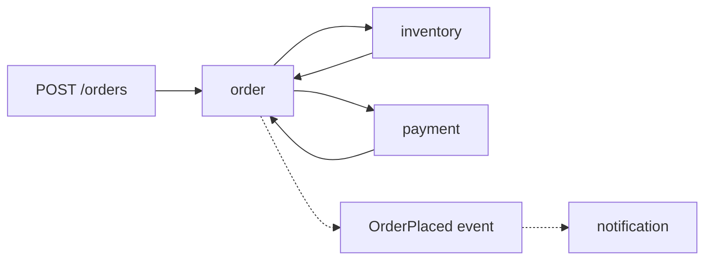
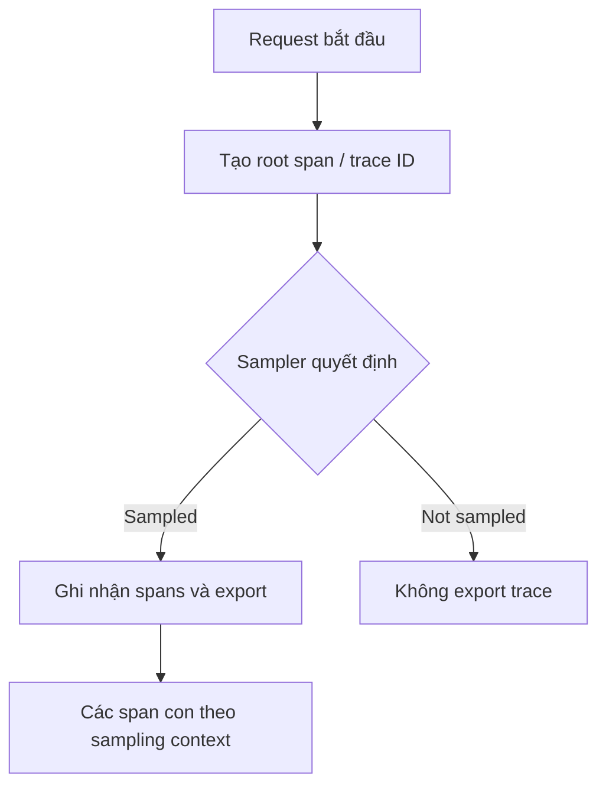
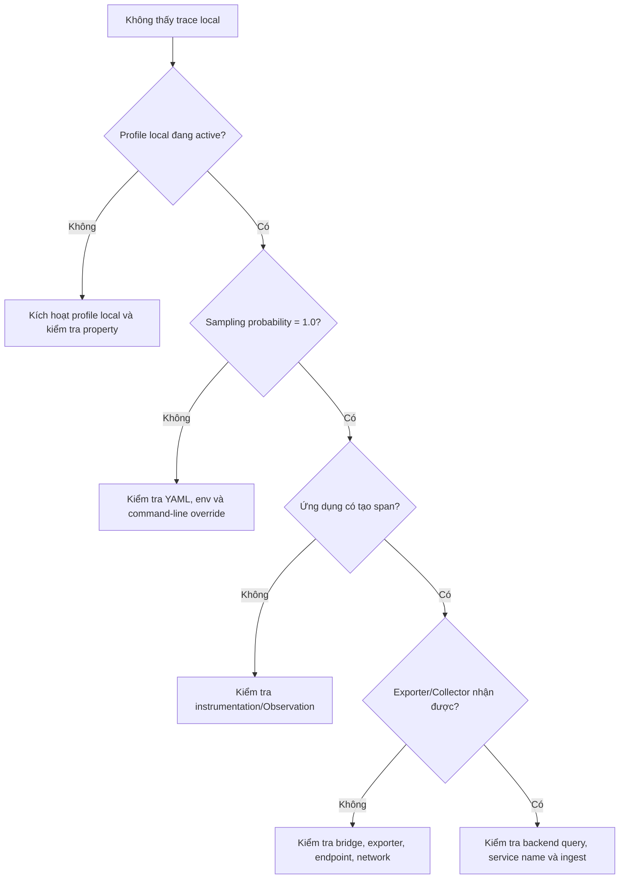

# Sampling trong môi trường local

Khi phát triển ứng dụng Spring Boot dùng **Spring Modulith**, bạn thường muốn xem đầy đủ một request đi qua những application module nào, ví dụ `order` gọi `inventory`, sau đó gọi `payment` và phát sự kiện cho `notification`. Nhưng khi mở tracing backend, có lúc request đã chạy thành công mà trace lại không xuất hiện. Một nguyên nhân thường gặp là **sampling**: ứng dụng chỉ chọn một phần trace để ghi nhận và export.

Spring Boot mặc định lấy mẫu khoảng **10% request** nhằm hạn chế lượng dữ liệu gửi tới trace backend. Trong môi trường **local**, nơi lưu lượng thường nhỏ và mục tiêu là gỡ lỗi, bạn có thể tăng sampling lên **100%** bằng property `management.tracing.sampling.probability: 1.0`. Khi đó, mọi trace mới do ứng dụng khởi tạo đều được chọn theo cấu hình lấy mẫu này.

Bài thuộc chương **Sampling** của học phần `SPRING_MODULITH_DOCUMENTATION_OBSERVABILITY`. Học phần sử dụng Spring Modulith để sinh tài liệu ranh giới application module và quan sát tương tác giữa các phần trong ứng dụng Spring Boot thông qua module graph, Actuator, event metrics, tracing và context propagation. Bài này tập trung vào cách bật sampling đầy đủ khi chạy local, hiểu trace flags và quyết định lấy mẫu theo parent, kiểm tra kết quả ở backend và tránh nhầm sampling với instrumentation hay metrics.

Sau bài học, bạn có thể:

- Giải thích sampling và lý do Spring Boot không mặc định export mọi trace.
- Cấu hình sampling 100% trong profile local.
- Phân biệt head sampling với tail sampling và hiểu giới hạn của mỗi cách.
- Đọc trace flags trong W3C `traceparent` và giải thích ảnh hưởng của parent-based sampling.
- Kiểm tra một trace qua nhiều application module của Spring Modulith.
- Phân biệt sampling của traces với metrics tổng hợp và event counters.
- Nhận biết các trường hợp trace không xuất hiện dù request đã chạy.

> **Phạm vi phiên bản:** ví dụ dùng Spring Boot 3.5.x với Micrometer Tracing. Property `management.tracing.sampling.probability` nhận giá trị từ `0.0` đến `1.0`, mặc định `0.1` trong tài liệu Spring Boot 3.5. Cấu hình ví dụ dưới đây dành cho local; không lấy sampling 100% làm mặc định cho production nếu chưa đánh giá lưu lượng và chi phí.

## 1. Sampling là gì?

**Sampling** là việc chọn một phần traces/spans để ghi nhận và gửi tới hệ thống quan sát. Một trace có thể bao gồm nhiều span: span HTTP đầu vào, span nghiệp vụ ở module `order`, span lời gọi `inventory`, span thanh toán và các span liên quan đến event listener.

Không phải lúc nào hệ thống cũng cần lưu 100% trace. Trong một ứng dụng có hàng nghìn request mỗi giây, lưu toàn bộ spans có thể làm tăng:

- Băng thông từ ứng dụng tới OpenTelemetry Collector.
- CPU và bộ nhớ cho việc tạo, batch và export spans.
- Dung lượng lưu trữ và chi phí truy vấn ở tracing backend.
- Khối lượng dữ liệu mà đội vận hành phải lọc khi điều tra.

Sampling giúp giảm lượng trace cần lưu mà vẫn giữ được một mẫu đại diện để phân tích. Tuy nhiên, nếu sampling quá thấp, một lỗi hiếm gặp có thể không xuất hiện trong dữ liệu được lưu.

### Ví dụ xác suất lấy mẫu

Giả sử ứng dụng nhận 100 request độc lập và sampling probability là `0.1`:

- Mỗi trace có xác suất 10% được chọn.
- Số trace kỳ vọng được lưu khoảng 10.
- Không có bảo đảm chính xác cứ 10 request sẽ có một trace.
- Có thể xuất hiện 7, 9, 12 hoặc số lượng khác tùy quyết định sampling.

Khi đặt probability là `1.0`, mọi trace mới thuộc phạm vi sampler đó được chọn. Đây là lựa chọn thuận tiện cho local vì bạn thường muốn tái hiện và xem từng thao tác.

| Probability | Ý nghĩa | Mục đích thường gặp |
| ---: | --- | --- |
| `0.0` | Không chọn trace gốc nào theo sampler tỷ lệ | Kiểm thử trường hợp không export trace |
| `0.1` | Chọn khoảng 10% trace | Mặc định Spring Boot 3.5 |
| `0.5` | Chọn khoảng 50% trace | Thử nghiệm tải vừa phải |
| `1.0` | Chọn 100% trace | Local, test và điều tra có kiểm soát |

Các tỷ lệ trên mô tả xác suất của sampler, không phải tỷ lệ chính xác trên một nhóm request nhỏ.

## 2. Cấu hình sampling 100% cho local

Trong Spring Boot, đặt property dưới `management.tracing.sampling.probability`.

Tạo hoặc cập nhật file `src/main/resources/application-local.yml`:

```yaml
spring:
  application:
    name: shop-modulith

management:
  tracing:
    sampling:
      probability: 1.0
```

Property này yêu cầu Spring Boot chọn mọi trace mới theo cấu hình sampling probability. Bạn không cần tự viết sampler chỉ để bật 100% cho local.

Nếu muốn cấu hình chung cho tất cả môi trường, có thể đặt trong `application.yml`, nhưng thông thường nên để sampling 100% trong profile local nhằm tránh vô tình áp dụng sang staging/production.

Ví dụ file `application.yml` giữ mặc định:

```yaml
spring:
  application:
    name: shop-modulith

management:
  tracing:
    sampling:
      probability: 0.1
```

Và file `application-local.yml` ghi đè:

```yaml
management:
  tracing:
    sampling:
      probability: 1.0
```

Khi profile `local` được kích hoạt, giá trị `1.0` từ file profile sẽ ghi đè giá trị nền `0.1`.

### Chạy ứng dụng với profile local

Với Maven Wrapper trên Linux/macOS:

```bash
./mvnw spring-boot:run -Dspring-boot.run.profiles=local
```

Trên Windows PowerShell, dùng:

```powershell
.\mvnw.cmd spring-boot:run -Dspring-boot.run.profiles=local
```

Nếu chạy JAR đã build:

```bash
java -jar target/shop-modulith.jar --spring.profiles.active=local
```

Xác nhận profile `local` thực sự active qua log khởi động hoặc cấu hình deploy. Nếu biến môi trường hay tham số command line ghi đè property, giá trị runtime có thể khác file YAML.

### Cần có tracing pipeline

Sampling 100% chỉ quyết định trace nào được chọn. Để nhìn thấy trace trong UI, ứng dụng vẫn cần các thành phần phù hợp:

- Spring Boot Actuator và Micrometer Tracing.
- Tracing bridge, ví dụ `micrometer-tracing-bridge-otel`.
- Exporter tương ứng, ví dụ OTLP hoặc Zipkin exporter.
- Collector/backend đang chạy và có thể truy cập.
- Instrumentation tạo ra observations/spans cho thao tác đang kiểm tra.

Nếu thiếu exporter hoặc backend, tăng sampling lên `1.0` không tự tạo ra giao diện trace.

## 3. Chạy thử luồng qua các module

Giả sử ứng dụng Spring Modulith có các module:

```text
com.example.shop
├── order
├── inventory
├── payment
└── notification
```

Một request đặt hàng có thể đi qua:



Khi tracing đã được cấu hình và các ranh giới tương ứng được instrument, một trace minh họa có thể trông như sau:

```text
Trace T1
└── HTTP POST /orders
    └── order.place
        ├── inventory.reserve
        ├── payment.capture
        └── event.publish OrderPlaced
```

Với listener `notification` chạy bất đồng bộ, span có thể nằm trong cùng trace nếu context được truyền đúng, hoặc xuất hiện trong trace khác tùy thiết kế xử lý sự kiện. Sampling không tự nối các trace khác nhau thành một trace.

### Các bước thử local

1. Khởi động trace backend hoặc OpenTelemetry Collector.
2. Chạy ứng dụng với profile `local`.
3. Gửi một request `POST /orders` có dữ liệu thử nghiệm.
4. Lấy trace ID từ log correlation hoặc response/debug context nếu ứng dụng cung cấp.
5. Mở tracing backend, tìm theo `service.name` hoặc trace ID.
6. Kiểm tra span HTTP, span nghiệp vụ và các module calls đã được instrument.
7. Lặp lại với request lỗi để quan sát exception/status trong trace.

Spring Boot tự động thêm correlation ID gồm `traceId` và `spanId` vào log khi Micrometer Tracing được cấu hình theo mặc định. Nhờ đó, có thể đối chiếu log với trace cụ thể.

**Lưu ý:** không phải mọi method Java đều tự tạo span. Nếu không thấy span `inventory.reserve`, hãy kiểm tra instrumentation và cách gọi API module. Đừng mặc định đó là lỗi sampling.

## 4. Head sampling và trace-level decision

Spring Boot property `management.tracing.sampling.probability` thường được dùng để cấu hình xác suất lấy mẫu ở phía ứng dụng. Đây là một dạng **head sampling**: quyết định được đưa ra sớm, khi trace bắt đầu, trước khi biết toàn bộ kết quả của request.

Ví dụ:



Head sampling có ưu điểm:

- Quyết định sớm, dễ cấu hình.
- Giảm lượng spans cần xử lý và gửi đi.
- Thường giúp giữ tính nhất quán ở cấp trace nếu quyết định được truyền theo parent context.

Giới hạn chính: sampler chưa biết request sẽ thành công, thất bại hay mất bao lâu khi đưa ra quyết định. Vì vậy, với sampling 10%, một trace có lỗi vẫn có thể bị loại nếu quyết định ban đầu không chọn nó.

Trong local, sampling 100% giúp tránh bỏ lỡ request thử nghiệm do xác suất. Trong production, lựa chọn tỷ lệ cần dựa vào lưu lượng, chi phí, nhu cầu điều tra và chính sách lưu trữ.

## 5. Parent-based sampling và trace flags

Trong hệ thống có nhiều service, một trace có thể bắt đầu ở gateway rồi truyền sang ứng dụng Spring Boot. Service nhận request đọc tracing context từ header, phổ biến là W3C `traceparent`.

Một `traceparent` có cấu trúc minh họa:

```text
00-4bf92f3577b34da6a3ce929d0e0e4736-00f067aa0ba902b7-01
```

Các phần:

| Thành phần | Ý nghĩa |
| --- | --- |
| `00` đầu tiên | Phiên bản của định dạng Trace Context |
| `4bf9...4736` | Trace ID |
| `00f0...02b7` | Parent Span ID |
| `01` cuối | Trace flags; bit sampled được bật |

Trong byte flags, bit thấp nhất (`0x01`) biểu thị sampled flag. Ví dụ `01` có bit sampled được bật; `00` biểu thị bit này không bật.

**Parent-based sampler** quyết định theo trạng thái của parent span:

- Không có parent: dùng root sampler để quyết định.
- Parent đã sampled: thông thường child tiếp tục sampled.
- Parent không sampled: thông thường child không sampled.
- Remote parent và local parent có thể có nhánh cấu hình riêng.

Cách này giúp các service không tự quyết định trái ngược nhau, tránh một trace bị ghi một phần ở service đầu nhưng mất phần tiếp theo ở service sau.

### Điều này có nghĩa gì với local?

Nếu bạn gọi trực tiếp ứng dụng local mà không có incoming `traceparent`, request thường tạo root trace mới và sampling probability của ứng dụng được dùng để quyết định.

Nếu bạn gọi qua gateway hoặc test harness đã gửi `traceparent`, parent-based policy có thể tôn trọng sampled flag từ upstream. Do đó, dù local đặt probability `1.0`, một parent không sampled vẫn có thể khiến child không được ghi nhận nếu sampler đang dùng chính sách parent-based tương ứng.

Khi kiểm thử, hãy thử cả hai trường hợp:

1. Request không có header `traceparent`: ứng dụng tạo root trace và dùng sampling local.
2. Request có header `traceparent` với sampled flag bật/tắt: quan sát hành vi theo parent context và sampler được cấu hình.

Không tự sửa trace flags trong production để ép trace được ghi; cần hiểu hệ thống upstream và chính sách sampling chung.

## 6. Phân biệt head sampling và tail sampling

**Tail sampling** đưa ra quyết định sau khi đã nhận được một phần lớn hoặc toàn bộ spans của trace. Vì đã có thêm dữ liệu, tail sampler có thể chọn theo kết quả cuối:

- Giữ mọi trace có lỗi.
- Giữ trace vượt ngưỡng latency.
- Giữ một tỷ lệ trace thành công.
- Giữ trace theo thuộc tính hoặc service cụ thể.

So sánh:

| Tiêu chí | Head sampling | Tail sampling |
| --- | --- | --- |
| Thời điểm quyết định | Khi trace bắt đầu | Sau khi Collector nhận spans của trace |
| Biết lỗi/latency cuối cùng? | Không | Có thể biết nếu đã nhận đủ dữ liệu |
| Chi phí tại ứng dụng | Thấp hơn, quyết định sớm | Ứng dụng có thể gửi nhiều spans hơn tới Collector |
| Độ phức tạp vận hành | Thường đơn giản | Cao hơn; cần giữ trạng thái trace trong một khoảng thời gian |
| Phù hợp | Local, tỷ lệ sampling đơn giản, giảm dữ liệu sớm | Production cần giữ trace lỗi/chậm theo tiêu chí |

Một cấu hình tail sampling có thể dùng Collector processor `tail_sampling`, nhưng cần cấu hình pipeline, decision wait, policies và khả năng xử lý dữ liệu. Các spans của cùng một trace phải được định tuyến tới cùng tail-sampling decision point; nếu spans bị chia sang nhiều Collector không có cơ chế phân phối phù hợp, quyết định có thể thiếu dữ liệu.

### Vì sao local thường không cần tail sampling?

Trong local, mục tiêu thường là xem trace của request bạn vừa tạo. Cấu hình head sampling 100% dễ hiểu, ít thành phần và giúp kiểm tra instrumentation. Tail sampling chỉ đáng thêm khi bạn đang thực hành chính sách giữ trace theo lỗi/latency hoặc kiểm thử chính pipeline sampling của Collector.

Một lưu ý quan trọng: nếu ứng dụng đã head-sample bỏ trace trước khi export, Collector không thể khôi phục những spans đó để tail-sample sau này. Muốn tail sampling quyết định dựa trên toàn bộ trace, phải bảo đảm dữ liệu cần thiết đến được tail sampler.

## 7. Sampling không làm giảm metrics và event counters

Sampling traces không đồng nghĩa sampling mọi tín hiệu observability.

| Tín hiệu | Sampling trace có ảnh hưởng trực tiếp? | Ví dụ |
| --- | --- | --- |
| Traces/spans | Có | Chỉ một phần trace được ghi và export |
| Micrometer counters/timers | Không, theo cấu hình trace sampling thông thường | HTTP request count, latency metrics |
| Spring Modulith event metrics | Không | `module.events.published` |
| Application logs | Không tự động | Log nghiệp vụ, log lỗi, log correlation |

Ví dụ, ứng dụng phát 100 event `OrderPlaced`. Counter `module.events.published` vẫn có thể ghi nhận các lần publication theo instrumentation, trong khi tracing chỉ export 10% trace liên quan. Không được dùng số trace lưu trong backend để suy ra chính xác số event đã phát.

Metrics tổng hợp là nguồn thích hợp để theo dõi lưu lượng, tỷ lệ lỗi và xu hướng. Traces là mẫu chi tiết để điều tra một lần thực thi. Hai tín hiệu bổ sung cho nhau.

## 8. Profile local và cấu hình các môi trường khác

Cấu hình sampling nên được quản lý theo profile để tránh vô tình chạy 100% trong production.

Ví dụ:

```yaml
# application.yml
management:
  tracing:
    sampling:
      probability: 0.1
```

```yaml
# application-local.yml
management:
  tracing:
    sampling:
      probability: 1.0
```

```yaml
# application-staging.yml
management:
  tracing:
    sampling:
      probability: 0.25
```

```yaml
# application-production.yml
management:
  tracing:
    sampling:
      probability: 0.05
```

Các tỷ lệ staging/production chỉ là ví dụ để minh họa cách tách cấu hình. Không có một con số phù hợp với mọi hệ thống. Tỷ lệ production cần dựa vào số trace mỗi giây, dung lượng Collector/backend, retention, chi phí và yêu cầu tuân thủ.

Nếu triển khai nhiều replica, mỗi instance có cùng sampling configuration nhưng mỗi request vẫn được quyết định theo trace context của nó. Đừng tính rằng “5% của mỗi instance” luôn cho ra đúng 5% trong một cửa sổ nhỏ; đây là tỷ lệ kỳ vọng trên tập đủ lớn.

### Cấp sampling qua biến môi trường

Spring Boot hỗ trợ relaxed binding từ biến môi trường sang property. Với `management.tracing.sampling.probability`, tên biến tương ứng là `MANAGEMENT_TRACING_SAMPLING_PROBABILITY`.

Trên Linux/macOS:

```bash
export MANAGEMENT_TRACING_SAMPLING_PROBABILITY=1.0
./mvnw spring-boot:run -Dspring-boot.run.profiles=local
```

Trên Windows PowerShell:

```powershell
$env:MANAGEMENT_TRACING_SAMPLING_PROBABILITY = "1.0"
.\mvnw.cmd spring-boot:run -Dspring-boot.run.profiles=local
```

Giá trị từ biến môi trường có thể ghi đè YAML theo thứ tự ưu tiên cấu hình của Spring Boot. Sau khi khởi động, xác nhận profile và giá trị thực tế đã được nạp; đừng giả định file YAML là nguồn duy nhất.

Không dùng `1.0` như giá trị fallback chung nếu cùng một artifact được deploy ở nhiều môi trường.

## 9. Thực hành sampling trong local

### Bước 1 — Kiểm tra dependency

Ứng dụng cần Actuator, Micrometer Tracing bridge và exporter phù hợp với backend. Ví dụ với OpenTelemetry/OTLP:

```xml
<dependencies>
    <dependency>
        <groupId>org.springframework.boot</groupId>
        <artifactId>spring-boot-starter-actuator</artifactId>
    </dependency>
    <dependency>
        <groupId>io.micrometer</groupId>
        <artifactId>micrometer-tracing-bridge-otel</artifactId>
    </dependency>
    <dependency>
        <groupId>io.opentelemetry</groupId>
        <artifactId>opentelemetry-exporter-otlp</artifactId>
    </dependency>
</dependencies>
```

Version nên do Spring Boot BOM quản lý. Nếu Spring Modulith cung cấp module instrumentation qua starter Insight trong dòng version bạn đang dùng, thêm dependency đó để quan sát các ranh giới module tương ứng. Exporter không tự tạo spans; nó chỉ gửi spans đã được tạo và chọn để export.

### Bước 2 — Cấu hình sampling

```yaml
# application-local.yml
management:
  tracing:
    sampling:
      probability: 1.0
```

### Bước 3 — Khởi động backend và ứng dụng

Khởi động OpenTelemetry Collector/trace backend theo cấu hình dự án. Xác nhận endpoint export có thể truy cập trước khi kiểm tra sampling. Nếu dùng OTLP, endpoint/transport phải khớp với receiver HTTP hoặc gRPC.

### Bước 4 — Gửi nhiều request có thể nhận diện

Gửi 5 request thử, mỗi request dùng một mã đơn hàng giả lập khác nhau. Lưu trace ID hoặc correlation ID tương ứng. Với sampling 100% và pipeline hoạt động, các trace mới được tạo trong ứng dụng phải xuất hiện ở backend.

### Bước 5 — Giảm sampling để quan sát khác biệt

Đổi tạm thành:

```yaml
management:
  tracing:
    sampling:
      probability: 0.1
```

Khởi động lại ứng dụng hoặc bảo đảm cấu hình mới thực sự được nạp, sau đó gửi một tập request lớn hơn. Số trace được lưu sẽ dao động quanh tỷ lệ 10%, không nhất thiết đúng chính xác 1 trên 10 ở một tập nhỏ.

### Bước 6 — Kiểm tra log và trace

Đối chiếu:

- Log có `traceId`/`spanId` hay không.
- Trace backend có trace tương ứng hay không.
- Span của module đã instrument có quan hệ cha-con đúng không.
- Request không được sample có còn chạy nghiệp vụ bình thường không.

Sampling chỉ quyết định dữ liệu trace có được ghi/export theo policy hay không; nó không được dùng để bật/tắt logic nghiệp vụ.

## 10. Các nguyên nhân khiến trace local không xuất hiện

| Triệu chứng | Nguyên nhân có thể | Cách kiểm tra |
| --- | --- | --- |
| Request chạy nhưng không có trace | Sampling thấp hoặc cấu hình profile chưa active | Xác nhận `local` active và probability thực tế |
| Đặt `1.0` nhưng backend vẫn trống | Thiếu bridge/exporter hoặc Collector không nhận dữ liệu | Kiểm tra dependency, endpoint và log exporter/Collector |
| Có trace HTTP nhưng thiếu span module | Module boundary chưa được instrument hoặc code path không đi qua API đó | Kiểm tra Spring Modulith Insight và đường gọi |
| Trace ở service đầu nhưng mất ở service sau | Context/traceparent không được truyền hoặc parent không sampled | Kiểm tra propagation headers và parent sampler |
| Chỉ thấy một số request trong thử nghiệm | Sampling chưa phải 1.0, parent context không sampled hoặc có filter khác | Kiểm tra cấu hình runtime và trace flags |
| Thấy log correlation nhưng không có trace backend | Trace có thể chưa được export hoặc backend query sai | Kiểm tra exporter, collector và service/resource name |
| Không thấy listener async trong trace gốc | Listener chạy bất đồng bộ, context không được truyền hoặc tạo trace khác | Kiểm tra executor/message propagation và event ID |
| Trace xuất hiện trễ | Exporter batch/flush theo lịch hoặc backend ingest chậm | Kiểm tra batch delay, timeout và Collector pipeline |
| Trace lặp hoặc thiếu span sau retry | Mỗi lần retry có thể tạo execution/trace riêng | Đối chiếu trace ID, event ID và mã nghiệp vụ |

### Quy trình kiểm tra nhanh



Đừng tăng sampling nhiều lần nếu nguyên nhân thực tế là thiếu exporter, sai endpoint hoặc chưa có instrumentation. Sampling không thể sửa những lỗi ở các tầng đó.

## 11. Lưu ý khi dùng local 100% sampling

Sampling 100% rất hữu ích cho phát triển nhưng có thể tạo nhiều dữ liệu khi ứng dụng chạy load test hoặc vòng lặp gọi API liên tục.

Một số nguyên tắc:

- Chỉ bật 100% trong môi trường local hoặc test có phạm vi rõ.
- Không gửi dữ liệu khách hàng thật hoặc thông tin nhạy cảm vào trace chỉ vì đang lấy mẫu đầy đủ.
- Dùng dữ liệu giả lập và request có thể nhận diện để tìm trace nhanh.
- Tắt load generator và tác vụ lặp khi không cần, tránh làm đầy backend local.
- Khi debug xong, kiểm tra profile đang active trước khi deploy.
- Không dựa vào sampling để tính số request hoặc số event; dùng metrics tổng hợp cho mục tiêu đó.

Nếu cần quan sát một lỗi hiếm trong staging/production, có thể cân nhắc tail sampling hoặc chính sách sampling có tiêu chí, thay vì tăng tỷ lệ toàn bộ traffic lên 100% trong thời gian dài. Tail sampling có chi phí vận hành và yêu cầu dữ liệu spans đến Collector trước khi quyết định.

## 12. Bài thực hành tự kiểm tra

**Bối cảnh:** ứng dụng Spring Modulith có module `order`, `inventory`, `payment` và `notification`. Bạn muốn nhìn đầy đủ trace của một luồng đặt hàng trên máy local.

1. Cấu hình `application-local.yml` với `management.tracing.sampling.probability: 1.0`.
2. Khởi động ứng dụng với profile `local`, xác nhận giá trị sampling đã được nạp.
3. Gửi một request đặt hàng thành công và một request có lỗi thanh toán.
4. Tìm hai trace trong backend; kiểm tra HTTP span, span của `order` và các module calls đã được instrument.
5. Phát `OrderPlaced`; kiểm tra listener `notification` có cùng trace hay không. Nếu khác trace, kiểm tra context propagation và event correlation.
6. Đổi sampling về `0.1`, gửi một tập request thử đủ lớn và so sánh số trace được lưu với số request đã gửi.
7. Xác nhận event counter `module.events.published` vẫn phản ánh publication theo instrumentation, không giảm theo tỷ lệ trace sampling.
8. Gửi request có `traceparent` sampled flag bật và tắt để quan sát ảnh hưởng của parent-based policy nếu hệ thống đang sử dụng sampler đó.
9. Viết checklist trước khi commit: local profile không bị dùng cho production, exporter/backend hoạt động, dữ liệu trace không chứa thông tin nhạy cảm, và sampling đã được chọn theo mục đích.

**Kết quả mong đợi:** bạn cấu hình được sampling 100% cho local, tìm được trace của request thử nghiệm, giải thích được vì sao sampling thấp có thể khiến trace không xuất hiện, và phân biệt rõ sampling với instrumentation, propagation và metrics.

## Tài liệu tham khảo

- [Spring Boot 3.5 — Tracing](https://docs.spring.io/spring-boot/3.5/reference/actuator/tracing.html): mặc định sampling 10% và cấu hình `management.tracing.sampling.probability`.
- [Spring Boot 3.5 — Common Application Properties](https://docs.spring.io/spring-boot/3.5/appendix/application-properties/index.html): phạm vi giá trị và giá trị mặc định của sampling probability.
- [OpenTelemetry — Sampling](https://opentelemetry.io/docs/concepts/sampling/): head sampling, tail sampling, lợi ích và giới hạn.
- [OpenTelemetry Trace SDK — Sampling](https://opentelemetry.io/docs/specs/otel/trace/sdk/): parent-based sampler, quyết định theo parent và sampled flag.
- [W3C Trace Context](https://www.w3.org/TR/trace-context/): định dạng `traceparent`, trace ID, parent span ID và trace flags.
- [Spring Modulith — Production-ready Features](https://docs.spring.io/spring-modulith/reference/production-ready.html): quan sát module và event metrics.

**Ghi nhớ:** local thường đặt sampling probability `1.0` để không bỏ lỡ trace của request thử nghiệm. Hãy xác nhận profile, parent context, instrumentation, exporter và backend; trace không xuất hiện không phải lúc nào cũng do sampling.
