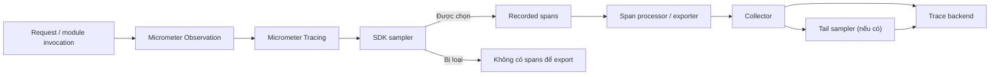

# Ảnh hưởng của sampling đến điều tra sự cố

## 1. Sampling có thể làm thay đổi điều gì khi sự cố xảy ra?

Trong ứng dụng Spring Boot sử dụng **Spring Modulith**, một request có thể đi qua nhiều application module như `orders`, `payments`, `inventory` và `notifications`. Spring Modulith có thể tạo observation/span tại điểm vào module; Micrometer Tracing liên kết các span thành trace để nhóm vận hành lần theo request và tìm đoạn gây lỗi hoặc chậm.

Trong production, hệ thống thường không thu thập mọi trace. **Sampling** chọn một phần trace để ghi nhận và export, nhằm kiểm soát lưu lượng telemetry, bộ nhớ, chi phí lưu trữ và tốc độ truy vấn. Quyết định này ảnh hưởng trực tiếp đến khả năng điều tra: một request lỗi có thể đã chạy thật nhưng trace của nó không được lưu; một trace được giữ có thể thiếu span downstream; các trace nhìn thấy có thể không đại diện đầy đủ cho những request hiếm hoặc chậm nhất.

Bài **“Ảnh hưởng của sampling đến điều tra sự cố”** thuộc chương **Sampling** của module **SPRING_MODULITH_DOCUMENTATION_OBSERVABILITY**. Mục tiêu là biết cách diễn giải dữ liệu khi incident, phân biệt “không có trace” với “không có hoạt động”, kết hợp metrics/logs/module graph và chọn chính sách sampling phù hợp.

Sau bài học, bạn có thể:

- Giải thích sampling ảnh hưởng tới trace được lưu, tính đầy đủ và tính đại diện của dữ liệu điều tra.
- Ước lượng khả năng bỏ lỡ sự cố hiếm dưới head sampling xác suất.
- Nhận diện trace thiếu span do sampling, propagation, instrumentation hoặc lỗi export.
- Hiểu vì sao tail sampling có thể ưu tiên trace lỗi/chậm và điều kiện để hoạt động đúng.
- Kết hợp event metrics, module spans, logs, trace exemplars và module graph để tìm nguyên nhân.
- Lập quy trình điều tra sự cố và điều chỉnh sampling có kiểm soát.

## 2. Sampling tác động ở đâu trong pipeline?

Một pipeline quan sát điển hình:



**Head sampling** quyết định sớm, thường khi root span/trace được tạo trong SDK. Nếu trace không được chọn, SDK có thể không ghi nhận các span của trace và không gửi chúng đến exporter. **Tail sampling** quyết định sau, thường tại OpenTelemetry Collector, khi Collector đã nhận các spans cần thiết để đánh giá trace.

Hai vị trí này tạo ra khác biệt quan trọng khi điều tra:

| Giai đoạn | Điều sampling có thể làm | Điều nó không làm |
| --- | --- | --- |
| SDK/head sampler | Loại trace trước khi export; giảm spans và traffic gửi đi | Không ngăn request hoặc domain event thực thi |
| Exporter | Gửi các spans đã được ghi nhận | Không thể khôi phục spans SDK đã loại |
| Collector/tail sampler | Giữ hoặc loại trace dựa trên lỗi, latency, attributes hoặc xác suất | Không thể đánh giá trace mà Collector chưa nhận |
| Trace backend | Lưu và cho truy vấn dữ liệu được export | Không tự biết các request không được sample |

**Sampling là chính sách thu thập telemetry, không phải chính sách thực thi nghiệp vụ.** Request vẫn có thể đặt hàng, event vẫn có thể được phát và listener vẫn có thể chạy dù trace của request đó không được lưu.

## 3. Head sampling khiến sự cố hiếm dễ bị bỏ lỡ

Với head sampling xác suất `p`, mỗi trace mới được chọn theo xác suất đó. Nếu một sự cố chỉ tạo ra một trace duy nhất và sampler chọn 10%, khả năng trace đó không xuất hiện là 90%.

Nếu có `n` trace độc lập liên quan đến cùng một loại sự cố và xác suất chọn mỗi trace là `p`, xác suất bỏ lỡ tất cả xấp xỉ:

\[
P(\text{miss all})=(1-p)^n
\]

Ví dụ với sampling 10%:

| Số trace liên quan đến sự cố | Xác suất bỏ lỡ tất cả |
| ---: | ---: |
| 1 | 90,0% |
| 5 | 59,0% |
| 10 | 34,9% |
| 20 | 12,2% |
| 30 | 4,2% |

Các con số giả định mỗi trace được chọn độc lập theo xác suất 10%. Đây là mô hình ước lượng, không phải cam kết về kết quả của một tập request nhỏ. Với parent-based sampling, quyết định thường áp dụng cho toàn trace, không phải chọn độc lập từng span.

### 3.1. Sự cố hiếm có thể không xuất hiện trong trace backend

Giả sử module `payments` gặp timeout một lần trong một triệu giao dịch. Nếu ứng dụng chỉ dùng head sampling 5%, xác suất trace của giao dịch đó được chọn chỉ là 5%, nếu quyết định không dựa trên thuộc tính lỗi được biết sau đó.

Điều tra viên có thể thấy:

- Metrics tổng hợp cho thấy số lỗi hoặc latency tăng nhẹ.
- Logs có thể ghi nhận exception và correlation ID, tùy cấu hình logging.
- Trace backend không có trace của request lỗi vì trace bị loại trước exporter.

Không có trace trong backend **không chứng minh request không chạy**. Hãy dùng metrics/logs và dữ liệu nghiệp vụ để xác định request đã xảy ra, sau đó kiểm tra chính sách sampling.

### 3.2. Sampling ngẫu nhiên không ưu tiên lỗi

Head sampler xác suất thông thường không biết request sẽ thành công hay thất bại khi quyết định tại thời điểm bắt đầu. Vì vậy, trace lỗi và trace thành công có cùng xác suất được chọn nếu không có policy bổ sung.

Điều này có thể tạo ra thiên lệch nhận thức:

- Nhóm vận hành chỉ nhìn thấy các trace thành công và nghĩ rằng hệ thống ổn định.
- Một luồng hiếm gây lỗi ở module `inventory` không có trace đại diện.
- Trace p99 hoặc các request chậm nhất có thể không xuất hiện trong tập mẫu nhỏ.
- Một dashboard đếm trace trong backend có thể bị hiểu nhầm là tổng request thực tế.

Khi cần đo tỷ lệ lỗi hoặc latency tổng thể, ưu tiên **metrics được thu thập độc lập với trace sampling**. Trace dùng để tìm nguyên nhân chi tiết cho một số giao dịch, không thay thế các chỉ số tổng hợp.

## 4. Trace được sample vẫn có thể thiếu span

Được chọn ở head sampler không bảo đảm trace sẽ đầy đủ trong backend. Có nhiều nguyên nhân khác nhau:

| Nguyên nhân | Biểu hiện | Cách phân biệt |
| --- | --- | --- |
| Head sampling loại trace | Không có trace hoặc không có spans tương ứng trong backend | Kiểm tra sampler, sampling probability và trace flags |
| Context propagation bị mất | Span downstream có trace ID khác hoặc không có quan hệ với publisher | Kiểm tra HTTP headers, executor, Reactor Context hoặc message headers |
| Instrumentation không bao phủ điểm gọi | Có HTTP span nhưng thiếu module entry span | Kiểm tra Modulith core, module API và đường gọi qua Spring bean |
| Exporter/Collector lỗi | Một phần hoặc toàn bộ spans không tới backend | Kiểm tra exporter errors, queue, Collector logs và dropped spans |
| Tail sampler quyết định quá sớm | Span đến muộn không nằm trong trace được giữ | Kiểm tra decision wait, routing và độ trễ của các service |
| Backend retention/indexing | Trace đã được nhận nhưng không còn trong khoảng truy vấn hoặc khó tìm | Kiểm tra retention, service name, time range và index |

Đặc biệt, nếu `orders` phát `OrderPlaced` rồi listener `inventory` chạy trên executor khác, việc thiếu span listener có thể do mất context. Nếu listener vẫn thực thi nhưng trace bị đứt, cần kiểm tra **context propagation** trước khi quy lỗi cho module hoặc event.

## 5. Sampling và các tín hiệu Spring Modulith khác

Sampling chủ yếu ảnh hưởng traces. Những tín hiệu khác có vòng đời thu thập riêng:

| Tín hiệu | Nó trả lời câu hỏi gì? | Trace sampling có trực tiếp loại nó không? |
| --- | --- | --- |
| Module graph / `/actuator/modulith` | Module nào tồn tại và phụ thuộc module nào? | Không. Đây là dữ liệu cấu trúc/endpoint riêng. |
| `module.events.published` | Có bao nhiêu lần domain event được công bố theo module/event type? | Không. Đây là Micrometer counter riêng, không phải span. |
| Module entry spans | Một trace được ghi nhận đã đi qua điểm vào module nào? | Có. Các span thuộc trace bị loại có thể không được export. |
| Logs | Ứng dụng ghi lại sự kiện, thông điệp và exception nào? | Không tự động. Log pipeline có thể có sampling/filter riêng. |
| Audit/business records | Giao dịch và trạng thái nghiệp vụ được lưu bền vững ra sao? | Không, nếu hệ thống lưu trữ độc lập. |

Ví dụ, counter publication của `orders` có thể tăng dù trace của request bị head sampler loại. Module graph vẫn cho biết quan hệ cấu trúc giữa `orders` và `inventory`. Logs có thể vẫn ghi exception, nhưng trace backend không có span để mở.

**Không cộng event metrics và số traces để tính số request.** Một publication có thể kích hoạt nhiều listener và một trace có thể chứa nhiều spans. Đây là các đơn vị đo khác nhau.

### 5.1. Đọc module spans khi trace được giữ

Module entry span của Spring Modulith có thể mang các tag:

- `module.identifier` — định danh module đang được quan sát.
- `module.name` — tên hiển thị module.
- `module.invocation-type` — kiểu lời gọi, ví dụ bean hoặc event listener.
- `module.method` — method ở điểm vào module.

Nếu trace được sample và instrumentation hoạt động, các tag giúp lọc những tương tác đi qua `inventory` hoặc `payments`. Nhưng khi không tìm thấy tag, cần xem liệu trace có bị sampling, instrumentation thiếu hay backend không index attribute. Đừng kết luận module chưa được gọi chỉ từ một truy vấn trace rỗng.

## 6. Ảnh hưởng đến việc đọc error rate và latency

### 6.1. Không lấy số trace làm mẫu số request

Giả sử trong 10.000 request có 500 request lỗi. Nếu chỉ sample 10%, backend có thể nhận khoảng 1.000 trace; số lỗi trong mẫu có thể xấp xỉ 50 nếu sampling ngẫu nhiên và nhất quán, nhưng không đảm bảo đúng 50.

Nếu dashboard tính:

\[
\text{error rate}=\frac{\text{error traces}}{\text{all traces}}
\]

thì kết quả chỉ là **error rate của tập trace được sample**, có thể gần với tỷ lệ thực khi sampling ngẫu nhiên và mẫu đủ lớn, nhưng không nên dùng thay cho metric request/error được instrument đầy đủ. Với tail sampling ưu tiên lỗi, tập trace được giữ có chủ đích thiên về lỗi; lấy tỷ lệ lỗi trên tập đó sẽ **đánh giá cao** tỷ lệ lỗi thực tế.

Nên dùng HTTP server request metrics, business outcome metrics hoặc consumer success/failure metrics làm số liệu tổng hợp. Tracing giúp drill-down từ metric hoặc alert sang một số ví dụ có chi tiết.

### 6.2. Percentile latency từ sampled traces có thể thiếu phần đuôi

Nếu sampling ngẫu nhiên với mẫu lớn, phân phối latency có thể là một ước lượng hữu ích. Nhưng khi sự cố hiếm tạo ra các request rất chậm, một mẫu nhỏ có thể bỏ lỡ phần đuôi p99/p99.9. Tail sampling ưu tiên trace chậm giúp điều tra, nhưng tập trace được giữ không còn đại diện cho phân phối latency gốc.

Vì vậy:

- Dùng histogram/timer metrics được thu thập liên tục để theo dõi percentile khi registry/backend hỗ trợ phù hợp.
- Dùng traces để tìm module/span gây ra những mẫu latency cao đã được giữ.
- Không tính p99 của toàn bộ traffic từ tập trace tail-sampled rồi coi đó là p99 thực.
- Ghi rõ dashboard đang hiển thị latency của **sampled traces** hay metric toàn traffic.

### 6.3. Ước lượng bằng trọng số chỉ phù hợp với sampling xác suất đã biết

Với head sampling ngẫu nhiên đồng nhất xác suất `p`, có thể dùng trọng số xấp xỉ `1/p` để ước lượng tổng số trace từ mẫu, nếu sampling decision và dữ liệu thu thập đáp ứng giả định. Ví dụ, 100 trace được sample ở p=0.1 có thể đại diện xấp xỉ 1.000 trace.

Đây là **ước lượng thống kê**, không phải số đếm chính xác. Không áp dụng phép nhân đơn giản này cho tập trace được tail sampler giữ theo lỗi/latency, vì chính sách đó chọn trace có chủ đích và xác suất giữ mỗi trace không đồng nhất theo cùng một quy tắc.

## 7. Tail sampling giúp giữ trace quan trọng như thế nào?

**Tail sampling** trì hoãn quyết định tới khi Collector nhận được spans cần thiết của trace. Khi đó Collector có thể giữ:

- Trace có span status `ERROR`.
- Trace có tổng latency vượt ngưỡng.
- Trace đi qua một module hoặc service cụ thể.
- Một tỷ lệ trace thành công để vẫn có mẫu nền.

Ví dụ policy: giữ tất cả trace lỗi, giữ trace chậm hơn 2 giây và giữ 5% trace còn lại. Cách này tăng cơ hội có trace hữu ích khi incident nhưng không có nghĩa là miễn phí.

### 7.1. Điều kiện để tail sampling điều tra được sự cố

1. SDK/agent phải gửi tới Collector các spans cần thiết. Nếu head sampler ở ứng dụng đã drop trace, Collector không thể khôi phục.
2. Các spans của cùng trace phải được route tới **cùng một tail-sampling Collector instance**.
3. Collector cần chờ đủ thời gian để nhận các spans đến muộn; cấu hình `decision_wait` quá ngắn có thể làm thiếu span.
4. Status lỗi và attributes cần thiết phải được instrument đúng để policy nhận diện.
5. Collector phải đủ memory/CPU và được giám sát queue, dropped spans, decision cache và export errors.

### 7.2. Minh họa policy

Đoạn cấu hình rút gọn dưới đây chỉ minh họa ý tưởng, cần điều chỉnh theo phiên bản OpenTelemetry Collector Contrib:

```yaml
processors:
  tail_sampling:
    decision_wait: 10s
    num_traces: 50000
    policies:
      - name: keep-errors
        type: status_code
        status_code:
          status_codes: [ERROR]
      - name: keep-slow
        type: latency
        latency:
          threshold_ms: 2000
      - name: keep-baseline
        type: probabilistic
        probabilistic:
          sampling_percentage: 5
```

Để tail policy thấy đủ trace, SDK có thể cần gửi 100% spans tới Collector, ví dụ cấu hình OpenTelemetry sampler `always-on` ở Spring Boot 4.2:

```yaml
management:
  opentelemetry:
    tracing:
      sampler: always-on
```

Với cấu hình này, Collector trở thành nơi quyết định cuối cùng trace nào được export tới backend. Phải tính chi phí traffic từ ứng dụng tới Collector và capacity của Collector; không có nghĩa backend cuối phải lưu 100% trace.

Nếu có nhiều Collector gateway, dùng routing theo trace ID để bảo đảm các spans của một trace không bị phân tán ngẫu nhiên sang nhiều instance. Nếu trace đến sau thời điểm quyết định, Collector có thể không kết hợp được span muộn đó vào quyết định đã đưa ra.

## 8. Quy trình điều tra incident khi traces được sample

Khi alert báo module `inventory` tăng latency hoặc listener `notifications` lỗi, làm theo trình tự:

### Bước 1: Xác định phạm vi và thời điểm

- Ghi nhận thời gian bắt đầu/kết thúc incident, môi trường, service name và phiên bản deploy.
- Xác định module/operation bị ảnh hưởng, ví dụ `inventory.reserve`.
- Đọc dashboard metrics để biết traffic, error rate, latency và event publication rate.

Không bắt đầu bằng việc giả định trace backend có toàn bộ request.

### Bước 2: Kiểm tra metric độc lập với trace sampling

Với Spring Modulith, kiểm tra `module.events.published` theo module/event type; với HTTP/consumer, kiểm tra request count, error count, duration và kết quả xử lý được instrument riêng.

Ví dụ PromQL minh họa nếu exporter tạo series tương ứng:

```promql
# Tốc độ domain event publication theo module.
sum by (module_identifier) (
  rate(module_events_published_total[5m])
)

# Tốc độ request lỗi theo service/route nếu ứng dụng có metric tương ứng.
sum(rate(http_server_requests_seconds_count{status=~"5.."}[5m]))
```

Tên metric/label phải xác minh qua `/actuator/prometheus` và backend thực tế. Các query này đo metrics, không phụ thuộc quyết định trace sampling; chúng vẫn có thể bị ảnh hưởng bởi scrape gaps, meter filters hoặc metrics pipeline riêng.

### Bước 3: Xem sampling policy đang chạy

- Đọc `management.tracing.sampling.probability` của profile đang chạy.
- Với OpenTelemetry, kiểm tra sampler type và parent-based behavior.
- Nếu dùng tail sampling, kiểm tra Collector policies, decision wait và trace-ID routing.
- Xác nhận sampling config đã được áp dụng ở tất cả service tham gia trace.

### Bước 4: Tìm trace và kiểm tra tính đầy đủ

- Tìm theo trace ID từ log nếu có; nếu không, lọc theo service, thời gian, route và attributes.
- Xác nhận có root/server span và các span downstream mong đợi.
- Mở module entry spans, kiểm tra `module.identifier`, `module.invocation-type` và `module.method`.
- Kiểm tra span status, exception, duration, parent ID và span links.
- Nếu thiếu module span, kiểm tra instrumentation và context propagation trước khi kết luận module không chạy.

### Bước 5: Kết hợp logs và trạng thái nghiệp vụ

Tìm logs cùng trace ID/span ID nếu có correlation. Đọc exception và thông điệp nghiệp vụ; đối chiếu trạng thái đơn hàng, publication registry hoặc dữ liệu giao dịch theo quyền được cấp. Không đưa toàn bộ user ID/order ID vào metric labels để giải quyết một cuộc điều tra đơn lẻ.

### Bước 6: Đánh giá có cần thay sampling không

- Nếu sự cố hiếm và head sampling bỏ lỡ trace, cân nhắc tăng tỷ lệ có kiểm soát hoặc dùng tail sampling.
- Nếu Collector không nhận đủ spans, sửa SDK sampler/propagation/routing trước khi thay policy.
- Nếu backend quá tải, không bật 100% head sampling toàn hệ thống một cách vội vàng; giới hạn phạm vi, thời gian và traffic.
- Ghi lại thay đổi, người phê duyệt, thời điểm bắt đầu/kết thúc và kế hoạch khôi phục sampling policy sau incident.

## 9. Các tình huống điều tra thường gặp

| Tình huống | Dữ liệu có thể thấy | Cách diễn giải |
| --- | --- | --- |
| Request lỗi nhưng không tìm thấy trace | HTTP/error metrics hoặc log có exception; trace backend rỗng | Có thể bị head sampling loại, exporter lỗi hoặc query sai time range. |
| Trace root có nhưng thiếu span `inventory` | Span HTTP và `orders` xuất hiện | Kiểm tra Modulith instrumentation, proxy/API boundary và propagation tới executor/listener. |
| Chỉ thấy trace thành công | Tập traces có vẻ khỏe, nhưng error metric tăng | Head sampling có thể bỏ lỡ lỗi hiếm; dùng metrics/logs và xem tail policy. |
| Tail sampler giữ nhiều trace lỗi | Backend có tỷ lệ trace lỗi cao | Đây là tập được chọn có chủ đích; không lấy tỷ lệ này làm error rate tổng. |
| Module spans xuất hiện rời rạc | Có span ở publisher nhưng listener thành trace mới | Kiểm tra context propagation; với message broker kiểm tra inject/extract headers. |
| p99 trên trace backend thấp hơn dashboard metrics | Tập trace sample thiếu các request cực chậm | So sánh phương pháp tính, sample policy và metric histogram. |
| Sau khi tăng sampling, Collector bắt đầu drop spans | Traffic/queue/memory tăng | Giảm phạm vi hoặc tối ưu Collector; kiểm tra load balancing theo trace ID. |
| Event counter tăng nhưng không thấy trace tương ứng | Metric publication vẫn ghi nhận, trace bị sample hoặc export lỗi | Hai pipeline độc lập; không suy luận event không chạy. |

## 10. Điều chỉnh sampling trong lúc incident

Khi cần tăng khả năng quan sát trong incident, thay đổi sampling phải có **phạm vi và thời hạn rõ ràng**:

1. Ưu tiên áp dụng cho service/route/module liên quan nếu kiến trúc hỗ trợ policy có chọn lọc.
2. Nếu chỉ có xác suất head sampling toàn service, tăng theo từng mức và theo dõi số spans/giây, queue, exporter errors, Collector memory và backend ingestion.
3. Nếu dùng tail sampling, xác nhận SDK gửi đủ spans tới Collector, các spans cùng trace được route đúng và policy đã match status/latency.
4. Ghi nhận thời điểm đổi config, thời lượng giữ cấu hình và người chịu trách nhiệm.
5. Khi đã có bằng chứng cần thiết, khôi phục sampling baseline để tránh chi phí và dữ liệu nhạy cảm tích lũy ngoài dự kiến.

Ví dụ profile cho môi trường thử nghiệm:

```yaml
# application-incident-lab.yml
management:
  tracing:
    sampling:
      probability: 1.0
```

Đây chỉ là cấu hình **lab hoặc cửa sổ điều tra tải thấp**. Nó không phải lệnh khuyến nghị bật sampling 100% cho toàn bộ production. Với OpenTelemetry + tail sampling, sampler phía SDK phải phù hợp với kiến trúc tail sampler; nếu SDK đã drop trace, policy Collector không thể giữ lại trace đó.

## 11. Những điều sampling không thể thay thế

- **Metrics:** dùng để theo dõi số lượng, tỷ lệ và phân phối theo thời gian trên toàn traffic; trace sampling không thay thế counter/histogram.
- **Logs:** ghi sự kiện và exception cụ thể. Log pipeline có sampling riêng, nên cần biết logs có được lọc độc lập hay không.
- **Audit/event store:** lưu dữ liệu nghiệp vụ bền vững để đối soát. Sampled trace không phải sổ kiểm toán.
- **Module graph:** mô tả cấu trúc module và dependency; sampling không thay đổi graph.
- **Context propagation:** truyền trace context qua thread hoặc transport. Sampling không tự sửa lỗi mất context.
- **Instrumentation:** tạo observation/span tại đúng điểm. Sampling không thể tạo module span cho code chưa được instrument.

Nếu cần truy vấn user hoặc order cụ thể, dùng dữ liệu nghiệp vụ được phân quyền và correlation ID phù hợp trong logs/traces; không biến metric tags thành cơ sở dữ liệu định danh.

## 12. Checklist khi đọc trace trong incident

| Câu hỏi | Điều cần xác minh |
| --- | --- |
| Trace có thể đã bị head sampler loại không? | Sampling probability, sampler type và parent decision. |
| Có tail sampling không? | Collector policy, decision wait, capacity và routing theo trace ID. |
| Các service có thống nhất propagation không? | W3C/B3 headers, auto-configured HTTP clients và message instrumentation. |
| Trace có đủ module spans không? | Modulith core, module API, listener instrumentation và async context. |
| Backend có nhận đủ dữ liệu không? | Exporter errors, queue, Collector dropped spans, backend ingestion/retention. |
| Metrics có xác nhận hoạt động nghiệp vụ không? | Event publication counter, HTTP/consumer metrics và scrape health. |
| Logs có correlation không? | Trace ID/span ID, MDC integration, log sampling và retention. |
| Có thể kết luận từ trace sample không? | Nêu rõ trace là mẫu, policy và giới hạn thống kê. |
| Có cần thay sampling tạm thời? | Phạm vi, thời hạn, capacity, quyền truy cập và rollback. |

## 13. Ghi nhớ

Sampling giúp kiểm soát chi phí tracing nhưng cũng làm **trace backend không chứa mọi request đã chạy**. Head sampling có thể bỏ lỡ một sự cố hiếm ngay từ đầu; trace đã được chọn vẫn có thể thiếu span vì instrumentation, context propagation, exporter hoặc tail sampler. Vì thế, không tìm thấy trace không đồng nghĩa nghiệp vụ không xảy ra.

Trong Spring Modulith, hãy kết hợp **module spans** để lần theo các ranh giới được instrument, **event metrics** để đo publication, **module graph/Actuator** để hiểu cấu trúc, và **logs/dữ liệu nghiệp vụ** để xác nhận lỗi cụ thể. Nếu cần ưu tiên trace lỗi/chậm, tail sampling có thể hữu ích nhưng Collector phải nhận đủ spans của trace và có routing/capacity phù hợp.

Khi điều tra incident, trước hết kiểm tra sampling policy và tính đầy đủ của trace, sau đó đối chiếu metrics/logs và trạng thái nghiệp vụ. Điều chỉnh sampling có thời hạn, theo dõi tải telemetry và khôi phục cấu hình baseline khi kết thúc sự cố.

## Tài liệu tham khảo

- [Spring Boot — Tracing](https://docs.spring.io/spring-boot/reference/actuator/tracing.html): sampling probability, parent-based sampler, trace propagation và exporter.
- [Spring Boot 3.5 — Tracing](https://docs.spring.io/spring-boot/3.5/reference/actuator/tracing.html): cấu hình tracing và sampling trong Boot 3.5.
- [OpenTelemetry — Sampling](https://opentelemetry.io/docs/concepts/sampling/): head sampling, tail sampling và lý do chọn sampling.
- [OpenTelemetry — Trace SDK specification](https://opentelemetry.io/docs/specs/otel/trace/sdk/): sampler decisions, recording và exporting spans.
- [OpenTelemetry Collector — Tail Sampling Processor](https://github.com/open-telemetry/opentelemetry-collector-contrib/tree/main/processor/tailsamplingprocessor): policy lỗi/latency, decision wait và vận hành processor.
- [OpenTelemetry Collector — Agent to Gateway](https://opentelemetry.io/docs/collector/deploy/other/agent-to-gateway/): định tuyến spans theo trace ID để tail sampling nhận đủ trace.
- [Spring Modulith — Production-ready Features](https://docs.spring.io/spring-modulith/reference/production-ready.html): module entry observations/spans và event metrics.
- [Micrometer Tracing](https://docs.micrometer.io/tracing/reference/): tracer abstraction, context propagation và log correlation.

> **Giới hạn:** Sampling policy, sampler names, exporter và Collector processor phụ thuộc phiên bản Spring Boot/OpenTelemetry đang dùng. Các số liệu, PromQL và YAML trong bài là ví dụ minh họa; cần xác nhận tên metric, property binding, status code, transport và capacity trong môi trường thực tế trước khi dùng để điều tra production.
