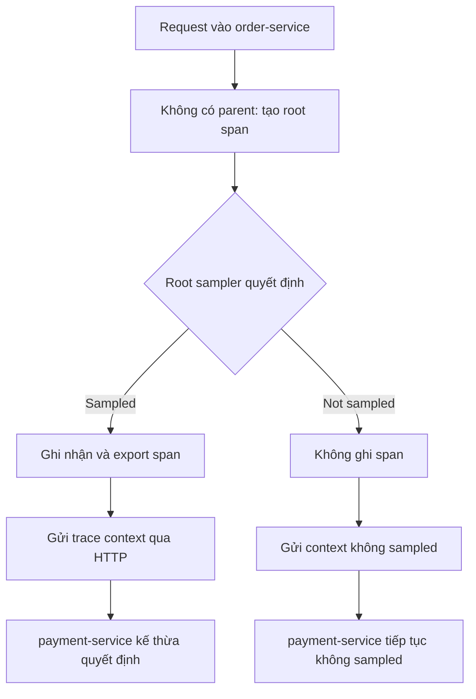
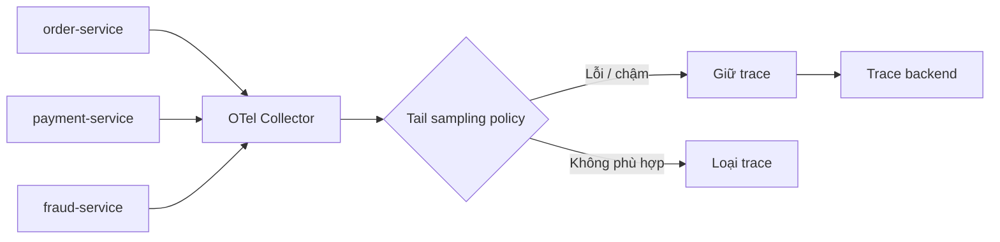
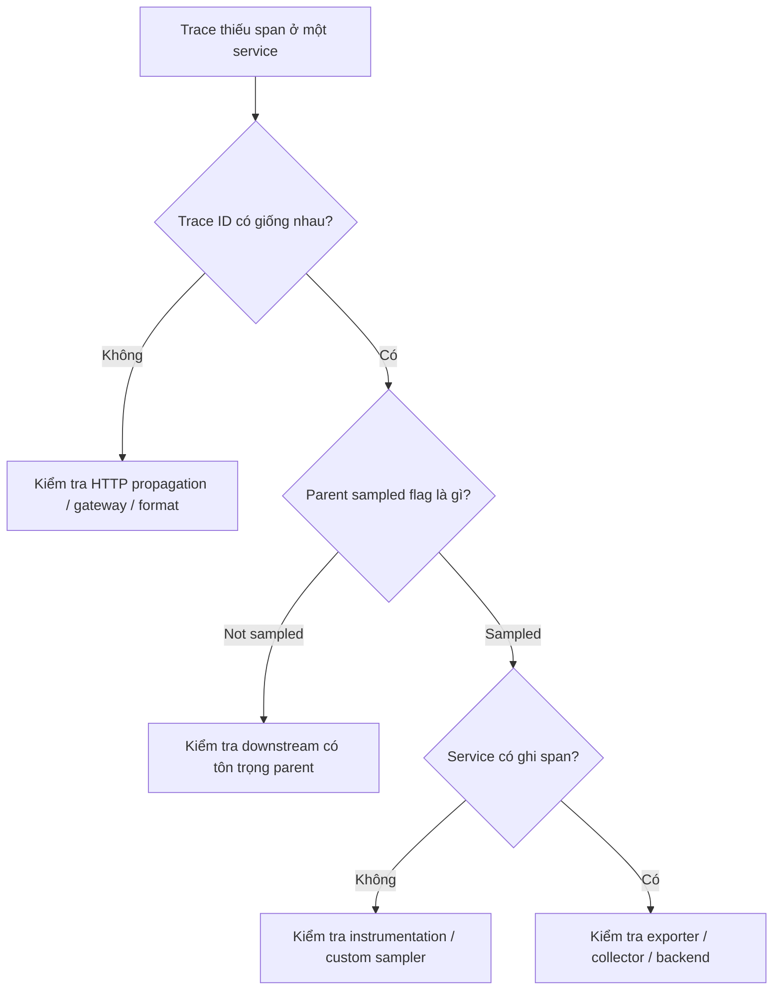

# Đồng nhất sampling giữa các service

## 1. Vì sao sampling phải được xem trên toàn trace?

Một request tạo đơn hàng có thể đi qua nhiều service:

```text
Client
  └─ order-service
      └─ payment-service
          └─ fraud-service
              └─ notification-service
```

Nếu mỗi service tự quyết định lấy mẫu độc lập, backend tracing có thể chỉ nhận được một phần hành trình. Ví dụ, `order-service` ghi span nhưng `payment-service` loại span; hoặc service cuối lại ghi một span không có cha trong trace đang xem. Khi đó, người vận hành nhìn thấy các đoạn rời rạc và dễ kết luận sai về thời gian, lỗi hoặc quan hệ giữa các service.

**Đồng nhất sampling giữa các service** có nghĩa là các service phối hợp theo cùng một quyết định lấy mẫu của trace, để những span thuộc một hành trình được ghi nhận nhất quán. Cốt lõi là: **service khởi tạo trace quyết định sampling ở root; các service downstream phải tôn trọng quyết định được truyền qua trace context**, trừ khi hệ thống chủ động áp dụng một kiến trúc sampling khác như tail-based sampling.

Bài thuộc chương **Sampling** của **SPRING_MODULITH_DOCUMENTATION_OBSERVABILITY**. Module học cách dùng Spring Modulith tạo tài liệu ranh giới application module và quan sát tương tác trong Spring Boot qua module graph, Actuator, event metrics, tracing và context propagation. Bài này mở rộng góc nhìn từ một service sang toàn bộ đường đi của trace phân tán.

Sau bài học, bạn có thể:

1. Phân biệt root sampling với quyết định sampling được kế thừa từ remote parent.
2. Hiểu sampled flag trong W3C Trace Context và B3.
3. Cấu hình Spring Boot để các service thống nhất định dạng propagation và chính sách lấy mẫu.
4. Phân biệt head sampling và tail sampling, biết điều kiện để tail sampler nhận đủ span.
5. Kiểm chứng trace xuyên nhiều service và tìm nguyên nhân khi trace bị thiếu một phần.
6. Phân biệt sampling của trace với metrics tổng hợp của Spring Modulith.

## 2. Root sampling và quyết định của các service downstream

### 2.1. Trace có một quyết định lấy mẫu ở điểm bắt đầu

Khi request đi vào hệ thống mà chưa có trace context, service đầu tiên tạo một trace mới và tạo root span. Sampler quyết định trace này có được ghi nhận hay không dựa trên chính sách cấu hình, ví dụ xác suất 10% hoặc 20%.

Nếu trace được lấy mẫu, các span được ghi nhận và có thể xuất tới backend. Nếu không được lấy mẫu, instrumentation vẫn có thể duy trì một context không ghi span để truyền quyết định cho các service sau, tùy tracer/bridge.

Khi request đi tới service tiếp theo, header propagation mang trace ID, parent span ID và trạng thái sampled. Service downstream cần **kế thừa quyết định của parent** thay vì tung một lần lấy mẫu độc lập cho mỗi hop.



Điều này giúp một trace không bị chia thành các phần ngẫu nhiên chỉ vì nó đi qua nhiều service.

### 2.2. Parent-based sampling

Một **parent-based sampler** xử lý hai trường hợp:

- Nếu span đang tạo có parent (local hoặc remote), sampler kế thừa quyết định sampled/not-sampled của parent.
- Nếu không có parent, sampler gốc (*root sampler*) mới áp dụng xác suất hoặc quy tắc chọn mẫu.

Với OpenTelemetry, đây là vai trò của `ParentBased` kết hợp một root sampler như `TraceIdRatioBased`. Với Brave, các span con thông thường kế thừa quyết định sampling của trace đã tồn tại. Khi dùng Micrometer Tracing, cần kiểm tra bridge/tracer và sampler thực tế của phiên bản Spring Boot; nếu thay bằng custom sampler, bảo đảm nó không tự ý ghi đè quyết định remote parent.

**Không nên cấu hình mỗi service thành một root sampler độc lập cho mọi request**, vì request downstream đã có parent. Nếu service B nhận một trace chưa sampled nhưng tự quyết định sampled theo xác suất riêng, backend có thể nhận span của B mà không có phần đầu trace. Nếu B nhận trace sampled nhưng lại loại span, trace bị khuyết ở giữa.

### 2.3. Có cần cùng một sampling probability ở mọi service?

Đặt cùng một xác suất root sampling giữa các service giúp chính sách dễ hiểu và nhất quán khi request có thể bắt đầu ở bất kỳ service nào. Tuy nhiên, điều quan trọng hơn là **các service downstream phải tôn trọng quyết định parent**.

Ví dụ:

| Service | Xác suất root sampling | Vai trò trong request |
| --- | ---: | --- |
| `order-service` | 20% | Thường là entry point |
| `payment-service` | 20% | Downstream, kế thừa parent |
| `fraud-service` | 20% | Downstream, kế thừa parent |

Khi một request có root ở `order-service`, xác suất 20% của payment và fraud không nên được áp dụng lại cho trace đó. Chúng phải theo sampled flag được truyền đến. Xác suất riêng của chúng chỉ áp dụng khi chúng nhận một request mới **không có parent context** và tự tạo root trace.

Do đó, “đồng nhất” không chỉ là sao chép cùng một con số vào YAML; còn cần tương thích propagation format, parent-based behavior, sampler và cách exporter hoạt động.

## 3. Sampled flag được truyền qua HTTP như thế nào?

### 3.1. W3C Trace Context

Với W3C, header `traceparent` có cấu trúc:

```text
traceparent: 00-{trace-id}-{parent-id}-{trace-flags}
```

Trong version `00`, bit thấp nhất của `trace-flags` là sampled flag:

| Giá trị flags | Diễn giải thông thường |
| --- | --- |
| `01` | Sampled bit được bật |
| `00` | Sampled bit không được bật |

Ví dụ:

```http
traceparent: 00-4bf92f3577b34da6a3ce929d0e0e4736-00f067aa0ba902b7-01
```

Service nhận đọc header bằng propagator, tạo span mới với cùng trace ID và parent ID trỏ về span gửi. Khi service nhận tiếp tục gọi service khác, nó inject context của span hiện tại vào request kế tiếp.

Không tự chỉnh sampled flag bằng cách nối chuỗi header. Tracer/propagator phải quản lý trace context, vì sampled flag chỉ là một phần của context và cần nhất quán với trạng thái recording của SDK.

### 3.2. B3 propagation

B3 có thể dùng một header tổng hợp `b3` hoặc nhiều header như `X-B3-TraceId`, `X-B3-SpanId`, `X-B3-Sampled`. Quyết định lấy mẫu được truyền bằng trường sampled/debug tương ứng.

Các service cần thống nhất cách consume/produce B3. Không giả định B3 single và B3 multi luôn được xử lý giống hệt trong mọi gateway hoặc thư viện cũ; hãy kiểm tra định dạng thực tế qua từng hop.

### 3.3. Trace ID giống nhau chưa đủ chứng minh sampling nhất quán

Khi kiểm tra, cần nhìn đồng thời:

- Trace ID có giống nhau giữa các service không?
- Mỗi service có tạo span ID riêng không?
- Parent span ID có trỏ đúng về client/server span trước đó không?
- Sampled flag có được giữ đúng theo quyết định root không?
- Span có được export thành công tới backend không?

Một request có thể giữ cùng trace ID nhưng thiếu span ở một service vì sampler loại span, instrumentation không hoạt động hoặc exporter lỗi. Cũng có thể span đã được ghi nhưng backend chưa nhận do transport/export lỗi. Phải tách các trường hợp này khi điều tra.

## 4. Cấu hình Spring Boot đồng nhất giữa các service

### 4.1. Dùng cùng propagation format

Nếu toàn bộ service mới đều hỗ trợ W3C, nên chọn W3C làm định dạng produce chung và bảo đảm các service consume W3C. Spring Boot hiện hành mặc định produce W3C và có thể consume W3C, B3, B3 multi-header; khi muốn chính sách rõ ràng, có thể cấu hình tường minh.

Ví dụ `application.yml` giống nhau về chính sách trên từng service:

```yaml
management:
  tracing:
    propagation:
      consume:
        - W3C
      produce:
        - W3C
```

Đây là cấu hình cho hệ thống mà tất cả service và gateway đã thống nhất W3C. Nếu phải tiếp nhận request từ service legacy dùng B3, bổ sung B3 vào danh sách consume của service cần tương thích; vẫn có thể giữ W3C làm định dạng produce chuẩn.

Không cấu hình service A chỉ produce B3 nhưng service B chỉ consume W3C. Nếu gateway không chuyển đổi, downstream có thể không nhận được parent context và tạo trace mới.

### 4.2. Đồng nhất xác suất root sampling

Ví dụ cho môi trường staging, chọn 20% root traces:

```yaml
spring:
  application:
    name: order-service

management:
  tracing:
    sampling:
      probability: 0.2
    propagation:
      consume:
        - W3C
      produce:
        - W3C
```

Ở `payment-service` và `fraud-service`, cấu hình cùng xác suất root nếu chúng có thể nhận request độc lập từ bên ngoài:

```yaml
spring:
  application:
    name: payment-service

management:
  tracing:
    sampling:
      probability: 0.2
    propagation:
      consume:
        - W3C
      produce:
        - W3C
```

`sampling.probability` trong Spring Boot là xác suất lấy mẫu, không phải giới hạn số span hoặc tỷ lệ phần trăm đảm bảo chính xác trong từng phút. Ví dụ 0.2 nghĩa là sampler được cấu hình để chọn khoảng 20% trace gốc theo thuật toán của tracer. Trong một cửa sổ ngắn, tỷ lệ quan sát có thể cao hoặc thấp hơn đáng kể.

Spring Boot mặc định sampling probability thường là **0.1 (10%)**. Không dựa vào giá trị mặc định nếu các service chạy khác phiên bản hoặc có custom sampler; ghi rõ chính sách mong muốn và kiểm tra cấu hình hiệu lực.

### 4.3. Tạo cấu hình dùng chung

Để tránh mỗi service tự sao chép YAML rồi lệch dần, có thể quản lý các thuộc tính chung trong:

- Spring Boot config chung của nền tảng hoặc config server.
- Helm values/Kubernetes ConfigMap dùng chung cho tracing policy.
- Một thư viện cấu hình nội bộ chỉ chứa default sampling/propagation, còn service có thể override có chủ đích.

Ví dụ bảng chính sách:

| Thuộc tính | Giá trị thống nhất | Ngoại lệ được phép |
| --- | --- | --- |
| Produce format | W3C | Gateway legacy cần B3 |
| Consume format | W3C | B3/B3_MULTI ở service tích hợp legacy |
| Root sampling probability | 0.2 staging | 1.0 trong local test; mức thấp hơn ở production theo budget |
| Parent decision | Tôn trọng remote parent | Chỉ thay đổi bằng thiết kế sampling đã review |
| Service name | Tên ổn định theo service | Không dùng pod ID làm service name |
| Export destination | OTLP Collector của môi trường | Endpoint khác theo môi trường, không theo từng service tùy tiện |

Không cần bắt buộc tất cả service có cùng exporter URL nếu hạ tầng triển khai khác nhau, nhưng chúng phải gửi đến pipeline tương thích và không làm rơi trace.

## 5. Head sampling và tail sampling

### 5.1. Head sampling

**Head sampling** quyết định lấy mẫu ở đầu trace, trước khi biết toàn bộ hành trình và kết quả cuối cùng. Spring Boot property `management.tracing.sampling.probability` thường được dùng để cấu hình xác suất sampling ở phía ứng dụng.

Ưu điểm:

- Quyết định sớm, giảm chi phí ghi span ngay từ đầu.
- Dễ triển khai ở SDK và các service.
- Khi downstream tôn trọng parent, trace được giữ nhất quán qua nhiều service.

Hạn chế:

- Chưa biết request có lỗi hay chậm bất thường khi quyết định.
- Một trace không được lấy mẫu từ đầu thường không thể được tail sampler khôi phục đầy đủ nếu span đã bị loại ở SDK.
- Request hiếm nhưng quan trọng có thể không được lưu chỉ vì xác suất.

### 5.2. Tail sampling

**Tail sampling** đợi nhận các span của trace rồi mới quyết định giữ hay loại dựa trên toàn bộ thông tin, chẳng hạn:

- Giữ trace có span lỗi.
- Giữ trace có tổng thời gian vượt 2 giây.
- Giữ một tỷ lệ trace bình thường.
- Giữ trace có thuộc tính nghiệp vụ phù hợp chính sách.

Tail sampling thường được triển khai tại OpenTelemetry Collector hoặc backend observability, không phải chỉ bằng cách đổi `management.tracing.sampling.probability` trong mỗi service.

Để tail sampling có thể đánh giá một trace đầy đủ:

1. Các SDK/service phải gửi đủ span đến collector; tránh head-sample loại bỏ span trước đó.
2. Collector cần nhận span của cùng trace trong một khoảng chờ phù hợp.
3. Các span cùng trace cần được định tuyến đến cùng tail-sampling decision point/collector worker (thường dùng load balancing theo trace ID).
4. Cấu hình memory, decision wait, số trace đồng thời và chính sách overflow phải phù hợp tải.
5. Nếu một service export lỗi hoặc span đến sau thời gian chờ, trace có thể vẫn thiếu dù tail sampler đã bật.



**Không kết hợp head sampling thấp với kỳ vọng tail sampler sẽ nhìn thấy mọi lỗi.** Nếu order-service loại trace ở SDK rồi không gửi span, collector không có dữ liệu để quyết định giữ trace đó. Một kiến trúc tail sampling điển hình cho phép gửi tất cả span đến collector rồi để collector quyết định; điều này tăng tải collector/network và cần budget riêng.

## 6. Spring Modulith, module spans và event metrics chịu ảnh hưởng thế nào?

Spring Modulith có thể instrument các lời gọi qua Spring component thuộc API application module, tạo module invocation observations/spans. Khi Micrometer Tracing được cấu hình, các span này tuân theo sampling/tracing context đang hoạt động.

Điều đó có nghĩa:

- Nếu root trace được sampled và downstream giữ quyết định, module spans có thể xuất hiện cùng trace.
- Nếu trace không được sampled, module span có thể không được ghi/export, dù lời gọi module vẫn diễn ra.
- Nếu instrumentation không đi qua Spring bean/proxy được hỗ trợ, span có thể không được tạo, độc lập với sampling.
- Nếu module span được ghi nhưng exporter lỗi, backend vẫn không thấy span.

**Event metrics là dữ liệu khác với trace sampling.** Counter `module.events.published` đếm lần công bố event được instrument; nó không bị giảm theo tỷ lệ trace sampling. Một hệ thống có thể ghi nhận 100% event counter nhưng chỉ lưu 20% trace. Không nhân counter với 5 để suy ra số trace hoặc số giao dịch thành công.

| Nguồn quan sát | Sampling ảnh hưởng thế nào? | Câu hỏi trả lời |
| --- | --- | --- |
| Module graph / `/actuator/modulith` | Không phụ thuộc trace sampling | Module và dependency tĩnh là gì? |
| Event metrics | Không phụ thuộc trace sampling | Bao nhiêu event được publish? |
| Module spans / distributed traces | Có | Request cụ thể đã đi qua module/service nào? |
| Log correlation | Phụ thuộc logging và trace context; không nhất thiết cùng sampling với trace export | Log nào liên quan request/trace? |

## 7. Kiểm chứng sampling nhất quán end-to-end

### 7.1. Kịch bản thử nghiệm

Chạy ba service `order-service`, `payment-service` và `fraud-service` với:

- Cùng tracer/bridge tương thích.
- Produce/consume W3C.
- Root sampling probability `1.0` trong môi trường local để dễ quan sát.
- Export tới cùng backend hoặc cùng collector pipeline.
- HTTP client builder auto-configured và server instrumentation hoạt động.

Gọi request đến order-service; theo dõi trace qua payment và fraud. Khi đã xác nhận hoạt động, đổi xác suất root về `0.2` và chạy nhiều request độc lập.

### 7.2. Ma trận kiểm tra sampled và not sampled

| Tình huống | Context đầu vào | Kết quả mong đợi ở downstream |
| --- | --- | --- |
| Request ngoài không có trace context | order tạo root, sampler chọn sampled | Payment và fraud kế thừa sampled, span được ghi nếu exporter hoạt động |
| Request ngoài không có trace context | order tạo root, sampler chọn not sampled | Downstream kế thừa not sampled, không tự ghi một trace độc lập |
| Request có W3C sampled flag bật | order nhận remote parent sampled | Downstream tiếp tục cùng trace và giữ sampled decision |
| Request có W3C sampled flag tắt | order nhận remote parent not sampled | Downstream tôn trọng quyết định không sampled |
| Request từ B3 nhưng service chỉ consume W3C | Không extract được parent theo cấu hình | Có thể tạo root trace mới; phải sửa consume/format |
| Gateway xóa trace header | Downstream không thấy parent context | Trace bị tách dù service có cùng sampling probability |

Có thể kiểm tra W3C header bằng request test:

```powershell
# Remote parent được đánh dấu sampled
curl.exe -X POST http://localhost:8080/orders -H "traceparent: 00-4bf92f3577b34da6a3ce929d0e0e4736-00f067aa0ba902b7-01"

# Remote parent không được đánh dấu sampled
curl.exe -X POST http://localhost:8080/orders -H "traceparent: 00-4bf92f3577b34da6a3ce929d0e0e4736-00f067aa0ba902b7-00"
```

Hai request dùng cùng trace ID giả lập chỉ dành cho test minh họa; trong bài test thực tế nên tạo ID mới cho từng trace để tránh backend gộp dữ liệu của các lần thử khác nhau. Kết quả phụ thuộc sampler có tôn trọng remote parent và cấu hình propagator đúng.

### 7.3. Kiểm tra các span

Trong trace backend, xác nhận:

1. Các service thuộc cùng một request có cùng trace ID.
2. Server span của payment có parent là client span do order tạo.
3. Span của fraud tiếp tục dưới client/server span tương ứng.
4. Các span được ghi nhận nhất quán theo sampled decision.
5. Các service có service name riêng, ổn định và phân biệt được.
6. Nếu thiếu span, xem exporter/collector và instrumentation trước khi kết luận sampling sai.

Một trace không xuất hiện có thể do request không sampled; một trace chỉ có một phần span có thể do sampling không tôn trọng parent, header bị mất, instrumentation không hoạt động hoặc exporter bị lỗi. Cần phân loại bằng log, header và cấu hình hiệu lực.

## 8. Chẩn đoán khi sampling không đồng nhất

| Triệu chứng | Nguyên nhân khả dĩ | Hướng xử lý |
| --- | --- | --- |
| Order có span, payment không có | Downstream áp dụng sampler riêng và loại span; instrumentation/exporter payment lỗi | Kiểm tra parent-based behavior, remote sampled flag, exporter |
| Order không sampled nhưng payment có trace | Downstream tự sample remote parent hoặc header bị mất nên tạo root mới | Kiểm tra sampler và header qua gateway |
| Trace ID khác nhau giữa service | Không inject/extract context hoặc propagation format không tương thích | Kiểm tra W3C/B3, HTTP client builder, ingress |
| Cùng trace ID nhưng thiếu span ở giữa | Span bị loại, không instrument hoặc export thất bại | Xem sampled decision, module span, exporter logs |
| Một số request có trace, một số không | Root probability dưới 1, sampling theo xác suất | Đây có thể là hành vi mong đợi; kiểm tra sampled flag |
| Mỗi service có tỷ lệ trace khác hẳn | Entry point độc lập, config lệch, sampler custom hoặc scrape/backend không đồng đều | So sánh effective config và vai trò root/downstream |
| Tail sampler không giữ trace lỗi | SDK đã head-drop, span đến muộn, trace bị chia collector worker | Kiểm tra head sampling, decision wait, trace-ID routing |
| Trace backend thiếu service | Service không export, endpoint sai, TLS/auth hoặc quota lỗi | Kiểm tra exporter, collector receiver/exporter và log |
| Dashboard event count vẫn cao khi trace ít | Metrics không chịu trace sampling | Đây là khác biệt bình thường giữa metrics và traces |

### 8.1. Quy trình tìm nguyên nhân



## 9. Những nhầm lẫn phổ biến

| Nhầm lẫn | Cách hiểu đúng |
| --- | --- |
| “Mỗi service cùng đặt 20% là trace chắc chắn đủ span.” | Còn cần propagation, parent-based decision, instrumentation và exporter hoạt động. |
| “Downstream phải lấy mẫu lại 20%.” | Downstream có parent nên kế thừa quyết định của trace, không tung xác suất độc lập. |
| “Sampled flag bật nghĩa trace chắc chắn có trong backend.” | Exporter, collector, mạng và backend vẫn có thể làm mất span. |
| “Trace không thấy nghĩa request không chạy.” | Trace có thể bị sampling loại; metrics/log/business data có thể vẫn ghi nhận. |
| “Đặt sampling 100% ở production luôn tốt nhất.” | Tăng chi phí ingest, storage và xử lý; cần chính sách theo tải. |
| “Tail sampling khôi phục được mọi trace bị head sampler loại.” | Collector không thể chọn trace nếu SDK đã không gửi span cần thiết. |
| “Event counter cũng chỉ ghi 20% khi trace sampling là 20%.” | Event metrics độc lập với trace sampling. |
| “Trace ID giống nhau đủ chứng minh parent-child đúng.” | Cần kiểm tra span ID, parent ID và timeline. |
| “Tất cả service phải có cùng export URL.” | Pipeline có thể khác nhau, miễn dữ liệu được chuyển tới backend/collector tương thích và không mất trace. |

## 10. Checklist thực hành

- [ ] Xác định service nào thường tạo root trace và service nào nhận remote parent.
- [ ] Hiểu root sampler và parent-based sampler; downstream tôn trọng quyết định parent.
- [ ] Chọn một propagation format chuẩn (ví dụ W3C) và cấu hình produce/consume tương thích.
- [ ] Ghi rõ root sampling probability dùng ở từng môi trường.
- [ ] Kiểm tra custom sampler không ghi đè remote sampled decision ngoài chủ đích.
- [ ] Kiểm chứng sampled/not-sampled bằng W3C hoặc B3 header trong môi trường test.
- [ ] Kiểm tra trace ID, span ID, parent span ID và service name xuyên suốt request.
- [ ] Phân biệt head sampling ở SDK với tail sampling ở collector.
- [ ] Nếu dùng tail sampling, bảo đảm collector nhận đủ span và định tuyến theo trace ID.
- [ ] Không suy event count từ tỷ lệ trace sampling; event metrics và module graph có vòng đời riêng.
- [ ] Theo dõi exporter/collector errors, sampling rate thực tế và số span bị thiếu.

## 11. Tài liệu tham khảo

- [Spring Boot — Tracing](https://docs.spring.io/spring-boot/reference/actuator/tracing.html): sampling probability, propagation và cấu hình Micrometer Tracing.
- [Spring Boot — Application Properties](https://docs.spring.io/spring-boot/appendix/application-properties/): `management.tracing.sampling.*` và `management.tracing.propagation.*`.
- [OpenTelemetry — Sampling](https://opentelemetry.io/docs/concepts/sampling/): head sampling, parent-based sampling và trace sampling concepts.
- [OpenTelemetry Java — Sampler](https://opentelemetry.io/docs/languages/java/sdk/#sampler): cấu hình sampler cho SDK Java.
- [W3C — Trace Context](https://www.w3.org/TR/trace-context/): `traceparent`, trace flags và truyền sampled state.
- [Micrometer Tracing — Reference](https://docs.micrometer.io/tracing/reference/): tracing bridge, sampler và propagation.
- [OpenTelemetry Collector — Tail Sampling Processor](https://github.com/open-telemetry/opentelemetry-collector-contrib/tree/main/processor/tailsamplingprocessor): tail sampling policies, decision wait và cấu hình collector.
- [Spring Modulith — Production-ready Features](https://docs.spring.io/spring-modulith/reference/production-ready.html): module spans và event metrics.
