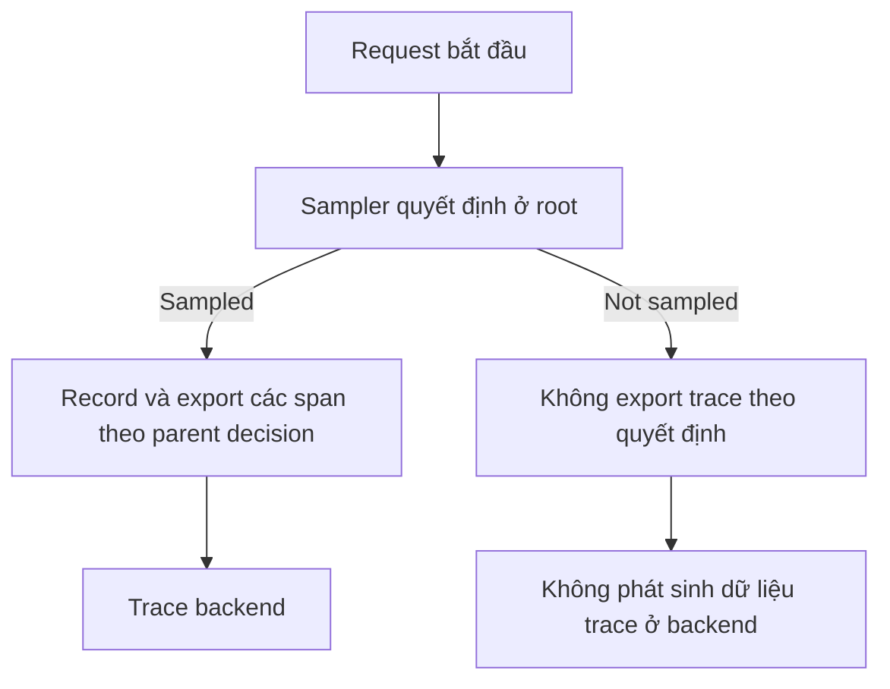
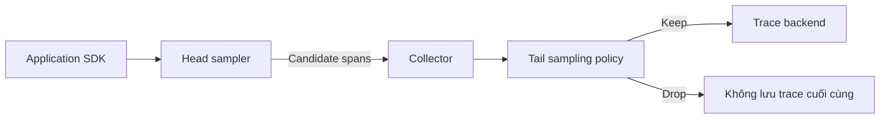

# Chi phí lưu trữ theo tỷ lệ sampling

## 1. Vì sao sampling ảnh hưởng đến chi phí lưu trữ trace?

Trong ứng dụng Spring Boot sử dụng **Micrometer Tracing** và **Spring Modulith**, một yêu cầu có thể tạo nhiều span khi đi qua controller, service, database và các application module như `orders`, `inventory`, `notifications`. Những span này được xuất tới trace backend để nhóm phát triển điều tra độ trễ, lỗi và tương tác giữa các module.

Nếu lưu toàn bộ trace của mọi yêu cầu, hệ thống quan sát có thể phải tiếp nhận và giữ một lượng dữ liệu lớn. **Sampling** là cách chọn một phần trace đại diện để ghi nhận và xuất, qua đó kiểm soát lưu lượng telemetry, dung lượng lưu trữ và chi phí backend.

Trong phạm vi `SPRING_MODULITH_DOCUMENTATION_OBSERVABILITY`, sampling cần được xem cùng module graph, Actuator, event metrics, tracing và context propagation. Mục tiêu là giảm chi phí trace mà vẫn giữ đủ thông tin để hiểu hành vi runtime của các application module.

Bài này tập trung vào câu hỏi: **nếu thay đổi tỷ lệ sampling từ 100% xuống 10%, 5% hoặc 1%, số trace, số span, dung lượng lưu trữ và chi phí theo retention thay đổi ra sao?** Ta sẽ xây dựng mô hình ước lượng, tính ví dụ, phân biệt head-based với tail-based sampling và chọn tỷ lệ phù hợp với nhu cầu điều tra.

## 2. Sampling là gì và tỷ lệ sampling biểu thị điều gì?

**Sampling** là quá trình quyết định trace nào được ghi nhận và xuất tới hệ thống nhận telemetry. Với trace sampling theo xác suất, một tỷ lệ `p` trong khoảng từ `0.0` đến `1.0` biểu thị xác suất một trace được chọn.

| Tỷ lệ `p` | Phần trăm trace được chọn kỳ vọng | Ý nghĩa |
| ---: | ---: | --- |
| `1.0` | 100% | Ghi nhận mọi trace đủ điều kiện |
| `0.5` | 50% | Chọn khoảng một nửa trace |
| `0.1` | 10% | Chọn khoảng một phần mười trace |
| `0.05` | 5% | Chọn khoảng một phần hai mươi trace |
| `0.01` | 1% | Chọn khoảng một phần trăm trace |
| `0.001` | 0,1% | Chọn khoảng một phần nghìn trace |
| `0.0` | 0% | Không xuất trace theo sampler này |

Nếu có (R) trace đủ điều kiện trong một khoảng thời gian, số trace được giữ **kỳ vọng** là:

\[
R_{sampled} = R \times p
\]

Ví dụ, với 500.000 trace/ngày và tỷ lệ sampling 10%, số trace được chọn kỳ vọng là 50.000 trace/ngày.

Đây là giá trị kỳ vọng, không phải cam kết số đếm chính xác mỗi ngày. Sampler xác suất có thể giữ nhiều hơn hoặc ít hơn trong một cửa sổ ngắn; tỷ lệ quan sát được sẽ ổn định hơn khi số lượng trace lớn. Với sampler dựa trên trace ID, quyết định có thể mang tính xác định theo trace ID thay vì tung đồng xu độc lập ở mỗi span.

### 2.1. Tỷ lệ sampling thường áp dụng cho trace, không phải từng span riêng lẻ

Một trace có thể chứa 5 span hoặc 80 span. Với **head-based sampling kết hợp parent-based sampling**, quyết định ở root trace được truyền cho các span con để giữ tính nhất quán. Khi trace được chọn, các span con theo quyết định parent; khi trace bị loại, các span con thường cũng không được xuất.

Vì vậy, nói “sampling 10%” thường có nghĩa **chọn khoảng 10% trace**, không phải chọn ngẫu nhiên 10% span trong mọi trace. Nếu lấy mẫu độc lập từng span, trace có thể bị thiếu các đoạn quan trọng và khó đọc quan hệ cha-con.

## 3. Sampling trong Spring Boot và Micrometer Tracing

Spring Boot cung cấp thuộc tính `management.tracing.sampling.probability` để cấu hình tỷ lệ sampling. Tài liệu Spring Boot hiện hành nêu mặc định lấy mẫu 10% request nhằm tránh làm trace backend quá tải.

Ví dụ cấu hình 10%:

```yaml
management:
  tracing:
    sampling:
      probability: 0.1
```

Trong môi trường phát triển, có thể tăng lên 100% để dễ kiểm tra:

```yaml
management:
  tracing:
    sampling:
      probability: 1.0
```

Không nên mặc định giữ 100% trong production tải lớn nếu chưa ước lượng lưu lượng, dung lượng và ngân sách backend. Sampling 100% hữu ích khi debug một môi trường nhỏ hoặc chạy kiểm thử có giới hạn.

Khi dùng OpenTelemetry trong Spring Boot, có thể chọn sampler qua `management.opentelemetry.tracing.sampler`. Các lựa chọn được tài liệu Spring Boot mô tả gồm:

| Sampler | Hành vi |
| --- | --- |
| `always-on` | Chọn mọi trace |
| `always-off` | Loại mọi trace |
| `trace-id-ratio` | Chọn một tỷ lệ trace theo `management.tracing.sampling.probability` |
| `parent-based-always-on` | Theo quyết định parent; nếu không có parent thì chọn trace |
| `parent-based-always-off` | Theo quyết định parent; nếu không có parent thì loại trace |
| `parent-based-trace-id-ratio` | Theo parent; với root trace thì chọn theo tỷ lệ trace ID |

Sampler mặc định cụ thể có thể thay đổi theo phiên bản Spring Boot và cấu hình. Hãy xác nhận phiên bản ứng dụng trước khi dựa vào một giá trị mặc định. Với distributed tracing, parent-based sampler giúp các service/module theo cùng quyết định của trace cha thay vì tự chọn tỷ lệ độc lập.

### 3.1. Sampling không đồng nghĩa với context propagation

Sampling quyết định **có ghi và xuất dữ liệu span hay không**. Context propagation mang `traceId`, span context và các thông tin liên quan qua HTTP, executor hoặc message để những thành phần tiếp theo có thể tiếp tục hoặc liên kết trace.

Một trace không được sample vẫn có thể mang context propagation để hệ thống downstream biết quyết định của parent. Ngược lại, truyền được trace ID không bảo đảm span đã được ghi hoặc gửi tới backend.

## 4. Từ số trace đến số span

Backend thường tính dung lượng theo dữ liệu span được ingest/lưu, không chỉ theo số trace. Gọi:

- (R): số trace đầu vào trong một ngày.
- (p): tỷ lệ trace được sampling.
- (S): số span trung bình trong một trace.
- (B): dung lượng lưu trữ trung bình của một span theo mô hình đang ước lượng.

Số trace được giữ kỳ vọng:

\[
R_{sampled} = R \times p
\]

Số span được giữ kỳ vọng, nếu quyết định lấy mẫu trace không phụ thuộc vào kích thước trace:

\[
N_{spans} = R \times p \times S
\]

Dung lượng dữ liệu span cơ sở mỗi ngày:

\[
D_{day} = R \times p \times S \times B
\]

Nếu retention là (T) ngày và giả định lưu lượng tương đối ổn định:

\[
D_{retained} = R \times p \times S \times B \times T
\]

Đây là mô hình ước lượng. Dung lượng backend thực tế còn chịu ảnh hưởng của serialization, compression, index, metadata resource, replication, retention policy, kích thước attributes/events/links, số service và cách backend tính phí. Nên dùng kích thước span lưu trữ đo được từ hệ thống của mình thay vì coi một con số byte cố định là chuẩn chung.

### 4.1. Phân biệt dung lượng gửi đi và dung lượng lưu trữ

Có ít nhất hai đại lượng khác nhau:

| Đại lượng | Ý nghĩa | Dùng để ước lượng |
| --- | --- | --- |
| **Ingest bytes** | Số byte telemetry truyền tới Collector/backend; phụ thuộc OTLP encoding và compression | Network, ingest quota, chi phí theo GB nhận vào |
| **Stored bytes** | Số byte backend giữ sau xử lý, nén và lập chỉ mục | Dung lượng retention và chi phí lưu trữ |

Không nên dùng kích thước payload OTLP làm dung lượng đĩa mà không có hệ số chuyển đổi đo được. Backend có thể nén dữ liệu nhưng đồng thời cần index, bloom filter, metadata hoặc replication. Khi tính chi phí, nên có hai mô hình riêng: **ingest cost** và **retained storage cost**.

## 5. Ví dụ tính chi phí lưu trữ theo sampling

Giả sử một ứng dụng modular monolith có:

| Tham số | Giá trị giả định |
| --- | ---: |
| Trace đủ điều kiện mỗi ngày (`R`) | 2.000.000 |
| Span trung bình mỗi trace (`S`) | 18 |
| Dung lượng lưu trữ trung bình mỗi span (`B`) | 1,2 KB |
| Retention (`T`) | 14 ngày |
| Sampling (`p`) | Thay đổi theo từng kịch bản |

Trong ví dụ, 1,2 KB là **giả định dung lượng backend lưu trên mỗi span sau xử lý cơ bản**, chưa bao gồm phần index/replication. Đây không phải kích thước cố định của OpenTelemetry span.

### 5.1. Sampling 100%

\[
R_{sampled} = 2.000.000 \times 1,0 = 2.000.000
\]

\[
N_{spans} = 2.000.000 \times 18 = 36.000.000
\]

Dung lượng cơ sở mỗi ngày:

\[
D_{day} = 36.000.000 \times 1,2\ KB = 43,2\ GB
\]

Trong 14 ngày:

\[
D_{14d} = 43,2 \times 14 = 604,8\ GB
\]

### 5.2. Sampling 10%

\[
R_{sampled} = 2.000.000 \times 0,1 = 200.000
\]

\[
N_{spans} = 200.000 \times 18 = 3.600.000
\]

\[
D_{day} = 3.600.000 \times 1,2\ KB = 4,32\ GB
\]

\[
D_{14d} = 4,32 \times 14 = 60,48\ GB
\]

### 5.3. So sánh nhiều tỷ lệ

| Sampling | Trace/ngày kỳ vọng | Span/ngày kỳ vọng | Dung lượng cơ sở/ngày | Dung lượng cơ sở/14 ngày |
| ---: | ---: | ---: | ---: | ---: |
| 100% | 2.000.000 | 36.000.000 | 43,2 GB | 604,8 GB |
| 50% | 1.000.000 | 18.000.000 | 21,6 GB | 302,4 GB |
| 10% | 200.000 | 3.600.000 | 4,32 GB | 60,48 GB |
| 5% | 100.000 | 1.800.000 | 2,16 GB | 30,24 GB |
| 1% | 20.000 | 360.000 | 0,432 GB | 6,048 GB |

Với các giả định giữ nguyên, sampling 10% làm dung lượng span cơ sở kỳ vọng còn khoảng một phần mười so với 100%. Sampling 1% còn khoảng một phần trăm. **Mức giảm thực tế chỉ gần tuyến tính khi cách lấy mẫu không ưu tiên một nhóm trace có kích thước khác biệt đáng kể và số span trung bình không đổi theo nhóm được giữ.**

### 5.4. Thêm hệ số index và replication

Giả sử backend có hệ số tổng hợp (K=1,5) cho index/metadata/replication trong mô hình chi phí nội bộ. Khi đó:

\[
D_{backend} = D_{retained} \times K
\]

| Sampling | Cơ sở 14 ngày | Sau hệ số minh họa `K=1,5` |
| ---: | ---: | ---: |
| 100% | 604,8 GB | 907,2 GB |
| 10% | 60,48 GB | 90,72 GB |
| 1% | 6,048 GB | 9,072 GB |

Hệ số 1,5 chỉ dùng để minh họa. Không có một hệ số index/replication áp dụng cho mọi backend. Hãy lấy số liệu từ hệ thống lưu trữ hoặc bảng giá dịch vụ thực tế; một số nền tảng tính phí theo ingest, một số theo retained data, số khác tính cả query, replica và mức truy cập.

### 5.5. Chuyển dung lượng thành chi phí ước tính

Nếu backend tính riêng ingest và dung lượng giữ lại, có thể ước lượng:

\[
C_{ingest/month} = D_{ingest/day} \times M \times P_{ingest}
\]

\[
C_{storage/month} \approx D_{stored/day} \times T \times P_{storage}
\]

Trong đó:

- `M`: số ngày tính phí trong tháng.
- `T`: retention tính theo ngày.
- `P_ingest`: giá trên mỗi GB ingest.
- `P_storage`: giá trên mỗi GB-tháng lưu trữ.
- `D_ingest/day`: ingest bytes/ngày đổi sang GB.
- `D_stored/day`: stored bytes/ngày đã tính hệ số backend phù hợp.

Ví dụ nếu retained storage ổn định ở 90,72 GB với retention 14 ngày theo phép tính ở trên, đó là ước lượng dung lượng đang được giữ trong một cửa sổ 14 ngày sau khi hệ thống đạt trạng thái ổn định. Không nhân thêm số ngày trong tháng vào retained GB nếu đơn giá đã là GB-tháng; phần thời gian đã nằm trong đơn vị tính giá. Cách tính hóa đơn thực tế còn tùy backend, replica, tier, index và cách đo trung bình trong kỳ.

## 6. Những yếu tố khiến chi phí thực tế khác phép tính đơn giản

| Yếu tố | Ảnh hưởng | Cách đo hoặc xử lý |
| --- | --- | --- |
| Kích thước trace không đồng đều | Trace có nhiều module, SQL hoặc events có thể lớn hơn nhiều trace đơn giản | Đo P50/P95 spans và bytes mỗi trace |
| Số span trung bình thay đổi | Thêm instrumentation hoặc module entry spans làm trace dài hơn | Theo dõi spans/trace theo version |
| Attributes/events/links | Payload span lớn hơn, có thể tăng index | Giới hạn attributes, tránh payload lớn và dữ liệu động |
| Resource metadata | `service.name`, version, pod, region… tăng phần dữ liệu chung | Chuẩn hóa resource attributes |
| Compression | Giảm byte truyền/lưu nhưng tùy dữ liệu và backend | Đo ingest bytes và stored bytes riêng |
| Index/replication | Có thể làm dung lượng backend lớn hơn payload | Dùng số liệu lưu trữ thực tế và hệ số backend |
| Retention | Thời gian giữ dài làm dữ liệu tích lũy lớn hơn | Tính theo rolling retention và chính sách xóa |
| Sampling không đồng đều | Trace được giữ có thể dài hơn hoặc ngắn hơn trung bình | Tính theo từng nhóm policy/endpoint |
| Tail sampling buffer | Collector phải giữ span chờ quyết định | Đo memory, trace cache và thời gian chờ |
| Retry/duplicate export | Có thể tăng traffic hoặc dữ liệu lặp nếu pipeline cấu hình sai | Theo dõi retry, duplicate và exporter errors |

Đặc biệt, nếu trace lỗi hoặc chậm được giữ 100% còn trace bình thường chỉ giữ 1%, nhóm được giữ có thể có kích thước trung bình lớn hơn nhiều. Khi đó không thể lấy tỷ lệ sampling chung nhân thẳng với dung lượng baseline để ra con số chính xác; cần tính riêng theo **nhóm policy**.

## 7. Head-based sampling

**Head-based sampling** quyết định lấy mẫu sớm, thường khi root span bắt đầu. Quyết định được truyền cho các span/service downstream qua trace context.



Ưu điểm:

- Quyết định sớm, chi phí tính toán thấp.
- Có thể giảm dữ liệu ngay từ ứng dụng, trước khi gửi qua mạng.
- Dễ áp dụng ở nhiều service nếu parent-based decision được tôn trọng.
- Dễ ước lượng dung lượng khi tỷ lệ và kích thước trace tương đối ổn định.

Hạn chế:

- Tại thời điểm bắt đầu trace, sampler chưa biết request cuối cùng có lỗi hay chậm không.
- Nếu một trace bình thường được loại ở đầu, lỗi phát sinh ở span phía sau không thể được giữ lại ở backend chỉ bằng cách thêm tail policy sau đó.
- Tỷ lệ thấp có thể bỏ qua một lỗi hiếm hoặc một đường đi module ít được gọi.

### 7.1. Parent-based sampling giữ trace nhất quán

Trong distributed tracing, nên tránh để mỗi service tự quyết định sampling độc lập cho span con. Với parent-based sampler:

- Root span áp dụng sampler gốc, ví dụ trace ID ratio 10%.
- Nếu parent đã được sample, child span tiếp tục được sample.
- Nếu parent không được sample, child thường tuân theo quyết định không sample.

Nhờ đó, trace ít bị chia thành những đoạn rời rạc chỉ vì các service dùng tỷ lệ khác nhau. Trong modular monolith, cùng một quyết định trace có thể bao phủ module `orders`, `inventory` và `notifications`; nếu các thao tác được instrument và context còn được truyền đúng.

## 8. Tail-based sampling

**Tail-based sampling** trì hoãn quyết định tới khi Collector đã nhận được phần lớn hoặc toàn bộ span của trace. Nhờ nhìn thấy kết quả cuối cùng, policy có thể giữ trace lỗi, trace chậm hoặc trace chứa một thuộc tính cụ thể.

Ví dụ policy:

| Nhóm trace | Quyết định minh họa | Lý do |
| --- | ---: | --- |
| Có span status `ERROR` | Giữ 100% | Phục vụ điều tra lỗi |
| Tổng thời gian vượt 2 giây | Giữ 100% | Điều tra latency cao |
| Request checkout bình thường | Giữ 20% | Luồng nghiệp vụ quan trọng |
| Request health check | Giữ 0% hoặc tỷ lệ rất thấp | Ít giá trị chẩn đoán |
| Các trace bình thường khác | Giữ 2% | Có mẫu đại diện với chi phí thấp |

Các tỷ lệ trên chỉ là ví dụ chính sách, không phải mặc định của OpenTelemetry hay Spring Boot.

### 8.1. Chi phí bổ sung của tail sampling

Tail sampling có khả năng chọn trace dựa trên kết quả cuối cùng, nhưng cần giữ các span trong bộ nhớ hoặc storage tạm trước khi ra quyết định. Điều này tạo thêm:

- Bộ nhớ cho trace đang chờ đủ span hoặc hết thời gian `decision_wait`.
- CPU để gom, đánh giá policy và duy trì cache.
- Độ trễ trước khi trace được xuất.
- Rủi ro trace thiếu span nếu span đến muộn hoặc Collector quyết định trước khi nhận đủ.
- Chi phí mạng/ingest từ ứng dụng tới Collector vì các span ứng viên vẫn phải được chuyển tới tầng tail sampler.

Do đó, tail sampling có thể giảm **dữ liệu cuối cùng lưu ở backend**, nhưng không nhất thiết giảm lượng telemetry gửi từ ứng dụng tới Collector. Nếu head sampling ở SDK đã loại 90% trace trước đó, tail sampler không thể khôi phục những trace không được gửi.

### 8.2. Tất cả span của một trace phải đến đúng tail-sampling Collector

Tail sampler cần nhìn thấy đủ span của cùng trace để đưa ra quyết định chính xác. Nếu load balancer phân tán các span của một trace tới nhiều Collector độc lập, mỗi Collector chỉ thấy một phần và có thể quyết định khác nhau.

Khi scale tail-sampling Collector theo chiều ngang, cần định tuyến theo `traceID` để các span cùng trace tới cùng một Collector. Mô hình phổ biến là một tầng Collector nhận OTLP và load-balance theo trace ID sang tầng Collector có tail-sampling processor.

## 9. Kết hợp head và tail sampling

Một kiến trúc có thể dùng cả hai tầng, nhưng cần hiểu giới hạn:



Nếu SDK head sampler chỉ gửi 10% trace, tail sampler chỉ có thể lựa chọn trong 10% đó. Muốn giữ mọi trace lỗi bằng tail sampling, cần đảm bảo các span ứng viên có thể tới Collector; thường là cấu hình SDK không loại sớm những trace cần xét hoặc dùng một chiến lược hybrid phù hợp. Điều này làm tăng chi phí mạng và buffer tại Collector.

Không nên bật head sampling thấp rồi kỳ vọng tail sampler sẽ “cứu” được mọi trace lỗi đã bị loại từ SDK. Cần xác định rõ:

1. Quyết định nào được đưa ra ở SDK?
2. Những span nào được gửi tới Collector?
3. Collector chờ bao lâu để gom đủ trace?
4. Policy nào giữ hoặc loại trace?
5. Backend nhận những trace nào và với retention bao lâu?

## 10. Tính chi phí theo từng nhóm sampling policy

Khi giữ trace theo nhóm, không dùng một tỷ lệ `p` chung nếu các nhóm có kích thước khác nhau. Gọi nhóm `i` có:

- `R_i`: số trace/ngày của nhóm.
- `p_i`: tỷ lệ giữ trace của nhóm.
- `S_i`: số span trung bình trong một trace của nhóm.
- `B_i`: dung lượng trung bình mỗi span của nhóm.

Dung lượng cơ sở mỗi ngày:

\[
D_{day} = \sum_i R_i \times p_i \times S_i \times B_i
\]

Ví dụ:

| Nhóm | Trace/ngày | Sampling | Span/trace trung bình | Byte/span | Dung lượng/ngày |
| --- | ---: | ---: | ---: | ---: | ---: |
| Trace bình thường | 1.900.000 | 2% | 12 | 1,0 KB | 0,456 GB |
| Trace lỗi | 50.000 | 100% | 30 | 1,5 KB | 2,25 GB |
| Trace chậm | 50.000 | 100% | 40 | 1,5 KB | 3,0 GB |
| **Tổng** | **2.000.000** | — | — | — | **5,706 GB/ngày** |

Ví dụ giả định các nhóm không chồng lấp. Trong thực tế, một trace có thể vừa lỗi vừa chậm; cần định nghĩa policy và cách tránh đếm trùng. Ví dụ này cho thấy dù trace lỗi/chậm chỉ chiếm 5% traffic, giữ 100% nhóm đó vẫn có thể chiếm phần lớn dung lượng vì trace dài hơn và span lớn hơn.

## 11. Sampling ảnh hưởng đến loại dữ liệu nào?

Sampling trace không tự động giảm mọi dữ liệu observability:

| Loại dữ liệu | Có giảm theo trace sampling không? | Ghi chú |
| --- | --- | --- |
| Span/traces được xuất | Có | Đây là dữ liệu sampling trực tiếp kiểm soát |
| Metrics Micrometer thông thường | Thường không | Counter, timer vẫn được ghi theo instrumentation riêng |
| Spring Modulith event metrics | Không tự giảm | `module.events.published` là metric riêng, không phải trace span |
| Application logs | Không tự giảm | Có thể có log sampling riêng, nhưng không suy ra từ trace sampling |
| Span-derived metrics | Có thể | Nếu metrics được tạo từ các span đã sample, số liệu có thể bị bias hoặc cần điều chỉnh |
| Collector internal metrics | Không | Là metrics theo dõi chính Collector |

Ví dụ `module.events.published` có thể tiếp tục đếm các event được publish ngay cả khi trace tương ứng không được sample. Vì vậy, không dùng tỷ lệ trace sample để nhân giảm event metrics hoặc business counters.

Trong Spring Modulith, module entry spans có thể mang các thuộc tính như `module.identifier`, `module.name`, `module.method` và `module.invocation-type`. Khi một trace bị loại bởi head sampler, các span đó không xuất hiện trong trace backend để điều tra request tương ứng; **module graph, kiểm tra `ApplicationModules.verify()` và metadata cấu trúc qua Actuator vẫn là nguồn riêng để xem kiến trúc module**. Sampling không làm module biến mất khỏi mô hình ứng dụng.

Nếu backend tạo metrics từ spans đã sample, cần hiểu liệu pipeline có hỗ trợ **adjusted counts** hoặc cơ chế span-to-metrics phù hợp không. Một trace sample không phải là toàn bộ dữ liệu giao dịch và không nên dùng thay thế số liệu kiểm toán nghiệp vụ.

## 12. Chọn tỷ lệ sampling theo nhu cầu vận hành

Không có một tỷ lệ tối ưu cho mọi service. Hãy cân nhắc:

| Tiêu chí | Câu hỏi cần trả lời | Hướng lựa chọn |
| --- | --- | --- |
| Traffic | Bao nhiêu trace mỗi giây/ngày? | Traffic cao có thể cần tỷ lệ thấp hơn |
| Độ phức tạp trace | Trung bình/P95 có bao nhiêu span? | Trace dài cần nhiều dung lượng hơn |
| Mức độ quan trọng nghiệp vụ | Checkout/payment có cần độ phủ cao hơn health check? | Có thể phân policy theo service/route/criticality |
| Tần suất lỗi | Lỗi hiếm có cần giữ toàn bộ để điều tra? | Cân nhắc tail sampling hoặc dedicated error telemetry |
| SLO và latency | Có cần giữ trace chậm để tìm nguyên nhân? | Tail sampling có thể chọn theo latency |
| Retention | Cần truy vấn lịch sử bao lâu? | Retention dài làm chi phí tích lũy tăng |
| Ngân sách | Backend tính phí theo ingest, storage hay cả hai? | Tính từng thành phần riêng |
| Quy định dữ liệu | Có yêu cầu giữ/không được giữ một số telemetry? | Tuân thủ retention và policy dữ liệu |

Một chiến lược thực tế thường kết hợp:

- Sampling đại diện cho trace bình thường.
- Giữ tỷ lệ cao hơn cho luồng nghiệp vụ quan trọng.
- Tail sampling cho lỗi hoặc latency cao khi hạ tầng cho phép.
- Exclude hoặc giảm sampling cho health check, readiness và traffic không có giá trị điều tra.
- Giữ metrics và event counters để theo dõi xu hướng tổng hợp độc lập với trace sampling.

## 13. Ví dụ cấu hình và kiểm tra trong Spring Boot

Ví dụ cấu hình 5% cho một môi trường có traffic lớn:

```yaml
management:
  tracing:
    sampling:
      probability: 0.05
```

Với OpenTelemetry sampler trong Spring Boot, có thể chỉ rõ parent-based trace ID ratio sampler theo thuộc tính của phiên bản hỗ trợ:

```yaml
management:
  opentelemetry:
    tracing:
      sampler: parent-based-trace-id-ratio
  tracing:
    sampling:
      probability: 0.05
```

Hãy kiểm tra danh sách sampler và tên property trong tài liệu đúng phiên bản Spring Boot. Không phải mọi Micrometer Tracing bridge đều cung cấp cùng bộ tùy chọn sampler.

Quy trình đo:

1. Ghi baseline traffic: request/trace mỗi ngày, tỷ lệ lỗi, số span/trace và kích thước trace.
2. Ghi tỷ lệ sampling đang cấu hình và xác nhận sampler thực tế được sử dụng.
3. Thu thập số trace/span backend ingest trong một cửa sổ đủ dài.
4. So sánh tỷ lệ trace giữ thực tế với tỷ lệ cấu hình; điều chỉnh theo trace đến từ upstream đã có parent decision.
5. Đo ingest bytes/ngày, stored bytes/ngày, active traces, retention và chi phí backend.
6. Thay đổi tỷ lệ theo từng bước, theo dõi chất lượng điều tra lỗi và trace bị thiếu.
7. Kiểm tra module entry spans có cùng sampling decision và context propagation qua các module/service.

Không kết luận sampling hoạt động chỉ dựa trên một vài trace nhìn thấy trong UI. Sampling xác suất cần cửa sổ đo đủ lớn và phải xét traffic thực tế, parent sampling decision, retry/export errors và các filter ở Collector/backend.

## 14. Những sai lầm thường gặp

| Sai lầm | Hệ quả | Cách khắc phục |
| --- | --- | --- |
| Nghĩ sampling 10% nghĩa là 10% span trong mỗi trace | Trace có thể bị cắt rời và sai quan hệ nhân quả | Dùng trace-level, parent-based decision phù hợp |
| Nhân dung lượng 100% với `p` mà không đo span/trace | Ước lượng sai khi nhóm trace được giữ có kích thước khác biệt | Tính theo nhóm policy và đo bytes thực tế |
| Dùng head sampling thấp rồi mong tail sampler giữ mọi lỗi | Trace đã bị loại ở SDK không tới Collector | Đưa đủ candidate spans tới tail sampler hoặc dùng hybrid đúng thiết kế |
| Cho rằng sampling giảm cả metrics và logs | Mất khả năng đọc xu hướng tổng hợp hoặc log | Quản lý sampling riêng cho từng loại tín hiệu |
| Tăng retention mà không tính lại dung lượng | Storage tăng theo số ngày giữ | Đưa retention vào mô hình chi phí |
| Scale tail sampler bằng round-robin | Span cùng trace có thể tới các Collector khác nhau | Route theo trace ID tới cùng tail-sampling instance |
| Chỉ nhìn ingest GB, bỏ qua index/replica | Ước lượng storage thấp hơn thực tế | Đo retained storage và hệ số backend |
| Giảm sampling mà không theo dõi lỗi hiếm | Có thể mất trace cần thiết để điều tra | Giữ error/slow traces bằng policy phù hợp hoặc bổ sung telemetry khác |
| Dùng trace count làm số giao dịch chính xác | Trace sampling không phải nguồn kiểm toán | Dùng business metrics/database cho số liệu nghiệp vụ |

## 15. Bài thực hành: tính storage budget cho ứng dụng modular monolith

**Bối cảnh:** `shop-app` có các module `orders`, `inventory`, `payments`, `notifications`. Hệ thống nhận 1.200.000 trace/ngày, trung bình 22 span/trace. Backend ước lượng 1,4 KB lưu trữ/span và giữ 30 ngày.

### 15.1. Tính theo tỷ lệ sampling đồng nhất

| Sampling | Trace/ngày | Span/ngày | Storage cơ sở/ngày | Storage cơ sở/30 ngày |
| ---: | ---: | ---: | ---: | ---: |
| 100% | 1.200.000 | 26.400.000 | 36,96 GB | 1.108,8 GB |
| 10% | 120.000 | 2.640.000 | 3,696 GB | 110,88 GB |
| 5% | 60.000 | 1.320.000 | 1,848 GB | 55,44 GB |
| 1% | 12.000 | 264.000 | 0,3696 GB | 11,088 GB |

Các giá trị dùng KB/GB thập phân và chưa gồm index/replication. Hãy tự chọn hệ số backend đã đo được để tính retained storage gần thực tế.

### 15.2. Đề xuất policy theo độ quan trọng

Giả sử 1.140.000 trace bình thường/ngày được sample 2%, 40.000 trace thanh toán được sample 20%, 20.000 trace lỗi được giữ 100%. Hãy tính:

1. Số trace được giữ kỳ vọng trong ngày.
2. Nếu trace bình thường trung bình 14 span, payment 30 span, error 35 span, tổng số span kỳ vọng là bao nhiêu?
3. Nếu dung lượng lưu trữ/span tương ứng lần lượt là 1,0 KB, 1,4 KB và 1,6 KB, dung lượng cơ sở/ngày là bao nhiêu?
4. Với retention 30 ngày, storage cơ sở là bao nhiêu trước khi tính index/replication?
5. Những giả định nào cần kiểm tra nếu một trace có thể vừa thuộc payment vừa có lỗi?

### 15.3. Tiêu chí hoàn thành

- Phân biệt được tỷ lệ sampling theo trace và số span được giữ.
- Tính được số trace/span kỳ vọng theo tỷ lệ sampling.
- Ước lượng storage theo ngày và retention, có nêu giả định về bytes/span.
- Phân biệt ingest bytes với stored bytes và biết cần đo hệ số backend.
- Giải thích được giới hạn head sampling và lợi ích/chi phí của tail sampling.
- Nêu được vì sao metrics/event counters không tự giảm theo trace sampling.
- Đề xuất được policy phù hợp cho trace bình thường, trace lỗi và trace chậm.

## 16. Ghi nhớ

**Sampling làm giảm số trace được ghi nhận và xuất, qua đó có thể giảm lượng span ingest và dung lượng trace backend.** Với head-based trace sampling đồng nhất, số trace và số span được giữ kỳ vọng thường tỷ lệ gần tuyến tính với `p`; dung lượng retention còn phụ thuộc số span mỗi trace, bytes/span, retention, index, compression và replication.

Spring Boot cấu hình xác suất qua `management.tracing.sampling.probability`; parent-based sampler giúp các span con theo quyết định trace cha. Head sampling rẻ và quyết định sớm nhưng không thể biết trước trace có lỗi/chậm. Tail sampling có thể giữ trace dựa trên kết quả cuối, nhưng cần buffer span tại Collector, thêm bộ nhớ/độ trễ và route mọi span của một trace tới cùng sampler.

Đừng dùng một phép nhân đơn giản nếu policy giữ các nhóm trace có kích thước khác nhau. Hãy tính theo từng nhóm, đo ingest và stored bytes riêng, đưa retention vào mô hình, theo dõi chất lượng điều tra và giữ metrics/event counters độc lập. Với Spring Modulith, mục tiêu không chỉ là giảm dung lượng mà còn giữ đủ module entry spans để hiểu tương tác giữa `orders`, `inventory`, `payments` và `notifications` khi có sự cố.

### Tài liệu tham khảo

- [Spring Boot — Tracing](https://docs.spring.io/spring-boot/reference/actuator/tracing.html): tỷ lệ sampling mặc định, `management.tracing.sampling.probability` và các sampler OpenTelemetry.
- [OpenTelemetry — Sampling](https://opentelemetry.io/docs/concepts/sampling/): lý do sampling, head/tail sampling, lợi ích và trade-off.
- [OpenTelemetry — Tracing SDK](https://opentelemetry.io/docs/specs/otel/trace/sdk/): sampler, quyết định recording/sampled và parent-based sampling.
- [OpenTelemetry — Trace Data Model](https://opentelemetry.io/docs/specs/otel/trace/data-model/): span, trace và dữ liệu được xuất.
- [OpenTelemetry Collector — Gateway deployment pattern](https://opentelemetry.io/docs/collector/deploy/gateway/): định tuyến trace ID tới Collector xử lý tail sampling.
- [OpenTelemetry Collector — Tail Sampling Processor](https://github.com/open-telemetry/opentelemetry-collector-contrib/tree/main/processor/tailsamplingprocessor): cấu hình processor và các policy ở Collector.
