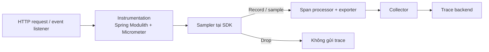

# Đánh giá trace bị thiếu do sampling

> **Chương:** Sampling  
> **Bối cảnh:** Spring Modulith bổ sung module entry spans và event metrics để quan sát tương tác giữa application module trong ứng dụng Spring Boot. Khi một trace không xuất hiện trên backend, nguyên nhân có thể là sampling, instrumentation, propagation, exporter hoặc hệ thống lưu trữ. Bài này hướng dẫn nhận diện trường hợp trace bị loại có chủ đích do sampling và chọn chính sách lấy mẫu phù hợp.

## Mục tiêu học tập

Sau bài này, bạn có thể:

1. Giải thích trace sampling và vì sao Spring Boot mặc định chỉ lấy mẫu một phần request.
2. Phân biệt **head sampling** ở SDK với **tail sampling** tại OpenTelemetry Collector.
3. Đọc ý nghĩa của `management.tracing.sampling.probability`, trace flags và parent-based sampling.
4. Phân biệt trace không được lấy mẫu với span không được instrument, mất context, export thất bại hoặc backend chưa hiển thị dữ liệu.
5. Hiểu vì sao sampling trace không làm giảm module graph hoặc event metrics.
6. Chọn tỷ lệ lấy mẫu, chính sách giữ trace lỗi/chậm và cách vận hành tail sampler có kiểm soát.

## 1. Vì sao trace có thể không xuất hiện?

Giả sử ứng dụng `shop-service` có các application module `orders`, `pricing`, `payments` và `inventory`. Khi request đặt hàng chạy qua nhiều module, Spring Modulith và Micrometer Tracing có thể tạo các span mô tả điểm vào module. Tuy nhiên, không phải mọi lần thực thi đều được gửi đến trace backend.

Một pipeline tracing có thể gồm:



Trace có thể không hiển thị vì nhiều lý do:

- **Sampling:** sampler quyết định không ghi/xuất trace.
- **Instrumentation:** đường thực thi không đi qua điểm được instrument nên không có module span tương ứng.
- **Context propagation:** span được tạo trong một trace khác do context không được truyền qua executor hoặc transport.
- **Exporter/Collector:** span được tạo nhưng queue đầy, timeout, lỗi mạng hoặc Collector drop dữ liệu.
- **Backend/query:** dữ liệu chưa ingest xong, truy vấn sai service/time range/tenant hoặc đã hết retention.

Không nên nhìn một trace UI trống rồi kết luận ngay rằng Spring Modulith không tạo observation.

## 2. Sampling là gì?

**Sampling** là quá trình chọn một phần trace để lưu và gửi tới hệ thống truy vết. Mục tiêu là giữ đủ dữ liệu để điều tra trong khi kiểm soát:

- Dung lượng lưu trữ và thời gian retention.
- Băng thông giữa ứng dụng, Collector và backend.
- CPU, bộ nhớ và chi phí export.
- Khối lượng dữ liệu người vận hành phải tìm kiếm.

Spring Boot mặc định lấy mẫu khoảng **10% request** để tránh làm quá tải trace backend. Có thể thay đổi tỷ lệ bằng:

```yaml
management:
  tracing:
    sampling:
      probability: 0.1
```

`probability` nhận giá trị từ `0.0` đến `1.0`:

| Giá trị | Ý nghĩa |
| ---: | --- |
| `0.0` | Không lấy mẫu trace root theo tỷ lệ này |
| `0.01` | Khoảng 1% trace root đủ điều kiện được chọn |
| `0.1` | Khoảng 10% |
| `0.5` | Khoảng 50% |
| `1.0` | Lấy mẫu 100% trace root đủ điều kiện |

Tỷ lệ là xác suất, không phải hạn mức chính xác cho từng phút hoặc từng nhóm 100 request. Với một mẫu nhỏ, số trace thực tế có thể lệch đáng kể so với kỳ vọng.

### 2.1. Ví dụ xác suất

Nếu có 1.000 trace root độc lập và xác suất lấy mẫu là 10%:

```text
Số trace kỳ vọng = 1.000 × 0,1 = 100
Độ lệch chuẩn    = sqrt(1.000 × 0,1 × 0,9) ≈ 9,5
```

Kết quả có thể là 91, 105 hoặc 112 trace; không có cam kết đúng 100 trace. Ở lưu lượng thấp, có thể có một khoảng thời gian không thấy trace nào dù sampling vẫn hoạt động đúng.

### 2.2. Sampling trace không làm request ngừng chạy

Khi sampler quyết định drop trace, ứng dụng vẫn thực thi logic nghiệp vụ:

- Controller vẫn xử lý request.
- Bean của `orders`, `pricing` hoặc `payments` vẫn được gọi.
- Event vẫn được publish và listener vẫn có thể chạy.
- Transaction, database và side effect vẫn chịu sự điều khiển của logic ứng dụng.

Sampling chỉ quyết định **dữ liệu tracing nào được ghi nhận/xuất**, không quyết định nghiệp vụ có được thực thi hay không.

## 3. Head sampling tại SDK

**Head sampling** đưa ra quyết định sớm khi trace bắt đầu, thường tại root span hoặc khi context từ upstream được nhận. Ở Spring Boot, `management.tracing.sampling.probability` điều khiển xác suất lấy mẫu trace theo cấu hình sampler.

Ví dụ:

```yaml
management:
  tracing:
    sampling:
      probability: 0.1
```

Với head sampling:

1. SDK nhận hoặc tạo trace context.
2. Sampler quyết định ghi/xuất trace hay drop.
3. Quyết định được truyền theo context để các span con có hành vi nhất quán.
4. Nếu trace được chọn, các span tiếp theo được ghi nhận và chuyển qua exporter.

Ưu điểm:

- Quyết định nhanh, chi phí thấp.
- Giảm số span ngay tại ứng dụng.
- Dễ triển khai với nhiều backend và ít yêu cầu bộ nhớ tập trung.

Giới hạn:

- Quyết định xảy ra **trước khi biết toàn bộ kết quả request**.
- Không thể chỉ dựa vào lỗi xảy ra ở cuối request để giữ trace nếu trace đã bị drop từ đầu.
- Không biết tổng latency cuối cùng tại thời điểm root span được tạo.
- Một trace bị drop ở SDK không thể được Collector tail sampler khôi phục về sau.

### 3.1. Ví dụ trace bị loại từ đầu

```text
Request bắt đầu
  |
  +-- Head sampler quyết định DROP
        |
        +-- orders.checkout vẫn chạy
        +-- pricing.calculate vẫn chạy
        +-- payments.authorize vẫn chạy
        +-- Event vẫn được publish
        |
        +-- Không có trace đầy đủ gửi tới backend
```

Đây là lý do một request có thể thành công hoặc thất bại trong log ứng dụng nhưng không có trace trên UI.

### 3.2. Không thấy trace không chứng minh sampler đã drop

Head sampling chỉ là một khả năng. Nếu xác suất là `1.0` mà trace vẫn vắng mặt, cần kiểm tra tiếp instrumentation, exporter, Collector và backend. Cấu hình 100% không khắc phục endpoint OTLP sai, queue overflow hoặc Collector từ chối dữ liệu.

## 4. Parent-based sampling và trace context

Trong ứng dụng nhiều service, một trace có thể bắt đầu ở gateway hoặc service upstream rồi đi vào `shop-service`. Sampler cần xử lý quan hệ với quyết định lấy mẫu của parent.

Với **parent-based sampler**, span con thường kế thừa quyết định sampled của parent:

- Parent sampled: child tiếp tục được sample theo nhánh parent-sampled.
- Parent không sampled: child thường không được sample theo nhánh parent-not-sampled.
- Không có parent: sampler root mới áp dụng xác suất hoặc chính sách root được cấu hình.

Điều này giúp tránh một trace bị chia thành các phần có quyết định sampling mâu thuẫn giữa các service.

### 4.1. W3C `traceparent` và sampled flag

W3C Trace Context truyền trace ID, parent span ID và flags qua HTTP header:

```http
traceparent: 00-4bf92f3577b34da6a3ce929d0e0e4736-00f067aa0ba902b7-01
```

Trong ví dụ:

- `00`: phiên bản header.
- `4bf92f3577b34da6a3ce929d0e0e4736`: trace ID.
- `00f067aa0ba902b7`: span ID của phía gửi.
- `01`: flags có bit sampled được bật.

Nếu flags sampled là `00`, một parent-based sampler ở service nhận có thể tiếp tục không ghi span. Nếu flags là `01`, service nhận thường tiếp tục trace đã được chọn.

Không tự sửa header `traceparent` để ép sampled trong production. Việc thay đổi flags tùy tiện có thể làm trace bị chia, gây sai lệch chi phí hoặc phá vỡ chính sách sampling của upstream.

### 4.2. Boot 3.5: xác suất sampling

Với Spring Boot 3.5, property cơ bản:

```yaml
management:
  tracing:
    sampling:
      probability: 0.1
```

Giá trị mặc định trong tài liệu Spring Boot 3.5 là `0.1`. Khi cần kiểm tra trong lab:

```yaml
management:
  tracing:
    sampling:
      probability: 1.0
```

Khi tăng lên `1.0`, trace root đủ điều kiện sẽ được lấy mẫu; điều đó không đảm bảo tất cả span đều tới backend vì exporter và hạ tầng vẫn có thể lỗi.

### 4.3. OpenTelemetry sampler trên Spring Boot 4.x

Spring Boot 4.1 cho phép chọn sampler OpenTelemetry qua `management.opentelemetry.tracing.sampler`. Các lựa chọn được tài liệu mô tả gồm:

| Sampler | Hành vi |
| --- | --- |
| `always-on` | Lấy mẫu mọi trace |
| `always-off` | Loại mọi trace |
| `trace-id-ratio` | Lấy một tỷ lệ trace dựa trên `management.tracing.sampling.probability` |
| `parent-based-always-on` | Theo quyết định của parent; nếu không có parent thì lấy mẫu |
| `parent-based-always-off` | Theo quyết định của parent; nếu không có parent thì loại |
| `parent-based-trace-id-ratio` | Theo parent; nếu không có parent thì áp dụng xác suất theo trace ID |

Sampler mặc định được tài liệu Boot 4.1 mô tả là `parent-based-trace-id-ratio`.

Ví dụ:

```yaml
management:
  opentelemetry:
    tracing:
      sampler: parent-based-trace-id-ratio
  tracing:
    sampling:
      probability: 0.1
```

Không chép thuộc tính `management.opentelemetry.tracing.sampler` sang Boot 3.5 nếu phiên bản đó không cung cấp property tương ứng. Hãy xác nhận Spring Boot minor version và metadata cấu hình đang chạy.

## 5. Sampling ảnh hưởng module spans như thế nào?

Spring Modulith tạo module entry observations cho các điểm vào module được hỗ trợ, ví dụ lời gọi bean API module và event listener. Khi tracing handler tạo span từ observation, span đó vẫn chịu quyết định sampling của trace.

Giả sử:

```text
HTTP POST /orders
└── orders.Checkout.place
    ├── pricing.QuoteService.quote
    └── payments.PaymentService.authorize
```

Nếu trace root bị head sampler drop, các module entry spans có thể không được ghi/xuất tới trace backend. Điều đó không có nghĩa các method trên không chạy.

Nếu trace được sample nhưng chỉ thiếu một module span, hãy xem:

- Method có thực sự đi qua điểm vào module được instrument không?
- Lời gọi có qua Spring bean/proxy hay chỉ là self-invocation?
- Module span có được tạo nhưng bị filter/exporter loại không?
- Child span có bị tách trace do context propagation không?

### 5.1. Sampling không thay đổi module graph

`/actuator/modulith` cung cấp mô hình application module và dependencies. Đây là dữ liệu cấu trúc được phát hiện từ ứng dụng, không phải trace được sampling.

```text
GET /actuator/modulith
```

Nếu endpoint vẫn hiển thị `orders`, `pricing`, `payments`, việc trace bị sampling drop không làm module biến mất khỏi graph.

### 5.2. Sampling trace không làm giảm event metrics

Spring Modulith có event metrics như:

- `module.events.published`
- `module.events.published.<moduleIdentifier>.<simpleEventTypeName>`

Đây là counter Micrometer cho event được publish. Trace sampling không phải bộ lọc của các counter này. Vì vậy có thể xảy ra:

| Module graph | Event counter | Trace backend | Diễn giải |
| --- | --- | --- | --- |
| Có module | Tăng | Có trace | Có bằng chứng cấu trúc, publish metric và trace được lưu |
| Có module | Tăng | Không có trace | Event được đo, trace có thể bị sampling hoặc export/query lỗi |
| Có module | Không tăng | Có trace | Trace vẫn có thể được tạo cho request không publish event |
| Có module | Tăng | Có trace nhưng thiếu listener span | Listener không được instrument, không chạy hoặc span bị mất ở pipeline |

Không dùng trace count để thay thế event counter hoặc kết quả nghiệp vụ.

## 6. Head sampling và tail sampling

Head sampling quyết định ở đầu trace. **Tail sampling** đợi nhận thêm span của trace rồi mới quyết định giữ hay loại, dựa trên đặc điểm cuối cùng như status, latency hoặc attributes.

| Tiêu chí | Head sampling | Tail sampling |
| --- | --- | --- |
| Thời điểm quyết định | Khi trace bắt đầu/nhận parent | Sau khi Collector đã nhận một phần hoặc toàn bộ trace |
| Thông tin biết được | Chủ yếu thông tin tại đầu trace và parent context | Có thể đánh giá lỗi, latency, span attributes xuất hiện muộn |
| Vị trí | SDK/application hoặc upstream | Collector |
| Tài nguyên | Giảm dữ liệu sớm ở ứng dụng | Cần giữ trace tạm thời trong bộ nhớ Collector |
| Chọn trace lỗi/chậm | Khó nếu lỗi/chậm chưa xảy ra lúc quyết định | Có thể giữ dựa trên trạng thái/latency cuối cùng |
| Rủi ro | Có thể bỏ một trace sau đó mới phát sinh lỗi | Có thể thiếu span đến muộn, đầy bộ nhớ hoặc quá tải Collector |

### 6.1. Ví dụ cần tail sampling

Một hệ thống có:

- 95% request hoàn tất nhanh và thành công.
- 4% request chậm hơn một ngưỡng vận hành.
- 1% request có lỗi.

Nếu chỉ dùng head sampling 10%, phần lớn trace bị loại trước khi biết request sẽ thành công hay thất bại. Tail sampling có thể giữ:

- Tất cả trace có span status `ERROR`.
- Trace có tổng latency vượt ngưỡng.
- Một tỷ lệ nhỏ trace bình thường để làm baseline.

Tail sampling hữu ích khi muốn giữ **trace bất thường** mà không cần lưu toàn bộ trace bình thường. Tuy nhiên, để đánh giá đầy đủ, Collector phải nhận được các span cần thiết trước khi ra quyết định.

### 6.2. Không thể tail sample trace đã bị SDK drop

Đây là quy tắc quan trọng:

```text
SDK head sampler DROP
    -> span không được export
    -> Collector không nhận span
    -> tail sampler không có dữ liệu để đánh giá
    -> không thể khôi phục trace
```

Nếu dùng tail sampling tại Collector, **tất cả service trong đường trace phải gửi các span cần thiết tới Collector**. Không được để ingress hoặc một service upstream head-drop trace trước khi span tới Collector. Cách triển khai thường là cấu hình SDK ở chế độ ghi nhận 100% trace đầu vào, sau đó để Collector quyết định trace nào được lưu. Các service downstream phải kế thừa sampled context từ đầu trace hoặc được cấu hình nhất quán; chỉ đặt probability cao ở một service phía sau không thể phục hồi span đã bị upstream loại.

Với Spring Boot 4.1 và OpenTelemetry, một cấu hình lab có thể chọn:

```yaml
management:
  opentelemetry:
    tracing:
      sampler: always-on
```

Với Spring Boot 3.5, ví dụ cấu hình tỷ lệ root 100% trong lab:

```yaml
management:
  tracing:
    sampling:
      probability: 1.0
```

Với các phiên bản/cấu hình dùng sampler theo xác suất, đặt tỷ lệ root phù hợp để không head-drop dữ liệu trước Collector. Hãy đồng bộ chính sách ở gateway và toàn bộ service tham gia trace. **Đây là kiến trúc có chi phí cao hơn head sampling** vì Collector phải nhận và xử lý lượng span đầy đủ trước khi lọc.

Điều này chuyển tải xử lý và bộ nhớ sang Collector; không có nghĩa tổng chi phí tracing bằng 0.

## 7. Cấu hình tail sampling tại OpenTelemetry Collector

`tail_sampling` là processor của bản phân phối OpenTelemetry Collector có hỗ trợ processor này (thường dùng Collector Contrib). Cấu hình dưới đây là ví dụ rút gọn cho lab, giữ trace nếu có lỗi, vượt ngưỡng latency hoặc thuộc tỷ lệ baseline:

```yaml
receivers:
  otlp:
    protocols:
      grpc:
        endpoint: 0.0.0.0:4317
      http:
        endpoint: 0.0.0.0:4318

processors:
  memory_limiter:
    check_interval: 1s
    limit_mib: 1024

  tail_sampling:
    decision_wait: 10s
    num_traces: 50000
    expected_new_traces_per_sec: 1000
    policies:
      - name: keep-errors
        type: status_code
        status_code:
          status_codes: [ERROR]

      - name: keep-slow
        type: latency
        latency:
          threshold_ms: 1000

      - name: baseline
        type: probabilistic
        probabilistic:
          sampling_percentage: 5

  batch:
    send_batch_size: 1024

exporters:
  otlp:
    endpoint: tempo:4317
    tls:
      insecure: true

service:
  pipelines:
    traces:
      receivers: [otlp]
      processors: [memory_limiter, tail_sampling, batch]
      exporters: [otlp]
```

Giải thích:

- `decision_wait`: thời gian chờ trước khi đưa ra quyết định sampling theo trace; phải đủ dài để các span quan trọng đến Collector.
- `num_traces`: số trace được giữ trong bộ nhớ để chờ quyết định.
- `expected_new_traces_per_sec`: ước lượng số trace mới mỗi giây để processor chuẩn bị cấu trúc dữ liệu.
- Policy `status_code`: giữ trace có span báo lỗi.
- Policy `latency`: giữ trace có thời lượng vượt 1.000 ms.
- Policy `probabilistic`: giữ thêm một phần trace baseline.

Trong ví dụ không có policy `drop`, các policy giữ lỗi/chậm/baseline đóng vai trò các điều kiện giữ trace. Khi bổ sung policy `drop`, `not`, `and` hoặc `composite`, phải đọc quy tắc kết hợp policy của đúng phiên bản Collector; một policy drop có thể khiến trace bị loại dù policy khác đã match.

Đây là cấu hình minh họa; tên processor, phiên bản Collector, cách kết hợp policy và schema cấu hình phải theo bản Collector đang triển khai. Không dùng `tls.insecure: true` cho kết nối production qua mạng không tin cậy.

### 7.1. Tail sampler cần nhận đủ trace

Tail sampler gom span theo `trace_id`. **Tất cả span của cùng một trace phải đến cùng một Collector instance** để processor có đủ dữ liệu ra quyết định.

Nếu có nhiều Collector:

- Dùng trace-ID-aware load balancing trước các Collector chạy tail sampling.
- Không chia ngẫu nhiên các span của cùng trace sang các instance khác nhau.
- Kiểm tra cấu hình gateway/load balancer và retry để không làm phân mảnh trace.

Tail sampling là processor stateful: nó giữ dữ liệu trong RAM trong lúc chờ quyết định. Scale ngang sai cách có thể làm một trace chỉ còn một phần span ở mỗi instance.

### 7.2. `decision_wait` và late spans

Nếu `decision_wait` quá ngắn, Collector có thể quyết định trước khi span lỗi hoặc span chậm đến. Các span đến sau quyết định có thể bị xử lý theo decision cache hoặc không thay đổi quyết định ban đầu, tùy phiên bản và cấu hình.

Nếu `decision_wait` quá dài:

- Trace bị giữ trong bộ nhớ lâu hơn.
- Số trace đang chờ quyết định tăng.
- Có thể vượt `num_traces`, làm trace cũ bị loại trước khi sampler quyết định.
- Trace xuất hiện trên backend trễ hơn.

Chọn `decision_wait` dựa trên phân bố thời gian hoàn tất trace và độ trễ truyền span, không chỉ dựa vào timeout HTTP của request.

## 8. Chẩn đoán trace bị thiếu do sampling

Khi người dùng báo “request đặt hàng không có trace”, hãy phân loại trước:

| Dấu hiệu | Khả năng | Cách kiểm tra |
| --- | --- | --- |
| Không có trace ID trong log | Logging/tracing context chưa được gắn hoặc log pattern không lấy MDC | Kiểm tra instrumentation và logging correlation |
| Log có trace ID nhưng backend không có trace | Trace không sampled, exporter lỗi hoặc backend chưa nhận | Kiểm tra sampled flag, sampler, exporter và Collector |
| Trace có HTTP span nhưng thiếu module span | Module entry không được instrument hoặc span bị filter | Kiểm tra điểm vào API bean/listener và span attributes |
| Module spans ở trace ID khác | Context propagation bị đứt hoặc service dùng propagation format không tương thích | Kiểm tra executor, `traceparent`, W3C/B3 |
| Child có parent ID nhưng parent không hiển thị | Parent remote, bị sampling, retention hoặc query thiếu service | Tìm trace ID trên upstream và các backend |
| Trace chỉ xuất hiện một phần | Sampling không đồng nhất, late span, exporter/Collector drop | Kiểm tra sampled flags, tail sampling và drop metrics |
| Trace xuất hiện muộn | Batch export hoặc tail `decision_wait` | Xem processor delay, Collector queue và backend ingestion |

### 8.1. Kiểm tra sampling probability

Đọc cấu hình thực tế từ:

- `application.yml`/profile đang active.
- Biến môi trường và tham số triển khai.
- Spring Boot configuration metadata của đúng version.
- Cấu hình custom sampler/OTel SDK nếu ứng dụng tự cấu hình.

Đừng chỉ xem file `application.yml` mặc định nếu production đang dùng profile hoặc environment override.

### 8.2. Kiểm tra sampled flag và parent

Với W3C Trace Context, xem `traceparent` nhận vào:

- Flag sampled `01`: parent báo trace được lấy mẫu.
- Flag sampled `00`: parent báo không lấy mẫu.

Nếu sampler là parent-based, quyết định từ upstream có thể giải thích vì sao service hiện tại không xuất child span dù local probability đặt cao. Một số cấu hình custom có thể thay đổi hành vi, vì vậy hãy xem sampler thật sự được khởi tạo.

### 8.3. Kiểm tra exporter riêng biệt

Nếu xác nhận trace được sample, tiếp tục kiểm tra:

1. Span processor có nhận span đã kết thúc không?
2. Queue có đầy hoặc drop span không?
3. Exporter có timeout, lỗi HTTP/gRPC, TLS hoặc authentication không?
4. Collector receiver có nhận trace không?
5. Collector processor có drop trace không?
6. Backend có ingest và query được trace trong đúng tenant/time range không?

Sampling không giải thích được mọi trường hợp thiếu dữ liệu. Nếu probability là `1.0` mà trace vẫn mất, cần xem pipeline export và backend.

## 9. Dùng metrics và module graph làm bằng chứng độc lập

Sampling chỉ tác động đến trace. Khi điều tra, kết hợp nhiều tín hiệu:

| Nguồn | Có phụ thuộc trace sampling không? | Dùng để kiểm tra |
| --- | --- | --- |
| `/actuator/modulith` | Không | Module và dependency kiến trúc |
| `module.events.published` | Không theo trace sampler | Số lượt event được công bố |
| Module entry spans | Có | Đường tương tác module trong trace được lấy mẫu |
| HTTP request metrics | Không theo trace sampler | Lưu lượng, status và latency tổng hợp |
| Application logs | Không tự bị trace sampler loại, nếu logging độc lập | Lỗi và business correlation |
| Dữ liệu nghiệp vụ | Không | Đơn hàng/thanh toán/tồn kho thực sự đã thay đổi hay chưa |

Ví dụ:

```text
HTTP request counter tăng
module.events.published tăng
application log có orderId
trace backend không có trace
```

Trường hợp này vẫn có thể là request đã chạy và event đã được publish, trong khi trace bị head sampling loại hoặc export thất bại. Cần kiểm tra sampled decision trước khi kết luận.

## 10. Chọn sampling policy theo môi trường

### 10.1. Local development

Trong local development, có thể lấy mẫu 100% để dễ xem trace:

```yaml
management:
  tracing:
    sampling:
      probability: 1.0
```

Lưu lượng nhỏ giúp chi phí lưu trace thấp. Tuy nhiên, nếu test tải lớn ở local, 100% vẫn có thể làm tăng CPU, memory và dung lượng exporter.

### 10.2. Integration/staging

Có thể dùng tỷ lệ cao hơn production, hoặc 100% trong các bài kiểm thử ngắn có kiểm soát. Điều quan trọng là:

- Dùng Collector/backend có giới hạn tài nguyên rõ ràng.
- Không chứa dữ liệu nhạy cảm trong span.
- Ghi lại sampling config của build/profile đang thử.
- Không dùng kết quả staging để suy ra trực tiếp tỷ lệ trace production.

### 10.3. Production với head sampling

Chọn xác suất dựa trên:

- Request/trace rate thực tế.
- Số span trung bình trên mỗi trace.
- Dung lượng trung bình của span.
- Throughput và quota của Collector/backend.
- Mức độ cần quan sát của từng service.

Ví dụ cấu hình 10%:

```yaml
management:
  tracing:
    sampling:
      probability: 0.1
```

Nếu 10.000 trace root/giây và lấy mẫu 10%, kỳ vọng khoảng 1.000 trace/giây được ghi nhận ở root, chưa tính các span con. Cần đo số span thực tế và chi phí export; không dùng số request đơn thuần để sizing.

### 10.4. Khi cần giữ lỗi hoặc trace chậm

Head sampling theo xác suất không thể biết lỗi xảy ra trong tương lai tại thời điểm root span bắt đầu. Nếu yêu cầu vận hành là:

- Giữ tất cả trace có status `ERROR`.
- Giữ trace có latency vượt ngưỡng.
- Chỉ giữ một tỷ lệ nhỏ trace thành công bình thường.

hãy cân nhắc tail sampling tại Collector. Đổi lại, ứng dụng phải gửi đủ span đến Collector và hạ tầng tail sampling cần bộ nhớ, định tuyến theo trace ID và thời gian chờ quyết định.

## 11. Sampling không phải instrumentation filter

Một số trường hợp module span không xuất hiện không liên quan sampling:

### 11.1. Không đi qua điểm vào module được instrument

Spring Modulith tập trung vào các điểm tương tác module được hỗ trợ. Một helper nội bộ, self-invocation (`this.method()`), object tạo bằng `new` hoặc lời gọi không đi qua Spring bean/proxy có thể không tạo module entry span riêng.

### 11.2. Không có tracing handler/exporter

Observation có thể được tạo nhưng không được chuyển thành span nếu thiếu Micrometer Tracing bridge hoặc tracing handler phù hợp. Metrics vẫn có thể hoạt động độc lập.

### 11.3. Context propagation bị đứt

Một listener bất đồng bộ có thể chạy và tạo span nhưng không cùng trace với request nếu executor không truyền tracing context. Đây là lỗi liên kết trace, không phải sampling đơn thuần.

### 11.4. Backend lọc hoặc chưa ingest

Span đã rời ứng dụng nhưng có thể chưa xuất hiện do queue/batch, Collector, tenant, retention hoặc query filter. Hãy kiểm tra export logs/metrics trước khi thay sampling probability.

## 12. Bảng xử lý sự cố

| Triệu chứng | Nguyên nhân có thể | Hành động |
| --- | --- | --- |
| Chỉ khoảng 10% request có trace | Spring Boot dùng probability mặc định 0.1 | Xác nhận sampling config; đây có thể là hành vi đúng |
| Local có trace, production thiếu nhiều trace | Production có sampling thấp hơn hoặc parent upstream không sampled | Kiểm tra profile, env override và parent-based sampler |
| Đặt probability `1.0` nhưng vẫn thiếu trace | Exporter, Collector, backend hoặc instrumentation | Kiểm tra pipeline sau sampler và điểm tạo span |
| Có trace ID trong log nhưng không có trace trên UI | Trace không sampled hoặc export/query thất bại | Kiểm tra sampled flag, exporter logs và backend |
| Child service không xuất span dù local probability cao | Parent remote có sampled flag `00` và sampler parent-based | Kiểm tra `traceparent` từ upstream |
| Trace có HTTP span nhưng thiếu module span | Module entry không được instrument hoặc span bị filter | Kiểm tra module API bean, listener và instrumentation |
| Listener ở trace khác | Context propagation qua executor bị thiếu | Kiểm tra task decorator, messaging headers và propagation type |
| Trace chậm/mất ở tail sampler | `decision_wait`, `num_traces` hoặc trace routing chưa phù hợp | Xem late spans, buffer pressure và trace-ID-aware load balancing |
| Tail sampler không giữ trace lỗi | Span báo lỗi không đến Collector hoặc policy không khớp status | Kiểm tra instrumentation exception, status code và policy config |
| Event metric tăng nhưng trace không có | Metrics độc lập với trace sampling | Kiểm tra sampling/export; xác nhận listener bằng log/registry |
| Trace biến mất sau deploy | Sampling config thay đổi hoặc Collector/backend rollout | So sánh effective config, exporter và trạng thái ingest |
| Chỉ thiếu parent span | Parent ở service khác, bị sample/filter hoặc query không đủ phạm vi | Tìm cùng trace ID trên upstream và backend liên quan |

## 13. Bài tập tự kiểm tra

### Câu 1 — Xác suất

Ứng dụng có 2.000 trace root trong một khoảng thời gian và đặt `probability=0.1`. Số trace kỳ vọng được sample là bao nhiêu? Có được yêu cầu kết quả phải đúng bằng số đó không?

### Câu 2 — Parent-based

Service `orders` nhận `traceparent` với sampled flag `00`. Service đặt local probability `1.0`, nhưng dùng parent-based sampler. Vì sao child spans có thể vẫn không được gửi?

### Câu 3 — Trace thiếu nhưng event metric tăng

Counter `module.events.published` tăng sau thao tác đặt hàng, nhưng không có trace trên backend. Nêu ít nhất ba khả năng cần kiểm tra.

### Câu 4 — Giữ trace lỗi

Nhóm muốn chỉ lưu 5% trace bình thường nhưng giữ mọi trace có lỗi xảy ra ở cuối request. Head sampling 5% có đáp ứng được yêu cầu này không? Vì sao?

### Câu 5 — Tail sampling

Ứng dụng đã head-sample 10% trước khi gửi tới Collector. Collector dùng tail sampling để giữ tất cả trace lỗi. Collector có thể khôi phục các trace lỗi đã bị SDK drop không?

### Câu 6 — Scale Collector

Tail sampler có hai Collector instance nhưng load balancer phân phối từng span ngẫu nhiên. Vì sao một trace có thể bị thiếu hoặc bị quyết định sampling sai?

### Câu 7 — Module spans

`/actuator/modulith` vẫn hiển thị module `orders`, nhưng trace không có span của `orders`. Có thể kết luận module bị xóa hoặc không chạy không?

### Gợi ý đáp án

1. Kỳ vọng `2.000 × 0,1 = 200` trace. Không bảo đảm chính xác 200 vì đây là xác suất thống kê.
2. Parent-based sampler kế thừa quyết định không sampled từ upstream; local probability áp dụng cho trace root khi không có parent theo nhánh sampler đó.
3. Trace bị sampling drop; exporter/Collector lỗi; backend chưa ingest hoặc query sai; instrumentation không tạo span; trace ID có thể nằm ở log nhưng sampled flag không bật.
4. Không. Head sampler quyết định trước khi biết lỗi cuối request. Cần tail sampling hoặc một cơ chế quyết định khác có đủ dữ liệu về kết quả.
5. Không. Span bị SDK drop không được export, Collector không có dữ liệu để đánh giá.
6. Các span cùng trace bị tách sang hai instance; mỗi tail sampler chỉ thấy một phần trace nên có thể thiếu root/error span và đưa ra quyết định dựa trên dữ liệu không đầy đủ. Cần định tuyến theo trace ID.
7. Không. Module graph là cấu trúc kiến trúc; trace có thể bị sampling, instrumentation không bao phủ điểm gọi hoặc exporter/backend làm mất span.

## 14. Checklist điều tra trace bị thiếu

- [ ] Xác định request, service, môi trường, thời gian và trace ID (nếu có).
- [ ] Kiểm tra effective `management.tracing.sampling.probability` và custom sampler.
- [ ] Kiểm tra sampler parent-based và sampled flag trong `traceparent`.
- [ ] Phân biệt trace root bị drop với module span không được instrument.
- [ ] Kiểm tra context propagation qua HTTP, executor và event listener.
- [ ] Kiểm tra span processor, exporter queue, timeout và lỗi export.
- [ ] Kiểm tra Collector receiver/processor, tail sampling policy và trace-ID routing.
- [ ] Kiểm tra backend tenant, ingestion delay, retention và query filters.
- [ ] Đối chiếu module graph, event metrics, logs và dữ liệu nghiệp vụ.
- [ ] Chỉ tăng sampling probability trong phạm vi có kiểm soát, theo dõi chi phí sau thay đổi.

## 15. Ghi nhớ

Spring Boot mặc định sample khoảng **10% request**. `management.tracing.sampling.probability` điều khiển xác suất lấy mẫu trace root; parent-based sampler thường kế thừa quyết định từ upstream. Vì vậy, log có trace ID nhưng backend không có trace vẫn có thể là hành vi sampling hợp lệ.

Head sampling quyết định sớm và tiết kiệm tài nguyên nhưng không biết kết quả cuối request. Tail sampling có thể giữ trace lỗi/chậm dựa trên toàn bộ dữ liệu nhận được, đổi lại Collector phải nhận đủ spans, gom theo trace ID và giữ trace trong bộ nhớ trong thời gian chờ quyết định. Trace đã bị SDK drop không thể được tail sampler khôi phục.

Sampling trace không làm thay đổi module graph, event metrics hay việc thực thi nghiệp vụ. Khi điều tra trace bị thiếu, hãy kiểm tra sampler, parent flags, instrumentation, propagation, exporter, Collector và backend theo từng lớp thay vì kết luận từ trace UI trống.

### Tài liệu tham khảo

- [Spring Boot 3.5 — Tracing](https://docs.spring.io/spring-boot/3.5/reference/actuator/tracing.html): sampling probability và mặc định 10%.
- [Spring Boot 3.5 — Common Application Properties](https://docs.spring.io/spring-boot/3.5/appendix/application-properties/): `management.tracing.sampling.probability`.
- [Spring Boot 4.1 — Tracing](https://docs.spring.io/spring-boot/4.1/reference/actuator/tracing.html): OpenTelemetry sampler và parent-based sampling.
- [OpenTelemetry — Sampling](https://opentelemetry.io/docs/concepts/sampling/): head sampling, parent-based sampling và trace sampling concepts.
- [OpenTelemetry Collector Contrib — Tail Sampling Processor](https://github.com/open-telemetry/opentelemetry-collector-contrib/tree/main/processor/tailsamplingprocessor): policies, decision wait, in-memory traces và trace-ID routing.
- [W3C Trace Context](https://www.w3.org/TR/trace-context/): `traceparent`, trace flags và sampled bit.
- [Spring Modulith — Production-ready Features](https://docs.spring.io/spring-modulith/reference/production-ready.html): module entry spans, event metrics và module observability.
