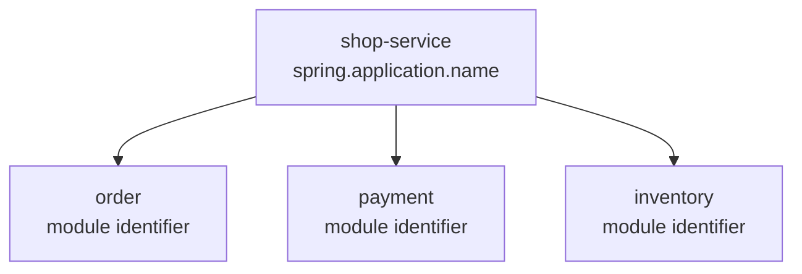
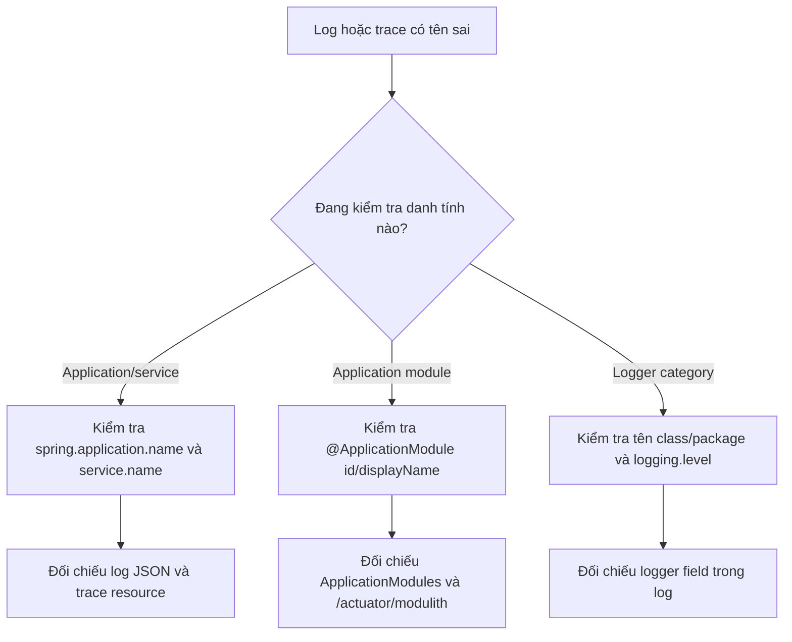

# Phân biệt application name với module name

## 1. Vì sao cần phân biệt hai tên?

Trong một ứng dụng Spring Boot được tổ chức bằng **Spring Modulith**, một tiến trình có thể chứa nhiều application module như `order`, `payment` và `inventory`. Khi request đặt hàng chạy qua các module, đội vận hành cần biết:

- Log được ghi từ **ứng dụng/service nào**?
- Log hoặc span này thuộc **application module nào**?
- Module đang được nói đến có tên kỹ thuật gì, nằm trong package nào và có tên hiển thị nào?

Hai khái niệm **application name** và **module name** giải quyết hai câu hỏi khác nhau. Nếu dùng một giá trị cho cả hai, log và trace sẽ dễ gây hiểu nhầm, nhất là khi một ứng dụng nguyên khối chứa nhiều module hoặc khi một module được tách thành service độc lập.

Bài thuộc chương **Logging** của **SPRING_MODULITH_DOCUMENTATION_OBSERVABILITY**. Module học cách dùng Spring Modulith sinh tài liệu ranh giới application module và quan sát tương tác giữa các phần trong Spring Boot qua module graph, Actuator, event metrics, tracing và context propagation.

Sau bài học, bạn có thể:

1. Giải thích sự khác nhau giữa danh tính ứng dụng/service và danh tính application module.
2. Cấu hình `spring.application.name` để log và hệ thống observability nhận diện đúng ứng dụng.
3. Đặt `id` và `displayName` cho module bằng `@ApplicationModule`.
4. Đọc module identifier, display name và base package qua API hoặc Actuator.
5. Bổ sung trường module vào log có cấu trúc mà không làm mất service identity.
6. Đối chiếu service name trong trace với module span và module graph.

## 2. Application name và module name là hai lớp danh tính

### 2.1. Application name: ứng dụng hoặc service đang chạy

Trong Spring Boot, `spring.application.name` là tên ứng dụng được cấu hình trong Spring Environment. Giá trị này hữu ích để nhận diện **một ứng dụng đang chạy** trong log, service discovery và hệ thống quan sát. Khi dùng logging mặc định của Spring Boot, tên ứng dụng được đưa vào log nếu thuộc tính này đã được đặt.

Ví dụ:

```yaml
spring:
  application:
    name: shop-service
```

Trong môi trường triển khai, tất cả replica của cùng một service thường dùng cùng một application name:

```text
shop-service (replica 1)
shop-service (replica 2)
shop-service (replica 3)
```

Mỗi replica có thể có hostname, pod name, process ID hoặc instance ID khác nhau; những giá trị này phục vụ nhận diện instance. Không nên đưa pod ID vào `spring.application.name` vì sẽ khiến mỗi replica trông như một service khác nhau.

### 2.2. Module name: ranh giới logic trong một ứng dụng

**Application module** của Spring Modulith là một vùng logic được nhận diện từ cấu trúc package và metadata module. Module có:

- **Identifier**: định danh kỹ thuật dùng trong mô hình module và các tham chiếu kiến trúc.
- **Display name**: tên thân thiện để hiển thị trong tài liệu/sơ đồ.
- **Base package**: package gốc chứa code của module.

Ví dụ:

| Thuộc tính module | Giá trị |
| --- | --- |
| Identifier | `inventory` |
| Display name | `Inventory Management` |
| Base package | `com.example.shop.inventory` |

Một ứng dụng `shop-service` có thể chứa nhiều module:



Tên ứng dụng nhận diện **đơn vị triển khai**, còn tên module nhận diện **ranh giới kiến trúc bên trong đơn vị đó**. Một ứng dụng có thể có hàng chục module nhưng vẫn chỉ có một `spring.application.name`.

### 2.3. Các tên khác cũng không nên đánh đồng

| Tên | Ví dụ | Ý nghĩa |
| --- | --- | --- |
| `spring.application.name` | `shop-service` | Tên ứng dụng Spring Boot |
| Module identifier | `inventory` | Định danh logic của module |
| Module display name | `Inventory Management` | Tên hiển thị cho người đọc |
| Module base package | `com.example.shop.inventory` | Phạm vi package gốc của module |
| Logger name | `com.example.shop.inventory.InventoryService` | Category của logger, thường là tên class/package |
| Service resource attribute | `service.name=shop-service` | Danh tính service được backend tracing/telemetry dùng |
| Trace/span ID | Một chuỗi định danh | Nhận diện một trace hoặc span cụ thể |
| Instance/pod name | `shop-service-7c9d...` | Một bản chạy cụ thể của service |

Logger name không tự động là module identifier: một logger có thể nằm trong package con của module, và tên logger thường dài hơn tên module. Trace ID cũng không phải module name; nó chỉ định danh một lần xử lý.

## 3. Ví dụ cấu trúc ứng dụng

Giả sử ứng dụng đặt tại package gốc `com.example.shop`:

```text
com.example.shop
├── ShopApplication.java
├── order
│   ├── OrderService.java
│   └── package-info.java
├── payment
│   ├── PaymentService.java
│   └── package-info.java
└── inventory
    ├── InventoryService.java
    └── package-info.java
```

Application class:

```java
package com.example.shop;

import org.springframework.boot.SpringApplication;
import org.springframework.boot.autoconfigure.SpringBootApplication;

@SpringBootApplication
public class ShopApplication {

    public static void main(String[] args) {
        SpringApplication.run(ShopApplication.class, args);
    }
}
```

Spring Boot lấy `com.example.shop` làm package gốc cho component scan mặc định. Spring Modulith cũng có thể nhận diện các subpackage trực tiếp như `order`, `payment` và `inventory` thành application module theo chiến lược phát hiện mặc định.

Đặt tên ứng dụng ở `application.yml`:

```yaml
spring:
  application:
    name: shop-service
```

Ở đây `shop-service` không phải tên của module `order` hay `inventory`. Nếu mai sau module `payment` được tách ra thành một ứng dụng độc lập, ứng dụng mới có thể đặt `spring.application.name: payment-service`; tên module bên trong ứng dụng đó vẫn được quyết định bởi cấu trúc và metadata Modulith của ứng dụng mới.

## 4. Đặt module identifier và display name

### 4.1. Dùng @ApplicationModule

Spring Modulith cho phép tùy chỉnh thông tin module qua annotation `org.springframework.modulith.ApplicationModule`. Ví dụ file `com/example/shop/inventory/package-info.java`:

```java
@org.springframework.modulith.ApplicationModule(
    id = "inventory",
    displayName = "Inventory Management"
)
package com.example.shop.inventory;
```

Tương tự, module order:

```java
@org.springframework.modulith.ApplicationModule(
    id = "order",
    displayName = "Order Management"
)
package com.example.shop.order;
```

Các điểm cần nhớ:

- `id` là định danh logic của module. Nó được dùng trong tham chiếu dependency; không được chứa chuỗi `::`.
- `displayName` là tên thân thiện dùng để hiển thị trong tài liệu và sơ đồ.
- Nếu không khai báo `id`, Spring Modulith suy ra identifier từ cấu trúc package/chiến lược phát hiện module.
- Nếu không khai báo `displayName`, framework cung cấp tên hiển thị mặc định dựa trên module.
- Đổi identifier có thể ảnh hưởng các chỗ tham chiếu module, cấu hình allowed dependencies, tài liệu, test và dashboard dựa trên identifier.

Không dùng `displayName` làm khóa kỹ thuật để nối dữ liệu: display name có thể thay đổi vì lý do trình bày hoặc bản địa hóa. Dùng identifier ổn định cho việc đối chiếu.

### 4.2. Identifier và display name trong API

Spring Modulith cung cấp `ApplicationModules` để phân tích module:

```java
package com.example.shop;

import org.springframework.modulith.core.ApplicationModules;

public class ModuleInventory {

    public static void printModules() {
        var modules = ApplicationModules.of(ShopApplication.class);

        modules.forEach(module -> {
            System.out.println("identifier: " + module.getIdentifier());
            System.out.println("displayName: " + module.getDisplayName());
            System.out.println("basePackage: " + module.getBasePackage());
        });
    }
}
```

Kết quả minh họa:

```text
identifier: inventory
displayName: Inventory Management
basePackage: com.example.shop.inventory

identifier: order
displayName: Order Management
basePackage: com.example.shop.order
```

Trong Spring Modulith hiện hành, dùng `getIdentifier()` để lấy định danh kỹ thuật. API `getName()` cũ đã deprecated từ 1.3; code mới nên dùng identifier. `getDisplayName()` chỉ dùng cho mục đích trình bày, còn `getBasePackage()` cho biết phạm vi package.

## 5. Đọc module name qua Actuator

Khi ứng dụng có Spring Modulith Insight và endpoint Modulith được bật, có thể gọi:

```http
GET /actuator/modulith
```

Ví dụ phản hồi rút gọn:

```json
{
  "inventory": {
    "displayName": "Inventory Management",
    "basePackage": "com.example.shop.inventory",
    "dependencies": []
  },
  "order": {
    "displayName": "Order Management",
    "basePackage": "com.example.shop.order",
    "dependencies": [
      {
        "target": "inventory",
        "types": ["USES_COMPONENT"]
      }
    ]
  }
}
```

Đọc JSON:

- Khóa `inventory` và `order` là **technical module identifiers**.
- `displayName` là tên hiển thị.
- `basePackage` là package gốc.
- `dependencies[].target` tham chiếu tới identifier của module đích.

`/actuator/modulith` mô tả mô hình module và phụ thuộc kiến trúc; endpoint này không trả về `spring.application.name` như một tên module. Tên ứng dụng thuộc cấu hình Spring Boot và thông tin runtime của ứng dụng.

Ví dụ expose endpoint trong môi trường phát triển:

```yaml
management:
  endpoints:
    web:
      exposure:
        include: "health,info,modulith"
```

Chỉ expose endpoint quản trị theo chính sách bảo mật phù hợp. Module graph có thể tiết lộ package và cấu trúc nội bộ của ứng dụng.

## 6. Application name trong log Spring Boot

### 6.1. Log mặc định

Khi khai báo:

```yaml
spring:
  application:
    name: shop-service
```

Spring Boot đưa application name vào định dạng log mặc định. Ví dụ:

```text
2026-11-27T09:15:30.120+07:00  INFO 12345 --- [shop-service] [http-nio-8080-exec-1]
  c.e.shop.order.OrderService : Order created
```

Trong ví dụ:

- `shop-service` là application name.
- `c.e.shop.order.OrderService` là logger name được rút gọn từ class.
- Thread name giúp nhận biết luồng xử lý.
- Message là nội dung log.

Log mặc định **không tự suy ra module identifier chỉ từ application name**. Logger name có thể gợi ý package/module, nhưng nếu muốn truy vấn chính xác theo module, hãy bổ sung một trường module có cấu trúc.

### 6.2. Thêm module field bằng SLF4J key-value logging

Nếu dùng SLF4J 2 fluent API, có thể thêm key-value cho một log event:

```java
package com.example.shop.inventory;

import org.slf4j.Logger;
import org.slf4j.LoggerFactory;
import org.springframework.stereotype.Service;

@Service
public class InventoryService {

    private static final Logger log =
        LoggerFactory.getLogger(InventoryService.class);

    public void reserve(String sku) {
        log.atInfo()
            .addKeyValue("module", "inventory")
            .addKeyValue("operation", "reserve")
            .log("Inventory reservation requested");
    }
}
```

Các giá trị `module` và `operation` ở đây là metadata do ứng dụng chủ động ghi. Chúng không tự được Spring Modulith chèn vào mọi log. Với module identifier có giá trị cố định, trường này có cardinality thấp và thuận tiện để lọc log.

Nếu dùng Logback pattern text, có thể dùng MDC để bổ sung trường vào log line; nếu dùng structured logging, key-value có thể được xuất thành field JSON theo format hỗ trợ. Tránh thêm `orderId`, email hoặc request ID vào metric tags; các giá trị này phù hợp hơn với log/trace có kiểm soát.

### 6.3. Structured logging với ECS

Spring Boot hỗ trợ structured logging, trong đó ECS là một định dạng JSON phổ biến:

```yaml
spring:
  application:
    name: shop-service

logging:
  structured:
    format:
      console: ecs
    ecs:
      service:
        version: "1.4.0"
        environment: production
```

Với ECS, trường `service.name` mặc định lấy từ `spring.application.name` nếu không override bằng `logging.structured.ecs.service.name`. Trường này nhận diện service/application trong log. Key-value `module` có thể xuất thành field riêng của log event:

```json
{
  "@timestamp": "2026-11-27T02:15:30.120Z",
  "log": {
    "level": "INFO",
    "logger": "com.example.shop.inventory.InventoryService"
  },
  "service": {
    "name": "shop-service",
    "version": "1.4.0",
    "environment": "production"
  },
  "module": "inventory",
  "operation": "reserve",
  "message": "Inventory reservation requested"
}
```

JSON trên là ví dụ minh họa hình dạng dữ liệu. Field thực tế phụ thuộc logger, encoder, MDC và cấu hình structured logging. Không tự giả định Spring Boot sẽ tự thêm field `module`.

Nếu muốn thay service name trong ECS, có thể cấu hình:

```yaml
logging:
  structured:
    ecs:
      service:
        name: shop-service
```

Nên giữ giá trị này nhất quán với danh tính service mà tracing/telemetry sử dụng. Chỉ override khi có lý do triển khai rõ ràng; tránh để log ghi một service name còn trace backend ghi một tên khác.

## 7. Application name và service.name trong tracing

Trong distributed tracing, backend thường nhóm trace theo **service resource identity**, chẳng hạn `service.name`. Spring Boot có thể dùng `spring.application.name` làm cơ sở cho danh tính service trong telemetry. Khi nhiều application module cùng nằm trong một tiến trình, chúng thường chia sẻ cùng service identity.

Ví dụ:

```text
service.name = shop-service

Trace:
  HTTP POST /orders
    module.identifier = order
    module.name       = Order Management
    module.method     = OrderService.place
    module.invocation-type = bean
      module.identifier = inventory
      module.name       = Inventory Management
      module.method     = InventoryService.reserve
```

Service name trả lời **span được tạo trong ứng dụng nào**; module tags trả lời **span đó thuộc module nào**. Cùng một trace có thể chứa nhiều module span nhưng vẫn chỉ có một service name cho các span trong cùng tiến trình.

Khi một module được tách thành service riêng:

```text
Trước khi tách:
  service.name = shop-service
  module.identifier = payment

Sau khi tách:
  service.name = payment-service
  module.identifier = payment
```

Identifier module có thể giữ tên `payment` nếu mô hình ứng dụng mới vẫn dùng identifier đó. Nhưng service name thay đổi để phản ánh đơn vị triển khai mới. Không lấy module identifier làm service name chỉ vì chúng có vẻ giống nhau.

## 8. Đối chiếu application name, module name và logger name

Giả sử một log được ghi từ `com.example.shop.inventory.InventoryService`:

| Nguồn | Giá trị | Cách dùng |
| --- | --- | --- |
| Spring Boot application name | `shop-service` | Nhóm log theo ứng dụng/service |
| Modulith module identifier | `inventory` | Nhóm log/trace theo module |
| Modulith display name | `Inventory Management` | Hiển thị trong tài liệu/sơ đồ |
| Logger name | `com.example.shop.inventory.InventoryService` | Chọn log level theo class/package |
| Trace ID | `4bf92f...` | Nối các span/log thuộc một lần xử lý |
| Instance ID | `shop-service-pod-7c9d` | Phân biệt replica cụ thể |

Không thay logger name bằng module name toàn cục: logger category còn có ích cho việc cấu hình mức log theo package/class. Cũng không đặt application name bằng `inventory` nếu tiến trình vẫn chứa cả order, payment và inventory.

## 9. Đặt tên nhất quán khi triển khai nhiều service

Một nền tảng có thể tổ chức như sau:

| Đơn vị triển khai | `spring.application.name` | Module identifier |
| --- | --- | --- |
| Ứng dụng nguyên khối ban đầu | `shop-service` | `order`, `payment`, `inventory` |
| Service sau khi tách thanh toán | `payment-service` | `payment` |
| Service quản lý kho sau khi tách | `inventory-service` | `inventory` |

Quy tắc đề xuất:

1. Application name dùng tên service/deployable ổn định, không gắn replica ID.
2. Module identifier dùng tên logic ngắn, ổn định trong phạm vi ứng dụng Modulith.
3. Display name dùng cho người đọc; có thể thân thiện và dễ hiểu hơn identifier.
4. Base package phản ánh vị trí mã nguồn, không phải tên service.
5. Logger name giữ theo class/package để điều khiển log level.
6. Service resource attribute trong trace và structured log nên được đồng bộ.
7. Khi tách module thành service, cập nhật service name theo ranh giới triển khai và giữ module identity theo mô hình mới nếu phù hợp.

Không có quy tắc bắt buộc application name phải kết thúc bằng `-service`; điều quan trọng là thống nhất trong tổ chức và giữ ổn định qua các phiên bản triển khai.

## 10. Chẩn đoán lỗi thường gặp

| Triệu chứng | Nguyên nhân khả dĩ | Cách xử lý |
| --- | --- | --- |
| Log không có application name | Chưa cấu hình `spring.application.name` hoặc bị tắt trong logging | Kiểm tra cấu hình và `logging.include-application-name` |
| Tất cả module có cùng tên trong log | Chỉ log application name | Bổ sung field module theo logger/package hoặc key-value/MDC |
| `/actuator/modulith` có module nhưng log không có module field | Modulith graph không tự sửa log format | Thêm field có cấu trúc trong logging hoặc custom integration |
| Trace backend hiện tên service không như log | `service.name`/resource attributes bị override hoặc cấu hình khác | Đồng bộ Spring application name và telemetry resource |
| Tên module trong sơ đồ không mong muốn | Identifier/display name mặc định hoặc annotation chưa đúng package | Kiểm tra `@ApplicationModule(id, displayName)` |
| Dependency JSON dùng tên khác display name | JSON dùng technical identifier làm khóa và target | Dùng identifier khi tham chiếu, display name khi trình bày |
| Log sau khi tách service vẫn mang tên monolith | Cấu hình application name chưa cập nhật | Đặt tên mới theo service triển khai |
| Logger name quá dài hoặc khó đọc | Đang dùng class/package đầy đủ | Giữ logger name cho filtering; bổ sung module field riêng |

### Quy trình kiểm tra nhanh



## 11. Checklist thực hành

- [ ] Giải thích được application name và module identifier là hai danh tính khác nhau.
- [ ] Cấu hình `spring.application.name` ổn định cho ứng dụng.
- [ ] Dùng `@ApplicationModule(id, displayName)` khi cần tùy chỉnh module.
- [ ] Lấy identifier, display name và base package qua `ApplicationModules`.
- [ ] Đọc đúng khóa module và `displayName` trong `/actuator/modulith`.
- [ ] Nhận biết application name trong log mặc định của Spring Boot.
- [ ] Thêm field module vào log có cấu trúc nếu cần truy vấn theo module.
- [ ] Giữ `service.name` trong log và trace đồng nhất.
- [ ] Không dùng pod ID làm application name hoặc module identifier.
- [ ] Không nhầm logger name, trace ID hoặc display name với module identifier.
- [ ] Khi tách module thành service, cập nhật service name theo đơn vị triển khai mới.

## 12. Tài liệu tham khảo

- [Spring Boot — Logging](https://docs.spring.io/spring-boot/reference/features/logging.html): application name trong log, correlation ID và structured logging.
- [Spring Boot — Structured Logging](https://docs.spring.io/spring-boot/reference/features/logging.html#features.logging.structured): ECS/Logstash/GELF và cấu hình service fields.
- [Spring Boot — Common Application Properties](https://docs.spring.io/spring-boot/appendix/application-properties/): `spring.application.name`, `logging.include-application-name` và ECS service properties.
- [Spring Modulith — ApplicationModule API](https://docs.spring.io/spring-modulith/docs/current/api/org/springframework/modulith/core/ApplicationModule.html): identifier, display name, base package và dependency.
- [Spring Modulith — @ApplicationModule API](https://docs.spring.io/spring-modulith/docs/current/api/org/springframework/modulith/ApplicationModule.html): tùy chỉnh module id và display name.
- [Spring Modulith — Production-ready Features](https://docs.spring.io/spring-modulith/reference/production-ready.html): JSON của Modulith Actuator và module metadata.
- [OpenTelemetry — Service Resource](https://opentelemetry.io/docs/concepts/resources/): service identity và resource attributes trong telemetry.
