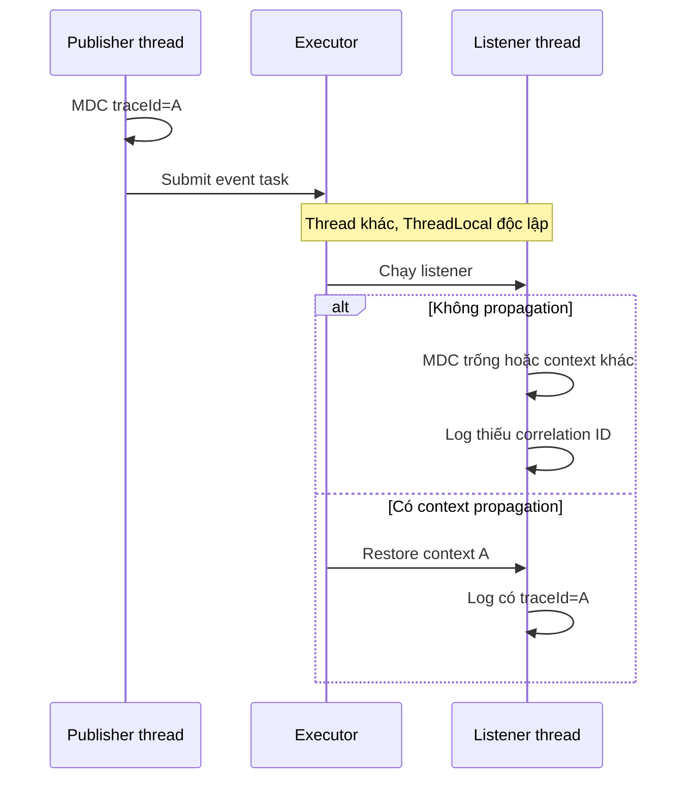

# Log synchronous và event asynchronous

## 1. Vì sao log thay đổi khi chuyển event sang asynchronous?

Một ứng dụng Spring Boot dùng **Spring Modulith** có thể chia thành các application module như **ordering**, **inventory** và **notification**. Khi đơn hàng được xác nhận, module ordering công bố event **OrderPlaced** để các module liên quan xử lý.

Có hai kiểu luồng phổ biến:

- **Synchronous event:** listener được gọi ngay trong luồng publish. Publisher và listener thường ghi log trên cùng thread, theo thứ tự thực thi của lời gọi.
- **Asynchronous event:** publisher gửi event để listener xử lý ở thread/executor khác. Publisher có thể tiếp tục hoặc hoàn tất request trước khi listener ghi log. Log giữa các module có thể xen kẽ và không còn theo thứ tự tuyến tính.

Vì vậy, khi đổi listener từ đồng bộ sang bất đồng bộ, việc đọc log cũng phải thay đổi. Không thể chỉ nhìn thứ tự dòng log để kết luận event đã hoàn tất, cũng không thể giả định MDC hoặc trace ID luôn tự đi theo sang thread khác.

**Mục tiêu bài học:** phân biệt log của publisher và listener, hiểu thời điểm xử lý của **@EventListener**, **@TransactionalEventListener** và **@ApplicationModuleListener**, thiết kế log có thể tương quan bằng event ID/trace ID, đồng thời biết cách giữ correlation context qua executor.

> **Phân biệt quan trọng:** log ứng dụng (SLF4J/Logback) là bản ghi thông điệp do code phát ra; Event Publication Registry của Spring Modulith là **log trạng thái publication được lưu trữ bền vững**. Hai cơ chế hỗ trợ nhau nhưng không thay thế nhau.

## 2. Synchronous event: publisher và listener chạy cùng luồng

### 2.1. Mặc định của Spring application events

Khi gọi phương thức **ApplicationEventPublisher.publishEvent(...)**, Spring gửi event đến các listener đã đăng ký. **Mặc định**, event publication và xử lý **@EventListener** diễn ra đồng bộ trên thread gọi publisher. Do đó:

1. Publisher bắt đầu ghi log.
2. Publisher gọi publishEvent(...).
3. Listener được gọi ngay trong quá trình publish.
4. Listener ghi log và trả về.
5. publishEvent(...) trả về, publisher tiếp tục ghi log.

Đây là hành vi mặc định. Nếu ứng dụng cấu hình một **ApplicationEventMulticaster** dùng executor, hoặc listener được đánh dấu async, event processing có thể chạy trên thread khác; khi đó cần kiểm tra executor và context propagation.

Một event minh họa:

```java
package com.example.shop.ordering;

public record OrderPlaced(String eventId, String orderId) {
}
```

Publisher:

```java
package com.example.shop.ordering;

import java.util.UUID;

import org.slf4j.Logger;
import org.slf4j.LoggerFactory;
import org.springframework.context.ApplicationEventPublisher;
import org.springframework.stereotype.Service;
import org.springframework.transaction.annotation.Transactional;

@Service
class OrderManagement {

    private static final Logger log =
            LoggerFactory.getLogger(OrderManagement.class);

    private final ApplicationEventPublisher events;

    OrderManagement(ApplicationEventPublisher events) {
        this.events = events;
    }

    @Transactional
    public void placeOrder(String orderId) {
        String eventId = UUID.randomUUID().toString();
        OrderPlaced event = new OrderPlaced(eventId, orderId);

        log.info("order.accepted eventId={} orderId={}", eventId, orderId);
        events.publishEvent(event);
        log.info("order.publish-returned eventId={}", eventId);
    }
}
```

Listener đồng bộ:

```java
package com.example.shop.inventory;

import org.slf4j.Logger;
import org.slf4j.LoggerFactory;
import org.springframework.context.event.EventListener;
import org.springframework.stereotype.Component;

import com.example.shop.ordering.OrderPlaced;

@Component
class InventoryManagement {

    private static final Logger log =
            LoggerFactory.getLogger(InventoryManagement.class);

    @EventListener
    void on(OrderPlaced event) {
        log.info("inventory.event-received eventId={} orderId={}",
                event.eventId(), event.orderId());

        // Xử lý giữ hàng đồng bộ.

        log.info("inventory.event-handled eventId={}", event.eventId());
    }
}
```

Log minh họa có thể xuất hiện theo thứ tự:

```text
order.accepted eventId=evt-101 orderId=ord-501
inventory.event-received eventId=evt-101 orderId=ord-501
inventory.event-handled eventId=evt-101
order.publish-returned eventId=evt-101
```

Các dòng này cùng thuộc một call stack đồng bộ. Nếu listener ném exception không được xử lý, exception có thể truyền ngược qua publishEvent(...) và ảnh hưởng luồng publisher.

### 2.2. Ý nghĩa của log trong luồng đồng bộ

| Log point | Có thể kết luận gì? |
| --- | --- |
| order.accepted | Publisher đã bắt đầu xử lý yêu cầu |
| inventory.event-received | Listener đã được gọi |
| inventory.event-handled | Code listener đã chạy đến điểm ghi log này |
| order.publish-returned | Lời gọi publish đã trả về; với listener đồng bộ thông thường, listener đã kết thúc trước đó |

Thông điệp publish-returned **không phải** bằng chứng về trạng thái bền vững của event publication. Nó chỉ phản ánh lời gọi publish đã hoàn tất theo semantics của Spring event multicaster đang dùng.

### 2.3. Trường hợp @TransactionalEventListener

**@TransactionalEventListener** mặc định gắn listener vào phase **AFTER_COMMIT**. Nếu không thêm **@Async**, listener vẫn xử lý đồng bộ ở thời điểm transaction completion; log thường xuất hiện trong thread hoàn tất transaction.

Event phải được publish trong một transaction đang hoạt động để listener chạy ở phase này. Ví dụ publisher ở mục 2.1 đã dùng @Transactional. Nếu không có transaction, listener mặc định không được gọi trừ khi bật fallbackExecution.

Ví dụ:

```java
package com.example.shop.inventory;

import org.slf4j.Logger;
import org.slf4j.LoggerFactory;
import org.springframework.transaction.event.TransactionalEventListener;
import org.springframework.stereotype.Component;

import com.example.shop.ordering.OrderPlaced;

@Component
class InventoryManagement {

    private static final Logger log =
            LoggerFactory.getLogger(InventoryManagement.class);

    @TransactionalEventListener
    void on(OrderPlaced event) {
        log.info("inventory.after-commit eventId={}", event.eventId());
    }
}
```

Khác biệt cần nhớ:

- **@EventListener:** xử lý ngay khi event được dispatch.
- **@TransactionalEventListener:** xử lý theo transaction phase, mặc định AFTER_COMMIT; nếu không có transaction thì mặc định không thực thi, trừ khi bật fallbackExecution.
- **@TransactionalEventListener** không tự động có nghĩa là asynchronous. Muốn chạy ở thread khác cần cấu hình async riêng.

Với transaction được quản lý bởi Spring, callback AFTER_COMMIT thường chạy trong thread hoàn tất transaction. Do đó, MDC/ThreadLocal hiện hành vẫn có thể được nhìn thấy trong listener đồng bộ này.

## 3. Asynchronous event: publisher và listener có vòng đời log riêng

### 3.1. @ApplicationModuleListener của Spring Modulith

Spring Modulith cung cấp **@ApplicationModuleListener** cho integration listener giữa các application module. Annotation này kết hợp:

- **@Async:** thực thi listener thông qua Spring task executor.
- **@TransactionalEventListener:** gắn xử lý với transaction phase.
- **@Transactional(propagation = REQUIRES_NEW):** listener chạy trong transaction riêng.

Vì vậy, listener thường được kích hoạt sau khi transaction publish event commit thành công, sau đó thực thi ở thread executor và transaction riêng. Điều này giúp tách phần xử lý phụ khỏi transaction nghiệp vụ ban đầu.

Ở đây, asynchronous nói về **cách listener được thực thi trong cùng ứng dụng**, không có nghĩa event đã được gửi qua Kafka/RabbitMQ hoặc một broker bên ngoài. Nếu cần giao tiếp qua tiến trình khác, phải có cơ chế messaging riêng.

Ví dụ:

```java
package com.example.shop.inventory;

import org.slf4j.Logger;
import org.slf4j.LoggerFactory;
import org.springframework.modulith.events.ApplicationModuleListener;
import org.springframework.stereotype.Component;

import com.example.shop.ordering.OrderPlaced;

@Component
class InventoryManagement {

    private static final Logger log =
            LoggerFactory.getLogger(InventoryManagement.class);

    @ApplicationModuleListener
    void on(OrderPlaced event) {
        log.info("inventory.async-started eventId={} orderId={}",
                event.eventId(), event.orderId());

        try {
            // Xử lý giữ hàng trong transaction riêng.
            reserve(event.orderId());

            log.info("inventory.async-completed eventId={}", event.eventId());
        } catch (RuntimeException exception) {
            log.error("inventory.async-failed eventId={} orderId={}",
                    event.eventId(), event.orderId(), exception);
            throw exception;
        }
    }

    private void reserve(String orderId) {
        // Gọi repository hoặc domain service để giữ hàng.
    }
}
```

**Hãy để exception đi ra khỏi listener nếu muốn publication được đánh dấu thất bại.** Nếu catch rồi nuốt exception, framework có thể coi listener đã trả về bình thường; Event Publication Registry không thể suy ra lỗi đã bị code che đi.

### 3.2. Thứ tự log không còn tuyến tính

Publisher có thể ghi log sau khi publish/commit, trong khi listener đã được đưa vào executor. Listener có thể bắt đầu gần như ngay lập tức hoặc sau một khoảng chờ. Vì vậy, không có một thứ tự tổng thể cố định giữa log publisher và log listener.

Một lần chạy có thể trông như:

```text
order.accepted eventId=evt-101 orderId=ord-501
order.publish-returned eventId=evt-101
inventory.async-started eventId=evt-101 orderId=ord-501
inventory.async-completed eventId=evt-101
```

Một lần chạy khác có thể thấy listener bắt đầu trước khi publisher ghi log tiếp theo, tùy thời điểm commit và executor scheduling:

```text
order.accepted eventId=evt-102 orderId=ord-502
inventory.async-started eventId=evt-102 orderId=ord-502
order.publish-returned eventId=evt-102
inventory.async-completed eventId=evt-102
```

Đây là hai lịch thực thi minh họa. **Không dùng thứ tự dòng log để kết luận quan hệ nhân quả** trong hệ thống bất đồng bộ; hãy dùng eventId, traceId, timestamp và publication status.

### 3.3. So sánh nhanh

| Tiêu chí | Synchronous @EventListener | Asynchronous @ApplicationModuleListener |
| --- | --- | --- |
| Thread | Thường là thread publisher | Thread executor |
| Thời điểm xử lý | Trong lúc dispatch event | Sau transaction phase phù hợp, qua async executor |
| Transaction | Thường tham gia luồng gọi hiện tại nếu không có thiết lập riêng | Transaction riêng REQUIRES_NEW theo mặc định |
| Publisher có chờ listener hoàn tất? | Có | Không |
| Thứ tự log | Có thể đọc theo call flow | Có thể xen kẽ giữa các thread |
| Exception listener | Có thể truyền về publisher | Không truyền đồng bộ về caller; cần theo dõi listener/registry |
| Correlation context | Thường cùng thread nên MDC/ThreadLocal còn hiện diện | Cần xác minh propagation qua executor |
| Khả năng mất event khi listener lỗi/crash | Nằm trong cùng luồng/transaction tùy thiết kế | Nên dùng Event Publication Registry để lưu và phục hồi publication |

## 4. Ba loại “log” không được nhầm lẫn

Trong ứng dụng có event asynchronous, từ “log” có thể chỉ ba thứ:

| Loại | Ví dụ | Dùng để trả lời |
| --- | --- | --- |
| **Application log** | SLF4J/Logback log.info(...), log.error(...) | Code đã ghi nhận bước nào, lỗi gì, ở module nào? |
| **Event Publication Registry** | Bản ghi publication cho từng transactional listener | Publication đang chờ, đang xử lý, hoàn tất hay thất bại? |
| **Trace/span** | Module entry span, listener span, HTTP span | Một luồng thực thi đi qua đâu, thời lượng và quan hệ cha-con thế nào? |

Spring Modulith Event Publication Registry tích hợp vào cơ chế transactional event listener. Khi event được publish, registry ghi các publication entries trong transaction nghiệp vụ gốc; listener được bao quanh để đánh dấu completion khi xử lý thành công. Khi listener thất bại, entry vẫn còn để cơ chế recovery có thể xem xét.

Trong các phiên bản Spring Modulith mới, lifecycle publication còn phân biệt các trạng thái như PUBLISHED, PROCESSING, COMPLETED, FAILED và các trạng thái resubmission/abandonment tùy phiên bản. Các trạng thái này là **dữ liệu publication được quản lý**, không phải dòng text trong Logback.

### 4.1. Vì sao application log không thay thế publication registry?

Giả sử listener ghi:

```text
inventory.async-started eventId=evt-101
```

Sau đó process bị dừng đột ngột trước khi ghi inventory.async-completed. Chỉ từ hai dòng application log, ta không biết listener đã:

- Chưa bắt đầu xử lý.
- Đã xử lý một phần rồi crash.
- Đã commit dữ liệu nhưng crash trước khi ghi log cuối.
- Đã thất bại và cần retry.

Publication registry có thể lưu trạng thái theo transactional lifecycle và hỗ trợ recovery. Application log cung cấp ngữ cảnh chẩn đoán chi tiết. **Cần dùng cả hai khi yêu cầu vận hành đòi hỏi biết cả trạng thái lẫn nguyên nhân.**

### 4.2. Dùng Event Publication Registry

Spring Modulith khuyến nghị dùng Event Publication Registry cùng các integration listeners như **@ApplicationModuleListener** để publication không bị mất khi ứng dụng hoặc listener gặp lỗi.

Các starter persistence phổ biến gồm JDBC, JPA và MongoDB. Ví dụ với JDBC, ứng dụng thêm starter tương ứng theo dependency management Spring Modulith:

```kotlin
dependencies {
    runtimeOnly("org.springframework.modulith:spring-modulith-starter-jdbc")
}
```

Đây là ví dụ dependency; cần có datasource và transaction manager phù hợp. Không dùng starter persistence chỉ để thay thế SLF4J logging.

Khi listener ném exception, registry có thể giữ publication ở trạng thái chưa hoàn tất/failed theo phiên bản và cấu hình. Nhóm vận hành có thể kiểm tra publication, quyết định resubmit hoặc xử lý thủ công theo chính sách. **Đừng tự retry bằng cách publish một event mới** nếu chưa xem trạng thái publication cũ, vì có thể tạo xử lý trùng.

## 5. Thiết kế log có thể tương quan giữa modules

### 5.1. Luôn ghi một correlation key ổn định

Đối với event asynchronous, nên có một mã định danh ổn định xuyên publisher và listener, ví dụ **eventId**. Nếu event được phát sinh từ một nghiệp vụ có ID an toàn để log, có thể ghi thêm **orderId** hoặc mã tham chiếu tương ứng theo chính sách dữ liệu.

Một bộ field hữu ích:

| Field | Mục đích |
| --- | --- |
| eventId | Tương quan cùng một publication qua nhiều module |
| eventType | Nhận biết loại event |
| module | Xác định module phát log |
| listener | Xác định handler đang xử lý |
| phase | published, started, completed, failed |
| attempt | Lần xử lý/resubmission nếu ứng dụng có dữ liệu này |
| traceId / spanId | Liên hệ log với trace khi tracing context có mặt |
| durationMs | Thời gian xử lý của listener |

Không phải field nào cũng cần ghi trong mọi dòng log. Hãy chọn những field giúp truy vấn được luồng và tránh log toàn bộ event payload.

### 5.2. Ví dụ log publisher và listener

Publisher:

```java
log.info("event.published eventId={} eventType={} module={}",
        event.eventId(),
        event.getClass().getSimpleName(),
        "ordering");
```

Listener:

```java
long startedAt = System.nanoTime();
log.info("event.processing.started eventId={} eventType={} module={} listener={}",
        event.eventId(),
        event.getClass().getSimpleName(),
        "inventory",
        "InventoryManagement.on");

try {
    reserve(event.orderId());
    long durationMs = (System.nanoTime() - startedAt) / 1_000_000;
    log.info("event.processing.completed eventId={} module={} durationMs={}",
            event.eventId(), "inventory", durationMs);
} catch (RuntimeException exception) {
    log.error("event.processing.failed eventId={} module={}",
            event.eventId(), "inventory", exception);
    throw exception;
}
```

System.nanoTime() phù hợp đo elapsed duration trong cùng JVM; không dùng timestamp wall-clock để trừ thời gian thực thi vì đồng hồ hệ thống có thể thay đổi. Nếu cần duration chuẩn hóa cho observability, ưu tiên Micrometer Observation/Timer hoặc span thay vì tự tính ở mọi listener.

Log event.published nên được hiểu là publisher đã phát event vào Spring event mechanism. Với event gắn transaction, dòng log này chưa chứng minh transaction đã commit hoặc listener đã hoàn tất.

### 5.3. Không ghi toàn bộ payload

Event có thể chứa email, số điện thoại, địa chỉ, thông tin thanh toán hoặc dữ liệu khách hàng. Log toàn bộ payload có thể:

- Làm lộ thông tin cá nhân/bí mật trong hệ thống log.
- Tăng dung lượng và chi phí ingest.
- Làm truy vấn chậm, khó tìm lỗi thật.
- Gây khó khăn khi tuân thủ retention và quyền truy cập dữ liệu.

Chỉ log những field cần cho chẩn đoán. Dùng event ID hoặc mã tham chiếu đã được phê duyệt để truy ngược dữ liệu nghiệp vụ qua hệ thống có quyền truy cập phù hợp.

## 6. Correlation ID và MDC trong Spring Boot

### 6.1. Spring Boot tích hợp Micrometer Tracing

Khi ứng dụng dùng **Micrometer Tracing**, Spring Boot mặc định đưa **traceId** và **spanId** vào **MDC** để tạo correlation ID trong log. Ví dụ:

```text
[803B448A0489F84084905D3093480352-3425F23BB2432450]
INFO  [ordering] order.accepted eventId=evt-101
```

Giá trị trong ví dụ là minh họa. Correlation ID mặc định được tạo từ MDC traceId và spanId. Khi log có các ID này, ta có thể:

1. Tìm các dòng log cùng trace.
2. Mở trace tương ứng trong backend tracing.
3. Xem span của từng module để biết thời gian và quan hệ thực thi.
4. Đối chiếu với publication registry khi listener lỗi.

Nếu không có Micrometer Tracing hoặc không có active span, correlation ID có thể trống. Log vẫn được ghi bình thường.

### 6.2. Tùy chỉnh format correlation

Ví dụ application.yml với Logback:

```yaml
logging:
  pattern:
    correlation: "[%X{traceId:-},%X{spanId:-}] "
```

Spring Boot cũng cho phép đổi MDC key names qua:

```yaml
management:
  tracing:
    mdc:
      trace-id-key: traceId
      span-id-key: spanId
```

Chỉ thay key names khi có nhu cầu tương thích hệ thống log ingest. Nếu đổi, pattern correlation tùy chỉnh cần tham chiếu đúng key names.

### 6.3. Log đồng bộ và MDC

Trong synchronous event flow, listener mặc định chạy trên cùng thread. MDC/ThreadLocal của publisher vì thế thường vẫn có mặt trong listener. Điều này giúp log của publisher và listener dùng cùng trace ID, nhưng span ID có thể khác nếu có child span/observation được tạo.

Đừng mặc định mọi dòng log phải có cùng spanId; cùng trace ID là mối tương quan cấp trace, còn span ID nhận diện từng operation.

## 7. Vì sao log asynchronous có thể mất correlation ID?

MDC và nhiều tracing context dựa trên ThreadLocal. Khi listener được gửi sang thread pool:

- Thread xử lý listener có thể là thread khác với publisher.
- ThreadLocal không tự động được sao chép sang thread đó.
- MDC có thể rỗng hoặc chứa context của task trước nếu wrapper không restore đúng.
- Trace/span của listener có thể tách khỏi trace ban đầu.

Đây là lý do log async đôi khi không có correlation ID dù log publisher có đầy đủ.



## 8. Propagate logging/tracing context qua executor

### 8.1. Dùng ContextPropagatingTaskDecorator

Spring Framework cung cấp **ContextPropagatingTaskDecorator** để capture context khi task được submit và restore context trong lúc task chạy. Ví dụ cấu hình:

```java
package com.example.shop.config;

import org.springframework.context.annotation.Bean;
import org.springframework.context.annotation.Configuration;
import org.springframework.core.task.TaskExecutor;
import org.springframework.core.task.support.ContextPropagatingTaskDecorator;
import org.springframework.scheduling.annotation.EnableAsync;
import org.springframework.scheduling.concurrent.ThreadPoolTaskExecutor;

@Configuration(proxyBeanMethods = false)
@EnableAsync
class AsyncConfiguration {

    @Bean
    TaskExecutor applicationTaskExecutor() {
        ThreadPoolTaskExecutor executor = new ThreadPoolTaskExecutor();
        executor.setCorePoolSize(4);
        executor.setMaxPoolSize(8);
        executor.setQueueCapacity(100);
        executor.setThreadNamePrefix("module-event-");
        executor.setTaskDecorator(new ContextPropagatingTaskDecorator());
        return executor;
    }
}
```

Điều cần xác minh là **executor thực sự được @Async dùng**. Nếu ứng dụng có AsyncConfigurer, executor riêng hoặc cấu hình nhiều task executor, decorator phải được gắn đúng nơi. Chỉ khai báo một bean TaskDecorator không bảo đảm mọi executor đều tự sử dụng nó.

### 8.2. Cấu hình Spring Boot 4

Spring Boot 4 cung cấp property cho auto-configured task executor:

```yaml
spring:
  task:
    execution:
      propagate-context: true
```

Property này bật propagation context cho task executions qua executor do Spring Boot auto-configure. Nếu ứng dụng tự tạo executor hoặc dùng cấu hình async riêng, cần xác nhận executor đó có được áp dụng propagation hay không; có thể gắn ContextPropagatingTaskDecorator trực tiếp.

**Lưu ý phiên bản:** không copy property này vào Spring Boot 3.5 mà chưa kiểm tra reference của đúng phiên bản. Trong nhánh 3.5, có thể cấu hình decorator trực tiếp trên ThreadPoolTaskExecutor.

### 8.3. Với @ApplicationModuleListener

**@ApplicationModuleListener** có **@Async** nhưng không có thuộc tính executor qualifier riêng. Executor được chọn theo cơ chế async của Spring, ví dụ AsyncConfigurer hoặc executor mặc định phù hợp trong application context. Do đó:

1. Xác định executor mà async infrastructure đang chọn.
2. Đặt ContextPropagatingTaskDecorator trên executor đó, hoặc bật property Boot phù hợp nếu đang dùng auto-configured executor.
3. Tạo một event trong request có trace.
4. Kiểm tra log trong listener có cùng traceId với publisher.
5. Xác nhận task tiếp theo không bị rò MDC từ task trước.

Propagation giữ **observability context**, không chuyển transaction của publisher sang listener. @ApplicationModuleListener vẫn chạy transaction riêng theo semantics của annotation.

## 9. Ví dụ cấu hình log có cấu trúc

Khi log được gửi vào hệ thống tập trung, log có cấu trúc giúp lọc theo event, module, listener và kết quả. Spring Boot hỗ trợ structured logging ở các phiên bản có tính năng này.

Ví dụ bật định dạng Logstash JSON cho console:

```yaml
logging:
  structured:
    format:
      console: logstash
```

Các phiên bản Spring Boot khác nhau có thể hỗ trợ các định dạng structured logging và tùy chỉnh khác nhau. Khi cần JSON logs, kiểm tra tài liệu logging của đúng phiên bản ứng dụng.

Một bản ghi JSON minh họa:

```json
{
  "@timestamp": "2026-11-27T10:20:30.125Z",
  "level": "INFO",
  "logger_name": "com.example.shop.inventory.InventoryManagement",
  "message": "event.processing.completed",
  "eventId": "evt-101",
  "eventType": "OrderPlaced",
  "module": "inventory",
  "listener": "InventoryManagement.on",
  "traceId": "803B448A0489F84084905D3093480352",
  "durationMs": 18
}
```

Đây là ví dụ cấu trúc mong muốn, không phải output bảo đảm giống hệt mọi logging backend. Nếu dùng structured logging customizer hoặc key-value logging, cần xác nhận field names ở log thực tế.

## 10. Quy tắc log cho synchronous và asynchronous event

| Quy tắc | Synchronous flow | Asynchronous flow |
| --- | --- | --- |
| Ghi event được publish | Ghi tại publisher sau khi tạo event | Ghi tại publisher, không gọi là listener completed |
| Ghi listener start/end | Có thể đọc theo thứ tự call flow | Ghi rõ started và completed theo event ID |
| Log lỗi | Có thể nổi lên publisher | Ghi stack trace tại listener rồi ném lại exception |
| Correlation | MDC thường còn trên cùng thread | Cần context propagation qua executor |
| Thứ tự dòng log | Thường tuyến tính | Có thể xen kẽ, dùng timestamp và IDs |
| Xác nhận hoàn tất | Có thể dựa vào listener return trong luồng đồng bộ | Dựa vào listener result/publication status |
| Recovery | Theo transaction/call flow | Dùng Event Publication Registry và chính sách retry |

Một số nguyên tắc áp dụng cho cả hai:

- Dùng một eventId ổn định từ publisher đến listener.
- Log event type và module để tìm kiếm xuyên module.
- Không log toàn bộ payload hoặc dữ liệu nhạy cảm.
- Dùng WARN cho tình huống cần chú ý nhưng có thể phục hồi; ERROR cho lần xử lý thực sự thất bại.
- Đừng ghi cùng một stack trace ở nhiều tầng nếu không thêm ngữ cảnh mới.
- Không ghi log completed trước khi nghiệp vụ và transaction của listener thực sự hoàn tất.
- Không dùng application log làm bằng chứng duy nhất rằng publication đã được lưu hoặc listener đã commit.

## 11. Kiểm thử log đồng bộ và bất đồng bộ

### 11.1. Test synchronous listener

Với @EventListener, có thể publish event và xác minh listener được gọi trước khi phương thức publish tiếp tục. Dùng appender test hoặc spy để kiểm tra các thông điệp:

```text
order.accepted
inventory.event-received
inventory.event-handled
order.publish-returned
```

Thứ tự trên phù hợp với listener đồng bộ thông thường. Nếu listener dùng @TransactionalEventListener, hãy tính đến transaction phase như AFTER_COMMIT.

### 11.2. Test asynchronous listener

Với @ApplicationModuleListener, không kiểm tra thứ tự log bằng một list cứng. Thay vào đó:

1. Publish event trong transaction có commit.
2. Chờ listener hoàn tất bằng CountDownLatch, BlockingQueue hoặc Awaitility với timeout.
3. Xác minh log publisher có eventId.
4. Xác minh log listener started và completed có cùng eventId.
5. Nếu tracing được bật, xác minh traceId được propagation theo cấu hình.
6. Nếu listener lỗi, xác minh có log failed và exception được ném ra để publication registry nhận biết.

Không dùng Thread.sleep() để đoán listener đã chạy. Chờ theo tín hiệu hoàn tất giúp test ổn định hơn.

### 11.3. Test context không bị rò qua thread pool

Cho hai task chạy lần lượt trên cùng executor:

- Task A có trace ID A.
- Task B có trace ID B.

Xác nhận log task B có trace ID B, không mang trace ID A. Đây là kiểm tra quan trọng vì thread pool tái sử dụng worker threads.

## 12. Các lỗi thường gặp

| Hiện tượng | Nguyên nhân có thể | Cách xử lý |
| --- | --- | --- |
| Log listener xuất hiện trước log publish-returned | Listener chạy async và executor bắt đầu task rất nhanh | Không dựa vào thứ tự log; tương quan bằng event ID và trace ID |
| Log listener không có trace ID | Executor không propagate context hoặc không có tracing handler | Kiểm tra ContextPropagatingTaskDecorator, Boot property và tracer |
| Log listener có trace ID nhưng trace tree thiếu span | Logging context được truyền nhưng span instrumentation/exporter chưa đúng | Kiểm tra Micrometer Tracing, module instrumentation và exporter |
| Publisher log published nhưng listener thất bại | Publish thành công không có nghĩa listener hoàn tất | Xem log listener và Event Publication Registry |
| Listener lỗi nhưng registry báo completed | Code bắt exception rồi nuốt, listener trả về bình thường | Log lỗi rồi ném exception tiếp để registry đánh dấu thất bại |
| Không có log listener | Listener không được kích hoạt, transaction chưa commit, hoặc async executor lỗi | Kiểm tra event type, transaction phase, listener bean và executor |
| Listener @TransactionalEventListener không chạy khi không có transaction | Mặc định listener yêu cầu transaction | Publish trong transaction hoặc cân nhắc fallbackExecution nếu semantics cho phép |
| MDC task mới mang trace ID task cũ | Context scope không được restore/clear đúng | Kiểm tra decorator và test thread reuse |
| Log quá nhiều dữ liệu event | Ghi toàn payload trong mỗi module | Chỉ log ID và metadata cần thiết; áp dụng chính sách bảo vệ dữ liệu |
| Có nhiều log stack trace giống nhau | Publisher, listener và tầng trên cùng đều log cùng exception | Chọn một tầng ghi stack trace, tầng khác bổ sung ngữ cảnh ngắn |
| Có log completed nhưng dữ liệu chưa commit | Ghi log trước khi transaction kết thúc hoặc dùng sai phase | Đặt log sau thao tác nghiệp vụ phù hợp và dựa vào publication status |

## 13. Bài tập tự kiểm tra

**Bài tập 1.** @EventListener đồng bộ xử lý event. Publisher ghi before publish, listener ghi handled, rồi publisher ghi after publish. Thứ tự mong đợi là gì?

**Gợi ý:** before publish → handled → after publish, vì listener mặc định chạy ngay trong quá trình dispatch trên cùng thread.

**Bài tập 2.** Listener đổi sang @ApplicationModuleListener. Có thể khẳng định log handled luôn đứng sau after publish không?

**Gợi ý:** Không. Listener chạy async sau transaction phase phù hợp; log có thể xen kẽ tùy lịch executor.

**Bài tập 3.** Log publisher có traceId, listener async không có. Nên kiểm tra gì?

**Gợi ý:** Executor thực tế, ContextPropagatingTaskDecorator, property Boot phù hợp phiên bản và tracing integration. Cùng thread không phải yêu cầu; điều cần giữ là context đã capture/restore đúng.

**Bài tập 4.** Listener ghi log failed rồi catch exception mà không ném lại. Registry có biết listener thất bại không?

**Gợi ý:** Không nhất thiết. Nếu listener trả về bình thường, interceptor có thể đánh dấu publication hoàn tất. Ném exception ra ngoài sau khi log để framework nhận biết lỗi.

**Bài tập 5.** Log order.publish-returned xuất hiện. Có thể kết luận inventory đã commit giữ hàng không?

**Gợi ý:** Không với asynchronous listener. Cần kiểm tra publication completion hoặc trạng thái nghiệp vụ ở module inventory.

## 14. Tổng kết

Log trong luồng synchronous và asynchronous phản ánh hai mô hình thực thi khác nhau:

- **Synchronous event:** listener thường chạy ngay trong thread publisher; log có thể đọc theo thứ tự call flow và exception có thể ảnh hưởng trực tiếp publisher.
- **Asynchronous event:** listener chạy trên executor, thường sau transaction commit với @ApplicationModuleListener; log có thể xen kẽ và publisher không chờ listener hoàn tất.
- **Correlation:** eventId giúp nối các dòng log cùng publication; Micrometer Tracing cung cấp traceId/spanId trong MDC khi tracing được bật.
- **Context propagation:** cần cấu hình executor phù hợp để giữ MDC/tracing context khi chuyển thread.
- **Độ tin cậy:** application log giúp điều tra; Event Publication Registry lưu trạng thái publication và hỗ trợ phục hồi; trace cho biết hành trình thực thi.

Khi kết hợp đúng các cơ chế này, đội phát triển có thể theo dõi event qua ordering, inventory và notification, hiểu rõ listener đã bắt đầu hay hoàn tất, đồng thời liên kết log với module spans mà không phụ thuộc vào thứ tự dòng log.

### Tài liệu tham khảo

- [Spring Modulith — Working with Application Events](https://docs.spring.io/spring-modulith/reference/events.html): synchronous event publication, asynchronous transactional listener và Event Publication Registry.
- [Spring Modulith — ApplicationModuleListener API](https://docs.spring.io/spring-modulith/docs/current/api/org/springframework/modulith/events/ApplicationModuleListener.html): meta-annotations @Async, @TransactionalEventListener, REQUIRES_NEW và khuyến nghị dùng registry.
- [Spring Framework — Observability Support, Application Events](https://docs.spring.io/spring-framework/reference/integration/observability.html): event listener mặc định synchronous và context propagation khi chuyển thread.
- [Spring Framework — Task Execution and Scheduling](https://docs.spring.io/spring-framework/reference/integration/scheduling.html): TaskExecutor, @Async và TaskDecorator.
- [Spring Boot — Tracing, Logging Correlation IDs](https://docs.spring.io/spring-boot/reference/actuator/tracing.html): traceId, spanId, MDC và logging.pattern.correlation.
- [Spring Boot — Logging](https://docs.spring.io/spring-boot/reference/features/logging.html): logging levels, structured logging và JSON customization.
- [Spring Boot 4.0 — Common Application Properties](https://docs.spring.io/spring-boot/4.0/appendix/application-properties.html): spring.task.execution.propagate-context.
